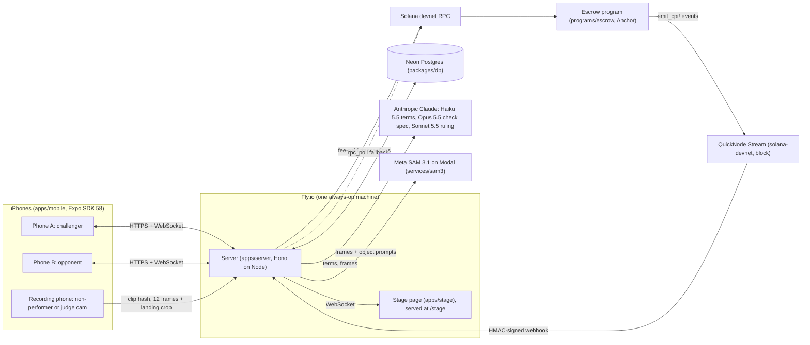

# You're On

**Bet your friends on anything you can film. AI judges the video, a Solana escrow pays the winner
in USDC, and nobody sees any crypto.**

Every friend group has a bet that never got paid. You're On is an iPhone app that makes the
handshake enforceable. Point your phone at a friend, say _"Jarvis, I bet him $5 he can't land a
bottle flip,"_ and both of you confirm with Face ID. Both stakes lock into a Solana escrow in one
transaction, a phone films the attempt, and AI judges rule on frames from the clip. The loser swipes
GG, or the appeal window runs out, and the winner is paid. Back up the trash talk with receipts.

|                   |                                                                                                                                                                                                                                                    |
| ----------------- | -------------------------------------------------------------------------------------------------------------------------------------------------------------------------------------------------------------------------------------------------- |
| Escrow program    | [`BL3gwTBcftGQFdPNp7rZiAyDojkSusdAJ2dzNvFouwcp`](https://explorer.solana.com/address/BL3gwTBcftGQFdPNp7rZiAyDojkSusdAJ2dzNvFouwcp?cluster=devnet)                                                                                                  |
| Live server       | https://youre-on.fly.dev (Solana devnet)                                                                                                                                                                                                           |
| Stage (projector) | https://youre-on.fly.dev/stage/ (needs a room code and stage key, see [`docs/runbook.md`](docs/runbook.md))                                                                                                                                        |
| Built with        | Solana (Anchor, SPL Token / USDC, durable nonces), QuickNode Streams, Anthropic Claude, Meta SAM 3.1 on Modal, Apple Vision, Apple Speech, InsightFace MobileFaceNet, Expo / React Native, Node.js / Hono, PostgreSQL (Neon), Fly.io, Vite + React |

Built at UBC 2026.

## Contents

- [How a bet works](#how-a-bet-works)
- [What makes it different](#what-makes-it-different)
- [Architecture](#architecture)
- [The escrow on Solana](#the-escrow-on-solana)
- [The AI judge](#the-ai-judge)
- [Dance Off](#dance-off)
- [On-chain events with QuickNode Streams](#on-chain-events-with-quicknode-streams)
- [Faces and privacy](#faces-and-privacy)
- [Status, honestly](#status-honestly)
- [Run it yourself](#run-it-yourself)
- [Repo layout](#repo-layout)

## How a bet works

1. **Challenge by face.** Take a photo of your friend. The phone turns their face into an embedding
   on the device, and the server matches it only against opted-in people in the same room. Their
   phone gets the invite. A face match only addresses the challenge; it never authorizes anything.
2. **Say the bet.** "Jarvis, …" is heard on the phone by Apple's on-device speech recognizer. The
   sentence goes to the server, where Claude Haiku 5.5 turns it into exact terms: who performs,
   what counts as a win and the edge cases (the phone reads the stake from the sentence). Both
   phones show the same terms card, and
   the server hashes those terms (SHA-256 of canonical JSON).
3. **Lock it in.** Each person swipes up and passes Face ID on their own phone. Both signatures go
   into one Solana transaction, so both stakes move into escrow together, or nothing moves.
4. **The attempt.** The non-performer's phone (or a third "judge cam" phone) films it. Claude
   Sonnet 5.5 and Meta SAM 3.1 judge frames from the clip in parallel. The judge key commits the
   ruling on chain, with the clip's hash and the hashes of the exact frames the judges saw.
5. **Settle.** The loser swipes GG and the winner is paid at once, or the appeal window closes (20 s on
   devnet) and the program pays the ruling. The loser can instead tap "I appeal!" to send the same
   frames to a blind appeal panel.

Other features: **Dance Off** (scored on the phone with Apple Vision body pose), **odds** (unequal
stakes up to 10:1, with a "suggest odds" that the code computes from your record), **double or
nothing**, **call it off** (both agree and both are refunded), and a shared **lobby**, so scanning
anyone who has the app open challenges them directly.

## What makes it different

- **Nothing moves until both of you agree, and then both stakes move in one transaction.** The
  lock is one durable-nonce transaction with three signatures from two phones and our fee payer.
- **The AI decides who won, never where the money goes.** The program pays out only to the two
  players. There is no admin withdrawal, and every live state has an exit that anyone can trigger
  after its deadline, so funds can't get stuck even if our server goes down.
- **A language model can't say "they made it" on its own.** For a throw, SAM 3.1's track decides
  whether it went in. For other camera bets, a "made it" call only stands if SAM's checks back it
  up; otherwise it's a redo.
- **Invisible crypto.** No wallet setup, seed phrase or SOL. The server pays every fee and fronts
  the rent, which comes back when the bet closes. Balances show in dollars.

## Architecture



| Part           | Path              | What it is                                                                                                                                                                                   |
| -------------- | ----------------- | -------------------------------------------------------------------------------------------------------------------------------------------------------------------------------------------- |
| iPhone app     | `apps/mobile`     | Expo SDK 58 / React Native 0.88, iOS (iPhone and iPad). Two custom Swift Expo modules: `modules/wake-word` ("Jarvis") and `modules/dance-pose` (Vision body pose).                           |
| Server         | `apps/server`     | Hono on Node. Auth, rooms, bets, WebSocket hub, terms, judge pipeline, lock service and nonce pool, payouts, appeals, QuickNode receiver, keeper sweeps.                                     |
| Stage          | `apps/stage`      | Vite + React page for the projector: the live bet, the ruling, mirrored phones and an on-chain ticker with Explorer links.                                                                   |
| Shared         | `packages/shared` | The contract all four parts share: zod schemas, canonical JSON (JCS) hashing, the escrow IDL and Codama `@solana/kit` client, the lock builder, the device signing policy, the dance scorer. |
| Database       | `packages/db`     | Drizzle schema and SQL migrations 0000–0009.                                                                                                                                                 |
| Escrow         | `programs/escrow` | Anchor 1.2.2 program, 12 instructions, Rust LiteSVM test matrix.                                                                                                                             |
| SAM 3.1        | `services/sam3`   | Modal app serving `facebook/sam3.1` on an A10G / L4 GPU behind a bearer token.                                                                                                               |
| Streams filter | `infra/quicknode` | The Stream's JavaScript filter (generated from the IDL), the Stream config and fixtures.                                                                                                     |

**Two lanes, one rule.** The server polls the status of every transaction it sends, so the phones
update right away. The program's events, delivered by the QuickNode Stream, are folded into the
database's on-chain record, drive the stage ticker, and catch any confirmation the server missed.
If the two ever disagree, the chain wins. Full design:
[`docs/planning/ARCHITECTURE.md`](docs/planning/ARCHITECTURE.md).

## The escrow on Solana

The program, not our server, decides where money can go.

| Account                                 | Address                                                                                                                                           |
| --------------------------------------- | ------------------------------------------------------------------------------------------------------------------------------------------------- |
| Escrow program                          | [`BL3gwTBcftGQFdPNp7rZiAyDojkSusdAJ2dzNvFouwcp`](https://explorer.solana.com/address/BL3gwTBcftGQFdPNp7rZiAyDojkSusdAJ2dzNvFouwcp?cluster=devnet) |
| Config PDA `["config"]`                 | [`FYF8BZaszwttYxSsnXXdtf75YQUhAMwYDNK73eNzDoz`](https://explorer.solana.com/address/FYF8BZaszwttYxSsnXXdtf75YQUhAMwYDNK73eNzDoz?cluster=devnet)   |
| Event authority `["__event_authority"]` | `2R3N7HdDrqP4nteeBL88v7EESXabbcrLCPasi88F5i7m` (signs every `emit_cpi!` event)                                                                    |
| USDC mint (Circle devnet)               | `4zMMC9srt5Ri5X14GAgXhaHii3GnPAEERYPJgZJDncDU`                                                                                                    |
| Fee payer and nonce authority           | `ADEMopwqe6cVs9cEyMSbK1pGsJgnyBc3zkC3Wsqf9pQ8` (pinned in the app; phones refuse any other)                                                       |

Live Config: $20 maximum stake per side, a 20 s appeal window, up to 600 s to accept, 3,600 s to
rule, and 300 s to settle an appeal. Each bet copies its deadlines and its judge and appeal keys
when it is created, so a config change never touches a live bet.

### Instructions

| Instruction                          | Signed by                                                       | What it does                                                                                                 |
| ------------------------------------ | --------------------------------------------------------------- | ------------------------------------------------------------------------------------------------------------ |
| `initialize_config`, `update_config` | the upgrade authority, then the admin                           | Judge and appeal keys, stake cap, deadlines, allowed mints, pause.                                           |
| `create_bet`                         | A + fee payer                                                   | Open: A's stake into the vault, with B, both stakes, the terms hash and the accept deadline.                 |
| `accept_bet`                         | B + fee payer                                                   | Open → Locked: B's stake. Fails unless B passes the same terms hash, both stakes and A's key.                |
| `cancel_open_bet`                    | A, B or the judge key                                           | Open → Cancelled: refunds A.                                                                                 |
| `resolve`                            | the bet's judge key                                             | Locked → Resolved: outcome (A, B, split or refund) plus evidence and ruling hashes; opens the appeal window. |
| `concede`                            | the loser                                                       | Resolved → Settled: GG, pays out at once.                                                                    |
| `appeal`                             | the loser (either side on a split or refund), inside the window | Resolved → Appealed: freezes the payout for the appeal key.                                                  |
| `resolve_appeal`                     | the bet's appeal key                                            | Appealed → Settled: the final outcome plus an appeal ruling hash.                                            |
| `finalize`                           | anyone, after the appeal window                                 | Resolved → Settled: pays the ruling.                                                                         |
| `timeout_refund`                     | anyone, after that state's deadline                             | Open, Locked or Appealed → Refunded: every stake goes back to whoever put it in.                             |
| `close_bet`                          | anyone                                                          | Closes a finished bet and returns the rent to the fee payer.                                                 |

### Why the money is safe

- **One payout path.** Each bet is a `Bet` PDA (`["bet", bet_id]`) that owns a USDC vault PDA
  (`["vault", bet_id]`). Every way a bet can end pays through one `transfer_checked` path, signed
  by the Bet PDA, to token accounts owned by the two players and no one else. The judge key picks
  an outcome, never a destination.
- **Always an exit.** There is no admin withdrawal. Every live state has an instruction anyone can
  send after its deadline (`timeout_refund` or `finalize`), and pausing only blocks creating and
  accepting bets, never an exit. The server's keeper sends these itself, and `scripts/crank.ts` lets anyone else.
- **Terms on chain.** The program stores `sha256(JCS(terms))`, and `accept_bet` checks that B
  agreed to exactly those terms. The ruling hash commits to the SHA-256 of every frame the model
  saw, and the evidence hash is the recording phone's SHA-256 of the whole clip.
- **Mint checks.** Only allowlisted mints with 6 decimals (today, devnet USDC only). Token-2022
  mints may carry no extensions except metadata, so tricks like a closable mint are refused.
- **Events can't be forged.** Every state change emits one Anchor event with `emit_cpi!`, as an
  inner instruction signed by the program's event-authority PDA (12 event types).

### The atomic lock

When both people have seen the same terms card, the server builds one v0 transaction on a durable
nonce leased from a pool of five:

```
[AdvanceNonceAccount, SetComputeUnitLimit, create_bet, accept_bet]
```

It needs three signers: A, B and the fee payer, which is also the nonce authority.

- **Phones check before they sign.** Each phone decodes the exact message bytes and runs the device
  signing policy ([`packages/shared/src/device-policy.ts`](packages/shared/src/device-policy.ts))
  before Face ID is ever asked. The policy checks the program ID, mint, fee payer, signer set,
  instruction order, nonce account, the PDAs (re-derived on the phone), the stakes, and the terms
  hash, which it recomputes from the card it showed.
- **Signing.** The phone signs with an ed25519 key it generated itself, kept in the iOS Keychain
  (this device only, never backed up), and only after Face ID (or the device passcode, if Face ID
  is unavailable). There is no seed phrase.
- **One submission.** The server checks each signature against the stored bytes. When the second
  one arrives, it co-signs as fee payer and submits once, with preflight on.
- **No expiry while people decide.** A durable nonce does not expire the way a blockhash does; the
  program's accept deadline bounds the bet instead. A decline or a timeout advances the nonce, so
  the collected signatures become useless.

A live lock on devnet is 989 bytes (of 1,232), uses 46,640 compute units and costs 15,000 lamports,
all paid by the server. From the second confirm to LOCKED took 4.0–4.6 s on devnet
([`docs/measurements.md`](docs/measurements.md)).

**Sample transactions (devnet):**
[atomic lock](https://explorer.solana.com/tx/3Dq7rQ9h1b1PdVEwfEsQzqT9C2Lc9GXz73zWbqG4eysTJ1bj3CTJyK3E5A4dDfYkKBoLAHWzQmFT51GwmXrHgU9q?cluster=devnet)
·
[resolve](https://explorer.solana.com/tx/4LLGESFAjhRXZ79AgcCBvUuxB4fp91iduMRfshCRR1vAyHy1J637kkBUQBiwybJUgJ2vEx8EvNrCdFkbcTsKVvft?cluster=devnet)
·
[finalize + close](https://explorer.solana.com/tx/3AzeFcB97yfdUWDeM4VCodbb7n8ktgo6MHkkxgJU27dt2vC9c53uscZdA85ZMgppc8fzEdfPncNaWrbPdGKUhUFg?cluster=devnet)
·
[timeout refund + close](https://explorer.solana.com/tx/2dvcUpmFNiE76aRqRoGCUKrLTAYywAfFSkuZnkEQKP6CVyTVYnHMj53HXa2egLnY42U7sQqhgoLq5WqFC2JxmXzx?cluster=devnet)

### Reproducible build

The deployed program is the build of this repo's source:

```sh
cd programs/escrow
cargo build-sbf --arch v3 --tools-version v1.57 \
  --manifest-path programs/escrow/Cargo.toml --sbf-out-dir /tmp/yo-escrow
shasum -a 256 /tmp/yo-escrow/escrow.so
# 826f0874b350743c8f6fcd99f2bd57bc472b618e8a5846593fb26e9843b9e67a  (446,552 bytes)

solana program dump --url devnet BL3gwTBcftGQFdPNp7rZiAyDojkSusdAJ2dzNvFouwcp onchain.so
shasum -a 256 onchain.so   # same hash
```

Toolchain: Anchor 1.2.2, Rust 1.89.0, Agave 4.1.2, platform-tools v1.57, sBPF v3. The program
keypair is not in the repo, so never run `anchor keys sync` or `anchor deploy` from a fresh
build; upgrades go through the deployer key ([`scripts/deploy-devnet.md`](scripts/deploy-devnet.md)).

## The AI judge

**When the terms are written.** Claude Haiku 5.5 turns the spoken or typed sentence into
structured terms. A deterministic prefilter refuses dangerous, illegal, alcohol or drug,
self-harm and minor-related challenges, and the $20 stake cap applies. Then Claude Opus 5.5
compiles the terms into a **check spec**: which objects SAM 3.1 should find on camera and what
has to be true of them.

**When the attempt is filmed.** The recording phone films 720p with no audio and reports the clip's
SHA-256 plus 12 frames at the clip's full resolution: 3 from early in the clip, then 9 spread over
its last 2.7 s to cover the release, the flight and the landing. It adds a sharp crop of the
landing. Each frame is hashed. Two judges then run in parallel:

- **Claude Sonnet 5.5** returns a structured verdict with its confidence and any rule that was
  broken (for example, stepping over the line).
- **SAM 3.1**, self-hosted on Modal, segments and tracks the objects the check spec names. A
  shared evaluator scores the spec's checks on SAM's masks.

**How the two combine.**

| Bet                                           | Who decides                                                                                                                                                                                                                                                                                              |
| --------------------------------------------- | -------------------------------------------------------------------------------------------------------------------------------------------------------------------------------------------------------------------------------------------------------------------------------------------------------- |
| A throw at a target (a paper ball into a bin) | SAM's track alone decides in or out ([`packages/shared/src/checks/throw.ts`](packages/shared/src/checks/throw.ts)). Claude only reports a broken rule, which makes it a loss. A ball that moved always gets a call from its track; it's a redo only if SAM can't find the target or anything that moved. |
| Any other camera bet                          | Claude's verdict decides, but a "made it" call only stands if SAM's checks back it up: a failed or unconfirmed check turns it into a redo. So do confidence under 0.8 and a model failure.                                                                                                               |
| Both                                          | The third attempt that ends without a clear result voids the bet and refunds both sides.                                                                                                                                                                                                                 |

The judge key then sends `resolve` with the clip hash as evidence and a ruling hash that commits to
every frame hash. If SAM is down or slow, a throw is a redo; for other bets its checks are skipped
rather than counted against the player.

**Appeals.** The loser taps "I appeal!" (with Face ID) inside the window. The appeal panel is built
for three seats from different providers (Claude Opus 5.5, GPT and Gemini). Each votes on the same
frames without seeing the original ruling. A seat that times out (8 s) or has confidence under 0.6
abstains. Two agreeing votes decide; anything else upholds the ruling. The appeal key settles with
`resolve_appeal`. In the current deployment only the Claude seat has a key, so a ruling can't be
overturned yet.

**Spend guard.** Every paid model API refuses to start without `ALLOW_SPEND=true`, and in
production the mock model refuses every call, so a misconfigured server can't issue fake rulings.

## Dance Off

"Jarvis, dance off" opens a round. Both dancers follow a reference routine shown on B's phone (or beside the camera when B's phone is offline),
while the recording phone films them with its front camera.

- **On the phone.** A custom Swift module ([`apps/mobile/modules/dance-pose`](apps/mobile/modules/dance-pose))
  captures 720p at 30 fps and runs Apple Vision body pose on its frames: 19 joints per person. It
  tells the two dancers apart by face, falling back to left and right.
- **Scoring.** A deterministic TypeScript scorer ([`packages/shared/src/dance/score.ts`](packages/shared/src/dance/score.ts))
  compares each dancer's limbs to the routine. The server re-scores the round from the uploaded
  poses and never trusts the phone's score. A finish within 2 points is a tie, and both are
  refunded.
- **Claude only checks the round was valid** (both danced the whole time, nobody swapped sides, no
  third person) and writes the announcer's line. It never picks the winner.
- **Routines.** Three are built in: "Bye Bye Bye" (32.6 s) and two 15 s routines. The reference
  poses come from the same Vision request, run on the source video by
  [`tools/dance-ref`](tools/dance-ref), and SAM 3.1 produced the routine's silhouette video.

## On-chain events with QuickNode Streams

A QuickNode Stream on Solana devnet (`block` dataset) runs the filter in
[`infra/quicknode/filter.js`](infra/quicknode/filter.js), which is generated from the escrow IDL
(a test fails if it drifts). It keeps an instruction only if it is an **inner** instruction of a
successful transaction, from our program, carrying Anchor's event tag, whose first account is our
event-authority PDA. Only our program can sign as that PDA, so no other program can forge one of
our events. Top-level instructions and logs are never parsed.

The Stream posts matches to `POST /webhooks/quicknode`. The server checks the HMAC-SHA256
signature in constant time with a 300 s timestamp window, re-decodes every event with the IDL,
stores it once (unique on signature and instruction position), folds it into the bet, and pushes
it over WebSockets to both phones and the stage. The stage ticker says "via QuickNode Streams"
only when the Stream delivered the events it shows.

**Fallback.** If the Stream hasn't delivered a transaction the server sent within 30 s, the
server fetches it with `getTransaction` and runs it through the same decoder and the same
projector (bounded: 10 per tick, 2 s budget, stops on a 429 or 5xx). Whichever copy arrives second is a
no-op. Transactions the server didn't send itself are seen only through the Stream. Run the Stream with `npm run qn-stream -- …` (`reset-start`, `resume`, `pause`).

## Faces and privacy

- **On the phone.** Google ML Kit finds the face and InsightFace MobileFaceNet (`w600k_mbf`, via
  TFLite) turns it into an embedding on the device. The photo is deleted after the scan.
- **On the server.** Face matching is opt-in. The server stores one embedding per opted-in user,
  encrypted with AES-256-GCM, and compares a scan only with current members of the caller's room.
  It returns a person or nothing, never a score.
- **Deleted on a schedule.** An hourly job deletes an embedding 180 days after it was last used, 30
  days after you turn face matching off, or on 2026-12-31, whichever comes first. You can delete
  it yourself at any time. Nothing biometric goes on chain.
- **Face ID is separate.** It stays in the Secure Enclave; the app only learns pass or fail.

## Status, honestly

| What                                       | Status                                                                                                                                                                     |
| ------------------------------------------ | -------------------------------------------------------------------------------------------------------------------------------------------------------------------------- |
| Escrow, server, database                   | Live on devnet, Fly.io and Neon.                                                                                                                                           |
| Phone signing                              | Live: the phones sign every lock themselves (`LOCK_SIGNER=phones`). The iPhone app is installed on the team's phones from Xcode; it is not on TestFlight or the App Store. |
| Claude + SAM 3.1 judging                   | Live, with camera checks on. SAM runs on a Modal GPU that scales to zero, so the server warms it when a bet is confirmed.                                                  |
| Dance Off, GG, finalize, refunds, call off | Live.                                                                                                                                                                      |
| QuickNode Stream                           | Created and wired up. It is paused between sessions to save trial credits; while paused, the RPC fallback delivers events about 30 s later.                                |
| Appeal panel                               | The appeal itself is live. Only the Claude seat has a key, so a ruling can't be overturned until `OPENAI_API_KEY` and `GOOGLE_GENERATIVE_AI_API_KEY` are set.              |
| Funding                                    | Devnet USDC from Circle's faucet. A new wallet starts at $0, and an operator tops it up (`npm run fund -- --wallet <pubkey>`).                                             |
| Trust assumptions                          | The program is upgradeable by a single deployer key, which is also the Config admin. Face embeddings travel over TLS without an extra sealed layer.                        |
| Built, not in the demo                     | An ElevenLabs voice judge (build with `EXPO_PUBLIC_VOICE=on`) and a Gemini Bitcoin prediction-market bet (`EXPO_PUBLIC_MARKET=on`). Both are off in the demo build.        |

Measured numbers live in [`docs/measurements.md`](docs/measurements.md).

## Run it yourself

Prerequisites: Node 22.4+, Docker (or Podman), and for the escrow Rust 1.89, Agave 4.1.2 and
Anchor 1.2.2. The iPhone app needs a Mac with Xcode ([`docs/IOS-BUILD.md`](docs/IOS-BUILD.md)).

```sh
npm ci
docker compose up -d db                      # Postgres 17 on :54329
export DATABASE_URL=postgres://yo:yo@localhost:54329/youre_on
npm run db:migrate -w packages/db            # the server does not migrate on boot
cp .env.example apps/server/.env             # fill in values; only names are in git
npm run dev -w @youre-on/server              # http://localhost:8080
npm run dev -w @youre-on/stage               # the stage page (Vite)
```

Without API keys the server runs on offline mocks, and any live provider needs `ALLOW_SPEND=true`.
Without `SOLANA_DEVNET_RPC` and `FEE_PAYER_SECRET_KEY` there is no chain (with `DEMO_MODE=true`,
`GET /v1/demo/health` with the admin key says so).

**iPhone app.** The face model is not committed: `scripts/face-model.sh` rebuilds it from the
official InsightFace release. Then build a Release app and install it on every plugged-in iPhone,
signed with a free Apple Personal Team (installs expire after 7 days; full steps in
[`docs/IOS-BUILD.md`](docs/IOS-BUILD.md)):

```sh
cd apps/mobile
echo 'EXPO_PUBLIC_API_URL=https://youre-on.fly.dev' > .env.local
export APPLE_TEAM_ID=<your team id> IOS_BUNDLE_ID=dev.youreon.app.<yourname>
CI=1 npx expo prebuild -p ios --clean --no-install && (cd ios && pod install)
scripts/usb-install.sh
```

**SAM 3.1.** `modal deploy services/sam3/modal_app.py`, after approval for the gated `facebook/sam3.1`
weights on Hugging Face. Then set `SAM3_URL`, `SAM3_API_TOKEN` and `CHECKS_ENABLED=true` on the
server.

**Deploy.** One always-on Fly machine runs the server and serves the stage
([`fly.toml`](fly.toml), [`apps/server/Dockerfile`](apps/server/Dockerfile)), backed by Neon
Postgres. The escrow deploy is in [`scripts/deploy-devnet.md`](scripts/deploy-devnet.md), and the
demo-day runbook is [`docs/runbook.md`](docs/runbook.md).

### Tests

```sh
npm run typecheck && npx eslint . && npm run format:check
npm test                                     # every workspace; DB suites skip without DATABASE_URL
npm run test:escrow -w @youre-on/shared      # TS client on LiteSVM (needs the built escrow.so)
(cd programs/escrow && cargo test)           # Rust LiteSVM matrix
```

| Suite                       | Tests                                 |
| --------------------------- | ------------------------------------- |
| Server                      | 1,072 (with `DATABASE_URL`)           |
| iPhone app (logic, in Node) | 2,078, 1 skipped                      |
| Shared                      | 623                                   |
| Stage                       | 340 (8 need `DATABASE_URL`)           |
| Database                    | 32 (with `DATABASE_URL`)              |
| Escrow, TS client (LiteSVM) | 23, 1 skipped                         |
| Escrow, Rust (LiteSVM)      | 169 (167 in the matrix, 2 unit tests) |

CI ([`.github/workflows/ci.yml`](.github/workflows/ci.yml)) runs typecheck, lint, format,
migrations and every workspace's tests on Postgres, gitleaks over the full history, then
`anchor build`, the Codama client check, the TS LiteSVM suite and `cargo test`.

## Repo layout

```
apps/mobile        iPhone app (Expo), with Swift modules for "Jarvis" and dance pose
apps/server        Hono server; also serves the stage at /stage
apps/stage         projector page
packages/shared    shared contract: zod schemas, JCS hashing, IDL + client, signing policy, dance scorer
packages/db        Drizzle schema and SQL migrations
programs/escrow    Anchor escrow program and its LiteSVM matrix
services/sam3      SAM 3.1 on Modal
infra/quicknode    Streams filter (generated from the IDL), Stream config, fixtures
tools/dance-ref    Swift CLI that extracts a routine's poses from a reference video
scripts            deploy, fund, crank, cp1-drive (a full bet without phones), qn-stream, face model
docs               runbook, measurements, iOS build, pitch, and the specs in docs/planning
```

## Team

- Logan Staples
- Alaric
- Eva Stevanovic

## License

MIT; see [`LICENSE`](LICENSE). The InsightFace face-model weights are not MIT: they are licensed
for non-commercial research only.
