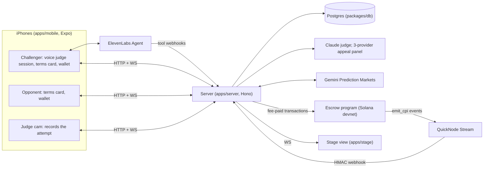

# You're On

**Bet your friends on anything you can film. An AI judge rules, the loser's GG settles it, and a
Solana escrow pays out.**

You're On is an iPhone app for friendly bets. Users never see crypto: money shows in dollars, and
there are no seed phrases or gas fees. Built for UBC 2026 (Consumer Apps, Best use of Solana;
ElevenLabs, QuickNode Streams and Gemini Prediction Markets bounties).

> **Status.** This is a work in progress inside the build window. The component table and each
> section below say what is built and what is planned; the experience, data flow and trust map
> describe the design. Nothing here has run against a paid API, and the escrow is not yet deployed
> to devnet.

## The experience

The demo is six beats on the team's iPhones. Judges don't install anything.

1. **Challenge by face.** Point the camera at a friend. An on-device face embedding is matched only
   against opted-in members of the same room. A match only addresses the challenge; it never
   authorizes anything.
2. **Terms by voice.** An ElevenLabs voice judge on the challenger's phone talks through the bet and
   asks about edge cases. Our server composes the binding terms and hashes them.
3. **Lock it in.** Both phones show the same terms card. Each person holds to confirm and passes
   Face ID on their own phone. Both signatures go into one transaction, so both stakes move into
   escrow together, or nothing moves.
4. **The attempt.** A bottle flip, filmed on a judge-cam iPhone. Claude rules on 12–16 frames from
   the end of the attempt plus a crop of the landing, alongside deterministic checks (cap tape
   visible, bottle at rest). If they disagree, it's a REDO. Then the loser says GG, or stays silent
   until the appeal window closes, and the escrow pays the winner.
5. **Dispute.** If the loser disputes, each side gets a short hearing, and an appeal goes to a panel
   of three models from different providers. No majority upholds the ruling. (Shown in the video.)
6. **The closer.** A bet on Gemini's 5-minute Bitcoin market, locked at the start of the pitch.
   Stakes are set from the market's odds, and Gemini's settled result decides it at the end.

## Architecture



| Component       | Path              | Built                                                                                                                                              | Planned                                                                                              |
| --------------- | ----------------- | -------------------------------------------------------------------------------------------------------------------------------------------------- | ---------------------------------------------------------------------------------------------------- |
| Mobile app      | `apps/mobile`     | Expo SDK 58, iOS only: diagnostics screen, on-device face model, device wallet (Face ID → sign) with the signing policy, UI tokens                 | Screens: face scan, voice session, terms card, GG, appeal                                            |
| Server          | `apps/server`     | Hono on Node: auth, rooms, bets, WebSocket hub, voice token + `propose_terms` tool, provider registry, QuickNode receiver (stub projector), keeper | Judge endpoint, lock service + nonce pool, transaction builder, full chain projector, RPC reconciler |
| Stage view      | `apps/stage`      | Vite + React: live escrow ticker for the pitch screen                                                                                              |                                                                                                      |
| Shared contract | `packages/shared` | zod schemas for every wire shape, JCS terms hashing, chain constants, the escrow IDL, the device signing policy                                    |                                                                                                      |
| Database        | `packages/db`     | Drizzle schema and SQL migrations for Postgres                                                                                                     |                                                                                                      |
| Escrow          | `programs/escrow` | Anchor program: `initialize_config`, `update_config`, `create_bet`, `accept_bet`                                                                   | The other 8 instructions; devnet deploy                                                              |

**Data flow (design).** The server's own RPC subscription makes the UI feel instant. The QuickNode
Stream carries the program's events and is the source of truth for "money moved": it writes the
database projection, gates the paid and voided states, and drives the stage ticker. If the two ever
disagree, the chain wins. _Built so far:_ the Stream receiver stores events and fans them out as
`chain.*` bet events; the RPC subscription, the bet-state projection and the paid/voided gating are
planned.

The full design is in [`docs/planning/ARCHITECTURE.md`](docs/planning/ARCHITECTURE.md).

## How we use Solana

| Item                                   | Value                                                                  |
| -------------------------------------- | ---------------------------------------------------------------------- |
| Escrow program ID                      | `FyJQHCE1TBuaCtaueeoSzLDzV5Gns6iUSA7Yd2m8UNvm` (devnet deploy pending) |
| USDC mint (Circle devnet)              | `4zMMC9srt5Ri5X14GAgXhaHii3GnPAEERYPJgZJDncDU`                         |
| IDL                                    | `packages/shared/idl/escrow.json`                                      |
| Config PDA                             | PENDING (after deploy + `init-config`)                                 |
| Fee payer / nonce authority            | PENDING (generated at deploy; `FEE_PAYER_PUBKEY` pin)                  |
| Nonce pool                             | PENDING (lock service)                                                 |
| `judge_authority` / `appeal_authority` | PENDING (set by `init-config`)                                         |
| Upgrade authority                      | PENDING (the deployer key; a disclosed devnet trust assumption)        |
| Sample transactions                    | PENDING (lock, payout, appeal resolution on Explorer)                  |

- **Escrow PDAs.** Each bet is a `Bet` PDA (`["bet", bet_id]`) with a PDA-owned SPL token vault
  (`["vault", bet_id]`) holding Circle devnet USDC. Payouts go only to the two parties' own USDC
  accounts, through `transfer_checked`. Stakes are capped, there is no admin withdrawal, and every
  state is designed to have a permissionless timeout refund (`timeout_refund`, planned).
- **Atomic durable-nonce lock.** When both people have seen the same terms card, the server builds one
  transaction: `[AdvanceNonce, ComputeBudget, create_bet, accept_bet]`. Each person signs that exact
  message on their own phone. The server is designed to add its fee-payer signature at the second
  authorization and submit once (the lock service is planned). A durable nonce means the transaction doesn't expire while people decide, and a
  decline advances the nonce so the signatures become useless.
- **Terms on chain.** The program stores the SHA-256 of the canonical terms. Before signing, each
  phone decodes the transaction and checks the program, instructions, stakes and terms hash against
  the card it showed.
- **Fees are invisible.** The server pays every fee and fronts the rent, which comes back when the
  bet closes. Users hold no SOL.
- **Events.** Every state change emits an Anchor event with `emit_cpi!`, signed by the program's
  event-authority PDA so no other program can forge one. A QuickNode Stream delivers them.

**Built:** `initialize_config`, `update_config`, `create_bet` and `accept_bet`, tested with LiteSVM.
The phone-side signing policy (`packages/shared/src/device-policy.ts`, wired into the mobile wallet)
is built and tested against Kit-built messages; no screen calls it yet, and the fee-payer pin is unset
until deploy, so it rejects everything until then.
**Planned:** the remaining 8 instructions (`cancel_open_bet`, `resolve`, `concede`, `appeal`,
`resolve_appeal`, `finalize`, `timeout_refund`, `close_bet`), the devnet deploy and the lock service
with its nonce pool. Specs: [`docs/planning/ESCROW-PROGRAM.md`](docs/planning/ESCROW-PROGRAM.md).

## ElevenLabs

| Product                      | How we use it                                                                                                                                                 | Status                                                                                                   |
| ---------------------------- | ------------------------------------------------------------------------------------------------------------------------------------------------------------- | -------------------------------------------------------------------------------------------------------- |
| Agents                       | The voice judge: one session per bet on the challenger's phone over WebRTC (`@elevenlabs/react-native` + LiveKit). It negotiates terms and announces results. | Agent config script (`scripts/el-agent.ts`), token endpoint and `propose_terms` tool built; not run live |
| Server tools (webhooks)      | `propose_terms`, `confirm_terms`, `open_hearing`, `file_appeal`, `get_market_odds` at `/el/tools/:name`                                                       | `propose_terms` built and tested against a fake; the rest planned                                        |
| Client tools                 | `request_attempt`, `show_terms_card`, a gavel cue, run on the phone                                                                                           | Planned                                                                                                  |
| Scribe (speech-to-text)      | Transcribes the opponent's hearing argument                                                                                                                   | Client built with a mock (`STT_PROVIDER`)                                                                |
| Text-to-Speech, Voice Design | The judge's voice; stage announcements and the three appeal votes                                                                                             | Planned                                                                                                  |
| Sound Effects                | The gavel and other stage cues                                                                                                                                | Client built with a mock (`SFX_PROVIDER`); cue prompts are placeholders                                  |

A spoken "accept" is theatre only. The judge never moves money and never authorizes a lock.

## QuickNode Streams

| Setting     | Value                                                                                                                                                                                                                                                                                                                                                                   |
| ----------- | ----------------------------------------------------------------------------------------------------------------------------------------------------------------------------------------------------------------------------------------------------------------------------------------------------------------------------------------------------------------------- |
| Network     | Solana devnet                                                                                                                                                                                                                                                                                                                                                           |
| Dataset     | `block`, because `emit_cpi!` events are inner instructions and the block dataset carries them                                                                                                                                                                                                                                                                           |
| Filter      | JavaScript generated from the escrow IDL. Drops failed transactions. Keeps inner instructions whose program is our escrow, whose data starts with Anchor's event tag, and whose first account is our event-authority PDA. Forwards the raw event bytes with a name hint; the server decodes them against the IDL compiled into it (`apps/server/src/chain/decoder.ts`). |
| Destination | Webhook `POST /webhooks/quicknode` on our server, HMAC-verified, stored idempotently in `chain_events`                                                                                                                                                                                                                                                                  |
| Why         | Source of truth for "money moved": updates the bet's state, notifies both phones and drives the stage ticker                                                                                                                                                                                                                                                            |

**Status:** the receiver (`apps/server/src/chain/`), the `chain_events` table and the filter
(`infra/quicknode/filter.js`, generated from the IDL by `build-filter.ts`, with `stream.json`) are built
and tested offline with HMAC-signed fixtures. The projector is a stub: it stores events and appends
them to the bet's event log (only for events of our own instance of the bet), but does not yet
write bet state or payouts. Creating the Stream needs
the devnet deploy and a QuickNode account.

## Gemini Prediction Markets

For the closer, the server finds the live 5-minute Bitcoin contract
(`GET /v1/prediction-markets/events?status=active&category=Crypto`, series `BTC05M`) and follows its
order book, trades, contract status and BTC index over one WebSocket (`wss://ws.gemini.com`). Fair
stakes come from the mid price: if you take "Up" at 62%, you put in 62% of the pot and your friend
puts in 38%. The quote, strike and contract go into the terms, so their hash is locked on chain. When
the contract settles, the server confirms with `GET /v1/prediction-markets/events/{eventTicker}`,
hashes that exact response as the bet's evidence, and resolves the escrow from Gemini's result.

Public market data only: no key, no account, no trading. "Gemini" here is the exchange, not Google's
Gemini model (which sits on the appeal panel).

**Status:** planned. The shared Gemini schemas exist in `packages/shared`; the service is next.

## Trust map

Design, not all built yet: the escrow guarantees below rely on instructions that are still planned
(GG / `concede`, `finalize`, `resolve`, timeouts), and the judge endpoint is planned.

| What                                             | Where it runs                         | Trust                                                                                                                            |
| ------------------------------------------------ | ------------------------------------- | -------------------------------------------------------------------------------------------------------------------------------- |
| Custody, payout destinations, stake cap, refunds | Escrow program                        | **Onchain**                                                                                                                      |
| Agreeing to a bet                                | Each person's phone (hold + Face ID)  | **Onchain**: both signatures on one transaction                                                                                  |
| Terms                                            | Server composes; phones check         | **Checkable**: the terms hash is on chain, and each phone decodes the transaction before signing                                 |
| Face scan                                        | On device                             | Addresses the challenge only. Never authorizes anything.                                                                         |
| Settlement by GG or silence                      | Loser's phone, then the program       | **Onchain**                                                                                                                      |
| Ruling (Claude on frames + deterministic checks) | AI API + server judge key             | **Trusted.** The ruling commits to the hashes of the frames the model saw.                                                       |
| Appeal panel (three providers)                   | AI APIs + server appeal key           | **Trusted**                                                                                                                      |
| Gemini settlement                                | Gemini API                            | **Trusted** external oracle; the response is hashed as evidence                                                                  |
| Orchestration and fees                           | Our server                            | Can pick an outcome through the judge keys, never a destination. Can delay; permissionless timeouts bound the delay.             |
| Program upgrades                                 | Upgrade authority                     | **Trusted** (disclosed devnet assumption)                                                                                        |
| Lock submission and revocation                   | Server fee payer = nonce authority    | Can submit a held lock only exactly as signed and before `accept_deadline`, or revoke it by advancing the nonce. Can't alter it. |
| USDC freeze                                      | Circle (devnet USDC freeze authority) | **Trusted.** A frozen vault blocks payouts; a frozen party account is routed around to a fresh account of that party.            |

### Escrow invariants and accepted residual risks

The invariants (ESCROW-PROGRAM §1.1) in short: payouts go only to the two parties; the vault always
holds at least what was deposited; every live status has a permissionless exit; pause never blocks
an exit; no admin withdrawal. The server's judge and appeal keys choose outcomes but cannot redirect
funds or hold them past the deadlines (§1.2). Status: enforced by the 4 built instructions; the rest
land with the remaining instructions.

Accepted residual risks (ESCROW-PROGRAM "Accepted residual risks"):

- TM-F11: tokens stranded in non-vault Bet-PDA accounts.
- TM-L9: the appeal-timeout refund can be gamed by taking the pipeline down.
- TM-L11: Circle freeze; upgrade authority.
- TM-L12: write-lock spam vs a 10 s window.
- TM-T5: clock drift vs the window.
- TM-E8: devnet fork after `confirmed`.
- TM-N4: a lock whose state changes between preflight and execution burns both signatures and
  15,000 lamports. The parties re-authorize.
- TM-I1 (atomic): repeated `bet_id` squats can stall a lock. This is a devnet DoS only; no funds are
  at risk.

## The AI judge

PENDING (the judge endpoint is planned). Design: Claude on 12–16 frames from the end of the attempt
plus a landing crop, alongside deterministic checks; a disagreement is a REDO (`MAX_REDOS = 2`). A
dispute opens a short hearing, and an appeal goes to a three-provider panel. Guardrails: 18+, a $20
stake cap, PG-13 refusals. Built: the voice judge's persona, guardrails and `propose_terms` tool
(`packages/shared/src/judge`), and an offline-tested fixture runner. Schemas: SCHEMAS (Terms,
Ruling).

## Privacy by design

Design (ARCHITECTURE §6.7); status: the on-device face model is built, and the server-side face store
and its retention jobs are planned.

- **Face data is opt-in.** Your phone turns a selfie into a face embedding on the device; face
  images never leave the phone. The server keeps one encrypted embedding per opted-in user and
  matches only within the same room. A match only addresses a challenge and never authorizes
  anything. You can disable or hard-delete it at any time, and it is deleted at the earliest of
  180 days without a match, 30 days after disabling, or 2026-12-31. Nothing biometric goes onchain.
- **Face ID is separate.** It stays in the Secure Enclave; the app learns only success or failure.
- **Voice.** No voiceprints. Only transcripts and their hashes are kept as evidence.
- **Why.** Texas CUBI and Illinois BIPA treat face embeddings as biometric identifiers; we designed
  for both. This is not legal advice.

## Security model

PENDING (condensed from ARCHITECTURE §6.2–§6.4 as the pieces land). Who can move money: only the
escrow program, to the two parties, after both signed the lock on their own phones. The device
signing policy (built) decodes every server-built transaction and refuses anything that doesn't
match the card the phone showed, before Face ID is asked. Custodial demo accounts: PENDING.

## Prior work

Two prototypes of this idea were written on 2026-11-07/08, before the build window, and the organizers
confirmed that reusing that work is allowed. Alaric's prototype ("Verdict") is in this repo's history
on `main`, and its specs are in `docs/reference/verdict/`. Logan's prototype ("You're On") was imported
as the base on 2026-11-14 (commit "Import the You're On monorepo as the base"), together with the Phase 0
planning docs in `docs/planning/`. [`docs/MERGE-PLAN.md`](docs/MERGE-PLAN.md) lists what was kept,
ported and dropped. The face model is not committed: `scripts/face-model.sh` rebuilds it.

## Setup

Prerequisites: Node 22.4+, Docker or Podman, and for the escrow Rust 1.89, Agave 4.1.2 and Anchor
1.2.2. iOS builds need a Mac with Xcode.

```sh
npm ci
docker compose up -d db            # or: podman-compose up -d db  (Postgres 17 on :54329)
export DATABASE_URL=postgres://yo:yo@localhost:54329/youre_on

npm run typecheck && npm run lint && npm run format:check
npm test                           # every workspace; DB suites skip without DATABASE_URL
npm test -w @youre-on/shared       # schemas, JCS vectors, chain pins, judge, device signing policy
npm test -w @youre-on/server       # auth, WS hub, rooms/bets, voice, providers, QuickNode receiver, keeper
npm test -w @youre-on/db           # migrations, triggers, enum parity, chain_events
npm test -w @youre-on/mobile       # wallet + device policy, PDA vs Kit, diagnostics, native config, UI tokens
npm test -w @youre-on/stage
npx tsx apps/server/scripts/smoke.ts http://127.0.0.1:8080   # against a running server

export PATH=$HOME/.cargo/bin:$HOME/.local/share/solana/install/active_release/bin:$PATH
(cd programs/escrow && NO_DNA=1 anchor build && cargo test)   # tests include_bytes! the built .so
(cd apps/mobile && CI=1 npx expo-doctor)
```

Test counts: see CI.

Run things locally:

```sh
npm run db:migrate -w packages/db  # server boot does not migrate; uses DATABASE_URL
cp .env.example apps/server/.env   # then fill in values (names only in git)
npm run dev -w @youre-on/server    # reads apps/server/.env
npm run dev -w @youre-on/stage
cd apps/mobile && npx expo run:ios --device   # local Xcode dev build
```

Notes:

- **Paid calls need `ALLOW_SPEND=true`.** `LLM_PROVIDER`, `STT_PROVIDER` and `SFX_PROVIDER` take
  `mock` (default) or `live`, and any `live` mode refuses to start unless `ALLOW_SPEND=true`. The
  ElevenLabs Agent token endpoint (`POST /v1/voice/tokens`) has no mock: it calls ElevenLabs only
  when `ALLOW_SPEND=true` and `ELEVENLABS_API_KEY` is set, and otherwise answers `spend_disabled` /
  `not_configured`. The judge fixture runner (`apps/server/src/judge/fixture-runner.ts`) also needs
  `ALLOW_SPEND=true`. `scripts/el-agent.ts` only writes agent and tool configuration (not billed)
  and is not guarded. Under `NODE_ENV=production` the mock LLM and STT refuse every call, so a
  deploy that forgets `*_PROVIDER=live` cannot issue fake rulings. Env var names are in
  [`.env.example`](.env.example); values never go in git.
- **The face model is not committed.** `scripts/face-model.sh` rebuilds
  `apps/mobile/assets/models/w600k_mbf_float32.tflite` from the official InsightFace release and
  checks its hash. The weights are licensed for non-commercial research only.
- **The program keypair is local only.** `programs/escrow/target/deploy/escrow-keypair.json` is
  gitignored. Without it you can build and test, but not deploy to the same program ID.

## Repo layout

```
apps/mobile        Expo iOS app
apps/server        Hono server
apps/stage         stage view for the pitch screen
packages/shared    zod contract, JCS hashing, chain constants, escrow IDL
packages/db        Drizzle schema and SQL migrations
programs/escrow    Anchor escrow program
infra/quicknode    Streams filter (generated from the IDL), stream config, fixtures
scripts            face-model.sh, el-agent.ts
docs/planning      binding specs (schemas, API, data model, escrow, architecture, tasks, setup)
docs/reference     Verdict's specs, kept as design reference
docs/MERGE-PLAN.md how the two prototypes were combined
```

## Where this came from

The team built two prototypes of this product and merged them on 2026-11-14, with You're On as the
base. [`docs/MERGE-PLAN.md`](docs/MERGE-PLAN.md) records what was kept, ported and dropped. Verdict's
specs are in [`docs/reference/verdict/`](docs/reference/verdict/INDEX.md).

## Team

- **Logan**: lead engineer; wrote You're On, the base of this repo.
- **Alaric**: Verdict, the consent-first settlement model, the design system, the rule interpreter on
  the roadmap.
- **Eva**: the consent-before-capture enroll flow.

## License

MIT; see [`LICENSE`](LICENSE). The face-model weights are InsightFace's, for non-commercial research
only.
