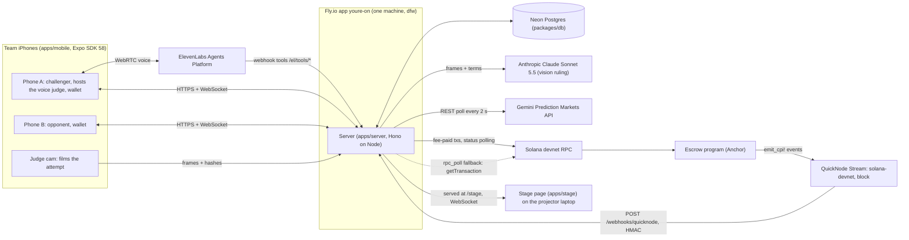

# You're On

**Bet your friends on anything you can film. An AI judge rules, the loser's GG settles it, and a
Solana escrow pays out in USDC.**

Friends bet each other all the time, and it all runs on trust: who said what, whether that flip
counted, who still owes $5. You're On is an iPhone app that makes the bet enforceable. You point
your phone at a friend to challenge them and say the bet out loud. A voice judge turns it into
precise terms, and both of you confirm on your own phone with Face ID. Both stakes then move into
an escrow on Solana in one transaction. A judge-cam iPhone films the attempt, Claude rules on the
frames, and the loser says GG (or stays silent for 10 seconds) and the winner is paid. Nobody sees
crypto: money shows in dollars, there are no seed phrases, and the server pays every fee. Built
for UBC 2026 (Consumer Applications track, Best use of Solana; ElevenLabs, QuickNode Streams and
Gemini Prediction Markets bounties).

|                   |                                                                                                                                                   |
| ----------------- | ------------------------------------------------------------------------------------------------------------------------------------------------- |
| Live server       | https://youre-on.fly.dev (Fly app `youre-on`, devnet)                                                                                             |
| Stage (projector) | https://youre-on.fly.dev/stage/ (needs a stage key, see [`docs/runbook.md`](docs/runbook.md))                                                     |
| Escrow program    | [`BL3gwTBcftGQFdPNp7rZiAyDojkSusdAJ2dzNvFouwcp`](https://explorer.solana.com/address/BL3gwTBcftGQFdPNp7rZiAyDojkSusdAJ2dzNvFouwcp?cluster=devnet) |
| Submission docs   | [`docs/devpost.md`](docs/devpost.md), [`docs/pitch.md`](docs/pitch.md), [`docs/runbook.md`](docs/runbook.md)                                      |
| Measured numbers  | [`docs/measurements.md`](docs/measurements.md)                                                                                                    |
| Specs (behaviour) | [`docs/planning/`](docs/planning/) (API-CONTRACT, DATA-MODEL, SCHEMAS, ARCHITECTURE, ESCROW-PROGRAM, TASKS, TRACEABILITY)                         |

## Status, honestly

This README describes the code at the head of this branch. What is live, what is built but not yet
run live, and what is not built:

| Status                        | What                                                                                                                                                                                                                                                                                                      |
| ----------------------------- | --------------------------------------------------------------------------------------------------------------------------------------------------------------------------------------------------------------------------------------------------------------------------------------------------------- |
| **Live on devnet**            | The escrow program (12 instructions, deployed). The server on Fly with Neon Postgres. The atomic lock, the live Claude ruling, GG and finalize payouts, the timeout-refund keeper. 10/10 live soak runs on 2026-11-18 (5 finalize, 5 GG), see [measurements](docs/measurements.md).                       |
| **Built, waiting on a key**   | The ElevenLabs voice judge (ElevenLabs key pending: the agent is defined as code but not yet created on ElevenLabs). The QuickNode Stream (QuickNode key pending: the filter, config and receiver are built; until the Stream exists the server runs on its `rpc_poll` fallback and a public devnet RPC). |
| **Built, waiting on a build** | The iPhone app (Expo SDK 58). Its logic is unit-tested in Node (827 tests) and has Maestro flows for the iOS Simulator, but the signed iPhone build is pending (Apple developer account / EAS). So face scan, Face ID signing and the judge cam have not yet run on a real iPhone.                        |
| **Built, not yet run live**   | The Gemini BTC 5-minute closer (Beat 6): tested offline against recorded real Gemini responses and a fake Gemini, plus a labelled REPLAY feed. The live run is still to be measured.                                                                                                                      |
| **Not built**                 | The dispute flow of Beat 5 (spoken hearing and the three-model appeal panel). The escrow's `appeal` and `resolve_appeal` instructions are built and tested; the server-side hearing and panel are not.                                                                                                    |

## The demo: six beats

The demo runs on the team's own iPhones plus a laptop driving the stage view. Judges don't install
anything.

| #   | Beat                  | What happens                                                                                                                                                                                                                               | Status                                                                                                   |
| --- | --------------------- | ------------------------------------------------------------------------------------------------------------------------------------------------------------------------------------------------------------------------------------------ | -------------------------------------------------------------------------------------------------------- |
| 1   | **Challenge by face** | A points the camera at B. The phone computes a face embedding on the device; the server matches it only against opted-in members of the same room. "Challenge B?" B's phone shows the invite. A match only addresses the challenge.        | Built and tested; not yet on an iPhone. Fallback: challenge from the room list.                          |
| 2   | **Terms by voice**    | A says "Bet you $5 you can't land a bottle flip." The ElevenLabs voice judge asks one or two edge-case questions and reads the terms back. The server composes the binding terms and their SHA-256; the terms card appears on both phones. | Built and tested against a fake ElevenLabs; key pending. Fallback: "Type it instead" (same server path). |
| 3   | **Lock it in**        | Each person holds to confirm and passes Face ID on their own phone. Both signatures go into one durable-nonce transaction, so both stakes move into escrow together, or nothing moves. The stage shows the lock with an Explorer link.     | Live on devnet: confirm to LOCKED in 4.0–4.6 s. Phone signing pending the iPhone build.                  |
| 4   | **The attempt**       | The judge cam films the flip. Claude Sonnet 5.5 rules on 8 frames plus two deterministic checks; if they disagree it's a REDO. The loser taps GG (`concede`, instant) or the 10 s appeal window closes (`finalize`). The winner is paid.   | Live on devnet: ruling 2.8–4.0 s, full bet 18–28 s.                                                      |
| 5   | **Dispute**           | The loser appeals inside the 10 s window; the appeal key settles it with `resolve_appeal`.                                                                                                                                                 | Escrow side built and tested. Hearing and three-model panel not built; not in the live demo.             |
| 6   | **The closer**        | "Bitcoin's up by the end of this pitch." The bet locks at the start of the pitch on Gemini's live 5-minute BTC contract, with stakes set from its odds. Gemini's settled result, hashed on chain as evidence, pays the winner at the end.  | Built and tested offline; live run pending.                                                              |

## Architecture



| Component       | Path              | What it is                                                                                                                                                                                                         |
| --------------- | ----------------- | ------------------------------------------------------------------------------------------------------------------------------------------------------------------------------------------------------------------ |
| Mobile app      | `apps/mobile`     | Expo SDK 58, iOS only. Signup, rooms, face enrollment and scan, the voice judge session, terms card, hold + Face ID signing with a device signing policy, judge cam, GG, payout.                                   |
| Server          | `apps/server`     | Hono on Node (tsx). Auth, rooms, bets, WebSocket hub, ElevenLabs tools, judge pipeline, LockService + nonce pool, payouts, Gemini relay and settlement, QuickNode receiver and projector, keeper sweeps, demo ops. |
| Stage view      | `apps/stage`      | Vite + React page for the projector, served by the server at `/stage`.                                                                                                                                             |
| Shared contract | `packages/shared` | zod schemas for every wire shape, JCS hashing, chain constants and pins, the escrow IDL and Codama client, the atomic-lock builder, the device signing policy, Gemini fair stakes.                                 |
| Database        | `packages/db`     | Drizzle schema and SQL migrations 0000–0007 for Postgres.                                                                                                                                                          |
| Escrow          | `programs/escrow` | Anchor 1.2.2 program, 12 instructions, Rust LiteSVM test matrix.                                                                                                                                                   |
| Streams         | `infra/quicknode` | The Streams filter (generated from the IDL), the Stream config and fixtures.                                                                                                                                       |

**Two lanes, one rule.** The server's own confirmation (it polls `getSignatureStatuses` for every
transaction it sends) makes the phones feel instant. The program's `emit_cpi!` events, delivered by
the QuickNode Stream (or by the `rpc_poll` fallback), are folded into the database's on-chain
projection, drive the stage's on-chain ticker, and reconcile any confirmation the server missed. If
the two ever disagree, the chain wins. Full design: [`docs/planning/ARCHITECTURE.md`](docs/planning/ARCHITECTURE.md).

## How it uses Solana

Every bet is escrowed and settled by our Anchor program on Solana devnet. The program, not our
server, decides where money can go.

| Item                                | Value                                                                                                                                             |
| ----------------------------------- | ------------------------------------------------------------------------------------------------------------------------------------------------- |
| Escrow program ID                   | [`BL3gwTBcftGQFdPNp7rZiAyDojkSusdAJ2dzNvFouwcp`](https://explorer.solana.com/address/BL3gwTBcftGQFdPNp7rZiAyDojkSusdAJ2dzNvFouwcp?cluster=devnet) |
| Config PDA (`["config"]`)           | [`FYF8BZaszwttYxSsnXXdtf75YQUhAMwYDNK73eNzDoz`](https://explorer.solana.com/address/FYF8BZaszwttYxSsnXXdtf75YQUhAMwYDNK73eNzDoz?cluster=devnet)   |
| Event-authority PDA                 | `2R3N7HdDrqP4nteeBL88v7EESXabbcrLCPasi88F5i7m` (`["__event_authority"]`; signs every `emit_cpi!` event)                                           |
| USDC mint (Circle devnet)           | `4zMMC9srt5Ri5X14GAgXhaHii3GnPAEERYPJgZJDncDU`                                                                                                    |
| Server fee payer = nonce authority  | `ADEMopwqe6cVs9cEyMSbK1pGsJgnyBc3zkC3Wsqf9pQ8` (pinned in `packages/shared/src/chain/constants.ts`; phones refuse any other)                      |
| Durable-nonce pool                  | 5 accounts at `createWithSeed(fee payer, "yo-nonce-0" … "yo-nonce-4")`, so phones verify a nonce offline                                          |
| IDL and client                      | `packages/shared/idl/escrow.json`; Codama-generated `@solana/kit` client in `packages/shared/src/chain/generated/`                                |
| Toolchain                           | Anchor 1.2.2, Rust 1.89.0, Agave 4.1.2, platform-tools v1.57, sBPF v3                                                                             |
| Demo Config (`scripts/lib/demo.ts`) | `max_stake` $20 per side, appeal window 10 s, accept deadline ≤ 600 s, resolve deadline 3,600 s, appeal resolve 300 s                             |

**Sample transactions (devnet, 2026-11-18):**

| What                                          | Transaction                                                                                                                                                   |
| --------------------------------------------- | ------------------------------------------------------------------------------------------------------------------------------------------------------------- |
| Atomic lock (`create_bet` + `accept_bet`)     | [`3Dq7rQ9h…HgU9q`](https://explorer.solana.com/tx/3Dq7rQ9h1b1PdVEwfEsQzqT9C2Lc9GXz73zWbqG4eysTJ1bj3CTJyK3E5A4dDfYkKBoLAHWzQmFT51GwmXrHgU9q?cluster=devnet)    |
| `resolve` (judge key, evidence + ruling hash) | [`4LLGESFA…cTsKVvft`](https://explorer.solana.com/tx/4LLGESFAjhRXZ79AgcCBvUuxB4fp91iduMRfshCRR1vAyHy1J637kkBUQBiwybJUgJ2vEx8EvNrCdFkbcTsKVvft?cluster=devnet) |
| `finalize` + `close_bet` (payout)             | [`3AzeFcB9…KUhUFg`](https://explorer.solana.com/tx/3AzeFcB97yfdUWDeM4VCodbb7n8ktgo6MHkkxgJU27dt2vC9c53uscZdA85ZMgppc8fzEdfPncNaWrbPdGKUhUFg?cluster=devnet)   |
| `timeout_refund` + `close_bet` (keeper)       | [`2dvcUpmF…C2JxmXzx`](https://explorer.solana.com/tx/2dvcUpmFNiE76aRqRoGCUKrLTAYywAfFSkuZnkEQKP6CVyTVYnHMj53HXa2egLnY42U7sQqhgoLq5WqFC2JxmXzx?cluster=devnet) |

### The 12 instructions

| Instruction         | Signed by                                      | State change                            | What it does                                                                                                           |
| ------------------- | ---------------------------------------------- | --------------------------------------- | ---------------------------------------------------------------------------------------------------------------------- |
| `initialize_config` | admin (deployer)                               | → Config                                | Judge and appeal keys, `max_stake`, deadlines, allowed mints.                                                          |
| `update_config`     | admin                                          | Config                                  | Changes apply to new bets only: each Bet snapshots its judge and appeal keys.                                          |
| `create_bet`        | A + fee payer                                  | → Open                                  | A's stake into the vault. Stores B, both stakes, the terms hash, the accept deadline, and the fee payer as rent payer. |
| `accept_bet`        | B                                              | Open → Locked                           | B's stake. B passes the terms hash, both stakes and A's key they saw; any mismatch fails.                              |
| `cancel_open_bet`   | A, B or the bet's judge key                    | Open → Cancelled                        | Refunds A.                                                                                                             |
| `resolve`           | the bet's judge key, before `resolve_deadline` | Locked → Resolved                       | Outcome `PartyA` / `PartyB` / `Split` / `Refund`, plus `evidence_hash` and `ruling_hash`; opens the appeal window.     |
| `concede`           | the loser                                      | Resolved → Settled                      | GG: pays out at once.                                                                                                  |
| `appeal`            | the loser, before `appeal_deadline`            | Resolved → Appealed                     | Freezes the payout for the appeal key.                                                                                 |
| `resolve_appeal`    | the bet's appeal key                           | Appealed → Settled                      | Final outcome plus `appeal_ruling_hash`.                                                                               |
| `finalize`          | anyone, at or after `appeal_deadline`          | Resolved → Settled                      | Pays out the ruling once the window closes.                                                                            |
| `timeout_refund`    | anyone, after that status's deadline           | Open / Locked / Appealed → Refunded     | Each side gets its own stake back. The server's keeper and `scripts/crank.ts` send it.                                 |
| `close_bet`         | anyone                                         | Settled / Refunded / Cancelled → closed | Returns the Bet and vault rent to the stored rent payer.                                                               |

### What makes the escrow safe

- **SPL vault PDAs.** Each bet is a `Bet` PDA (`["bet", bet_id]`) that owns an SPL token vault PDA
  (`["vault", bet_id]`) holding Circle devnet USDC. All five terminal instructions pay out through
  one `payout()` path with `transfer_checked`, signed by the Bet PDA, and only to the two parties'
  own token accounts. Classic SPL Token or Token-2022 (with an extension allowlist that rejects
  `MintCloseAuthority`).
- **Invariants.** Stakes are capped by Config; the terms hash is immutable after the lock; there is
  no admin withdrawal; every live status has a permissionless exit (`timeout_refund` or
  `finalize`), and pause never blocks an exit. The server's judge and appeal keys choose an
  outcome, never a destination.
- **The atomic durable-nonce lock.** When both people have seen the same terms card, the server
  builds one v0 transaction, `[AdvanceNonceAccount, SetComputeUnitLimit, create_bet, accept_bet]`,
  on a leased nonce from the pool, simulates it, and stores the exact message bytes. It needs
  **three signers**: A (for `create_bet`), B (for `accept_bet`) and the server's fee payer, which
  is also the nonce authority. Each phone signs those exact bytes after hold + Face ID; the server
  submits once, with preflight on, when the second authorization arrives. The durable nonce means
  the transaction does not expire while people decide (the program's `accept_deadline` bounds it
  instead), and a decline or an expiry advances the nonce, so the signatures become useless.
  Measured on local Agave: 1,001 bytes of the 1,232-byte limit, 46,791–67,791 CU, and 3 × 5,000
  lamports of signature fees, all paid by the server.
- **Phones check before they sign.** The device signing policy (`packages/shared/src/device-policy.ts`)
  decodes the message on the phone and refuses anything that is not exactly the expected program,
  instructions, stakes, terms hash, fee payer and nonce account, before Face ID is ever asked.
- **Events.** Every state change emits exactly one Anchor event with `emit_cpi!` (12 event types,
  from `ConfigInitialized` to `BetClosed`). The event is an inner instruction signed by the
  program's event-authority PDA, so no other program can forge one, and it survives log
  truncation. The QuickNode Stream filters on exactly that.
- **Fees are invisible.** The server pays every fee and fronts the rent, which `close_bet` returns.
  Party wallets hold 0 SOL. Balances show in dollars.
- **Terms on chain.** The program stores `sha256(JCS(Terms))`. A ruling's hash commits to the
  SHA-256 of every frame the model saw; a Gemini bet's evidence hash commits to Gemini's exact
  response body.

**Demo-key disclosure.** For the demo, phones A and B import the server's two custodial demo keys
(`demo-a`, `demo-b`) through a one-time QR (`POST /v1/auth/demo-claim`), so a rehearsal can also be
driven without phones (`LOCK_SIGNER=server`, `scripts/cp1-drive.ts`). In the product each phone
generates its own key, and it never leaves the device. The upgrade authority is the deployer key:
a disclosed devnet trust assumption.

### Reproducible build

The deployed program is the build of this repo's source:

```sh
cd programs/escrow
cargo build-sbf --arch v3 --tools-version v1.57 \
  --manifest-path programs/escrow/Cargo.toml --sbf-out-dir /tmp/yo-escrow
shasum -a 256 /tmp/yo-escrow/escrow.so
# 826f0874b350743c8f6fcd99f2bd57bc472b618e8a5846593fb26e9843b9e67a  (446,552 bytes)
```

`anchor build` (Anchor 1.2.2 defaults to `--arch v3 --tools-version v1.57`) gives the same bytes in
`target/deploy/escrow.so`, and a clean rebuild in a different directory matched it byte for byte.
The on-chain program data hashes to the same value; to check it yourself:

```sh
solana program dump --url devnet BL3gwTBcftGQFdPNp7rZiAyDojkSusdAJ2dzNvFouwcp onchain.so
shasum -a 256 onchain.so
```

The program keypair is not in the repo, so a fresh `anchor build` creates a random one. Never run
`anchor keys sync` or `anchor deploy` from a fresh build; upgrades go through the deployer key.

## ElevenLabs

| Product                   | How we use it                                                                                                                                                                                                                                                | Status                                       |
| ------------------------- | ------------------------------------------------------------------------------------------------------------------------------------------------------------------------------------------------------------------------------------------------------------ | -------------------------------------------- |
| **Agents Platform**       | The voice judge. One conversation per bet on A's phone over WebRTC (`@elevenlabs/react-native` 1.2.38 + LiveKit), on speakerphone. The agent's LLM (Claude Haiku 5.5, served by ElevenLabs) asks the edge-case questions; TTS model `eleven_v4_turbo`.       | Built; ElevenLabs key pending                |
| Webhook (server) tools    | `propose_terms` and `confirm_terms` at `/el/tools/:name`, authenticated by a workspace secret sent as `X-YO-Tool-Secret`. `get_market_odds` (Beat 6) has a live handler and is registered with `el-agent --tools=…`.                                         | Built; tested end to end against a fake      |
| Client tools              | `request_attempt` (arms the judge cam), `show_terms_card`, `cue` (gavel, drumroll, buzzer, cheer on the stage). They run on A's phone.                                                                                                                       | Built                                        |
| Conversation tokens       | `POST /v1/voice/tokens` mints a token server-side (`GET /v1/convai/conversation/token`), so the API key never reaches a phone. Spend-guarded: it calls out only with `ALLOW_SPEND=true`.                                                                     | Built                                        |
| Agent as code             | `npm run el-agent` creates or updates the workspace secret, the tools and the private agent, found by name and PATCHed only where they differ (a second run is a no-op). `--check-openapi` validates every body against ElevenLabs' public OpenAPI document. | Built; never run against ElevenLabs (no key) |
| Scribe STT, Sound Effects | REST clients behind `STT_PROVIDER` / `SFX_PROVIDER` (default mock). Not in the demo path: the hearing they were for is not built, and the stage synthesizes its sounds.                                                                                      | Built, unused in the demo                    |

**How a session runs.** A's phone asks for the mic, gets a conversation token from our server and
starts the session with the bet's dynamic variables. Every tool call is bound to its bet
(`conversation_id → voice_sessions → bet_id`; a mismatch answers `WRONG_BET`). `propose_terms`
hands the bet to the same evaluation core the typed form uses: the guardrail prefilter, the stake
cap, and the server-composed Terms with their hash. Server results (LOCKED, a ruling, PAID) come
back to the phone as `judge.cue` events, and the phone injects them into the conversation
(`sendUserMessage("[EVENT] …")`) so the judge announces them. A spoken "accept" is theatre only:
the judge never moves money and never authorizes a lock.

**Transcript relay to the stage.** A's phone relays the session's final lines to
`POST /v1/bets/:bet_id/voice/lines`; the server turns them into `judge.line` / `party.line` bet
events, which the stage shows as live captions and B's phone shows as subtitles. The `cue` client
tool goes through `POST /v1/bets/:bet_id/cues` to the stage laptop, because audio played on A's
phone would stop its mic.

**To switch it on** (needs the key): `npm run el-agent -- --check-openapi`, then set
`ELEVENLABS_API_KEY`, `ELEVENLABS_TOOL_SECRET` and the printed `ELEVENLABS_AGENT_ID` as Fly
secrets. `GET /v1/demo/voice` says whether the judge is on. Until then A's phone offers "Type it
instead", which runs the same server path.

## QuickNode Streams

| Setting     | Value                                                                                                                                                                                                                                                                                                                                                                                                                                                                                                                                                                                                                                                                                                                                                                                                          |
| ----------- | -------------------------------------------------------------------------------------------------------------------------------------------------------------------------------------------------------------------------------------------------------------------------------------------------------------------------------------------------------------------------------------------------------------------------------------------------------------------------------------------------------------------------------------------------------------------------------------------------------------------------------------------------------------------------------------------------------------------------------------------------------------------------------------------------------------- |
| Network     | `solana-devnet`                                                                                                                                                                                                                                                                                                                                                                                                                                                                                                                                                                                                                                                                                                                                                                                                |
| Dataset     | `block`, batches of 5 with elastic batching, region `usa_east`. Our events are `emit_cpi!` inner instructions, and the block dataset carries inner instructions.                                                                                                                                                                                                                                                                                                                                                                                                                                                                                                                                                                                                                                               |
| Filter      | [`infra/quicknode/filter.js`](infra/quicknode/filter.js), generated from the escrow IDL by `build-filter.ts` (a test fails if it drifts). For each transaction in the batch: (1) drop it if `meta.err` is set; (2) keep an **inner** instruction only if its program (resolved through the account keys and loaded addresses) is our escrow, its data starts with Anchor's event-instruction tag, and its first account is our event-authority PDA, so only our program can have emitted it; (3) never decode top-level instructions; (4) no `Program data:` log parsing. It forwards `{signature, blockHeight, parentSlot, blockTime, txIndex, outerIx, innerIx, eventBase64}`, and returns `null` (nothing sent) for a batch with no escrow events. Plain ES5: no BigInt, `atob`, `TextDecoder` or `Buffer`. |
| Destination | Webhook `POST https://youre-on.fly.dev/webhooks/quicknode`. The server checks `X-QN-Signature` = hex HMAC-SHA256(token, `X-QN-Nonce` + `X-QN-Timestamp` + body) in constant time, with a 300 s timestamp window, then re-decodes every event with the IDL compiled into the server (the filter's name is only a hint), stores it idempotently in `chain_events` keyed by `(signature, outer_ix, inner_ix)`, and folds it into the bet in the same database transaction. A bad signature gets 401, a transient database error 503 (so QuickNode retries), everything else 200.                                                                                                                                                                                                                                  |
| Why         | It is the source of truth for "money moved". The projector updates each bet's on-chain status and payout, moves the bet forward when the chain is ahead of the server (a missed confirmation), and pushes `chain.*` events to both phones and the stage ticker, each with its Explorer link. The stage header says "via QuickNode Streams" only when the Stream delivered the event.                                                                                                                                                                                                                                                                                                                                                                                                                           |

**Fallback: `rpc_poll`.** If the Stream has not delivered a server-sent transaction's events within
30 s (5 s when no Stream is configured), the keeper fetches it with `getTransaction` and ingests it
as source `rpc_poll` through the same decoder rules and the same projector. Every `chain.*` event
says which source saw it (`observed_via`), whichever copy arrives second is a no-op, and a late
Stream copy fills in the block position. The poll is bounded: server-sent transactions only, 10
per tick, a 2 s budget, and it stops at the first 429.

**Status.** The QuickNode key is pending, so the Stream has not been created and today the live
server runs on `rpc_poll`. Creating it is one command: `npm run qn-stream -- create --fly-app
youre-on` picks the HMAC token, sets the Fly secret, probes the webhook with a signed delivery,
and only then activates the Stream (3 failed deliveries would auto-pause it). Offline, the whole
path is tested: HMAC fixtures, real LiteSVM escrow transactions through `filter.js` → webhook →
projector, and a mimic program that emits our `BetFinalized` under its own ID, which the filter
forwards 0 times.

## Gemini Prediction Markets

The closer bets on Gemini's 5-minute Bitcoin market (series `BTC05M`). Public market data only:
no key, no account, no trading. "Gemini" here is the exchange, not Google's model.

| Endpoint (`https://api.gemini.com`)                                         | Use                                                                                                                      |
| --------------------------------------------------------------------------- | ------------------------------------------------------------------------------------------------------------------------ |
| `GET /v1/prediction-markets/events?status=active&category=Crypto&limit=200` | Discovery every 60 s and at each expiry: the current `BTC05M` contract, its `instrumentSymbol` used exactly as returned. |
| `GET /v1/prediction-markets/events/{eventTicker}`                           | Prices and status every 2 s; settlement (status, side, value), whose raw body becomes the evidence.                      |
| `GET /v1/prediction-markets/events/{eventTicker}/strike`                    | Strike fallback, latched on its first value.                                                                             |
| `GET /v1/pubticker/btcusd`                                                  | BTC/USD for the chart (display only).                                                                                    |

One server-side relay polls Gemini for every client (REST polling every 2 s stands in for the
WebSocket) and fans the snapshots out to the phones and the stage.

**Fair stakes from the live odds.** `fairStakes` (`packages/shared/src/gemini.ts`) takes the mid of
the best bid and ask (or the last trade, if the spread is wider than 0.30 and the trade is inside
it). If you take "Up" at 62%, you put in 62% of the pot and your friend puts in 38%, rounded to
whole cents so the two add up exactly. It refuses with a reason rather than quote a bad price: no
two-sided book, a price outside 5–95%, a snapshot older than 5 s, under 120 s to expiry, a
missing strike, or a stake over the $20 cap. The binding quote is taken when the terms are
composed (the voice judge's `propose_terms`, or "Bet on Bitcoin" on A's phone), and the contract,
strike, price and quote time go into the Terms, so their hash is locked on chain.
Both signatures must land within 60 s of the quote (`accept_deadline = quotedAt + 60 s`).

**Settlement evidence, hashed on chain.** At expiry + 5 s (then every 2 s, plus a keeper sweep) the
server fetches this bet's own contract. Once Gemini says settled:

```
Gemini's raw response body --sha256--> record.response_sha256
GeminiSettlementRecord     --JCS sha256--> evidence_hash   (on chain at resolve)
settlement Ruling          --JCS sha256--> ruling_hash     (on chain at resolve)
```

The judge key sends `resolve` with both hashes, then the usual GG or `finalize`. A voided or
mismatched contract refunds both. `GET /v1/bets/:bet_id/settlement` returns the whole chain, with
the on-chain hashes read from the chain itself (the Bet account, or the resolve transaction once
the account is closed), never from our database. The server runs the shared `verifySettlement`
over exactly what it returns, and anyone holding the response can run it again. The stage re-runs
it too and says on the projector whether the chain checks out; that part arrives with the stage
port now being merged (the stage deployed from `edc3613` does not show it yet).

**REPLAY feed.** If Gemini is down or has no usable book at pitch time, `POST /v1/demo/gemini
{"feed":"replay"}` serves one recorded real round (`BTC05M2611180240`) shifted onto the current
window. Every ticker is prefixed `REPLAY-`, so the stage, the phones and the terms hash all show
it. In a product, peer-to-peer money bets stay skill-only, and real-world bets would route each side
to Gemini's regulated market; this devnet demo uses our escrow with Gemini as the oracle.

## The AI judge

- **Ruling (Beat 4).** The judge cam samples 8 frames (half spread over the clip, half packed into
  its last second, ≤ 512 px JPEG) and uploads them with their SHA-256s. The server makes one
  structured-output call to Claude Sonnet 5.5 (`JUDGE_MODEL`, 10 s deadline). Next to its verdict
  the model reports two narrow observations (cap tape visible on top, bottle upright at rest); if
  they disagree with the verdict, the ruling is REDO. Confidence below 0.8 is REDO, a model failure
  is REDO, and a third REDO voids the bet and refunds both. The ruling's hash commits to the frame
  hashes.
- **Terms (Beat 2).** The voice judge's persona, guardrails and `propose_terms` schema live in
  `packages/shared/src/judge`. Guardrails: 18+ at signup, the $20 on-chain stake cap, and a keyword
  prefilter that refuses dangerous, illegal, alcohol/drug, self-harm or minor-related challenges.
- **`CACHED_RULING=true`** rules from a stored verdict with no model call (model
  `cache/demo-bottle@1`); it still commits to the hashes of the frames actually uploaded.
- **Spend guard.** Every paid provider refuses to start without `ALLOW_SPEND=true`, and under
  `NODE_ENV=production` the mock LLM refuses every call, so a misconfigured deploy cannot issue fake
  rulings.

## Privacy by design

- **Face data is opt-in.** The phone turns a selfie into an embedding on the device (InsightFace
  `w600k_mbf`); face images never leave the phone. The server stores one embedding per opted-in
  user, encrypted with AES-256-GCM, and matches only against current members of the caller's room.
  No confident match stores nothing. A match only addresses a challenge and never authorizes
  anything. You can turn it off or hard-delete it at any time; an hourly job deletes it 180 days
  after last use, 30 days after you turn it off, or on 2026-12-31. Nothing biometric goes on chain.
- **Face ID is separate.** It stays in the Secure Enclave; the app learns only success or failure.
- **Voice.** No voiceprints. Only transcripts are kept.
- **Why.** Texas CUBI and Illinois BIPA treat face embeddings as biometric identifiers, and the
  finals are in Texas. This is not legal advice.

## Setup

Prerequisites: Node 22.4+, Docker or Podman, and for the escrow Rust 1.89, Agave 4.1.2 and Anchor
1.2.2. iOS builds need a Mac with Xcode, or EAS ([`docs/IOS-BUILD.md`](docs/IOS-BUILD.md)).

### Local development

```sh
npm ci
docker compose up -d db                      # Postgres 17 on :54329 (or podman-compose)
export DATABASE_URL=postgres://yo:yo@localhost:54329/youre_on

npm run db:migrate -w packages/db            # the server does not migrate on boot
cp .env.example apps/server/.env             # fill in values; names only in git
npm run dev -w @youre-on/server              # http://127.0.0.1:8080, reads apps/server/.env
npm run dev -w @youre-on/stage               # Vite dev server for the stage page
cd apps/mobile && npx expo run:ios --device  # local Xcode dev build
```

Without keys the server runs on offline mocks (`LLM_PROVIDER`, `STT_PROVIDER`, `SFX_PROVIDER`
default to `mock`); any `live` mode needs `ALLOW_SPEND=true`. Without `SOLANA_DEVNET_RPC` and
`FEE_PAYER_SECRET_KEY` there is no chain, and the health report says so. Every env var name is in
[`.env.example`](.env.example); values never go in git.

### Tests

```sh
npm run typecheck && npx eslint . && npm run format:check
npm test                                     # every workspace; DB suites skip without DATABASE_URL

# The server's LiteSVM suites and the escrow suites load the built program:
#   programs/escrow/target/deploy/escrow.so  (anchor build, or the cargo build-sbf line above)
npm test -w @youre-on/server                 # with DATABASE_URL set
npm run test:escrow -w @youre-on/shared      # TS client on LiteSVM
(cd programs/escrow && cargo test)           # Rust LiteSVM matrix
npm run test:validator -w @youre-on/shared   # local Agave validator (atomic-lock timing, fees)
npm run e2e:local                            # deploy scripts + smoke against a throwaway validator
```

| Suite                         | Command                                   | Count                                                                 |
| ----------------------------- | ----------------------------------------- | --------------------------------------------------------------------- |
| Server                        | `npm test -w @youre-on/server`            | 658                                                                   |
| Mobile                        | `npm test -w @youre-on/mobile`            | 827, 1 skipped (the face-model test also skips without the `.tflite`) |
| Shared                        | `npm test -w @youre-on/shared`            | 259                                                                   |
| Database                      | `npm test -w @youre-on/db`                | 26                                                                    |
| Escrow, TS client (LiteSVM)   | `npm run test:escrow -w @youre-on/shared` | 23, 1 skipped (the E3 mimic test needs `build-mimic.sh`)              |
| Escrow, Rust matrix (LiteSVM) | `cargo test` in `programs/escrow`         | 167                                                                   |
| Stage                         | `npm test -w @youre-on/stage`             | TBD (the stage is being merged)                                       |

CI (`.github/workflows/ci.yml`) runs typecheck, lint, format, migrations and every workspace's
tests on Postgres, gitleaks, then `anchor build`, the Codama check, the TS LiteSVM suite and
`cargo test`.

### Deploy (Fly + Neon)

- **Server and stage:** one always-on Fly machine (`fly.toml`, app `youre-on`, region `dfw`). The
  Docker image (`apps/server/Dockerfile`) builds the stage too, so the server serves it at
  `/stage`. Non-secret config is in `fly.toml [env]`; keys and URLs are Fly secrets
  (`fly secrets import`, see [`scripts/deploy-devnet.md`](scripts/deploy-devnet.md) step 8).
- **Database:** Neon Postgres. The app uses the pooled URL (`DATABASE_URL`); migrations run from a
  laptop over `DATABASE_URL_DIRECT`, never from Fly.
- **Escrow:** [`scripts/deploy-devnet.md`](scripts/deploy-devnet.md): keys, deploy, `init-config`,
  `check-config`, the nonce pool, funding, smoke.
- **Demo day:** [`docs/runbook.md`](docs/runbook.md).

## Repo layout

```
apps/mobile        Expo iOS app
apps/server        Hono server (also serves the stage at /stage)
apps/stage         stage view for the projector
packages/shared    zod contract, JCS hashing, chain pins, escrow IDL + client, device policy
packages/db        Drizzle schema and SQL migrations 0000-0007
programs/escrow    Anchor escrow program and its LiteSVM matrix
infra/quicknode    Streams filter (generated from the IDL), stream config, fixtures
scripts            deploy, demo-check, crank, cp1-drive, el-agent, qn-stream, fund, face model
docs/planning      the specs (source of truth for behaviour)
docs/reference     Verdict's specs, kept as design reference
```

## Prior work

Two prototypes of this idea were written on 2026-11-07/08, before the build window, and the
organizers confirmed that reusing that work is allowed. Alaric's prototype ("Verdict") is in this
repo's history on `main`, and its specs are in `docs/reference/verdict/`. Logan's prototype
("You're On") was imported as the base on 2026-11-14, together with the Phase 0 planning docs in
`docs/planning/`. [`docs/MERGE-PLAN.md`](docs/MERGE-PLAN.md) lists what was kept, ported and
dropped. The face model is not committed: `scripts/face-model.sh` rebuilds it from the official
InsightFace release.

## Team

<!-- TODO before submission: full names, roles and links, as the team wants them shown. -->

- **Logan**: lead engineer.
- **Alaric**: Verdict, the consent-first settlement model, the design system.
- **Eva**: the consent-before-capture enroll flow.

## License

<!-- TODO before submission: confirm the license with the team. -->

MIT; see [`LICENSE`](LICENSE). The face-model weights are InsightFace's, licensed for
non-commercial research only.
