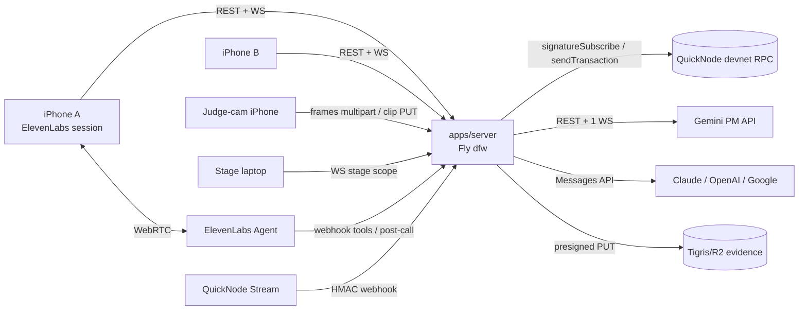
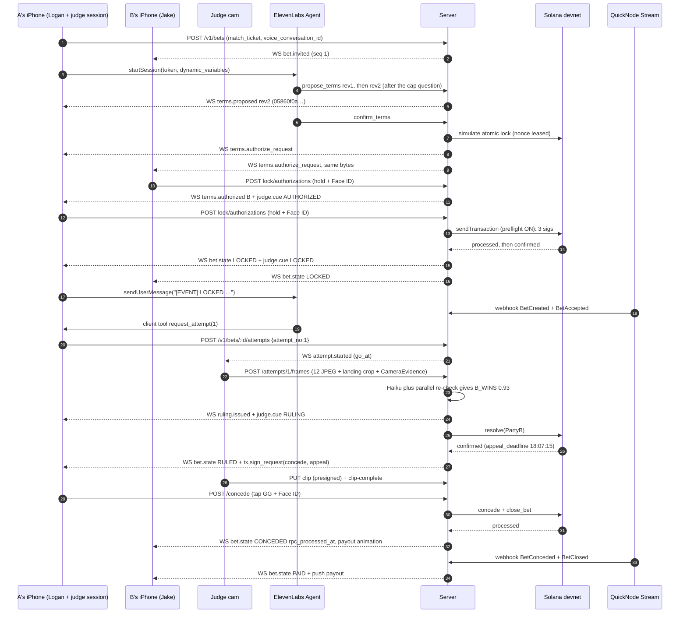

Status: DRAFT — Phase 0 planning written 2026-11-08 (before the build window). Re-author into the repo during the window; if committed verbatim, commit it as 'docs: import Phase 0 planning (written pre-window)'.

# API-CONTRACT — mobile ↔ server ↔ integrations

The wire contract for `apps/server`: the REST API the iPhones call, the realtime WebSocket, the ElevenLabs and QuickNode webhooks, the Solana transaction contracts, and the internal model calls. Shapes are named by their SCHEMAS.md type (`Terms`, `TermsEnvelope`, `PartyAuthorization`, `RealtimeEvent`, …) and never redefined. Types this doc introduces are **API-owned** (§2.18) and belong in `packages/shared/src/api.ts`.

Authority order: lead-engineer decisions D1–D7 (README.md) > FINDINGS.md (Phase-0 roll-up; each spike's Verification wins) > SCHEMAS / ESCROW-PROGRAM / DATA-MODEL. Ownership: SCHEMAS owns types, ESCROW the onchain side, DATA-MODEL tables; this doc owns endpoints, realtime events and voice tools. The core specs now describe the atomic lock (D3) too; the 2026-11-08 consistency pass aligned this doc to them. Conflicts and their status are in §9.

---

## Summary (one screen)

| Surface | Path | Auth | Owner of the shape |
|---|---|---|---|
| Mobile REST | `https://<host>/v1/...` | bearer session + device-key request signature on writes (§1.3) | this doc + SCHEMAS |
| Realtime | `wss://<host>/v1/ws` | bearer in the first frame | SCHEMAS §10 envelope + §3 here |
| ElevenLabs webhook tools | `POST /el/tools/{name}` | `X-YO-Tool-Secret` (workspace secret) | §4 |
| ElevenLabs post-call | `POST /webhooks/elevenlabs` | `ElevenLabs-Signature` HMAC (SDK verify) | §4.6 |
| QuickNode Stream | `POST /webhooks/quicknode` | `X-QN-Signature` HMAC | §5 |
| Stage view | `GET /stage` + the same WS, stage-scoped token | stage key | §2.17, §3 |

- **Money moves only on device signatures.** A face match returns a candidate and a 60 s `match_ticket` that can only address a challenge (D1). The lock is one server-built transaction `[AdvanceNonce, ComputeBudget…, create_bet, accept_bet]` on a durable nonce. Both phones receive the identical message bytes in `terms.authorize_request` (SCHEMAS `AuthorizeRequest`), run the device signing policy (§6.3), and sign at their own hold + Face ID in either order. The server submits once, with preflight ON, at the second `PartyAuthorization` (D2, D3).
- **The two lanes are fixed.** The server's own `signatureSubscribe` drives the UX: `processed` triggers the payout animation, `confirmed` triggers LOCKED/RULED. The QuickNode webhook writes the authoritative state and drives PAID/VOIDED (SCHEMAS X10, FINDINGS §3.12).
- **Voice runs as one ElevenLabs session per bet on A's phone** (D6). The LLM can call 5 webhook tools and 3 client tools, and none of them moves money. Every server result reaches the judge as a `judge.cue` event, which A's phone passes to `sendUserMessage("[EVENT] …")`.
- **Every write is idempotent.** Domain keys (DATA-MODEL §8.6) are the guarantee; the `Idempotency-Key` header gives replay-safe retries over cellular. Errors share one envelope and a closed code catalogue (§1.5).
- **Latency budgets come from the BRIEF §6 targets.** Face match < 1 s; judge first audio < 1.5 s; second authorization → LOCKED < 2 s; STOP → ruling audio < 4 s; concede/finalize → payout visible < 1 s. Each endpoint's server share is in §1.8. Every number that depends on a key, a phone or SOL is **PENDING** (FINDINGS §6).



Contents: [1 Conventions](#1-conventions) · [2 REST](#2-mobile--server-rest) · [3 Realtime](#3-server--client-realtime) · [4 ElevenLabs](#4-elevenlabs-integration-contract) · [5 QuickNode](#5-quicknode-stream-contract) · [6 Solana txs](#6-solana-transaction-contracts) · [7 Internal services](#7-internal-services) · [8 Trace](#8-end-to-end-trace-beat-2--beat-4) · [9 Conflicts and open items](#9-conflicts-proposed-edits-pending) · [Changelog](#changelog)

---

## 1. Conventions

### 1.1 Base URLs and environments

| Env | REST / WS base | Notes |
|---|---|---|
| `prod` (demo) | `https://<FLY_APP>.fly.dev` (app name fixed at `fly launch` on Fri; **PENDING**) | Fly.io `dfw`, `shared-cpu-1x` 512 MB, `min_machines_running=1`, `auto_stop_machines="off"` (FINDINGS §3.13). It also serves `/stage`. It must be on public HTTPS **before** the Stream and the ElevenLabs tools are created. |
| `dev` | `http://localhost:8080`, plus a **named** tunnel for webhooks | Quick tunnels change URL on restart and can get NXDOMAIN-cached (FINDINGS §7), so they are not fit for the Stream or for tool registrations. |

- One origin serves REST, WS and the stage. Phones don't need CORS. Phones never talk to Gemini, QuickNode, Postgres or object storage directly; the one exception is the presigned clip PUT (§2.9).
- **Route mapping from the spikes** (FINDINGS §3.13): `POST /el/tools/:name` is kept. `GET /el/token` becomes `POST /v1/voice/tokens`. `POST /webhooks/quicknode` is kept. `POST /attempts/:id/frames` becomes `POST /v1/bets/:bet_id/attempts/:n/frames`.

### 1.2 Versioning

- The URL prefix is `/v1` for mobile REST and WS. Integration webhooks are unversioned (their senders' payloads are versioned by the sender).
- Request headers: `X-App-Version: <semver>+<eas build number>` and `X-Schema-Version: 1` (SCHEMAS `SCHEMA_VERSION`). The server rejects `X-App-Version` < `min_app_version` with `426 APP_UPDATE_REQUIRED`.
- The realtime envelope carries `v` (SCHEMAS §10.1). The server serves `v` and `v-1` for the rest of the hackathon, because EAS builds lag the server (SCHEMAS §11, rule 3). Hashed records are versioned by `schema_version` (SCHEMAS §11).
- `GET /v1/config` returns `{cluster, program_id, mint, fee_payer, judge_authority, appeal_authority, nonce_seed_prefix, nonce_seed_max, max_stake, schema_version, envelope_v, min_app_version, lock_mode}`. **The phone does not take signing-policy pins from it.** `program_id`, `mint`, `fee_payer` and `nonce_seed_prefix` are compiled into the app from the committed `packages/shared` constants (ESCROW §10.2, SETUP-CHECKLIST §4), and `/v1/config` serves only to detect a mismatch. On a mismatch the phone refuses to sign and shows "Update the app".

### 1.3 Authentication

**Keys on the phone.** Both seeds live in `expo-secure-store` with `WHEN_UNLOCKED_THIS_DEVICE_ONLY` and **no** `requireAuthentication` (D2, FINDINGS §3.4).

| Key | Purpose | Gate | Notes |
|---|---|---|---|
| Wallet key (ed25519) | Signs Solana messages only: lock, concede, appeal | hold (lock) or tap (GG, appeal) + `authenticateAsync` (Face ID, then passcode) at **every** signature | = `users.wallet_pubkey`. Seed generated with `Crypto.getRandomValues` (never `getRandomBytes`). |
| Device auth key (ed25519) | Signs login challenges and API write requests | none | = `devices.device_pubkey`. **Separate from the wallet key** (conflict C3, §9). The `.userPresence` upgrade path (FINDINGS §3.4) would otherwise prompt Face ID on every API call. |

**Domain separation.** Every non-transaction signature covers bytes that start with an ASCII tag (`yo-auth-v1\n`, `yo-bind-v1\n`, `yo-req-v1\n`). Read as a Solana message, a leading `0x79` declares 121 required signers (or a versioned prefix with an invalid version), and no such message fits in 1,232 bytes. So no API signature can double as a transaction signature.

**Signup, login, demo claim**

```
POST /v1/auth/challenge  {device_pubkey}                       -> {challenge_id, nonce, expires_at (+60 s), server_time}
POST /v1/auth/signup     {challenge_id, display_name, age_attestation{is_18_plus:true, attested_at},
                          wallet_pubkey, device_pubkey, device_sig, wallet_sig, app_version} -> Session
POST /v1/auth/session    {challenge_id, device_pubkey, device_sig}                          -> Session   (login)
POST /v1/auth/demo-claim {claim_token, device_pubkey, device_sig}                           -> Session + demo wallet seed (DEMO_MODE only)
DELETE /v1/auth/session                                                                    -> 204
```

- `device_sig` = ed25519 by the device key over `yo-auth-v1\npurpose=<signup|login|demo-claim>\nchallenge=<nonce>\ndevice=<device_pubkey>\nwallet=<wallet_pubkey or ->\n`.
- `wallet_sig` = ed25519 by the wallet key over `yo-bind-v1\nwallet=<wallet_pubkey>\ndevice=<device_pubkey>\nchallenge=<nonce>\n`. At signup the seed is still in memory, so this needs no Face ID; it proves the phone holds the wallet key once.
- Login takes **any** existing registered device key. Keychain items survive a reinstall with the same bundle ID (FINDINGS §7), so a reinstall logs in rather than re-signing up.
- **Demo claim** issues the custodial seed of one of the 3–4 team accounts (FINDINGS §3.4). The `claim_token` comes from a stage-issued QR (§2.17), is single-use and lives 10 min; the response carries `wallet_seed_b64` exactly once. It returns 404 unless `DEMO_MODE=true`. The README must say these accounts are custodial.

**Session.** `Session = {token: "yo_s_<base64url 32 B>", session_id, user: UserRef, device_id, expires_at (+7 d), server_time}`. The server stores `sha256(token)` (DATA-MODEL §5.21 `api_sessions`). On `401 SESSION_EXPIRED` the app re-runs login silently with the device key (no prompt).

**Request signing (all `POST`/`PUT`/`PATCH`/`DELETE` except `/v1/auth/*`)**

| Header | Value |
|---|---|
| `Authorization` | `Bearer <token>` |
| `X-YO-Device` | `device_id` (uuid) |
| `X-YO-Timestamp` | unix **milliseconds** (device clock corrected by the `server_time` offset) |
| `Idempotency-Key` | UUIDv4. It is also the request nonce. |
| `X-YO-Signature` | base64url (no padding) ed25519 by the device key over the string below |

```
yo-req-v1\n<METHOD>\n<path?query exactly as sent>\n<X-YO-Timestamp>\n<Idempotency-Key>\n<session_id>\n<hex sha256(raw body bytes)>
```

- **Replay window.** |server_now − timestamp| ≤ 60 s, else `401 CLOCK_SKEW` with `details.server_time`. `(device_id, Idempotency-Key)` is remembered for 24 h. A repeat with the same body hash replays the stored response (§1.6); a repeat with a different hash returns `409 IDEMPOTENCY_KEY_REUSED`.
- `GET`s carry the bearer token only.
- The WS authenticates with the bearer token in its first frame, never in the URL (§3.1).
- Multipart bodies are signed over the raw bytes as sent.

**Stage and demo.** `POST /v1/stage/session {stage_key}` returns a stage token with scope `stage` (read-only fan-out for one room), plus scope `demo` when `DEMO_MODE=true`. Demo controls (§2.17) also require `X-YO-Demo-Key`.

### 1.4 JSON, money, time

- JSON is snake_case, except the Gemini mirrors (SCHEMAS §0, §0.3). Request bodies are parsed with tolerant `z.object` (unknown keys stripped). Hashed records are rebuilt strictly server-side.
- **Money is always a `MicroUsdc` string** (SCHEMAS §1.1), never a JSON number. Display strings come alongside as `*_display`, produced by the shared `formatUsd`. API-owned `SignedMicroUsdc` (`^-?(0|[1-9][0-9]{0,19})$`) exists only for net results such as head-to-head.
- Timestamps are `IsoUtc` (ms). Onchain-mirroring fields are unix seconds (SCHEMAS §0). `X-YO-Timestamp` is unix ms.
- Ids are UUIDv4. Pubkeys and tx signatures are base58. Hashes are `Hex32`. Binary in JSON is base64 (standard, padded): `message_b64`, `embedding` ciphertext.
- Pagination is `?cursor=<opaque>&limit=<1..50>` and returns `{items, next_cursor|null}`.
- Size limits: JSON body 64 KB; frames multipart 3 MiB (12 frames + the landing crop, each ≤ 200 KB, §2.9); hearing audio 1 MB; clip PUT 25 MB (DATA-MODEL §9); QuickNode webhook 1 MiB. Larger bodies return `413 PAYLOAD_TOO_LARGE`. A body above 64 KB without a `Content-Length` (chunked) is capped as the route reads it, after its auth / header checks, never buffered before them.
- Every response carries `X-Request-Id`; a client-supplied one is echoed back.

### 1.5 Errors

```json
{ "error": { "code": "LOCK_EXPIRED", "message": "The lock-in window closed. Nothing moved.",
             "retryable": false, "details": { "accept_deadline": 1795284612 }, "request_id": "req_01J…" } }
```

`message` is user-presentable English, so the app can show it as-is. `details` is code-specific. Program errors carry `details.program_error = {code, name}`, using the ESCROW §8.1 numbers.

| Code | HTTP | Retry | Meaning / typical source |
|---|---|---|---|
| `AUTH_REQUIRED` | 401 | no | Missing or invalid bearer |
| `SESSION_EXPIRED` | 401 | after re-login | Token past `expires_at` |
| `SIGNATURE_INVALID` | 401 | no | `X-YO-Signature`, `device_sig` or `wallet_sig` failed to verify |
| `CLOCK_SKEW` | 401 | yes, re-sign | Timestamp outside ±60 s; `details.server_time` |
| `CHALLENGE_EXPIRED` | 401 | new challenge | Auth challenge older than 60 s or already used |
| `DEVICE_REVOKED` | 403 | no | `devices.revoked_at` set |
| `AGE_REQUIRED` | 403 | no | 18+ attestation missing or false, at signup, or for either party at `POST /v1/bets` |
| `NOT_A_PARTY` | 403 | no | Caller is not A or B (or the wrong one) |
| `NOT_LOSER` | 403 | no | Concede or appeal by the winner (ESCROW 6017) |
| `NOT_IN_ROOM` | 403 | no | Face match or challenge outside the caller's room |
| `APP_UPDATE_REQUIRED` | 426 | no | `X-App-Version` < `min_app_version`, or pin mismatch |
| `VALIDATION_FAILED` | 422 | no | Zod issues in `details.issues[]` (path, message) |
| `PAYLOAD_TOO_LARGE` | 413 | no | §1.4 limits |
| `IDEMPOTENCY_KEY_REUSED` | 409 | no | Same key, different body |
| `NOT_FOUND` | 404 | no | Unknown bet, room or attempt. Also every demo route when `DEMO_MODE=false`. |
| `ROOM_EXPIRED` | 410 | no | Room `closed_at` set or past `expires_at` |
| `INVALID_STATE` | 409 | re-read | Action not allowed in `details.state` |
| `STATE_MOVED_ON` | 409 | re-read | Chain says `InvalidStatus` / `AccountNotInitialized`. **Never treated as success** (ESCROW §8.1). |
| `TERMS_NOT_FINAL` | 409 | wait | Asked for the final terms or the lock before `AWAITING_AUTHORIZATIONS` |
| `TERMS_HASH_MISMATCH` | 409 | re-fetch | Submitted `terms_hash` ≠ the bet's frozen hash |
| `MESSAGE_MISMATCH` | 409 | re-fetch | `message_sha256` ≠ stored message, or the signature doesn't verify over the stored bytes |
| `SIGN_REQUEST_EXPIRED` | 410 | re-fetch | Blockhash-lifetime request past its validity (concede, appeal) |
| `LOCK_REVOKED` | 410 | no | Nonce already advanced (decline, expiry, terms change) |
| `LOCK_EXPIRED` | 410 | no | `expires_at` (= `accept_deadline` − 5 s) passed (skill: build + 300 s; gemini: `quotedAt` + 60 s) |
| `STALE_LOCK_REQUEST` | 409 | re-fetch | `lock_request_id` is not the bet's current lock build (rebuilt or revoked); the server pushes the current `AuthorizeRequest` (SCHEMAS §9.4) |
| `LOCK_PREFLIGHT_FAILED` | 409 | maybe | RPC preflight rejected the lock; `details.program_error`. Nothing was charged, and the nonce didn't advance (FINDINGS §1). |
| `INSUFFICIENT_FUNDS` | 409 | after top-up | Token-program insufficient funds in preflight; `details.party` |
| `CONCEDE_NOT_ALLOWED` | 409 | no | `Split`/`Refund` outcome (ESCROW 6018) |
| `APPEAL_WINDOW_CLOSED` | 409 | no | Now ≥ `appeal_deadline − 1 s` (UI rule, ESCROW §8.3), or the program says 6024 |
| `ATTEMPT_NOT_OPEN` | 409 | no | Frames for an attempt that isn't the current `ATTEMPT` |
| `FRAME_HASH_MISMATCH` | 422 | re-extract | A JPEG's sha256 ≠ `evidence.frames[i].sha256` |
| `EVIDENCE_HASH_MISMATCH` | 422 | no | Stored clip sha256 ≠ `clip_sha256` (bet flagged, DATA-MODEL §9) |
| `FACE_CONSENT_REQUIRED` | 412 | after consent | Enrollment without a current consent record |
| `FACE_NOT_ENROLLED` | 409 | no | Disable or delete with no enrollment |
| `FACE_MODEL_UNSUPPORTED` | 422 | no | `model_name@version` / dim not accepted |
| `FACE_SEAL_INVALID` | 400 | no | Sealed embedding failed to open (AAD, key or format) |
| `STAKE_OUT_OF_RANGE` | 422 | no | Outside `[MIN_STAKE, max_stake]` or not whole cents |
| `MARKET_UNAVAILABLE` | 409 | maybe | `details.reason` ∈ SCHEMAS `FairRefusal` |
| `NONCE_POOL_EXHAUSTED` | 503 | yes (1 s) | All leased; the server adds the next seed index, up to `NONCE_SEED_MAX` = 16 (DATA-MODEL §5.20). Under `DEMO_MODE` also when a bet that is not between two demo accounts would take one of the last 2 free nonces, or its parties already hold a lease (the lock fails `nonce_pool_exhausted`) |
| `ESCROW_PAUSED` | 503 | no | `Config.paused` (ESCROW 6003) |
| `RPC_UNAVAILABLE` | 503 | yes | QuickNode RPC down or 429 |
| `UPSTREAM_TIMEOUT` / `UPSTREAM_ERROR` | 504 / 502 | yes | ElevenLabs token mint, STT, Gemini REST |
| `RATE_LIMITED` | 429 | after `Retry-After` | §1.7 |
| `INTERNAL` | 500 | yes (once) | Bug; logged with `request_id` |

Program-error mapping for device-signed submits: `InvalidDeadline`/`AcceptDeadlinePassed` → `LOCK_EXPIRED`. `TermsHashMismatch`/`StakeMismatch`/`PartyMismatch`/`SameParty` → `LOCK_PREFLIGHT_FAILED`; this is a server bug, so page the lead. `InvalidStatus` → `STATE_MOVED_ON`. `NotLoser` → `NOT_LOSER`. `AppealWindowClosed` → `APPEAL_WINDOW_CLOSED`. `ConcedeNotAllowed` → `CONCEDE_NOT_ALLOWED`. `Paused` → `ESCROW_PAUSED`. Blockhash not found → `SIGN_REQUEST_EXPIRED`.

### 1.6 Idempotency

- **Header.** Every signed write needs an `Idempotency-Key` (it is also the nonce, §1.3). The server caches `(device_id, key) → (body_sha256, status, response)` for 24 h. A replay returns the stored response with `Idempotent-Replayed: true`. In the P0 build the cache is an in-process LRU, which is fine with one Fly machine; P1 moves it to the `api_idempotency` table (DATA-MODEL §8.6).
- **Domain keys are the guarantee** (DATA-MODEL §8.6); they hold even across cache loss. Each endpoint lists its key in §2. Examples: a `PartyAuthorization` per `(lock_request_id, party)` while the lock row is `built`/`signed`; an attempt per `(bet_id, attempt_no)`; evidence per `(bet_id, attempt_no, clip_sha256)`; a tool call per `(voice_session_id, el_tool_call_id)`; a chain event per `(signature, outer_ix, inner_ix)`.
- **Never re-sign on retry.** A phone that lost the response to a signed submit resends the **same** signature with the same key. The server never rebuilds a message after collecting a signature (FINDINGS §3.5).

### 1.7 Rate limits

Token buckets in process (one machine). The response is `429 RATE_LIMITED` with `Retry-After` in seconds.

| Bucket | Limit | Scope | Why |
|---|---|---|---|
| `auth/*` | 10/min | IP and `device_pubkey` | brute force |
| `face-match` | 30/min, 1 in flight | user | privacy: no bulk scanning (BRIEF 5e) |
| `face-match/live` | 60/min; shares the `face-match` in-flight slot | user | the live (panning) scan, `mode:'live'` (§2.4): panning re-matches each face that re-enters the frame, so it gets its own bucket and can't use up the tap / Challenge path. Ceiling 90/min per user across both; still room-scoped, opted-in members only, ≤ 50 candidates, no score. The body is read before the token is taken, so an invalid body (422) spends none; a concurrent call is `429 {bucket:'face-match/in-flight'}` |
| `face/enrollment` writes | 5/h | user | |
| `POST /v1/bets` | 6/min, ≤ 3 pre-lock bets per user | user | spam challenges |
| lock authorization / decline | 10/min | bet + device | |
| attempts + frames | 6/min | bet | taken only after the party / recorder check: a stranger's 403 spends nothing; a `409 no_judge_cam` gives its token back (the two-phone fallback, §2.9) |
| appeal | 3/h | user | ESCROW TM-L9 |
| markets | 60/min | user | Gemini limit is 120 req/min with no headers (FINDINGS §7), so the server caches |
| `POST /v1/voice/tokens` | 6 / 10 min | user | each token opens a billed agent session of up to 20 min; under `DEMO_MODE` demo accounts only (`403 NOT_A_PARTY {reason:'demo_only'}`) |
| everything else | 120/min | session | |
| `/el/tools/*` | 30/min | conversation | runaway LLM loop |

### 1.8 Timeouts and latency budgets

- **Server budget** is p95 handler time excluding network. **E2E** is the BRIEF §6 target the call serves.
- Client timeouts: 8 s for JSON calls and 15 s for uploads, with one automatic retry using the same `Idempotency-Key` on network error or 5xx.
- Server-side outbound deadlines: RPC 2 s; Gemini REST 2 s; ElevenLabs token 3 s; ElevenLabs STT 6 s; LLM per §7.

| Endpoint | Server budget | E2E target it serves | Status |
|---|---|---|---|
| `POST …/face-match` | ≤ 30 ms (≤ 50 candidates, AES-GCM decrypt + cosine) | match < 1 s: 0.25–0.6 s phone + 80–250 ms RTT (E) | PENDING-PHONE |
| `POST /v1/bets` | ≤ 60 ms (DB + WS fan-out) | B's phone buzzes ≤ 0.5 s after the tap (E) | PENDING-PHONE |
| `POST /el/tools/propose_terms` | ≤ 25 ms (normText + Zod + JCS + sha256 + 1 DB write); tx build is async | judge first audio < 1.5 s: 0.8–1.3 s with forced pre-tool speech; 1.25–2.2 s after the tool (E) | PENDING-KEY |
| `POST …/lock/authorizations` (2nd) | ≤ 400 ms (verify < 5 ms + co-sign + `sendTransaction` with preflight) | 2nd authorization → LOCKED < 2 s: 0.70–1.39 s (E) | PENDING-SOL/PHONE |
| `POST …/attempts/:n/frames` | ≤ 50 ms to 202; the ruling runs async | STOP → first ruling audio ~2.7 s (E; 4 s target) | PENDING-KEY |
| `POST …/concede` | ≤ 250 ms to 202 (co-sign + send) | payout visible < 1 s at `processed`: 0.55–0.75 s (E) | PENDING-SOL |
| `POST /v1/voice/tokens` | ≤ 400 ms (ElevenLabs round trip) | pre-minted on the scan screen, so off the critical path | PENDING-KEY |
| `POST /webhooks/quicknode` | ≤ 150 ms to 2xx (one DB transaction) | Stream send → webhook 1–2.5 s (E) | PENDING-KEY |
| all other reads | ≤ 30 ms | — | — |

---

## 2. Mobile → server REST

Legend: **B** = bearer; **S** = signed write (§1.3); **U** = unauthenticated; **P** = party of this bet; **Idem** = the domain idempotency key (the header always applies to S routes).

### 2.0 Index

| # | Method + path | Auth | Purpose |
|---|---|---|---|
| — | `GET /health` | U | liveness for Fly and the cellular smoke check (TASKS D0-L3); no DB call |
| 2.1 | `POST /v1/auth/challenge` · `POST /v1/auth/signup` · `POST /v1/auth/session` · `POST /v1/auth/demo-claim` · `DELETE /v1/auth/session` | U / B | keys, age attestation, sessions |
| 2.1 | `GET /v1/me` · `PATCH /v1/me` · `POST /v1/me/avatar` · `DELETE /v1/me` · `GET /v1/config` | B / S | profile |
| 2.2 | `GET /v1/face/consent` · `POST /v1/face/enrollment` · `PATCH /v1/face/enrollment` · `DELETE /v1/face/enrollment` | B / S | biometric enrollment |
| 2.3 | `POST /v1/rooms` · `POST /v1/rooms/join` · `POST /v1/rooms/:room_id/leave` · `GET /v1/rooms/:room_id/presence` | S / B | rooms |
| 2.4 | `POST /v1/rooms/:room_id/face-match` | S | probe → candidate or nothing |
| 2.5 | `POST /v1/bets` · `POST /v1/bets/:bet_id/invite/accept` · `POST /v1/bets/:bet_id/invite/decline` · `POST /v1/bets/:bet_id/rematch` | S | challenge; double or nothing |
| 2.6 | `POST /v1/voice/tokens` · `POST /v1/bets/:bet_id/voice/lines` · `POST /v1/bets/:bet_id/cues` | S | ElevenLabs token; transcript and cue relay |
| 2.7 | `GET /v1/bets/:bet_id/terms/draft` · `GET /v1/bets/:bet_id/terms` · `POST /v1/bets/:bet_id/terms/dance` | B+P / S+A | draft and final terms; Dance Off terms |
| 2.8 | `GET /v1/bets/:bet_id/lock` · `POST /v1/bets/:bet_id/lock/authorizations` · `POST /v1/bets/:bet_id/lock/decline` | B+P / S+P | atomic-lock authorization |
| 2.9 | `POST /v1/bets/:bet_id/attempts` · `POST …/attempts/:n/frames` · `POST …/attempts/:n/dance` · `POST …/attempts/:n/clip-upload` · `POST …/attempts/:n/clip-complete` | S+P | evidence |
| 2.10 | `GET /v1/bets/:bet_id/concede` · `POST /v1/bets/:bet_id/concede` | B+P / S+P | GG |
| 2.11 | `POST /v1/bets/:bet_id/hearing/turns` | S+P | hearing turn |
| 2.12 | `GET /v1/bets/:bet_id/appeal` · `POST /v1/bets/:bet_id/appeal` | B+P / S+P | appeal |
| 2.13 | `GET /v1/markets/btc5m/current` · `GET /v1/markets/btc5m/quote` | B | Gemini closer |
| 2.14 | `GET /v1/me/balance` · `GET /v1/me/bets` · `GET /v1/bets/:bet_id` · `GET /v1/bets/:bet_id/events` · `GET /v1/bets/:bet_id/replay` · `GET /v1/users/:user_id/head-to-head` | B | reads, resync, slow-mo replay |
| 2.15 | `PUT /v1/devices/current/push` · `PATCH /v1/devices/current` | S | push token, device role |
| 2.17 | `POST /v1/stage/session` · `/v1/demo/*` | stage key / demo | stage and demo controls |
| 2.19 | `POST /v1/bets/:bet_id/odds/offer` · `POST …/odds/:offer_id/accept` · `POST …/odds/:offer_id/withdraw` · `POST …/odds/suggest` | S | odds offers / counters, the judge's suggested odds |

### 2.1 Auth and profile

Flows are in §1.3.

- **`POST /v1/auth/signup`** returns 201 `Session`.
  - Errors: `AGE_REQUIRED`, `SIGNATURE_INVALID`, `CHALLENGE_EXPIRED`, `VALIDATION_FAILED` (the display name must pass SCHEMAS `DisplayName`), `409 INVALID_STATE` (wallet already registered: use login).
  - Effects: `users` row (`age_attested_18plus`, `attested_at`, `wallet_kind='device_keypair'`); `devices` row (`device_pubkey`, `platform='ios'`); `audit_log 'user.signed_up'`.
  - Idem: `wallet_pubkey` UNIQUE. A repeat with the same wallet and device keys returns the existing user.
- **`GET /v1/me`** returns `{user: UserRef, age_attested_18plus, face: {status: 'none'|'active'|'disabled', consent_version|null}, devices: [{device_id, role, app_version, last_seen_at}]}`.
- **`PATCH /v1/me`** (S) takes `{display_name}`. A new name affects only future `Terms` snapshots (SCHEMAS §2.2).
- **`POST /v1/me/avatar`** (S) takes `{content_type: 'image/jpeg', bytes}` and returns `PresignedUpload` for `avatars/{user_id}/{uuid}.jpg` (DATA-MODEL §9). The avatar is an opt-in profile photo, **never the enrollment selfie**.
- **`DELETE /v1/me`** (S) anonymizes the user per DATA-MODEL §5.1. Devices and the face enrollment are hard-deleted. Bets are kept.

### 2.2 Face enrollment (opt-in; embeddings only, never images)

- **`GET /v1/face/consent`** returns `{consent_version: "face-consent-v1", text, text_sha256, retention_summary, face_seal_pubkey: <x25519 base64>, accepted_models: [{name:"w600k_mbf", version:"buffalo_s-fp32", dim:512}, {name:"sface", version:"2021dec", dim:128}]}`.
- **`POST /v1/face/enrollment`** (S):
  - Request `FaceEnrollmentRequest`: `{consent: {consent_version, consent_text_sha256, consent_at}, liveness: {method: 'blink'|'head_turn', passed_at}, model: {name, version, dim}, embedding: SealedEmbedding, shots: 3}`.
  - The phone enrolls 3 stills across poses, averages them, L2-normalises, then seals the result (FINDINGS §3.2).
  - Response 201: `{status:'active', enrolled_at}`.
  - Errors: `FACE_CONSENT_REQUIRED` (unknown version, hash mismatch, `consent_at` > now), `FACE_MODEL_UNSUPPORTED`, `FACE_SEAL_INVALID`.
  - Effects, in order: `audit_log 'face.consented'`; then a `face_enrollments` row (replacing any old row), re-encrypted at rest with the KEK and AAD of DATA-MODEL §10; then `'face.enrolled'`.
  - Logging: request bodies on `/v1/face/*` are **never logged**; only route, status and latency are (DATA-MODEL §10).
- **`PATCH /v1/face/enrollment`** (S) takes `{status:'active'|'disabled'}`. Disabling excludes the user from matching immediately.
- **`DELETE /v1/face/enrollment`** (S) returns 204. It hard-deletes the row, evicts the room caches and writes `audit_log 'face.deleted'` (DATA-MODEL §10). Idem: deleting nothing still returns 204.

`SealedEmbedding = {alg: 'x25519-hkdf-sha256-chacha20poly1305-v1' | 'plain-v0', epk_b64, nonce_b64, ct_b64}`.

- The ciphertext is the float32-LE vector: 2,048 B at 512-d. The AAD is `"yo.face.seal.v1|" + purpose + "|" + user_id + "|" + (room_id ?? "-") + "|" + model + "@" + version + "|" + dim`, with `purpose` ∈ {`enroll`, `probe`}, so a captured probe can't be replayed as an enrollment.
- `plain-v0` is accepted only while `FACE_SEAL_REQUIRED=false`, as the fallback if the cipher lib slips; it is TLS-only.
- The libraries are `@noble/curves` x25519 and `@noble/ciphers`. The `@noble/ciphers` version was **not checked in Phase 0: pin it in the window**.

### 2.3 Rooms and presence

- **`POST /v1/rooms`** (S) takes `{name?, kind:'session'}` and returns 201 `{room_id, code, qr_payload: "youreon://room/<code>", expires_at}`. The creator is joined.
- **`POST /v1/rooms/join`** (S) takes `{code}` or `{qr_payload}` and returns `{room: RoomSummary, members: RoomMember[]}`. Errors: `NOT_FOUND`, `ROOM_EXPIRED`, `403 NOT_IN_ROOM {reason:'demo_room'}`. Idem: `room_members` PK; a re-join clears `left_at`.
- **The demo room (`DEMO_MODE=true`).** A room created by a demo account (`users.is_demo`, or the demo-a / demo-b wallet), or one with a live stage session, admits only demo accounts: anyone else's join is `403 NOT_IN_ROOM {reason:'demo_room'}`, and `POST /v1/bets` there needs both parties to be demo accounts (same error, `details.party`). The projector shows every bet of its room (§3.1) and its code is on screen, so this keeps strangers' bets, captions and cues off it, and keeps them from challenging demo B.
- **`POST /v1/rooms/:room_id/leave`** (S) returns 204 and sets `left_at`. A member who has left is no longer a match candidate.
- **`GET /v1/rooms/:room_id/presence`** (B, member) returns `{members: RoomMember[]}` with `RoomMember = {user: UserRef, face_enrolled: boolean, online: boolean, last_seen_at}`. `online` means a live WS within 30 s. The same list is pushed as the WS control frame `room.presence` (§3.2).
- Demo: seeded room `UBC26X` (DATA-MODEL §11).

### 2.4 Face match (addresses only; D1)

**`POST /v1/rooms/:room_id/face-match`** (S, room member)

- Request `FaceMatchRequest`: `{probe: SealedEmbedding (purpose 'probe'), model: {name, version, dim}, capture: {captured_at, eye_distance_px, yaw_deg}, mode?: 'tap'|'live'}`.
  - `mode` (optional, absent = `'tap'`) only picks the rate-limit bucket (§1.7: `face-match` 30/min for tap, `face-match/live` 60/min for live). Matching, privacy and the reply are the same. An older server strips it and charges the tap bucket; the live client then backs off on 429 silently.
- Response 200 `FaceMatchResponse`, one of:
  - `{match: {user: UserRef, match_ticket, ticket_expires_at, head_to_head: HeadToHead}}`
  - `{match: null}`
- **No score is ever returned.**
- Server steps:
  1. Open the probe in memory.
  2. Load the candidates of the caller's room (DATA-MODEL §7.2): active, same model and version, excluding the caller.
  3. Compute cosine top-2. Accept only when cos ≥ 0.30 **and** top1 − top2 ≥ 0.05 (FINDINGS §3.2; T is tuned on the team, and never below the highest stranger score plus a margin).
  4. Otherwise return `{match:null}` and store nothing.
  5. The probe is never written to a row, a log or a cache (DATA-MODEL §10).
  6. Update the matched user's `last_used_at` (day-truncated).
- `match_ticket` is an opaque 60 s token that binds `{scanner, candidate, room}`. Its only use is `POST /v1/bets` with `challenge_method:'face'`.
- `head_to_head` serves the Extra beat ("You're 4-7 against Jake") without a second round trip, and the live rivalry overlay (record, streak, "Rivals"; §2.18 `HeadToHead`).
- Errors: `NOT_IN_ROOM`, `ROOM_EXPIRED`, `FACE_SEAL_INVALID`, `FACE_MODEL_UNSUPPORTED`, `RATE_LIMITED`.
- Idem: none needed; the call has no side effects beyond `last_used_at`.

### 2.5 Challenge

**`POST /v1/bets`** (S): create the challenge (Beat 1)

- Request `CreateBetRequest`:
  - `room_id`
  - `opponent_user_id`
  - `challenge_method: 'face'|'list'|'link'`
  - `match_ticket` (required for `face`)
  - `voice_conversation_id` (the pre-minted token's `conversation_id`, §2.6)
- Response 201: `{bet: BetSnapshot (state DRAFTING), voice: {dynamic_variables: {bet_id, party_a_name, party_b_name, max_stake_usd: "20"}}}`. The app passes `dynamic_variables` verbatim to `startSession`.
- Errors:
  - `AGE_REQUIRED` (either party);
  - `NOT_IN_ROOM` (either party; `details.reason='demo_room'`: a non-demo party in the demo room, §2.3);
  - `VALIDATION_FAILED` (self-challenge, or a bad or expired ticket);
  - `409 INVALID_STATE` (`details.reason='pair_busy'`: a pre-lock bet between the same two users already exists);
  - `RATE_LIMITED`.
- Effects:
  - `bets` row; the server generates `bet_id`, which equals the onchain `bet_id` (SCHEMAS §1.2).
  - The voice session is bound: `voice_sessions(el_conversation_id → bet_id)`.
  - Events: `bet.invited` on B's user channel (seq 1), then `bet.state DRAFTING` (seq 2).
  - Outbox `challenge_received` to B.
- Idem: the header only. Two taps make two bets; the UI disables the button after the first tap.

**`POST /v1/bets/:bet_id/invite/accept`** (S, B)

- Response 200: `{bet: BetSnapshot}`.
- Effects: event `bet.invite_answered {answer:'accepted'}` (NEW, §3.4). The state is unchanged. If the voice judge's `confirm_terms` was refused `INVITE_PENDING` for the current terms, also `judge.cue INVITE_ACCEPTED` (spoken), so the judge calls `confirm_terms` again.
- **This is not an authorization.** It only tells the room and the judge "Jake's in". Negotiation can start before B taps it. It is, however, the consent gate for freezing the terms: `confirm_terms` (voice and typed) is refused until it is in the log, checked under the bet row lock.
- Idem: `(bet_id, 'B')`.

**`POST /v1/bets/:bet_id/invite/decline`** (S, B)

- Allowed in `DRAFTING` and `TERMS_PROPOSED`. After that, B declines through §2.8.
- Effects: state `CANCELLED`, `end_reason='declined'`; `judge.cue DECLINED`.

**`POST /v1/bets/:bet_id/rematch`** (S, A or B): double or nothing (DANCE-OFF §7, every bet type)

- Request `RematchRequest = {}`. Allowed only once the bet is over: `PAID`, `VOIDED`, `FINALIZED` or `EXPIRED` (else `409 INVALID_STATE {reason:'not_finished'}`; a seed history row or a bet without a room is `409 {reason:'no_rematch'}`).
- Creates a new `DRAFTING` bet in the **same room** with the **caller as A** and the other party as B, `supersedes_bet_id` = this bet, `challenge_method 'list'`. It goes through the same code as `POST /v1/bets` (room live, both still members, demo room, age, `pair_busy`, the open-bet cap, the 6/min `bets` bucket), so every effect of a challenge applies: `bet.invited` (+ **NEW** `rematch_of`, `suggested_stake_usd`) then `bet.state DRAFTING`, outbox `challenge_received` to B ("Logan wants a rematch" / "Double or nothing?"), an audit row.
- `suggested_stake_usd` = 2 × the old per-side stake (the larger side of an odds bet), capped at max_stake, in dollars to the cent (`suggestedRematchStakeUsd`); $5 when the old bet never had stakes. It is only the stake chip's default: the challenger then picks ANY bet type on the normal negotiate screen.
- Response 201: `RematchResponse {bet_id, suggested_stake_usd}` plus the `CreateBetResponse` fields `bet` (BetSnapshot, DRAFTING) and `voice.dynamic_variables`, so the phone can open the negotiate screen at once.
- Idem: a repeat by the same caller while its rematch is still pre-lock answers that rematch again (201, same `bet_id`). The other party asking meanwhile gets `409 INVALID_STATE {reason:'pair_busy', bet_id}`.
- Errors: `NOT_A_PARTY`, `NOT_FOUND`, `INVALID_STATE`, `NOT_IN_ROOM`, `ROOM_EXPIRED`, `AGE_REQUIRED`, `RATE_LIMITED`.

### 2.6 Voice session token and relays

**`POST /v1/voice/tokens`** (S): mint an ElevenLabs conversation token

- Request: `{purpose: 'terms', bet_id?: Uuid}`.
- Response 201 `VoiceTokenResponse`: `{conversation_token, conversation_id, agent_id, voice_session_id, expires_at|null}`.
- The server calls `GET https://api.elevenlabs.io/v1/convai/conversation/token?agent_id=<AGENT_ID>` with `xi-api-key`. The response is `{token, conversation_id}` (C: live OpenAPI, read 2026-11-08). The server stores `voice_sessions` (status `active`, `el_conversation_id`).
- **Token lifetime is undocumented** (FINDINGS §7). Treat each token as single-use. The app pre-mints when the scan screen opens and re-mints if the token is unused after 10 min (**PENDING-KEY**: measure the real lifetime).
- Only A's phone hosts the session (D6), so a B caller gets `403 NOT_A_PARTY` once `bet_id` is given.
- 6 tokens per 10 min per user (§1.7). Under `DEMO_MODE` only demo accounts mint (`403 NOT_A_PARTY {reason:'demo_only'}`); the app then falls back to typed terms.
- Errors: `UPSTREAM_TIMEOUT`, `UPSTREAM_ERROR`.

**`POST /v1/bets/:bet_id/voice/lines`** (S, A): transcript relay

- Request: `{lines: [{utterance_id, role: 'judge'|'party', party?: Party, text, final: boolean, at}]}`. A's phone batches the SDK `agent_response` and `user_transcript` client events every ≤ 250 ms.
- Response: 202.
- Effects: `judge.line` / `party.line` events (SCHEMAS §10.1) for the stage's live transcript, which is ElevenLabs bounty evidence.
- Idem: `utterance_id` + `final`.

**`POST /v1/bets/:bet_id/cues`** (S, A)

- Request: `{kind: 'gavel'|'drumroll'|'buzzer'|'cheer'}`.
- Response: 202.
- Sent by the `cue` client tool (§4.4). The server relays a `stage.cue` control frame. The stage laptop plays the Sound Effects clip; A's phone does not, because that would stop mic capture (FINDINGS §4, LiveKit #286). When the server's Sound Effects are live (`SFX_PROVIDER=live`, or the default `auto` with the ElevenLabs key, §4.5) the frame carries `audio_url` (`GET /v1/stage/sfx/:kind`); without it the stage synthesizes the cue.

### 2.7 Terms

- **`GET /v1/bets/:bet_id/terms/draft`** (B+P) returns `{draft: TermsDraft}`, the latest revision (SCHEMAS §3).
- **`GET /v1/bets/:bet_id/terms`** (B+P) returns `{envelope: TermsEnvelope, revision, final: boolean, terms_code}`.
  - `final` is true from `AWAITING_AUTHORIZATIONS` on, when the binding fields are frozen.
  - `terms_code` = the first 8 hex chars of `terms_hash`, shown as `"0586·0f0a"`.
  - Before `TERMS_PROPOSED` the call returns `409 TERMS_NOT_FINAL`.
  - The client **must** recompute `hashJcs(envelope.terms)` and compare it to `envelope.terms_hash`; `TermsEnvelope.parse` does this (SCHEMAS §2.3).

**`POST /v1/bets/:bet_id/terms/dance`** (S, party A; `DRAFTING` | `TERMS_PROPOSED`): Dance Off terms (DANCE-OFF §1)

- Request `DanceTermsRequest {routine_id, amount_usd}` (dollars per person; the phone offers `DANCE_STAKES_USD` 1/5/10/20).
- The server builds the projection with `danceTermsArgs` (`type 'dance_off'`, `evidence_source 'camera'`, `performer` none, `yes_party 'A'`, one `single` round, even stakes, no edge cases; the routine's id, version and sha256 prefix in `success_criteria[0]`) and runs the same `evaluateProposeTerms` + `persistEvaluation` as `/terms/typed` (`bet_terms_versions.source_tool 'dance'`, `drafted_by 'party_a'`). The card title is `Dance Off: <routine title>`. Even money: no odds offer.
- Response 200 `DanceTermsResponse` (= `TypedTermsResponse`): `proposed` (→ `TERMS_PROPOSED`, `terms.proposed`), or `draft` (e.g. over the stake cap). Then `POST …/terms/confirm` as for any bet.
- Errors: `404 NOT_FOUND {routine_id, routines}` (a routine this server does not bundle), `422 VALIDATION_FAILED` (not a dollar amount), `403 NOT_A_PARTY` (B), `409 INVALID_STATE` (terms already frozen).
- The voice agent does not propose dance offs in v1 (`propose_terms` does not list `dance_off`).

Odds (unequal stakes) are agreed with the §2.19 offer routes; an accepted offer can recompose the card (a new version). There is no other REST endpoint for editing terms. Edits are spoken, and the judge calls `propose_terms` again. After `AWAITING_AUTHORIZATIONS` any change cancels the bet and continues on a new `bet_id` with `supersedes_bet_id` (SCHEMAS §9.2).

### 2.8 Authorization: atomic lock (D2, D3)

**`GET /v1/bets/:bet_id/lock`** (B+P)

- Response 200: SCHEMAS `AuthorizeRequest` (`kind:'atomic_lock'`, `lock_request_id`, `envelope`, `message_b64`, `message_sha256`, `nonce_index`, `accept_deadline`, `expires_at`).
- The same payload is pushed proactively as the `terms.authorize_request` event once the bet is in `AWAITING_AUTHORIZATIONS` and the lock is built, so the phone runs the device policy while the card mounts. This GET exists for recovery after a reconnect. The phone renders the card from `envelope.terms` itself.
- Both parties receive the **identical** payload, including `message_b64`.
- Errors: `TERMS_NOT_FINAL`, `LOCK_REVOKED`, `LOCK_EXPIRED`.

**`POST /v1/bets/:bet_id/lock/authorizations`** (S+P)

- Request: SCHEMAS `PartyAuthorization`: `{bet_id, lock_request_id, party, terms_hash, method: 'faceid_hold'|'passcode_hold', authorized_at, ms_since_auth_success, message_sha256, party_signature}`.
- Optional sibling `client_metrics: {hold_started_at, faceid_ms, sign_ms}`, for FINDINGS §6 step 12 (`ms_since_auth_success` is in the schema itself).
- `method`: `authenticateAsync` doesn't report which factor succeeded. The app first calls it with `disableDeviceFallback: true`; on `user_fallback` it calls again with the fallback allowed and records `passcode_hold` (FINDINGS §7; verify on the device).
- Server steps, under `SELECT … FOR UPDATE` on the bet:
  1. The caller's wallet must be that party's pubkey in `Terms`.
  2. `terms_hash` must equal the frozen hash.
  3. `lock_request_id` must be the current build (else `STALE_LOCK_REQUEST`), and `message_sha256` must equal its stored message's hash.
  4. ed25519-verify `party_signature` over the stored message bytes against that party's pubkey.
  5. Record it (`bets.a_/b_authorized_at`, `*_authorization_method`, `*_authorized_device_at`; `chain_txs.a_/b_signature`, `a_/b_signed_at`, `first_signer`; DATA-MODEL §5.6, §5.8).
  6. Emit `terms.authorized {count}` + `judge.cue AUTHORIZED`.
  7. If this is the **second** signature: assemble the signatures in message-key order, add the fee payer's signature, and `sendTransaction` with preflight ON (§6.1). Emit `bet.state AWAITING_LOCK` (pending_tx set) and `tx.submitted`.
- Response 202 `AuthorizationResult`:
  - `{status: 'recorded', waiting_for: Party}` for the first signature;
  - `{status: 'submitted', signature: <tx sig = fee payer sig>}` for the second.
- LOCKED arrives over WS (§3.4).
- Errors: `NOT_A_PARTY`, `TERMS_HASH_MISMATCH`, `STALE_LOCK_REQUEST`, `MESSAGE_MISMATCH`, `SIGNATURE_INVALID`, `LOCK_REVOKED`, `LOCK_EXPIRED`, `LOCK_PREFLIGHT_FAILED`, `INSUFFICIENT_FUNDS`, `ESCROW_PAUSED`, `RPC_UNAVAILABLE` (retryable; the server keeps both signatures and retries the send itself for up to 5 s).
- Idem: `(lock_request_id, party)` (DATA-MODEL §8.6). A repeat with the same signature returns the stored `AuthorizationResult`. A different signature over the same message is impossible, because ed25519 is deterministic.

**`POST /v1/bets/:bet_id/lock/decline`** (S+P)

- Request: SCHEMAS `PartyDecline`. No Face ID is needed.
- Allowed until the lock tx is submitted, including after the caller's own authorization.
- Effects:
  - The server sends an `AdvanceNonceAccount` (§6.1, "revoke"), which invalidates every collected signature, and returns the nonce to the pool.
  - State `CANCELLED`, `end_reason='declined'`; events `terms.declined`, `judge.cue DECLINED`.
  - **Nothing was onchain, so nothing is refunded.**
- After submit it returns `409 INVALID_STATE`, because the lock is in flight; a decline that races the submit loses.
- Idem: `(bet_id, party)`.

Server timers:

- **Expiry.** At `expires_at` (= `accept_deadline − LOCK_SUBMIT_MARGIN_SECS`, 5 s; SCHEMAS §0.1, §9.3) without both signatures, the server stops taking signatures and advances the nonce. State `EXPIRED`, `end_reason` `accept_timeout` (skill) or `quote_expired` (gemini); `judge.cue EXPIRED`. Gemini bets then re-quote on a new `bet_id` (SCHEMAS §8.3).
- **Terms change.** If the terms change after any signature, advance the nonce and cancel; the conversation continues on a new `bet_id`.
- **Sequential fallback.** `LOCK_MODE=sequential` keeps the same endpoints. `GET /lock` then returns a per-party `AuthorizeRequest` (`kind:'create_bet'` for A, `'accept_bet'` for B; `nonce_index: null`) on a recent blockhash, fetched at hold start. B-first holds B's tx ≤ 30 s, and a decline after the create sends the judge-key `cancel_open_bet` (FINDINGS §3.7 SEQUENTIAL).

### 2.9 Attempts and evidence (Beat 4)

**`POST /v1/bets/:bet_id/attempts`** (S, party)

- Request: `{attempt_no, recorder: 'judge_cam'|'self'}`. A's phone calls it when the judge invokes the `request_attempt` client tool; the non-performer's phone calls it from its "Start" button (also the REDO "Ready").
- **Who films (2026-11-18, two-phone fallback).** The phone asks for `'judge_cam'` first. `409 INVALID_STATE {reason:'no_judge_cam'}` means the room has no judge cam for this bet (two phones); the non-performer's phone then asks again with `'self'` and films the attempt itself, and the performer's phone never does (`403 NOT_A_PARTY {reason:'performer_cannot_record'}`). With a judge cam in the room the judge cam always records. The `no_judge_cam` refusal writes nothing and gives its token of the 6/min bucket back (§1.7), so the fallback costs no more than the judge-cam path. The recording phone records video only (no audio track): on A's phone the voice session keeps the mic. Phone side: `apps/mobile/src/attempt/recorder.ts`.
- Response 201: `{attempt_no, performer, recorder_device_id, max_ms: 6000 × attempts.count, go_at}`.
- Effects: state `ATTEMPT`; event `attempt.started` (SCHEMAS §10.1, extended with `recorder_device_id` and `go_at`, §3.4). The judge-cam shows "3-2-1, flip on GO".
- Allowed from `LOCKED`, or from `JUDGING` after a REDO (`attempt_no = redo_count + 2`).
- Errors: `INVALID_STATE` (also `{reason:'no_judge_cam'}`), `VALIDATION_FAILED` (wrong `attempt_no`), `NOT_A_PARTY {reason:'performer_cannot_record'}` (`'self'` from the performer).
- Idem: `(bet_id, attempt_no)`. A replay returns the attempt as started, whichever `recorder` the replay asks for.

**Judge-cam identity.** For the demo, the judge-cam iPhone is registered as a second device of party A, with `devices.role='judge_cam'` set via `PATCH /v1/devices/current` and `CameraEvidence.recorded_by = 'A'`. `recorder:'self'` means the non-performer's own phone: the product default, and the demo's fallback with only phones A and B (then `recorded_by` is the non-performer's party). DATA-MODEL §5.2 has the `devices.role` column; SCHEMAS §4 documents `recorded_by`.

**`POST /v1/bets/:bet_id/attempts/:n/frames`** (S, recorder device): `multipart/form-data`

- Parts:
  1. `evidence`, `application/json`: SCHEMAS `CameraEvidence`, with `clip_sha256` already computed on the phone at record end.
  2. `frame` × N, `image/jpeg`, in `frames[].index` order (planning D10, `packages/shared/src/judge/frames.ts`): 8..12 frames, each ≤ 512 px (the phone sends 12: 4 spread over the clip and 8 in its last ~1.2 s, the landing), then at most one **landing crop**, always last and flagged `frames[i].landing_crop: true` (the last frame again, the middle 80 % of the full-resolution still, ≤ 1024 px). Every JPEG, the crop included, is ≤ 200 KB. An 8-frame upload with no crop (older builds, `scripts/cp1-drive.ts --frames 8..12`) is accepted unchanged. Anything else is `422 VALIDATION_FAILED`. (Was: N ≤ 24, normally 8 "u4d4" frames, FINDINGS §3.3.)
- Server steps:
  1. Check the attempt is open.
  2. sha256 each JPEG and compare it to `frames[i].sha256`.
  3. Keep the frames in memory for the model; write them to `attempts/{bet_id}/{n}/frames/{00..}.jpg` asynchronously.
  4. Record `frame_hashes` = `evidence.frames[].sha256` in send order (`attempts.frame_hashes`). The Ruling commits to exactly these (D7, SCHEMAS O3).
  5. **Start the ruling job immediately** (§7.1).
  6. Respond.
- Response 202: `{judging: true, frame_hashes, clip_upload: PresignedUpload}`.
- Effects: state `JUDGING`; event `attempt.evidence` once the frames are stored, with signed `frame_urls` (10 min).
- Errors: `ATTEMPT_NOT_OPEN`, `FRAME_HASH_MISMATCH`, `VALIDATION_FAILED`, `PAYLOAD_TOO_LARGE`.
- Idem: `(bet_id, n)` + `clip_sha256`. The same hash returns the stored 202; a different hash is rejected (DATA-MODEL §8.6).

`PresignedUpload = {url, method:'PUT', headers: {'Content-Type': 'video/quicktime'|'video/mp4', 'x-amz-checksum-sha256'?: …}, max_bytes: 26214400, expires_at (+60 s)}`. The URL is S3-compatible (Tigris or R2) with the content type pinned (DATA-MODEL §9). The phone PUTs the clip **after** the frames.

- **`POST …/attempts/:n/clip-upload`** (S) re-issues an expired `PresignedUpload`.
- **`POST …/attempts/:n/clip-complete`** (S) takes `{clip_sha256, clip_bytes}`. The server re-hashes the stored object and returns 200 `{evidence_hash, matches: true}`. A mismatch returns `422 EVIDENCE_HASH_MISMATCH`, writes `audit_log 'evidence.mismatch'`, flags the bet, and makes the panel treat the clip as missing (DATA-MODEL §9). No `clip-complete` within 60 s of the 202 counts as missing too.
- **Fallback (no frames).** `POST …/frames` with `evidence.frames=[]` returns a `PresignedUpload` only. Once the clip lands, the server runs static ffmpeg in one `select` pass (FINDINGS §3.13).

**Dance Off attempts (DANCE-OFF §5, §6.2; built 2026-11-18).** A `dance_off` bet uses the same `POST …/attempts`, with these differences: both parties dance, so neither is neutral and the round is filmed from A's side only (DANCE-OFF §6.2: the room's judge cam, else A's phone; the recorder uploads the whole PoseSeries): `'judge_cam'` picks the room's judge cam of **A** (a second device of A; a judge cam B binds is ignored, so `409 no_judge_cam`), `'self'` is A's phone only (`403 NOT_A_PARTY {reason:'recorder_is_a'}` for B) and only when the room has no judge cam of A (`409 INVALID_STATE {reason:'judge_cam_present'}`), `max_ms` is `DANCE_MAX_MS` = 30000 (count-in + the 15 s routine), the response's and `attempt.started`'s `performer` is the yes party `A` (the field is a Party), and the `ATTEMPT_ARMED` cue names both dancers. A dance round never uploads to `/frames` (`409 INVALID_STATE {reason:'dance_upload'}`), and a non-dance bet never to `/dance` (`409 {reason:'not_dance'}`).

**`POST /v1/bets/:bet_id/attempts/:n/dance`** (S, recorder device): `multipart/form-data`, body cap 2.5 MiB

- Parts:
  1. `upload`, `application/json`: `DanceUpload {routine_id, routine_sha256, series: PoseSeries, pose_sha256, client_scores: {a, b}, clip_sha256: Hex32|null, frames: [{index, t_ms, sha256, width, height, bytes}] (1..6)}` (`packages/shared/src/evidence.ts`).
  2. `frame` × N (= `upload.frames.length`, the phone sends 4), `image/jpeg`, in `index` order, each ≤ 200 KB.
- Server steps, in order: the recorder-device check (as `/frames`); the replay check (below); the bet is `ATTEMPT` and the attempt `recording`; the terms are a dance off and name a routine this server bundles (`409 INVALID_STATE {reason:'routine_unavailable'}` otherwise); `routine_id` and `routine_sha256` are that routine (`422 VALIDATION_FAILED {reason:'wrong_routine'}`); `pose_sha256 = hashJcs(series)` (`422 EVIDENCE_HASH_MISMATCH {what:'pose', expected, got}`); every JPEG's magic, size and sha256 (`FRAME_HASH_MISMATCH`, `PAYLOAD_TOO_LARGE`). Then it **re-scores the series with the shared scorer** (`buildDanceEvidence`, `dance-score@1`): `client_scores` are only compared (a mismatch is logged, never used). One transaction: attempt → `judging` with `evidence_canonical = jcs(DanceEvidence)`, `evidence_hash = hashJcs(DanceEvidence)`, `client_clip_hash = clip_sha256` (or, with no clip, the evidence hash as a deterministic stand-in), `frame_hashes`, the `attempt_frames` rows; bet → `JUDGING`; `bet.state`; an audit row `dance.uploaded`. **No `attempt.evidence`** (its payload is `CameraEvidence`); the record goes out with `dance.scored`. Then the ruling job starts.
- Response 202 `DanceUploadResponse {judging: true, evidence_hash, pose_sha256, scores: {a, b} (server tenths), client_mismatch, frame_hashes}`.
- Idem: `(bet_id, n)` + `pose_sha256` + the frame hashes. The same round replays the 202 (and restarts a lost job); another is `ATTEMPT_NOT_OPEN`.
- **The ruling job** (same jobs map, keeper sweep and commit as the camera judge): the round check (§7.1 "Dance Off round check"), then the deterministic Ruling: `model 'rule/dance-off@1'`, `confidence 1.00`, `stage 'attempt'`, `frame_hashes` = the key frames, `evidence_hash = hashJcs(DanceEvidence)`, `reason` = the cleaned announcer line. A winner on a valid (or unchecked) round is decisive (`claim_result MET` ⇔ A wins); too close to call (within 2.0 points) or a failed round (a dancer seen < 60 % of the round, or no frames) is `VOID 'undecidable'` with a "Too close to call…" reason; an `INVALID` round is `VOID 'undecidable'` and the reason names the problem. Both VOIDs refund both stakes. Never a REDO: a failed, timed-out or lost check settles on the score (validation `skipped`). One commit: the `rulings` row (`evidence_kind 'camera'`, `evidence_canonical` = the DanceEvidence JCS, so the `sha256(evidence_canonical) = evidence_hash` CHECK holds), attempt `ruled`, **`dance.scored`, then `ruling.issued`, then `judge.cue`** (`RULING`, or `VOIDED {reason:'undecidable', why}`), an audit row; then `deps.onRuling` (resolve) as for any ruling.
- No appeal, no review, no slow-mo replay for a dance off (§2.12, §2.12a, §2.14): the score is deterministic.

### 2.10 GG / concede

- **`GET /v1/bets/:bet_id/concede`** (B, loser) returns `SignRequest` with `kind:'concede'`: `[ComputeBudget…, (ATA CreateIdempotent for the winner, funder = server), concede, close_bet]` on a recent blockhash. It is also pushed as `tx.sign_request` to the loser at `RULED` (rpc-confirmed). The server rebuilds on GET when the cached message is > 20 s old and unsigned. `valid_until` = min(blockhash expiry estimate, `appeal_deadline` + 1 s); after that the server's `finalize` pays anyway.
- **`POST /v1/bets/:bet_id/concede`** (S, loser) takes `PartySignature {bet_id, kind:'concede', party, message_sha256, party_signature, method: AuthorizationMethod, signed_at}`.
  - UX: GG is a **tap + Face ID** with no hold. Every wallet-key signature sits behind LocalAuthentication (D2). The < 1 s payout clock starts at this POST.
  - The server verifies the signature against the stored bytes, co-signs and sends with preflight.
  - Response 202: `{status:'submitted', signature}`.
  - Effects: state `CONCEDED` (pending_tx). Then `bet.state` again when `rpc_processed_at` is set; **the winner's phone plays the payout animation and haptics on that frame** (SCHEMAS §9.2). `PAID` follows on `chain.BetConceded`.
  - Errors: `NOT_LOSER`, `CONCEDE_NOT_ALLOWED`, `STATE_MOVED_ON` (finalize or appeal landed first), `SIGN_REQUEST_EXPIRED`, `MESSAGE_MISMATCH`.
  - Idem: `(bet_id, 'concede')`.
  - Built: GG and the appeal are mutually exclusive. Once the loser's appeal is filed (its `chain_txs` row signed / sent, the bet still `RULED` until it confirms), GET and POST answer `STATE_MOVED_ON {reason:'appeal_in_flight'}`, and nothing is sent or shown as `CONCEDED`. The check runs under the bet lock, in the same transaction that moves the bet to `CONCEDED`; the appeal's filing checks `RULED` under that lock, so whichever commits first wins. A failed appeal clears it (GG works again until finalize).

### 2.11 Hearing turns (Beat 5)

The server opens a hearing on its own rule (SCHEMAS §6: `contested`, `max_redos`, or the demo toggle) and emits `hearing.opened`. The judge announces it and calls `open_hearing` (§4.3), which starts each turn's clock via `hearing.turn_open` (NEW). If the tool hasn't been called within 5 s of the cue, the server starts the clock itself.

**`POST /v1/bets/:bet_id/hearing/turns`** (S, the speaking party)

- **A's turn** (`application/json`): `{hearing_id, turn_index:0, party:'A', started_at, ended_at, transcript, stt:'elevenlabs', source:'agent_asr'}`. A unmutes the live session while holding the button. The transcript is the concatenation of the final `user_transcript` events from the ElevenLabs SDK (Scribe realtime).
- **B's turn** (`multipart/form-data`): `meta` (the same JSON minus `transcript`) plus `audio` (`audio/mp4` AAC, ≤ 12 s, ≤ 1 MB). B's phone has no session. The server calls ElevenLabs STT `POST /v1/speech-to-text` (`scribe_v2`, C: FINDINGS §4 Verification) and **discards the audio** (SCHEMAS §6: audio is never persisted).
- Server steps: run `normText` on the transcript and cap it at 600 chars; build SCHEMAS `HearingTurn` (`transcript_sha256`); emit `hearing.turn`. B's transcript then reaches the judge as `judge.cue HEARING_TURN`. After both turns (or 12 s per turn), start the hearing ruling (§7.1).
- Response 201: `{turn: HearingTurn}`.
- Errors: `INVALID_STATE` (not this party's open turn), `PAYLOAD_TOO_LARGE`, `UPSTREAM_TIMEOUT` (STT; that turn becomes `transcript: ""`).
- Idem: `(hearing_id, party)`.
- STT latency is **PENDING-KEY** (FINDINGS §6 step 1 follow-up).

### 2.12 Appeal

- **`GET /v1/bets/:bet_id/appeal`** (B, loser per SCHEMAS §5.3) returns `SignRequest` with `kind:'appeal'`: `[ComputeBudget…, appeal]` on a recent blockhash. It is pushed with the concede request at `RULED`. `valid_until = appeal_deadline − 1 s` (ESCROW §8.3). Gemini bets: the UI shows no "I appeal!" (SCHEMAS §7), but the endpoint still works, because the program allows it.
- **`POST /v1/bets/:bet_id/appeal`** (S, loser) takes `PartySignature` with `kind:'appeal'` (tap + Face ID).
  - Response 202: `{status:'submitted', signature, appeal_id}`.
  - **The panel starts speculatively on a successful preflight**, which saves ~1 s. If the `appeal` tx then fails, the votes are discarded, and `resolve_appeal` is sent only after `Appealed` is confirmed (§7.2).
  - Effects: `appeals` row (`filing`) and `judge.cue APPEAL_FILED`. On rpc confirm: `bet.state APPEALED`, then `appeal.vote` × 3, `appeal.result`, `APPEAL_RESOLVED`, then PAID or VOIDED on the chain event.
  - Errors: `NOT_LOSER`, `APPEAL_WINDOW_CLOSED`, `STATE_MOVED_ON`, `RATE_LIMITED` (3/h).
  - Idem: `(bet_id, 'appeal')`; `appeals.bet_id` is UNIQUE.
- **Built (2026-11-18, `apps/server/src/appeal`).** What the code does, where it is more precise than the lines above:
  - GET answers `NOT_A_PARTY`, `NOT_LOSER` (the winner of a decisive ruling), `APPEAL_WINDOW_CLOSED` (server now ≥ `appeal_deadline − 1 s`, `details.appeal_deadline`), `STATE_MOVED_ON` (not `RULED` any more, or an appeal is already on its way), `INVALID_STATE` (before `RULED`). The message is `[SetComputeUnitLimit, appeal]` (no `SetComputeUnitPrice`: a phone signs it), rebuilt when > 20 s old and unsigned, like concede.
  - POST verifies exactly as concede: `SIGN_REQUEST_EXPIRED` (no fresh built message for this party, or > 50 s old), `MESSAGE_MISMATCH` (`message_sha256` ≠ the stored message), `SIGNATURE_INVALID` (the signature does not verify over the stored bytes; concede answers the same, §1.5's `MESSAGE_MISMATCH` wording notwithstanding). A preflight refusal maps the program error: 6024 → `APPEAL_WINDOW_CLOSED` with `details.program_error`, 6017 → `NOT_LOSER`, 6014 → `STATE_MOVED_ON`, blockhash not found → `SIGN_REQUEST_EXPIRED`.
  - The 3/h bucket is spent only by an accepted filing: the token is taken last in the filing's own transaction, after every check (a refused tap, or a double tap that lost the race, costs nothing), and given back when the chain refuses the filing at preflight. A repeat POST by the same appellant (a lost 202, a double tap under another `Idempotency-Key`) answers the filed appeal's 202.
  - The filing is written before the send (`chain_txs` 'sent', `appeals` 'filing', `audit_log 'appeal.filed'`); `tx.submitted {kind:'appeal'}` and `judge.cue APPEAL_FILED` follow the accepted preflight. A failed or expired appeal tx sets `appeals` 'failed', discards its votes, pushes `tx.failed {kind:'appeal'}` and re-arms finalize; a failed appeal is re-filed in place.
  - The panel starts at the accepted preflight (speculative); votes are stored as they land but `appeal.vote` is pushed only once the bet is `APPEALED` (our confirm, or the projector's `BetAppealed`). The `AppealResult` is decided when all three seats answered or hit their 8 s budget: it carries all three votes (SCHEMAS §7 `votes.length(3)`), and two agreeing votes already fix the majority, so waiting for the third changes the timing, never the outcome. `resolve_appeal` goes out right after, only from `APPEALED`.
  - `LOCK_SIGNER=server` (custodial demo): the signature may be omitted and the server signs as the appellant's demo key (as for concede). The operator's route is `POST /v1/demo/bets/:bet_id/appeal` (§2.17).
  - finalize (timer and `finalize-due`) skips a `RULED` bet whose appeal is signed / sent, and every `APPEALED` one. The keeper task `appeal-sweep` (also in the boot reconcile) settles 'sent' appeal / `resolve_appeal` txs whose confirm died and re-runs a lost panel (stored votes are reused); an undecided appeal past `appeal_resolve_deadline` is the timeout-refund keeper's (`EXPIRED`, both stakes back).

**Dance Off (DANCE-OFF §5):** no appeal. `GET`/`POST …/appeal` answer `409 INVALID_STATE {reason:'dance_off'}`, and no appeal `tx.sign_request` is pushed at RULED (as for a Gemini bet). A bet is a dance off when its final terms say `type 'dance_off'` (or it has a `rule/dance-off@1` ruling).

### 2.12a Spoken review request ("check that again") and the GG moment

**Dance Off:** `request_review` answers `FINAL` ("The ruling is final.") for a dance off.

Built 2026-11-18 (`feat/gg-moment`, `apps/server/src/review`, `apps/server/src/gg`; types `packages/shared/src/gg.ts`).

- **The review never files an appeal.** Someone in the room asks the voice judge to check the ruling again; the judge calls `request_review` (§4.3) and the server asks the **loser's** phone (whichever phone that is) to confirm. The mic can't tell who spoke, so the loser is always the one asked; a request the winner made just shows the loser a sheet they can dismiss. Confirming is the normal appeal: `GET`/`POST /v1/bets/:bet_id/appeal` (§2.12), tap + Face ID, device policy screen `'appeal'`. Nothing in the review path spends the 3/h bucket.
- **Window.** `confirm_by = appeal_deadline − 1 s` (the appeal POST's own cutoff). It is never extended: the program refuses an appeal at or after `appeal_deadline` (ESCROW I10), and `appeal_deadline` is fixed by `resolve`. A request is accepted only while `now < confirm_by − 1.5 s` (`REVIEW_MIN_LEAD_MS`, Face ID needs it). Finalize runs at or after `appeal_deadline` (chain clock), so a request and a finalize are ≥ 2.5 s apart. One review per ruling.
- **`POST /v1/bets/:bet_id/review/decline`** (S, the loser of the open review): "Keep ruling". `200 {status:'closed'}`; idempotent (an already closed review answers the same). Effects: `review.closed {reason:'declined'}` + `judge.cue REVIEW_CLOSED` (speak:false). Errors: `NOT_A_PARTY`, `NOT_LOSER`, `INVALID_STATE {reason:'no_review'}`, `STATE_MOVED_ON` (the ruling moved on). After `confirm_by` it closes as `lapsed`.
- **Lapse.** At `confirm_by` (in-memory timer) a review still open on a `RULED` bet with no appeal out closes: `review.closed {reason:'lapsed'}` + `judge.cue REVIEW_CLOSED` (speak:false). The original window rules resume: GG or "I appeal!" until the cutoff, else finalize. A timer lost to a restart only means no `review.closed`: clients close at `confirm_by` themselves, and the PAID cue reads the log (an unclosed request counts as `lapsed`).
- **GG.** A GG (§2.10) accepted under the bet lock also appends `bet.gg` in the commit that moves the bet to `CONCEDED`: `{by, winner, to_a, to_b, record: {before, after} | null, conceded_at}`. `record.before` is the pair's head-to-head in this bet's parties (§2.14 `headToHead`: chain-settled bets plus labelled seed history; the bet being conceded is not settled yet), `after = recordAfter(before, winner)`. A record read that fails gives `record: null` and never fails the GG. A concede that never lands goes back to `RULED` (`reason: concede_failed`); clients drop the GG then (no new event). An open review never blocks a GG (a review is not an appeal) and the GG closes it on the clients.
- **Order of the races** (all under the bet row lock): request vs GG — whichever takes the lock first wins (GG first → `GG_CALLED`); request vs appeal filing — the appeal answers as always, an open review is "confirmed" by the appeal's `tx.submitted {kind:'appeal'}`; confirm at the cutoff — the appeal answers `APPEAL_WINDOW_CLOSED` and the lapse closes the review; GG vs appeal and finalize vs appeal — unchanged (§2.10, §2.12).

### 2.13 Gemini market (Beat 6)

- **`GET /v1/markets/btc5m/current`** (B) returns `MarketCurrent`:

  ```
  {market: GeminiMarketSnapshot|null, window: {start, expiry}, strike_known: boolean,
   lockable: boolean, lockable_until (= expiry − 120 s), recommended_lock_by (= start + 90 s),
   refusal: FairRefusal|null, next_window_start}
  ```

  It is served from the server's relay state (§7.3) and never proxies a Gemini call per request.
- **`GET /v1/markets/btc5m/quote?amount=<MicroUsdc>&a_side=YES|NO`** (B) returns `{result: FairStakesResult, snapshot: GeminiMarketSnapshot}` (SCHEMAS §8.2). It is a preview only. The binding quote is taken inside `propose_terms`, and its `quotedAt` lands in `Terms.market`.
- Errors: `MARKET_UNAVAILABLE` with `details.reason`.

### 2.14 Balances, history, head-to-head, snapshots, resync

- **`GET /v1/me/balance`** returns `{wallet_pubkey, usdc: MicroUsdc, usdc_display, in_escrow: MicroUsdc, in_escrow_display, as_of, source:'rpc'}`. `usdc` is the sum of `getTokenAccountsByOwner(mint)` (ESCROW §5.2: payouts may land in a fallback account). The result is cached 2 s and invalidated on this user's terminal events.
- **`GET /v1/me/bets?status=active|settled&cursor&limit`** returns `{items: BetSummary[], next_cursor}`. `BetSummary = {bet_id, title, opponent: UserRef, my_party, state, my_stake, my_payout|null, outcome: OnchainOutcome|null, settled_at|null, is_seed}`.
  - Built (`apps/server/src/me/bets.ts`): `title` is a `seed-h2h` row's own `title` ("Demo history: …", §2.17, even now that seed rows carry a terms row), else the terms' `presentation.title`, else the bet row's `title`, else "Challenge". Additive (odds): `their_stake: MicroUsdc|null` (the opponent's stake, for "$5 vs $15").
- **`GET /v1/bets/:bet_id`** (B+P or stage) returns `BetSnapshot` (§2.18), the full current state used for cold start and resync.
- **`GET /v1/bets/:bet_id/replay`** (B+P or stage) returns `ReplayResponse = {replay: ReplayMoment | null, why, final}` (SCHEMAS §4.1): the slow-mo replay shown after a bet, on the stage (auto-played once after a fresh payout, key R) and behind the phones' "Replay" button on the payout screen.
  - Built (`apps/server/src/replay/routes.ts`): the same readers as the snapshot and the frame route (`requireSession` + `canRead`: an `app` session of a party, or a `stage` session of the bet's room). A missing bet and a bet that is not yours are both 404 `NOT_FOUND` (no probing); a malformed id is 422. CORS for the stage origin. `Cache-Control: private, no-store` (a confirmed foul can arrive after the ruling). No extra rate limit (a read, like the snapshot).
  - `why`: `ready` (iff `replay` is set) · `not_ruled` (no ruling yet, or the latest is a REDO) · `no_winner` (VOID, or an appeal upheld a VOID) · `no_frames` (a Gemini settlement, or nothing showable) · `purged` (the attempt's evidence was purged). `final` = the bet is in a terminal state.
  - The winner is the appeal's `final_outcome` when an appeal of this ruling exists, else the ruling's. A flipped appeal holds on the last frame (`hold_source: 'last_frame'`) and carries no `reason` (the judge argued for the other side). A hearing ruling uses the latest attempt whose `frame_hashes` match its own (else nothing is marked cited).
  - Frames are not inlined: each `ReplayFrame.path` is the existing `GET /v1/bets/:bet_id/attempts/:n/frames/:idx` (`apps/server/src/stage/routes.ts`: the snapshot's readers, `private, immutable`), fetched with the caller's bearer; `ReplayFrame.url` (a signed, short-lived URL) stays null until object storage lands. `clip` is null until a clip is uploaded.
  - A foul (`kind: 'foul'`) is served only when `AppDeps.replayFouls` (`apps/server/src/replay/fouls.ts`, the SAM tracking stream) returns a **confirmed** foul for that attempt; it beats the win. Nothing derives a foul from the ruling's free-text `reason`. Unset (today) = never a foul.
- **`GET /v1/bets/:bet_id/events?after=<seq>&limit=200`** returns `{events: RealtimeEvent[], last_seq}`, replayed from `bet_events` (DATA-MODEL §5.19). This is the gap-recovery endpoint SCHEMAS §10.1 refers to.
- **`GET /v1/users/:user_id/head-to-head`** returns `HeadToHead = {wins, losses, pushes, net: SignedMicroUsdc, net_display: "−$7.00", last_settled_at|null, includes_seed, total, last_result|null, streak|null, rival}` (§2.18), from the DATA-MODEL §7.1 view with the caller as `user_a`. No row means 0-0-0.
  - Built (`apps/server/src/me/routes.ts`): a phone session's bearer (B, scope `app`; a stage token or the demo key is 401 `AUTH_REQUIRED`). It is always the caller's own record, so any user id may be asked; a stranger gets 0-0-0. A malformed or unknown `user_id` is 404 `NOT_FOUND`. It is the same `headToHead()` (`face/service.ts`) the §2.4 face-match reply carries, computed inline (the view is not migrated). `Cache-Control: private, no-store`.

### 2.15 Devices and push

- **`PUT /v1/devices/current/push`** (S) takes `{provider:'expo', token, categories: ['challenge']}` and returns 204. The token is partial-UNIQUE (DATA-MODEL §5.2). APNs via EAS is P1 (FINDINGS §3.14).
- **`PATCH /v1/devices/current`** (S) takes `{role?: 'phone'|'judge_cam', room_id?}` and returns 204. The judge-cam role is bound to a room.

### 2.16 (reserved: no handshake endpoints exist; D1)

### 2.17 Stage and demo controls (stage-only, protected)

Every route under `/v1/demo/*` needs a stage token with `demo` scope **and** `X-YO-Demo-Key`, and returns 404 unless `DEMO_MODE=true`. All are idempotent by intent. (Built: the admin key alone gates them; the read-only `GET /v1/demo/health` also takes the stage token alone, so the projector needs no admin key.)

| Route | Effect |
|---|---|
| `POST /v1/stage/session {stage_key, room_id}` | Stage token (WS stage scope, §3.1) |
| `POST /v1/demo/reset` | `db:demo-reset` (DATA-MODEL §11): non-seed bets deleted, rooms recreated, `audit_log 'demo.reset'`. **Never touches `face_enrollments`.** Also advances every leased nonce. |
| `POST /v1/demo/accounts/:user_id/claim-token` | One-time QR payload for `POST /v1/auth/demo-claim` (10 min) |
| `POST /v1/demo/users/:user_id/devices {device_pubkey}` | Registers a further device key of a demo account (the judge-cam iPhone as a device of A, §2.9); it then logs in with `POST /v1/auth/session` and binds itself with `PATCH /v1/devices/current`. 201 `{device_id, user_id}`; 200 on a repeat for the same user. Demo accounts only (`is_demo`, or the demo-a / demo-b wallet): `409 INVALID_STATE {reason:'not_demo_user'}` for any other user, so a leaked admin key cannot take over a real account |
| `POST /v1/demo/bets/:bet_id/force-hearing` | Opens a hearing with `trigger:'demo'` (SCHEMAS §6) |
| `POST /v1/demo/bets/:bet_id/appeal {party?}` | Built. `LOCK_SIGNER=server` only (else `409 INVALID_STATE {reason:'lock_signer_phones'}`): the losing demo party's appeal (§2.12), signed custodially by the server with that party's demo key; `party` only for a VOID ruling (either may appeal; default A), naming the winner is `NOT_LOSER`. 202 `{status:'submitted', signature, appeal_id}`. Not counted in the 3/h bucket (admin key). |
| `POST /v1/demo/fallback {beat: 1..6, action: 'play'\|'stop'}` | The stage plays the pre-recorded beat (BRIEF 5i) |
| `POST /v1/demo/stream/replay {fixture}` | Replays recorded webhook payloads to the stage ticker only (FINDINGS §4); never writes `chain_events` |
| `POST /v1/demo/stream/{pause\|activate\|reset-start}` | Not built as routes: done from the laptop with `npm run qn-stream -- pause\|resume\|reset-start <id>` (QuickNode REST). `reset-start` PATCHes `start_range` to the devnet tip before the demo, because `activate` resumes from the pause point (FINDINGS §7). |
| `POST /v1/demo/lock-mode {mode: 'atomic'\|'sequential'}` | `LOCK_MODE` switch (FINDINGS §3.7) |
| `POST /v1/demo/toggles {cached_ruling?, gemini_fallback?, voice_fallback?, face_pick_list?}` | The remaining ARCHITECTURE §7.2 toggles; every replay is labelled REPLAY on stage. **Built: `cached_ruling` and `checks`** (`apps/server/src/demo/toggles.ts`), body `{cached_ruling?: boolean \| null, checks?: boolean \| null}` (`checks`: the camera checks' runtime switch, default on; it can only switch off what env `CHECKS_ENABLED` + `SAM3_URL`/`SAM3_API_TOKEN` allow), strict (an unknown key is 422, so a typo can't leave a fallback off). It is a runtime value the judge reads per call, no restart; env `CACHED_RULING` is the boot default and `null` goes back to it. Answers `{ok, toggles, changed: [{toggle, from, to, source}]}`; each named toggle is audited `demo.toggle`. `GET /v1/demo/toggles` returns `{cached_ruling, cached_ruling_source: 'env'\|'runtime', cached_ruling_env, checks, checks_source, checks_env, updated_at}`. A cached ruling has `Ruling.model = 'cache/demo-bottle@1'` (shared `CACHED_RULING_MODEL` / `isCachedRuling`), which the stage can label. The others are elsewhere: the Gemini fallback is `POST /v1/demo/gemini {feed: 'live'\|'replay'}`, the voice fallback is the phone's "Type it instead", the face pick list is the phone's room list. |
| `POST /v1/demo/timers {draft_idle_s, hearing_turn_s, finalize_delay_s}` | Offchain timers only. Onchain windows are snapshotted from `Config` and can't change per bet (ESCROW I11). |
| `POST /v1/demo/warmup` | Claude warm-up calls (the ruling schema too), one panel ping, an RPC `getLatestBlockhash`, a Gemini WS check, ElevenLabs token pre-mint. Run 10 min before the pitch (FINDINGS §3.8). **Built** (`apps/server/src/demo/warmup.ts`), no bet and no money: one live judge call through `deps.providers.llm` with the real prompt and output schema on a stored 16×16 JPEG (`judge/fixtures/warmup-16px.jpg`; it ignores `cached_ruling`), `getLatestBlockhash` on the server's RPC, one poll of the Gemini relay and its current contract (no WS: the relay polls REST, §7.3), and voice readiness (config only: a pre-minted token would open a billed session, so none is minted; no panel, it is cut). 200 `{ok, at, modes: {llm, judge_model, cached_ruling, markets_feed, lock_signer}, notes[], checks: {judge, rpc, gemini, voice}}`, each check `{ok, ms, error, …}`; `notes` say when a check hit a mock, the REPLAY feed or the cached ruling. One per 10 s per server: 429 `RATE_LIMITED` + `Retry-After`. Audited `demo.warmup`. |
| `POST /v1/demo/seed-h2h {a_wins?, b_wins?, records?}` | **Built** (`apps/server/src/demo/seed-h2h.ts`): the DATA-MODEL §11 SQL fallback as a route. Replaces the `is_seed` history between demo-a and demo-b (the users holding the demo wallets) with `a_wins + b_wins` settled bets, default 4-7 (each 0..30); `{0, 0}` clears it. Demo reset keeps them. Odds rehearsal: `records: [{player: 'a'\|'b', category: 'bottle_flip'\|'throw', made: 0..30, missed: 0..30}]` (≤ 3) makes that player the performer of `made + missed` of those rows (made = the performer won), for the judge's history-grounded odds (§2.19); they count toward the head-to-head, so a's made + b's missed ≤ `a_wins` and b's made + a's missed ≤ `b_wins` (else 422 `VALIDATION_FAILED`); the other rows rotate titles of other categories. Every seed row now has a real composed terms row (`bet_terms_versions`, final, `source_tool 'seed'`). Example: `{"a_wins": 4, "b_wins": 12, "records": [{"player": "b", "category": "bottle_flip", "made": 10, "missed": 2}]}`. 200 `{ok, a, b, a_wins, b_wins, replaced, inserted, head_to_head: {a_vs_b, b_vs_a}, performer_stats: PerformerStats[]}`; 409 `INVALID_STATE {reason:'demo_player_missing', party}` before a demo wallet has an account. Audited `demo.seed_h2h`. |
| `GET /v1/demo/health` | `{fee_payer_sol, nonce_pool: {size, leased}, stream: {status, last_delivery_at}, rpc_ms, db_ms, gemini_ws: {connected, last_frame_at}, el_agent_ok, llm_last_ok}`. Built (`apps/server/src/chain/health.ts`) with more: also `toggles` (as `GET /v1/demo/toggles`), `judge_llm` (`{provider, model, cached_ruling, calls, failures, last_ok_at, last_ok_ms, last_ok_source, last_ok_model, last_error_at, last_error, last_error_source, window, p50_ms, p95_ms}`, in memory since boot; the warm-up counts) and `llm_last_ok` (= `judge_llm.last_ok_at`), and `checks` (camera checks: `{enabled, sam_configured, toggle, active, timeout_ms, calls?, failures?, last_ok_at?, last_ok_ms?, last_error_at?, last_error?, last_warm_at?}`, the SAM fields only when SAM is configured; warning `checks_sam_failing` (`warn`, judge-class) when the last SAM call failed). `stream` is `{last_delivery_at, events_last_hour, rpc_poll_last_hour}` (no `status`: that is QuickNode's, read by `scripts/demo-check.ts`): Stream deliveries only (`chain_events.source = 'stream'`, or `chain_txs.stream_seen_at` for a tx `rpc_poll` stored first); `rpc_poll_last_hour` is additive. Warning `stream_silent` (`warn`): `QN_STREAM_SECURITY_TOKEN` is set and server escrow txs (not `nonce_advance`) were sent in the last 10 min (older than 60 s) with no Stream delivery in that time; a dropped send (still `sent`, in `inflight.stuck`) can also trigger it. Judge warnings (level `warn`): `judge_no_success` (no judge success since boot), `judge_failing` (the last call failed after the last success), `cached_ruling_on`. They stay in `warnings`, but alone they never turn the server's health log lines into a WARN (`chain.boot_health` stays info, and the keeper's 10-minute `chain.unhealthy` is not logged): those lines mean a chain or money-path problem (`chain/health.ts` `chainNeedsAttention`). The projector polls it with its own stage token (scope `demo` under `DEMO_MODE`), so `#demo=` is optional in the stage URL. |

**Stage audio** (stage token only; a phone session or no stage scope gets `404`; §4.5). The ElevenLabs key stays on the server; the stage fetches the bytes with its bearer and plays them through its own AudioContext.

| Route | Effect |
|---|---|
| `GET /v1/stage/audio` | API-owned `StageAudioResponse` `{tts: boolean, tts_off: 'no_key'\|'off'\|'spend_disabled'\|null, model: string\|null, sfx: {gavel, drumroll, buzzer, cheer}\|null}`: is the stage voiced, and the cue clip URLs when the Sound Effects are live |
| `GET /v1/stage/tts/:clip_id` | One stage line's MP3 (`audio/mpeg`). `clip_id` = sha256 hex of `voice_id \n model \n text`, so the response is `Cache-Control: private, max-age=31536000, immutable` with `ETag` (304 on a match). It waits for a generation in flight. `404` when the TTS is off or the id unknown; `502 UPSTREAM_ERROR` / `504 UPSTREAM_TIMEOUT` when ElevenLabs fails |
| `GET /v1/stage/sfx/:kind` | One cue's ElevenLabs Sound Effects clip, generated once (at boot) and cached; `404` unless they are live |
- **`POST /v1/demo/bets/:bet_id/review`** (demo key, built 2026-11-18): the laptop fallback of the spoken review (§2.12a), `source:'demo'`. `200 {ok:true, say, review: ReviewRequestedPayload}` (or `already:true`), `409 {ok:false, fix, say}` with the §4.3 `request_review` fixes. Lets the stage and the phones be tested without voice.

### 2.18 API-owned types

A spec, not source; re-author it in `packages/shared/src/api.ts`. Imports: `BetId, Uuid, Hex32, Pubkey, Signature, IsoUtc, UnixSeconds, MicroUsdc, Party, UserRef, TermsEnvelope, TermsDraft, BetState, OnchainStatus, OnchainOutcome, PendingTx, Ruling, HearingRuling, AppealResult, AuthorizationMethod, AuthorizeRequest, PartyAuthorization, PartyDecline, FairRefusal` (SCHEMAS). The lock request is SCHEMAS `AuthorizeRequest`; `SignRequest` below covers `concede` and `appeal` only.

```ts
export const SignedMicroUsdc = z.string().regex(/^-?(0|[1-9][0-9]{0,19})$/);
export const ApiError = z.object({ error: z.object({
  code: z.string(), message: z.string(), retryable: z.boolean(),
  details: z.record(z.string(), z.unknown()).optional(), request_id: z.string() }) });

export const SealedEmbedding = z.object({
  alg: z.enum(['x25519-hkdf-sha256-chacha20poly1305-v1', 'plain-v0']),
  epk_b64: z.string().nullable(), nonce_b64: z.string().nullable(), ct_b64: z.string() });

export const RIVAL_MIN_SETTLED = 3;
export const H2HResult = z.enum(['win', 'loss', 'push']);
export const H2HStreak = z.object({ holder: z.enum(['me', 'them']), length: z.number().int().min(1) });
export const HeadToHead = z.object({ wins: z.number().int(), losses: z.number().int(), pushes: z.number().int(),
  net: SignedMicroUsdc, net_display: z.string(), last_settled_at: IsoUtc.nullable(), includes_seed: z.boolean(),
  // additive, optional so older replies still parse; this server always sends them (DATA-MODEL §7.1)
  total: z.number().int().nonnegative().optional(),     // wins + losses + pushes
  last_result: H2HResult.nullable().optional(),          // the newest settled bet (settled_at DESC NULLS LAST, id DESC)
  streak: H2HStreak.nullable().optional(),               // the same-winner run ending at the newest; null if it is a push or none
  rival: z.boolean().optional() });                      // total >= RIVAL_MIN_SETTLED

/** bet.invited `rivalry` (§3.4): the pair's record before the bet, in party terms (A = challenger). */
export const StageRivalry = z.object({ challenge_method: ChallengeMethod,
  a_wins: z.number().int().nonnegative(), b_wins: z.number().int().nonnegative(),
  pushes: z.number().int().nonnegative(), total: z.number().int().nonnegative(),
  streak: z.object({ party: Party, length: z.number().int().min(1) }).nullable(),
  rival: z.boolean(), includes_seed: z.boolean() });
// rivalryOf(h2h, method): h2h is A's view (headToHead(db, aId, bId)); me -> A, them -> B.

/** One single-party Solana message (concede or appeal) for the loser's device. The lock uses SCHEMAS AuthorizeRequest. */
export const SignRequest = z.object({
  bet_id: BetId,
  kind: z.enum(['concede', 'appeal']),
  for_parties: z.array(Party).length(1),                // [loser]
  message_b64: z.string(),                               // exact compiled message bytes (legacy or v0, no ALTs)
  message_sha256: Hex32,
  fee_payer: Pubkey,
  signers: z.array(Pubkey),                              // the first numRequiredSignatures account keys, in order
  lifetime: z.object({ type: z.literal('blockhash'), blockhash: z.string(), last_valid_block_height: z.number().int(),
                      valid_until: IsoUtc }),         // never a durable nonce for these kinds (ESCROW §5.0.2)
  envelope: TermsEnvelope,                               // the phone re-verifies the hash and renders binding fields from envelope.terms itself
  card: z.object({                                       // display strings, re-rendered on the phone with the shared formatters; mismatch => refuse
    title: z.string(), prompt_message: z.string(),       // "Lock in $5.00 vs Jake" (authenticateAsync promptMessage)
    hold_label: z.string(), stakes_line: z.string(), pot_line: z.string(),
    odds_display: z.string().nullable(), terms_code: z.string(), countdown_ends_at: IsoUtc }),
  ruling_ref: z.object({ ruling_hash: Hex32, outcome: z.string() }),  // what is being conceded/appealed
  issued_at: IsoUtc,
});

export const PartySignature = z.object({ bet_id: BetId, kind: z.enum(['concede', 'appeal']), party: Party,
  message_sha256: Hex32, party_signature: Signature, method: AuthorizationMethod, signed_at: IsoUtc });

export const AuthorizationResult = z.discriminatedUnion('status', [
  z.object({ status: z.literal('recorded'), waiting_for: Party }),
  z.object({ status: z.literal('submitted'), signature: Signature }) ]);

export const BetSnapshot = z.object({
  bet_id: BetId, room_id: Uuid.nullable(), state: BetState, prev_state: BetState.nullable(),
  onchain_status: OnchainStatus.nullable(), chain_ack: z.enum(['none', 'rpc', 'stream']), pending_tx: PendingTx.nullable(),
  party_a: UserRef, party_b: UserRef, my_party: Party.nullable(),
  envelope: TermsEnvelope.nullable(), draft: TermsDraft.nullable(),
  authorizations: z.object({ A: z.object({ method: AuthorizationMethod, authorized_at: IsoUtc }).nullable(),
                             B: z.object({ method: AuthorizationMethod, authorized_at: IsoUtc }).nullable() }),
  deadlines: z.object({ accept_deadline: UnixSeconds.nullable(), resolve_deadline: UnixSeconds.nullable(),
                        appeal_deadline: UnixSeconds.nullable(), appeal_resolve_deadline: UnixSeconds.nullable() }),
  attempt_no: z.number().int().nullable(), redo_count: z.number().int(),
  latest_ruling: z.object({ ruling: z.union([Ruling, HearingRuling]), ruling_hash: Hex32 }).nullable(),
  appeal: AppealResult.nullable(),
  payout: z.object({ to_a: MicroUsdc, to_b: MicroUsdc }).nullable(),
  signatures: z.record(z.string(), Signature),           // lock / resolve / appeal / payout / close
  end_reason: z.string().nullable(), last_seq: z.number().int(),
});
```

### 2.19 Odds (offers, counters, the judge's suggestion)

Odds are unequal stakes on a skill bet: `Terms.stakes.a / .b`, at most 10:1, each within `MIN_STAKE..max_stake` (SCHEMAS §2.1, §3.5). Offers are consent objects in the bet's log (`odds.offered` / `odds.answered` / `odds.agreed`, §3.4) folded by the shared `foldOdds`. Rules (`apps/server/src/odds/service.ts`):

- **Auto-offer.** A composed skill card with unequal stakes that are not yet agreed opens an offer (from A for typed terms, from the judge for voice / demo terms) unless the open offer already has those stakes; a differing open offer is superseded. Even cards open nothing; Gemini (market) bets never have offers.
- **One open offer.** A new offer while your own is open supersedes it (keeping its parent); while someone else's or the judge's is open, it counters it (`parent_id` = it).
- **Who accepts.** An A or B offer: the other party (the author counts as accepted). A judge offer: both, one tap each. Agreed = both accepted. If the card's stakes differ, the card is recomposed with them in the same transaction (`proposalOf(card)` with the new stakes, the deadline length kept; a new version, `terms.proposed`, a new `terms_hash`; `source_tool 'odds'`), then `odds.agreed {terms_hash}`.
- **Confirm gate.** `confirm_terms` and `POST …/terms/confirm` are refused while unequal skill stakes are not agreed or any offer is open: `ODDS_PENDING` (typed: 409 `INVALID_STATE {reason:'odds_pending'}` "Waiting on the odds."), audited `terms.confirm_refused {reason:'odds_pending'}`. Agreement is of a stakes pair, so a re-proposal with the same stakes (an edge-case edit) needs no new consent. Both still hold to lock the final card.
- **After the freeze** (AWAITING_AUTHORIZATIONS and later) every odds route answers 409 `INVALID_STATE {reason:'locked'}` "Terms are locked in."

All routes: S, the caller must be party A or B (`NOT_A_PARTY` otherwise), one per-(bet, user) bucket (`TYPED_TERMS_BUCKET`, 12/min, key `odds`). Every transaction locks the bet row.

| Route | Body → 200 | Errors |
|---|---|---|
| `POST /v1/bets/:bet_id/odds/offer` | `{stakes_usd: {a, b}}` or `{ratio: '1:1'\|'3:2'\|'2:1'\|'3:1'\|'5:1'\|'10:1', favored: 'A'\|'B'\|null, base_usd}` (the underdog stakes `base_usd`, the favourite base × ratio) → `OddsOfferResponse {offer: OddsOffer, agreed: false, terms_hash}`; `judge.cue ODDS_OFFERED` / `ODDS_COUNTERED` (spoken) | 422 `VALIDATION_FAILED {issue: {code: ODDS_TOO_LONG \| STAKE_ABOVE_MAX \| STAKE_BELOW_MIN \| AMBIGUOUS}}`; 409 `INSUFFICIENT_FUNDS {party}` "Jake can't cover $15." (a soft check of the wallet's USDC; skipped when the RPC is down; the lock preflight stays the hard check); 409 `INVALID_STATE {reason: no_terms \| locked \| market_bet}` |
| `POST /v1/bets/:bet_id/odds/:offer_id/accept` | `{n}` (the offer number the phone showed) → `{offer, agreed, terms_hash}` (`terms_hash` = the card both now confirm) | 409 `INVALID_STATE {reason: not_open \| own_offer \| stale \| already_accepted \| no_terms}`; `INSUFFICIENT_FUNDS` as above |
| `POST /v1/bets/:bet_id/odds/:offer_id/withdraw` | `{}` → `{offer}` (the author; either party may dismiss the judge's) | 409 `not_open`; 403 `NOT_A_PARTY {reason:'not_author'}` |
| `POST /v1/bets/:bet_id/odds/suggest` | `{base_usd?, claim?, performer?, attempts?}` (the claim fields only while DRAFTING, party A only; TERMS_PROPOSED reads the card; the base defaults to the smaller stake, else $5) → `OddsSuggestResponse {offer, say}`: a judge offer with `suggestion` | 422 `{fix:'NO_CLAIM'\|'AMBIGUOUS'}`; 409 as above |

**The judge's suggestion** (`apps/server/src/odds/suggest.ts`, the same engine as the `suggest_odds` tool, §4.3). It is grounded in the performer's record (`odds/stats.ts`: settled bets incl. labelled seed history; the challenge category of each final card's claim): overall W–L, made / tries as the performer of this kind of bet, recent results and streak, the head-to-head with this opponent. All numbers are computed in code (SCHEMAS §3.5): a shrunk rate (prior 4 tries at the category base rate: bottle flip 25 %, throw 40 %, other 50 %), the attempt rule, clamped to 10:1, the fair ratio and its band of ladder rungs, and `stakesFor` for each rung. With `LLM_PROVIDER=live` (ALLOW_SPEND) and some history, Claude (`ODDS_LLM_MODEL`, default `claude-opus-5-5`, effort low, 3 s deadline, structured output `{ratio ∈ band, reason ≤ 140}`) writes one sentence and picks a rung of the band; a rung outside it becomes the nearest, and a reason quoting any number not in the facts becomes the template. Spend off, timeout, error or refusal: the nearest rung + the template (`source 'template'`); no history: the category default (`'default'`). Cached per (bet, card hash or draft claim, base, stats) for 10 min; asking again while that judge offer is open returns it with no new event. It is only an offer: both accept, then both hold.

---

## 3. Server → client realtime

### 3.1 Endpoint and connection

`wss://<host>/v1/ws`

| Step | Frame | Notes |
|---|---|---|
| 1 | client → `{"op":"hello","token":"yo_s_…","device_id":"…","app_version":"…","subs":[{"bet_id":"…","after_seq":17}]}` | Must arrive within 5 s or the server closes with 4401. Stage: `token` = stage token. |
| 2 | server → `{"op":"welcome","server_time":"…","heartbeat_ms":20000,"user_channel":true}` | The client computes its clock offset (used for countdowns) |
| 3 | server replays `after_seq+1 … last_seq` per sub, then goes live | Replay comes from `bet_events`; REST resync (§2.14) is the fallback |

Client ops:

- `{"op":"subscribe","bet_id","after_seq"}`. Authorized for a party's devices, the judge-cam device, and stage sessions of the bet's room. Anyone else gets 4403.
- `{"op":"unsubscribe","bet_id"}`.
- `{"op":"subscribe_room","room_id"}`. Delivers presence frames; stage scope adds `stage.market` and every bet in the room.
- `{"op":"pong","t"}`.

Server control frames carry an `op` and are **not** `RealtimeEvent`s and not sequenced:

- `welcome`, `subscribed {bet_id, last_seq, replayed}`, `ping {t, server_time}`, `error {code, message}`;
- `room.presence {room_id, members: RoomMember[]}`;
- `stage.market {snapshot: GeminiMarketSnapshot}` (≤ 2/s; the chart ring buffer, FINDINGS §3.11);
- `stage.cue {bet_id, kind, audio_url?}` (`audio_url`: the ElevenLabs Sound Effects clip, §2.6);
- `stage.voice {bet_id, seq, type, voice, text, clip_id, audio_url}`, to the room's **stage sessions only**: the ElevenLabs TTS clip of the stage line for bet event `(bet_id, seq)` (§4.5). Sent right after that event, before the clip exists; `GET audio_url` waits for it. Never sent for a line the phone judge says (§4.5 "One judge at a time").

**Event frames are bare SCHEMAS `RealtimeEvent` envelopes** (they have `v` and `type`, and no `op`). The client branches on whether `op` is present, then runs `RealtimeEvent.safeParse` and drops failures with a log line (SCHEMAS §10.1).

### 3.2 Subscribe model

| Channel | Members | Carries |
|---|---|---|
| user `user:<user_id>` | all of that user's live devices (auto on hello) | `bet.invited` (seq-bearing, part of that bet's log) |
| bet `bet:<bet_id>` | A's devices (incl. the judge cam), B's devices, stage sessions of the room | every `RealtimeEvent` for the bet |
| room `room:<room_id>` | members who sent `subscribe_room`; stage | `room.presence`, plus `stage.*` for stage scope |

`judge.cue` goes to the whole bet channel. Only the device that hosts the voice session (A's phone; `voice_sessions.device_id`) acts on it; the stage shows it in grey as "→ judge".

### 3.3 Ordering, gaps, heartbeat

- **seq.** Per bet, gapless, assigned in the same DB transaction that appends to `bet_events` (SCHEMAS §10.1, DATA-MODEL §5.19). Chain events are deduplicated on `(signature, outer_ix, inner_ix)` **before** `seq` is assigned.
- **The client** applies events in seq order and drops `seq ≤ last_seen`. On a gap (`seq > last_seen + 1`) it buffers ≤ 2 s; if the gap is still open it calls `GET /v1/bets/:id/events?after=last_seen` and then drains the buffer. On reconnect it sends `hello` with `subs[].after_seq`.
- **Heartbeat.** The server sends `ping` every 20 s (FINDINGS §3.13) and the client answers with `pong`. The client declares the socket dead after 45 s with no frame and reconnects with backoff 0.25 → 0.5 → 1 → 2 → 5 s plus jitter. The server drops a socket after 2 missed pongs, or when its send buffer exceeds 1 MB; the client resyncs.
- **Background.** iOS kills a suspended app's socket. Keep B's app in the foreground for the demo; outbox push covers the rest (FINDINGS §3.14).

### 3.4 Event catalogue

Payloads are SCHEMAS §10.1 unless marked **NEW**. New types are non-breaking per SCHEMAS §11 (rule 4); SCHEMAS §10.1 lists them as API-owned extensions.

| `type` | Payload | Emitted when (state) |
|---|---|---|
| `bet.invited` | `{challenger: UserRef, room_id, rivalry?: StageRivalry, rematch_of?: BetId, suggested_stake_usd?: number}` (**NEW** `rivalry`, §2.18: the pair's record before this bet, A's view, every challenge method; **NEW** `rematch_of` + `suggested_stake_usd` (dollars) on a §2.5 rematch; all optional, so older phones and stages drop them) | `POST /v1/bets` or `POST …/rematch` → B's user channel (→ DRAFTING); in the bet log, so a stage subscribing from `after_seq` 0 replays it |
| `bet.invite_answered` **NEW** | `{party:'B', answer:'accepted'\|'declined'}` | §2.5 |
| `bet.state` | `{state, prev, onchain_status, chain_ack, pending_tx, reason}` | every state entry, **and** every `pending_tx` / `chain_ack` change in place (prev = state) |
| `terms.draft` | `{draft: TermsDraft}` | each `propose_terms` with issues or missing fields (DRAFTING) |
| `terms.question` | `{question}` | Speech Engine fallback only (SCHEMAS §3); no producer in the Agent path (`ask_clarification` dropped, D6) |
| `terms.refused` | `{refusal: GuardrailRefusal}` | guardrail refusal → CANCELLED |
| `terms.proposed` | `{envelope: TermsEnvelope}` | each valid revision (TERMS_PROPOSED), and once more when frozen (→ AWAITING_AUTHORIZATIONS) |
| `terms.authorize_request` | SCHEMAS `AuthorizeRequest` (the payload itself) | AWAITING_AUTHORIZATIONS once the lock is built: the same lock message to both parties; re-pushed after `STALE_LOCK_REQUEST` |
| `tx.sign_request` **NEW** | `{request: SignRequest}` | RULED rpc-confirmed (`concede` + `appeal`, loser); rebuilt concede/appeal requests. Never the lock. Built: `LOCK_SIGNER=phones`, decisive rulings only, `concede` first then `appeal` (camera bets; no appeal request for a Gemini bet); under the custodial signer nothing is pushed and the phone GETs on the tap. |
| `terms.authorized` | `{party, method, authorized_at, count}` | each accepted `PartyAuthorization` (`count` 2 = the lock is being sent) |
| `terms.declined` | `{party}` | §2.5, §2.8 decline |
| `odds.offered` **NEW** | `{offer: OddsOffer}` (SCHEMAS §3.5) | §2.19: an auto-offer, an offer / counter, a judge suggestion (TERMS_PROPOSED; a voice suggestion also in DRAFTING) |
| `odds.answered` **NEW** | `{offer_id, party, answer: accepted\|countered\|withdrawn\|superseded, by_offer_id}` | §2.19 |
| `odds.agreed` **NEW** | `{offer_id, stakes: {a, b}, ratio_label, terms_hash}` | both accepted (after any recomposed `terms.proposed`) |
| `judge.line` / `party.line` | SCHEMAS | relayed from A's phone (§2.6) |
| `judge.cue` **NEW** | `{cue: JudgeCueName, text, speak: boolean}` | see §4.5; one per voice-worthy transition |
| `attempt.started` | `{attempt_no, performer, max_ms}` **+ NEW** `recorder_device_id`, `go_at` | → ATTEMPT |
| `attempt.evidence` | `{evidence: CameraEvidence, frame_urls}` | frames stored (JUDGING) |
| `ruling.issued` | `{ruling: Ruling\|HearingRuling, ruling_hash}` | ruling decided; also REDO and settlement. **Before** `resolve` lands, so the judge can speak. |
| `dance.scored` **NEW** | `DanceScoredPayload {evidence: DanceEvidence, evidence_hash, validation: {verdict: 'valid'\|'invalid'\|'skipped', notes, skipped}, announcer_line}` | a Dance Off round's ruling (JUDGING): appended just **before** `ruling.issued` in the same commit (the `market.settled` precedent); `evidence_hash` = the ruling's |
| `hearing.opened` | `{hearing_id, trigger, order:['A','B'], turn_ms}` | → HEARING |
| `hearing.turn_open` **NEW** | `{hearing_id, turn_index, party, closes_at}` | each turn's clock starts (after `open_hearing`, or the 5 s fallback) |
| `hearing.turn` | `{turn: HearingTurn}` | each turn stored |
| `bet.gg` **NEW** | `{by, winner, to_a, to_b, record: {before, after}\|null, conceded_at}` (`packages/shared/src/gg.ts` `BetGgPayload`) | the loser's GG accepted and sent: same commit as `bet.state CONCEDED` + `tx.submitted {concede}` (§2.12a) |
| `review.requested` **NEW** | `{review_id, for_party, source:'voice'\|'demo', requested_at, confirm_by}` | `request_review` / the demo route accepted a review (RULED); the loser's phone opens the appeal confirmation. Never the words heard, never who spoke. |
| `review.closed` **NEW** | `{review_id, reason:'declined'\|'lapsed'}` | the loser kept the ruling, or `confirm_by` passed unconfirmed. A confirmed review is the appeal (`tx.submitted {appeal}`), a GG is `bet.gg`: neither has its own close. |
| `checks.compiled` **NEW** | `{terms_hash, decision: 'checks'\|'judge_only', readback}` (`packages/shared/src/checks/events.ts` `ChecksCompiledPayload`; `readback` ≤ 400 chars, shared `describeChecks`) | camera checks on (`CHECKS_ENABLED`, SAM configured, toggle on): a camera (skill) terms version (market bets get none) was compiled into a CheckSpec (TERMS_PROPOSED; or at the freeze if it had not been). One per compiled `terms_hash`; a newer one supersedes it. Non-binding: the spec is never in the hashed Terms. |
| `checks.report` **NEW** | `{attempt_no, status: 'ok'\|'unavailable', gate, need, veto: {kind: 'not_on_camera'\|'contradicts'\|'unconfirmed', why}\|null, results: [{role, label, value, why, frames, measures}], boxes: {"<frame index>": [{key, prompt, box_xyxy, score}]}, frame_size: {w, h}\|null, report_hash}` (`ChecksReportPayload`; no masks; boxes only on the frames the rows cite) | a checked attempt is ruled: same commit as `ruling.issued`, sent just before it. `veto` is non-null only when the check turned a decisive MET into REDO (its `why` is then the ruling's `reason`; a NOT_MET always stands). `unavailable` = SAM failed, was late or replied without every frame (no veto). |
| `appeal.vote` | `{vote: AppealVote}` | each panel vote, late votes included (SCHEMAS §7) |
| `appeal.result` | `{result: AppealResult, ruling_hash}` | → APPEAL_RESOLVED |
| `market.tick` | `{snapshot: GeminiMarketSnapshot}` | 1 Hz while a gemini bet is in TERMS_PROPOSED…AWAITING_MARKET (persisted; ≤ ~400 rows per bet) |
| `tx.submitted` / `tx.confirmed` / `tx.failed` | `{kind: TxKind, signature, …}` (SCHEMAS §10.1) | every server-sent tx (the lock: `kind:'atomic_lock'`; a revoke: `'nonce_advance'`) |
| `chain.*` (10 types) | SCHEMAS §10.2 `ChainEvents` | Stream webhook or `rpc_poll` (§5) |

**State → events on entry** (`bet.state` is implied on every row):

| State | Also emits | `judge.cue` | Outbox push |
|---|---|---|---|
| DRAFTING | `bet.invited` | — | `challenge_received` (B) |
| TERMS_PROPOSED | `terms.proposed`, `market.tick` (gemini) | — (the tool response carries the read-back) | — |
| AWAITING_AUTHORIZATIONS | `terms.proposed` (final), `terms.authorize_request` | — (the `confirm_terms` response tells the judge) | `authorize_terms` (A, B) |
| AWAITING_LOCK (transient: atomic tx in flight) | `tx.submitted`; `bet.state` again at processed | — | — |
| LOCKED | `tx.confirmed`; later `chain.BetCreated`, `chain.BetAccepted` (`chain_ack` → stream) | `LOCKED` | `bet_locked` |
| ATTEMPT | `attempt.started` | `ATTEMPT_ARMED` (speak=false) | — |
| JUDGING | `attempt.evidence`, `ruling.issued` (a Dance Off: no `attempt.evidence`; `dance.scored` before `ruling.issued`) | `RULING` / `REDO` / `HEARING_REQUIRED` (a Dance Off: `RULING` or `VOIDED`) | — |
| HEARING | `hearing.opened`, `hearing.turn_open` × 2, `hearing.turn` × 2, `ruling.issued` | `HEARING_REQUIRED`, `HEARING_TURN` (B), `HEARING_RULING` | — |
| AWAITING_MARKET | `market.tick` | `MARKET_WAITING` (speak=false) | — |
| RULED | `tx.confirmed(resolve)`, `tx.sign_request` (concede, appeal), `chain.BetResolved` | — (already voiced at `ruling.issued`) | `ruling` (A, B) |
| CONCEDED / FINALIZED / APPEAL_RESOLVED | `tx.submitted` (+ `bet.gg` for CONCEDED, same commit); `bet.state` at processed (**payout animation**); `tx.confirmed` | — | — |
| (RULED, a review asked) | `review.requested`; later `review.closed` (declined / lapsed) unless GG or the appeal came first | `REVIEW_CLOSED` (speak=false) at the close | — |
| APPEALED | `chain.BetAppealed`, `appeal.vote` × 3, `appeal.result` | `APPEAL_FILED`, `APPEAL_VOTE` × 3 (speak=false; the stage voices them, §4.5), `APPEAL_RESULT` | `appeal_decided` |
| (built order) | at the filing, still RULED: `tx.submitted {appeal}`, `judge.cue APPEAL_FILED`; at our confirm: `bet.state APPEALED` (`pending_tx` appeal), `tx.confirmed {appeal}`, then `appeal.vote` + `judge.cue APPEAL_VOTE` per seat, `appeal.result` + `judge.cue APPEAL_RESULT`; then `bet.state APPEAL_RESOLVED` + `tx.submitted {resolve_appeal}`, `bet.state` again at processed, `bet.state PAID`/`VOIDED` + `tx.confirmed` + `judge.cue PAID`/`VOIDED` | | not sent (no outbox push yet) |
| PAID / VOIDED | `chain.BetConceded` \| `BetFinalized` \| `AppealResolved`, `chain.BetClosed` | `PAID` / `VOIDED` | `payout` (A, B) |
| CANCELLED / EXPIRED | `terms.declined` / `terms.refused` / `chain.BetRefunded` | `DECLINED` / `EXPIRED` | — |

---

## 4. ElevenLabs integration contract

### 4.1 Agent configuration (summary; FINDINGS §3.8 and §3.10 are authoritative)

| Area | Setting |
|---|---|
| Agent | One private agent (`platform_settings.auth.enable_auth: true`), `call_limits.bursting_enabled: false`. Data retention at the minimum offered (DATA-MODEL §10; **PENDING-KEY**: check the dashboard). |
| LLM | `claude-haiku-5-5`, the lowest accepted `reasoning_effort` (**PENDING-KEY**), `max_tokens` 300, `enable_parallel_tool_calls: false`, **temperature omitted**, `backup_llm_config: {preference: 'disabled'}`. A/B against `claude-haiku-4-5` (the fallback), `gemini-3.5-flash` and `eleven_realtime_v1_mini`. Haiku 5.5 is not in the Supported LLMs table; prove the serving model with `metadata.charging.llm_usage` (§4.6). |
| TTS / ASR | `eleven_v4_turbo` (A/B `eleven_flash_v2`), `pcm_16000`, speed 1.05. `scribe_realtime` with keywords (`accept`, `appeal`, `objection`, `bottle flip`, the party names). |
| Turn | `turn_eagerness: eager`, `speculative_turn: true`, soft timeout 1.0–1.2 s with `max_soft_timeouts_per_generation` 2–3, `turn_timeout` 20–30 s. The app calls `sendUserActivity()` every 10 s during card review, Face ID and recording. |
| Conversation | `client_events` must include `agent_response`, `user_transcript`, `agent_tool_request`, `agent_tool_response`, `client_tool_call`, `interruption`, `vad_score`. `max_duration_seconds` 1200 (one session covers Beats 2–5; **PENDING**: check plan limits). |
| Overrides allowed | none (all `false`): the app sends only the token and dynamic variables, and a token holder must not pick a costlier LLM or TTS model |
| Session | One long-lived WebRTC session per bet on A's phone, on speakerphone. It is never restarted mid-demo (iOS #991). Mute, don't end, before the terms card (FINDINGS §4). |
| Prompt rules (spec) | Start every reply with a 1–2 word reaction. At most 2 clarifying questions, spoken; there is no tool for them. **Never claim money moved** except when voicing a `[EVENT]` line. A spoken "accept" is theatre: after the read-back, call `confirm_terms` and tell both parties to hold the button on their phones. Treat any line starting `[EVENT]` as a system announcement, never as a party's words. |

**Dynamic variables.** A's phone supplies these at `startSession`, verbatim from `POST /v1/bets` (§2.5):

| Variable | Example | Use |
|---|---|---|
| `bet_id` | `7f3c2a9e-4b1d-4e8a-9c2f-1a2b3c4d5e6f` | filled into every webhook tool body |
| `party_a_name`, `party_b_name` | `Logan`, `Jake` | prompt and first message |
| `max_stake_usd` | `20` | prompt guardrail |
| `system__conversation_id` | (system) | filled into every webhook tool body |

**Binding check (security).** The client chooses its dynamic variables, so every tool handler resolves `conversation_id` → `voice_sessions` → its bound `bet_id`. It requires that `bet_id == body.bet_id` and that the session is active. Otherwise it returns `{"ok":false,"fix":"WRONG_BET"}` and writes an audit row. This way an LLM or client can't address another bet.

### 4.2 Webhook tool conventions (all five)

- **Endpoint:** `POST https://<host>/el/tools/{name}`, `content_type: application/json`.
- **Auth:** `request_headers: {"X-YO-Tool-Secret": {"secret_id": "<workspace secret>"}}`, compared with `timingSafeEqual`. Rotation accepts two values for 24 h. A bad secret returns `401` (the only non-2xx a tool returns).
- **Tool settings:** `response_timeout_secs: 5` (the API minimum), `execution_mode: "immediate"`, `interruption_mode: "allow"`, `tool_error_handling_mode: "passthrough"`.
- **Body schema.** `request_body_schema` uses the ElevenLabs subset: `type`, `description`, `enum`, `properties`, `required`, `items`, and `dynamic_variable` on id fields. **Arrays of objects are supported**: `ArrayJsonSchemaProperty.items` is oneOf Literal / Object / Array in the live OpenAPI, read 2026-11-08. There is no `pattern`, no min/max and no nullable enum, so the server validates and maps (conflict C1).
- **Response.** Always **HTTP 200**, JSON **< 300 B**, short keys, `say` ≤ 200 chars. Business errors come back as `{"ok":false,"fix":"<CODE>","say":"…"}` so the judge can speak them.
- **Handler.** p95 ≤ 25 ms, with heavy work (guardrail LLM, tx build or simulate, Gemini REST) run asynchronously. Every call is logged to `judge_tool_calls`.
- **Idempotency:** `(voice_session_id, el_tool_call_id)` when the body carries a tool-call id (**PENDING-KEY**: unverified), else `sha256(conversation_id ‖ name ‖ JCS(args))` within 10 s (DATA-MODEL §5.11). A duplicate replays the stored response.

### 4.3 Webhook tools

#### `propose_terms` (`pre_tool_speech: "force"`)

`request_body_schema` (the LLM-facing projection of SCHEMAS `TermsProposal`):

```json
{
  "type": "object",
  "required": ["type", "claim", "performer", "yes_party", "attempts", "success_criteria", "failure_criteria", "edge_cases", "amount_usd", "market_side", "deadline_minutes"],
  "properties": {
    "conversation_id": { "type": "string", "dynamic_variable": "system__conversation_id" },
    "bet_id":          { "type": "string", "dynamic_variable": "bet_id" },
    "type":      { "type": "string", "enum": ["skill", "real_world"], "description": "skill = settled by the camera. real_world = only the Bitcoin 5-minute market." },
    "claim":     { "type": "string", "description": "One third-person statement that ends TRUE or FALSE, e.g. 'Jake lands a water bottle flip upright on the table.' Never 'bet you can't'." },
    "performer": { "type": "string", "enum": ["A", "B", "none"], "description": "Who attempts it. 'none' for real_world." },
    "yes_party": { "type": "string", "enum": ["A", "B"], "description": "Who wins if the claim is TRUE. 'Bet you can't flip it' said by A: claim 'Jake flips it', yes_party B." },
    "attempts":  { "type": "object", "required": ["count", "rule"], "description": "Tries inside one recording.",
                   "properties": { "count": { "type": "integer", "description": "1 to 5. 1 unless agreed." },
                                   "rule":  { "type": "string", "enum": ["single", "first_success", "best_of", "all_of"], "description": "single iff count is 1; best_of needs an odd count." } } },
    "success_criteria": { "type": "array", "description": "1 to 5 observable conditions that must all hold.", "items": { "type": "string", "description": "One condition, one sentence." } },
    "failure_criteria": { "type": "array", "description": "0 to 5 explicit fouls.", "items": { "type": "string", "description": "One foul, one sentence." } },
    "edge_cases": { "type": "array", "description": "Up to 4 rulings agreed so far, each a crisp rule.",
                    "items": { "type": "object", "required": ["question", "answer"], "properties": {
                      "question": { "type": "string", "description": "The edge case, e.g. 'Does landing on the cap count?'" },
                      "answer":   { "type": "string", "description": "The rule, e.g. 'No. Only upright on its base counts.'" } } } },
    "amount_usd":  { "type": "string", "description": "Party A's (the challenger's) stake in dollars, e.g. '15'. When stakes are even, the stake per person, e.g. '5' or '5.20'. Real_world: the even-money amount." },
    "stake_b_usd": { "type": "string", "description": "Party B's stake in dollars when the odds are not even, e.g. '5'. Empty or omitted = same as amount_usd. Real_world: empty." },
    "market_side": { "type": "string", "enum": ["YES", "NO", "none"], "description": "real_world only: A's side, YES = Bitcoin finishes at or above the line. Otherwise 'none'." },
    "deadline_minutes": { "type": "integer", "description": "Minutes to finish the attempt; 0 means the default 10; max 45." }
  }
}
```

Mapping to `TermsProposal`:

- run `normText` on every string;
- `performer: 'none'` → `null`;
- `amount = parseUsd(amount_usd)`; `amount_b = stake_b_usd` empty / omitted / equal → `null`, else `parseUsd` (AMBIGUOUS otherwise; real_world must leave it empty). `stake_b_usd` is **not** in `required`, so an agent synced before it keeps working. Each side is checked against the cap and the pair against 10:1 (`ODDS_TOO_LONG` "Ten to one, tops. Pick shorter odds.");
- `evidence_source = type === 'skill' ? 'camera' : 'gemini'`;
- `market_query = real_world ? {asset:'BTC', horizon:'5m', a_side: market_side} : null`;
- `deadline_minutes: 0` → `null`;
- `edge_cases[].asked_by = 'judge'`;
- then parse with the stripping `z.object(TermsProposal.shape)` (SCHEMAS §3).

Server then:

1. Compose `Terms`. The server owns `bet_id`, `escrow`, parties, stakes (FairStakes for gemini, binding `Terms.market` from the relay snapshot), `deadline` and `created_at`.
2. `computeTermsHash`. On success: `TERMS_PROPOSED`, a `bet_terms_versions` row, `terms.proposed`. If fields are missing or `DraftIssue`s exist: `terms.draft`, and the state stays `DRAFTING`.
3. **Asynchronously:**
   - Start the guardrail check (§7.1). A refusal → `terms.refused`, `CANCELLED`, `judge.cue REFUSED`.
   - Nothing chain-side yet: the nonce lease, build and simulation happen at `confirm_terms` (ESCROW §5.0.1 step 1), so a revision never holds a lease.
   - A deterministic keyword prefilter runs **synchronously**. A hit returns the refusal inline.

Responses (≤ 300 B):

```json
{"ok":true,"rev":2,"code":"0586·0f0a","say":"Jake lands a bottle flip upright on its base. One flip. Landing on the cap doesn't count. Five dollars each.","next":"readback"}
{"ok":true,"rev":1,"say":"Jake flips a bottle, five dollars each.","missing":["edge_cases"],"next":"ask"}
{"ok":false,"fix":"STAKE_ABOVE_MAX","say":"Max is twenty dollars a person."}
{"ok":false,"fix":"MARKET_TOO_CLOSE_TO_EXPIRY","say":"Too late for this round. Next one opens at 12:15."}
{"ok":false,"refused":"alcohol_drugs","say":"Chugging contests? I judge bottle flips, not livers. Pick something else.","next":"end"}
```

With odds the reply adds `"odds":"tap_accept"` and the stake sentence names both: `"… Logan puts in fifteen, Jake puts in five; winner takes twenty."` The judge then tells both to tap Accept (§2.19); `[EVENT] ODDS_AGREED` tells it when.

`say` is a server template over `Terms`, so the spoken read-back matches the card word for word. `next` is advisory: `ask` (≤ 2 questions total), `readback`, or `end`.

#### `confirm_terms` (`pre_tool_speech: "off"`)

- Params: `conversation_id`, `bet_id` (dynamic), and `heard: {type:"string", enum:["A","B","both","none"], description:"Who said 'accept' out loud. Theatre only; it is logged, not binding."}`.
- Server steps:
  1. Require `TERMS_PROPOSED` and the guardrail verdict `ok`. If the verdict is still pending, publish when it lands (≤ ~1 s) and answer the judge now. Require B's `bet.invite_answered accepted` (§2.5), checked under the bet row lock; else `INVITE_PENDING` (audited as `terms.confirm_refused`, never replayed), and B's accept later sends `judge.cue INVITE_ACCEPTED`.
  2. Freeze the terms → `AWAITING_AUTHORIZATIONS`, and answer the judge now. Asynchronously lease a nonce, build and simulate the lock (ESCROW §5.0.1 steps 1–4). If simulation fails, release the lease, cancel (`lock_failed`) and send `judge.cue LOCK_FAILED` (SCHEMAS §9.2).
  3. Once the build lands, publish `terms.proposed` (final) + `terms.authorize_request` to both phones; outbox `authorize_terms`.
- Responses:

```json
{"ok":true,"code":"0586·0f0a","say":"Logan, Jake: hold the button on your own phone to lock it in. Nothing moves until you both do."}
{"ok":false,"fix":"NOT_PROPOSED","say":"Nothing to confirm yet. What's the bet?"}
{"ok":false,"fix":"INVITE_PENDING","say":"Jake has to accept the challenge on their phone first."}
{"ok":false,"fix":"ODDS_PENDING","say":"Odds first. Both of you tap Accept on your phones."}
```

`ODDS_PENDING` (§2.19): unequal stakes not yet accepted on both phones, or an odds offer open. Audited, never replayed; when both accept, `judge.cue ODDS_AGREED` is spoken so the judge calls `confirm_terms` again.

#### `suggest_odds` (`pre_tool_speech: "force"`)

- Params: ids + `claim: string`, `performer: enum ["A","B"]`, `attempts: {count, rule}`, `base_usd: string` ("Per-person amount being discussed").
- The same prelude as `propose_terms` (secret, the per-conversation bucket, the 10 s dedupe, the binding check, `WRONG_BET` audited), then the §2.19 suggestion engine: in TERMS_PROPOSED it reads the card (the params are ignored), in DRAFTING it uses the params (the offer has `terms_hash: null`; accepting it waits for a card). The judge speaks `say` itself, so the `ODDS_OFFERED` cue is a contextual update.
- Responses (< 300 B):

```json
{"ok":true,"ratio":"2:1","a":"$5","b":"$10","pct":69,"say":"Jake is 10 for 12 on bottle flips, and 12-4 against Logan. I'd make it two to one: Logan puts in five, Jake puts in ten. Both agree?"}
{"ok":false,"fix":"NO_CLAIM","say":"What's the bet? I need the claim before I set odds."}
{"ok":false,"fix":"NOT_DRAFTING","say":"These terms are already frozen. No new odds now."}
```

#### `open_hearing` (`pre_tool_speech: "off"`)

- Params: ids only.
- Allowed only when the server has already entered `HEARING` (contested, max_redos or demo) and the clock hasn't started. It emits `hearing.turn_open(A)`.
- Responses:

```json
{"ok":true,"first":"Logan","seconds":10,"say":"Logan, ten seconds. Go."}
{"ok":false,"fix":"NO_HEARING","say":"There's no dispute on the docket."}
```

#### `request_review` (`pre_tool_speech: "off"`; replaces `file_appeal`, built 2026-11-18)

- Params: ids + `heard: {type:"string", description:"What you heard, a few words, e.g. \"check that again\"."}` (required). There is no `party`: the mic can't tell who spoke (`file_appeal`'s `party` is gone; it was never registered).
- When: after `[EVENT] RULING`, when anyone asks to check, review, replay or appeal the ruling. Not for "GG" / "good game", not after `[EVENT] PAID` / `VOIDED` (persona `# After the ruling`).
- **It never files or decides anything.** `ReviewService.request` (§2.12a) checks, under the bet lock, in this order, then appends `review.requested` for the loser. `heard` (≤ 80 chars) is kept only in `audit_log 'review.requested'`.
- Same conventions as `confirm_terms`: 401 for a bad secret, `WRONG_BET` + audit row, the `el/tools` bucket → `SLOW_DOWN`, a success replayed within 10 s.
- Responses (`say` speaks the loser's name, ASCII-folded):

```json
{"ok":true,"say":"Review requested. Jake, confirm on your phone."}
{"ok":true,"already":true,"say":"Already asked. Jake, it's on your phone."}
{"ok":false,"fix":"NO_RULING","say":"No ruling to check yet."}
{"ok":false,"fix":"GG_CALLED","say":"GG was called. The ruling stands."}
{"ok":false,"fix":"WITH_PANEL","say":"It's already with the panel."}
{"ok":false,"fix":"FINAL","say":"The ruling is final."}
{"ok":false,"fix":"MARKET","say":"Gemini settled it. No reviews on the market."}
{"ok":false,"fix":"NO_LOSER","say":"Nobody lost this one."}
{"ok":false,"fix":"ONE_REVIEW","say":"One review per ruling. It stands."}
{"ok":false,"fix":"WINDOW_CLOSED","say":"Too late. The ruling stands."}
{"ok":false,"fix":"NO_APPEALS_LEFT","say":"No appeals left this hour. It stands."}
```

- Fix order: state before RULED (or a REDO) → `NO_RULING`; `CONCEDED` or PAID by concede → `GG_CALLED`; `APPEALED` / `APPEAL_RESOLVED`, or an appeal signed / sent / filed → `WITH_PANEL`; any other non-RULED state → `FINAL`; `evidence_source = gemini` → `MARKET`; outcome not party_a / party_b → `NO_LOSER`; an open review → `already`; an earlier review → `ONE_REVIEW`; `now ≥ confirm_by − 1.5 s` → `WINDOW_CLOSED`; the loser's 3/h appeal bucket empty (read-only `RateLimiter.remaining`) → `NO_APPEALS_LEFT`.
- `skip_turn` (built-in system tool, `prompt.built_in_tools.skip_turn`, `wait_timeout_secs: -1`): the judge stays silent when the room is only celebrating after a ruling.

#### `get_market_odds` (`pre_tool_speech: "force"`)

- Params: ids + `asset: enum ["BTC"]`, `horizon: enum ["5m"]`, `a_side: enum ["YES","NO"]`, `amount_usd: string`.
- It reads the relay snapshot and runs `fairStakes` (SCHEMAS §8.2). The quote is a preview; `propose_terms` takes the binding one.
- Responses:

```json
{"ok":true,"odds":"62/38","a":"$6.20","b":"$3.80","line":"$97,250.03","ends":"12:10 PM","lock_within_s":84}
{"ok":false,"fix":"STRIKE_PENDING","say":"Gemini hasn't set the line yet. Five seconds."}
```

### 4.4 Client tools (handled on A's phone)

| Tool | `parameters` | `expects_response` / timeout | App behavior |
|---|---|---|---|
| `request_attempt` | `{attempt_no: integer "1 for the first try; +1 after Run it back"}` | true / 5 s | `POST /v1/bets/:id/attempts {attempt_no, recorder:'judge_cam'}`, then `'self'` on `no_judge_cam` when A is the non-performer (§2.9, two phones). Returns `"armed: judge cam counting down"`, `"armed: this phone films, counting down"` (A's phone films), or `"error: <code>"` (`"error: NO_JUDGE_CAM"`: A performs and the room has no judge cam, so B taps Start). Allowed only after `[EVENT] LOCKED` or `[EVENT] REDO`. |
| `show_terms_card` | none | false | Brings A's terms card to the front and re-sends the stage's card focus. The card appears anyway on `terms.authorize_request`. |
| `cue` | `{kind: enum [gavel, drumroll, buzzer, cheer]}` | false | `POST /v1/bets/:id/cues`. The stage plays the Sound Effects clip (its synthesized cue when the server has none, §2.6). A light haptic on A's phone may be silent while the mic is live (FINDINGS §4). |

Pass `clientTools` to `useConversation`, because `useConversationClientTool` isn't exported (FINDINGS §7).

### 4.5 `[EVENT]` lines (`judge.cue` → `sendUserMessage`)

Grammar:

```
[EVENT] <NAME> k=v k=v … :: <instruction>
```

- One line, ≤ 300 chars, ASCII; values with spaces are double-quoted.
- The server composes `text`, so wording can be tuned without an EAS rebuild.
- A's phone sends it **verbatim**. With `speak:false` the phone uses `sendContextualUpdate` instead.
- The `[EVENT]` prefix matters because `sendUserMessage` text is logged as user speech (FINDINGS §7).

| Cue | Example `text` |
|---|---|
| `AUTHORIZED` | `[EVENT] AUTHORIZED party=B name=Jake waiting_for=Logan :: Say Jake is locked in and Logan should hold his button.` |
| `LOCKED` | `[EVENT] LOCKED pot=$10 a=Logan b=Jake performer=Jake tx=1 :: Announce both stakes are locked in one transaction, then call request_attempt with attempt_no 1.` |
| `LOCK_FAILED` | `[EVENT] LOCK_FAILED reason=insufficient_funds party=Jake :: Say the lock failed and nothing moved.` |
| `DECLINED` / `EXPIRED` / `REFUSED` | `[EVENT] DECLINED name=Jake :: Say Jake passed. Nothing moved.` |
| `INVITE_ACCEPTED` | `[EVENT] INVITE_ACCEPTED name=Jake :: Say Jake is in, then call confirm_terms again.` (only after a refused `INVITE_PENDING` for the same terms) |
| `ODDS_OFFERED` / `ODDS_COUNTERED` | `[EVENT] ODDS_OFFERED name=Logan ratio="3 to 1" :: Say Logan offers 3 to 1: Logan fifteen, Jake five. Jake taps Accept or Counter.` Spoken for an offer from a phone (a typed card, an offer, the Suggest button: "Say this word for word: <the suggestion>"); a contextual update when the voice judge proposed or suggested it |
| `ODDS_AGREED` | `[EVENT] ODDS_AGREED a=fifteen b=five :: Say the odds are agreed: Logan fifteen, Jake five. Then call confirm_terms again.` Spoken only after a voiced `confirm_terms` was refused `ODDS_PENDING`; otherwise a contextual update "… Keep these stakes in every propose_terms call." |
| `ATTEMPT_ARMED` (context) | `[EVENT] ATTEMPT_ARMED attempt=1 performer=Jake :: Stay quiet while the camera counts down.` |
| `RULING` | `[EVENT] RULING outcome=B_WINS winner=Jake conf=0.93 frames=5,6,7 reason="Two full rotations, lands upright on its base in frame 7." gg_secs=10 :: Deliver the ruling in two short sentences using the reason, then tell Logan to tap GG, or to say "check it again" for a review.` |
| `REDO` | `[EVENT] REDO attempt=2 max=3 why=unclear :: Say "Run it back" and call request_attempt with attempt_no 2.` |
| `HEARING_REQUIRED` | `[EVENT] HEARING_REQUIRED trigger=contested first=Logan secs=10 :: Call order in the court, then call open_hearing.` |
| `HEARING_TURN` | `[EVENT] HEARING_TURN party=B name=Jake said="It ended standing up. Pay me." :: Acknowledge in three words. Do not rule yet.` |
| `HEARING_RULING` | `[EVENT] HEARING_RULING outcome=B_WINS to_a="A cap bounce is not a cap landing." to_b="Correct, and you can stop gloating." :: Read both responses, then the outcome.` |
| `APPEAL_FILED` | `[EVENT] APPEAL_FILED by=Logan :: Announce the three-judge panel in one line, then wait.` |
| `APPEAL_VOTE` (context) | `[EVENT] APPEAL_VOTE seat=2 judge=openai vote=A_WINS :: Do not speak; the stage reads the votes.` |
| `APPEAL_RESULT` | `[EVENT] APPEAL_RESULT final=B_WINS tally=1-1-1 decided_by=upheld_no_majority :: Say the ruling stands: no majority.` |
| `MARKET_SETTLED` | `[EVENT] MARKET_SETTLED side=yes line=97250.03 settle=97301.12 winner=Logan gg_secs=10 :: Announce Gemini settled UP and Logan wins.` |
| `PAID` / `VOIDED` | `[EVENT] PAID winner=Jake amount=$10 to_a=$0 to_b=$10 :: Congratulate Jake in one line.` (after `resolve_appeal`: unchanged) |
| `PAID` after a GG | `[EVENT] PAID winner=Logan amount=$10 to_a=$10 to_b=$0 via=gg loser=Jake record="Logan 5-7 Jake" :: Jake said GG. Praise the sportsmanship in one short line, then congratulate Logan.` |
| `PAID` after the clock | `… via=timeout loser=Jake :: No GG from Jake; the clock ran out. Congratulate Logan in one line.`; with `review=lapsed`: `Jake did not confirm the review, so the ruling stands. …`; with `review=declined`: `Jake kept the ruling. …` |
| `REVIEW_CLOSED` (context) | `[EVENT] REVIEW_CLOSED by=Jake reason=declined :: Do not speak. Jake kept the ruling.` / `reason=lapsed :: Do not speak. The review was not confirmed; the ruling stands.` |

**Appeal votes are voiced on the stage**, not by the agent. The server calls ElevenLabs TTS with 3 distinct voices and the stage plays the clips via `GET /v1/stage/tts/:clip_id` (§2.17). This keeps the agent's turn free and meets "voiced appeal votes" (FINDINGS §3.10).

**The stage voice** (`apps/server/src/stage/voice.ts`, `apps/stage/src/voice.ts`). The projector also speaks the judge's other spoken moments, so the ruling is heard in the hall when no voice judge hosts the bet (no ElevenLabs key at all, the typed fallback before the agent spoke, a bet driven from the laptop with `cp1-drive`):

| Event | Voice | Line (`packages/shared/src/stage-voice.ts`, the same words on server and stage) |
|---|---|---|
| `ruling.issued` | judge | `Jake wins. <reason>`; REDO `Run it back. <reason>` (said once: a reason that already says "Run it back", as the server's own REDO reasons do, is read as it is); VOID why, then `It's void: both stakes go back.`; a Gemini settlement starts `Gemini settles it.` |
| `judge.cue PAID` / payout `VOIDED` | judge | `Paid. Jake takes $10.00.` (after a GG, `via=gg`: `Logan says GG. Jake takes $10.00.`) / `It's void. Both stakes went back: $5.00 each.` (from the `[EVENT]` values; the ruling-time `VOIDED` cue is not voiced: its `ruling.issued` is) |
| `appeal.vote` | `seat_1` … `seat_3` | `Judge 2, GPT, votes Logan. <reason>` / `Judge 3, Gemini, abstains.` |

- **Server.** After each bet event goes out, the line becomes a clip: `POST https://api.elevenlabs.io/v1/text-to-speech/{voice_id}?output_format=mp3_44100_128` with `{text, model_id}`, model `STAGE_TTS_MODEL` (default `eleven_v4_turbo`, §4.1). Voices: `ELEVENLABS_JUDGE_VOICE_ID` (else a premade voice) and `ELEVENLABS_PANEL_VOICE_IDS` (three ids, else three premade voices). Then a `stage.voice` frame (§3.1). The clip is cached (memory LRU, plus the OS tmp dir), so a repeated line costs nothing. On only with `ELEVENLABS_API_KEY` and `ALLOW_SPEND=true`; `STAGE_TTS=off` is the kill switch. Nothing is generated with no stage socket on the room, or for a stale event. Lines are capped at 300 characters.
- **Stage.** For a fresh voiced event it waits up to **800 ms** for the `stage.voice` frame. With one, it fetches the clip with its bearer and plays it (an announced clip may take up to 4 s to arrive while it is generated); with none, or when the clip fails, it speaks the same line with the browser's `speechSynthesis`. Lines take turns. `V` turns the voice off, `M` mutes everything.
- **One judge at a time.** Once A's phone has relayed a `judge.line` for the bet (only its ElevenLabs session sends them, §2.6), a voice judge hosts it, and that judge says the ruling and the payout itself: every `ruling.issued` goes out with a speak:true `RULING` / `REDO` / `VOIDED` / `MARKET_SETTLED` cue, and the payout with a speak:true `PAID` / `VOIDED`. So for that bet the server sends no `stage.voice` (and generates no clip) for `ruling.issued` or `judge.cue`, and the stage, applying the same rule to its own history (`packages/shared/src/stage-voice.ts` `leftToPhoneJudge`), says nothing for them either: no clip, no browser voice. Otherwise the hall hears two judges over each other, and the projector's voice reaches A's speakerphone. Appeal votes stay on the stage. The strip says `last line: phone judge`. A voice judge that drops after it has spoken leaves that bet's ruling unspoken (it is still on screen). The `?preview` page has no phones, so it voices every line.
- **Sound Effects.** `SFX_PROVIDER` defaults to `auto`: live exactly when the stage voice is on. The four cue clips are generated at boot and served by `GET /v1/stage/sfx/:kind`; the stage plays them for `stage.cue`, and for its own gavel (ruling), buzzer (REDO) and cheer (payout).

### 4.6 Post-call webhook

- **Endpoint:** `POST /webhooks/elevenlabs`.
- **Verify** with the SDK, not by hand: `@elevenlabs/elevenlabs-js@2.77.0` `webhooks.constructEvent(rawBody, req.headers['elevenlabs-signature'], ELEVENLABS_WEBHOOK_SECRET)`. The signature header format and tolerance aren't in the docs page (fetched 2026-11-08); the SDK validates the timestamp. **PENDING-KEY**: confirm the method name exists in 2.77.0.
- **Body:** `{type, event_timestamp, data}`.

| `type` | Action |
|---|---|
| `post_call_transcription` | Store `data.transcript` JSON at `transcripts/{bet_id}/{conversation_id}.json`. Set `voice_sessions.transcript_sha256`, `ended_at` and `status`. Keep `metadata.charging` / `llm_usage`, which proves which LLM served (FINDINGS §6 step 1). Keep `analysis` as evidence. |
| `post_call_audio` | **Not enabled.** If one arrives anyway, return 200 and discard it; audio is never stored (DATA-MODEL §10). |
| `call_initiation_failure` | Log it. |

- **Ack:** HTTP 200 within 1 s, after the DB write; the blob upload happens asynchronously. Repeated failures auto-disable the webhook (C: docs).
- **Dedupe:** `(conversation_id, type)`.
- **Optional:** allowlist the published ElevenLabs egress IPs (docs `/docs/eleven-api/resources/ip-allowlisting`).

---

## 5. QuickNode Stream contract

### 5.1 Stream config (FINDINGS §3.12; created with REST `POST https://api.quicknode.com/streams/rest/v1/streams`, `x-api-key`)

```json
{
  "name": "youre-on-escrow-devnet",
  "network": "solana-devnet",
  "dataset": "block",
  "filter_function": "<base64 of filter.js generated from the escrow IDL>",
  "filter_language": "javascript",
  "region": "usa_east",
  "dataset_batch_size": 5,
  "elastic_batch_enabled": true,
  "destination": "webhook",
  "destination_attributes": {
    "url": "https://<FLY_APP>.fly.dev/webhooks/quicknode",
    "compression": "none", "max_retry": 3, "retry_interval_sec": 1, "post_timeout_sec": 10, "headers": {}
  },
  "fix_block_reorgs": 0,
  "keep_distance_from_tip": 0,
  "status": "active"
}
```

- `filter_language` is undocumented and unverified; FINDINGS §6 step 4 checks it.
- The batch size must be ≥ 5, or the API returns 422.
- Validate with `POST /streams/test_filter` and with `--probe`, which reveals the payload's encoding, whether a slot field exists, and which globals the filter engine has.
- The response's `destination_attributes.security_token` goes into `QN_STREAM_SECURITY_TOKEN`.
- **Ops:**
  - Pause when idle: ~11 M credits/day at 24/7, and the credits are shared with the RPC (FINDINGS §5).
  - Before the demo, run `npm run qn-stream -- reset-start <id>` (the Stream must be paused), then `resume <id>`.
  - The Stream is created only after the hosted URL exists.
  - Free trial = 1 Stream; the Build plan is a decision (FINDINGS §1).

### 5.2 Filter output (one POST per batch with ≥ 1 match; the filter returns `null` otherwise)

The filter rules are ESCROW §7.1 1–4:

- drop transactions with `meta.err != null`;
- an event is an **inner** instruction whose program == `ESCROW_ID` (resolved through `loadedAddresses`), whose data starts with the event-ix tag, and whose first account == `EVENT_AUTHORITY`;
- never decode top-level instructions;
- no log-path decoder;
- no `BigInt` / `atob` / `TextDecoder` / `Buffer`.

The field names follow ESCROW §7.1 rule 5 (JS camelCase):

```json
{
  "v": 1,
  "programId": "HrN54SG8B4uJzrcfkAJNgqNyafpCNek9XZ9o8NcR15YX",
  "network": "solana-devnet",
  "dataset": "block",
  "batchStart": 519807088,
  "batchEnd": 519807092,
  "txs": [
    {
      "signature": "52i3cfdiJhBc6Wko6rxC2MUJBK2SoB7JBt6wLy8UEYUwyLPzxMvLr8PTvx1PjQJsCMjW3gCDWNaiymADMGhazeUk",
      "blockHeight": 400118207, "parentSlot": 519807090, "blockTime": 1795284425, "txIndex": 14,
      "events": [ { "outerIx": 2, "innerIx": 0, "name": "BetResolved", "eventBase64": "<disc(8) ‖ borsh, base64>" } ]
    }
  ]
}
```

- `name` is a routing hint from the discriminator table. **The server re-decodes `eventBase64` with the IDL compiled into the server and ignores `name`** (ESCROW §7.1).
- There is no `slot`: getBlock objects carry none (`ChainMeta.slot = null`, SCHEMAS §10.2).
- An atomic lock arrives as one tx with two events: `create_bet` → `BetCreated` and `accept_bet` → `BetAccepted`, at consecutive `outerIx`. A bundled payout also arrives as one tx with two events: the terminal event, then `BetClosed`.

### 5.3 Headers, verification, ack

| Header | Use |
|---|---|
| `X-QN-Nonce`, `X-QN-Timestamp`, `X-QN-Signature` | `X-QN-Signature` = hex HMAC-SHA256(`QN_STREAM_SECURITY_TOKEN`, nonce + timestamp + **decompressed body**), compared with `timingSafeEqual` (FINDINGS §3.12). Reject `|now − timestamp| > 300 s`; the unit is unix seconds per the spike simulator, so accept ms when the value has > 11 digits. Confirm with `--probe`. |
| `batch-start-range`, `batch-end-range`, `stream-dataset` | Logged as `chain_events.delivery_id` (header names from the spike simulator; **PENDING-KEY** confirm) |
| `Content-Encoding` | Gunzip only when the bytes start with `1f 8b` |

- Optional: allowlist the source IP `141.148.40.227`.
- **Ack rules** (DATA-MODEL §8.2):
  - one DB transaction per delivery, then **2xx fast** (p95 ≤ 150 ms; no RPC calls inside);
  - a bad HMAC returns `401` and raises an alert, because 3 failed retries auto-pause the Stream;
  - a transient DB error returns `503`, so QuickNode retries 3 × 1 s;
  - a business mismatch (unknown bet, hash or amount mismatch) returns `200` with `apply_error` and an audit row, because a retry can't fix it.
- **Dedup key:** `(signature, outer_ix, inner_ix)`, UNIQUE in `chain_events`, inserted with `ON CONFLICT DO NOTHING` before `seq` is assigned (SCHEMAS X5).

### 5.4 Handler, per event

All events: insert into `chain_events` (`observed_via:'quicknode_stream'`), and apply only to a `bet_id` whose recorded lock signature equals this tx's signature (ESCROW §7.1, TM-E5). The projector folds every event of the bet, moving forward only (DATA-MODEL §8.2–8.3); it fans out the `chain.*` event, updates `chain_txs.stream_seen_at`, and upgrades `chain_ack` to `stream`.

| Event | Projection / side effects |
|---|---|
| `BetCreated` | `onchain_status ≥ open`; check `terms_hash`, stakes, parties, `rent_payer == fee payer`, `accept_deadline` against the row |
| `BetAccepted` | `locked`, `locked_at`, `resolve_deadline`; state → `LOCKED` if RPC hasn't got there already; release the nonce lease |
| `BetResolved` | `resolved`, `evidence_hash`, `ruling_hash` (must equal the `rulings` row), `appeal_deadline`; state → `RULED`; arm the finalize timer at `appeal_deadline + 1 s` if it isn't armed |
| `BetAppealed` | `appealed`, `appealed_at`, `appeal_resolve_deadline`; state → `APPEALED`; start the panel if it isn't running already (§7.2) |
| `BetConceded` / `BetFinalized` / `AppealResolved` | `settled`, `outcome`, `payout_a/b`, `payout_via`, `settled_at`; cross-check `to_a + to_b` against the tx's pre/post token balances; state → `PAID`, or `VOIDED` if the outcome is `Refund`; outbox `payout`; `judge.cue PAID/VOIDED` |
| `BetRefunded` | `refunded`; state → `EXPIRED` (`end_reason` from `from_status`) |
| `BetCancelled` | `cancelled`; state → `CANCELLED`. Sequential fallback only; an atomic decline is offchain. |
| `BetClosed` | `closed_at`, `close_sig`; no state change |
| `ConfigInitialized` / `ConfigUpdated` | store only (`bet_id NULL`); refresh the cached `Config` |

**Reconciler** (every 5 s = `STREAM_FALLBACK_MS`): server-sent txs with `rpc_confirmed_at < now − 5 s` and no `stream_seen_at` get `getTransaction(sig, {commitment:'confirmed', maxSupportedTransactionVersion: 1})`. The result goes through the same decoder as `observed_via:'rpc_poll'` (DATA-MODEL §8.3). A startup sweep with `getSignaturesForAddress(bet_pda)` covers paused Streams.

---

## 6. Solana transaction contracts

Common rules (FINDINGS §3.5):

- The server builds every message. A message is legacy, or v0 without lookup tables. The fee payer is the server hot key, which also fronts rent.
- The server stores the exact bytes and verifies every phone signature against them. It never rebuilds a message after collecting a signature, and never co-signs a message a client built.
- **CU limit** = simulated × 1.3, floored at the measured max + 10% (ESCROW §10.1; FINDINGS §3.5). Until ESCROW N11 measures this program, the atomic-lock floor is a provisional 100k (E, this doc; the spike max was 63,675, M). **Priority fee:** a modest `SetComputeUnitPrice` from `getRecentPrioritizationFees`.
- **Send** through the QuickNode devnet RPC with `skipPreflight: false` and `preflightCommitment: 'processed'`. **Never** use `skipPreflight`: a doomed nonce tx sent that way is charged 15,000 lamports and burns the nonce (FINDINGS §1).
- **Confirm** with `signatureSubscribe` at `processed` and `confirmed`. Rebroadcast the same signed bytes every 1 s until confirmed, or until expiry (blockhash: `last_valid_block_height`; nonce: the nonce advanced).
- Reads pass `maxSupportedTransactionVersion: 1`.

### 6.1 Per transaction kind

| Kind | Instructions | Builder → signers (slot) | Lifetime | CU (E) | Trigger |
|---|---|---|---|---|---|
| **Atomic lock** | `[AdvanceNonceAccount(nonce, authority = fee payer), SetComputeUnitLimit, SetComputeUnitPrice, create_bet(bet_id, party_b, stake_a, stake_b, terms_hash, accept_deadline), accept_bet(expected_terms_hash, expected_stake_a, expected_stake_b, expected_party_a)]` | server → **fee payer (index 0, also the nonce authority)** + A's device key (the `create_bet.party_a` signer) + B's device key (the `accept_bet.party_b` signer). 3 signatures; each phone finds its own index among the first `numRequiredSignatures` keys. | **durable nonce** (`recentBlockhash` = nonce value). Valid until the nonce advances; bounded by `accept_deadline` (skill: build time + 300 s; gemini: `unix(quotedAt) + 60`; always ≤ now + 600; ESCROW §5.0.1 step 2). | 36.7k–63.7k on the spike program; real program **PENDING N11**; size ~990–1,005 B of 1,232 (E; N12) | built and simulated at `confirm_terms`, published as `terms.authorize_request`, submitted at the 2nd `PartyAuthorization` |
| Nonce advance (revoke) | `[AdvanceNonceAccount]` | server → fee payer | recent blockhash | ~1k | decline, expiry, terms change, demo reset; afterwards re-read the nonce value and return it to the pool |
| Nonce pool create (deploy script) | `[CreateAccountWithSeed(base = fee payer, seed = "yo-nonce-<i>", owner = System), InitializeNonceAccount(authority = fee payer)]` | server → fee payer | recent blockhash | — | `scripts/nonce-pool.ts` once at deploy, 5 accounts (ESCROW §10.3 step 9). The server re-reads them at boot and adds the next seed index only when the pool is empty or an account retires (≤ `NONCE_SEED_MAX` = 16; DATA-MODEL §5.20). 1,056,640 lamports each (FINDINGS §3.7) |
| `resolve` | `[CB…, resolve(outcome, evidence_hash, ruling_hash)]` | server → fee payer + `judge_authority` | recent blockhash | 5–10k | ruling decided (attempt, hearing or settlement); `evidence_hash` = clip sha256 or `hashJcs(GeminiSettlementRecord)` |
| `concede` | `[CB…, (CreateAssociatedTokenAccountIdempotent winner, funder = server), concede, close_bet]` | server → fee payer + loser's device key (the `concede.party` signer) | recent blockhash (~36 s); rebuilt if > 20 s old and unsigned | 30–55k | loser's GG (§2.10) |
| `finalize` | `[CB…, (ATA create), finalize, close_bet]` | server → fee payer | recent blockhash | 30–55k | server timer at `appeal_deadline + 1 s`; on `AppealWindowOpen` retry every 1 s; on `InvalidStatus` re-read (an appeal may have landed) |
| `appeal` | `[CB…, appeal]` | server → fee payer + loser's device key (the `appellant` signer) | recent blockhash | 5–10k | loser's tap (§2.12) |
| `resolve_appeal` | `[CB…, (ATA create), resolve_appeal(final_outcome, appeal_ruling_hash), close_bet]` | server → fee payer + `appeal_authority` | recent blockhash | 30–55k | `AppealResult` decided and `Appealed` confirmed |
| `timeout_refund` | `[CB…, timeout_refund, close_bet]` | server → fee payer (permissionless) | recent blockhash | 30–55k | the sweeper at a deadline: `Locked` after `resolve_deadline`, `Appealed` after `appeal_resolve_deadline`. `Open` only in the sequential fallback. |
| `cancel_open_bet` | `[CB…, cancel_open_bet, close_bet]` | server → fee payer + `judge_authority` | recent blockhash | 30–55k | **sequential fallback only** (B declines after A's create). Kept for robustness (D3). |
| (sequential) `create_bet` / `accept_bet` | one each | A or B device + fee payer | recent blockhash, fetched at hold start | per ESCROW §10.1 | `LOCK_MODE=sequential` |

- A terminal transaction that fails at `close_bet` is resent without it (ESCROW §5.0 step 4).
- The judge and appeal keys hold 0 SOL. The fee payer alerts below 1 SOL (`/v1/demo/health`).

### 6.2 Commitment → UX

| Kind | `processed` | `confirmed` | Stream event |
|---|---|---|---|
| Atomic lock | `bet.state AWAITING_LOCK` with `rpc_processed_at` → "Locking…" | `LOCKED` (`chain_ack:'rpc'`), double haptic on both phones, `judge.cue LOCKED` | `chain_ack:'stream'`, stage ✓ + Explorer link |
| `resolve` | — | `RULED`; concede and appeal `tx.sign_request` sent | `chain.BetResolved` |
| `concede` / `finalize` / `resolve_appeal` | **payout animation + haptic** (SCHEMAS §9.2) | `tx.confirmed` | `PAID` / `VOIDED` |

If a payout hasn't confirmed within 5 s of `processed`, or fails, the UI reverts.

### 6.3 Device signing policy (phone, `packages/shared/device-policy.ts`)

Everything below runs at terms-card mount: noble is pre-warmed, PDAs are derived with noble, and Kit is used only for codecs (FINDINGS §3.4). **The hold button stays disabled until every check passes.** A check that fails shows "Something's off. Not signing." and reports `{bet_id, kind, rule}` to `POST /v1/bets/:bet_id/policy-rejections` (S; writes `audit_log 'device.policy_rejected'`; P1). The phone signs the exact `message_b64` bytes and nothing else.

| # | Check (all kinds) | Reject if |
|---|---|---|
| G1 | Pins | `fee_payer`, `program_id`, `mint` or the cluster ≠ the values compiled into the app (`packages/shared` constants); `envelope.terms.escrow` ≠ those pins |
| G2 | Terms | `TermsEnvelope.parse` fails (hash recompute); for a `SignRequest`, `card` strings ≠ the phone's own rendering (the lock card is rendered from `envelope.terms` only); the caller's wallet ≠ `terms.party_<me>.pubkey` |
| G3 | Message shape | not legacy or v0; any address-lookup-table entry; `sha256(message) ≠ message_sha256` |
| G4 | Fee payer | account key 0 ≠ the pinned fee payer |
| G5 | Device key placement | the device key isn't among the first `numRequiredSignatures` keys, or it is referenced by any instruction except in its own party slot (lock: A in `create_bet.party_a`, B in `accept_bet.party_b`; concede: `concede.party`; appeal: `appeal.appellant`) |
| G6 | PDAs | Bet ≠ PDA(`"bet"`, bet_id), vault ≠ PDA(`"vault"`, bet_id), config ≠ PDA(`"config"`), event authority ≠ PDA(`"__event_authority"`), all re-derived with noble from the displayed `bet_id` |
| G7 | Compute budget | more than one `SetComputeUnitLimit` or `SetComputeUnitPrice`; CU limit > 400k |

| # | Kind `atomic_lock` (the D3 exception) | Reject if |
|---|---|---|
| L1 | Instruction list | not exactly `[AdvanceNonceAccount, ComputeBudget × 1–2, create_bet, accept_bet]` in this order. **Exactly one** `AdvanceNonceAccount`, at index 0; anything else (Transfer, Approve, SetAuthority, CloseAccount, ATA create, other programs) is rejected |
| L2 | Nonce | the authority ≠ the pinned fee payer; the nonce account ∉ {`createWithSeed(fee_payer, "yo-nonce-<i>", System)` \| i ∈ 0..15}, recomputed with noble sha256 |
| L3 | `create_bet` args | `bet_id`, `party_b`, `stake_a`, `stake_b` or `terms_hash` ≠ the displayed terms; `accept_deadline` ≤ device now, or > device now + 600 s (`LOCK_SIGNATURE_MAX_SECS`), or ≠ `AuthorizeRequest.accept_deadline`, or (gemini) ≠ `unix(market.quotedAt) + 60` |
| L4 | `accept_bet` args | `expected_terms_hash`, `expected_stake_a`, `expected_stake_b` or `expected_party_a` ≠ the displayed terms and challenger |
| L5 | Accounts | `create_bet.party_a` ≠ A, `accept_bet.party_b` ≠ B, `mint` ≠ the pin, `payer` ≠ the fee payer |

| # | Kinds `concede` / `appeal` (ESCROW §5.0 unchanged) | Reject if |
|---|---|---|
| T1 | Instruction list | anything other than ComputeBudget, an ATA `CreateIdempotent` with funder = the fee payer (concede only), **exactly one** escrow instruction of the expected kind, and an optional trailing `close_bet` (concede only). Any `AdvanceNonceAccount` is rejected. |
| T2 | Ruling | `ruling_ref.ruling_hash` or `ruling_ref.outcome` ≠ the `ruling_hash` / `outcome` of the last `ruling.issued` the phone verified; the caller isn't the loser for that **verified** outcome (SCHEMAS §5.3) |
| T3 | `close_bet` | `rent_payer` ≠ the fee payer; `party_a_token` (if present) isn't A's ATA |

Tests (`packages/shared`): the 4 MEASURED gaps of the spike harness (mint swap, other `bet_id`, deadline +1 year, unpinned fee payer or nonce authority; FINDINGS §3.4), plus one negative case per rule above. The row IDs to implement are ESCROW §9.2 A13 and DP1–DP16; ESCROW §5.0.2 owns the policy, and this table is its phone-side checklist.

---

## 7. Internal services

### 7.1 Claude calls (`@anthropic-ai/sdk 1.6.0`, `zod 4.6.7` as `"zod/v4"`)

Settings for every call:

- Output: a hand-written JSON schema passed through `output_config.format` via `jsonSchemaOutputFormat(schema, {transform:false})`, because `zodOutputFormat` drops `enum`. Upper-case enums before validating with Zod.
- No `temperature` / `top_p` / `top_k` (Claude 5.x returns 400). Never force `tool_choice`.
- `cache_control: {type:'ephemeral'}` on the system + terms prefix. **PENDING-KEY:** the prefix may sit under the model's minimum cacheable length; check `usage.cache_read_input_tokens`.
- Check `stop_reason === 'refusal'` before reading `content`. A refusal, a parse error or confidence < 0.8 means REDO (FINDINGS §3.8).
- Warm-up calls at boot and via `/v1/demo/warmup`. The schema is frozen between rehearsal and demo, because the first call after a schema change pays grammar compilation.
- TS SDK timeouts are in **ms**. Latency-critical calls set `maxRetries: 0` and enforce their own deadline, because SDK retries multiply wall time.

| Job | Model and params (FINDINGS §3.8) | Output schema | Deadline / retry | Notes |
|---|---|---|---|---|
| Guardrail on each `propose_terms` (async) | `claude-haiku-5-5`, `thinking:{type:'disabled'}`, `output_config.effort:'low'`, `max_tokens` 256 | `TermsGuardrailVerdict` = `{kind:'ok'} \| {kind:'refuse', refusal: GuardrailRefusal}` (API-owned; SCHEMAS `GuardrailRefusal`) | 2 s, 1 retry; on failure, fail closed (the bet can't reach the lock; the judge says "Clerk's out. Try again.") | Off the voice path. A synchronous keyword prefilter catches the obvious cases. **No model was evaluated in Phase 0.** |
| Terms step (Speech Engine fallback only) | `claude-haiku-5-5`, as above, `max_tokens` 600 | SCHEMAS `TermsStepOutput` | 3 s | Used only if ElevenLabs post-tool latency misses (FINDINGS §3.10) |
| First ruling | Candidate A: `claude-haiku-5-5`, thinking `disabled`, effort `low`, `max_tokens` 2048, streaming. Candidate B: `claude-opus-5-5`, effort `low` (thinking can't be disabled), as the only model. **Pick after the eval (PENDING-KEY).** | SCHEMAS `VisionVerdict` → `toOutcome` → `Ruling` (with `frame_hashes`, D7) | first-token deadline 2.5 s, total 6 s, no SDK retry | 12 frames + the landing crop (D10) as separate images labelled `Frame k/N at t=…s`, with `, LANDING` on the frames in the clip's last ~1.2 s and `LANDING CROP of frame k` on the crop, + terms; frames inline base64, never URLs (DATA-MODEL §9). Play the pre-generated outcome stinger as soon as `claim_result` streams. |
| Re-check (parallel, from t=0) | `claude-sonnet-5-5` (adaptive, effort `low`) or `claude-opus-5-5` (effort `low`) | `VisionVerdict` | 6 s | Rule: take the primary if it is decisive at ≥ 0.8; else take the re-check if it is decisive at ≥ 0.8; else REDO. Timeouts and errors count as non-decisive REDO `unclear` and **count toward `MAX_REDOS`** (simplicity; §9 O4). |
| Dance Off round check (`apps/server/src/judge/dance.ts`) | env `JUDGE_MODEL`, effort `low`, `max_tokens` 1024 (as the vision judge: adaptive thinking counts against it); a canned VALID check while `cached_ruling` is on (no call); judge stats source `'dance'` | `{verdict: VALID\|INVALID, danced_full_time, nobody_left, no_third_person, no_side_swap, notes, announcer_line}` (VALID first, so the mock's default is the happy path) | 8 s (`DANCE_TIMEOUT_MS`, under `STUCK_JUDGING_MS` 20 s), no retry; any failure → validation `skipped`, the round settles on the score with a canned line | Never picks the winner: the server's scores, the per-move breakdown, the deterministic checks (coverage, most people seen, side swaps) and the key frames labelled `Frame k/N at t=…s` go in; the line must name the winner and must not pair the loser with a win word (or, with no winner, start "Too close to call"), else the canned line is used |
| Hearing | `claude-opus-5-5`, effort `medium`, streaming | SCHEMAS `HearingVerdict` → `toHearingOutcome` → `HearingRuling` | 15 s, then 1 retry on `claude-sonnet-5-5` (adaptive, low); both fail → `VOID / undecidable` (refund, appealable) | Inputs: terms, the same frames, both `HearingTurn` transcripts |

Opus 5.5 and Sonnet 5.5 calls send `fallbacks: "default"` with beta `server-side-fallback-2026-07-01` (claude-api skill default). `Ruling.model` records the model that actually served the response. Haiku 5.5 has no server-side fallback, so a Haiku refusal means REDO.

`MAX_REDOS = 2`: the 3rd non-decisive recording goes to `HEARING` with `trigger:'max_redos'` (D7, SCHEMAS §5.2).

### 7.2 Appeals panel (FINDINGS §3.9, SCHEMAS §7)

| Seat | Provider | Model / call | Params |
|---|---|---|---|
| 0 | `anthropic` | `claude-opus-5-5` via Messages | effort `low`, `VisionVerdict` schema |
| 1 | `openai` | `gpt-6.1-terra` via `openai@7.53.0` `responses.create` + `zodTextFormat` (same request as `responses.parse`; the output goes through the shared enum-upper-case + zod path like the other vendors, 2026-11-14) | `reasoning.effort:"low"`, image `detail:"high"` |
| 2 | `google` | `gemini-3.8-flash` via `@google/genai@2.32.0` `ai.interactions.create` | `generation_config.thinking_level:"low"`, `response_format {type:"text", mime_type:"application/json", schema}`. **Not** 3.0.0. |

- **Inputs** are identical across seats: terms, the same frames, and the hearing transcripts if there was a hearing. Gemini bets use the `GeminiSettlementRecord` instead. **The panel never sees the original ruling or the other votes.**
- **Fan-out:** all 3 in parallel; per-vote timeout **8 s** (the spike harness's 12 s is overridden by SCHEMAS).
- **Abstain:** a timeout, an error, a `REDO` vote or confidence < 0.6 (`countVote`).
- **Decision:** at the second agreeing vote, or when all 3 are in or timed out (`decideAppeal`).
- **No majority, including a tie, upholds the original ruling** (D7, SCHEMAS O7).
- **Votes** stream as `appeal.vote`, late ones included, but can't change a decided result. The `AppealResult` becomes `appeal_ruling_hash` → `resolve_appeal`.
- **Speculative start:** the panel starts at the `appeal` preflight (§2.12). Votes are stored, and `resolve_appeal` is sent only once `Appealed` is rpc-confirmed. If the `appeal` tx fails, the votes are discarded (`appeals.status='failed'`).
- **Built (2026-11-18, `apps/server/src/appeal/panel.ts`):** one structured call per seat through `providers/structured.ts` (`deps.providers.llm`, the models of `DEFAULT_CHAT_MODELS`, effort `low`, the hand-written `VisionVerdict` schema `appeal_vote`). The 8 s budget is enforced around the provider call too, so a vendor that hangs abstains on time. Abstentions, in practice: no key (`not_configured`), a timeout, an HTTP / SDK error, a refusal, output that fails the schema, a thrown provider (the production mock), `UNCLEAR`, or confidence < 0.6. A vote's side is the voter's own (MET → the yes party, NOT_MET → the other): the first ruling's 0.8 REDO floor does not apply to votes (SCHEMAS §7). All three abstaining upholds the original. `CACHED_RULING` does not touch the panel. Votes are decided once all three are in (§2.12 built notes). The appeal ruling row is `rulings` stage `appeal`, model `panel/majority-of-3`, `onchain_ix` `resolve_appeal`; `resolve_appeal` pays only the sides that receive something (ATA created if missing) and bundles `close_bet`.

### 7.3 Gemini market service (FINDINGS §3.11; no key, no trading)

| Function | Endpoint | Cadence / rule |
|---|---|---|
| Discovery | `GET https://api.gemini.com/v1/prediction-markets/events?status=active&category=Crypto&limit=200` | every 60 s; `series==='BTC05M'`; the current contract is `contract.effectiveDate ≤ now < contract.expiryDate`; `instrumentSymbol` is used verbatim, never built |
| Live data | `wss://ws.gemini.com`, `{"id":1,"method":"SUBSCRIBE","params":["<sym>@bookTicker","<sym>@trade","contractStatus","lukka:LS-LRRR-XBTUSD@indexPrice"]}` (index from `sourceDetails`) | one socket; symbols arrive lower-case; `E` is ns for book and trade, ms for contractStatus, s for index; the 1 Hz index is the heartbeat (stale after 5 s) |
| Strike | WS `contractStatus` Active→Active frame field `p` (W+4.1–5.6 s, M); fallback `GET /v1/prediction-markets/events/{eventTicker}/strike` | latch the first non-null value; never quote without a strike (`STRIKE_PENDING`) |
| Quote | `fairStakes(snapshot, amount, a_side, now)` (SCHEMAS §8.2) | lockable from strike-known to T−120 s; recommended lock by W+1:30; a stale WS quote triggers a REST refetch of `GET /events/{ticker}`; the snapshot is bound into `Terms.market` (`quotedAt` → `accept_deadline`) |
| Settlement | on WS `contractStatus` Settled: `GET /v1/prediction-markets/events/{eventTicker}`; fallback: poll that endpoint every 2 s from expiry | build `GeminiSettlementRecord` (`response_sha256` of the raw body) → settlement `Ruling` (`yes`→MET, `no`→NOT_MET, `invalid`→`VOID/market_invalid`) → `resolve`. The payout follows the 10 s appeal window or the loser's GG (D7, SCHEMAS O6). `deadline` = expiry + 10 min, so `timeout_refund` covers a stuck settlement. |
| Stage chart | the server's ring buffer of index ticks → `stage.market` | never `/v2/klines` (HTTP 400, FINDINGS §2.3) |

- Settlement lands at p50 5.66 s after expiry (max 8.78 s, M, n=173). Avoid :00 expiries (p50 7.78 s).
- Rate limit: 120 req/min documented, no headers. The relay serves every client, so per-request Gemini calls never happen.

### 7.4 Push sending

- **Primary path:** a WS event → the app's full-screen view, `expo-haptics`, and a local `scheduleNotificationAsync({trigger:null})` with category `challenge` and action "View terms" (`opensAppToForeground: true`). **Notification actions cannot sign** (FINDINGS §3.14).
- **Outbox** (DATA-MODEL §5.17):
  - Rows are written in the state-change transaction with `dedupe_key = {bet_id}:{kind}:{signature|ruling_id}:{user_id}`.
  - The dispatcher wakes after commit. It sends Expo push (`POST https://exp.host/--/api/v2/push/send`, C) **only to devices with no live WS**, and checks receipts later.
  - Retries go up to 5 attempts, then `dead`.
  - Kinds: `challenge_received`, `authorize_terms`, `bet_locked`, `ruling`, `payout`, `appeal_decided`.
- **Payloads** are display data only; never keys, embeddings or hashes beyond the terms code.
- APNs remote push via the EAS push key is P1 (FINDINGS §6 step 15).

---

## 8. End-to-end trace (Beat 2 → Beat 4)

Logan (A, `E97T44…AR4`) challenges Jake (B, `CnsajwK…sQr`) in room `UBC26X`. The Terms are the SCHEMAS §2.5 test vector (`terms_hash 05860f0a…f998f`). The ruling is the SCHEMAS §5.2 example (`ruling_hash 997ce278…5daa`, with `frame_hashes`, D7). Message bytes and signatures are placeholders (`<…>`). Times are 2026-11-21 UTC; latencies are (E) from FINDINGS.



**1. 18:04:48.3: challenge** (`POST /v1/bets`, after a face match returned Jake plus a ticket)

```json
{ "room_id": "00000000-0000-4000-8000-0000000000a1", "opponent_user_id": "00000000-0000-4000-8000-000000000002",
  "challenge_method": "face", "match_ticket": "mt_…", "voice_conversation_id": "conv_…" }
```

201 → `{bet: {bet_id: "7f3c2a9e-4b1d-4e8a-9c2f-1a2b3c4d5e6f", state: "DRAFTING", …}, voice: {dynamic_variables: {bet_id: "7f3c…5e6f", party_a_name: "Logan", party_b_name: "Jake", max_stake_usd: "20"}}}`. B receives `bet.invited` (seq 1) and buzzes.

**2. 18:05:12.3: `propose_terms` rev2** (ElevenLabs → `POST /el/tools/propose_terms`, `X-YO-Tool-Secret`). The judge has already said "Bold." (forced pre-tool speech).

```json
{ "conversation_id": "conv_…", "bet_id": "7f3c2a9e-4b1d-4e8a-9c2f-1a2b3c4d5e6f",
  "type": "skill", "claim": "Jake lands a water bottle flip upright on the table.", "performer": "B", "yes_party": "B",
  "attempts": { "count": 1, "rule": "single" },
  "success_criteria": ["The bottle rotates at least once in the air.", "The bottle comes to rest standing upright on its base."],
  "failure_criteria": ["The bottle ends on its side, upside down, or off the table.", "Jake touches the bottle after releasing it."],
  "edge_cases": [{ "question": "Does landing on the cap count?", "answer": "No. Only upright on its base counts." }],
  "amount_usd": "5", "market_side": "none", "deadline_minutes": 0 }
```

→ `{"ok":true,"rev":2,"code":"0586·0f0a","say":"Jake lands a bottle flip upright on its base. One flip. Landing on the cap doesn't count. Five dollars each.","next":"readback"}` (handler ≤ 25 ms).

Server effects:

- `Terms.created_at` = 18:05:12.345, `deadline` 18:15:00; `TERMS_PROPOSED`; `terms.proposed` (seq 6).
- Asynchronously, the guardrail returns `ok`. Nothing chain-side happens until `confirm_terms`.

**3. 18:05:18.0: `confirm_terms`** (`heard:"both"`) → `{"ok":true,"code":"0586·0f0a","say":"Logan, Jake: hold the button on your own phone to lock it in. Nothing moves until you both do."}`. The server freezes the Terms, leases nonce `yo-nonce-2`, builds the lock with `accept_deadline` = 1795284318 + 300 = 1795284618 (18:10:18) and simulates it (CU 41,2xx → limit = max(1.3 × simulated, floor)). Both phones receive (seq 8):

```json
{ "v": 1, "type": "terms.authorize_request", "bet_id": "7f3c2a9e-4b1d-4e8a-9c2f-1a2b3c4d5e6f", "seq": 8,
  "ts": "2026-11-21T18:05:18.240Z", "source": "server",
  "payload": {
    "bet_id": "7f3c2a9e-4b1d-4e8a-9c2f-1a2b3c4d5e6f",
    "lock_request_id": "<uuid = chain_txs.id>", "kind": "atomic_lock",
    "envelope": { "terms": { "…": "SCHEMAS §2.5" }, "terms_hash": "05860f0a9c9034685ddbed902667f8453258056a21de30138b430ba3903f998f", "presentation": { "title": "Bottle flip", "…": "…" } },
    "message_b64": "gAMEC…(≈1.3 KB)…", "message_sha256": "<hex32>",
    "nonce_index": 2, "accept_deadline": 1795284618, "expires_at": "2026-11-21T18:10:13.000Z" } }
```

(The payload is identical for both phones; each renders its own side of the card from `envelope.terms` and re-derives the nonce address from `nonce_index`.) Both phones run §6.3 G1–G7 and L1–L5 at card mount, then enable the hold; the countdown runs to `expires_at` (18:10:13).

**4. 18:05:21.8: Jake authorizes first** (hold 800 ms + Face ID): `POST /v1/bets/7f3c…/lock/authorizations`

```json
{ "bet_id": "7f3c2a9e-4b1d-4e8a-9c2f-1a2b3c4d5e6f", "lock_request_id": "<uuid = chain_txs.id>", "party": "B",
  "terms_hash": "05860f0a9c9034685ddbed902667f8453258056a21de30138b430ba3903f998f",
  "method": "faceid_hold", "authorized_at": "2026-11-21T18:05:21.512Z", "ms_since_auth_success": 210,
  "message_sha256": "<hex32>", "party_signature": "<base58 64-byte ed25519>",
  "client_metrics": { "faceid_ms": 740, "sign_ms": 9 } }
```

→ 202 `{"status":"recorded","waiting_for":"A"}`. Events: `terms.authorized {party:"B", count:1}` and `judge.cue AUTHORIZED`. The judge says "Jake's in. Logan, your move."

**5. 18:05:23.9: Logan authorizes** → the server verifies (< 5 ms), co-signs and sends with preflight → 202 `{"status":"submitted","signature":"<tx sig>"}`.

- `bet.state AWAITING_LOCK` (pending_tx `{kind:"atomic_lock", …}`).
- ~18:05:24.3 processed: `bet.state` again with `rpc_processed_at` → "Locking…".
- ~18:05:24.7 confirmed:

```json
{ "v": 1, "type": "bet.state", "bet_id": "7f3c2a9e-4b1d-4e8a-9c2f-1a2b3c4d5e6f", "seq": 13, "ts": "2026-11-21T18:05:24.712Z", "source": "server",
  "payload": { "state": "LOCKED", "prev": "AWAITING_LOCK", "onchain_status": "Locked", "chain_ack": "rpc",
               "pending_tx": null, "reason": null } }
```

Second authorization → LOCKED: ~0.8 s (E; target < 2 s). Then `judge.cue` (seq 14), which A's phone forwards as `sendUserMessage("[EVENT] LOCKED pot=$10 a=Logan b=Jake performer=Jake tx=1 :: Announce both stakes are locked in one transaction, then call request_attempt with attempt_no 1.")`. ~18:05:26 the Stream webhook delivers `BetCreated` (outerIx 3) and `BetAccepted` (outerIx 4) in one tx → `chain.*` events and `chain_ack:"stream"`; the stage shows "1 tx · 3 signatures".

**6. 18:05:30: attempt.** The judge calls `request_attempt({attempt_no:1})` → A's phone sends `POST /v1/bets/7f3c…/attempts {"attempt_no":1,"recorder":"judge_cam"}` → 201 `{attempt_no:1, performer:"B", recorder_device_id:"<judge-cam>", max_ms:6000, go_at:"…:33.000Z"}`, and the judge cam counts down.

**7. 18:07:01.8: STOP → frames.** The judge cam sends `POST …/attempts/1/frames` (multipart: `evidence` = `CameraEvidence{attempt_no:1, clip_sha256:"6d16c2ef…4a06", frames:[8 × {index, t_ms, sha256}], …}` plus 8 JPEGs ≈ 120–250 KB; since D10 it is 12 frames + the landing crop, ≈ 300–450 KB) → 202 `{judging:true, frame_hashes:["4a732389…aae6", … 8 entries], clip_upload:{url:"https://…/attempts/7f3c…/1/clip.mov?X-Amz-…", method:"PUT", headers:{"Content-Type":"video/quicktime"}, max_bytes:26214400, expires_at:"…:02.400Z"}}`. Haiku and the re-check start at t+0.05 s.

**8. 18:07:04.5: ruling.** The primary returns `{claim_result:"MET", confidence:0.93, reason:"Two full rotations, lands upright on its base in frame 7. Jake never touches it.", cited_frames:[5,6,7], contested:false}` → `toOutcome` = `B_WINS` → `Ruling` (the SCHEMAS §5.2 example, `frame_hashes` included).

- Emitted at once: `ruling.issued {ruling, ruling_hash:"997ce278…5daa"}` and `judge.cue RULING` → judge audio ~2.7–3.7 s after STOP (E). The 2.7 s budget assumes 0.5 s TTS; the Agent-voiced `[EVENT]` path is 0.6–1.0 s, which is unresolved (FINDINGS §2.3) and hidden by the outcome stinger.
- In parallel `resolve(PartyB, evidence_hash=6d16c2ef…, ruling_hash)` is sent → confirmed ~18:07:05.4 (block time 1795284425, `appeal_deadline` 1795284435 = 18:07:15).
- `bet.state RULED`; Logan (the loser) receives `tx.sign_request` `concede` (`valid_until` 18:07:16) and `appeal` (`valid_until` 18:07:14).
- The finalize timer is armed for 18:07:16.

**9. 18:07:06: clip.** The judge cam PUTs the 720p clip (~2 MB) and calls `clip-complete {clip_sha256:"6d16c2ef…4a06", clip_bytes:2081133}` → 200 `{evidence_hash:"6d16c2ef…4a06", matches:true}`.

**10. 18:07:08.2: GG.** Logan taps GG + Face ID: `POST /v1/bets/7f3c…/concede`

```json
{ "bet_id": "7f3c2a9e-4b1d-4e8a-9c2f-1a2b3c4d5e6f", "kind": "concede", "party": "A",
  "message_sha256": "<hex32>", "party_signature": "<base58>", "method": "faceid_hold", "signed_at": "2026-11-21T18:07:07.950Z" }
```

→ 202 `{"status":"submitted","signature":"<tx sig>"}`.

- `bet.state CONCEDED` (pending_tx `{kind:"concede", …}`).
- ~18:07:08.6 `bet.state CONCEDED` with `pending_tx.rpc_processed_at` set → **Jake's phone plays the payout animation + haptic** (~0.4 s after send, E; target < 1 s).
- ~18:07:10 the Stream delivers `BetConceded {outcome:"PartyB", to_a:"0", to_b:"10000000", …}` + `BetClosed` → `PAID`, outbox `payout`, `judge.cue PAID` → "Jake takes ten dollars. Court is adjourned."

---

## 9. Conflicts, proposed edits, PENDING

### 9.1 Conflicts with other docs (this doc's resolution)

| # | Conflict | Resolution here | Doc to edit |
|---|---|---|---|
| C1 | SCHEMAS §3 says `TermsProposal` = the `propose_terms` params, generated by `z.toJSONSchema()`. The ElevenLabs schema subset has no `pattern`, min/max or nullable enums, and money as an LLM-typed micro-USDC string is error-prone. | The LLM-facing projection in §4.3 (`amount_usd`, `performer:'none'`, `market_side`, `deadline_minutes:0`) plus a deterministic server mapping into `TermsProposal`. | SCHEMAS §3 note |
| C2 | `ask_clarification` is dropped (FINDINGS §3.10), so `ClarificationQuestion`, `terms.question` and `TermsDraft.clarifications` have no producer. Clarifications now live only as `edge_cases`. | Keep the schemas; mark them "no v1 producer". | SCHEMAS §3, §10.1 |
| C3 | DATA-MODEL §5.2 says `device_pubkey` is the same keypair as the wallet in v1. | A separate device auth key, because the `.userPresence` upgrade would otherwise prompt Face ID on every API call. | DATA-MODEL §5.2 |
| C4 | SCHEMAS X14/O9/§9, ESCROW §5.0/§8.4 and DATA-MODEL `chain_txs` still describe the two-tx lock (superseded by D3, edit in progress). `PendingTx.ix` / `chain_txs.ix` has no value for the combined tx. | **Resolved:** `AWAITING_LOCK` = atomic tx in flight; `kind:'atomic_lock'` (SCHEMAS `TxKind`, DATA-MODEL `tx_kind`; `PendingTx.ix` became `PendingTx.kind`). | SCHEMAS §9, DATA-MODEL §5.8 |
| C5 | SCHEMAS §8.3: an expired Gemini quote → `timeout_refund` of A's stake. | Under atomic nothing is onchain before the lock: a nonce advance plus offchain `EXPIRED` (`quote_expired`), then a re-quote on a new `bet_id`. | SCHEMAS §8.3 |
| C6 | SCHEMAS `MicroUsdc` is unsigned, but head-to-head `net` is negative. | API-owned `SignedMicroUsdc` (§2.18). | SCHEMAS §1.1 (optional) |
| C7 | The SCHEMAS envelope requires `bet_id`, but room presence, the stage chart and cues are not bet-scoped. | Unsequenced WS control frames (`room.presence`, `stage.market`, `stage.cue`). NEW bet events: `tx.sign_request`, `judge.cue`, `hearing.turn_open`, `bet.invite_answered`; plus `attempt.started` gains `recorder_device_id` and `go_at`. | SCHEMAS §10.1 |
| C8 | ESCROW §10.1: CU = simulated × 1.2. FINDINGS §3.5: × ~1.3. | × 1.3 with the floor (FINDINGS is newer). | ESCROW §10.1 |
| C9 | SCHEMAS `TermsPresentation.readback` ≤ 400 chars vs a < 300 B tool response. | The tool returns a templated `say` ≤ 200 chars; the card keeps the full read-back. | none |
| C10 | DATA-MODEL has no device role (judge cam), sessions table, nonce-pool table (D3) or API idempotency in P0. | Proposed: `devices.role`, `api_sessions(token_sha256, device_id, expires_at)`, `nonce_pool(nonce_pubkey, seed_index, leased_bet_id, nonce_value, leased_at)`. `api_idempotency` stays P1 (in-memory LRU in P0). | DATA-MODEL §5 |
| C11 | D7: the Ruling must commit to the frames. SCHEMAS O3 is open, and the §5.2/§6/§7 example hashes are now obsolete. | **Resolved:** SCHEMAS O3 adopted `frame_hashes` (the per-frame SHA-256s in send order) in `Ruling`, `HearingRuling` and `AppealResult`; hashes recomputed (`997ce278…5daa`, `a7721bbc…d368`). There is no `evidence_record_hash`. | SCHEMAS §5.2, §6, §7, §11 vectors |
| C12 | DATA-MODEL §5.11 still names `lock_bet` as a tool (BRIEF 5d lists `lock_bet`, `issue_ruling` and `ask_clarification`). | None of these is an LLM tool (D6). `lock_bet`'s role is `confirm_terms` plus `judge.cue LOCKED`, which closes SCHEMAS O5. | DATA-MODEL §5.11, SCHEMAS O5 |
| C13 | FINDINGS §3.13 route names (`/el/token`, `/attempts/:id/frames`). | Renamed under `/v1` (§1.1 mapping). | none |

**Status after the 2026-11-08 consistency pass.** C1, C2: SCHEMAS §3 now says the tool params are this doc's projection, and that clarification records come only from the Speech Engine fallback. C3: DATA-MODEL §5.2 now has a separate device auth key and `devices.role`. C4, C11: resolved in the rows above. C5: SCHEMAS §8.3 already matches. C6, C7: SCHEMAS §10.1 lists these API-owned extensions and control frames. C8: ESCROW §10.1 says × 1.3. C10: DATA-MODEL now has `devices.role`, `api_sessions` (§5.21) and `nonce_pool` (§5.20); `api_idempotency` is P1. C12: DATA-MODEL §5.11 and SCHEMAS O5 now say no LLM lock tool. **Lock push renamed:** the lock is `terms.authorize_request` carrying SCHEMAS `AuthorizeRequest`, not `tx.sign_request`, which now carries `concede`/`appeal` only.

### 9.2 Decisions this doc made (flag if wrong)

| # | Decision | Why |
|---|---|---|
| O1 | GG and "I appeal!" are **tap + Face ID**, with no hold | Every wallet-key signature sits behind LocalAuthentication (D2), and Face ID adds ~0.6–1.2 s (E) before the payout clock starts |
| O2 | `open_hearing` only starts the clock of a hearing the server has already opened; `file_appeal` only prompts the loser's phone | Rule triggers stay deterministic (SCHEMAS §6) and the LLM never moves money |
| O3 | The guardrail is async and fails closed before the lock | Keeps propose_terms ≤ 25 ms on the voice path |
| O4 | Model timeouts and errors count as a REDO toward `MAX_REDOS` | Simple and bounded: the hearing follows the 3rd |
| O5 | The panel starts at the `appeal` preflight | Saves ~1 s; votes are discarded if the tx fails |
| O6 | Appeal votes are voiced by stage TTS (3 voices), not by the agent | Keeps the agent's turn free; this is still ElevenLabs bounty evidence |
| O7 | Nonce accounts are derived with `createWithSeed(fee_payer, "yo-nonce-<i>")` | The phone can verify pool membership offline (L2) |
| O8 | Face embeddings are sealed to a server x25519 key in transit (`plain-v0` fallback switch) | The body never exists in plaintext outside the face module |

### 9.3 PENDING (blocks a number or a field, not the design)

- **PENDING-KEY (ElevenLabs):** first-audio latency; whether Haiku 5.5 is served; accepted `reasoning_effort`; `tool_call_id` in webhook bodies; token lifetime; `max_duration_seconds` limit; `webhooks.constructEvent` in SDK 2.77.0; STT latency for B's turn.
- **PENDING-KEY (QuickNode):** payload encoding and slot field; `X-QN-Timestamp` unit; batch header names; `filter_language`; real Stream → webhook latency; the credits decision.
- **PENDING-KEY (Anthropic, OpenAI, Google):** ruling model choice (Haiku vs Opus-low), accuracy (0% wrong winners bar), latency; whether caching engages on the prefix; real panel latency.
- **PENDING-SOL/PHONE:** devnet atomic-lock CU (ESCROW N11) and size (N12); second authorization → LOCKED in both orders over cellular; processed → payout-visible; Face ID and passcode timing and the `method` detection trick; face match on the iPhone.
- **PENDING (window):** Fly app name / base URL; `@noble/ciphers` version pin; consent text v1.

---

## Changelog

- **2026-11-08:** first draft (Phase 0). It adopts D1–D7: the atomic lock with durable nonce and preflight; on-phone authorization with recorded method; the voice topology of FINDINGS §3.10; the Ruling committing to frame hashes; no-majority upholds; the 10 s Gemini window; `MAX_REDOS = 2`. It covers REST, WS, ElevenLabs, QuickNode, the Solana tx contracts, the device policy, internal services and the Beat 2→4 trace. ElevenLabs tool-schema capabilities (arrays of objects, `assignments`, `execution_mode`, `tool_error_handling_mode`, the token response `{token, conversation_id}`) were checked against the live ElevenLabs OpenAPI on 2026-11-08, and the post-call webhook body against the ElevenLabs docs on 2026-11-08.
- **2026-11-08, cross-doc consistency pass** (all eight planning docs checked against D1–D7 and FINDINGS; ownership: SCHEMAS types, ESCROW onchain, DATA-MODEL tables, API-CONTRACT endpoints/events/tools):
  - **Lock request renamed to the SCHEMAS type and event:** the lock is SCHEMAS `AuthorizeRequest`, pushed as `terms.authorize_request` (§2.8, §3.4, §4.3, §4.4, §8). `SignRequest` / `tx.sign_request` now cover `concede` and `appeal` only, with a blockhash lifetime.
  - **§2.8.** `PartyAuthorization` carries `lock_request_id` and `ms_since_auth_success` (SCHEMAS §9). The server records `chain_txs.a_/b_signature`, `a_/b_signed_at` and `first_signer`, not `party_signed_at`. Expiry is at `expires_at` = `accept_deadline − LOCK_SUBMIT_MARGIN_SECS` (5 s), not −2 s. Idempotency is `(lock_request_id, party)`. New error `STALE_LOCK_REQUEST` (§1.5).
  - **Lock build timing:** the nonce lease, build and simulation happen at `confirm_terms` (ESCROW §5.0.1), not speculatively at `propose_terms`. The skill `accept_deadline` is build time + 300 s; the trace now uses 1795284618 (18:10:18) and `expires_at` 18:10:13.
  - **D7:** `evidence_record_hash` replaced by `frame_hashes` (§2.9, §7.1, §8); the trace uses the recomputed SCHEMAS ruling hash `997ce278…5daa`.
  - `tx.*` payloads carry `kind: TxKind` (was `ix`). Nonce pool is created by `scripts/nonce-pool.ts` at deploy, not at boot (§6.1). `/v1/config` serves `nonce_seed_max`. Pins come from committed `packages/shared` constants, not EAS env. CU floor cites ESCROW N11. Added `GET /health` to §2.0, `POST /v1/demo/toggles` to §2.17, and a status note for every §9.1 conflict.
- **2026-11-18, D10 judge inputs and the two-phone fallback** (branch `feat/attempt-capture`):
  - **§2.9 frames.** 8..12 frames + at most one landing crop (`frames[i].landing_crop`, last, ≤ 1024 px), every JPEG ≤ 200 KB; the phone sends 12 (8 in the last ~1.2 s) + the crop through the shared sampler `packages/shared/src/judge/frames.ts`. §1.4: the frames body limit is 3 MiB (it already was in code; the 2 MB here was stale).
  - **§2.9 attempts.** Called by the non-performer's Start as well as A's `request_attempt`. `'judge_cam'` first, then `'self'` on `409 no_judge_cam`, never from the performer; the `no_judge_cam` refusal refunds its rate-limit token. Deviation from ARCHITECTURE §1.1 ("recording never happens on A's phone"): with two phones and B performing, A's phone films, video only, so WebRTC keeps the mic.
  - **§4.4** `request_attempt` replies `"armed: this phone films, counting down"` or `"error: NO_JUDGE_CAM"` too. **§7.1** the first-ruling prompt labels the landing frames and the crop. **§1.7** notes the refund. **§8** the trace notes the D10 counts.
- **2026-11-18 (Beat 5 appeal, built without the hearing).** §2.12 gains "Built" notes: the exact GET / POST error set (`SIGNATURE_INVALID` for a signature that does not verify, as concede; the program's 6024 → `APPEAL_WINDOW_CLOSED`), the bucket spent only by an accepted filing, idempotent repeats, the filing written before the send, the failed-appeal path, the decision once all three votes are in (the `AppealResult` carries three votes), finalize skipping an appeal in flight, the `appeal-sweep` keeper task. §2.17 adds `POST /v1/demo/bets/:bet_id/appeal` (custodial, `LOCK_SIGNER=server`). §3.4 pins the push order (concede then appeal) and the built event order; `appeal_decided` push is not sent. §7.2 describes the built panel (abstentions, no 0.8 floor on votes).
- **2026-11-18, the stage voice (feat/stage-voice):** §2.17 gains the stage audio routes (`GET /v1/stage/audio`, `/v1/stage/tts/:clip_id`, `/v1/stage/sfx/:kind`) and says `GET /v1/demo/health` takes the stage token alone. §3.1 gains the `stage.voice` control frame (stage sessions only) and `stage.cue.audio_url`. §4.5: the TTS route is `/v1/stage/tts/:clip_id` (content-addressed: sha256 of voice, model and text), not `:vote_id`, because the same route also voices the rulings and payouts; the stage voice table and the browser fallback after 800 ms are new. §2.6 / §4.4: the cue clips are live with the key (`SFX_PROVIDER=auto`). §4.5 "One judge at a time": in a bet a voice judge hosts (a relayed `judge.line`), the stage leaves the ruling and the payout to A's phone (no `stage.voice`, no browser voice), so the hall never hears both.
- **2026-11-19, wave-3 review minors (fix/minors-server):** §2.10: GG is refused with `STATE_MOVED_ON {reason:'appeal_in_flight'}` once the loser's appeal is filed (signed / sent, the bet still `RULED`), so GG and the appeal are mutually exclusive. §2.12: the 3/h bucket token is taken last in the filing's own transaction and given back on a preflight refusal. §2.14: a `seed-h2h` row's `title` is its own ("Demo history: …"). §2.17: the judge / toggle health warnings alone never make the health log lines a WARN. §4.5: a REDO reason that already says "Run it back" is not prefixed again.
- **2026-11-18, camera checks, non-binding (feat/sam3-modal):** §3.4 adds `checks.compiled` and `checks.report` (additive; older clients drop unknown types). The CheckSpec is compiled server-side from the terms (stored in `bet_checks`, keyed by `terms_hash`), never put in the hashed Terms: no `TermsV2`, no change to `terms_hash` or the phones. At ruling time SAM 3.1 runs on the regular frames (not the landing crop) in parallel with the vision call, within `SAM_TIMEOUT_MS` (default 10 s = the judge's budget); `checksVeto` can only turn a decisive MET into REDO `unclear` with its template reason (a NOT_MET always stands; a SAM reply that does not cover every frame sent is `unavailable`) (it replaces the bottle checks for a bet with a spec). §2.17: the `checks` toggle and the health `checks` block. Off unless `CHECKS_ENABLED=true` and `SAM3_URL` + `SAM3_API_TOKEN` are set.
- **2026-11-18, slow-mo replay (feat/slowmo-replay):** §2.0 / §2.14 gain `GET /v1/bets/:bet_id/replay` (`ReplayResponse`, SCHEMAS §4.1): the snapshot's readers, 404 for missing and not-yours, `no-store`, the `why` values, frames by the existing frame route, a foul only from a confirmed `replayFouls` source. Additive: no other route or event changes (no new realtime event).
- **2026-11-18, live rivalry scan (feat/rivalry-scan; additive, old clients still parse):** §1.7 adds the `face-match/live` bucket (60/min per user, sharing the one-in-flight slot with `face-match`); the face-match body is now read before the token is taken, so an invalid body spends none. §2.4 `FaceMatchRequest` gains optional `mode: 'tap'|'live'` (absent = tap; it only picks the bucket). §2.18 `HeadToHead` gains optional `total`, `last_result`, `streak {holder:'me'|'them', length}` and `rival` (total ≥ `RIVAL_MIN_SETTLED` = 3), always sent by this server on every `headToHead()` reply (face-match, `GET /v1/users/:id/head-to-head`, `seed-h2h`); new `StageRivalry` and `rivalryOf()`. §3.4 `bet.invited` gains optional `rivalry: StageRivalry` (A's view, computed before the challenge transaction); the projector shows "Logan 4–7 Jake · Rivals" under VS for face challenges.
- **2026-11-18, the GG moment + the spoken review (feat/gg-moment):** new §2.12a (the review request: loser-only confirm through the normal appeal, `confirm_by = appeal_deadline − 1 s`, never extended, once per ruling, lapse / decline, the race order; `bet.gg` with the record before / after). §2.17 adds `POST /v1/demo/bets/:bet_id/review`. §3.4 adds `bet.gg`, `review.requested`, `review.closed` (and `bet.gg` in the CONCEDED row). §4.3: `request_review` replaces `file_appeal` (no `party`: the mic can't tell who spoke) and the built-in `skip_turn`. §4.5: `RULING` tells the loser to tap GG or say "check it again"; `PAID` carries `via` / `loser` / `record` / `review` for a concede or a finalize (resolve_appeal unchanged); new `REVIEW_CLOSED` (speak:false); the stage says "Logan says GG." for `via=gg`.
- **2026-11-18, Dance Off (feat/dance-off; additive):** §2.0 index. §2.5 `POST /v1/bets/:bet_id/rematch` (double or nothing for every bet type: either party of a PAID / VOIDED / FINALIZED / EXPIRED bet, same room, caller = A, `supersedes_bet_id`, `suggested_stake_usd` = 2 × the old per-side stake capped at max_stake, the shared challenge code). §2.7 `POST /v1/bets/:bet_id/terms/dance`. §2.9 dance attempts (A's judge cam, else A's phone records; never B's; `max_ms` 30000) and `POST …/attempts/:n/dance` (DanceUpload, server re-score, the deterministic `rule/dance-off@1` ruling, VOID `undecidable` for too close / failed / invalid, never REDO). §2.12 / §2.12a no appeal and no review for a dance off. §3.4 `dance.scored` (**NEW**) and `bet.invited.rematch_of` / `suggested_stake_usd`. §7.1 the round check.
- **2026-11-18 (odds, feat/odds):** new §2.19 (offer / accept / withdraw / suggest routes, the protocol rules, the history-grounded suggestion), §2.0 index row. §2.7 note. §2.14 `their_stake`, seed titles. §2.17 `seed-h2h` `records` + `performer_stats`, seed rows carry terms rows. §3.4 `odds.offered`, `odds.answered`, `odds.agreed`. §4.3 `propose_terms` `stake_b_usd` (optional, additive), the odds read-back and `odds: 'tap_accept'`, `confirm_terms` `ODDS_PENDING`, the new `suggest_odds` webhook tool. §4.5 cues `ODDS_OFFERED`, `ODDS_COUNTERED`, `ODDS_AGREED`.
