Status: DRAFT — Phase 0 planning written 2026-11-08 (before the build window). Re-author into the repo during the window; if committed verbatim, commit it as 'docs: import Phase 0 planning (written pre-window)'.

# ARCHITECTURE — You're On

How the pieces fit, what talks to what, who can move money, and what happens when something breaks on stage. This doc owns topology, flows, budgets and fallbacks. It does **not** own shapes or rules: SCHEMAS owns every JSON shape and the BetState machine, ESCROW-PROGRAM owns the program and the device signing policy, DATA-MODEL owns Postgres and the projection. FINDINGS (`youre-on-spikes/FINDINGS.md`) owns every measured number and pinned version. Where this doc cites "§x" without a doc name it means a section of this doc.

**Labels.** M = MEASURED, C = CLAIMED, E = ESTIMATED (FINDINGS legend). PENDING-KEY / PENDING-PHONE / PENDING-SOL = not measured yet. "E (this doc)" = arithmetic or a design proposal made here, not in FINDINGS.

---

## Summary (one screen)

- **Five parts.** `apps/mobile` (Expo SDK 58 dev build, iOS only, three demo iPhones: A, B, judge cam, plus one non-demo phone for the Face ID reset test), `apps/server` (Node 22 + TS, Hono, WebSockets, one always-on Fly.io machine in `dfw`), `apps/stage` (web SPA for the projector, served by the server), `programs/escrow` (Anchor 1.2.2 on devnet), `packages/shared` (Zod schemas, JCS hashing, device signing policy, Codama Kit client). Stack and versions: FINDINGS §3.
- **Money rule.** Only a party's own device signature moves that party's stake, and the program decides where tokens can go (ESCROW I1–I18). The server's keys pay fees, choose an outcome (judge, appeal) and submit. They can never choose a destination. A face match, a spoken word or an LLM output never authorizes anything (D1).
- **Lock = one atomic transaction (D3).** `[AdvanceNonce, ComputeBudget, create_bet, accept_bet]`, fee payer = nonce authority = server hot key, durable nonce from a server pool. Both phones get the same message bytes, run the device policy, and sign at their own hold + Face ID, in either order. The server submits once at the second signature, preflight ON. Nothing moves unless both sign. Decline or expiry advances the nonce (§3.3).
- **Two lanes.** The fast lane is the server's own `signatureSubscribe` on QuickNode RPC: `confirmed` advances LOCKED/RULED, `processed` fires the payout animation. The Streams lane is the QuickNode Stream webhook: the source of truth for money moved, writes the projection, and confirms on the stage (§5).
- **Voice (D6).** One ElevenLabs Agent session per bet on A's phone (speakerphone). Webhook tools for terms, client tools for UI, and server results voiced through a phone-side "[EVENT]" bridge. Spoken "accept" and "I appeal!" are theatre; the phones sign.
- **Judging.** The judge-cam iPhone extracts 8 frames on the device; Claude rules from them (model PENDING-KEY). Below 0.8 confidence → REDO, at most 2 → HEARING. Hearing: 10 s push-to-talk per side, Claude Opus. Appeal: Anthropic + OpenAI + Google vote in parallel; no majority upholds the original ruling (D7).
- **Gemini closer.** Public REST + one WebSocket, no key. Odds come from the mid price, are bound into `terms_hash`, and must be locked between strike-known and T−120 s (by ~W+1:30). Settlement: WS `Settled` → REST confirm → `resolve` with the settlement record's hash.
- **Targets.** Four of the five brief targets are on track **on paper only** (all E; §4). The judge's post-tool read-back (1.25–2.2 s) is marginal against 1.5 s. Atomic lock 0.70–1.39 s. Payout < 1 s only when the UI flips at `processed`.
- **Biggest risks** (FINDINGS §4): the iOS native build path (no Mac, EAS only), voice latency PENDING-KEY, vision accuracy unmeasured (20 clips needed), the narrow Beat 6 window, devnet SOL needing a human. Every beat has a labelled pre-recorded fallback (§7).

Contents: [1 Components](#1-components) · [2 Deployment](#2-deployment-topology) · [3 Sequences](#3-sequence-diagrams-per-demo-beat-as-amended) · [4 Latency](#4-latency-budget) · [5 Realtime](#5-realtime-and-consistency-model) · [6 Trust and security](#6-trust-boundaries-and-security) · [7 Failure modes](#7-failure-modes-and-demo-safe-fallbacks) · [8 Sponsor tech](#8-sponsor-tech-map) · [9 README skeleton](#9-readme-skeleton-submission-repo) · [10 Conflicts and open items](#10-conflicts-and-open-items)

---

## 1. Components

### 1.1 Component diagram

Every edge is labelled with its protocol and what flows over it. Solid = runtime, dotted = build-time import or P1.

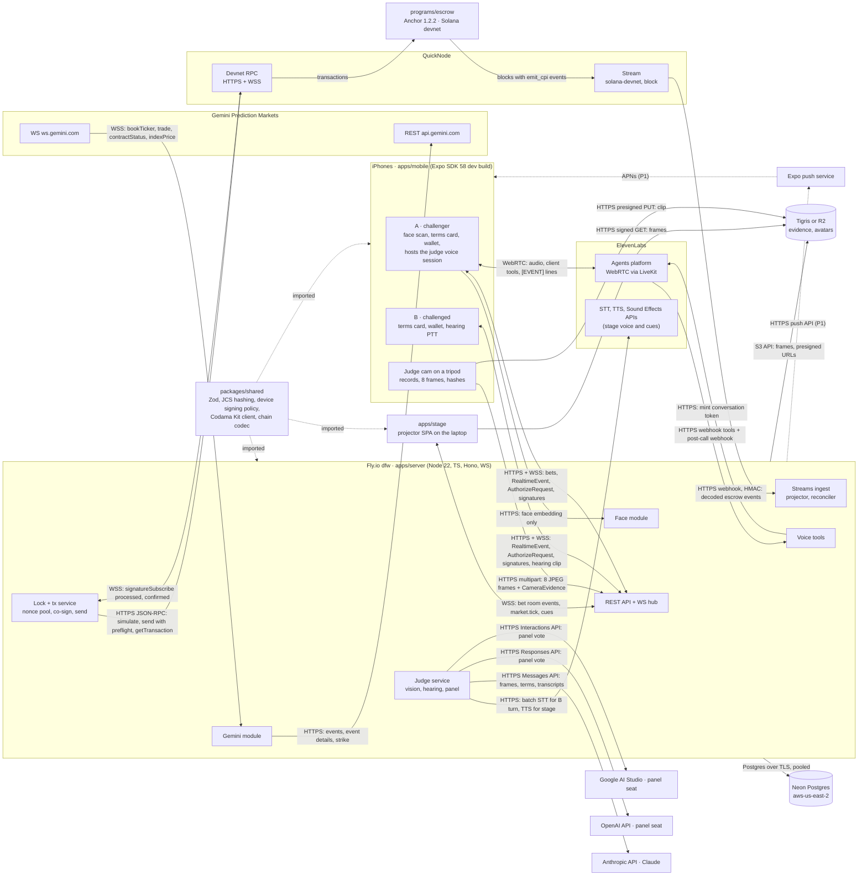

### 1.2 Responsibilities

| Component | Owns | Must never | Key libs (FINDINGS) |
|---|---|---|---|
| `apps/mobile`, party mode (A, B) | Face enrollment + scan (on-device embedding), terms card, hold-to-confirm, Face ID gate, seed custody, device signing policy, ed25519 signing, payout UX + haptics, WS client, hearing push-to-talk. A only: the judge voice session and the voice bridge (§3.2). | Call Solana RPC, hold an RPC key, be a fee payer, sign a message that fails the policy, send face images | §3.1, §3.2, §3.4, §3.10 |
| `apps/mobile`, judge-cam mode | Countdown, `recordAsync`, on-device frame extraction (u4d4, 8 × 512 px), frame + clip SHA-256, upload frames first, clip after. Recording never happens on A's phone, whose mic is held by WebRTC (FINDINGS §4 Beat 4). | Hold a wallet | §3.3 |
| `apps/server` | REST + WS hub (per-bet rooms, per-user channels, `seq`), auth, face matching, ElevenLabs tools + token minting, Terms composition + hashing, LockService (nonce pool, build, simulate, verify, co-sign, send), TxService (resolve, concede, appeal, finalize, crank), fast-lane subscriptions, Streams ingest + projector + reconciler, JudgeService (vision, hearing, panel), Gemini module, evidence presigning, push outbox, demo controls | Co-sign a message it did not build byte for byte; rebuild a message after collecting a signature; send with `skipPreflight`; log face embeddings | §3.5, §3.8, §3.9, §3.11–§3.13 |
| `apps/stage` | One screen per bet: photos, terms card + terms code, live transcript, frame strip with cited frames, ruling, panel votes, escrow ticker with Explorer links, Gemini chart + countdown. Stage audio: the judge's voice for rulings, payouts and appeal votes (ElevenLabs TTS clips, else the browser's speechSynthesis), the cues (ElevenLabs Sound Effects, else synthesized stingers). Demo control panel. | Hold any key except a read-only stage token (plus the demo admin token on the control panel) | §3.11 (chart), DATA-MODEL §8.4 |
| `programs/escrow` | Where and when money moves: Config, Bet PDA, PDA vault, 10 instructions, `emit_cpi!` events | Take a destination argument; give any authority a withdrawal path | ESCROW §1–§7, FINDINGS §3.6 |
| `packages/shared` | Zod schemas (SCHEMAS), `hashJcs`, money math, `fairStakes`, the **device signing policy** (ESCROW §5.0.2, including the D3 `atomic_lock` kind), Codama client from the IDL, `chain-codec`, noble PDA helper, `AuthorizeRequest`/`PartyAuthorization` | Pull in web3.js or `@anchor-lang/core` | §3.4, §3.5 |

### 1.3 Server process model

- **One machine, one Node process.** The WS fan-out, the nonce-pool lease, and the timers (finalize at `appeal_deadline + 1 s`, accept expiry → nonce advance, hearing turns, panel timeouts) are in-process. One instance avoids distributed locks. Scaling out would need Postgres advisory locks for timers and leases; that is out of scope.
- **Every timer is a DB row first.** At boot the server rebuilds timers and leases from Postgres, re-subscribes to in-flight signatures, and runs the startup sweep (DATA-MODEL §8.3). A machine restart mid-demo must lose nothing.
- **Background loops:** reconciler every 5 s (`STREAM_FALLBACK_MS`), Gemini discovery every 60 s, Neon keepalive every 60 s, outbox dispatcher, Claude warm-up at boot (and again 10 min before the demo, FINDINGS §3.8), WS ping every ~20 s.

---

## 2. Deployment topology

### 2.1 Where things run

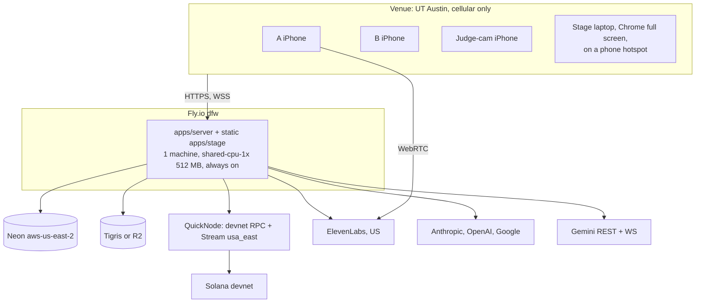

| Unit | Where | Region | Config | Why |
|---|---|---|---|---|
| `apps/server` + static `apps/stage` | Fly.io | `dfw` | `shared-cpu-1x` 512 MB, `auto_stop_machines="off"`, `min_machines_running=1` | Near Austin; public HTTPS for the ElevenLabs and QuickNode webhooks; ~$2–3 for 2 weeks (FINDINGS §3.13, §5) |
| Postgres | Neon Free | `aws-us-east-2` | Pooled; 60 s keepalive (scale-to-zero after 5 min can't be disabled) | FINDINGS §3.13 |
| Object storage | Tigris (on Fly) or Cloudflare R2 | — | Private buckets `evidence` and `avatars`; presigned PUT/GET only; 30-day evidence lifecycle | DATA-MODEL §9 |
| Solana RPC | QuickNode devnet endpoint | — | Every server send and read; `maxSupportedTransactionVersion: 1` | Public RPC limits getBlock to 6 per window (FINDINGS §7) |
| Stream | QuickNode | `usa_east` | `solana-devnet`, dataset `block`, batch 5, elastic, webhook → server | FINDINGS §3.12 |
| Judge agent | ElevenLabs | US | Private agent, WebRTC, server-minted conversation tokens | FINDINGS §3.10 |
| Program | Solana devnet | — | Upgradeable through finals; upgrade authority = the deployer key | ESCROW §10.4 |
| Phones | 3 iPhones (+1 non-demo phone for the Face ID reset test) | — | EAS `development` builds (ad hoc), then TestFlight internal; every device registered before the build | FINDINGS §3.15 |

**Network.** Everything at the venue runs on cellular, never venue Wi-Fi (brief §6). The stage laptop tethers to a phone on a different carrier from the demo phones. Hot paths make at most one synchronous DB write; the `dfw` ↔ `us-east-2` round trip is unmeasured (E (this doc): tens of ms).

### 2.2 Public HTTPS endpoints

Paths match API-CONTRACT §2.0, which owns them (spike route names were moved under `/v1`; API-CONTRACT §1.1).

| Route group | Caller | Inbound auth | Notes |
|---|---|---|---|
| `POST /v1/auth/challenge`, `/v1/auth/signup`, `/v1/auth/session`, `/v1/auth/demo-claim` | App | The device auth key signs the challenge → 7-day bearer session; every write is also request-signed (API-CONTRACT §1.3) | Signup = selfie. The device auth key is **separate** from the wallet key (API-CONTRACT §1.3, DATA-MODEL §5.2) |
| `/v1/face/*` (consent, enroll, delete), `POST /v1/rooms/:room_id/face-match` | App | Session token; scanner must be a room member | Request and response bodies are never logged (DATA-MODEL §10) |
| `/v1/bets/*` (create, authorizations, decline, attempts, hearing turns, events replay) | App | Session token; role checked per bet | `Idempotency-Key` on mutations (DATA-MODEL §8.6) |
| `POST /v1/bets/:bet_id/attempts/:n/frames` | Judge-cam app (`devices.role = judge_cam`) | Session token of the room's paired judge-cam device | Frames first, then the clip by presigned PUT |
| `wss://<host>/v1/ws` | App, stage | Session token or stage token in the first frame, never in the URL | Per-bet room (A, B, stage) + per-user channel; replay with `GET /v1/bets/:id/events?after=` |
| `POST /v1/voice/tokens` | App (A) | Session token | One conversation token per conversation; pre-minted on the challenge screen |
| `POST /el/tools/:name` | ElevenLabs | Secret header (`X-YO-Tool-Secret`) referencing an ElevenLabs workspace secret = `ELEVENLABS_TOOL_SECRET` | Responses < 300 B, handler < 5 ms, idempotent per `bet_id` |
| `POST /webhooks/elevenlabs` | ElevenLabs | `ElevenLabs-Signature` HMAC, SDK-verified with `ELEVENLABS_WEBHOOK_SECRET` | Transcript archived as evidence (hashed) |
| `POST /webhooks/quicknode` | QuickNode | `X-QN-Signature` HMAC-SHA256 + timestamp check; optional IP allowlist | Ack 2xx fast: delivery is sequential, and the Stream auto-pauses after 3 failed retries |
| `GET /stage`, `POST /v1/stage/session`, `GET /v1/stage/audio`, `GET /v1/stage/tts/:clip_id`, `GET /v1/stage/sfx/:kind` | Stage laptop | `STAGE_KEY` → stage token | TTS and Sound Effects are proxied, so the ElevenLabs key stays on the server (API-CONTRACT §2.17, §4.5) |
| `/v1/demo/*` | Stage control panel | Stage token with `demo` scope + `X-YO-Demo-Key` (= `DEMO_ADMIN_TOKEN`); 404 unless `DEMO_MODE=true` | §7.2 toggles (API-CONTRACT §2.17) |
| `GET /health` | Fly, smoke checks | none | Liveness only |

### 2.3 Keys and secrets

| Key | Purpose | Lives in | Funds | Can | Cannot |
|---|---|---|---|---|---|
| **Wallet seed** (one per user) | The user's wallet key | iPhone Keychain via `expo-secure-store`, `WHEN_UNLOCKED_THIS_DEVICE_ONLY`, **without** `requireAuthentication`. The app reads it only after `authenticateAsync` succeeds (D2). The public key is a separate item, so app start never prompts. | USDC only, 0 SOL | Sign its own party slot in the lock tx, `concede`, `appeal` | Be a fee payer; sign anything the device policy rejects (§6.4). The seed is generated with `getRandomValues` and never `getRandomBytes` (FINDINGS §3.4). |
| Device auth key (one per device) | Login challenges and API request signatures (API-CONTRACT §1.3) | Keychain, ungated, so an API call never prompts | — | Sign `yo-auth-v1` / `yo-bind-v1` / `yo-req-v1` strings; domain-separated, so none can double as a tx signature | Sign any Solana message |
| Demo account seeds (3–4) | Custodial demo wallets | Generated on the server, stored with AES-GCM under `DEMO_SEED_KEK` (devnet only), provisioned once by QR or deep link into the phone's Keychain | USDC | Same as a device seed once on the phone | Same as a device seed. The README must say the demo accounts are custodial (FINDINGS §3.4). |
| **Server fee payer = nonce authority** | Fee payer and rent payer for every tx; authority of the nonce pool; crank | Fly secret `FEE_PAYER_SECRET_KEY`; pubkey pinned in `packages/shared` | 2 devnet SOL to start, alert below 1 SOL (SETUP-CHECKLIST KP3; FINDINGS §5: 0.5 to start, 1–2 over rehearsals) | Pay fees and rent, submit or withhold txs, advance (revoke) a nonce, crank `finalize` / `timeout_refund` / `close_bet` | Move USDC: it is no party's delegate and the program pays only parties. It co-signs only messages it built. |
| **`judge_authority`** | `resolve`; decline cleanup via `cancel_open_bet` (sequential fallback only) | Fly secret `JUDGE_AUTHORITY_SECRET_KEY` | 0 SOL | Choose one outcome per bet (A, B, Split, Refund) while `Locked` and before `resolve_deadline` | Pick a destination, rule after the deadline, rule on appeals |
| **`appeal_authority`** | `resolve_appeal` | Fly secret `APPEAL_AUTHORITY_SECRET_KEY`; ≠ judge key (enforced in Config) | 0 SOL | Set the final outcome of an `Appealed` bet before `appeal_resolve_deadline` | Anything else |
| **Upgrade authority = Config admin** | Deploy and upgrade the program; `initialize_config`, `update_config` | Lead's laptop `~/.config/solana/youre-on-deployer.json` + password manager. **Never on the server.** | ≥ 5 devnet SOL for deploys | Replace program code (a disclosed devnet trust assumption); change Config for **new** bets | Touch live bets through Config (snapshots, ESCROW I11) |
| Program keypair | First deploy only | Lead's laptop, gitignored | — | — | — |
| `TREASURY` | Devnet USDC float for topping up demo wallets | Fly secret `TREASURY_SECRET_KEY` (SETUP-CHECKLIST KP6); loaded only by the top-up job | USDC, 0 SOL | Fund demo wallets | Appear in any bet tx; be an SPL delegate |
| Face KEK | AES-256-GCM for embeddings | Fly secret `FACE_KEK_2026_11_A` + `FACE_KEK_ACTIVE` (SETUP-CHECKLIST naming); face module only | — | Decrypt one room's candidates in memory | Be logged or stored in the DB |
| Provider keys and symmetric secrets | Anthropic, OpenAI, `GOOGLE_GENERATIVE_AI_API_KEY` (never `GEMINI_API_KEY`), ElevenLabs, QuickNode RPC URL, `QN_STREAM_SECURITY_TOKEN`, `ELEVENLABS_TOOL_SECRET` + post-call HMAC secret, Neon `DATABASE_URL`, `S3_*`, `SESSION_SECRET`, `STAGE_KEY`, `DEMO_ADMIN_TOKEN`, `FACE_SEAL_SECRET_KEY` (x25519; only if API-CONTRACT O8 sealing ships) | Fly secrets; `fly.toml [env]` holds only non-secret config (`PROGRAM_ID`, `USDC_MINT`, `LOCK_MODE`, `DEMO_MODE`); local `apps/server/.env` for development, never committed. Full list: SETUP-CHECKLIST §7. | — | — | Reach a phone or the stage bundle (EAS env is `EXPO_PUBLIC_*` only) |
| APNs key (P1) | Remote push | EAS credentials (`eas credentials -p ios`) | — | — | — |

Phones hold no provider key and no RPC key. Gemini needs no key (FINDINGS §3.11).

---

## 3. Sequence diagrams per demo beat (as amended)

Cast: **A** = Logan (challenger, phone hosts the judge session), **B** = Jake (challenged), **J** = judge-cam iPhone. Every state name is a SCHEMAS §9 `BetState`; every event name is a SCHEMAS §10 `RealtimeEvent` or an API-CONTRACT §3.4 extension (listed in SCHEMAS §10.1). Routes are abbreviated API-CONTRACT §2 paths.

### 3.1 Beat 1: challenge by face

A face match only addresses the request (D1). The probe embedding lives in server memory for the length of the request (DATA-MODEL §10).

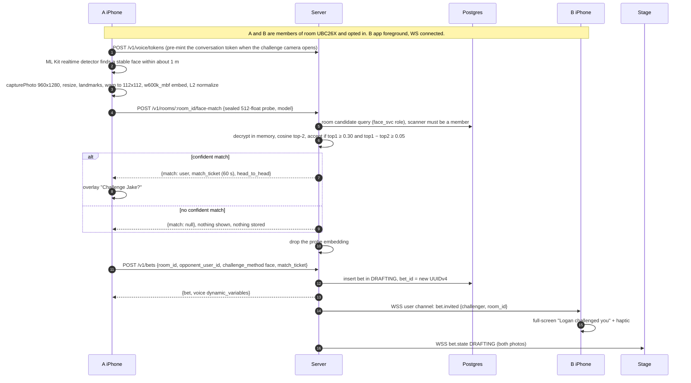

- Pipeline, thresholds and "do not use" list: FINDINGS §3.2. Stage it at ≤ 1 m (auto-scan reach is ~1 m, a still photo ~1.4 m; E).
- B's buzz is a WS event, plus a local notification if the app is backgrounded but alive. APNs is P1. Keep B's app in the foreground (FINDINGS §3.14).
- A's face-scan camera must be stopped before the terms card, because haptics go silent while the camera runs (FINDINGS §4 Beat 3).

### 3.2 Beat 2: terms by voice

The agent's LLM (Claude Haiku 5.5 inside ElevenLabs, FINDINGS §3.8; fallback Haiku 4.5) does the extraction: it fills `propose_terms` with the LLM-facing projection in API-CONTRACT §4.3, which the server maps into SCHEMAS `TermsProposal` (§3). The server owns every non-semantic field and the hash. The read-back and `confirm_terms` are not binding.

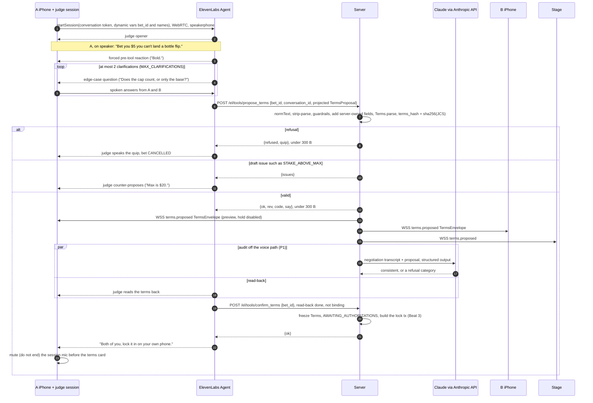

- **Tool split (FINDINGS §3.10).** Webhook tools: `propose_terms` (`pre_tool_speech: force`), `confirm_terms`, later `open_hearing`, `file_appeal`, `get_market_odds`. Client tools on A's phone: `request_attempt`, `show_terms_card` (UI timing only; the server push is authoritative), and a gavel cue (relayed to the stage, which plays the SFX). `ask_clarification` is dropped, and `lock_bet` and `issue_ruling` are not LLM-callable.
- **Voice bridge.** After each voice-worthy transition is committed, the server emits a `judge.cue` event with a server-composed `[EVENT]` line (API-CONTRACT §4.5: `AUTHORIZED`, `LOCKED`, `RULING`, `REDO`, `HEARING_REQUIRED`, `APPEAL_RESULT`, `PAID`, …). Only A's phone, the voice host, acts on it: it passes the line verbatim to `sendUserMessage` (or `sendContextualUpdate` when `speak=false`). The judge therefore never voices a state the server hasn't committed, and wording changes need no EAS build. A's phone also forwards transcript client events to the server for the stage transcript (`judge.line`, `party.line`).
- **Terms audit (P1, E (this doc)).** This is the server-side "Claude terms extraction" check. It re-reads the transcript and the proposal while the judge reads back. A refusal-category hit cancels before `AuthorizeRequest` is sent; anything else is logged and shown on the stage. No model was evaluated for this job in Phase 0 (FINDINGS §3.8): PENDING-KEY.
- **Mute, don't end** the session before the terms card (iOS second-session silent mic, #991; haptics, FINDINGS §4 Beat 3). Whether muting restores haptics is unverified (PENDING-PHONE).

### 3.3 Beat 3: lock it in (atomic, D3)

Spec edits: FINDINGS §3.7. Both parties sign the identical message. The second valid signature submits. A single signature is inert, because the tx also needs the other party's signature and the fee payer's.

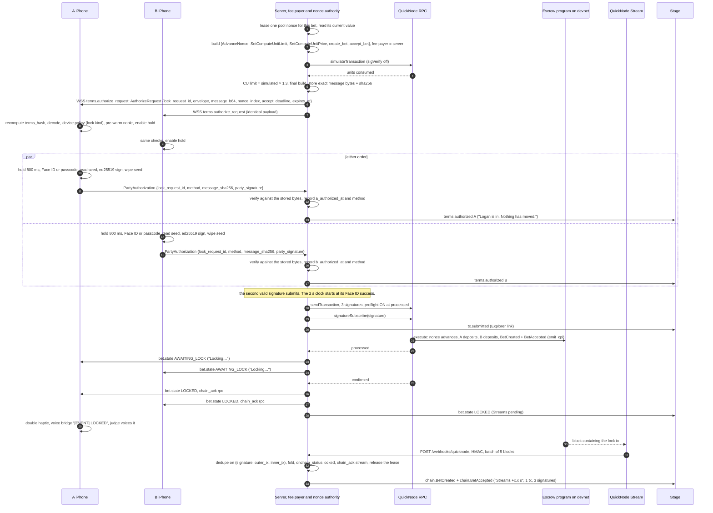

Revocation paths:

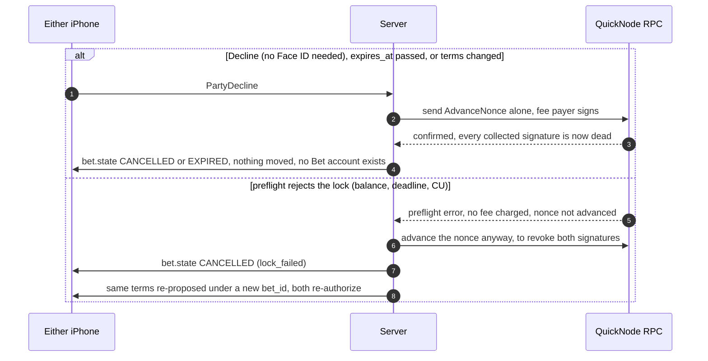

- **Signature lifetime.** With a durable nonce, the only bound is `accept_deadline` (skill `now + 300 s`, gemini `quotedAt + 60 s`, never more than `now + 600 s`; D3, SCHEMAS §9.3). The device policy refuses anything outside that range.
- **Instruction indices.** `outer_ix` 3 = `create_bet`, 4 = `accept_bet` when `SetComputeUnitPrice` is present (0 = AdvanceNonce, 1–2 = ComputeBudget). This matters for the dedupe key.
- **Measured guard rails** (FINDINGS §2.3, §7): atomic CU is 36,675–63,675 and a 60k cap failed 1 in 20, so size it from simulation. Tx size is ~990–1,005 B of 1,232 (E) with the spec's arguments. With `skipPreflight`, a doomed nonce tx is charged 15,000 lamports and burns the nonce. With preflight on it is rejected for free (M, local Agave).
- **Nonce pool.** 5 accounts at 1,056,640 lamports each (M), authority = fee payer, addresses `createAccountWithSeed(fee payer, "yo-nonce-<k>")` so phones can verify membership, one lease per pending bet, re-read after every advance (ESCROW §5.0.1, FINDINGS §3.7). DATA-MODEL owns the table (`nonce_pool`).
- **Submit margin.** `expires_at` on the `AuthorizeRequest` = `accept_deadline − LOCK_SUBMIT_MARGIN_SECS`, so a lock is never sent close to the deadline it could cross between preflight and execution (ESCROW §5.0.1, TM-N4).
- **`AWAITING_LOCK` is transient** under atomic (FINDINGS §3.7): it is shown between submit and `confirmed`. `HELD_SIGNATURE_MAX_SECS` does not apply. `LOCK_MODE=sequential` keeps the old two-tx path as a fallback (§7), so `cancel_open_bet` and `timeout_refund`-from-`Open` stay in the program.
- **Recording the method (D2).** `authenticateAsync` doesn't say whether Face ID or the passcode succeeded. Call it with `disableDeviceFallback: true` first; on `user_fallback`, call it again with the fallback allowed, and record `passcode_hold` (FINDINGS §7, E; check on the device).
- **Pitch copy.** "Nothing moves until you both say yes" is literally true only under atomic (FINDINGS §4).

### 3.4 Beat 4: attempt → ruling → GG or auto-finalize → payout

B performs and wins in this example, so A is the loser. Thresholds come from SCHEMAS §0.1 (`REDO_BELOW` 0.8, `MAX_REDOS` 2). Per D7, the ruling commits to the exact frames the model saw; SCHEMAS owns the field (O3, adopted).

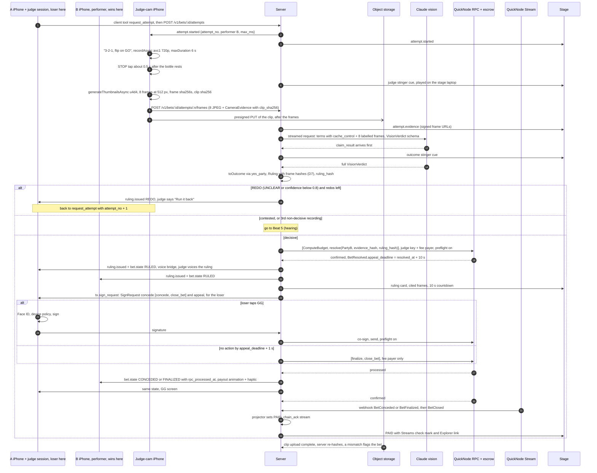

- **Recording and frames:** FINDINGS §3.3. There is no auto-stop (expo-camera 58 gives no frames while recording), and the STOP tail decides whether the 4 s target holds (§4). Frames are uploaded before the clip. `resolve` commits `client_clip_hash`, and the server verifies it after the upload (DATA-MODEL §9).
- **Model choice is open:** Haiku 5.5 (thinking disabled, effort low) vs a single Opus 5.5 at low effort, with a parallel re-check below 0.8 (FINDINGS §3.8). Every ruling call uses a hand-written JSON schema, upper-cases the enum, and treats a refusal or parse error as REDO.
- **Concede = a device signature,** so it runs behind Face ID like every device signature (D2). The < 1 s clock starts when the server has the signature (or sends `finalize`). See open item O-A1 (§10).
- **Payout UX** fires at `processed` (SCHEMAS X10). `PAID` waits for the chain event. If the payout isn't confirmed within 5 s, the UI reverts (§5).
- The server's finalize timer retries every 1 s on `AppealWindowOpen` (devnet clock lag) and re-reads the Bet on `InvalidStatus` (ESCROW §8.3).

### 3.5 Beat 5: dispute → hearing → ruling → appeal → three-model panel → `resolve_appeal`

The hearing happens **before** any onchain `resolve`. After a ruling is onchain, the only recourse is an appeal (SCHEMAS §6). Speaker identity comes from which phone captured the turn, never from voice. In this example the hearing rules B_WINS and A appeals (the SCHEMAS §7 example).

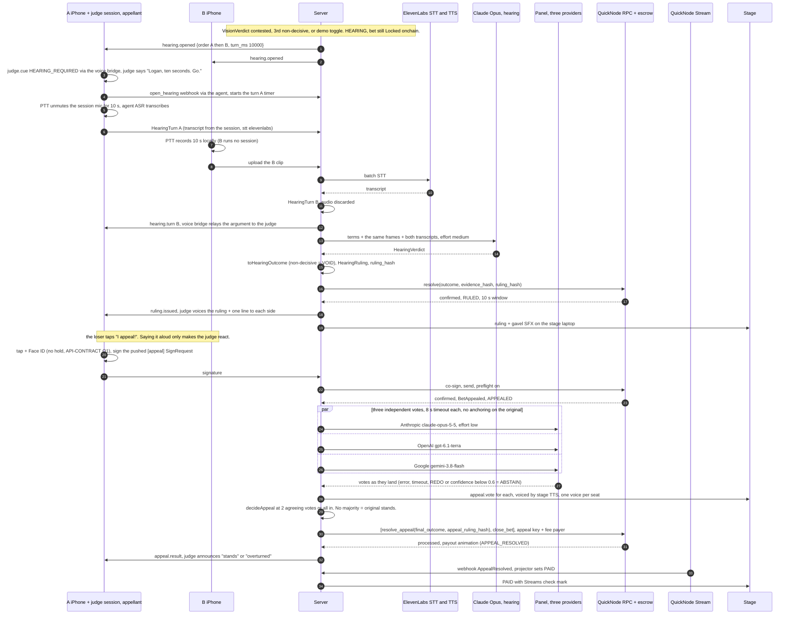

- **Turn A capture is a design choice (E (this doc), PENDING-PHONE).** A's mic belongs to the live WebRTC session, so A's turn is transcribed by the agent's own ASR and forwarded by A's phone. The agent prompt keeps the judge silent until the turn ends. B's turn uses a local recording, then batch STT, then the bridge (FINDINGS §3.10). B-clip → STT latency is PENDING-KEY (FINDINGS §6 step 1 follow-ups).
- **Mute toggles play an iOS tone** (LiveKit #344). Never play audio with expo-audio on A's phone, because it stops mic capture (#286). The gavel and the vote voices play on the stage laptop.
- **`file_appeal` webhook = theatre.** It only pushes the appeal sheet to the loser's phone; the onchain `appeal` needs the loser's signature. The UI disables "I appeal!" at `appeal_deadline − 1 s` (ESCROW §8.3).
- **Panel rules:** SCHEMAS §7 (D7). Votes keep streaming to the stage after the decision for drama, but can't change it. An appeal never decided within 300 s refunds by `timeout_refund` (ESCROW TM-L9, residual).

### 3.6 Beat 6: Gemini BTC closer

Endpoints, guards and timing: FINDINGS §3.11, SCHEMAS §8. W = start of the current 5-minute contract window (a UTC boundary), T = its expiry = W + 5:00. **Beat 6 is set up first and pays off last:** the lock must land by ~W+1:30, so it is the first thing in the pitch.

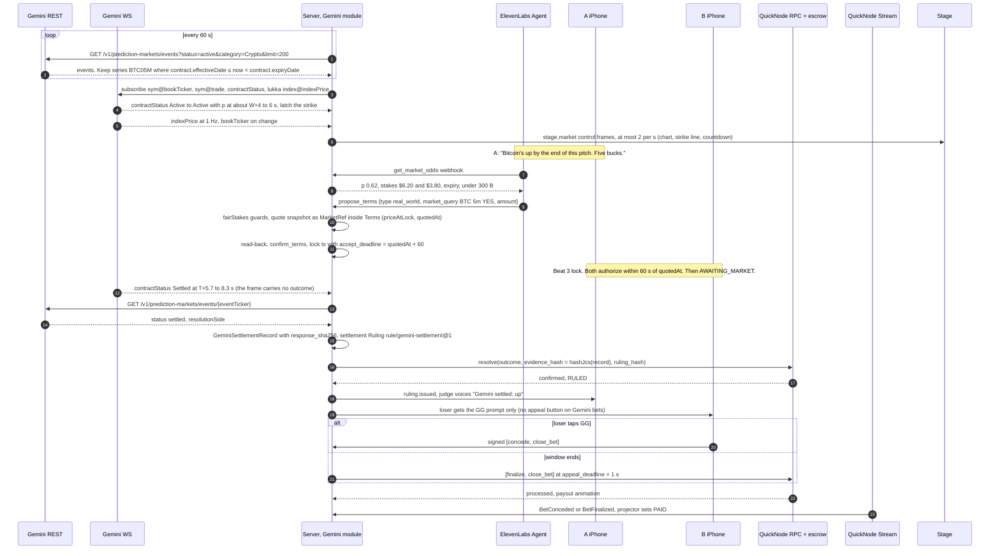

| Moment | Time | Source |
|---|---|---|
| Strike known (WS `p`) | W+4.1–5.6 s | M |
| Pitch starts | W+0:06 to W+1:00; ≥ W+0:20 if the payout must land inside the 5 minutes | FINDINGS §4 (E, arithmetic) |
| Lock by | ~W+1:30 (lopsided-refusal risk 4% at W+2:00, 18% at W+3:00) | E |
| Last quotable | T−120 s = W+3:00 (usable quotes 0% after) | M |
| Settled frame → REST `resolutionSide` | p50 5.66 s, p99 8.01 s, max 8.78 s after T (n=173); top of the hour p50 7.78 s, so avoid `:00` expiries | M |
| Payout | At the GG tap, or ~T+17–20 s (10 s appeal window, SCHEMAS O6) | E |

Fallbacks: REST poll every 2 s from expiry if the `Settled` frame is missed. An `invalid` contract → `VOID / market_invalid` → `resolve(Refund)`. No settlement → `timeout_refund` after `resolve_deadline`. Never trade on Gemini. The quote snapshot is never re-priced after the terms freeze (FINDINGS §7).

### 3.7 Extra: head-to-head lookup

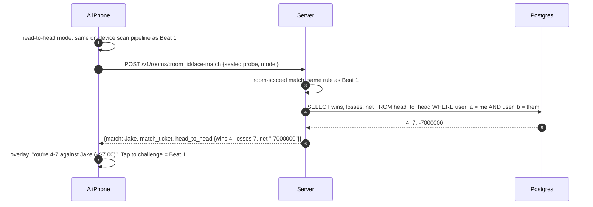

`head_to_head` counts only chain-confirmed settlements plus labelled `is_seed` history (DATA-MODEL §7.1, §11). Preferred seed: `seed:chain`, ~11 real devnet bets the day before.

---

## 4. Latency budget

Each brief §6 target (amended) against the best FINDINGS number, with the clock defined explicitly. Nothing here has run on an iPhone, over cellular, on devnet with SOL, or against a keyed API.

| Target | Beat | Clock: start → stop | Best number now | Components | Label | Verdict | Closes (FINDINGS §6) |
|---|---|---|---|---|---|---|---|
| Face match < 1 s | 1, h2h | photo capture → name on screen | ~0.33–0.85 s | On-phone 0.25–0.6 s (E; desktop parts M: warp 5.3–5.7 ms, embed 11.2 ms); server round trip 0.08–0.25 s (E); match µs | E · PENDING-PHONE | On track | 7 |
| Judge first audio < 1.5 s | 2, and every voiced line | party stops talking → first judge audio | 0.8–1.3 s with a forced pre-tool reaction; **1.25–2.2 s** for the substantive post-tool line | Turn commit 0.3–0.5; LLM pass 1 0.4–0.8; webhook 0.05–0.1 (handler p50 0.23–1.1 ms M; tunnel 45–84 ms M); LLM pass 2 first token 0.3–0.5; TTS ~0.1 (C); network 0.1–0.2 | E · PENDING-KEY | First audio on track; read-back marginal | 1, 9 |
| Second authorization → lock confirmed < 2 s | 3 | Face ID success on the second phone → LOCKED on both phones | **0.70–1.39 s** (0.71–1.44 s with preflight), either order | Phone policy 5.6–5.8 ms + warm sign 8.6–8.9 ms (M, Hermes v0.13 desktop); uplink + verify + co-sign; send → confirmed 0.6–1.0 s (E); local Agave p50 406–407 ms from the signature at the server (M, local only) | E · PENDING-SOL/PHONE | On track | 5, 8, 12 |
| Attempt → ruling < 4 s | 4 | bottle at rest → first ruling audio | **~3.2 s** with a 0.5 s STOP tail (~4.2 s with a 1.5 s tail: misses); ~2.7 s (2.3–3.5) from STOP | Tail 0.5; recordAsync finalize 0.1–0.3 (E); frames on the phone 0.3 (E); upload of 133 KB (M size) 0.4 (E); server build < 0.02 (M); network 0.1 (M proxy); model 1.2 (E); first audio 0.5 (E), or 0.6–1.0 s via the [EVENT] bridge (E, unresolved) | E · PENDING-KEY | On track only with a short tail. Stinger at STOP. | 0, 2, 10 |
| Concede/finalize → payout visible < 1 s | 4, 5, 6 | server has the concede signature (or sends finalize) → winner's animation | **~0.55–0.75 s at `processed`**; 1.0–1.6 s at `confirmed` (misses) | send → processed 0.2–0.6 s (E) + server → phone hop | E · PENDING-SOL | On track only at `processed` (X10) | 5, 12 |

User-perceived extras (not the targets): the Beat 3 hold (0.8 s) and Face ID (0.6–1.2 s, E) come before the lock clock, so hold start → LOCKED is ~2.1–3.4 s (E (this doc)). GG tap → payout adds Face ID. A passcode fallback adds ~3–5 s (E).

Supporting numbers:

| Path | Number | Label | Used for |
|---|---|---|---|
| Streams: send → webhook | 1–2.5 s | E · PENDING-KEY (step 6) | Stage ✓; `STREAM_FALLBACK_MS` = 5 s |
| Devnet `confirmed` − `processed` | p50 ~398 ms | M | Why the payout flips at `processed` |
| Devnet RPC round trip; slot | p50 32–36 ms; 238–240 ms | M | — |
| Recent blockhash lifetime | 36.0 s | M | Why the atomic lock needs a durable nonce |
| `AuthorizeRequest` payload | 1,997 B JSON | M | WS frame size |
| noble cold start | 92–127 ms (pre-warm at card mount) | M (desktop Hermes v0.13) | Beat 3 |
| [EVENT] push → judge voices it | 0.6–1.0 s | E · PENDING-KEY | Beats 3–6 voice lines |
| Panel wall time | 2–5 s, 8 s cap per vote | E · PENDING-KEY (step 3) | Beat 5 |
| Hearing verdict (Opus, medium effort); B clip → STT | — | PENDING-KEY | Beat 5 |
| Gemini settlement; strike | see §3.6 | M | Beat 6 |
| Streams filter execution | p50 0.08–0.12 ms | M (Bun, not QuickNode's engine) | — |

---

## 5. Realtime and consistency model

### 5.1 Three sources, one rule

| Source | Writes | Trusted for |
|---|---|---|
| Offchain state machine (server) | `bets.state` for conversation steps (DRAFTING … JUDGING, HEARING) | Everything with no money in it |
| **Fast lane:** the server's own `signatureSubscribe` on QuickNode RPC | `chain_txs.rpc_processed_at` / `rpc_confirmed_at`, `bets.onchain_pending`, `chain_ack: 'rpc'` | Advancing LOCKED / RULED / APPEALED at `confirmed`; the payout animation at `processed` |
| **Streams lane:** QuickNode Stream webhook (`rpc_poll` fallback) | `chain_events` → projector → `onchain_status`, outcome, payouts, `chain_ack: 'stream'` | **Money moved.** `PAID`, `VOIDED`, `EXPIRED` and `CANCELLED` with a deposit are entered only here. The chain wins any disagreement (DATA-MODEL §8.1). |

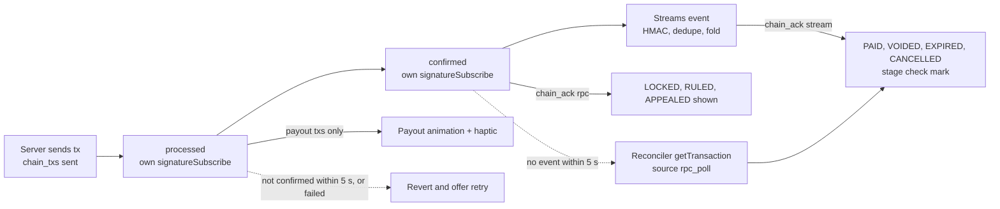

### 5.2 What the UI shows when

Adapted from DATA-MODEL §8.4 for the atomic lock.

| Moment | Trigger | A and B phones | Stage |
|---|---|---|---|
| `AuthorizeRequest` arrives | Server WS | Terms card; hold enabled once the policy passes | Terms card + terms code |
| One party signed | Server verified the signature | Signer: "You're in. Waiting for Jake…" Other: "Logan is in." | "Logan authorized · nothing has moved" |
| Second signature → sent | Server | "Locking…" | Signature + Explorer link (pending) |
| Lock `confirmed` | Fast lane | **LOCKED** double haptic; the judge voices it | LOCKED (Streams pending) |
| Lock Streams events | Streams lane | No visible change (reconcile only) | ✓ "Streams +x.x s"; one tx, 3 signatures, BetCreated → BetAccepted |
| `resolve` `confirmed` | Fast lane | Ruling + 10 s countdown from `BetResolved.appeal_deadline`; loser sees GG (and "I appeal!" on skill bets) | Ruling card, cited frames |
| Payout `processed` | Fast lane | Winner: payout animation + haptic; balance shown +$ with a "pending" tint | "Paying…" |
| Payout Streams event | Streams lane | Balance from the event's `to_a` / `to_b`; head-to-head updates | PAID ✓ |
| Failed, expired, or not confirmed within 5 s of `processed` | Fast lane timeout | Revert; offer a retry | Red "failed" |

### 5.3 Ordering, idempotency, recovery

- **Ordering:** per-bet gapless `seq`, assigned in Postgres before fan-out. Clients drop `seq ≤ last_seen` and replay gaps from `bet_events` (SCHEMAS §10.1). They ignore unknown types.
- **Idempotency keys:** DATA-MODEL §8.6, including two from D3: one authorization per `(lock_request_id, party)` (a resend of the same signature is a no-op; an old build gets `STALE_LOCK_REQUEST`), and one nonce lease per pending bet. Webhook tools dedupe per `(voice_session_id, el_tool_call_id)`, falling back to a hash of the args within 10 s (DATA-MODEL §5.11).
- **Chain dedupe:** `(signature, outer_ix, inner_ix)`, before `seq` assignment. The projector folds a bet's full event set each time, so it is order-independent. Status moves forward only (DATA-MODEL §8.2–§8.3).
- **Gaps:** reconciler every 5 s (`getTransaction`, v1), startup sweep with `getSignaturesForAddress(bet_pda)`, and a re-sweep after re-activating a paused Stream (`activate` resumes where it paused; reset `start_range` before the demo).
- **Known bets only:** events apply only to bets whose recorded `create_bet` signature matches (ESCROW §7.1, TM-E5). Under atomic, that is the lock signature.
- **Voice never leads state.** The bridge (§3.2) voices only committed events. The server never maps an error code to "settled".
- **Reconnects:** WS ping ~20 s; on reconnect the client sends `last_seen` and receives a replay. A phone resending the same signature after a lost uplink is idempotent (FINDINGS 3b).

---

## 6. Trust boundaries and security

### 6.1 Boundaries

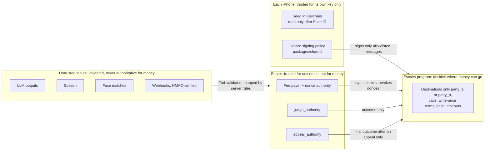

### 6.2 Who can move money

| Actor | Can make tokens move by | Bounded by |
|---|---|---|
| A party's device | Signing the lock tx (its own deposit); `concede` (pays the winner); `appeal` (moves nothing) | Device policy (§6.4); hold + Face ID at every signature (D2); program checks (`expected_*` args, caps) |
| Server fee payer | Submitting a tx both parties signed; cranking `finalize` / `timeout_refund` / `close_bet` | Pays only per the stored outcome or timeouts; co-signs only byte-equal messages it built (ESCROW §5.0 signing flow, TM-S5) |
| `judge_authority` | `resolve`, which picks the outcome | Once per bet, only while `Locked`, before `resolve_deadline`; the outcome is one of the 4 variants; never a destination (I1, I7) |
| `appeal_authority` | `resolve_appeal` | Only `Appealed` bets, before `appeal_resolve_deadline` (I8) |
| Admin / upgrade authority | New code; Config for new bets | Residual devnet trust assumption, disclosed (ESCROW §1.2, §10.4) |
| Anyone | Permissionless exits after deadlines | Pay out per the stored outcome or as refunds only (I12) |
| **Nobody** | Sending vault tokens anywhere but party_a's or party_b's own token accounts | I1, I4, I5 |

### 6.3 What the server can and cannot do

- **Can:** rule wrongly (bounded to the two parties; the evidence, ruling and appeal hashes are onchain; the appeal uses a separate key and three providers); delay or censor (bounded by onchain deadlines → refunds); refuse to build; revoke a pending lock (advance the nonce); see terms, transcripts and frames; front rent.
- **Cannot:** move a party's USDC without that party's Face ID-gated signature over a message that passes the device policy; change terms after the hash (I3); redirect a payout (I1); get a nonce-bearing signature for anything but the lock kind; reuse a lock signature after the nonce advances; keep a lock signature valid past `accept_deadline` (≤ 600 s).
- **Residual (D3):** between the two signatures and submit, the server holds a fully signed lock until `accept_deadline`. It could submit after a party taps Decline if it hasn't advanced the nonce yet. Both parties did authorize those exact terms. The mitigations are an immediate nonce advance on Decline, a stage-visible revoke, and the short `accept_deadline`. State this in the README (an analogue of ESCROW TM-S6).
- **Evidence provenance:** only the room's paired judge-cam device can upload attempt frames. A mismatch between the clip and its hash flags the bet, and the panel treats the clip as missing (DATA-MODEL §9).

### 6.4 Device signing policy (summary)

The full rules are ESCROW §5.0.2 (owner; it includes the D3 `atomic_lock` kind). Implement them in `packages/shared` with tests for the four gaps the spike's harness let through (mint, `bet_id`/PDAs, deadline range, fee payer; FINDINGS §3.4; ESCROW DP13). The phone decides the expected kind from **its own UI state** (terms card → `atomic_lock`, GG → `concede`, "I appeal!" → `appeal`); the server's label is only cross-checked. Tests: ESCROW §9.2 A13 and DP1–DP16.

| Message kind | Allowed instructions | Extra checks |
|---|---|---|
| **Lock (atomic only)** | Exactly: `AdvanceNonceAccount` at index 0 (authority = the pinned fee payer; the nonce account is in the server pool), ComputeBudget, `create_bet`, then `accept_bet` | The device key only in its own party slot (A in `create_bet`, B in `accept_bet`); both instructions' args equal the card (`bet_id`, stakes, recomputed `terms_hash`, `party_b`, `expected_party_a`); `now < accept_deadline ≤ now + 600` (gemini: `= quotedAt + 60`) |
| Every other kind (`concede`, `appeal`, `cancel_open_bet`) | Exactly one escrow instruction, optionally followed by `close_bet`; ComputeBudget; ATA `CreateIdempotent` funded by the server | **No** `AdvanceNonceAccount` |
| All kinds | — | Fee payer = pinned server key; program = `ESCROW_ID`; mint = pinned USDC; Bet / vault / Config PDAs re-derived with noble; no address lookup tables |

Pool membership: the phone has no RPC. It checks that the nonce authority = the pinned fee payer, and that the nonce account = `createWithSeed(pinned fee payer, "yo-nonce-<k>", System)` for some `k < 16`, which it can recompute offline (ESCROW §5.0.1–§5.0.2; a design choice, E).

### 6.5 Inbound authentication and abuse limits

- ElevenLabs tools: secret header from a workspace secret, plus `bet_id`/`conversation_id` from dynamic variables, checked against the bet's voice session. Post-call webhook: HMAC.
- QuickNode: HMAC-SHA256(token, nonce + timestamp + decompressed body) with `timingSafeEqual`; reject stale timestamps.
- App: device-auth-key-signed challenge → bearer session; writes also carry `X-YO-Signature` (API-CONTRACT §1.3). Stage: a read-only stage token from `STAGE_KEY`. Demo routes return 404 unless `DEMO_MODE=true`.
- Rate limits per user: challenges, face scans, appeals (ESCROW TM-L9, TM-R1). The server refuses to build other txs for a party while that party's lock is pending (FINDINGS 3b).

### 6.6 AI outputs

LLMs never pick a winner by letter. They report `claim_result`, and `yes_party` maps it (SCHEMAS §5.1). They never call a money tool, and their outputs are Zod-validated. A refusal or parse error → REDO (judge) or ABSTAIN (panel). Spoken words and frames are a prompt-injection surface, but the worst case is a wrong outcome between the two parties, which the appeal path covers. No model sees face data.

### 6.7 Privacy by design (README-ready)

> **Face data.** Face scanning is **opt-in**. You enroll with a selfie after a consent screen that states the purpose, retention, deletion and no-sale terms, plus a simple liveness check (blink or head turn). Your phone turns the photo into a face embedding (a list of 512 numbers) **on the device**; face images never leave the phone. The server stores one embedding per opted-in user, **encrypted** with AES-256-GCM under a key held in our host's secret store, and never logs it. A scan matches only against opted-in members of the **same room** (a demo session you joined), never a global search. If there is no confident match, nothing is shown and nothing is stored. A scanned person's embedding exists only in memory for that one request. A match only **addresses** a challenge: the other person still reviews the terms and authorizes their own stake on their own phone, so a wrong match can never move money. You can disable face matching at any time (it takes effect immediately) or delete it (a hard delete). We also delete it at the earliest of 180 days without a match, 30 days after disabling, or 2026-12-31 for this hackathon deployment. **Nothing biometric goes onchain:** the escrow only ever sees hashes, public keys and integers.
>
> **Face ID is separate.** Locking a bet uses Apple's Face ID through iOS LocalAuthentication. Face ID data never leaves the iPhone's Secure Enclave, and our app only learns "success" or "failure". We record whether Face ID or the passcode was used, and when. Face ID and our room-scoped face matching are unrelated systems.
>
> **Voice.** We build no voiceprints. Speech is transcribed for the judge, hearing audio is not stored, and only transcripts and their hashes are kept as evidence.
>
> **Why this matters here.** The finals are in Texas. Texas CUBI (Bus. & Com. Code §503.001) requires notice and consent before capturing a biometric identifier, bans its sale, and requires destruction within a reasonable time; the Attorney General enforces it with penalties of up to $25,000 per violation. Illinois BIPA adds a public retention schedule, a written release, and a private right of action ($1,000 / $5,000 per violation). We treat face embeddings as biometric identifiers and designed for both laws. This is not legal advice.
>
> **Model license.** The demo uses InsightFace `buffalo_s` (`w600k_mbf`) weights, which are licensed for non-commercial research only. A production build would switch to a commercially licensed model; SFace (Apache-2.0) is already converted.

Source rules: DATA-MODEL §10, FINDINGS §3.2 and §7. PENDING: confirm the ElevenLabs data-retention setting in the dashboard (DATA-MODEL §10), and a teammate's re-read of the Texas HB 149 amendments to CUBI (FINDINGS §6 step 16).

---

## 7. Failure modes and demo-safe fallbacks

### 7.1 Per beat

Likelihoods and mitigations come from FINDINGS §4. This table adds what the system does automatically and what the presenter does. **Every replayed or pre-recorded fallback is labelled "REPLAY" on the stage.**

| Beat | Failure | Automatic response | Presenter fallback / toggle |
|---|---|---|---|
| 1 | No or wrong match (distance, light, landmark noise) | The margin rule abstains: nothing shown (0% wrong person in sims, M) | Step in to ≤ 1 m; `face_pick_list` (choose B from the room list, which still only addresses the request; E (this doc)); `replay_beat_1` |
| 1 | B's phone doesn't buzz (suspended WS) | Stage shows "Jake offline" from WS presence | Keep B foregrounded; presenter cue |
| 1 | Native build of VisionCamera / ML Kit / fast-tflite fails on SDK 58 | — | `replay_beat_1`; spike-01 EAS build this week (FINDINGS §6 step 7) |
| 2 | First audio > 1.5 s; Claude 5.5 not served by ElevenLabs | Fillers via forced pre-tool speech; backup LLM disabled so failures are visible | Switch the agent LLM to `claude-haiku-4-5` / `gemini-3.5-flash`; Speech Engine (Claude on our server, tools in-process); pre-generated TTS lines |
| 2 | iOS second-session silent mic (#991) | One session per bet, never restarted | Force-quit and relaunch A's app; force-quit between rehearsals |
| 2 | WebRTC fails through carrier NAT | — | Tether A to a phone on another carrier |
| 2 | Invalid `propose_terms` args | The validation error is the tool result; the judge retries | — |
| 3 | Face ID fails (stage lights, lockout, permission alert) | `deviceOwnerAuthentication` falls back to passcode; the method is recorded | "Use Passcode" (+3–5 s, E); permission alert pre-accepted after every install |
| 3 | Preflight rejects the lock | Revoke the nonce, re-request both authorizations (§3.3) | — |
| 3 | Atomic path misbehaves on devnet | — | `lock_mode=sequential` (ESCROW §5.0.3: two txs, `cancel_open_bet` on a decline after create); demo order A first |
| 3 | No devnet SOL / nonce pool not funded | Boot health check fails loudly | `replay_beat_3` |
| 3 | Haptics silent (camera, mic, Low Power Mode) | On-screen LOCKED animation | Stage carries the moment |
| 4 | Wrong winner, or a REDO storm | REDO ("Run it back"); after 2 redos → hearing | `cached_ruling` (pre-recorded clip + cached ruling) |
| 4 | `generateThumbnailsAsync` returns no frames | Wait for `readyToPlay`, assert 8, retry; then expo-video-thumbnails; then server ffmpeg on the clip | — |
| 4 | Ruling > 4 s | Stinger at STOP; warm-up calls | — |
| 4 | Clip hash mismatch, or no upload within 60 s | Flag the bet; the panel treats the clip as missing | — |
| 5 | A panel provider errors or times out | Counts as ABSTAIN; no majority upholds the original | `replay_beat_5` |
| 5 | B clip → STT slow or failing | The judge fills the wait. After a timeout B's turn is stored with an empty transcript (SCHEMAS allows `""`) and the judge rules. `stt: 'device'` is allowed by SCHEMAS, but no device STT was evaluated (PENDING). | `replay_beat_5` |
| 5 | Audio played on A's phone kills its mic (#286) | All SFX and vote voices play on the stage laptop | — |
| 6 | No usable quote, or a lopsided book | `fairStakes` refuses with a reason; the judge suggests the next contract | Labelled 50/50 bet on the next contract (result lands in Q&A); labelled index-model odds; `replay_beat_6` |
| 6 | `Settled` frame missed; strike flickers to null | REST poll every 2 s from expiry; latch the WS strike | — |
| 6 | Payout lands after the pitch | GG prompt on the loser's phone | Loser taps GG |
| All | Stream lags, pauses, or runs out of credits (credits are shared with RPC) | Fast lane carries the UX; reconciler; startup sweep | `replay_streams` (recorded webhook payloads to the stage ticker); Build plan, or keep RPC on a quota the Stream can't exhaust |
| All | Fly machine restarts | Timers and leases rebuilt from the DB; WS replay by `seq` (§1.3) | — |
| All | Neon cold start | 60 s keepalive | — |
| All | Cellular leg fails | — | Hotspot on another carrier |
| All | The judge is inaudible in the hall (A's phone speaker; the SDK forces speaker output) | Stage shows live captions (`judge.line`) | Hold A's phone near the presenter mic (E (this doc)) |

### 7.2 Demo mode (`DEMO_MODE=true`, stage control panel; routes in API-CONTRACT §2.17)

| Toggle | Effect | Notes |
|---|---|---|
| Seeded accounts | 3–4 custodial demo accounts provisioned by one-time QR; `seed:chain` history (real devnet bets) or SQL `is_seed` rows | FINDINGS §3.4, DATA-MODEL §11; the stage labels seeded rows "demo history" |
| Short timers | Onchain: Config demo values (appeal 10 s, accept 300 s / quote 60 s, resolve 3600 s, appeal-resolve 300 s). Offchain: draft idle 5 min, hearing turn 10 s, panel 8 s | Onchain values change only via `update_config` and only for new bets (I11) |
| `force_hearing` | Next ruling opens a hearing (`trigger: 'demo'`) | SCHEMAS §6, keeps Beat 5 deterministic; `POST /v1/demo/bets/:bet_id/force-hearing` |
| `lock_mode` | `atomic` (default) or `sequential` | FINDINGS §3.7; `POST /v1/demo/lock-mode` |
| `replay_beat_N` (1–6, h2h) | Stage plays the pre-recorded video of that beat, labelled REPLAY | Record the take at Thursday's rehearsal; `POST /v1/demo/fallback` |
| `cached_ruling` | Beat 4 uses a pre-recorded clip and its cached ruling | FINDINGS §4 |
| `replay_streams` | Recorded webhook payloads feed the stage ticker, labelled | FINDINGS §4 "All"; `POST /v1/demo/stream/replay` |
| `gemini_fallback` | `next_contract_5050` or `index_model_odds` (labelled) | FINDINGS §4 Beat 6 |
| `voice_fallback` | Speech Engine, or pre-generated TTS lines | FINDINGS §3.10 |
| `face_pick_list` | Address B from the room list instead of the scan | E (this doc) |
| Demo reset | `npm run db:demo-reset` | DATA-MODEL §11; never touches face enrollments; `POST /v1/demo/reset` |
| Route for `cached_ruling`, `gemini_fallback`, `voice_fallback`, `face_pick_list` | — | `POST /v1/demo/toggles` (API-CONTRACT §2.17) |

**Pre-show checklist** (FINDINGS §4, §7): force-quit A's app; Face ID permission accepted on every phone; Low Power Mode off; passcodes set and known to the presenter; Wi-Fi off on every phone; B's app foregrounded; judge cam on the tripod 1–1.5 m from the landing spot; Stream active with `start_range` reset; fee payer > 1 SOL; nonce pool healthy; demo wallets funded with devnet USDC; Claude warm-up call 10 min before; schema frozen since the rehearsal; the pitch start time picked against the next 5-minute boundary (avoid `:00` expiries).

---

## 8. Sponsor-tech map

### 8.1 Solana

| Core use | Where |
|---|---|
| Anchor 1.2.2 escrow program: Config, Bet PDA (`["bet", bet_id]`), PDA-owned SPL vault (`["vault", bet_id]`), 10 instructions, hard invariants | `programs/escrow` (ESCROW) |
| SPL Token via `token_interface` + `transfer_checked`, Circle devnet USDC, Token-2022 compatible with an extension allowlist | Program |
| Fee sponsorship: the server is the fee payer and rent payer for every tx; users hold no SOL | `apps/server` LockService / TxService |
| **Durable nonce** atomic lock: both parties sign one tx with no blockhash expiry; revoke by advancing the nonce | LockService + nonce pool (D3) |
| `emit_cpi!` events, unforgeable (signed by the event-authority PDA), consumed by Streams | Program + Streams filter |
| `@solana/kit` + Codama client, shared by server and phones; noble PDAs and ed25519 on Hermes | `packages/shared` |

README paragraph:

> Every You're On bet is escrowed and settled by our Anchor program on Solana devnet (program ID `<ESCROW_PROGRAM_ID>`). When both people have reviewed the same terms card, our server builds **one** transaction: a durable-nonce advance, a compute budget, `create_bet` and `accept_bet`. Each person signs that exact message on their own iPhone after hold-to-confirm and Face ID. At the second authorization the server adds its fee-payer signature and submits once, so both USDC stakes move into a PDA-owned SPL token vault in the same transaction, or nothing moves. The program stores a SHA-256 hash of the canonical terms and checks that the opponent's stakes, terms hash and challenger match what their card showed. The program, not our server, decides where money can go. Payouts reach only the two parties' own USDC accounts (`transfer_checked` through `token_interface`), stakes are capped, there is no admin withdrawal, and every state has a permissionless timeout refund. Our server's separate judge and appeal keys can choose an outcome, never a destination. Users never see crypto: each phone holds its own keypair, our server sponsors every fee and fronts the account rent (returned when the bet closes), and balances show in dollars. Every state change emits an Anchor event through `emit_cpi!`, and a QuickNode Stream delivers those events to our backend as the source of truth for "money moved".

### 8.2 ElevenLabs

| Product | Core use | Where |
|---|---|---|
| **Agents** (conversational AI, WebRTC via `@elevenlabs/react-native` + LiveKit) | The judge: one long-lived session per bet on A's phone; negotiates terms, rules, runs the hearing | A's phone ↔ ElevenLabs |
| Server tools (webhooks) | `propose_terms`, `confirm_terms`, `open_hearing`, `file_appeal`, `get_market_odds` | `apps/server` `/el/tools/:name` |
| Client tools | `request_attempt`, `show_terms_card`, gavel cue | A's phone |
| Scribe realtime ASR | Both parties' speech in the session; A's hearing turn | Inside the agent |
| Speech-to-Text (batch) | B's hearing turn | Server |
| Text-to-Speech (`eleven_v4_turbo`, A/B `eleven_flash_v2`) | The projector speaks every ruling and payout in the judge's voice and the three appeal-panel votes in distinct voices (API-CONTRACT §4.5; the browser's voice when no clip comes) | Server → stage |
| Voice Design | The judge's voice | Agent config |
| Sound Effects | The gavel, drumroll, buzzer and cheer cues, generated once at server boot (`SFX_PROVIDER=auto` with the key) and played by the stage | Server → stage |
| Post-call webhooks | Transcripts archived and hashed as evidence | `apps/server` |

README paragraph:

> The AI judge is an ElevenLabs Agent. One conversation per bet runs on the challenger's iPhone over WebRTC (`@elevenlabs/react-native` with LiveKit), on speakerphone, from the challenge to the payout. Scribe transcribes both players. Claude Haiku 5.5, configured as the agent's LLM, asks the edge-case questions and calls our server tools (`propose_terms`, `confirm_terms`, `open_hearing`, `file_appeal`, `get_market_odds`) as webhooks, while client tools (`request_attempt`, `show_terms_card`, a gavel cue) run on the phone. The judge never moves money. Our server pushes each lock, ruling and payout to the phone, which injects it into the conversation so the judge announces it. ElevenLabs Speech-to-Text transcribes the opponent's hearing argument, ElevenLabs Text-to-Speech voices every ruling and payout and the three appeal-panel votes on the projector, Voice Design made the judge's voice, Sound Effects made the gavel, and post-call webhooks archive every transcript (hashed) as evidence.

(PENDING-KEY: which LLM ElevenLabs actually serves, FINDINGS §4 Beat 2. Edit the paragraph if the fallback ships.)

### 8.3 QuickNode Streams

| Setting | Value |
|---|---|
| Network | `solana-devnet` |
| Dataset | `block`: the dataset confirmed to carry inner instructions, which is where `emit_cpi!` events live (`programs_with_logs` is unverified) |
| Filter | JS generated from the escrow IDL. Drop `meta.err != null`. Keep inner instructions with program ID = `ESCROW_ID` (ALT-resolved), data starting with Anchor's event tag, and first account = the event-authority PDA. Decode Borsh. Forward `{signature, blockHeight, blockTime, outerIx, innerIx, event}`. Log-path decoding off. No BigInt / atob / TextDecoder / Buffer. Validated with `POST /streams/test_filter` (ESCROW §7.1) |
| Destination | Webhook `https://<server>/webhooks/quicknode`, `dataset_batch_size` 5 + elastic batching, region `usa_east`, compression none, `max_retry` 3, `retry_interval_sec` 1, `post_timeout_sec` 10; HMAC-verified |
| Why | Source of truth for money moved: it writes the DB projection, gates `PAID`/`VOIDED`, triggers pushes, and drives the stage's escrow ticker. `emit_cpi!` survives log truncation (M). |

README paragraph:

> **Network:** Solana devnet. **Dataset:** `block`, because our Anchor events are emitted with `emit_cpi!` as inner instructions, and the block dataset carries them. **Filter:** JavaScript generated from our program's IDL. It drops failed transactions and keeps only inner instructions whose program ID is our escrow, whose data starts with Anchor's event tag, and whose first account is our program's event-authority PDA, so no other program can forge an event. It then decodes each event (bet ID, status, outcome, amounts, hashes). **Destination:** a webhook on our backend (`/webhooks/quicknode`, batches of 5, 3 retries), verified with QuickNode's HMAC signature. **Why:** the Stream is our source of truth for "money moved". Each event is stored idempotently, folded into the bet's state, pushed to both phones, and shown on the stage view's live escrow ticker with an Explorer link. Our server's own RPC subscription makes the UI feel instant; the Stream confirms it, and if they ever disagree, the chain wins.

### 8.4 Gemini Prediction Markets

| Endpoint | Use |
|---|---|
| `GET https://api.gemini.com/v1/prediction-markets/events?status=active&category=Crypto&limit=200` | Discovery every 60 s; filter `series === 'BTC05M'`; current = `contract.effectiveDate ≤ now < contract.expiryDate`; `instrumentSymbol` used exactly as returned |
| `GET https://api.gemini.com/v1/prediction-markets/events/{eventTicker}` | Settlement confirmation (`status`, `resolutionSide`, `settlementValue`); its raw body is hashed into `evidence_hash`; stale-quote refetch |
| `GET …/events/{eventTicker}/strike` | Strike fallback |
| `wss://ws.gemini.com`: `<instrumentSymbol>@bookTicker`, `<instrumentSymbol>@trade`, `contractStatus` (global, filtered by symbol), `<agency>:<index>@indexPrice` (today `lukka:LS-LRRR-XBTUSD@indexPrice`) | Live quotes (mid → fair stakes), the strike (`p` on an Active → Active frame), the `Settled` trigger, the stage chart |

No key, no account, no trading. All Gemini traffic goes through the server; one WS. In the README, distinguish "Gemini" the exchange from Google's Gemini LLM on the appeals panel.

README paragraph:

> Real-world bets use the Gemini Prediction Markets API (public market data, no key). For the closer, our server discovers the live 5-minute Bitcoin "Up" contract (`GET /v1/prediction-markets/events?status=active&category=Crypto`), subscribes to its order book, trades, contract status and BTC index over one WebSocket (`wss://ws.gemini.com`), and latches the strike when it is published. Fair stakes come from the mid price: if you take "Up" at 62%, you put in 62% of the pot and your friend puts in 38%. The quote, strike and contract are written into the bet's terms, so their hash is locked onchain. When Gemini's WebSocket reports the contract settled, we confirm the result with `GET /v1/prediction-markets/events/{eventTicker}`, hash the exact response as the bet's onchain evidence, and the judge resolves the escrow from Gemini's result. In a product, peer-to-peer money bets stay skill-only, and real-world bets would route each side to Gemini's regulated market. This devnet demo uses our escrow with Gemini as the oracle.

---

## 9. README skeleton (submission repo)

Fill each heading as features land (brief §10). Paragraph sources are in brackets.

1. **You're On** — one line ("Bet your friends on anything, settled by an AI judge"), the pitch line, links to the demo video and Devpost, and a badge row (devnet program, Explorer).
2. **Demo** — the embedded 2–3 min video (with audio, required by ElevenLabs), 3–4 screenshots (terms card, LOCKED, ruling, stage view), and the note that the demo runs on the team's iPhones and judges don't install anything.
3. **What it does** — the six beats plus head-to-head, one line each.
4. **Architecture** — a simplified version of the §1.1 Mermaid diagram, the two-lanes paragraph (§5), and a link to `docs/ARCHITECTURE.md`.
5. **Program IDs and accounts (devnet)** — table:

   | Item | Value |
   |---|---|
   | Escrow program ID | `<ESCROW_PROGRAM_ID>` |
   | Config PDA | `<CONFIG_PDA>` |
   | USDC mint (Circle devnet) | `4zMMC9srt5Ri5X14GAgXhaHii3GnPAEERYPJgZJDncDU` |
   | Server fee payer / nonce authority | `<FEE_PAYER_PUBKEY>` |
   | Nonce pool | `<NONCE_1> … <NONCE_5>` |
   | `judge_authority` / `appeal_authority` | `<JUDGE_PUBKEY>` / `<APPEAL_PUBKEY>` |
   | Upgrade authority | `<UPGRADE_AUTHORITY_PUBKEY>` (disclosed devnet trust assumption) |
   | Sample transactions | lock `<SIG>`, payout `<SIG>`, appeal resolution `<SIG>` (Explorer links) |
   | IDL | published onchain; `packages/shared/idl/escrow.json` |

6. **How we use Solana** — the §8.1 paragraph, the invariants list (ESCROW §1.1, short form), and the accepted residual risks (ESCROW "Accepted residual risks", plus §6.3's held-signature note).
7. **ElevenLabs** — products used and how (§8.2).
8. **QuickNode Streams** — network, dataset, filter, destination, why (§8.3), and a link to the filter source.
9. **Gemini Prediction Markets** — endpoints, fair-stakes math, settlement (§8.4).
10. **The AI judge** — models per job (FINDINGS §3.8–§3.9, final picks), Terms / Ruling schemas (link SCHEMAS), the REDO / hearing / appeal rules, guardrails (18+, $20 cap, refusals, the real-world-bet demo exception).
11. **Privacy by design** — §6.7 verbatim.
12. **Security model** — §6.2–§6.4 condensed: who can move money, the device signing policy, the custodial demo accounts.
13. **Setup** — prerequisites (Node 22, Bun, Rust 1.89 / Agave 4.1.2 / Anchor 1.2.2, EAS CLI, Apple Developer), env var **names** only (no values), install, `anchor build && anchor test`, deploy + `init-config`, nonce-pool script, seed + demo reset, server dev, stage dev, EAS dev build, running the tests.
14. **Repo layout** — `apps/mobile`, `apps/server`, `apps/stage`, `programs/escrow`, `packages/shared`, `docs/`, `scripts/`.
15. **Built during the window** — every commit is after 2026-11-13 18:00 UTC; Phase 0 docs were imported as `docs: import Phase 0 planning (written pre-window)`; no spike code was copied. Pre-window **data**, disclosed: the 20 judge-cam eval clips filmed before the window (TASKS P-11; test data, kept out of git; TASKS §3.2 rule 9). The face model `.tflite` was regenerated in the window by `scripts/face-model.sh` from the official InsightFace release (TASKS D0-M2), not copied from the spike.
16. **Licenses and credits** — the InsightFace non-commercial weights disclosure, clip licenses, third-party notices.
17. **Team.**
18. **Devpost answers (drafting prompts)**:
    - *What did you build?* The six beats in plain words; a mobile app plus a stage view; real devnet escrow.
    - *What problem does it solve?* Friendly bets run on trust and get forgotten or disputed; enforcement and settlement in seconds, without crypto UX.
    - *How does it work?* On-device face addressing → ElevenLabs judge → terms hash → atomic durable-nonce lock signed on each phone → camera evidence → Claude ruling → hearing and three-provider appeal → Streams-confirmed payout; Gemini as the oracle for real-world bets. Name every sponsor product exactly where it is used.
    - *What makes it unique?* Nothing moves until both say yes, and then both stakes move in one transaction; an AI judge that is also appealable to independent models; privacy-first face addressing that never authorizes; fees and seed phrases invisible.
    - *What would you build next?* A web link to accept without installing (P2), more Gemini markets (NFL/NBA), top-ups, mainnet hardening (multisig upgrade authority, audited program, a commercial face model), device-side STT for hearings.
    - *Technologies used:* the FINDINGS §3 stack, listed by component.

---

## 10. Conflicts and open items

Conflicts found while writing, with their status after the 2026-11-08 consistency pass. All three core specs now describe the atomic lock (D3) and frame-hash rulings (D7).

| # | Conflict | Doc text | This doc follows |
|---|---|---|---|
| C1 | The lock flow is still sequential in two specs | SCHEMAS §9 intro, §9.2 "B authorizes first", X14, O9, `HELD_SIGNATURE_MAX_SECS`; DATA-MODEL `chain_txs` (`signed`, one in flight per `(bet_id, ix)`), §8.4, no `nonce_pool` table yet (ESCROW cites DATA-MODEL §5.20 and SCHEMAS §9.4 / `TxKind`, which don't exist on disk yet) | **Resolved:** SCHEMAS §9 / §9.4, X14, O9 and DATA-MODEL §5.8 / §5.20 now describe the atomic lock |
| C2 | The Ruling doesn't commit to frames | SCHEMAS §5.2 + O3 ("not added"), DATA-MODEL §9 / §5.12 | **Resolved:** `frame_hashes` in `Ruling` / `HearingRuling` / `AppealResult` (SCHEMAS O3, X18); hashes recomputed (`997ce278…5daa`, `a7721bbc…d368`) |
| C3 | CU limit multiplier | Was ESCROW §10.1 × 1.2 (now fixed to × 1.3) | **Resolved:** × 1.3 with a floor (ESCROW §10.1) |
| C4 | Lock latency citation | SCHEMAS §9.2: ~1.0–1.2 s (spike 07); ESCROW §8.4 is now fixed | **Resolved:** SCHEMAS §9.2 now cites 0.70–1.39 s (FINDINGS §2.3) |
| C5 | Judge-cam phone vs `recorded_by` | SCHEMAS `CameraEvidence.recorded_by: Party`; DATA-MODEL `attempts.recorded_by_user_id` | **Resolved:** the judge cam is a device of A with `devices.role = 'judge_cam'`, bound to the room (API-CONTRACT §2.9, DATA-MODEL §5.2); `recorded_by` stays `'A'` (SCHEMAS §4) |
| C6 | `ask_clarification` dropped, but SCHEMAS still enforces "≤ 2 asks, reject a 3rd" via that tool | SCHEMAS §3 | **Resolved:** SCHEMAS §3: prompt-enforced limit (`propose_terms` `next`); clarification records exist only in the Speech Engine fallback |
| C7 | `lock_bet` tool | SCHEMAS O5 / §9.2 keep it as an announcement; DATA-MODEL §5.11 lists it | **Resolved:** SCHEMAS O5 / §9.2 and DATA-MODEL §5.11: not LLM-callable; `judge.cue LOCKED` voices it |
| C8 | Face retention | FINDINGS §7: deletion 1 year after last use | DATA-MODEL §10 (stricter: 180 days unused / 30 days after disable / 2026-12-31); 1 year is the legal outer bound |
| C9 | `AuthorizeRequest` has no SCHEMAS shape | FINDINGS 3b §Impact proposes `AuthorizeRequest {bet_id, role, terms, terms_code, wireTx, expiresAt}` | **Resolved:** SCHEMAS §9 `AuthorizeRequest`, pushed as `terms.authorize_request` (API-CONTRACT §3.4) |
| C10 | Fee-payer funding | ESCROW §10.2: ≈5 SOL | **Resolved:** ESCROW §10.2 now says 2 SOL, alert below 1 SOL |
| C11 | When the nonce pool is created | SETUP-CHECKLIST KP7: at server boot | **Resolved:** SETUP-CHECKLIST KP7 and API-CONTRACT §6.1 now say `scripts/nonce-pool.ts` at deploy; the server re-reads at boot and adds a seed index only when the pool runs dry (DATA-MODEL §5.20) |

Open items for the lead engineer (defaults in force until changed):

| # | Question | Default here |
|---|---|---|
| O-A1 | Does GG (`concede`) need Face ID? It only pays the counterparty, but it is a device signature. | Yes: every device signature is behind LocalAuthentication (D2). The < 1 s clock starts when the server has the signature. |
| O-A2 | Nonce pool addresses: created at boot (3b), or fixed and derivable from the fee payer? | **Resolved by ESCROW §5.0.1:** `createAccountWithSeed(fee payer, "yo-nonce-<k>")`, created once by `scripts/nonce-pool.ts` |
| O-A3 | Hearing turn A: capture through the live agent session's ASR (no second audio stack on A's phone)? | Yes; PENDING-PHONE. If it fails, fall back to a "turn A" PTT clip on the judge-cam phone. |
| O-A4 | Terms audit (server-side Claude check during the read-back): P1 advisory, blocking only on refusal categories? | Yes; model PENDING-KEY |
| O-A5 | Stage TTS for appeal votes: server-proxied streaming TTS vs pre-generated per-outcome clips | Proxied streaming; pre-generated clips as `voice_fallback` |

## Changelog

- **2026-11-08:** first draft (Phase 0).
- **2026-11-08, cross-doc consistency pass** (all eight planning docs checked against D1–D7 and FINDINGS; ownership: SCHEMAS types, ESCROW onchain, DATA-MODEL tables, API-CONTRACT endpoints/events/tools):
  - **§2.2.** Routes now match API-CONTRACT §2: `/v1/auth/signup` + `/v1/auth/session` (not `/v1/auth/verify`), `POST /v1/rooms/:room_id/face-match`, `POST /v1/bets/:bet_id/attempts/:n/frames`, `wss://<host>/v1/ws`, `POST /v1/voice/tokens`, `X-YO-Tool-Secret`, `POST /webhooks/elevenlabs`, `/v1/stage/*`, `/v1/demo/*` with `DEMO_MODE=true`, `GET /health`.
  - **§2.3.** The device auth key is separate from the wallet seed (API-CONTRACT §1.3); added `STAGE_KEY`, `FACE_SEAL_SECRET_KEY` and `DEMO_MODE`.
  - **§3.** Beat diagrams use the API payloads (`match_ticket`, `opponent_user_id`, the `propose_terms` projection, `terms.authorize_request` with `AuthorizeRequest`, `PartyAuthorization.lock_request_id`, concede/appeal `tx.sign_request`, appeal = tap + Face ID, `stage.market`). The voice bridge is now API-CONTRACT's `judge.cue` (server-composed `[EVENT]` lines, acted on only by A's phone) instead of a phone-side allowlist.
  - **§5.3, §6.4, §6.5, §7.2.** Authorization idempotency `(lock_request_id, party)`; kind name `atomic_lock`; ESCROW test IDs A13 + DP1–DP16; demo toggles mapped to API routes.
  - **§10.** C1–C7 and C9–C11 marked resolved, with where.
- **2026-11-08, completeness pass** (`TRACEABILITY.md`): §9 item 15 now discloses the pre-window data artifacts (the eval clips, which stay out of git) and says the face model is regenerated in the window (timing rule; TASKS §3.2 rule 9, D0-M2).
- **2026-11-18, the stage voice:** the stage routes row adds `GET /v1/stage/audio`, `/v1/stage/tts/:clip_id` (content-addressed, was `:vote_id`) and `/v1/stage/sfx/:kind`. §8.2: TTS voices the rulings and payouts on the projector as well as the appeal votes, with the browser's voice as the fallback; the Sound Effects cues are generated at server boot, not at build time (API-CONTRACT §4.5).
