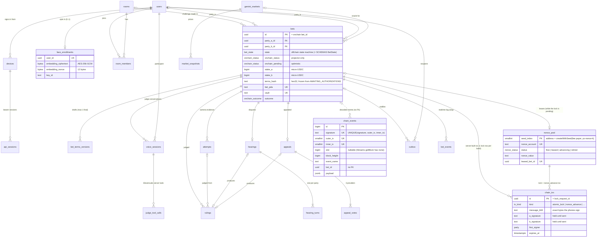
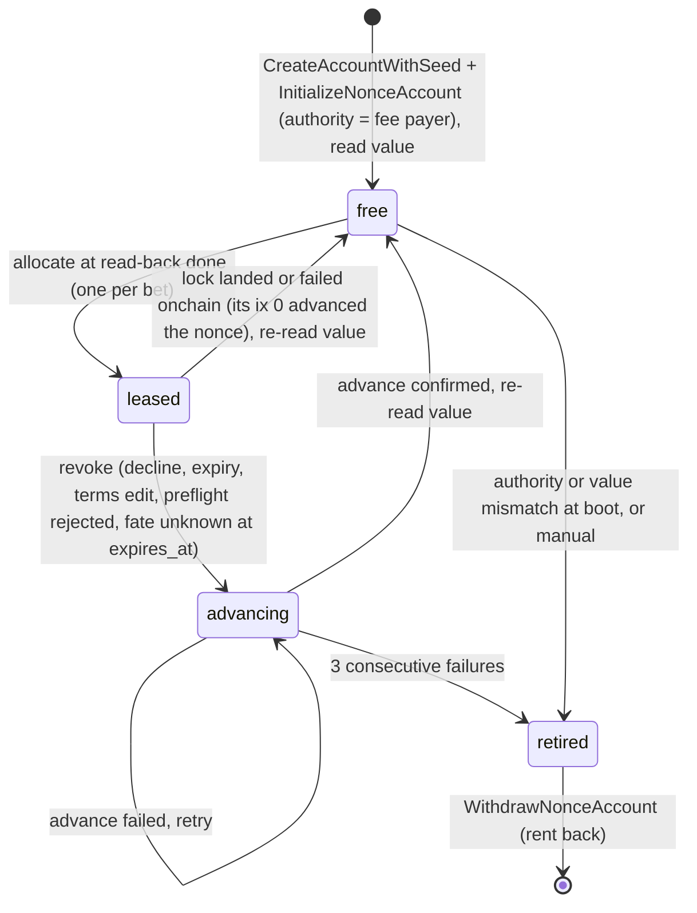
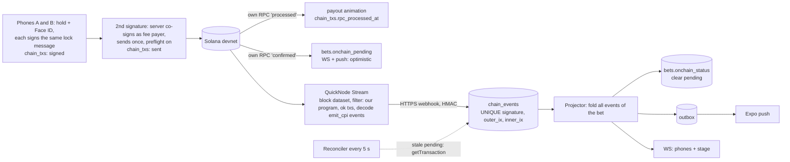

Status: DRAFT — Phase 0 planning written 2026-11-08 (before the build window). Re-author into the repo during the window; if committed verbatim, commit it as 'docs: import Phase 0 planning (written pre-window)'.

# You're On: Data Model (Postgres + onchain mapping)

Scope: the Postgres schema for `apps/server`, how each row relates to Solana accounts and Anchor events, and the rules for consistency, evidence, and biometric data. Other Phase 0 docs (architecture, API contract, Terms/Ruling schemas, escrow program, task breakdown) are being written in parallel. Where this doc names something one of those docs owns (instruction names, event names, Zod schemas), that doc wins and this one gets updated to match.

**At a glance (2026-11-08)**

- **Systems of record.** Postgres holds people, conversations, evidence pointers and rulings. Solana holds money. Only the projector writes `bets.onchain_status`, from Streams events (D1).
- **Lock = one transaction (D10, from decision D3).**
  - Each lock build is **one `chain_txs` row** (kind `atomic_lock`). It holds the exact message bytes, both party signatures, `first_signer` and `expires_at` (§5.8).
  - The row is built on a durable nonce leased from **`nonce_pool`** (§5.20): allocate per bet, advance after use or on a revoke, rotate.
  - `bets.a_/b_authorized_*` record each party's hold + Face ID.
- **Enums equal SCHEMAS.** New: `tx_kind`, `lock_mode` and `nonce_status`. `tx_status` gains `revoked`, and `bet_end_reason` gains `lock_failed`.
- **Rulings commit to frames.** `rulings.frame_hashes` mirrors the record's `frame_hashes` (SCHEMAS O3, adopted).
- **Idempotency.** Streams dedup on `(signature, outer_ix, inner_ix)`. Authorizations dedup on `(lock_request_id, party)`. One in-flight tx per `(bet_id, kind)`. Never two lock messages on one nonce value.

---

## 0. Key decisions

| # | Decision |
|---|---|
| D1 | Postgres is the system of record for people, conversations, evidence pointers and rulings. Solana is the system of record for money. Only the chain projector writes `bets.onchain_status`, and it writes it only from `chain_events` (QuickNode Streams webhook). |
| D2 | `bets.id` (uuid) **is** the onchain `bet_id`: the UUID's 16 bytes in RFC 4122 order. The server generates it at challenge time and never reuses it, even when a lock (or `create_bet`) fails. A failed lock continues on a new `bet_id` (`supersedes_bet_id`). |
| D3 | Vault = a PDA token account with seeds `["vault", bet_id]` and `token::authority = Bet PDA`, **not** the Bet PDA's ATA (§3.3). |
| D4 | Amounts are integer micro-USDC in `BIGINT`. Stakes are guarded by `CHECK (1..20_000_000)`. Payout math is re-checked by a DB constraint that mirrors the program. |
| D5 | Hashes are stored as lowercase hex `text` with a CHECK. Canonical JSON (Terms, Ruling, Gemini settlement) is stored verbatim, and the DB verifies `sha256(canonical) = hash`. |
| D6 | Commitment is `confirmed` for state and projection. "Optimistic" means the server's own RPC result: `bets.onchain_pending` is set at `confirmed`, and the payout animation fires at `processed` (`chain_txs.rpc_processed_at`, SCHEMAS X10). "Confirmed" means the event arrived through Streams (`bets.onchain_status`). |
| D7 | Face embeddings are encrypted at the app layer with AES-256-GCM and a per-row nonce. There is no pgvector: matching runs in memory, only over the members of one room. A face match only **addresses** a challenge. It never authorizes anything. |
| D8 | Tooling is Drizzle ORM + drizzle-kit + drizzle-zod. Triggers, views and grants go in one hand-written SQL migration. |
| D9 | No handshake (lead-engineer amendment, 2026-11-07). Each party authorizes on their own iPhone (hold-to-confirm + Face ID), and that signs the shared lock message. A's key authorizes only `create_bet` (A's deposit) and B's only `accept_bet` (B's). The DB records per-party `*_authorized_at` and `*_authorization_method`. No handshake column, enum, table or test exists. |
| D10 | **Atomic lock (D3, 2026-11-08).** The lock is one transaction `[AdvanceNonce, ComputeBudget…, create_bet, accept_bet]` on a durable nonce (ESCROW §5.0.1).<br>• The DB holds the pool (`nonce_pool`, §5.20).<br>• Per build, one `chain_txs` row (kind `atomic_lock`) holds the exact message bytes and both party signatures until the second arrives and the server sends it once.<br>• Decline, expiry, a terms edit or a failed lock revoke the lock by advancing its nonce.<br>• `bets.lock_mode` records `atomic`, or `sequential` (the fallback). |

---

## 1. Logical types

| Logical type | Postgres | Constraint | TS (Drizzle) | JSON over the API |
|---|---|---|---|---|
| id | `uuid` | `gen_random_uuid()` (v4) | `string` | string |
| micro_usdc | `bigint` | `>= 0` (plus caps where relevant) | `bigint` (`mode: 'bigint'`) | decimal string, e.g. `"5000000"` |
| hex32 | `text` | `~ '^[0-9a-f]{64}$'` | `string` | lowercase hex |
| pubkey | `text` | `~ '^[1-9A-HJ-NP-Za-km-z]{32,44}$'` | `string` (kit `Address`) | base58 |
| tx_sig | `text` | `~ '^[1-9A-HJ-NP-Za-km-z]{64,88}$'` | `string` | base58 |
| ts | `timestamptz` | DB `timezone = 'UTC'` | `Date` | `Date#toISOString()` (`…sss Z`, ms precision) |
| prob | `numeric(5,4)` | `BETWEEN 0 AND 1` | `string` | `"0.62"` |

- Implement these as named `CHECK` constraints (Drizzle `check()`), not `DOMAIN`s. Drizzle has no domain support.
- A u64 above 2^63−1 does not fit in `bigint`. That can't happen here (max stake is 2e7).
- Onchain timestamps are unix seconds (i64). Convert them at the edge with `to_timestamp(i64)`.
- `timestamptz` holds microseconds, but hashed records use ms ISO strings. Never rebuild a hashed record's timestamps from a column: the stored canonical text is the source.
- **Names and enums** follow SCHEMAS §0.3. Columns that mirror an onchain field use the Rust name (`accept_deadline`, `stake_a`). Offchain enums (`bet_state`, `ruling_outcome`, `party`) have exactly the Zod values. Onchain enums (`onchain_status`, `onchain_outcome`) store the snake_case of the Rust variant (`PartyA` → `party_a`). Drizzle keys are the snake_case column names.

---

## 2. ER diagram



`audit_log` stands alone. Its user and bet columns are plain uuids with no FK, so deleting or anonymizing a user never rewrites audit rows.

---

## 3. Postgres ↔ onchain

### 3.1 Accounts

| Onchain | Derivation | Postgres | Notes |
|---|---|---|---|
| Program | `PROGRAM_ID` env | none | Listed in the README |
| Config PDA | `["config"]` (escrow doc) | none. Env mirrors `MAX_STAKE_MICRO=20000000` and `APPEAL_WINDOW_S=10` | admin, judge_authority, appeal_authority, max_stake, default deadlines |
| Bet PDA | `["bet", bet_id]` | one `bets` row; `bets.bet_pda` (cached, UNIQUE) | |
| Vault | `["vault", bet_id]`, authority = Bet PDA | `bets.vault` (cached, UNIQUE) | Closed together with the Bet by `close_bet`, which the server bundles into every terminal tx. Rent goes back to the rent payer (ESCROW P8). `bets.closed_at`/`close_sig` come from `BetClosed`. |
| User wallet | device keypair: 32-byte seed in `expo-secure-store` (`WHEN_UNLOCKED_THIS_DEVICE_ONLY`), unlocked by LocalAuthentication at each authorization (confirmed: spike 07) | `users.wallet_pubkey`; snapshots in `bets.party_a_wallet`/`party_b_wallet` | Snapshot, because a new keypair can appear after a reinstall (on iOS an old one can also resurface, spike 07) |
| User USDC account | ATA(wallet, mint), classic SPL Token | not stored (derived) | The server, as fee payer, creates it at funding time |
| Fee payer, judge_authority, appeal_authority | server secrets | **never in DB** | Pubkeys live in config. The fee payer is also the nonce authority. |
| Lock nonce pool | 5 System nonce accounts (80 B, rent 1,056,640 lamports each, M), `createAccountWithSeed(fee payer, "yo-nonce-<k>", System)`, authority = fee payer | `nonce_pool` (§5.20) | Holds no tokens. Its value is the lock message's lifetime (ESCROW §5.0.1). |
| USDC balances | token accounts | **not stored** | Read over RPC; cached in memory for ≤ 5 s |
| Anchor events | `emit_cpi!` self-CPI inner instructions (confirmed: spike 06; `emit!` log events are lost on log truncation) | `chain_events` | Arrive via the Streams webhook (§8) |

Devnet USDC mint default: `4zMMC9srt5Ri5X14GAgXhaHii3GnPAEERYPJgZJDncDU` (Circle, classic SPL Token, 6 decimals, freeze authority set) (confirmed: spike 07). It is stored per bet in `bets.mint`; the env sets `USDC_MINT`.

### 3.2 Bet PDA fields ↔ `bets` columns

| Bet PDA field | Onchain type | `bets` column | Writer |
|---|---|---|---|
| bet_id | `[u8;16]` | `id` | state machine, at challenge |
| party_a / party_b | Pubkey | `party_a_wallet` / `party_b_wallet` | state machine when it builds the tx; projector verifies |
| mint | Pubkey | `mint` | state machine |
| stake_a / stake_b | u64 | `stake_a` / `stake_b` | state machine (frozen from `AWAITING_AUTHORIZATIONS`) |
| terms_hash | `[u8;32]` | `terms_hash` | = the final `bet_terms_versions.terms_hash` |
| status | enum | `onchain_status` | **projector only** |
| outcome | `Option<Outcome>` | `outcome` | projector (from `BetResolved`, then the terminal event) |
| evidence_hash / ruling_hash | `[u8;32]` | `evidence_hash` / `ruling_hash` | projector (must equal the submitted ruling's values) |
| accept_deadline | i64 | `accept_deadline` | state machine picks it (the `create_bet` argument: skill now + 300 s, gemini `quotedAt` + 60 s); projector verifies against `BetCreated` |
| locked_at / resolve_deadline | i64 | `locked_at` / `resolve_deadline` | projector (`BetAccepted`) |
| resolved_at / appeal_deadline | i64 | `resolved_at` / `appeal_deadline` | projector (`BetResolved`) |
| appealed_at / appeal_resolve_deadline | i64 | `appealed_at` / `appeal_resolve_deadline` | projector (`BetAppealed`) |
| rent_payer, bump, vault_bump, snapshotted authorities and windows | Pubkey, u8, u32 | not stored | `rent_payer` is always the server fee payer. Atomic lock: no Bet exists before the lock, so the simulation is the pre-check. Sequential fallback: the server pre-checks the Bet before building `accept_bet` (ESCROW §5.2). |

Byte order: `bet_id` is the UUID's bytes in string order. In TS, `uuid.parse(id)`. In SQL, `decode(replace(id::text,'-',''),'hex')`. PDAs come from `getProgramDerivedAddress({ programAddress, seeds: ['bet', bytes] })`. A unit test re-derives `bet_pda` and `vault` from `id`.

### 3.3 Vault: PDA token account `["vault", bet_id]`, not the ATA

1. **No griefing.** Anyone can create an ATA address. A griefer who pre-creates the Bet PDA's ATA makes `init` fail, and the workaround is `init_if_needed`, which Anchor puts behind a feature flag because of re-initialization risk. Only our program can create a PDA-seeded vault.
2. **Leaner.** There is no Associated Token Program CPI, so `create_bet` needs one fewer account.
3. **Still deterministic.** Any component (server, stage, Streams filter) can derive the vault from `bet_id` alone.
4. **The cost is irrelevant.** Explorers won't label the vault as "the PDA's USDC account", but users never see it.

Decided (ESCROW P8, SCHEMAS X8): `close_bet`, bundled into every terminal tx, closes **both** the vault and the Bet and returns all rent to the rent payer. The earlier "keep the Bet as a receipt" proposal (§14 P4) is rejected. The receipt is the terminal event plus `BetClosed` (kept in `chain_events`), plus this row.

### 3.4 Outcomes: Split vs Refund

The program pays out `V = vault.amount` at payout time (ESCROW §6, SCHEMAS §5.3). `V = stake_a + stake_b` unless someone sent extra tokens to the vault ("excess"). `payout_a + payout_b = V` always.

| Onchain outcome | To A | To B | Produced by |
|---|---|---|---|
| PartyA | `V` | 0 | offchain `A_WINS` |
| PartyB | 0 | `V` | offchain `B_WINS` |
| Refund | `min(stake_a, V)` | `V − to_a` (each gets their own stake back; excess → B) | offchain `VOID` (hearing undecidable, REDO limit with hearings off, Gemini market `invalid`, safety stop). Same amounts as `timeout_refund` from Locked/Appealed. |
| Split | `floor(V / 2)` | `V − floor(V/2)` (**B gets the odd micro-unit**) | Reserved: no v1 offchain outcome maps to it (SCHEMAS P5). |
| (cancel / timeout from Open) | `V` | 0 | `cancel_open_bet`, `timeout_refund` from Open. The event outcome is `Refund`. |

- With equal stakes, Split and Refund pay the same. With unequal stakes (Gemini odds bets), Split moves value from the larger staker to the smaller one, so **Split is never used on `evidence_source = 'gemini'` bets** (CHECK `bets_gemini_market`).
- The odd-unit rule is the natural integer code: `to_a = V / 2; to_b = V - to_a`.
- REDO never goes onchain. The `bets_payout_rule` CHECK (§6.2) enforces this table on every terminal row, and tolerates excess.

### 3.5 Anchor events → projection

Event names and fields are fixed by ESCROW §7.2 and mirrored field for field by SCHEMAS §10.2 `ChainEvents`. The projector is table-driven, so a rename is a one-line change in all three places.

| Event | Instruction | `onchain_status` → | Columns set by the projector | `bets.state` (SCHEMAS §10.2) |
|---|---|---|---|---|
| BetCreated | create_bet | open | `create_sig`, `accept_deadline`. Verifies `terms_hash`, stakes, mint, `party_a`/`party_b`, `rent_payer`. Atomic lock: it arrives with `BetAccepted` under the same signature, so `create_sig = accept_sig` = the lock tx. | atomic: folded with `BetAccepted` → `LOCKED`; sequential: `AWAITING_LOCK` |
| BetAccepted | accept_bet | locked | `accept_sig`, `locked_at`, `resolve_deadline`. Verifies `party_b`, `terms_hash`, stakes, `vault_amount` | `LOCKED` |
| BetResolved | resolve | resolved | `resolve_sig`, `outcome`, `evidence_hash`, `ruling_hash`, `resolved_at`, `appeal_deadline` | `RULED` |
| BetAppealed | appeal | appealed | `appeal_sig`, `appealed_at`, `appeal_resolve_deadline` | `APPEALED` |
| BetConceded | concede | settled | `payout_sig`, `payout_via='concede'`, `payout_a/b` (= `to_a`/`to_b`), `settled_at` | `PAID` |
| BetFinalized | finalize | settled | same, with `payout_via='finalize'` | `PAID`, or `VOIDED` if outcome `Refund` |
| AppealResolved | resolve_appeal | settled | final `outcome`, `appeal_ruling_hash`, payouts, `payout_via='resolve_appeal'` | `PAID`, or `VOIDED` if outcome `Refund` |
| BetRefunded | timeout_refund | refunded | payouts, `outcome='refund'`, `payout_via='timeout_refund'`, `settled_at` | `EXPIRED` (`end_reason` from `from_status`: Open → `accept_timeout`, or `quote_expired` for gemini; Locked → `resolve_timeout`; Appealed → `appeal_timeout`) |
| BetCancelled | cancel_open_bet | cancelled | payouts (`to_a = V`, `to_b = 0`), `outcome='refund'`, `payout_via='cancel_open_bet'`, `settled_at` | `CANCELLED` |
| BetClosed | close_bet (bundled) | unchanged | `closed_at`, `close_sig` | unchanged (housekeeping) |
| ConfigInitialized / ConfigUpdated | config ixs | — | none (stored with `bet_id` NULL) | — |

Every event carries `bet_id`, the resulting status and, for terminal events, the amounts moved (`to_a`, `to_b`). The projector never needs to read account data, which matters because the accounts are closed in the same transaction (§14 P3, accepted).

---

## 4. Enum types

The Postgres enums must equal the Zod enums in `packages/shared` (SCHEMAS §0.3). A unit test asserts `pgEnum.enumValues` deep-equals the Zod enum's options: offchain enums verbatim, onchain enums through `toPg` (`PartyA` → `party_a`), and `onchain_status` is `['none', ...]`. **Declaration order matters**: the code compares `bet_state` and `onchain_status` values with `<` / `>=`.

```sql
CREATE TYPE platform           AS ENUM ('ios');                               -- all demo phones are iPhones (D4); add 'android' later
CREATE TYPE device_role        AS ENUM ('phone','judge_cam');                 -- judge_cam = the tripod iPhone, registered as a device of party A and bound to a room (API-CONTRACT §2.9, §2.15)
CREATE TYPE wallet_kind        AS ENUM ('device_keypair','embedded_provider');
CREATE TYPE enrollment_status  AS ENUM ('active','disabled');
CREATE TYPE liveness_method    AS ENUM ('blink','head_turn');
CREATE TYPE room_kind          AS ENUM ('demo','nearby','session');
CREATE TYPE join_method        AS ENUM ('code','qr','nearby','link','demo_seed');
CREATE TYPE challenge_method   AS ENUM ('face','list','link');                -- how B was addressed; never an authorization
CREATE TYPE evidence_source    AS ENUM ('camera','gemini');
CREATE TYPE bet_state          AS ENUM (                                       -- = SCHEMAS BetState, same order (18 values)
  'DRAFTING','TERMS_PROPOSED','AWAITING_AUTHORIZATIONS','AWAITING_LOCK','LOCKED',
  'ATTEMPT','JUDGING','HEARING','AWAITING_MARKET','RULED',
  'CONCEDED','FINALIZED','APPEALED','APPEAL_RESOLVED',
  'PAID','VOIDED','CANCELLED','EXPIRED');                                      -- >= 'PAID' is terminal
CREATE TYPE bet_end_reason     AS ENUM ('refused','declined','terms_changed','cancelled','draft_idle',
                                        'quote_expired','accept_timeout','resolve_timeout','appeal_timeout',
                                        'lock_failed');                        -- why CANCELLED / EXPIRED; lock_failed = preflight rejected or lock tx failed (nonce advanced)
CREATE TYPE lock_mode          AS ENUM ('atomic','sequential');               -- = SCHEMAS LockMode; atomic is the default (D10)
CREATE TYPE authorization_method AS ENUM ('faceid_hold','passcode_hold');      -- = SCHEMAS AuthorizationMethod
CREATE TYPE onchain_status     AS ENUM ('none','open','locked','resolved','appealed',
                                        'settled','refunded','cancelled');   -- = ['none', ...BetStatus]; >= 'settled' is terminal
CREATE TYPE onchain_outcome    AS ENUM ('party_a','party_b','split','refund');
CREATE TYPE payout_via         AS ENUM ('concede','finalize','resolve_appeal','timeout_refund','cancel_open_bet');
CREATE TYPE chain_ix           AS ENUM ('create_bet','accept_bet','cancel_open_bet','resolve','concede','appeal',
                                        'resolve_appeal','finalize','timeout_refund','close_bet');  -- = SCHEMAS Instruction, same order (escrow ix names; rulings.onchain_ix)
CREATE TYPE tx_kind            AS ENUM ('atomic_lock','create_bet','accept_bet','cancel_open_bet','resolve','concede','appeal',
                                        'resolve_appeal','finalize','timeout_refund','close_bet','nonce_advance');  -- = SCHEMAS TxKind, same order (chain_txs.kind)
CREATE TYPE tx_status          AS ENUM ('built','signed','sent','confirmed','failed','expired','revoked');
                                        -- 'signed' = party signature(s) held by the server; 'expired' = blockhash txs only;
                                        -- 'revoked' = a lock killed by a nonce advance before it landed
CREATE TYPE nonce_status       AS ENUM ('free','leased','advancing','retired');  -- nonce_pool lifecycle (§5.20)
CREATE TYPE chain_event_source AS ENUM ('stream','rpc_poll');
CREATE TYPE ruling_outcome     AS ENUM ('A_WINS','B_WINS','REDO','VOID');    -- = SCHEMAS RulingOutcome (VOID → onchain refund)
CREATE TYPE ruling_stage       AS ENUM ('attempt','settlement','hearing','appeal');  -- Ruling.stage + HearingRuling + AppealResult
CREATE TYPE redo_reason        AS ENUM ('unclear','low_confidence','contested');
CREATE TYPE ruling_void_reason AS ENUM ('undecidable','max_redos','market_invalid','safety_stop');  -- = SCHEMAS VoidReason
CREATE TYPE claim_result       AS ENUM ('MET','NOT_MET','UNCLEAR');
CREATE TYPE party              AS ENUM ('A','B');
CREATE TYPE attempt_status     AS ENUM ('recording','uploaded','judging','ruled','redo','failed');
CREATE TYPE voice_purpose      AS ENUM ('terms','hearing','announce');
CREATE TYPE session_status     AS ENUM ('active','ended','failed');
CREATE TYPE hearing_trigger    AS ENUM ('contested','max_redos','demo');      -- = SCHEMAS HearingRuling.trigger
CREATE TYPE hearing_status     AS ENUM ('open','closed','aborted');
CREATE TYPE appeal_status      AS ENUM ('filing','panel_voting','decided','failed');
CREATE TYPE panel_provider     AS ENUM ('anthropic','openai','google');      -- = SCHEMAS PanelProvider
CREATE TYPE vote_status        AS ENUM ('ok','error','timeout');
CREATE TYPE vote_counted_as    AS ENUM ('A_WINS','B_WINS','ABSTAIN');
CREATE TYPE appeal_decided_by  AS ENUM ('majority','upheld_no_majority');
CREATE TYPE market_side        AS ENUM ('yes','no');                          -- Gemini resolutionSide values; Terms.market.side 'YES'/'NO' maps via lower()
CREATE TYPE market_status      AS ENUM ('approved','active','closed','under_review','settled','invalid');  -- Gemini's own values (SCHEMAS GeminiMarketSnapshot.status)
CREATE TYPE outbox_status      AS ENUM ('pending','sent','failed','dead');
CREATE TYPE actor_kind         AS ENUM ('user','server','judge','panel','system');
```

---

## 5. Tables

Conventions:
- PKs are `uuid DEFAULT gen_random_uuid()` unless noted. High-volume append tables use `bigint GENERATED ALWAYS AS IDENTITY`.
- Every table has `created_at timestamptz NOT NULL DEFAULT now()`. Mutable tables also have `updated_at`, set by Drizzle `$onUpdate` or the `bets_guard` trigger.
- FK `ON DELETE` is CASCADE from `bets` to its children, RESTRICT from `bets` to `users` (bets are financial records), and CASCADE from `users` to `devices`, `face_enrollments` and `room_members`.

### 5.1 `users`

| Column | Type | Null | Default | Notes |
|---|---|---|---|---|
| id | uuid | N | gen_random_uuid() | PK |
| display_name | text | N | | 1–32 chars; shown on the stage view |
| avatar_key | text | Y | | Object key in the `avatars` bucket. The **profile photo the user chose**. It is NOT the biometric enrollment and is never embedded or matched. |
| wallet_pubkey | text (pubkey) | Y | | UNIQUE. Device-generated. NULL only for `is_demo` users before their phone binds. |
| wallet_kind | wallet_kind | N | 'device_keypair' | Confirmed: spike 07. No embedded-wallet vendor offers selfie-only signup on a free tier. |
| age_attested_18plus | boolean | N | false | Self-attestation at signup. Both parties must be true to create a bet (trigger). |
| attested_at | timestamptz | Y | | |
| is_demo | boolean | N | false | Seeded team accounts |
| demo_seed_ciphertext / demo_seed_nonce | bytea / bytea | Y | | `is_demo` only. The **custodial** demo wallet seed (FINDINGS §3.4): 32 bytes generated on the server, AES-256-GCM under env `DEMO_SEED_KEK` (devnet only), 12-byte nonce. Released once by `POST /v1/auth/demo-claim` (API-CONTRACT §1.3). Never logged. |
| created_at / updated_at | timestamptz | N | now() | |
| deleted_at | timestamptz | Y | | Account deletion anonymizes the row: display_name becomes "Deleted user", avatar is removed, devices and face enrollment are hard-deleted, bets are kept |

CHECKs: `NOT age_attested_18plus OR attested_at IS NOT NULL`; `is_demo OR deleted_at IS NOT NULL OR wallet_pubkey IS NOT NULL`; `is_demo OR demo_seed_ciphertext IS NULL`; `(demo_seed_ciphertext IS NULL) = (demo_seed_nonce IS NULL)`.

### 5.2 `devices`

| Column | Type | Null | Default | Notes |
|---|---|---|---|---|
| id | uuid | N | | PK |
| user_id | uuid FK users | N | | CASCADE |
| platform | platform | N | 'ios' | iOS only for the hackathon |
| push_provider | text | N | 'expo' | `CHECK IN ('expo','apns')`. Primary realtime path is WS + haptics + a local notification; Expo push (APNs via EAS) is secondary (spike 07). |
| push_token | text | Y | | Expo push token; partial UNIQUE where not null |
| device_pubkey | text (pubkey) | Y | | Ed25519 **device auth key** that signs login challenges and API write requests (API-CONTRACT §1.3, which owns the login flow). It is a **separate keypair from the wallet**, ungated, so the `.userPresence` upgrade (FINDINGS §3.4) never prompts Face ID on an API call. UNIQUE where not null. |
| role | device_role | N | 'phone' | `judge_cam` for the tripod iPhone (set by `PATCH /v1/devices/current`). Only a room's `judge_cam` device may upload attempt frames. |
| app_version | text | Y | | |
| created_at / last_seen_at | timestamptz | N | now() | `last_seen_at` is bumped at most once a minute |
| revoked_at | timestamptz | Y | | Logout or lost device. Revoked devices get no pushes. |

### 5.3 `face_enrollments`

One row per user who opted in. It contains no images: enrollment selfies never leave the phone.

| Column | Type | Null | Default | Notes |
|---|---|---|---|---|
| id | uuid | N | | PK |
| user_id | uuid FK users | N | | UNIQUE, CASCADE. Re-enrolling deletes the old row and inserts a new one. |
| status | enrollment_status | N | 'active' | `disabled` = excluded from matching; data kept until deletion or the retention purge (§10) |
| embedding_ciphertext | bytea | N | | AES-256-GCM output (ciphertext ‖ 16-byte tag) of the float32-LE, L2-normalized vector |
| embedding_nonce | bytea | N | | 12 random bytes per row, never reused. `CHECK octet_length = 12` |
| key_id | text | N | | Key version, e.g. `face-kek-2026-11-a`; used for rotation |
| embedding_dim | smallint | N | | `CHECK 64..1024`; `CHECK octet_length(embedding_ciphertext) = embedding_dim*4 + 16` |
| model_name / model_version | text | N | | On-device embedding model. Confirmed: spike 01, default InsightFace `w600k_mbf` (512-d, TFLite fp32; weights are non-commercial, so disclose that), fallback OpenCV SFace (128-d). Matching only compares rows with the same model and version. |
| consent_version | text | N | | ID of the consent text shown, e.g. `face-consent-v1` |
| consent_text_sha256 | text (hex32) | N | | Hash of the exact consent text shown |
| consent_at | timestamptz | N | | `CHECK consent_at <= created_at` (consent before capture) |
| liveness_method | liveness_method | N | | blink or head turn, checked on device |
| liveness_passed_at | timestamptz | N | | |
| last_used_at | timestamptz | Y | | Date of the last match against this user, truncated to the day. Drives retention. |
| disabled_at | timestamptz | Y | | `CHECK (status='disabled') = (disabled_at IS NOT NULL)` |
| created_at | timestamptz | N | now() | |

**Deletion is a hard `DELETE`**, plus an `audit_log` row that contains no vector, ciphertext or nonce (§10). No soft delete.

### 5.4 `rooms`

A room is a demo session or a group of people nearby. It is the boundary for face matching.

| Column | Type | Null | Default | Notes |
|---|---|---|---|---|
| id | uuid | N | | PK |
| code | text | N | | UNIQUE, `CHECK ~ '^[A-HJ-NP-Z2-9]{6}$'` (no 0/O/1/I) |
| name | text | Y | | |
| kind | room_kind | N | 'session' | |
| join_method | join_method | N | 'code' | Primary way to join: code, QR, nearby, demo_seed. No spike covered nearby discovery, so code/QR is the P0 path. |
| created_by | uuid FK users | Y | | NULL for system-created demo rooms |
| is_demo | boolean | N | false | |
| created_at | timestamptz | N | now() | |
| expires_at | timestamptz | N | now() + 12 h | `CHECK expires_at > created_at AND expires_at <= created_at + '14 days'` |
| closed_at | timestamptz | Y | | Closing a room evicts its decrypted-embedding cache |

### 5.5 `room_members`

| Column | Type | Null | Default | Notes |
|---|---|---|---|---|
| room_id | uuid FK rooms | N | | PK part, CASCADE |
| user_id | uuid FK users | N | | PK part, CASCADE |
| joined_via | join_method | N | | How this member actually joined |
| joined_at / last_seen_at | timestamptz | N | now() | |
| left_at | timestamptz | Y | | Members who have left are not match candidates |

### 5.6 `bets`

| Column | Type | Null | Default | Notes |
|---|---|---|---|---|
| id | uuid | N | gen_random_uuid() | PK, **= onchain bet_id** |
| room_id | uuid FK rooms | Y | | Room where the challenge was made; the stage view filters by it |
| party_a_id / party_b_id | uuid FK users | N | | A = challenger, B = challenged. `CHECK a <> b`. RESTRICT. |
| party_a_wallet / party_b_wallet | text (pubkey) | Y | | Snapshot taken when the lock is built (= `Terms.party_a/b.pubkey`); the server verifies each party signature against it |
| lock_mode | lock_mode | N | 'atomic' | Env `LOCK_MODE` when the lock is built. `sequential` = the two-tx fallback (ESCROW §5.0.3). |
| challenge_method | challenge_method | N | 'face' | How A addressed B. A face match only addresses the challenge (D7). |
| supersedes_bet_id | uuid FK bets | Y | | Set when a terms change after `AWAITING_AUTHORIZATIONS` cancels the old bet and continues on this new `bet_id` (SCHEMAS §9.2) |
| title | text | Y | | Short claim from the final terms, used in lists (e.g. "Bottle flip") |
| evidence_source | evidence_source | Y | | Copied from the final terms |
| state | bet_state | N | 'DRAFTING' | Offchain state machine = SCHEMAS `BetState` (table below) |
| end_reason | bet_end_reason | Y | | Why the bet is `CANCELLED`/`EXPIRED`. `CHECK (state IN ('CANCELLED','EXPIRED')) = (end_reason IS NOT NULL)` |
| refusal_category | text | Y | | SCHEMAS `RefusalCategory` when `end_reason = 'refused'` (`CHECK (end_reason = 'refused') = (refusal_category IS NOT NULL)`) |
| onchain_status | onchain_status | N | 'none' | **Projector-only.** Confirmed via Streams. |
| onchain_pending | onchain_status | Y | | Optimistic target after the server's own RPC `confirmed` |
| pending_sig | text (tx_sig) | Y | | `CHECK (onchain_pending IS NULL) = (pending_sig IS NULL)` |
| mint | text (pubkey) | N | | Server sets it from `USDC_MINT` |
| stake_a / stake_b | bigint | Y | | micro-USDC, `CHECK 1..20_000_000` (onchain rule; SCHEMAS adds whole cents ≥ $0.10). Unequal for odds bets. |
| terms_hash | text (hex32) | Y | | Binding hash. Frozen once `state >= 'AWAITING_AUTHORIZATIONS'` (trigger). |
| bet_pda / vault | text (pubkey) | Y | | UNIQUE. Derived cache. |
| gemini_market_id | uuid FK gemini_markets | Y | | Required when `evidence_source='gemini'` |
| a_position | market_side | Y | | A's side: `lower(Terms.market.side)` |
| odds_p | numeric(3,2) | Y | | `Terms.market.priceAtLock` (P(YES), 2 dp) |
| odds_source | text | Y | | `Terms.market.priceSource`: `CHECK IN ('mid','last_in_spread')` |
| quoted_at | timestamptz | Y | | `Terms.market.quotedAt`; gemini `accept_deadline` = this + 60 s |
| pricing_snapshot_id | bigint FK market_snapshots | Y | | The quote used for `odds_p` |
| a_authorized_at / b_authorized_at | timestamptz | Y | | Server receive time of that party's verified `PartyAuthorization` (hold + Face ID done, lock message signed). The signature itself lives in `chain_txs` (§5.8). Who went first: the earlier of the two, also stored as `chain_txs.first_signer`. Replaces the dropped handshake columns. |
| a_authorization_method / b_authorization_method | authorization_method | Y | | `faceid_hold` or `passcode_hold`. `CHECK (x_authorized_at IS NULL) = (x_authorization_method IS NULL)` |
| a_authorized_device_at / b_authorized_device_at | timestamptz | Y | | Device clock at Face ID success (`PartyAuthorization.authorized_at`), kept for latency metrics |
| redo_count | smallint | N | 0 | Non-decisive attempt rulings so far. `CHECK 0..3`: at most `MAX_REDOS` (2) re-records, and the 3rd non-decisive result goes to `HEARING` (SCHEMAS §5.2). |
| accept_deadline / resolve_deadline / appeal_deadline / appeal_resolve_deadline | timestamptz | Y | | Mirror the onchain i64 deadlines (Rust names) |
| appealed_at | timestamptz | Y | | From BetAppealed |
| evidence_hash / ruling_hash | text (hex32) | Y | | Values committed by `resolve` (from BetResolved) |
| appeal_ruling_hash | text (hex32) | Y | | From AppealResolved |
| outcome | onchain_outcome | Y | | From BetResolved, then overwritten by the terminal event (`refund` for timeout and cancel) |
| payout_a / payout_b | bigint | Y | | Terminal event `to_a` / `to_b` |
| payout_via | payout_via | Y | | |
| create_sig / accept_sig / resolve_sig / appeal_sig / payout_sig / close_sig | text (tx_sig) | Y | | Confirmed signatures, set by the projector |
| created_at | timestamptz | N | now() | Challenge time |
| terms_final_at / locked_at / resolved_at / settled_at / closed_at | timestamptz | Y | | `terms_final_at` = `Terms.created_at` (entering `AWAITING_AUTHORIZATIONS`). Chain-derived ones use the event's `ts`. `settled_at` = time of any terminal event. |
| last_seq | integer | N | 0 | Realtime envelope `seq` counter (SCHEMAS §10.1, `bet_events` §5.19) |
| updated_at | timestamptz | N | now() | Set by trigger |
| version | integer | N | 0 | Trigger increments it. Writers use `WHERE id=$1 AND version=$2`. |
| is_seed | boolean | N | false | Demo-history rows (§11): SQL-fallback rows with no chain footprint, or `seed:chain` rows signed by a script instead of an on-phone authorization |

`bet_state` ↔ `onchain_status` (SCHEMAS §9.2 owns the meanings):

| bet_state | Meaning | Expected onchain_status |
|---|---|---|
| DRAFTING | A addressed B (face or list); B's phone buzzed; the judge negotiates by voice | none |
| TERMS_PROPOSED | Terms valid and hashed; the judge is reading them back | none |
| AWAITING_AUTHORIZATIONS | Lock built on a leased nonce. Both phones show the terms card and hold the same message. Each party authorizes (hold + Face ID), which signs it; 0–1 signatures are held in `chain_txs`. Binding fields frozen. | none |
| AWAITING_LOCK | Atomic: **transient**; both signatures held, the lock tx sent once (preflight on), waiting for confirmed. Sequential: A's deposit landed; B pending. | none (atomic); open (sequential) |
| LOCKED | The lock tx confirmed (sequential: `accept_bet`): the second authorization locked the bet | locked |
| ATTEMPT / JUDGING | Camera attempt and vision ruling (a REDO loops back, `redo_count++`) | locked |
| HEARING | Pre-resolve dispute hearing | locked |
| AWAITING_MARKET | Gemini bet waiting for settlement | locked |
| RULED | `resolve` landed; appeal window open | resolved |
| CONCEDED / FINALIZED | `[concede\|finalize, close_bet]` submitted; payout pending | resolved |
| APPEALED | The three-model panel is deliberating | appealed |
| APPEAL_RESOLVED | `[resolve_appeal, close_bet]` submitted; payout pending | appealed |
| PAID | Winner paid (or Split) | settled |
| VOIDED | Judge-ruled `Refund` paid out | settled |
| CANCELLED | Ended before lock (`end_reason`: `declined`, `terms_changed`, `lock_failed`, …). Atomic: the nonce was advanced; nothing moved. | none (atomic), or cancelled (sequential) |
| EXPIRED | Ended by a deadline (`end_reason`) | none (lock window passed), or refunded |

Dispute sequencing (confirmed by SCHEMAS §6 and §12.2):
- The **hearing comes before `resolve`**. It is judge-level, signed by judge_authority, and the onchain status stays Locked. Its ruling (`stage='hearing'`) is the one `resolve` submits.
- The **appeal comes after `resolve`**: a loser signs `appeal`, the panel rules (`stage='appeal'`), and appeal_authority calls `resolve_appeal`.

This matches Beat 5 ("argue → judge rules → I appeal! → panel") and the split between the two authority keys. A terms change from `AWAITING_AUTHORIZATIONS` on cancels the bet (`terms_changed`) and creates a new row with a new `bet_id` (`supersedes_bet_id`).

### 5.7 `bet_terms_versions`

| Column | Type | Null | Default | Notes |
|---|---|---|---|---|
| id | uuid | N | | PK |
| bet_id | uuid FK bets | N | | CASCADE |
| version | integer | N | | Starts at 1; `UNIQUE (bet_id, version)` |
| schema_version | smallint | N | 1 | = `Terms.schema_version` |
| drafted_by | text | N | 'judge' | `CHECK IN ('judge','party_a','party_b')` |
| source_tool | text | Y | | ElevenLabs tool that produced it (`propose_terms`, …) |
| canonical_json | text | N | | Exact RFC 8785 (JCS) UTF-8 string of a full, strictly parsed SCHEMAS `Terms`. Amounts are decimal strings. |
| terms | jsonb | N | | `GENERATED ALWAYS AS (canonical_json::jsonb) STORED`, for querying |
| terms_hash | text (hex32) | N | | `CHECK terms_hash = encode(sha256(convert_to(canonical_json,'UTF8')),'hex')` |
| is_final | boolean | N | false | The version shown on both terms cards (entering `AWAITING_AUTHORIZATIONS`). Partial UNIQUE `(bet_id) WHERE is_final`. |
| created_at | timestamptz | N | now() | |

One row per `TERMS_PROPOSED` revision, so each row is a complete `Terms`. Incomplete `TermsDraft`s are realtime-only. Each party's binding act is recorded on `bets` (`*_authorized_at`) and onchain (their deposit signature), not here. The voice "accept" columns of the first draft are dropped, because a spoken accept no longer binds anything. Done in SCHEMAS (P3): the binding `Terms` includes `bet_id`, `escrow {cluster, program_id, mint}`, both party pubkeys and both stakes, so `terms_hash` commits to them.

### 5.8 `chain_txs` (outbound transactions the server builds)

One row per transaction the server builds. The atomic lock is **one** row (kind `atomic_lock`). It holds the exact message bytes and both party signatures until the server sends it once, at the second authorization (D10; SCHEMAS §9.4).

| Column | Type | Null | Default | Notes |
|---|---|---|---|---|
| id | uuid | N | | PK. For a lock this is `AuthorizeRequest.lock_request_id`. |
| bet_id | uuid FK bets | N | | CASCADE |
| kind | tx_kind | N | | = SCHEMAS `TxKind`. `atomic_lock` = `[AdvanceNonce, CB…, create_bet, accept_bet]`. `nonce_advance` = a fee-payer-only revoke. `create_bet`/`accept_bet` = the sequential fallback only. Every other value is that escrow instruction. |
| bundled_close | boolean | N | false | Terminal txs carry a bundled `close_bet` |
| signer_role | text | N | | `CHECK IN ('party_a','party_b','both_parties','judge','appeal','fee_payer','crank')`. `atomic_lock` → `both_parties`; `nonce_advance` → `fee_payer`. The fee payer always signs as well. |
| message_b64 | text | Y | | The exact message bytes the phones sign, base64. Required for device-signed kinds. `CHECK message_sha256 = encode(sha256(decode(message_b64,'base64')),'hex')`. Never rebuilt after a signature (ESCROW §5.0). |
| message_sha256 | text (hex32) | N | | Hash of the server-built message bytes. The server co-signs only a byte-equal message. |
| nonce_account | text (pubkey) | Y | | `atomic_lock` and `nonce_advance`: the pool account (`nonce_pool.nonce_account`) |
| nonce_value | text | Y | | `atomic_lock`: the durable nonce used as the message's `recentBlockhash`. `UNIQUE (nonce_account, nonce_value) WHERE kind = 'atomic_lock'`: never two lock messages on one value (ESCROW TM-N1). |
| a_signature / b_signature | text (tx_sig format) | Y | | Base58 Ed25519 party signatures over `message_b64`, verified on receipt against `bets.party_a/b_wallet`. Single-party kinds use the signer's column. **Stored only here**: never logged, never fanned out (SCHEMAS §10.1). |
| a_signed_at / b_signed_at | timestamptz | Y | | Server receive time of each verified signature |
| first_signer | party | Y | | Which party signed the lock first. `CHECK (first_signer IS NULL) = (a_signature IS NULL AND b_signature IS NULL)` |
| expires_at | timestamptz | Y | | `atomic_lock`: `accept_deadline − LOCK_SUBMIT_MARGIN_SECS`. No signature is accepted and nothing is sent after it; the sweeper revokes. |
| revoked_by_tx_id | uuid FK chain_txs | Y | | The `nonce_advance` row that killed this lock. `CHECK (status = 'revoked') = (revoked_by_tx_id IS NOT NULL)` |
| simulated_cu / cu_limit | integer | Y | | From the pre-send simulation. `CHECK cu_limit >= simulated_cu` (the server applies × 1.3 plus a floor, ESCROW §10.1). |
| signature | text (tx_sig) | Y | | UNIQUE. Known once the fee payer signs (the fee payer's signature is the tx id). For a lock, set at send. |
| expected_status | onchain_status | N | | Status this tx should produce: `atomic_lock` → `locked`; `nonce_advance` → `none` (no bet account) |
| status | tx_status | N | 'built' | `built` → `signed` → `sent` → `confirmed` / `failed`; see the lifecycle below. Partial UNIQUE `(bet_id, kind) WHERE status IN ('built','signed','sent')`: **one in-flight tx per kind per bet**, so one pending lock per bet. |
| last_valid_block_height | bigint | Y | | Blockhash txs only (a recent blockhash lives ~36 s on devnet, spike 07). NULL for `atomic_lock`, which is bounded by `expires_at` instead. |
| err | text | Y | | Program error name or code, or the preflight error (e.g. `-32002` with the simulated error) |
| built_at | timestamptz | N | now() | Lock: when the read-back finished and the message was built and simulated. Other device-signed kinds: hold start. |
| sent_at / rpc_processed_at / rpc_confirmed_at / stream_seen_at | timestamptz | Y | | Latency metrics. Second authorization (`greatest(a_signed_at, b_signed_at)`) → `rpc_confirmed_at` of the lock must be < 2 s (ESCROW §8.4). For payouts, `sent_at` → `rpc_processed_at` drives the payout animation. |

More CHECKs:

```sql
CHECK (kind <> 'atomic_lock' OR (message_b64 IS NOT NULL AND nonce_account IS NOT NULL AND nonce_value IS NOT NULL
                          AND expires_at IS NOT NULL AND signer_role = 'both_parties'))
CHECK (kind <> 'atomic_lock' OR status NOT IN ('sent','confirmed') OR (a_signature IS NOT NULL AND b_signature IS NOT NULL))  -- never sent half-signed
CHECK (kind <> 'nonce_advance' OR (nonce_account IS NOT NULL AND signer_role = 'fee_payer'))
CHECK (status <> 'revoked' OR kind = 'atomic_lock')
```

**Lock row lifecycle** (SCHEMAS §9.4 has the user-facing side):

| Status | Meaning | Next |
|---|---|---|
| `built` | Message built, simulated and stored; `AuthorizeRequest` sent to both phones; 0 signatures | `signed`; `revoked` |
| `signed` | 1 signature held (`first_signer` set), or both held and about to send. A crash in this state is recovered by the sweeper: send if `now < expires_at`, else revoke. | `sent`; `revoked` |
| `sent` | Both signatures present; co-signed; sent once with preflight on. Transient send errors re-send the same bytes. | `confirmed`; `failed`; `revoked` (fate unknown at `expires_at`; then the lock signature's status decides) |
| `confirmed` | Lock landed: `BetCreated` + `BetAccepted`; the nonce has advanced | — |
| `failed` | Preflight rejected (no fee, nonce unchanged) or failed onchain (15,000 lamports, nonce advanced). The nonce is revoked or re-read. Bet `CANCELLED` (`lock_failed`). | — |
| `revoked` | `revoked_by_tx_id`'s `AdvanceNonceAccount` confirmed. Every stored signature is now useless. | — |

### 5.9 `chain_events` (inbound; QuickNode Streams = source of truth for money)

| Column | Type | Null | Default | Notes |
|---|---|---|---|---|
| id | bigint identity | N | | PK |
| signature | text (tx_sig) | N | | **`UNIQUE (signature, outer_ix, inner_ix)`**: the single dedup key shared with ESCROW §7.1 and SCHEMAS §10.1 |
| outer_ix | smallint | N | | Index of the top-level instruction in the tx |
| inner_ix | smallint | N | | Index of the `emit_cpi!` self-CPI within `meta.innerInstructions[outer_ix]`. The Stream filter and the RPC fallback share one decoder, so the indices always match. |
| slot | bigint | Y | | NULL from Streams: getBlock objects carry no slot field (spike 06; check whether Streams adds one with `test_filter --probe`). Set by `rpc_poll`. |
| block_height | bigint | Y | | From the Streams block (`blockHeight`); NULL from `rpc_poll` |
| tx_index | integer | Y | | Position of the tx in the block, if the filter provides it |
| block_time | timestamptz | Y | | Second precision; can be NULL |
| commitment | text | N | 'confirmed' | `CHECK IN ('confirmed','finalized')`. On devnet finalized ≈ confirmed (spike 06 measured p50 −2 ms). Which one Streams delivers is unverified until the key run. |
| program_id | text (pubkey) | N | | Always `ESCROW_ID` (the filter requires it) |
| event_name | text | N | | IDL name (ESCROW §7.2). Unknown names are stored but not applied. |
| bet_id | uuid | Y | | Taken from the payload. **No FK**: test scripts can emit events for bets that have no row. NULL for Config events. |
| payload | jsonb | N | | = SCHEMAS `ChainEvents.<name>` minus `ChainMeta`: u64 → string, Pubkey → base58, `[u8;32]` → hex, bet_id → uuid string, i64 → number, enums → Rust variant name |
| raw_b64 | text | Y | | Raw event bytes (discriminator + Borsh), kept for re-decoding |
| source | chain_event_source | N | 'stream' | `rpc_poll` = degraded-mode backfill (§8.3) |
| delivery_id | text | Y | | Streams delivery or batch header, for debugging |
| received_at | timestamptz | N | now() | Stream latency = `received_at − block_time` |
| applied_at | timestamptz | Y | | When the event was folded into `bets` |
| apply_error | text | Y | | e.g. hash mismatch or unknown bet |
| finalized_at | timestamptz | Y | | P2 finality sweeper |

The Stream filter must **drop failed transactions** (`meta.err != null`). A failed tx still records the inner instructions (and so the `emit_cpi!` events) that ran before the failure (ESCROW §7.1 rule 1).

### 5.10 `voice_sessions`

| Column | Type | Null | Default | Notes |
|---|---|---|---|---|
| id | uuid | N | | PK |
| bet_id | uuid FK bets | N | | CASCADE |
| user_id | uuid FK users | N | | The participant whose phone holds this conversation (one per participant) |
| device_id | uuid FK devices | Y | | |
| purpose | voice_purpose | N | | |
| el_agent_id | text | N | | ElevenLabs agent ID |
| el_conversation_id | text | N | | UNIQUE |
| status | session_status | N | 'active' | |
| started_at | timestamptz | N | now() | |
| ended_at | timestamptz | Y | | |
| first_audio_ms | integer | Y | | Target < 1500 |
| transcript_key | text | Y | | Evidence-bucket key of the transcript JSON, copied when the session ends |
| transcript_sha256 | text (hex32) | Y | | |

### 5.11 `judge_tool_calls` (ElevenLabs server-tool webhooks)

| Column | Type | Null | Default | Notes |
|---|---|---|---|---|
| id | uuid | N | | PK |
| voice_session_id | uuid FK voice_sessions | N | | CASCADE |
| bet_id | uuid FK bets | N | | |
| tool_name | text | N | | Webhook tools only (FINDINGS §3.10): `propose_terms`, `confirm_terms` (read-back done; not binding; it triggers the lock build), later `open_hearing`, `file_appeal`, `get_market_odds`. `lock_bet` and `issue_ruling` are not LLM tools (SCHEMAS O5): the server pushes their results to A's phone. |
| el_tool_call_id | text | Y | | Partial UNIQUE `(voice_session_id, el_tool_call_id)`. A retried call replays the stored response. Spike 04 saw `tool_call_id` in the WebSocket `agent_tool_request`; whether the webhook body carries it is unverified until the key run. If it doesn't, dedupe on sha256(conversation_id, tool, canonical args) within 10 s. |
| request / response | jsonb | N / Y | | |
| status | text | N | | `CHECK IN ('ok','error','duplicate')` |
| latency_ms | integer | Y | | |
| created_at | timestamptz | N | now() | |

### 5.12 `attempts` (camera evidence)

| Column | Type | Null | Default | Notes |
|---|---|---|---|---|
| id | uuid | N | | PK |
| bet_id | uuid FK bets | N | | CASCADE; `UNIQUE (bet_id, attempt_no)` |
| attempt_no | smallint | N | | Starts at 1; a REDO adds a new attempt |
| recorded_by_user_id | uuid FK users | N | | |
| recorded_by_device_id | uuid FK devices | Y | | |
| status | attempt_status | N | 'recording' | |
| clip_key | text | Y | | `attempts/{bet_id}/{attempt_no}/clip.{mp4\|mov}` |
| clip_mime / clip_bytes / duration_ms | text / int / int | Y | | `clip_mime IN ('video/mp4','video/quicktime')`, `CHECK clip_bytes <= 25 MB`, `duration_ms <= 30000` (= SCHEMAS `CameraEvidence`; ~19 MB at 720p / 5 Mbps, spike 02) |
| client_clip_hash | text (hex32) | Y | | Hash computed on the phone at record end, so the ruling isn't blocked on upload (§9). = `CameraEvidence.clip_sha256` = the onchain `evidence_hash`. |
| evidence_hash | text (hex32) | Y | | sha256(stored clip bytes), recomputed by the server. Must equal `client_clip_hash`. |
| evidence_canonical | text | Y | | JCS of the SCHEMAS `CameraEvidence` record (frames, hashes, timings) |
| frame_keys | text[] | N | '{}' | 12 JPEGs per try plus one landing crop (planning D10; 8..12 accepted), extracted on the phone, 8 of them in the last ~1.2 s |
| frame_ts_ms | integer[] | N | '{}' | `CHECK cardinality = cardinality(frame_keys) AND <= 24` (= SCHEMAS `CameraEvidence.frames` max) |
| frame_hashes | text[] | N | '{}' | sha256 of each frame = `CameraEvidence.frames[i].sha256`. Committed in `ruling_hash` through the record's `frame_hashes` (SCHEMAS O3, adopted 2026-11-08). |
| started_at / uploaded_at | timestamptz | Y | | |
| purged_at | timestamptz | Y | | Set by the 30-day retention sweeper |

### 5.13 `rulings`

| Column | Type | Null | Default | Notes |
|---|---|---|---|---|
| id | uuid | N | | PK |
| bet_id | uuid FK bets | N | | CASCADE |
| stage | ruling_stage | N | | `attempt` \| `settlement` (SCHEMAS `Ruling`), `hearing` (`HearingRuling`), `appeal` (`AppealResult`) |
| attempt_id | uuid FK attempts | Y | | `CHECK (stage='attempt') = (attempt_id IS NOT NULL)` |
| hearing_id | uuid FK hearings | Y | | `CHECK (stage='hearing') = (hearing_id IS NOT NULL)`; partial UNIQUE |
| appeal_id | uuid FK appeals | Y | | `CHECK (stage='appeal') = (appeal_id IS NOT NULL)`; partial UNIQUE |
| model | text | N | | `"<provider>/<model-id>"`, `"rule/gemini-settlement@1"`, or `"panel/majority-of-3"` for the appeal row (= the record's `model`) |
| outcome | ruling_outcome | N | | = record `outcome` (appeal row: `final_outcome`). `REDO` iff `claim_result = UNCLEAR` or confidence < 0.80, with re-attempts left. `VOID` only from server rules. |
| claim_result | claim_result | Y | | Raw model answer (NULL for the appeal row) |
| redo_reason | redo_reason | Y | | `CHECK (outcome='REDO') = (redo_reason IS NOT NULL)` |
| void_reason | ruling_void_reason | Y | | `CHECK (outcome='VOID') = (void_reason IS NOT NULL)`. A hearing VOID is `undecidable`. |
| confidence | numeric(3,2) | Y | | `CHECK 0..1`, 2 dp (= SCHEMAS `Confidence`); NULL for the appeal row |
| reason | text | Y | | ≤ 280 chars; the judge speaks it |
| cited_frames | smallint[] | N | '{}' | Indices into `frame_hashes` |
| frame_hashes | text[] | N | '{}' | = the record's `frame_hashes` (SCHEMAS O3, D7): the frames this model was sent, in order. The app checks that camera stages are a subset of `attempts.frame_hashes` in order (normally equal). `'{}'` for settlement rows. `CHECK cardinality(frame_hashes) <= 24` |
| evidence_kind | evidence_source | N | | |
| evidence_hash | text (hex32) | N | | Camera: `attempts.client_clip_hash` (what `resolve` commits). Gemini: `sha256(evidence_canonical)`. |
| evidence_canonical | text | Y | | Gemini only: JCS of the per-bet SCHEMAS `GeminiSettlementRecord` (contains `bet_id` and `terms_hash`, X12). `CHECK evidence_hash = sha256(evidence_canonical)` when set. |
| record_canonical | text | N | | JCS of the SCHEMAS record (`Ruling` \| `HearingRuling` \| `AppealResult`), stored byte for byte. Never rebuilt from columns. |
| ruling_hash | text (hex32) | N | | UNIQUE; `CHECK = sha256(record_canonical)`. Onchain `ruling_hash` (resolve) or `appeal_ruling_hash` (resolve_appeal). |
| onchain_ix | chain_ix | Y | | `resolve` or `resolve_appeal` once submitted. `CHECK onchain_ix IN ('resolve','resolve_appeal')`, `CHECK outcome <> 'REDO' OR onchain_ix IS NULL`. Partial UNIQUE `(bet_id, onchain_ix)`. |
| latency_ms | integer | Y | | Attempt end → ruling (target < 4000) |
| created_at | timestamptz | N | now() | = the record's `created_at` |

Mapping to onchain (SCHEMAS §5.3): `A_WINS → party_a`, `B_WINS → party_b`, `VOID → refund`, `REDO →` nothing. `split` has no v1 producer.

### 5.14 `hearings` and `hearing_turns`

`hearings`:

| Column | Type | Null | Default | Notes |
|---|---|---|---|---|
| id | uuid | N | | PK |
| bet_id | uuid FK bets | N | | UNIQUE (at most one hearing per bet) |
| trigger | hearing_trigger | N | | `contested`, `max_redos` (3rd non-decisive recording) or `demo` (stage toggle) |
| disputed_ruling_id | uuid FK rulings | Y | | The `attempt` ruling that led here (`redo_reason = 'contested'`, or the 3rd non-decisive one) |
| opened_by_user_id | uuid FK users | Y | | NULL unless opened by a person (demo toggle) |
| status | hearing_status | N | 'open' | |
| turn_seconds | smallint | N | 10 | |
| opened_at / closed_at | timestamptz | N / Y | now() | |

`hearing_turns`:

| Column | Type | Null | Default | Notes |
|---|---|---|---|---|
| id | uuid | N | | PK |
| hearing_id | uuid FK hearings | N | | CASCADE. `UNIQUE (hearing_id, turn_index)`, `UNIQUE (hearing_id, party)` |
| turn_index | smallint | N | | `CHECK 0..1`: 0 = A, 1 = B (= SCHEMAS `HearingTurn.turn_index`) |
| party | party | N | | One phone each, so the speaker is known from device auth, not from voice |
| speaker_user_id | uuid FK users | N | | Must be that party (app check) |
| device_id / voice_session_id | uuid FK | Y | | |
| transcript | text | N | '' | Normalized, ≤ 600 chars (= SCHEMAS `NText(600, 0)`; may be empty) |
| transcript_sha256 | text (hex32) | N | | sha256(UTF-8(transcript)); bound into `HearingRuling.arguments` |
| stt | text | N | 'elevenlabs' | `CHECK IN ('elevenlabs','device')` |
| duration_ms | integer | N | | `CHECK 0..12000` (10 s turn + 2 s grace) |
| audio_key | text | Y | | NULL by default: hearing audio is not retained |
| started_at / ended_at | timestamptz | N / Y | | |

### 5.15 `appeals` and `appeal_votes`

`appeals`:

| Column | Type | Null | Default | Notes |
|---|---|---|---|---|
| id | uuid | N | | PK |
| bet_id | uuid FK bets | N | | UNIQUE (the program allows one appeal) |
| appellant_user_id | uuid FK users | N | | The loser of a decisive original ruling, or either party if the original is `VOID` (onchain Refund) |
| appellant_party | party | N | | |
| appealed_ruling_id | uuid FK rulings | N | | The ruling submitted via `resolve` |
| original_outcome | ruling_outcome | N | | `CHECK IN ('A_WINS','B_WINS','VOID')` (= SCHEMAS `Appealable`) |
| status | appeal_status | N | 'filing' | `filing` → `panel_voting` (after the onchain `appeal`) → `decided` |
| filed_at | timestamptz | N | now() | |
| decided_at | timestamptz | Y | | |
| final_outcome | ruling_outcome | Y | | `CHECK IN ('A_WINS','B_WINS','VOID')`; set when decided |
| decided_by | appeal_decided_by | Y | | `majority` or `upheld_no_majority` |
| flipped | boolean | Y | | `final_outcome <> original_outcome` |
| result_ruling_id | uuid FK rulings | Y | | The `stage='appeal'` row holding the hashed `AppealResult` |

`appeal_votes`:

| Column | Type | Null | Default | Notes |
|---|---|---|---|---|
| id | uuid | N | | PK |
| appeal_id | uuid FK appeals | N | | CASCADE. `UNIQUE (appeal_id, seat)`, `UNIQUE (appeal_id, provider)` (three different providers) |
| seat | smallint | N | | `CHECK 0..2` (= SCHEMAS `AppealVote.seat`) |
| provider | panel_provider | N | | |
| model | text | N | | `"<provider>/<model-id>"` |
| status | vote_status | N | | `ok`, `error` or `timeout` (8 s) |
| outcome | ruling_outcome | N | | `CHECK outcome IN ('A_WINS','B_WINS','REDO')`: never VOID; REDO if `status <> 'ok'` |
| counted_as | vote_counted_as | N | | `ABSTAIN` if not ok, REDO, or confidence < 0.6. With no 2-of-3 majority the appealed ruling stands (SCHEMAS §7). |
| confidence | numeric(3,2) | N | | 0 if `status <> 'ok'` |
| reason | text | N | '' | |
| output_sha256 | text (hex32) | N | | Hash of the raw model JSON |
| latency_ms | integer | Y | | |
| created_at | timestamptz | N | now() | |

Built by migration 0008 (`packages/db/src/schema/judge.ts`, 2026-11-18), with these CHECKs on top of the tables above: `appeals_decided` (`status = 'decided'` iff `decided_at`, `final_outcome`, `decided_by`, `flipped` and `result_ruling_id` are all set), `appeals_flipped` (`flipped = final_outcome <> original_outcome`), `appeal_votes_failed` (a vote that is not `ok` is `REDO`, confidence 0, reason `''`, `ABSTAIN`), seat 0..2, outcome never `VOID`, reason ≤ 280. `rulings.appeal_id` now references `appeals` (NO ACTION, so a bet delete cascades through both in one statement). A `failed` appeal (its tx never landed) is re-filed in place: `bet_id` stays UNIQUE and its votes are deleted. The stage='appeal' rulings row carries `onchain_ix = 'resolve_appeal'` from the decision on, `void_reason` = the appealed ruling's when a VOID is upheld.

### 5.16 `gemini_markets` and `market_snapshots`

Field names follow the spike 05 samples (`btc5m-listing.json`, `event-…-settled.json`). Symbols come **only from the API**; they are never built by hand.

`gemini_markets` (one row per contract we touch):

| Column | Type | Null | Default | Notes |
|---|---|---|---|---|
| id | uuid | N | | PK |
| event_ticker | text | N | | e.g. `BTC05M2611072135` |
| instrument_symbol | text | N | | UNIQUE, e.g. `GEMI-BTC05M2611072135-UP` |
| contract_ticker | text | N | | e.g. `UP` |
| series | text | Y | | e.g. `BTC05M` |
| title | text | Y | | |
| strike | numeric(20,8) | Y | | From the API (`strike.value`), never parsed from the ticker; available at window start |
| window_start / expires_at | timestamptz | Y / N | | |
| status | market_status | N | 'active' | Gemini's status value, verbatim |
| resolution_side | market_side | Y | | API `resolutionSide` (`yes` / `no`) |
| settlement_value | text | Y | | API `settlementValue`, kept as the exact decimal string (e.g. `"75550.7195"`; arbitrary precision, = SCHEMAS `DecimalStr`) |
| resolved_at | timestamptz | Y | | API `resolvedAt` |
| settlement_raw | text | Y | | Raw body of the `GET /events/{eventTicker}` response that settled it, kept byte for byte |
| settlement_response_sha256 | text (hex32) | Y | | `CHECK = sha256(settlement_raw)` = `GeminiSettlementRecord.response_sha256` |
| event_raw | jsonb | Y | | Latest raw event, kept for audit |
| first_seen_at / updated_at | timestamptz | N | now() | |

`UNIQUE (event_ticker, instrument_symbol)`. The hashed settlement **evidence** is per bet (`GeminiSettlementRecord` contains `bet_id` and `terms_hash`), so it lives on the settlement `rulings` row (`evidence_canonical`, SCHEMAS X12), not here. What a voided (`invalid`) market looks like in the API is still unseen: 0 of 173 contracts in spike 05.

Gemini camelCase ↔ columns (SCHEMAS §0.3):

| Gemini / `Terms.market` / snapshot field | Column |
|---|---|
| `eventTicker`, `instrumentSymbol` | `gemini_markets.event_ticker`, `instrument_symbol` |
| `strike.value`, `strike.availableAt` | `gemini_markets.strike`, `window_start` |
| `expiry` | `gemini_markets.expires_at` |
| `status` | `gemini_markets.status` |
| `resolutionSide`, `settlementValue`, `resolvedAt` | `resolution_side`, `settlement_value`, `resolved_at` |
| `Terms.market.side` (`YES`/`NO`) | `bets.a_position` (`yes`/`no`) |
| `priceAtLock`, `priceSource`, `quotedAt` | `bets.odds_p`, `odds_source`, `quoted_at` |
| `bestBid`, `bestAsk`, `lastTradePrice`, `indexPrice`, `source`, `exchangeTs`, `observedAt` | `market_snapshots.best_bid`, `best_ask`, `last_price`, `index_price`, `source`, `exchange_ts`, `captured_at` |

`market_snapshots`:

| Column | Type | Null | Default | Notes |
|---|---|---|---|---|
| id | bigint identity | N | | PK |
| market_id | uuid FK gemini_markets | N | | CASCADE |
| captured_at | timestamptz | N | now() | = snapshot `observedAt`. Persist **≤ 1 per second** per market. The stage chart reads an in-memory ring buffer of 1 Hz index ticks (the undocumented `/v2/klines` backfill was not reproducible, spike 05). |
| exchange_ts | timestamptz | Y | | bookTicker `E` (nanoseconds; parse as bigint, confirmed: spike 05) |
| source | text | N | | `CHECK IN ('ws_book_ticker','rest_event')` (= SCHEMAS `GeminiMarketSnapshot.source`) |
| best_bid / best_ask / last_price | numeric(5,4) | Y | | YES prices 0–1. The 0.01/0.99 placeholder levels are stored as seen. |
| index_price | numeric(20,8) | Y | | `lukka:LS-LRRR-XBTUSD` index (its `E` is in seconds), for the BTC-vs-strike chart |

### 5.17 `outbox` (push notifications; durable)

Rows are written **in the same transaction** as the state change. After commit, the server publishes to WebSockets in-process, fire-and-forget: phones and the stage view re-sync over GET when they reconnect. The outbox exists so pushes survive crashes and are never sent twice.

| Column | Type | Null | Default | Notes |
|---|---|---|---|---|
| id | bigint identity | N | | PK |
| recipient_user_id | uuid FK users | N | | Fanned out to the user's active devices |
| bet_id | uuid FK bets | Y | | |
| kind | text | N | | `challenge_received`, `authorize_terms` (your terms card is ready), `bet_locked`, `ruling`, `payout`, `appeal_decided`, … |
| payload | jsonb | N | | Display data only. **Never** biometric data or keys. |
| dedupe_key | text | N | | UNIQUE, e.g. `{bet_id}:{kind}:{signature or ruling_id}:{user_id}` |
| status | outbox_status | N | 'pending' | |
| attempts | smallint | N | 0 | Marked `dead` after 5 attempts |
| next_attempt_at | timestamptz | N | now() | |
| provider_ticket_id | text | Y | | Expo push ticket, used to check the receipt |
| last_error | text | Y | | |
| created_at / sent_at | timestamptz | N / Y | now() | |

The dispatcher runs `SELECT … WHERE status='pending' AND next_attempt_at <= now() ORDER BY id FOR UPDATE SKIP LOCKED LIMIT 50`. After commit it is also woken in-process for an immediate send, which keeps payout pushes under 1 s.

### 5.18 `audit_log` (append-only; no biometric data, ever)

| Column | Type | Null | Default | Notes |
|---|---|---|---|---|
| id | bigint identity | N | | PK |
| at | timestamptz | N | now() | |
| actor_kind | actor_kind | N | | |
| actor_user_id | uuid | Y | | No FK |
| action | text | N | | dot.case: `face.consented`, `face.enrolled`, `face.deleted`, `bet.state_changed`, `chain.mismatch`, `evidence.mismatch`, `demo.reset`, … |
| bet_id / subject_user_id | uuid | Y | | No FK |
| request_id | text | Y | | |
| details | jsonb | N | '{}' | `CHECK NOT (details ?\| ARRAY['embedding','embedding_ciphertext','embedding_nonce','probe','face_image','image'])` as a tripwire |

A trigger blocks UPDATE and DELETE. Consent and deletion events stay here after the enrollment row is gone, as proof of consent and destruction.

### 5.19 `bet_events` (realtime log; SCHEMAS §10.1)

Every `RealtimeEvent` fanned out for a bet is appended here first, so clients can replay after a gap (`GET /bets/:id/events?after=<seq>`, API doc).

| Column | Type | Null | Default | Notes |
|---|---|---|---|---|
| bet_id | uuid FK bets | N | | PK part, CASCADE |
| seq | integer | N | | PK part. Assigned by `UPDATE bets SET last_seq = last_seq + 1 WHERE id = $1 RETURNING last_seq` in the same transaction. Gapless per bet. |
| type | text | N | | Envelope `type`, e.g. `bet.state`, `terms.authorized`, `chain.BetAccepted` |
| source | text | N | | `CHECK IN ('server','chain')`; `CHECK (type LIKE 'chain.%') = (source = 'chain')` |
| envelope | jsonb | N | | The full envelope (`v`, `type`, `bet_id`, `seq`, `ts`, `source`, `payload`) |
| chain_event_id | bigint FK chain_events | Y | | UNIQUE when set: each chain event enters the log once (dedup happens before `seq` is assigned) |
| created_at | timestamptz | N | now() | = envelope `ts` |

Privacy: the envelope rules of SCHEMAS §10.1 apply (no face data, raw audio or tokens), and `frame_urls` inside it expire after 10 min anyway. Retention: kept with the bet; the 30-day evidence sweeper does not touch it.


### 5.20 `nonce_pool` (durable nonces for the atomic lock)

One row per System nonce account. The authority of every account is the server fee payer, so the lock stays at 3 signatures (ESCROW §5.0.1). The pool has `NONCE_POOL_SIZE` = 5 accounts at 1,056,640 lamports each (M). Demo concurrency is ≤ 2 pending locks.

| Column | Type | Null | Default | Notes |
|---|---|---|---|---|
| seed_index | smallint | N | | PK. `CHECK 0..15` (`NONCE_SEED_MAX`). Address = `createWithSeed(fee payer, 'yo-nonce-' \|\| seed_index, System)`, which phones verify (ESCROW §5.0.2). |
| nonce_account | text (pubkey) | N | | UNIQUE |
| authority | text (pubkey) | N | | = the server fee payer; checked against env and onchain at boot |
| status | nonce_status | N | 'free' | `free` \| `leased` \| `advancing` \| `retired` |
| nonce_value | text | Y | | Current stored nonce (base58). Read at `confirmed` after creation and after every advance. NULL while `advancing`. |
| value_read_at | timestamptz | Y | | |
| leased_bet_id | uuid FK bets | Y | | Partial UNIQUE where not null: **one nonce per pending lock** |
| leased_tx_id | uuid FK chain_txs | Y | | The `atomic_lock` row built on this nonce |
| leased_at | timestamptz | Y | | |
| advance_tx_id | uuid FK chain_txs | Y | | The in-flight `nonce_advance` row while `advancing` |
| last_advanced_at | timestamptz | Y | | Drives least-recently-advanced allocation |
| uses / failures | integer / smallint | N | 0 / 0 | Locks built on this account; consecutive failed advances or reads (3 → `retired`) |
| created_at / retired_at | timestamptz | N / Y | now() | |

CHECKs:

```sql
CHECK ((status = 'leased')    = (leased_bet_id IS NOT NULL AND leased_tx_id IS NOT NULL))
CHECK ((status = 'advancing') = (advance_tx_id IS NOT NULL))
CHECK ((status = 'retired')   = (retired_at IS NOT NULL))
CHECK (status <> 'free' OR nonce_value IS NOT NULL)
```



- **Allocate, one per bet.** In one DB transaction at read-back done:
  1. `SELECT … FROM nonce_pool WHERE status = 'free' ORDER BY last_advanced_at NULLS FIRST LIMIT 1 FOR UPDATE SKIP LOCKED`.
  2. Set it `leased`.
  3. Insert the `chain_txs` lock row with `nonce_value` copied.

  Before building, re-read the onchain value at `confirmed`. Only the fee payer can advance, so a difference is an anomaly: write `audit_log 'nonce.mismatch'` and use the onchain value. If the pool is empty, create the next `seed_index` (0.00106 SOL), or else show "busy, try again".
- **Advance after use.** When the lock lands, its own ix 0 has moved the nonce. The same happens if it fails onchain, because Agave advances it anyway. Re-read the value at `confirmed`, then set `free`, increment `uses` and update `last_advanced_at`.
- **Advance on revoke.** Send a fee-payer-only `[AdvanceNonceAccount]` with a recent blockhash (`chain_txs` kind `nonce_advance`). The row stays `advancing` until that confirms. Then re-read → `free`, and the lock row → `revoked`. A revoke after the lock landed is harmless: it just advances again, and the lock signature's status decides the bet.
- **Never** lease an `advancing` nonce. Never build a second message on one value: `UNIQUE (nonce_account, nonce_value)` on lock rows.
- **Rotate.**
  - Every use gets a fresh value.
  - Allocation is least-recently-advanced, so an account that was just advanced rests.
  - Retire an account on 3 consecutive failures, or on an authority or value mismatch. Replace it with the next `seed_index`. Phones accept any `k < 16`, so this needs no app rebuild.
  - At teardown, withdraw the rent with `WithdrawNonceAccount`.
  - Rotating the fee-payer key means `AuthorizeNonceAccount` on every row plus an app build with the new pinned key (ESCROW §10.2).
- **Boot reconcile and sweep** (every 5 s, with the reconciler of §8.3). Read every non-retired account with `getAccountInfo` at `confirmed` and parse its nonce state (authority + value).
  - `leased`, and its lock row is terminal or past `expires_at` → revoke.
  - `advancing`, and the advance tx has confirmed or expired → re-read → `free`, or retry.
  - `free`, and the onchain value differs → update it and write `audit_log 'nonce.mismatch'`.

### 5.21 `api_sessions` (bearer sessions; API-CONTRACT §1.3)

| Column | Type | Null | Default | Notes |
|---|---|---|---|---|
| id | uuid | N | | PK (= `Session.session_id`; it is part of the signed request string) |
| token_sha256 | text (hex32) | N | | UNIQUE. sha256 of the bearer `yo_s_…` token; the token itself is never stored or logged |
| user_id | uuid FK users | Y | | CASCADE. NULL for stage tokens |
| device_id | uuid FK devices | Y | | CASCADE; revoking the device kills its sessions. NULL for stage tokens |
| room_id | uuid FK rooms | Y | | Stage tokens only: the room they fan out |
| scopes | text[] | N | '{app}' | Subset of `{app, stage, demo}`. `POST /v1/stage/session` issues `{stage}`, plus `demo` when `DEMO_MODE=true`. `CHECK ('app' = ANY(scopes)) = (user_id IS NOT NULL AND device_id IS NOT NULL)` |
| created_at / expires_at | timestamptz | N | now() / now() + 7 d | Login re-runs silently on `401 SESSION_EXPIRED` |
| revoked_at | timestamptz | Y | | `DELETE /v1/auth/session` |

---

## 6. Constraints, triggers, indices

### 6.1 Triggers

```sql
-- bets: monotonic money status, frozen binding fields, version bump
CREATE FUNCTION bets_guard() RETURNS trigger LANGUAGE plpgsql AS $$
BEGIN
  IF NEW.onchain_status < OLD.onchain_status
     OR (OLD.onchain_status >= 'settled' AND NEW.onchain_status <> OLD.onchain_status) THEN
    RAISE EXCEPTION 'bet %: onchain_status % -> % rejected', OLD.id, OLD.onchain_status, NEW.onchain_status;
  END IF;
  IF OLD.state >= 'AWAITING_AUTHORIZATIONS' AND
     (NEW.terms_hash, NEW.stake_a, NEW.stake_b, NEW.mint, NEW.party_a_id, NEW.party_b_id, NEW.evidence_source)
       IS DISTINCT FROM
     (OLD.terms_hash, OLD.stake_a, OLD.stake_b, OLD.mint, OLD.party_a_id, OLD.party_b_id, OLD.evidence_source) THEN
    RAISE EXCEPTION 'bet %: binding fields are immutable once the terms card is shown', OLD.id;
  END IF;
  IF OLD.state >= 'LOCKED' AND
     (NEW.a_authorized_at, NEW.a_authorization_method, NEW.b_authorized_at, NEW.b_authorization_method)
       IS DISTINCT FROM
     (OLD.a_authorized_at, OLD.a_authorization_method, OLD.b_authorized_at, OLD.b_authorization_method) THEN
    RAISE EXCEPTION 'bet %: authorizations are frozen once locked', OLD.id;  -- before lock only a sequential re-prompt may overwrite; an atomic rebuild is a new bet_id
  END IF;
  IF OLD.state >= 'PAID' AND NEW.state <> OLD.state                    -- PAID, VOIDED, CANCELLED, EXPIRED are final ...
     AND NOT (OLD.state IN ('CANCELLED','EXPIRED')                      -- ... except: chain wins (§8.3) if the chain shows
              AND NEW.onchain_status BETWEEN 'locked' AND 'settled') THEN  --     the bet locked or later after all
    RAISE EXCEPTION 'bet %: terminal state % is final', OLD.id, OLD.state;
  END IF;
  NEW.updated_at := now();
  NEW.version    := OLD.version + 1;
  RETURN NEW;
END $$;
CREATE TRIGGER bets_guard BEFORE UPDATE ON bets FOR EACH ROW EXECUTE FUNCTION bets_guard();

-- bets: both parties attested 18+
CREATE FUNCTION bets_parties_attested() RETURNS trigger LANGUAGE plpgsql AS $$
BEGIN
  IF NOT NEW.is_seed AND (SELECT count(*) FROM users
      WHERE id IN (NEW.party_a_id, NEW.party_b_id) AND age_attested_18plus AND deleted_at IS NULL) <> 2 THEN
    RAISE EXCEPTION 'both parties must be active and attested 18+';
  END IF;
  RETURN NEW;
END $$;
CREATE TRIGGER bets_parties_attested BEFORE INSERT ON bets FOR EACH ROW EXECUTE FUNCTION bets_parties_attested();

-- audit_log: append-only
CREATE FUNCTION audit_log_append_only() RETURNS trigger LANGUAGE plpgsql AS $$
BEGIN RAISE EXCEPTION 'audit_log is append-only'; END $$;
CREATE TRIGGER audit_log_append_only BEFORE UPDATE OR DELETE ON audit_log
  FOR EACH ROW EXECUTE FUNCTION audit_log_append_only();
```

### 6.2 `bets` CHECKs

```sql
ALTER TABLE bets
  ADD CONSTRAINT bets_distinct_parties CHECK (party_a_id <> party_b_id),
  ADD CONSTRAINT bets_stake_a_cap      CHECK (stake_a IS NULL OR stake_a BETWEEN 1 AND 20000000),  -- = Config.max_stake
  ADD CONSTRAINT bets_stake_b_cap      CHECK (stake_b IS NULL OR stake_b BETWEEN 1 AND 20000000),
  ADD CONSTRAINT bets_binding_set      CHECK (state < 'AWAITING_AUTHORIZATIONS' OR state IN ('CANCELLED','EXPIRED')
                                          OR (terms_hash IS NOT NULL AND stake_a IS NOT NULL
                                              AND stake_b IS NOT NULL AND evidence_source IS NOT NULL)),
  ADD CONSTRAINT bets_onchain_binding  CHECK (onchain_status = 'none'
                                          OR (terms_hash IS NOT NULL AND stake_a IS NOT NULL AND stake_b IS NOT NULL)),
  ADD CONSTRAINT bets_wallet_snapshot  CHECK (is_seed OR onchain_status = 'none' OR party_a_wallet IS NOT NULL),
  ADD CONSTRAINT bets_auth_pairs       CHECK ((a_authorized_at IS NULL) = (a_authorization_method IS NULL)
                                          AND (b_authorized_at IS NULL) = (b_authorization_method IS NULL)),
  ADD CONSTRAINT bets_locked_authorized CHECK (is_seed OR onchain_status IN ('none','open','cancelled')
                                          OR (onchain_status = 'refunded' AND accept_sig IS NULL)   -- timeout from Open
                                          OR (a_authorized_at IS NOT NULL AND b_authorized_at IS NOT NULL)),
  ADD CONSTRAINT bets_gemini_market    CHECK (evidence_source IS DISTINCT FROM 'gemini'
                                          OR (gemini_market_id IS NOT NULL AND a_position IS NOT NULL
                                              AND outcome IS DISTINCT FROM 'split')),
  ADD CONSTRAINT bets_end_reason       CHECK ((state IN ('CANCELLED','EXPIRED')) = (end_reason IS NOT NULL)),
  ADD CONSTRAINT bets_refusal          CHECK ((end_reason IS NOT DISTINCT FROM 'refused') = (refusal_category IS NOT NULL)),
  ADD CONSTRAINT bets_pending_pair     CHECK ((onchain_pending IS NULL) = (pending_sig IS NULL)),
  ADD CONSTRAINT bets_terminal_sig     CHECK (is_seed OR onchain_status < 'settled' OR payout_sig IS NOT NULL),
  -- Payouts mirror ESCROW §6 with V = payout_a + payout_b (= vault.amount at payout; V >= deposited, excess allowed).
  ADD CONSTRAINT bets_payout_rule      CHECK (onchain_status < 'settled' OR (
      outcome IS NOT NULL AND payout_a IS NOT NULL AND payout_b IS NOT NULL      -- NULL would pass a CHECK
      AND CASE onchain_status
        WHEN 'cancelled' THEN payout_b = 0 AND payout_a >= stake_a                 -- (V, 0)
        WHEN 'refunded'  THEN (payout_b = 0 AND payout_a >= stake_a)               -- from Open: (V, 0)
                           OR (payout_a = stake_a AND payout_b >= stake_b)         -- from Locked/Appealed: (stake_a, V - stake_a)
        ELSE payout_a + payout_b >= stake_a + stake_b AND CASE outcome            -- 'settled'
          WHEN 'party_a' THEN payout_b = 0
          WHEN 'party_b' THEN payout_a = 0
          WHEN 'refund'  THEN payout_a = stake_a                                   -- excess goes to B
          WHEN 'split'   THEN payout_a = (payout_a + payout_b) / 2                 -- floor(V/2); B gets the odd unit
        END
      END)),
  ADD CONSTRAINT bets_redo_cap         CHECK (redo_count BETWEEN 0 AND 3);
-- Every hex32 / pubkey / tx_sig column also gets its format CHECK from §1.
```

If the projector writes event amounts that break `bets_payout_rule`, the transaction fails, `chain_events.apply_error` is set and an alert is raised. That means the program and the DB disagree about money, and someone should look.

### 6.3 Indices

Postgres does not index FK columns automatically. The list below covers the hot paths. The UNIQUEs already listed in §5 also act as indices.

```sql
CREATE UNIQUE INDEX devices_push_token_uq     ON devices (push_token) WHERE push_token IS NOT NULL;
CREATE INDEX        devices_user_idx          ON devices (user_id) WHERE revoked_at IS NULL;
CREATE INDEX        room_members_user_idx     ON room_members (user_id) WHERE left_at IS NULL;
CREATE INDEX        rooms_active_idx          ON rooms (expires_at) WHERE closed_at IS NULL;

CREATE INDEX        bets_a_idx                ON bets (party_a_id, created_at DESC);
CREATE INDEX        bets_b_idx                ON bets (party_b_id, created_at DESC);
CREATE INDEX        bets_room_idx             ON bets (room_id, created_at DESC);
CREATE INDEX        bets_active_idx           ON bets (state) WHERE state < 'PAID';                -- non-terminal
CREATE INDEX        bets_pending_idx          ON bets (updated_at) WHERE onchain_pending IS NOT NULL;
CREATE INDEX        bets_h2h_idx              ON bets (party_a_id, party_b_id) WHERE onchain_status = 'settled';
CREATE INDEX        bets_h2h_rev_idx          ON bets (party_b_id, party_a_id) WHERE onchain_status = 'settled';
CREATE INDEX        bets_market_idx           ON bets (gemini_market_id) WHERE gemini_market_id IS NOT NULL;

CREATE UNIQUE INDEX btv_final_uq              ON bet_terms_versions (bet_id) WHERE is_final;
CREATE UNIQUE INDEX chain_txs_inflight_uq     ON chain_txs (bet_id, kind) WHERE status IN ('built','signed','sent');
CREATE UNIQUE INDEX chain_txs_nonce_value_uq  ON chain_txs (nonce_account, nonce_value) WHERE kind = 'atomic_lock';   -- ESCROW TM-N1
CREATE INDEX        chain_txs_lock_expiry_idx ON chain_txs (expires_at) WHERE kind = 'atomic_lock' AND status IN ('built','signed','sent');
CREATE UNIQUE INDEX nonce_pool_lease_uq       ON nonce_pool (leased_bet_id) WHERE leased_bet_id IS NOT NULL;
CREATE INDEX        nonce_pool_free_idx       ON nonce_pool (last_advanced_at NULLS FIRST) WHERE status = 'free';
CREATE INDEX        chain_txs_sent_idx        ON chain_txs (sent_at) WHERE status = 'sent';
CREATE UNIQUE INDEX chain_events_dedupe_uq    ON chain_events (signature, outer_ix, inner_ix);
CREATE INDEX        chain_events_bet_idx      ON chain_events (bet_id, received_at);
CREATE UNIQUE INDEX bet_events_chain_uq       ON bet_events (chain_event_id) WHERE chain_event_id IS NOT NULL;
CREATE INDEX        chain_events_unapplied    ON chain_events (received_at) WHERE applied_at IS NULL;
CREATE INDEX        chain_events_recent       ON chain_events (received_at DESC);           -- stage feed

CREATE INDEX        voice_sessions_bet_idx    ON voice_sessions (bet_id);
CREATE UNIQUE INDEX jtc_dedupe_uq             ON judge_tool_calls (voice_session_id, el_tool_call_id)
                                              WHERE el_tool_call_id IS NOT NULL;
CREATE INDEX        rulings_bet_idx           ON rulings (bet_id, created_at);
CREATE UNIQUE INDEX rulings_onchain_uq        ON rulings (bet_id, onchain_ix) WHERE onchain_ix IS NOT NULL;
CREATE UNIQUE INDEX rulings_hearing_uq        ON rulings (hearing_id) WHERE hearing_id IS NOT NULL;
CREATE UNIQUE INDEX rulings_appeal_uq         ON rulings (appeal_id) WHERE appeal_id IS NOT NULL;

CREATE INDEX        market_snapshots_idx      ON market_snapshots (market_id, captured_at DESC);
CREATE INDEX        gemini_markets_open_idx   ON gemini_markets (expires_at) WHERE status IN ('active','closed');
CREATE INDEX        outbox_due_idx            ON outbox (next_attempt_at) WHERE status = 'pending';
CREATE INDEX        audit_bet_idx             ON audit_log (bet_id, at) WHERE bet_id IS NOT NULL;
CREATE INDEX        audit_subject_idx         ON audit_log (subject_user_id, at) WHERE subject_user_id IS NOT NULL;
```

The FK pairs `hearings.disputed_ruling_id → rulings` / `rulings.hearing_id → hearings`, and the matching pair for appeals, are circular at the table level. Postgres accepts that. In Drizzle, declare them with `(): AnyPgColumn => …`.

---

## 7. Views and key queries

### 7.1 `head_to_head` ("You're 4-7 against Jake")

The view counts only settlements confirmed by the chain (`onchain_status='settled'` is written by the projector), plus `is_seed` demo-history rows, which it flags.

```sql
CREATE VIEW head_to_head AS
WITH sides AS (
  SELECT party_a_id AS user_id, party_b_id AS opponent_id, outcome,
         'party_a'::onchain_outcome AS my_side, stake_a AS my_stake, payout_a AS my_payout,
         settled_at, is_seed
  FROM bets WHERE onchain_status = 'settled'
  UNION ALL
  SELECT party_b_id, party_a_id, outcome,
         'party_b'::onchain_outcome, stake_b, payout_b,
         settled_at, is_seed
  FROM bets WHERE onchain_status = 'settled'
)
SELECT user_id                                                        AS user_a,
       opponent_id                                                    AS user_b,
       count(*) FILTER (WHERE outcome = my_side)                      AS wins,
       count(*) FILTER (WHERE outcome IN ('party_a','party_b')
                          AND outcome <> my_side)                     AS losses,
       count(*) FILTER (WHERE outcome IN ('split','refund'))          AS pushes,
       sum(my_payout - my_stake)::bigint                              AS net,        -- micro-USDC
       max(settled_at)                                                AS last_settled_at,
       bool_or(is_seed)                                               AS includes_seed
FROM sides
GROUP BY user_id, opponent_id;

-- "You're 4-7 against Jake (−$7.00)". No row means 0-0.
SELECT wins, losses, net FROM head_to_head WHERE user_a = $me AND user_b = $them;
```

### 7.2 Room-scoped face-match candidates (query, deliberately not a view)

This query runs in the face module only, under the `face_svc` role (§10). Ciphertext never appears in a general-purpose view.

```sql
SELECT fe.user_id, fe.embedding_ciphertext, fe.embedding_nonce, fe.key_id, fe.embedding_dim
FROM rooms r
JOIN room_members me ON me.room_id = r.id AND me.user_id = $scanner AND me.left_at IS NULL   -- scanner must be in the room
JOIN room_members rm ON rm.room_id = r.id AND rm.left_at IS NULL AND rm.user_id <> $scanner
JOIN face_enrollments fe ON fe.user_id = rm.user_id AND fe.status = 'active'
                        AND fe.model_name = $model_name AND fe.model_version = $model_version
WHERE r.id = $room AND r.closed_at IS NULL AND r.expires_at > now()
LIMIT 50;
```

Match rule, in memory after decryption (confirmed: spike 01, desktop): accept the top-1 candidate only if cosine ≥ 0.30 **and** top-1 − top-2 ≥ 0.05. Otherwise return nothing and store nothing. A match returns `{user_id, display_name}` so A can send the challenge (`challenge_method = 'face'`). It never authorizes anything: B still authorizes on B's own phone (D9).

---

## 8. Idempotency and consistency

### 8.1 Who writes which `bets` columns

| Columns | Writer | Rule |
|---|---|---|
| `state` (conversation steps), `end_reason`, `refusal_category`, `title`, stakes, `terms_hash`, `evidence_source`, `gemini_market_id`, `a_position`, `odds_*`, `quoted_at`, `a_/b_authorized_at`, `a_/b_authorization_method`, `redo_count`, `accept_deadline` (the arg it sends), `party_*_wallet`, `supersedes_bet_id`, `last_seq` | State machine (API, judge tools, authorization endpoint) | Optimistic concurrency on `version` |
| `onchain_pending`, `pending_sig` | Tx sender | Set when the server's **own** RPC reports `confirmed`. Cleared by the projector, or by the reconciler on failure or expiry. |
| `chain_txs` lock rows (signatures, `first_signer`, status), `nonce_pool` | **LockService only** | `SELECT … FOR UPDATE` on the lock row when a signature arrives. Only the `signed → sent` transition sends, so concurrent second signatures submit once (ESCROW TM-N9). |
| `onchain_status`, `outcome`, `payout_*`, `payout_via`, `*_sig`, `locked_at`/`resolved_at`/`appealed_at`/`settled_at`/`closed_at`, `resolve_deadline`/`appeal_deadline`/`appeal_resolve_deadline`, `evidence_hash`, `ruling_hash`, `appeal_ruling_hash` | **Projector only** | Values come from `chain_events` |
| `state` when the chain disagrees | Projector | **The chain wins**: `state := implied(onchain_status)` if the implied state is later in the enum order, or if `state IN ('CANCELLED','EXPIRED')` while the chain shows `locked` or later (§8.3) |

### 8.2 Webhook ingest (one DB transaction per delivery)



1. Verify the QuickNode signature (confirmed: spike 06). `X-QN-Signature` = hex HMAC-SHA256(stream security token, `X-QN-Nonce` + `X-QN-Timestamp` + decompressed body), compared with `timingSafeEqual`. Gunzip only when the body starts with `1f 8b`. Reject stale timestamps. Then parse the batch (Solana tip Streams deliver ≥ 5 blocks per batch).
2. `INSERT INTO chain_events … ON CONFLICT (signature, outer_ix, inner_ix) DO NOTHING RETURNING id, bet_id`. Apply only to `bet_id`s that have a `chain_txs` row (kind `atomic_lock`; sequential: `create_bet`) whose `signature` equals the `BetCreated` signature (ESCROW §7.1). The server knows the lock signature at send time, before any event arrives. Store others with `apply_error`.
3. For each distinct returned `bet_id`: `SELECT … FROM bets WHERE id=$1 FOR UPDATE`. Then **fold all** of that bet's events into the projection. The fold is order-independent, because Streams rows have no slot and `rpc_poll` rows have no block height, so no single sort key exists: status = the furthest status reached; final outcome = the terminal event's, else AppealResolved, else BetResolved. Verify the hashes and amounts against the row. Write the projected columns. Clear `onchain_pending` if `onchain_status >= onchain_pending`. Update `chain_txs` (`status='confirmed'`, `stream_seen_at`). Append `bet_events` (assigning `seq`), insert outbox rows with dedupe keys, and set `applied_at`.
4. COMMIT, then return 2xx **fast**. Delivery is sequential, a slow webhook stalls the Stream, and the Stream auto-pauses after 3 failed retries (`max_retry 3`, `retry_interval_sec 1`, confirmed: spike 06). Return non-2xx only for transient DB errors. If the Stream does pause, the reconciler and the startup sweep (§8.3) cover the gap until someone re-activates it. Mismatches return 2xx with `apply_error` set and an audit row, because a retry won't fix them.
5. After commit, publish to WS in-process and wake the outbox dispatcher.

### 8.3 Duplicates, out-of-order delivery, gaps, races

- **Duplicates** (Stream retries, RPC fallback + Stream): the UNIQUE key turns them into no-ops. Duplicates alone produce an empty `RETURNING` and the handler returns 200 straight away.
- **Out of order:** the projector re-folds the bet's full event set each time, so arrival order doesn't matter. The program enforces a monotonic state machine (no REDO onchain, no re-resolve), so "furthest status reached" is correct even when slot and `tx_index` are missing. The `bets_guard` trigger rejects any backward move.
- **Gaps** (missed or late webhook): the reconciler runs every 5 s (= SCHEMAS `STREAM_FALLBACK_MS`). For `chain_txs` with `status='sent'`, `rpc_confirmed_at < now()−5 s` and `stream_seen_at IS NULL`, it calls `getTransaction(sig, {commitment:'confirmed', maxSupportedTransactionVersion: 1})` on the QuickNode devnet RPC. Devnet now carries v1 transactions, and version 0 fails with -32015 (confirmed: spike 06).
  - Success: decode with the same decoder and insert with `source='rpc_poll'` (same unique key).
  - `meta.err`: mark the tx `failed`, clear pending, offer a retry.
  - Not found and past `last_valid_block_height`: mark `expired` and clear pending.

  `rpc_poll` is a **degraded mode**. Streams remains the normal source, and the stage view shows which source confirmed each event.
- **Startup sweep** (Solana Streams have no backfill on any plan, spike 06): for every bet whose `onchain_status` is not terminal, call `getSignaturesForAddress(bet_pda)`, then ingest any missing txs with `source='rpc_poll'`. Run it again after re-activating a paused Stream, because a resumed Stream may replay a backlog or skip to the tip.
- **Instructions anyone can call** (`finalize`, `timeout_refund`, `close_bet`): these may not be ours, so they arrive only via Streams or the sweep. Normally the server cranks `finalize` itself when the appeal window closes.
- **Lock fate is decided by the nonce.** A sent lock with no confirmation stays `sent` until one of these: its signature status resolves; the nonce is observed advanced; or `expires_at` passes, at which point the server revokes. After the revoke confirms, the lock either landed earlier (Bet exists, signature confirmed, so `LOCKED`: the chain wins) or never will. A durable-nonce tx never expires by blockhash, so `last_valid_block_height` doesn't apply to it.
- **Concurrent signatures:** see §8.1. The lock row lock serializes them, and the second one sends.
- **Race between cancel and accept** (sequential fallback only): the program accepts whichever lands first. The server enters `CANCELLED` (with a deposit) only on `BetCancelled`. If an offchain `CANCELLED`/`EXPIRED` was set anyway (e.g. a decline while B's held `accept_bet` was already in flight) and the chain shows `locked`, the projector restores `state='LOCKED'`. That is the one exception to "terminal is final" in `bets_guard`.
- **Orphan events** (no `bets` row): kept with `apply_error='unknown bet'` and ignored.

### 8.4 Optimistic vs confirmed, as the UI sees it

| Moment | `chain_txs.status` | `onchain_pending` | `onchain_status` | UI |
|---|---|---|---|---|
| Read-back done: lock built, simulated, stored; `AuthorizeRequest` on both phones | built | NULL | none | Terms card: "Hold to lock in $5" ring + Face ID, countdown to `expires_at` |
| First party signed (either order) | signed (1 signature, `first_signer` set) | NULL | none | Signer: "You're in. Waiting for Jake…". Other phone: "Logan is in". Stage: "Logan authorized (nothing has moved)" |
| Second party signed → sent once (preflight on) | sent | NULL | none | Both: "Locking…" |
| Declined / expired before the second signature | revoked (after the nonce advance confirms) | NULL | none | "Declined" / "Expired". Nothing moved. |
| Payout txs: party signed (GG / appeal) → sent | signed → sent | NULL | old | Spinner |
| Server's RPC `processed` | sent (`rpc_processed_at` set) | NULL | old | Payout txs: **payout animation and haptics play here** (target < 1 s; ~0.2–0.6 s after send, spike 06/07 estimates). Lock: still "Locking…" |
| Server's RPC `confirmed` | confirmed | target | old | New state shown (e.g. `LOCKED` on both phones, double-buzz: second authorization → lock confirmed < 2 s, E ~0.70–1.39 s, ESCROW §8.4). Stage shows **one lock tx** (3 signatures) as "pending". |
| Stream event applied | confirmed | NULL | target | Stage shows a ✓, the Explorer link and "Streams +x.x s". The lock shows `BetCreated → BetAccepted` under one signature. |
| Failed, expired, or not confirmed within 5 s of `processed` | failed / expired | NULL | old | Revert and offer a retry |

The server's RPC result is real (`processed`, then `confirmed`). "Optimistic" only means Streams has not echoed it yet.

### 8.5 Reorg and finality stance (devnet)

- Use **`confirmed`** for sends, the server's own confirmation and projection, and `processed` only for the payout animation (§8.4). Spike 06 measured devnet `confirmed` − `processed` at p50 ~400 ms and `finalized` ≈ `confirmed` (p50 −2 ms, probably Alpenglow), so `finalized` costs about nothing extra on devnet today. We keep `confirmed` so nothing breaks if that changes.
- Confirmed blocks have supermajority votes and are not expected to roll back. We accept that residual risk for devnet test money (ESCROW TM-E8).
- P2, not built: a sweeper sets `chain_events.finalized_at` from `getSignatureStatuses`. A confirmed signature that drops would be handled by hand: mark it and re-fold, the only case where status moves backward.
- If Streams delivers only finalized blocks (unverified until the key run), nothing in the schema changes. The UI rides on the optimistic layer and the "Streams ✓" arrives later.

### 8.6 Idempotency keys

| Flow | Key | Mechanism |
|---|---|---|
| Streams webhook | `(signature, outer_ix, inner_ix)` | UNIQUE + `ON CONFLICT DO NOTHING` |
| RPC fallback | same key | A late Stream copy becomes a no-op |
| Realtime log | `bet_events (bet_id, seq)`; `chain_event_id` UNIQUE | Each chain event gets one `seq` |
| Party authorization | `(lock_request_id = chain_txs.id, party)` while the row is `built`/`signed` | A repeated `PartyAuthorization` for the same build is a no-op. One for an old or revoked build is rejected (`STALE_LOCK_REQUEST`, API-CONTRACT §1.5). Sequential: a re-prompt replaces a dropped held tx. |
| Lock submission | `chain_txs.id`: only the `signed → sent` transition sends | A re-send carries the same signature, so it is idempotent onchain |
| Nonce lease | `nonce_pool.leased_bet_id` UNIQUE; `chain_txs (nonce_account, nonce_value)` UNIQUE for locks | One nonce per pending lock; never two messages on one value |
| Server-built txs | One in flight per `(bet_id, kind)` (partial UNIQUE); UNIQUE `signature` | A retry reuses the row until it is expired (blockhash txs) or revoked (lock) |
| ElevenLabs tool webhooks | `(voice_session_id, el_tool_call_id)` | Replay the stored `response` |
| Push | `outbox.dedupe_key` | UNIQUE |
| Evidence upload | `(bet_id, attempt_no)` + `evidence_hash` | Same hash = no-op; a different hash is rejected |
| Client mutations | `(device_id, Idempotency-Key)` header (API-CONTRACT §1.6) | P0: in-process LRU, 24 h (one Fly machine). P1: table `api_idempotency(device_id, key, body_sha256, status, response, created_at)`. |

---

## 9. Evidence storage

| Object | Bucket / key | Written by | Hash | Retention | Access |
|---|---|---|---|---|---|
| Attempt clip | `evidence` / `attempts/{bet_id}/{n}/clip.{mp4\|mov}` | Phone via presigned PUT (≤ 25 MB, URL TTL 60 s, content-type pinned) | `evidence_hash = sha256(exact stored bytes)` | **30 days** (lifecycle rule) | Server only. Signed GET (5 min) for the stage view and the two parties. |
| Frames (12 JPEG + 1 landing crop per try since D10, each ≤ 200 KB, ≤ 24) | `evidence` / `attempts/{bet_id}/{n}/frames/{00..23}.jpg` | Phone (confirmed: spike 02: expo-video `generateThumbnailsAsync`, 512 px; server ffmpeg is the fallback) | Per frame, in `attempts.frame_hashes` and `CameraEvidence.frames[]` | 30 days | Same. Models receive frames inline (base64) from the server, never as URLs. |
| Transcripts | `evidence` / `transcripts/{bet_id}/{el_conversation_id}.json` | Server, when the session ends | `voice_sessions.transcript_sha256` | 30 days | Server |
| Hearing audio | not stored by default | | | | |
| Gemini settlement | DB: raw body in `gemini_markets.settlement_raw`; the per-bet `GeminiSettlementRecord` in `rulings.evidence_canonical` | Server | `rulings.evidence_hash` (= onchain `evidence_hash`) | Kept with the bet | Server |
| Avatars | `avatars` / `avatars/{user_id}/{uuid}.jpg` | User | | Until replaced or the account is deleted | Signed GET (24 h) |
| Face images | **none: they never leave the device** | | | | |

- **Never public.** Buckets block public access. There are no public ACLs and no listable prefixes. Provider-side encryption at rest is on. Evidence and avatars live in separate buckets.
- **Provider:** any S3-compatible store with presigned URLs. Default **Tigris on Fly** (the host spike 07 picked), or Cloudflare R2. Supabase Storage is out: spike 07 found the connected Supabase org's free-project quota already used by another product.
- **Hashing order (latency; confirmed: spike 02 matches this order):**
  1. The phone hashes the clip when recording ends (~12–24 ms for 5.5 MB on a desktop; ~20–60 ms estimated on an iPhone) and uploads the frames first.
  2. The judge rules from the frames.
  3. `resolve` commits `client_clip_hash`.
  4. When the clip upload finishes, the server recomputes sha256 into `evidence_hash`.
  5. On a mismatch, or no upload within 60 s, it writes `audit_log 'evidence.mismatch'`, flags the bet, and the appeal panel treats the clip as missing.

  `ruling_hash` commits to the clip (through `evidence_hash`) **and** to the exact frames the model saw (`frame_hashes` in the record; SCHEMAS O3 adopted 2026-11-08, D7). They are stored in `attempts.frame_hashes` / `evidence_canonical` and mirrored in `rulings.frame_hashes`. The phone uploads the frames first, so their hashes are known before the ruling.
- **After retention:** DB rows keep the keys and hashes. The sweeper sets `attempts.purged_at`, and a 404 on purge is treated as expired. The onchain hash is the permanent record.

## 10. Biometric data handling

*This summarizes requirements at a high level. It is not legal advice.*

**What is stored:** one encrypted face embedding per opted-in user (§5.3). There are no face images. **Probe embeddings** from a scan exist in server memory for the duration of the request only: no row, no log, no cache. "No confident match" means nothing is shown and nothing is stored.

**Encryption (app-level):**
- **Cipher:** AES-256-GCM in the server's face module (Node `crypto`).
- **Key:** a 32-byte KEK from env `FACE_KEK_<KEY_ID in UPPER_SNAKE>`, e.g. `key_id = face-kek-2026-11-a` → `FACE_KEK_2026_11_A`, with `FACE_KEK_ACTIVE` naming the key for new writes (SETUP-CHECKLIST §7). Or a KMS-wrapped data key if the host provides KMS. The key is never in the DB and never logged.
- **Nonce:** `randomBytes(12)` per write, stored in `embedding_nonce`.
- **AAD:** `"yo.face.v1|" + user_id + "|" + model_name + "@" + model_version + "|" + dim`. This binds the ciphertext to its row, so a ciphertext swapped between rows fails to decrypt.
- **Plaintext:** the float32-LE L2-normalized vector.
- **Rotation:** new writes use the new `key_id`; a background job re-encrypts old rows; the old key is retired once no rows use it.
- **Decryption:** only for the candidate set of one room (§7.2), in memory. Optional per-room cache with TTL = min(room expiry, 10 min), evicted on delete. Never written to disk, Redis or logs.
- **No pgvector:** ciphertext cannot be indexed, and rooms have at most about 50 members.

**Never logged:**
- The HTTP logger redacts request and response bodies on `/v1/face/*` and logs only route, status and latency. Error tracking drops bodies on those routes.
- Postgres has no `log_statement='all'`. Set `log_parameter_max_length=0` and `log_parameter_max_length_on_error=0` at database or role level if the host allows. Even if parameters do get logged, they are ciphertext, because encryption happens before the query.
- Postgres has no per-table logging switch. The protections are app-level encryption plus the column-level grants below.
- Embeddings never appear in `audit_log` (CHECK tripwire), outbox payloads, chain data, analytics or LLM prompts.

**Column-level privileges** (cheap, do it if the host allows custom roles):

```sql
REVOKE ALL ON face_enrollments FROM app;
GRANT SELECT (id, user_id, status, model_name, model_version, embedding_dim, consent_version,
              consent_at, liveness_method, created_at, last_used_at, disabled_at) ON face_enrollments TO app;
GRANT SELECT, INSERT, UPDATE, DELETE ON face_enrollments TO face_svc;   -- face module's pool only
```

**Consent before capture:**
1. The consent screen comes before the camera opens for enrollment. It states the purpose, retention, deletion and no-sale terms, and the user taps an explicit agree.
2. The server rejects an enrollment that lacks a known `consent_version`, `consent_text_sha256`, and `consent_at <= now()`.
3. `audit_log 'face.consented'` is written first, then `'face.enrolled'`.

**Disable and delete:**
- *Disable:* `status='disabled'`. The user is excluded from matching immediately.
- *Delete:*
  1. `DELETE FROM face_enrollments WHERE user_id=$1` (hard delete).
  2. Evict every in-memory cache.
  3. Write `audit_log 'face.deleted'` with `{reason, model_name, model_version, enrolled_at}`. No vector, ciphertext or nonce.
- *Backups:* managed backups or PITR may hold the ciphertext until they age out (within the provider's window). That ciphertext is unreadable without the env key, and rotating the key after the purge crypto-shreds it.

**Written retention schedule** (publish it in the README privacy section). Destroy at the **earliest** of:
1. The user deletes their face data or their account.
2. 180 days with no match (`last_used_at`, or `created_at` if never used).
3. 30 days after disabling, unless re-enabled.
4. For this hackathon deployment, **2026-12-31**: the purpose (the UBC 2026 demo) ends on 2026-11-21.

A daily job enforces the schedule and writes audit rows.

**Laws (high level; not legal advice):**
- **Texas CUBI** (Tex. Bus. & Com. Code §503.001; the finals are in Texas):
  - Inform the person and get consent before capturing a biometric identifier for a commercial purpose.
  - Don't sell, lease or disclose it, outside narrow exceptions.
  - Protect it with reasonable care, at least as well as other confidential data.
  - Destroy it within a reasonable time, no later than the first anniversary of the date the purpose for collecting it expires.
  - Enforced by the Attorney General, with civil penalties per violation.
- **Illinois BIPA** (740 ILCS 14/15):
  - Keep a publicly available written retention schedule and destruction guidelines: destroy when the initial purpose is satisfied, or within 3 years of the person's last interaction, whichever comes first.
  - Before collection, inform the person in writing of the purpose and the length of retention, and get a written release.
  - No selling or profiting from the data; reasonable standard of care.
  - Private right of action.
- **We treat face embeddings as biometric identifiers** (scans of face geometry).
- **Residual question for counsel:** the probe embedding of a person scanned who has not opted in is processed transiently in memory and never stored. Room scoping limits where scanning can happen, and a match only addresses the challenge. Money moves only when each person authorizes their own deposit on their own phone (hold + Face ID). A wrong match can't move money.
- **Face ID is not our biometric.** iOS LocalAuthentication runs on the device and only returns success or failure to the app. We store only `*_authorization_method` and a timestamp, never anything from Face ID.
- **Voice:** we never build voiceprints. ElevenLabs processes speech for STT only. Set the agent's data retention to the minimum available. Spike 04 didn't cover the retention setting, so check it in the dashboard during the key run.

---

## 11. Seed data (demo mode)

Preferred: create the demo history **for real**. A `seed:chain` script runs about 11 small devnet bets between the team wallets the day before the demo, which gives real signatures and real `chain_events`. The script builds the same atomic lock (both demo keys sign one tx on a pool nonce) with the **custodial demo seeds the server holds** (`users.demo_seed_ciphertext`, FINDINGS §3.4), not through Face ID, so it records no authorization and marks its rows `is_seed=true` (exempt from `bets_locked_authorized`; the stage view labels them "demo history"). Fund the demo wallets with devnet USDC from faucet.circle.com beforehand. It gives 20 USDC per 2 h per address, so spread the clicks across addresses (spike 07).
Fallback: the SQL below, where rows have `is_seed=true` and no signatures. The stage view labels them "demo history". **Face enrollments are never seeded.** Each teammate enrolls live on their own phone through the consent screen.

| Seed | Rows |
|---|---|
| Users | Logan, Jake, Sam (placeholders; use the team's real first names. "Jake" matches the brief's script). `is_demo=true`, attested. **Custodial:** `db:seed` generates each seed on the server (`getRandomValues`-grade CSPRNG), stores it under `DEMO_SEED_KEK` (§5.1) and sets `wallet_pubkey`. A phone gets it once through the stage QR → `POST /v1/auth/demo-claim` (API-CONTRACT §1.3, §2.17). Say so in the README. |
| Room | `UBC26X`, kind `demo`, `join_method='demo_seed'`, expires 2026-11-22T06:00Z. All three users are members. |
| History | Logan vs Jake: 11 settled bets, **Logan 4-7, net −$7.00**. Logan vs Sam: 3 bets (2-1). Jake vs Sam: 2 bets (1-1). Same pattern as below. |

```sql
INSERT INTO users (id, display_name, avatar_key, age_attested_18plus, attested_at, is_demo) VALUES
  ('00000000-0000-4000-8000-000000000001','Logan','avatars/seed/logan.jpg', true, now(), true),
  ('00000000-0000-4000-8000-000000000002','Jake', 'avatars/seed/jake.jpg',  true, now(), true),
  ('00000000-0000-4000-8000-000000000003','Sam',  'avatars/seed/sam.jpg',   true, now(), true);

INSERT INTO rooms (id, code, name, kind, join_method, is_demo, expires_at) VALUES
  ('00000000-0000-4000-8000-0000000000a1','UBC26X','UBC finals stage','demo','demo_seed', true,'2026-11-22T06:00:00Z');
INSERT INTO room_members (room_id, user_id, joined_via)
  SELECT '00000000-0000-4000-8000-0000000000a1', id, 'demo_seed' FROM users WHERE is_demo;

-- Logan vs Jake: Logan wins n IN (2,5,7,10) -> 4-7; stakes (USD) 1,2,5,3,5,1,2,5,4,5,2 -> net -7.00 for Logan
WITH p AS (SELECT '00000000-0000-4000-8000-000000000001'::uuid AS logan,
                  '00000000-0000-4000-8000-000000000002'::uuid AS jake),
s AS (
  SELECT n,
         CASE WHEN n % 2 = 1 THEN logan ELSE jake END AS a,          -- alternate challenger
         CASE WHEN n % 2 = 1 THEN jake ELSE logan END AS b,
         CASE WHEN n IN (2,5,7,10) THEN logan ELSE jake END AS winner,
         (ARRAY[1,2,5,3,5,1,2,5,4,5,2])[n]::bigint * 1000000 AS stake,
         (ARRAY['Bottle flip','Free throw','Coin catch','Paper ball in the bin'])[1 + n % 4] AS title,
         now() - (12 - n) * interval '1 day' AS t0
  FROM p, generate_series(1, 11) AS n)
INSERT INTO bets (id, room_id, party_a_id, party_b_id, challenge_method, title, evidence_source,
                  state, onchain_status, mint, stake_a, stake_b, terms_hash,
                  outcome, payout_a, payout_b, payout_via,
                  created_at, terms_final_at, locked_at, resolved_at, settled_at, is_seed)
SELECT ('00000000-0000-4000-9000-' || lpad(n::text, 12, '0'))::uuid,
       '00000000-0000-4000-8000-0000000000a1', a, b, 'face', title, 'camera',
       'PAID', 'settled', '4zMMC9srt5Ri5X14GAgXhaHii3GnPAEERYPJgZJDncDU', stake, stake,
       encode(sha256(convert_to('seed-terms-' || n, 'UTF8')), 'hex'),
       (CASE WHEN winner = a THEN 'party_a' ELSE 'party_b' END)::onchain_outcome,
       CASE WHEN winner = a THEN 2 * stake ELSE 0 END,
       CASE WHEN winner = b THEN 2 * stake ELSE 0 END,
       'concede', t0, t0 + interval '30 s', t0 + interval '45 s', t0 + interval '90 s', t0 + interval '92 s', true
FROM s;
-- Expect: SELECT wins, losses, net FROM head_to_head WHERE user_a = logan AND user_b = jake  ->  4, 7, -7000000
```

**Built: `POST /v1/demo/seed-h2h {a_wins?, b_wins?}`** (API-CONTRACT §2.17, `apps/server/src/demo/seed-h2h.ts`) is this fallback as a route, for the two demo accounts the server has (demo-a / demo-b, the users holding the demo wallets) instead of the three seeded users above: `a_wins + b_wins` rows (default 4-7, demo-a winning bets 2, 5, 7 and 10 with the stakes above, so −$7.00), `is_seed = true`, titles "Demo history: …", `room_id` NULL (the projector never shows them), random ids, the party wallets set, no `chain_txs` or events. Each call first deletes the pair's `is_seed` rows, so re-seeding replaces them. The face-match reply on demo-a's phone then reads 4-7 against demo-b.

**Demo reset** (`npm run db:demo-reset`, npm workspaces per TASKS K-06): delete non-seed bets in the demo room (children cascade; `chain_events` stay, since they have no FK), close and recreate rooms, and write `audit_log 'demo.reset'`. It never touches `face_enrollments`.

---

## 12. Migration tooling

**Pick: Drizzle ORM + drizzle-kit + drizzle-zod.**

| | Drizzle | Kysely | Prisma |
|---|---|---|---|
| Schema in TS, no codegen step | ✓ | types only; migrations hand-written | ✗ (generate + engine) |
| pgEnum, `check()`, partial indexes, generated columns | ✓ (raw SQL for triggers and views) | raw SQL | weak (CHECK, partial index and views need raw SQL) |
| Schema → Zod | ✓ drizzle-zod | ✗ | 3rd-party |
| Readable SQL migrations to review | ✓ | ✓ | ✓ |

- **Layout:** `packages/db/` holds `schema/*.ts`, `migrations/*.sql` (generated), `seed.ts`, `seed-chain.ts` and `demo-reset.ts`. The server imports `@youre-on/db`.
- **Commands:** `drizzle-kit generate` → review the SQL → `drizzle-kit migrate`. Triggers, views, grants, the `audit_log` CHECK and the hash CHECKs go in **one** `drizzle-kit generate --custom --name=triggers_views_grants` migration.
- **Types:** `bigint({ mode: 'bigint' })` for micro-USDC; convert to a decimal string at the API edge. The domain Zod schemas (Terms, Ruling, BetState) live in `packages/shared` and are the source of truth. drizzle-zod is for row shapes only.
- **Driver:** `postgres` (postgres.js). Run migrations over the **direct** (non-pooled) URL; the app uses the pooled one. With a transaction-mode pooler, set `prepare: false` and don't use LISTEN/NOTIFY: fan-out is in-process.
- **Postgres:** spike 07's pick is **Neon Free** in `aws-us-east-2` (pooled URL for the app, direct URL for migrations), close to the Fly.io `dfw` server. Neon scales to zero after 5 min idle and that can't be disabled, so run a 60 s keepalive query; otherwise the first query mid-demo pays a cold start. Any managed Postgres ≥ 15 works. Run `ALTER DATABASE … SET timezone TO 'UTC'`.
- **If Supabase is used after all** (spike 07: the connected org's free quota is taken, so it would need a new org or Pro): enable RLS on **every** table with **no policies**. The server's role bypasses RLS, so PostgREST and the anon key can read nothing. Phones never talk to the DB directly.

---

## 13. Open items: status vs spike FINDINGS and sibling docs

Each spike's Verification section wins over the rest of its findings.

| Item | Default in this doc | Status |
|---|---|---|
| Devnet USDC mint, classic SPL Token, 6 decimals | `4zMMC9srt5Ri5X14GAgXhaHii3GnPAEERYPJgZJDncDU` | **Confirmed: spike 07** |
| Wallet = device keypair; Face ID at each authorization; device auth key **separate** from the wallet key | yes | **Confirmed: spike 07 / 3b** (wallet, Face ID). The separate auth key is API-CONTRACT §1.3's choice (it owns the login flow). |
| Atomic lock row + nonce pool (D10) | §5.8, §5.20 | **Decided (D3).** 3b MEASURED the flow in LiteSVM and on local Agave. Real-program CU/size, devnet and phone latency are pending (FINDINGS §6 steps 5, 8, 12, 13). |
| Rulings commit to frames (`frame_hashes`) | §5.12, §5.13 | **Decided (D7, SCHEMAS O3)** |
| Postgres host and object-storage provider | Neon Free us-east-2 + keepalive; Tigris/R2 | **Spike 07 recommendation.** Account setup is pending. |
| Event encoding (`emit_cpi!` inner ixs), filter drops failed txs, HMAC scheme, retry policy (3 × 1 s, then auto-pause), no slot in the getBlock payload | §5.9, §8.2 | **Confirmed: spike 06** |
| Which commitment Streams delivers; real Streams latency; whether Streams adds a slot | `confirmed`; `slot` nullable | Pending: QuickNode key |
| Anchor event names and payload fields; Bet closed by `close_bet` | §3.5 table | **Matches ESCROW §7.2 / SCHEMAS §10.2** |
| Embedding model, dimension, threshold | `w600k_mbf` 512-d; T = 0.30, margin 0.05 | **Confirmed on desktop: spike 01.** The on-iPhone test is pending. |
| ElevenLabs tool-call ID in webhook bodies; data-retention setting | `el_tool_call_id`, with a hash-dedupe fallback | Pending: ElevenLabs key (spike 04) |
| Gemini voided (`invalid`) market representation | `status='invalid'`, `resolution_side` NULL | Unseen in 173 contracts (spike 05) |
| Clip hash committed before the upload finishes | client hash committed; server verifies | **Confirmed: spike 02** |
| Hearing before `resolve`; appeal after | §5.6 | **Confirmed: SCHEMAS §6** |

---

## 14. Proposed changes

Resolutions (cross-doc consistency pass, 2026-11-07):

| # | Resolution | One-line rationale |
|---|---|---|
| P1 | **Accepted, with ESCROW P4's wider signer set** (A, B or judge_authority). `close_bet` closes the vault. | The refund can only go to A, so every listed signer is safe. Without it A's stake sits until `accept_deadline` whenever B declines. |
| P2 | **Accepted** as SCHEMAS `RulingOutcome` `VOID` (→ `refund`), with `void_reason`. `ruling_outcome` now includes it. | `resolve(Refund)` needs a hashable ruling, and REDO must never go onchain. |
| P3 | **Accepted.** ESCROW §7.2 events carry `bet_id`, the status and, for terminal events, `to_a`/`to_b` plus the destination accounts. | The accounts are closed in the same tx, so the projector can't read them afterwards. |
| P4a (keep the Bet as a receipt) | **Rejected** (ESCROW P8, SCHEMAS X8) | Token liveness must not depend on a lamport destination, and the baseline returns rent on close. The events plus Postgres are the receipt. |
| P4b (Terms binds `bet_id`, wallets, mint, stakes) | **Accepted** (SCHEMAS P3) | The hash then commits to everything the program checks. |

The original proposals, kept for the record:

- **P1. Add a `cancel_open_bet` instruction.**
  - Signer: party_a **or** judge_authority. Only valid from Open.
  - Pays `stake_a` back to party_a's token account, closes the vault and emits `BetCancelled`.
  - Why: A deposits when A authorizes the terms on A's phone, before B authorizes. Without this instruction, A's money is stuck until `accept_deadline` whenever B declines, walks away, or the terms have to change (we cancel the bet and re-create it with a new `bet_id`).
  - Letting judge_authority sign lets the server clean up when A's phone is offline. That is safe, because the funds can only go back to party_a.
  - The data model already includes `cancelled`, `payout_via='cancel_open_bet'` and `end_reason`.
- **P2. Add the offchain outcome `VOID`**, mapping to onchain **Refund**.
  - Baseline kept as-is for now: `A_WINS | B_WINS | REDO`.
  - Why: `resolve(Refund)` needs a Ruling record to hash into `ruling_hash`, but no current offchain outcome produces Refund. The cases that need it: a voided Gemini market, the REDO limit being reached, or a safety stop after lock.
  - Adopted: `'VOID'` is in `ruling_outcome` and maps `VOID → refund`. Split stays reserved.
- **P3. Make every escrow event self-describing:** `bet_id`, status after the instruction, amounts moved (`to_a`, `to_b`), and hashes where relevant. The Streams payload then fully drives the projection, with no extra RPC reads and no re-reading of accounts after they are closed.
- **P4 (minor; for the escrow and schemas docs; not a convention change):**
  - Keep the Bet account after payout as an onchain receipt, and close only the vault.
  - Include `bet_id`, both wallets, the mint and both stakes in the binding Terms object, so `terms_hash` commits to them.

## Changelog

- **2026-11-07, cross-doc consistency pass** (lead-engineer amendment + spike FINDINGS; each spike's Verification section wins). An earlier interrupted pass had only touched §1 (names follow SCHEMAS §0.3) and the ER diagram's `chain_events` key; everything below is this pass:
  - **No handshake.** Dropped `handshake_at`, `handshake_method`, the `handshake_method` enum, the `awaiting_handshake` state and the voice-accept columns on `bet_terms_versions`. Added `a_/b_authorized_at`, `a_/b_authorization_method` (enum `authorization_method`), `a_/b_authorized_device_at`, a freeze-after-lock trigger rule, and the CHECKs `bets_auth_pairs` and `bets_locked_authorized`. Added D9. A face match only addresses the challenge (D7, §7.2, §10).
  - **States and enums now equal SCHEMAS.** `bet_state` is the 18-value `BetState`. `void_reason` became `end_reason` (`bet_end_reason`) plus `refusal_category`. `ruling_outcome` gained `VOID`. Added `ruling_stage`, `redo_reason`, `ruling_void_reason`, `claim_result`, `panel_provider`, `vote_status`, `vote_counted_as`, `appeal_decided_by`. `hearing_trigger`, `market_status`, `chain_ix` (+`close_bet`, same order), `payout_via` and `tx_status` (+`signed`) were aligned. `platform` is iOS only.
  - **Onchain mapping.** Deadline columns now use the Rust names (`accept_deadline`, `resolve_deadline`, `appeal_deadline`, `appeal_resolve_deadline`). Added `appealed_at`, `appeal_ruling_hash`, `close_sig`/`closed_at`, `supersedes_bet_id`, `last_seq`, `quoted_at`. §3.3–§3.5 were rewritten to match ESCROW (close_bet closes the Bet; payouts use `V = vault.amount`; event → state table incl. `BetClosed`). The payout CHECK now covers `refunded`/`cancelled` and tolerates excess.
  - **Chain events.** The dedup key is `(signature, outer_ix, inner_ix)`. `slot` is nullable and `block_height` was added (spike 06). HMAC verification, fast ack and the auto-pause risk follow spike 06. The reconciler uses `maxSupportedTransactionVersion: 1`. Finality notes are updated.
  - **Tables.** Added §5.19 `bet_events`. `chain_txs` allows one in-flight tx per `(bet_id, ix)` and has `message_sha256`, `bundled_close`, `party_signed_at` and `rpc_processed_at`. `rulings` stores the SCHEMAS record verbatim (`stage`, `claim_result`, `redo_reason`, `void_reason`, `cited_frames`, `evidence_canonical`). The per-bet Gemini settlement record moved from `gemini_markets` to `rulings` (X12). Aligned `hearing_turns`, `appeals` and `appeal_votes` to SCHEMAS. Added a Gemini camelCase ↔ column table. Clip ≤ 30 s and ≤ 24 frames.
  - **Payout UX.** The animation fires on `processed` (§8.4, SCHEMAS X10). Seeds use `PAID` and `terms_final_at`, and `seed:chain` rows are `is_seed`.
  - **Infra and markers.** Neon Free with keepalive and Tigris/R2 (spike 07); spike 01 face model and match rule; spike 02 frames and hashing order. `ruling_hash` does not commit to frames (SCHEMAS O3). §13 is now a status table, and §14 P1–P4 are resolved.
- **2026-11-08, atomic lock (D3 → D10) + D7.** Sources: FINDINGS §3.7 and spike 3b, including its Verification.
  - **Header.** Status line updated; added an "At a glance" summary. D2 now says a failed lock continues on a new `bet_id`. D9 now says each key authorizes only its own deposit inside the shared lock message. Added **D10** (atomic lock, nonce pool, `lock_mode`).
  - **ER diagram.** Added `nonce_pool`, the lock relations, and `chain_txs` / `nonce_pool` attribute boxes.
  - **§3.** Added the nonce-pool account row. The `rent_payer` pre-check is atomic vs sequential. Under the atomic lock, `BetCreated` folds with `BetAccepted` (one signature, `create_sig = accept_sig`).
  - **§4 enums.** New `tx_kind` (= SCHEMAS `TxKind`), `lock_mode` and `nonce_status`. `tx_status` gained `revoked` ('expired' is for blockhash txs only). `bet_end_reason` gained `lock_failed`. `chain_ix` stays for escrow instruction names.
  - **§5.6 `bets`.** Added `lock_mode`. Wallet snapshots are taken at lock build. The authorization notes now point to where signatures live, and who went first is recorded. State rows: `AWAITING_LOCK` is transient (atomic) or Open (sequential); `CANCELLED`/`EXPIRED` move nothing under atomic.
  - **§5.8 `chain_txs` rewritten** for the one-row lock:
    - columns: `kind`, `message_b64`, `nonce_account`, `nonce_value`, `a_/b_signature`, `a_/b_signed_at`, `first_signer`, `expires_at`, `revoked_by_tx_id`, `simulated_cu`/`cu_limit`; `party_signed_at` replaced by the per-party columns;
    - new signer roles `both_parties` and `fee_payer`;
    - CHECKs: never sent half-signed; lock fields required;
    - a status lifecycle table.
  - **New §5.20 `nonce_pool`:** table, CHECKs, lifecycle diagram, and the allocate / advance-after-use / advance-on-revoke / rotate / boot-reconcile rules.
  - **§5.11.** `lock_bet` is not an LLM tool (SCHEMAS O5).
  - **§5.12 / §5.13 / §9.** Rulings now commit to `frame_hashes`: `rulings.frame_hashes` added (SCHEMAS O3, D7).
  - **§6.** Trigger comment updated. New indices: in-flight per `(bet_id, kind)`, UNIQUE `(nonce_account, nonce_value)` for locks, a lock-expiry index, nonce lease UNIQUE, and a free-nonce LRU index.
  - **§8.** LockService is the writer for lock rows and the pool (row lock; one send). Webhook ownership is now keyed by the lock signature. Flowchart updated. New §8.3 rules: the nonce decides lock fate; concurrent signatures; cancel/accept race is sequential-only. The §8.4 UI table now covers built → first signer → sent → confirmed and revoked, with the stage view showing one lock tx. New §8.6 idempotency keys: `(lock_request_id, party)`, lock submission, nonce lease.
  - **§11 / §13.** `seed:chain` builds the same atomic lock. Status rows added for the atomic lock and frame commitment.
  - **Naming aligned** with API-CONTRACT and TASKS, which were drafted in parallel: the lock's tx kind is `atomic_lock` (SCHEMAS `TxKind` = DATA-MODEL `tx_kind`), and the signed payload field is `message_b64`.
- **2026-11-08, cross-doc consistency pass** (all eight planning docs checked against D1–D7 and FINDINGS; ownership: SCHEMAS types, ESCROW onchain, DATA-MODEL tables, API-CONTRACT endpoints/events/tools):
  - **§5.1 `users`.** Custodial demo seed columns (`demo_seed_ciphertext`/`demo_seed_nonce`, AES-GCM under `DEMO_SEED_KEK`; FINDINGS §3.4) with CHECKs.
  - **§5.2 `devices`.** `device_pubkey` is now a separate device auth key, not the wallet key (API-CONTRACT §1.3 owns the login flow). New `role` column and `device_role` enum (`phone`, `judge_cam`).
  - **New §5.21 `api_sessions`** (sha256 of the bearer token; app and stage scopes) and its ER line.
  - **§8.6.** `STALE_LOCK_REQUEST` naming; client idempotency is an in-process LRU in P0 and an `api_idempotency` table in P1 (was P2).
  - **§10.** Face KEK env name is `FACE_KEK_<KEY_ID in UPPER_SNAKE>` (e.g. `FACE_KEK_2026_11_A`) plus `FACE_KEK_ACTIVE`.
  - **§11.** Demo wallets are custodial and server-generated (no `DEMO_WALLET_*` env); `seed:chain` uses those seeds; `npm run db:demo-reset` (npm workspaces, not pnpm). §13 row updated.
- **2026-11-18, D10 judge inputs** (branch `feat/attempt-capture`): `frame_keys` and the §9 frames row say 12 frames + one landing crop per try. No schema change: the crop is one more `attempt_frames` row (idx 12, the 204800 B CHECK holds it), and which row is the crop is read back from `attempts.evidence_canonical` (`frames[i].landing_crop`). `attempts.recorder = 'self'` is now also the two-phone demo's fallback (API-CONTRACT §2.9).
- **2026-11-18 (Beat 5 appeal built, migration 0008).** §5.15 `appeals` / `appeal_votes` created as specified, plus the CHECKs listed under §5.15 and the deferred FK `rulings.appeal_id → appeals`. No new enum (0000 has them).
