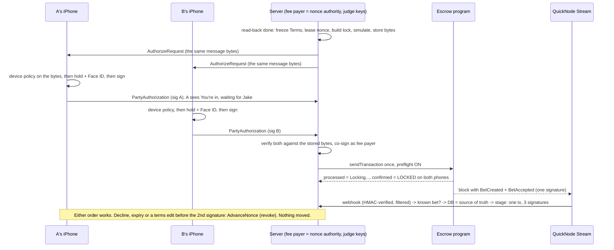
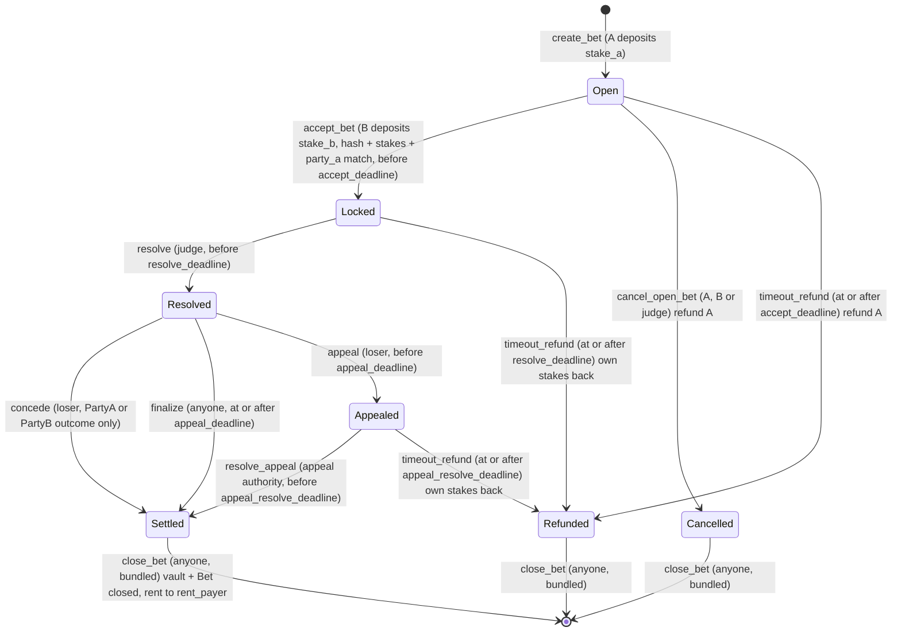

Status: DRAFT — Phase 0 planning written 2026-11-08 (before the build window). Re-author into the repo during the window; if committed verbatim, commit it as 'docs: import Phase 0 planning (written pre-window)'.

# ESCROW-PROGRAM — Anchor escrow spec (`programs/escrow`)

This is the spec for the onchain escrow. The program itself gets written during the window. Rust code blocks below are specs, not source. Where a choice depended on a Phase 0 spike, the default is written here. It is marked **(confirmed: spike NN)** where the spike's Verification settled it, and **(spike NN: pending)** where it still needs a key, SOL or a phone.

**At a glance (2026-11-08)**

- **Accounts:** one program, a `Config` PDA, and per bet a `Bet` PDA (`["bet", bet_id]`) plus a PDA token vault (`["vault", bet_id]`). Devnet USDC; the stake cap is $20 per side.
- **Lock = ONE transaction (D3):** `[AdvanceNonceAccount, ComputeBudget…, create_bet, accept_bet]` on a durable nonce from a 5-account server pool. The fee payer is also the nonce authority (§5.0.1).
  - Both iPhones sign the same bytes at their own hold + Face ID, in either order.
  - The server submits once, at the second authorization, with preflight on.
  - Nothing moves unless both sign. A decline or an expiry advances the nonce to revoke the pending lock.
- **No program change for the lock:** the composition is checked in §5.0.1. The device signing policy, including the lock exception, is in §5.0.2. `LOCK_MODE=sequential` is the fallback (§5.0.3).
- **Program-enforced guarantees:** funds go only to `party_a` or `party_b` (I1); stakes ≤ `max_stake`; `terms_hash` is write-once; there is no admin withdrawal; every live status has a permissionless timeout exit.
- **After the lock:** `resolve` (judge key) → a 10 s appeal window → `concede` / `finalize` / `appeal` → `resolve_appeal`. Every terminal tx bundles `close_bet`.
- **Latency:** second authorization → lock confirmed is ~0.70–1.39 s (E). Local Agave measured p50 406–407 ms. Devnet and phone runs are PENDING (§8.4).
- **Threat model:** adversarial review in **Threat model**; the atomic-lock rows are TM-N. Tests are in §9.2 (atomic lock: N1–N17; device policy: A13, DP1–DP16).

Toolchain **(confirmed: spike 06)**: Anchor 1.2.2 (avm 1.2.2; the repo moved to `otter-sec/anchor`), Agave CLI 4.1.2, platform-tools v1.57, and Rust 1.89.0 pinned by the Anchor template's `rust-toolchain.toml`. The crate is `anchor-lang = { version = "1.2.2", features = ["event-cpi"] }`, `Anchor.toml` sets `[toolchain] anchor_version = "1.2.2"`, and the dev-dependency is `litesvm = "0.15.0"` under `cargo test`. Devnet runs Agave 4.4.0. Set `NO_DNA=1` when scripting anchor or avm.

---

## 1. Overview

- One program. One global `Config` PDA. One `Bet` PDA per bet, plus one PDA-owned token **vault** per bet.
- There is no handshake (lead-engineer amendment, 2026-11-07). A face match only addresses B; it never authorizes anything.
- Each party **authorizes on their own iPhone** with hold-to-confirm plus Face ID (iOS LocalAuthentication), which unlocks that party's device key.
- **The lock is one transaction** (D3, 2026-11-08; §5.0.1): `[AdvanceNonceAccount, ComputeBudget…, create_bet, accept_bet]` on a durable nonce from the server's pool.
  - Both phones receive the same message bytes. Each runs the device signing policy (§5.0.2) and signs at its own hold + Face ID, in either order.
  - A's key signs as `party_a` of `create_bet`, which is A's deposit. B's key signs as `party_b` of `accept_bet`, which is B's deposit and must match `terms_hash`, the stakes and `party_a`.
  - The server submits once, at the **second authorization**, with RPC preflight on. The Bet goes from nonexistent to `Locked` in that one transaction, so **nothing moves unless both sign**.
  - Either party may decline or let it expire; either revokes the lock by advancing the nonce. Target: second authorization → lock confirmed < 2 s (§8.4).
- The server is only the fee payer and the nonce authority. The instruction set is unchanged. `Open` persists between transactions only under the `LOCK_MODE=sequential` fallback (§5.0.3), or for a bet someone else created.
- The server's `judge_authority` resolves (status `Resolved`), and a short appeal window opens (10 s in the demo). Then one of these happens:
  - The loser concedes, and the payout happens right away.
  - The window closes and anyone calls `finalize`.
  - The loser appeals (status `Appealed`). The server's separate `appeal_authority` rules, and the payout happens.
- Every non-terminal status has a **permissionless exit after a finite deadline**. Funds can never be stuck.
- Every terminal path pays out the tokens and marks the `Bet` terminal. A separate permissionless `close_bet` then closes the vault and the `Bet` and returns all rent lamports to the stored `rent_payer`. The server always sends the two in **one transaction**, so normally nobody sees the gap. Token payouts never touch `rent_payer`, so a broken rent payer can't block them (Proposed change P8).
- Users never hold SOL. The server's fee-payer key pays fees and rent on every transaction. Users sign only the lock (in which their key authorizes only their own deposit), concede, or appeal. An on-phone "Decline" needs no user signature: until the lock lands nothing is onchain, so the server just advances the nonce (SCHEMAS §9.4). `cancel_open_bet` stays for `Open` bets, which exist only under the sequential fallback or when someone else created the bet. A, B or the judge key can sign it, which is safe because the refund can only go to A.
- The program decides **where money can go and when**. The server's judge keys decide only **which outcome** applies.
- The adversarial review lives in **Threat model** (after §8). Every row names its mitigation and the test that proves it.

### 1.1 Invariants (numbered, each covered by tests in §9)

| # | Invariant | Enforced by |
|---|---|---|
| I1 | Tokens leave a vault only to a token account of `bet.mint` whose owner (the SPL `owner` field) is `bet.party_a` or `bet.party_b`. No other destination is expressible: no instruction takes a destination pubkey as an argument, and nothing ever burns, approves or re-authorizes vault tokens. | Payout account constraints (§5.2), single `payout()` helper, `close_bet` residual sweep (to A only) |
| I2 | `0 < stake_a ≤ config.max_stake` and `0 < stake_b ≤ config.max_stake` at `create_bet`. Both stakes are fixed at creation and never change. | `create_bet` checks; no setter exists |
| I3 | `terms_hash` is written once, in `create_bet`, and no instruction mutates it. That makes it immutable before and after `Locked`. `accept_bet` succeeds only if B's `expected_terms_hash`, expected stakes **and `expected_party_a`** equal the stored values. | No write path; `accept_bet` checks (P3, P9) |
| I4 | No admin withdrawal. `initialize_config` and `update_config` take no bet or vault accounts. No instruction lets admin, judge or appeal authority choose a token destination. | Instruction set |
| I5 | Each vault is drained **exactly once**, completely. Only `payout()` pays stakes out. Only the 5 terminal instructions call it, each one requires a non-terminal status and writes a terminal one, so a second terminal call fails with `InvalidStatus` (or `AccountNotInitialized` once closed). `to_a + to_b == vault.amount` (all of it, including any unsolicited tokens), and `vault.amount == 0` is asserted afterwards. The only other debit is `close_bet`'s sweep of tokens that arrived **after** settlement, which go to A. | `payout()` + `require!(vault.amount == 0)`; status checks |
| I6 | `close_bet` (permissionless, terminal status only) closes the vault (token `close_account` CPI) and the `Bet` (Anchor `close`). All their lamports go to `bet.rent_payer`. **No token payout depends on `rent_payer`**: terminal instructions don't take it as an account. | `close_bet` constraints `close = rent_payer`, `address = bet.rent_payer` (P8) |
| I7 | Only `bet.judge_authority` (snapshotted at creation) can `resolve`. | `has_one = judge_authority` |
| I8 | Only `bet.appeal_authority` (snapshotted) can `resolve_appeal`. `judge_authority != appeal_authority` is enforced in config. | `has_one = appeal_authority`; `validate_config` |
| I9 | Only the loser can `concede` (outcomes `PartyA`/`PartyB` only). Only the loser can `appeal`. For `Split`/`Refund`, both parties count as losers for appeal (see Proposed change P5). | Handler checks |
| I10 | Time windows are half-open intervals on `Clock::unix_timestamp`, so the action and its timeout can never both be valid: accept `< accept_deadline`; resolve `< resolve_deadline`; appeal `< appeal_deadline`; finalize `≥ appeal_deadline`; resolve_appeal `< appeal_resolve_deadline`; timeout_refund `≥` the deadline of the current status. Correctness does **not** assume the clock is monotonic: each handler reads `Clock::get()` once (syscall, never a passed sysvar account) and every transition is atomic, so a clock step backwards can only change which valid action lands first, never enable two payouts. | Handler checks |
| I11 | `update_config` never changes the guarantees of a live bet. Authorities, windows, and deadlines are snapshotted into `Bet`. Stakes and the mint are checked only at creation (§5.1 table). | Snapshot fields |
| I12 | Liveness: `Open`, `Locked`, `Resolved` and `Appealed` each have a permissionless exit. None of these can block a payout: unsolicited token "donations" into the vault; a party's ATA tricks (owner reassignment, closed or frozen ATA, Token-2022 `MemoTransfer`); a party with no token account at all; an unwritable `rent_payer`. | §6 math uses `vault.amount` and never errors; owner-checked (not ATA-pinned) destinations; the zero-amount side's account is optional; rent is handled only in `close_bet` (P8) |
| I13 | Accounting: in every non-terminal status, `vault.amount ≥ deposited`, where `deposited = stake_a` in `Open` and `stake_a + stake_b` in `Locked`/`Resolved`/`Appealed`. Each deposit is checked by its exact vault delta (`== stake`). | Only the program can debit; delta assert after each deposit |
| I14 | `config.paused` blocks only `create_bet` and `accept_bet`. It never blocks cancel, resolve, concede, appeal, resolve_appeal, finalize, timeout_refund or close_bet. | Pause check in exactly those 2 handlers |
| I15 | Mint consistency: `bet.mint` was allowlisted at creation, has 6 decimals, and (if Token-2022) carries only allowlisted extensions. Every token account in every instruction is for `bet.mint` and owned by the token program that owns the mint. | `has_one = mint`, `token::mint`, `token::token_program`, `mint::token_program`; §3.3 checks |
| I16 | PDA integrity: no instruction takes a bump or seed as an argument except `bet_id` in `create_bet`. `init` finds the canonical bumps, which are stored once. Every later derivation uses the stored `bet_id` and bumps. | Tested by re-derivation after every create (B20) |
| I17 | Party hygiene: `party_a ≠ party_b`. Neither is `Pubkey::default()`, this bet's Bet or vault PDA, or the config's `judge_authority`/`appeal_authority` at creation. | `create_bet` checks (`SameParty`, `InvalidParty`) |
| I18 | CPI surface: the program invokes only the System program (`init`), the token program passed as `Interface<TokenInterface>` (SPL Token and Token-2022 only), and itself (`emit_cpi!`). It never reads `remaining_accounts` and never passes the Bet PDA or event-authority signer to any other program. | Code review checklist + G3, B11 |

### 1.2 Trust assumptions (put these in the README too)

- The server keys (judge and appeal) choose outcomes. They can rule wrongly, but they cannot redirect funds (I1) or hold them past deadlines (I12).
- The server fee payer is also the **nonce authority** of the lock pool. What that key can and can't do with a lock (TM-N):
  - Holding both lock signatures, it can submit the lock only exactly as signed, and only before `accept_deadline`. Both phones check that `accept_deadline` is ≤ 600 s after the build.
  - It can revoke a pending lock by advancing the nonce.
  - It can't alter a signed lock or move tokens with it.
- The upgrade authority can replace the program code. That is a devnet trust assumption, and §10.4 covers the plan.
- Circle's devnet USDC has a freeze authority. A frozen **vault** blocks payouts, and that is outside the program's control. A frozen **party** account is routed around: the server pays a fresh account owned by that party (TM-L3).
- Token-2022 safety depends on allowlist hygiene: a `PermanentDelegate` mint can drain any account. The extension allowlist (§3.3) bounds what even a compromised admin can allowlist.
- `Clock::unix_timestamp` on devnet can trail wall-clock time by a few seconds. The server schedules against onchain deadlines with slack (§8.4).
- "Permissionless" exits still need *some* funded key to pay the fee, and users hold no SOL. If our server disappears, anyone can run `scripts/crank.ts` (P1, ~50 lines) with a faucet-funded devnet key. It finds live Bets with `getProgramAccounts` (memcmp on the `Bet` discriminator) and sends `finalize`, `timeout_refund` and `close_bet` for every one whose deadline has passed.
- The webhook is the source of truth for "money moved", but anyone can call the escrow. An event proves the escrow did something, not that the bet is one of ours. The server applies events only to bets it created (Threat model, TM-E5).

---

## 2. Constants, seeds, encodings

```rust
pub const CONFIG_SEED: &[u8] = b"config";   // Config PDA: ["config"]
pub const BET_SEED:    &[u8] = b"bet";      // Bet PDA:    ["bet", bet_id(16)]
pub const VAULT_SEED:  &[u8] = b"vault";    // Vault PDA:  ["vault", bet_id(16)]
pub const MAX_ALLOWED_MINTS: usize = 4;
pub const REQUIRED_DECIMALS: u8 = 6;                  // every bet mint: 1 unit = $0.000001, so max_stake means dollars
pub const MAX_STAKE_CEILING: u64 = u64::MAX / 4;      // validate_config bound: stake_a + stake_b can never overflow
// EVENT_AUTHORITY = PDA ["__event_authority"] under ESCROW_ID (Anchor event-cpi); precomputed into the Streams filter
```

| Value | Onchain | Offchain |
|---|---|---|
| `bet_id` | `[u8; 16]` | UUIDv4 string = Postgres `bets.id`. Bytes are the 16 bytes in RFC 4122 textual order (`uuid.parse()` in npm `uuid`), never Microsoft mixed-endian GUID order. |
| Hashes (`terms_hash`, `evidence_hash`, `ruling_hash`, `appeal_ruling_hash`) | `[u8; 32]` raw | 64-char lowercase hex. All-zero is rejected onchain (`EmptyHash`). |
| Amounts | `u64` micro-units (6 dp for USDC) | `bigint` / decimal string in JSON, `BIGINT` in Postgres |
| Time | `i64` unix seconds (UTC). `0` = "not set yet". | ISO-8601 UTC |
| Pubkeys | `Pubkey` | base58 |
| Field names / enum variants | snake_case fields; PascalCase variants | Same names in wire JSON. Codama clients camelCase the fields; Postgres stores onchain enums as snake_case (`PartyA` → `party_a`). See SCHEMAS §0.3. |

Offchain derivation, for reference (server, mobile and stage must agree):

```ts
// packages/shared — @solana/kit 8.6.0 + a Codama-generated client (confirmed: spike 07; codama 1.11.0,
// @codama/nodes-from-anchor 1.5.6, @codama/renderers-js 2.8.0). No @anchor-lang/core or web3.js in the app
// (it needs web3.js v1; pin @solana/web3.js@^1.99.0 if a server script ever uses it). Pass maxSupportedTransactionVersion: 1 on devnet reads.
const betIdBytes = uuidParse(betId);                       // Uint8Array(16)
const [betPda]   = await getProgramDerivedAddress({ programAddress: ESCROW_ID, seeds: ["bet",   betIdBytes] });
const [vaultPda] = await getProgramDerivedAddress({ programAddress: ESCROW_ID, seeds: ["vault", betIdBytes] });
const [config]   = await getProgramDerivedAddress({ programAddress: ESCROW_ID, seeds: ["config"] });
```

Devnet USDC: Circle mint `4zMMC9srt5Ri5X14GAgXhaHii3GnPAEERYPJgZJDncDU`, classic SPL Token program (`TokenkegQfeZyiNwAJbNbGKPFXCWuBvf9Ss623VQ5DA`), 6 decimals, freeze authority `CJtyoK…` set **(confirmed: spike 07, read onchain)**.

---

## 3. Accounts

### 3.1 `Config` (PDA `["config"]`, one per program)

```rust
#[account]
#[derive(InitSpace)]
pub struct Config {
    pub admin: Pubkey,               // 32  may call update_config
    pub judge_authority: Pubkey,     // 32  copied into each new Bet
    pub appeal_authority: Pubkey,    // 32  copied into each new Bet; must != judge_authority
    pub max_stake: u64,              //  8  per-side cap, micro-units (demo: 20_000_000 = $20)
    pub appeal_window_secs: u32,     //  4  demo: 10
    pub accept_deadline_secs: u32,   //  4  demo: 600   max accept window: create_bet's accept_deadline arg must be ≤ now + this
    pub resolve_deadline_secs: u32,  //  4  demo: 3600  (Locked -> must resolve within)
    pub appeal_resolve_secs: u32,    //  4  demo: 300   (Appealed -> must resolve within)  [Proposed change P1]
    #[max_len(4)]
    pub allowed_mints: Vec<Pubkey>,  //  4 + 4*32 = 132
    pub paused: bool,                //  1  blocks create/accept only                    [Proposed change P1]
    pub bump: u8,                    //  1
}
// INIT_SPACE = 254; account space = 8 (discriminator) + 254 = 262 bytes
// rent-exempt ≈ (128 + 262) × 6960 = 2,714,400 lamports (paid once by admin; never closed)
```

`validate_config()` runs on init and after every update. It rejects with `InvalidConfig` when any of these hold:

- `judge_authority == appeal_authority`, or either one is `Pubkey::default()`
- `admin == Pubkey::default()` (an `update_config` typo can't brick admin into the zero key; a wrong-but-valid key still can, and that is accepted because admin can never touch live bets, I11)
- `max_stake == 0` or `max_stake > MAX_STAKE_CEILING`
- `appeal_window_secs ∉ [1, 86_400]`
- `accept_deadline_secs ∉ [10, 86_400]`
- `resolve_deadline_secs ∉ [60, 604_800]`
- `appeal_resolve_secs ∉ [10, 86_400]`
- `allowed_mints` is empty, has more than 4 entries, contains duplicates, or contains `Pubkey::default()`

Demo config:

| Field | Value |
|---|---|
| `max_stake` | `20_000_000` ($20) |
| `appeal_window_secs` | `10` |
| `accept_deadline_secs` | `600` (cap; the server passes skill `now + 300`, gemini `quotedAt + 60`) |
| `resolve_deadline_secs` | `3600` (covers REDOs, the hearing, and the 5-min BTC contract with slack) |
| `appeal_resolve_secs` | `300` (the 3-model panel votes in seconds) |
| `allowed_mints` | `[devnet USDC]` (the test suite adds a Token-2022 mint) |

### 3.2 `Bet` (PDA `["bet", bet_id]`)

```rust
#[account]
#[derive(InitSpace)]
pub struct Bet {
    pub bet_id: [u8; 16],              // 16  = Postgres bets.id (UUID bytes)
    pub party_a: Pubkey,               // 32  challenger/proposer; signs create_bet
    pub party_b: Pubkey,               // 32  challenged; fixed at create, signs accept_bet
    pub mint: Pubkey,                  // 32  allowlisted at create
    pub rent_payer: Pubkey,            // 32  = create_bet payer; receives all rent on close
    pub judge_authority: Pubkey,       // 32  snapshot of config.judge_authority
    pub appeal_authority: Pubkey,      // 32  snapshot of config.appeal_authority
    pub stake_a: u64,                  //  8
    pub stake_b: u64,                  //  8  may differ from stake_a (Gemini odds bets)
    pub terms_hash: [u8; 32],          // 32  set once in create_bet
    pub evidence_hash: [u8; 32],       // 32  zero until resolve
    pub ruling_hash: [u8; 32],         // 32  zero until resolve (judge's Ruling record)
    pub status: BetStatus,             //  1
    pub outcome: Option<Outcome>,      //  2  None until resolve
    pub appeal_window_secs: u32,       //  4  snapshot
    pub resolve_window_secs: u32,      //  4  snapshot of config.resolve_deadline_secs
    pub appeal_resolve_secs: u32,      //  4  snapshot
    pub created_at: i64,               //  8
    pub accept_deadline: i64,          //  8  create_bet arg; created_at < accept_deadline ≤ created_at + config.accept_deadline_secs
    pub locked_at: i64,                //  8  0 until Locked
    pub resolve_deadline: i64,         //  8  locked_at + resolve_window_secs (0 until Locked)
    pub resolved_at: i64,              //  8
    pub appeal_deadline: i64,          //  8  resolved_at + appeal_window_secs
    pub appealed_at: i64,              //  8
    pub appeal_resolve_deadline: i64,  //  8  appealed_at + appeal_resolve_secs
    pub bump: u8,                      //  1
    pub vault_bump: u8,                //  1
}
// INIT_SPACE = 16 + 6*32 + 2*8 + 3*32 + 1 + 2 + 3*4 + 8*8 + 2 = 401
// account space = 8 + 401 = 409 bytes; rent-exempt ≈ (128 + 409) × 6960 = 3,737,520 lamports
```

Notes:

- Borsh layout, not `zero_copy`, so there is no padding. Field order is part of the client contract: append only, and redeploy plus drop open bets if it changes during the window.
- Terminal statuses (`Settled`, `Refunded`, `Cancelled`) persist only between a terminal instruction and `close_bet`. The server sends both in one transaction, so normally they are never observed. A bet is terminal iff `getAccountInfo(bet) == null` **or** its status is terminal. The terminal event says which status and how the money moved, and it is the only lasting onchain record of that. The server persists it.
- Closing frees the PDA address. A later `create_bet` with the same `bet_id` would succeed. The server never reuses a `bet_id`. It records the signature of the lock it sent (of the `create_bet` under the sequential fallback) and ignores any `BetCreated` for that `bet_id` from another signature (anomaly). A landed lock can't be replayed: its own `AdvanceNonceAccount` (ix 0) moved the nonce, so a resubmission fails even after `close_bet` frees the PDA (TM-N2). A lock that never landed dies when the server advances the nonce, and at `accept_deadline` at the latest (TM-N3). Under the sequential fallback, a replay is rejected once its blockhash expires (~36 s: 150 blocks × ~240 ms, measured by spike 07) and is deduplicated before that.
- `bet_id` is not secret: it appears in every transaction, and the stage view shows bets. So anyone can **squat** a `bet_id` by front-running `create_bet` with themselves as `party_a`, the real B as `party_b`, and the real (public) terms hash and stakes. A's create then fails ("already in use"), and the server retries with a fresh `bet_id`. B can never be locked into the squatter's bet, because `accept_bet` checks `expected_party_a` (P9, TM-I1). Under the atomic lock B's `accept_bet` exists only inside the same transaction as A's `create_bet`, so a squat can only make the lock fail at preflight. That costs nothing and leaves the nonce unchanged (N13).

### 3.3 Vault: PDA token account `["vault", bet_id]`, authority = Bet PDA

**Decision: a PDA token account, not the Bet PDA's ATA.**

| | PDA `["vault", bet_id]` (chosen) | ATA of Bet PDA |
|---|---|---|
| Pre-creation griefing | Impossible: only this program can sign for the address | Anyone can create the ATA first, so a plain `init` fails (needs `init_if_needed`) |
| CU | `InitializeAccount3` only | Plus the ATA program CPI and address derivation |
| Derivation | Same seeds as the Bet, from `bet_id` only | Needs the Bet PDA, mint and token program |
| Bump | Stored in `bet.vault_bump`, so no re-derivation later | Re-derived each time |
| Discoverability | Program-specific | Wallets and explorers find ATAs by convention, which we don't need |

Constraints at init: `token::mint = mint, token::authority = bet, token::token_program = token_program`.

**Token program support.** The program uses `anchor_spl::token_interface` (`InterfaceAccount<Mint>`, `InterfaceAccount<TokenAccount>`, `Interface<TokenInterface>`, `transfer_checked`, `close_account`), so the same code works with classic SPL Token and Token-2022 mints. The demo allowlist holds only classic devnet USDC, and Token-2022 is exercised in tests.

Every mint, classic or Token-2022, must have `decimals == REQUIRED_DECIMALS` (6) at `create_bet` (`WrongDecimals`), so `max_stake` always means dollars.

For Token-2022 mints, `create_bet` parses the mint's extension types and accepts **only** the ones in this allowlist. Anything else is rejected with `MintExtensionNotAllowed`:

| Allowed extension | Why it is safe |
|---|---|
| `MetadataPointer`, `TokenMetadata` | Display only |
| `MintCloseAuthority` | A mint can close only at supply 0, and the vault's tokens are part of supply, so it can't close mid-bet |

It is an allowlist, not a denylist, so extensions added to Token-2022 later are rejected by default. Notable rejections:

| Rejected extension | Why |
|---|---|
| `PermanentDelegate` | Can drain the vault, breaking I1 |
| `TransferFeeConfig` | The vault receives less than the stake, and withheld fees block `close_account` |
| `TransferHook` | Runs external code on every payout and could block it |
| `ConfidentialTransferMint`, `ConfidentialMintBurn` | Balances can move to the confidential side |
| `DefaultAccountState` | The vault could start frozen |
| `NonTransferable` | Tokens can't move |
| `Pausable` | The issuer can halt payouts |
| `ScaledUiAmount`, `InterestBearingConfig` | Raw units stop meaning $0.000001, so the dollar display and `max_stake` lie |

Mint extensions are fixed at `InitializeMint`. Their authorities can change parameters but can't add an extension, so a check at create covers the bet's whole lifetime. Parse with the `spl_token_2022` re-exported by `anchor_spl` to avoid version skew. **This check is P1 hardening**: the admin allowlist (classic devnet USDC only) is the P0 control. The extension check also bounds a compromised admin, who otherwise could allowlist a `PermanentDelegate` mint for new bets. Classic mints have no extensions and skip the parse. A mint's `freeze_authority` is allowed (Circle's USDC has one); see §1.2.

Vault size: classic is 165 bytes, rent-exempt 2,039,280 lamports. Token-2022 size depends on the account extensions the mint requires, and Anchor computes it. Assert this in the Token-2022 test.

---

## 4. Enums

```rust
#[derive(AnchorSerialize, AnchorDeserialize, Clone, Copy, PartialEq, Eq, InitSpace, Debug)]
pub enum BetStatus { Open, Locked, Resolved, Appealed, Settled, Refunded, Cancelled } // borsh u8: 0..=6

#[derive(AnchorSerialize, AnchorDeserialize, Clone, Copy, PartialEq, Eq, InitSpace, Debug)]
pub enum Outcome { PartyA, PartyB, Split, Refund } // borsh u8: 0..=3
```

Variant order is frozen after the first deploy (it is the wire format).

| Terminal status | Reached via | `outcome` in the event |
|---|---|---|
| `Settled` | `concede`, `finalize`, `resolve_appeal` | The ruling's outcome, which can be any of the 4 (a judge-ruled `Refund` is still `Settled`) |
| `Refunded` | `timeout_refund` | `Refund` |
| `Cancelled` | `cancel_open_bet` | `Refund` |

From any terminal status, `close_bet` (anyone) closes the accounts. It is the only instruction that accepts a terminal status.

Offchain-to-onchain outcome mapping (SCHEMAS §5.3 owns the offchain side):

| Offchain `RulingOutcome` | Onchain |
|---|---|
| `A_WINS` | `PartyA` |
| `B_WINS` | `PartyB` |
| `REDO` | No transaction. The bet stays `Locked`, and the attempt is retried before `resolve_deadline`. |
| `VOID` (`void_reason`: hearing `undecidable`, `max_redos`, `market_invalid`, `safety_stop`) | `Refund` |
| DRAW: reserved, no v1 producer | `Split` (implemented and tested; the server never sends it) |

See Proposed change P6 (accepted: `VOID` is now an offchain outcome value).

**Loser.**

| `outcome` | May `concede` | May `appeal` |
|---|---|---|
| `PartyA` | `party_b` | `party_b` |
| `PartyB` | `party_a` | `party_a` |
| `Split` / `Refund` | nobody (`ConcedeNotAllowed`; wait for `finalize`) | `party_a` or `party_b` |

---

## 5. Instructions

### 5.0 Fee payer, signers and rent per transaction

Every instruction except the two config instructions takes `payer: Signer` (mut). In production this is the **server fee-payer key**. The program does not require it to be the server, so permissionless instructions stay permissionless. A transaction pays 5,000 lamports per signature, plus an optional priority fee.

| Transaction (SCHEMAS `TxKind`) | Required signers | Fee payer (tx) | Rent paid | Rent returned to |
|---|---|---|---|---|
| `initialize_config` | `admin` (= upgrade authority) | admin | Config (2.71 M lamports) | never closed |
| `update_config` | `admin` | admin | — | — |
| **`atomic_lock`** (default, §5.0.1): `[AdvanceNonceAccount, ComputeBudget…, create_bet, accept_bet]` | `payer` (also the nonce authority) + `party_a` (A's device) + `party_b` (B's device). 3 signatures = 15,000 lamports (M: spike 3b) | server | Bet + vault (≈5.78 M lamports), stored as `rent_payer = payer` | via the terminal tx's `close_bet` |
| `nonce_advance` (revoke a pending lock) | `payer` (nonce authority) only | server | — | — |
| `create_bet` alone (`LOCK_MODE=sequential` fallback only, §5.0.3) | `party_a` (device) + `payer` | server | Bet + vault | — |
| `accept_bet` alone (sequential fallback only) | `party_b` (device) + `payer` | server | — | — |
| `cancel_open_bet` | `party_a` / `party_b` / `bet.judge_authority`, + `payer` | server | — | via bundled `close_bet` |
| `resolve` | `bet.judge_authority` (server key) + `payer` | server | — | — |
| `concede` | loser (device) + `payer` | server | — | via bundled `close_bet` |
| `appeal` | loser (device) + `payer` | server | — | — |
| `resolve_appeal` | `bet.appeal_authority` (server key) + `payer` | server | — | via bundled `close_bet` |
| `finalize` | `payer` only (anyone) | caller (server's 10 s timer) | — | via bundled `close_bet` |
| `timeout_refund` | `payer` only (anyone) | caller | — | via bundled `close_bet` |
| `close_bet` | `payer` only (anyone) | caller | — | `bet.rent_payer` |

Signing flow (server side, P0):

1. The server builds every message: `feePayer = server`, compute-budget instructions, a legacy message or v0 with no address lookup tables. **Lock:** the lifetime is a durable nonce leased from the pool (§5.0.1). The server builds and simulates it when the read-back finishes, before either hold. **Every other device-signed kind** (`concede`, `appeal`, and sequential `create_bet` / `accept_bet`): a recent blockhash, fetched when the party **starts** the hold, so the fetch overlaps the hold and Face ID. The blockhash is ~2–3 s old at signing, well inside its ~36 s life (spike 07).
2. The device runs LocalAuthentication at **every** authorization: Face ID, with the passcode fallback allowed and the method recorded (SCHEMAS O8). Then it reads the seed, decodes the message with Kit codecs and runs the **device signing policy** (§5.0.2). It signs with `@noble/ed25519` only if every check passes, then wipes the seed (FINDINGS §3.4).
3. The server verifies each party signature against **its own stored message bytes**. It adds the fee-payer signature only to messages it built itself (byte-equal) and sends with **RPC preflight on**, never `skipPreflight`. It never rebuilds a message after collecting a signature.
4. Terminal instructions always go out as `[compute budget…, <terminal ix>, close_bet]` in one transaction. If that transaction fails at `close_bet`, or fails to load because `rent_payer` is unwritable, the server resends the terminal instruction alone and raises an alert. The tokens move, and the bet waits in its terminal status for a later `close_bet` (P8).

#### 5.0.1 Lock transaction (atomic, default; D3 2026-11-08)

One transaction locks both stakes. Both phones sign the **same message bytes**, in either order. The server submits once, at the second authorization. Nothing moves unless both sign. Source: FINDINGS §3.7 and spike 3b (LiteSVM 21/21; 20/20 atomic locks on local Agave 4.1.2).

| ix | Instruction | Accounts | Notes |
|---|---|---|---|
| 0 | System `AdvanceNonceAccount` | nonce account (w), `SysvarRecentB1ockHashes11111111111111111111`, nonce authority = server fee payer (signer) | The runtime requires a durable-nonce tx to start with it. The message's `recentBlockhash` is the nonce's stored value. |
| 1 | `SetComputeUnitLimit` | — | simulated CU × 1.3, never below the measured max + margin (§10.1) |
| 2 | `SetComputeUnitPrice` (optional) | — | from `getRecentPrioritizationFees` |
| 3 | `create_bet(bet_id, party_b, stake_a, stake_b, terms_hash, accept_deadline)` | §5.2 `CreateBet`; `party_a` = A's device key | A's deposit |
| 4 | `accept_bet(expected_terms_hash, expected_stake_a, expected_stake_b, expected_party_a)` | §5.2 accept accounts; `party_b` = B's device key | B's deposit |

- **Signers:** exactly `[fee payer, party_a, party_b]`.
- **Size:** 875 B with the spike program (M). ~990–1,005 B of 1,232 with this spec's arguments (E; measure in N12).
- **Keys:** 16 unique keys, so it fits with no lookup table. There is no room budgeted for extra instructions.

**Composition check: the program supports `create_bet` + `accept_bet` in one transaction with no change.** This is MEASURED for the spike program and ESTIMATED for this spec until N1 runs.

- **Order.** `create_bet` must come first. `accept_bet` takes `bet` as an `Account<Bet>` whose seeds come from the stored `bet.bet_id`, so the reversed order fails with `AccountNotInitialized` (M: 3b L6). The device policy rejects any other order.
- **Accounts shared across the two instructions.** `payer`, `config`, `mint`, `bet`, `vault`, `token_program`, `event_authority` and the program appear in both. The message lists each key once. Each instruction sees the state the previous one wrote, so `accept_bet` reads the Bet that `create_bet` initialized and sees `vault.amount == stake_a`. Anchor's duplicate-mutable-account check runs per instruction, not per transaction.
- **No duplicate mutable account inside either instruction.** `create_bet`'s mutable set is {`payer`, `bet`, `vault`, `party_a_token`}, and `accept_bet`'s is {`payer`, `bet`, `vault`, `party_b_token`}. Within each set the accounts are pairwise distinct:
  - a party token account can't be the vault, because the vault's authority is the Bet PDA and no party can be that PDA (I17);
  - a party token account can't be `payer`, which is a system account.

  So no dup-allow constraint is needed. The program's only one stays `close_bet`'s `payer == rent_payer` (TM-U3).
- **One clock.** Both instructions read the same `Clock`, so `locked_at == created_at`. `accept_bet`'s `now < accept_deadline` holds whenever `create_bet`'s did.
- **Deposit checks still bite.** `create_bet` asserts `vault == stake_a`, and `accept_bet` asserts its delta `== stake_b`. Nothing can run between them (allowlist, §5.0.2).
- **Atomicity.** If `accept_bet` fails, the whole tx fails: no Bet, no vault, and A's tokens don't move (M: 3b L4/L5). The failures include `TermsHashMismatch`, `StakeMismatch`, `PartyMismatch`, `Paused` and `AcceptDeadlinePassed`.
- **Signer privileges are per message.** A's key is therefore a signer inside `accept_bet` too. That is harmless because:
  - the device policy keeps each device key out of the other party's instruction;
  - `party_b_token` requires `token::authority = party_b`.
- **Events.** One signature carries `BetCreated` (outer ix 3) and `BetAccepted` (outer ix 4), or outer ix 2 and 3 without the price ix. The dedup key `(signature, outer_ix, inner_ix)` keeps them apart (§7.1).
- **CU.** The spike program used 36,675–63,675 CU (M, n = 20), and a 60k cap failed 1 bet in 20. Stored bumps don't remove `create_bet`'s `init` bump search. This spec's handlers do more work (config, allowlist, reload and delta checks), so its figure is PENDING (N11).

**Server `LockService`.** The stage view shows exactly this **one lock transaction**: 3 signatures (A, B, You're On as fee payer), `BetCreated → BetAccepted`, one Explorer link.

1. **Lease.** At read-back done (`confirm_terms`; SCHEMAS §9.4), freeze the Terms and lease one free nonce (DATA-MODEL §5.20). Read its value at `confirmed`.
2. **Build** the message above. `accept_deadline` is `now + 300` for skill bets and `unix(quotedAt) + 60` for gemini bets, always ≤ now + 600.
3. **Simulate** (`sigVerify: false`) and set the CU limit from the result. If simulation fails, release the lease and show no card.
4. **Store and send.** Store the exact message bytes (DATA-MODEL `chain_txs`, kind `atomic_lock`). Send the same `AuthorizeRequest` to both phones (SCHEMAS §9).
5. **Collect.** On each `PartyAuthorization`, verify the Ed25519 signature over the stored bytes against that party's wallet in the Terms. Store it and record which party signed first. Never rebuild after a signature.
6. **Submit.** On the second signature, co-sign and send once with preflight on (`preflightCommitment: 'processed'`). Push `locking` at `processed` and `LOCKED` at `confirmed` (SCHEMAS X10). A transient send error re-sends the same bytes (same signature) until `expires_at`.
7. **Revoke** with a fee-payer-only `AdvanceNonceAccount` tx (kind `nonce_advance`) on any of these:
   - a decline;
   - `expires_at` (= `accept_deadline − LOCK_SUBMIT_MARGIN_SECS`) with fewer than 2 signatures;
   - any terms edit;
   - a preflight rejection;
   - a sent lock whose fate is still unknown at `expires_at`.

   After the advance confirms, re-read the value and free the nonce. A landed lock has already advanced its nonce at ix 0, so the server re-reads and frees it.
8. **Freeze other txs.** Build no other transaction for either party while their lock is pending. A balance change between preflight and execution is the residual burn risk (TM-N4).

**Nonce pool.**

- **Size and cost:** `NONCE_POOL_SIZE` = 5 System nonce accounts, 80 B each, rent 1,056,640 lamports each (M).
- **Authority:** the server fee payer, so the lock stays at 3 signatures.
- **Addresses:** `createAccountWithSeed(base = fee payer, seed = "yo-nonce-<k>", owner = System)` for `k < NONCE_SEED_MAX` (16). A phone can verify pool membership from the pinned fee-payer key alone, so no list ships with the app. This is a design choice (E), not a spike result.
- **Leases:** one nonce per pending lock. Never build two messages on one nonce value (TM-N1).
- **Details:** the lifecycle (allocate, advance, rotate, recover) and the table are in DATA-MODEL §5.20.

#### 5.0.2 Device signing policy (`packages/shared`; tests A13, DP1–DP16)

The device's key signs the **whole message**, and signer privileges carry into CPIs. So "check the escrow instruction" isn't enough: the device must reject anything else that could use its key.

- Implement every row below in full.
- In an `atomic_lock`, **both** phones check **both** escrow instructions.
- The spike's harness `devicePreflight` accepted four of these cases (MEASURED; FINDINGS §3.4), and DP13 tests each of them: a swapped mint, another `bet_id`, a deadline a year out, and an unpinned fee payer.

| Check | Reject if |
|---|---|
| Kind | The message doesn't decode to the kind the phone expects **from its own UI state**: terms card → `atomic_lock` (under `LOCK_MODE=sequential`: `create_bet` for A, `accept_bet` for B); "GG" → `concede`; "I appeal!" → `appeal`. The server's label is only cross-checked. |
| Fee payer | `feePayer` ≠ the pinned server fee-payer pubkey |
| Signers | The signer set is not exactly {fee payer, device key} (single-party kinds) or {fee payer, `party_a`, `party_b`} with the displayed Terms pubkeys (`atomic_lock`) |
| Lifetime: `atomic_lock` | Instruction 0 is not System `AdvanceNonceAccount`; there is a second `AdvanceNonceAccount`; its nonce account is not `createWithSeed(pinned fee payer, "yo-nonce-<k>", System)` for some `k < 16`; or its authority is not the pinned fee payer. With a durable nonce, the `accept_deadline` check below is **the only bound** on how long the signature stays valid. |
| Lifetime: every other kind | The message contains any `AdvanceNonceAccount`. A durable nonce would keep a concede or appeal signature valid indefinitely, so these kinds use a recent blockhash only. |
| Instruction allowlist: `atomic_lock` | The instructions are not exactly `[AdvanceNonceAccount, SetComputeUnitLimit, (SetComputeUnitPrice), create_bet, accept_bet]` in that order. So no ATA create, no `close_bet`, no third escrow ix and no other program. |
| Instruction allowlist: other kinds | Any instruction other than: `ComputeBudget` (`SetComputeUnitLimit`, `SetComputeUnitPrice`); ATA `CreateIdempotent` whose funder is the server; and exactly **one** escrow instruction of the expected kind, optionally followed by `close_bet`. This rejects SPL `Transfer`/`Approve`/`SetAuthority`/`CloseAccount` and any other program, because a CPI wrapper could reuse the device's signer privilege. |
| Lookups | The message uses address lookup tables (hidden accounts) |
| Device key placement | **`atomic_lock`:** A's key is listed anywhere except the `party_a` slot of `create_bet`, or B's key anywhere except the `party_b` slot of `accept_bet`. Neither key may appear in the other party's instruction, in `AdvanceNonceAccount` or in a ComputeBudget ix. **Other kinds:** the key is listed anywhere except the escrow instruction's party-signer slot or an allowlisted ATA `CreateIdempotent` (as the wallet). Signer status is per message, not per instruction, so every instruction that lists the key sees it as a signer. |
| Program and accounts | Program ID ≠ `ESCROW_ID`; `mint` ≠ the pinned USDC; the Bet, vault or Config address ≠ the PDA re-derived on the device from the displayed `bet_id`; the party signer slot ≠ the device key. Re-derive the PDAs with noble, because Kit's `getProgramDerivedAddress` throws on Hermes (FINDINGS §7); it takes ~6.9 ms per bet+vault pair, so run it at card mount. In an `atomic_lock`, both escrow instructions must also name the same Bet, vault, Config and mint. |
| `create_bet` args | `bet_id`, `stake_a`, `stake_b`, `terms_hash` or `party_b` ≠ what the UI showed (`terms_hash` recomputed on the device from the displayed Terms JSON). `accept_deadline` ≤ device now, or > device now + `LOCK_SIGNATURE_MAX_SECS` (600 s), or, for a gemini bet, ≠ `unix(market.quotedAt) + 60`. |
| `accept_bet` args | `expected_terms_hash`, `expected_stake_a`, `expected_stake_b` or `expected_party_a` ≠ the displayed terms and challenger. In an `atomic_lock`, they must also equal the `create_bet` args in the same message. |

Never use an SPL `Approve` to a server key to make deposits "one tap". Spike 07 (S3) showed that the server delegate can then pay anyone, which breaks I1.

The judge and appeal keys never pay fees, so they hold 0 SOL.

#### 5.0.3 Sequential fallback (`LOCK_MODE=sequential`)

This is the 2026-11-07 default, kept as a switch in case the atomic path misbehaves on devnet. It needs no program change.

- **Two transactions.** A's `create_bet` lands at A's authorization and B's `accept_bet` at B's. Each phone fetches its message at hold start, with a recent blockhash and no nonce.
- **B first.** If B authorizes first, the server holds B's signed tx for at most `HELD_SIGNATURE_MAX_SECS` (30 s), then re-prompts B. B-first takes ~1.3–2.4 s to confirmed (E) and can miss < 2 s.
- **Decline after create.** A decline after the create lands sends `cancel_open_bet`, signed by the judge key.
- **Copy.** The card must say "Your $5 is held until Jake locks in", not "Nothing moves until you both lock in".
- **Tests:** A14 and A15.



Concede and appeal follow the same pattern with one device signature and a recent blockhash. Terminal transactions go out as `[terminal ix, close_bet]`. The UI flips the payout at `processed`.

### 5.1 Config instructions

#### `initialize_config(args: InitConfigArgs)`

```rust
pub struct InitConfigArgs {
    pub judge_authority: Pubkey, pub appeal_authority: Pubkey, pub max_stake: u64,
    pub appeal_window_secs: u32, pub accept_deadline_secs: u32,
    pub resolve_deadline_secs: u32, pub appeal_resolve_secs: u32,
    pub allowed_mints: Vec<Pubkey>,
}

#[event_cpi]
#[derive(Accounts)]
pub struct InitializeConfig<'info> {
    #[account(mut)]
    pub admin: Signer<'info>,
    #[account(init, payer = admin, space = 8 + Config::INIT_SPACE, seeds = [CONFIG_SEED], bump)]
    pub config: Account<'info, Config>,
    // Named escrow_program because #[event_cpi] already injects a field called `program`.
    #[account(constraint = escrow_program.programdata_address()? == Some(program_data.key()))]
    pub escrow_program: Program<'info, Escrow>,
    #[account(constraint = program_data.upgrade_authority_address == Some(admin.key())
              @ EscrowError::NotUpgradeAuthority)]
    pub program_data: Account<'info, ProgramData>,
    pub system_program: Program<'info, System>,
}
```

| | |
|---|---|
| Purpose | Stops anyone from front-running initialization after deploy: only the program's upgrade authority can initialize. |
| Preconditions | `validate_config(args)` |
| Effects | Writes all fields; `admin = signer`; `paused = false`; `bump` |
| Transfers | none |
| Event | `ConfigInitialized` |
| Errors | `NotUpgradeAuthority`, `InvalidConfig`, system "already in use" on a second init |

#### `update_config(args: UpdateConfigArgs)`

Every field of `UpdateConfigArgs` is an `Option`: `new_admin`, `judge_authority`, `appeal_authority`, `max_stake`, `appeal_window_secs`, `accept_deadline_secs`, `resolve_deadline_secs`, `appeal_resolve_secs`, `allowed_mints` (replaces the whole list), `paused`.

| | |
|---|---|
| Signers | `admin` (`#[account(mut, seeds=[CONFIG_SEED], bump=config.bump, has_one = admin @ NotAdmin)] config`) |
| Effects | Applies the `Some` fields, then runs `validate_config()` |
| Event | `ConfigUpdated` (full post-update snapshot) |
| Errors | `NotAdmin`, `InvalidConfig` |

How each config field reaches a bet (this is why config changes can't touch live bets, I11):

| Config field | Read at | Effect on a live bet |
|---|---|---|
| `admin` | `update_config` | none |
| `judge_authority`, `appeal_authority` | `create_bet` → copied into `Bet` | none. A rotated key cannot rule on old bets, which fall back to `timeout_refund` if the old key is lost. |
| `max_stake` | `create_bet` only (both stakes are set there) | none |
| `accept_deadline_secs` | `create_bet` (caps the `accept_deadline` arg) → absolute `accept_deadline` | none |
| `resolve_deadline_secs` | `create_bet` → `resolve_window_secs`, applied at accept | none |
| `appeal_window_secs`, `appeal_resolve_secs` | `create_bet` → snapshot | none |
| `allowed_mints` | `create_bet` only | none (the bet carries its own `mint`) |
| `paused` | `create_bet`, `accept_bet` | Can stop an `Open` bet from locking. A's exits (cancel, timeout) are unaffected (I14). |

### 5.2 Bet instructions

Common constraint fragments:

```rust
// BET (existing): PDA from stored id + stored canonical bump; binds the mint
#[account(mut, seeds = [BET_SEED, bet.bet_id.as_ref()], bump = bet.bump, has_one = mint @ EscrowError::WrongMint)]
pub bet: Box<Account<'info, Bet>>,

// VAULT (existing)
#[account(mut, seeds = [VAULT_SEED, bet.bet_id.as_ref()], bump = bet.vault_bump,
          token::mint = mint, token::authority = bet, token::token_program = token_program)]
pub vault: Box<InterfaceAccount<'info, TokenAccount>>,

#[account(mint::token_program = token_program)]
pub mint: Box<InterfaceAccount<'info, Mint>>,
pub token_program: Interface<'info, TokenInterface>,   // classic SPL or Token-2022 only
```

**Payout account set (P)**, used by `cancel_open_bet`, `concede`, `resolve_appeal`, `finalize`, `timeout_refund`:

```rust
#[account(mut)] pub payer: Signer<'info>,
#[account(mut, seeds = [BET_SEED, bet.bet_id.as_ref()], bump = bet.bump,
          has_one = mint @ EscrowError::WrongMint)]               // NOT closed here: close_bet does it (P8)
pub bet: Box<Account<'info, Bet>>,
#[account(mut, seeds = [VAULT_SEED, bet.bet_id.as_ref()], bump = bet.vault_bump,
          token::mint = mint, token::authority = bet, token::token_program = token_program)]
pub vault: Box<InterfaceAccount<'info, TokenAccount>>,
#[account(mint::token_program = token_program)]
pub mint: Box<InterfaceAccount<'info, Mint>>,
// Optional destinations: required (MissingPayoutAccount) iff that side's amount > 0.
// Constraints are enforced whenever the account is present, even for a zero amount.
#[account(mut, token::mint = mint, token::token_program = token_program,
          constraint = party_a_token.owner == bet.party_a @ EscrowError::WrongPayoutAccount)]
pub party_a_token: Option<Box<InterfaceAccount<'info, TokenAccount>>>,
#[account(mut, token::mint = mint, token::token_program = token_program,
          constraint = party_b_token.owner == bet.party_b @ EscrowError::WrongPayoutAccount)]
pub party_b_token: Option<Box<InterfaceAccount<'info, TokenAccount>>>,
pub token_program: Interface<'info, TokenInterface>,
// + #[event_cpi] adds event_authority + program
// No rent_payer here, on purpose (P8).
```

`.owner` above is the SPL token account's **authority field** (`TokenAccount::owner`), not `AccountInfo::owner` (which is the token program). Mixing the two up would accept any token account. K7 catches it.

Destination design. This is a deliberate deviation from `associated_token::authority = bet.party_x`; see Proposed change P2.

- Payout accounts are constrained by **mint + token program + owner == party**, not pinned to the ATA address. That still satisfies I1: only the party's own token accounts for the bet mint.
- The server passes each party's ATA, so in practice payouts always land in the ATA. If an ATA is missing, the server prepends `CreateAssociatedTokenAccountIdempotent`.
- Sometimes the winner's ATA can't receive: its classic owner was reassigned, it is frozen, or it is a Token-2022 account with `MemoTransfer` required. Then the server creates a fresh token account owned by the winner in the same transaction. No `init_if_needed` feature is needed. The app shows balance as the sum of `getTokenAccountsByOwner(mint)`, so funds in a fallback account stay visible and spendable.
- The side that receives 0 may be omitted (`None`). The loser's broken or missing account never matters, and the server never pays ATA rent for a party who gets nothing. One example: on `cancel_open_bet`, B may never have had a USDC account.
- `party_a != party_b`, so the two destination accounts can never alias (both owner constraints can't hold for one account). The vault's owner is the Bet PDA, and no party can be the Bet PDA (I17), so the vault can never be passed as a destination.

**`payout()` helper.** It is the only code that pays stakes out of a vault.

```rust
fn payout(p: &mut PayoutAccounts, to_a: u64, to_b: u64) -> Result<()> {
    let seeds: &[&[&[u8]]] = &[&[BET_SEED, &p.bet.bet_id, &[p.bet.bump]]];
    if to_a > 0 {
        let dst = p.party_a_token.as_ref().ok_or(EscrowError::MissingPayoutAccount)?;
        transfer_checked(cpi_with_signer(vault -> dst, authority = bet, seeds), to_a, mint.decimals)?;
    }
    if to_b > 0 {
        let dst = p.party_b_token.as_ref().ok_or(EscrowError::MissingPayoutAccount)?;
        transfer_checked(cpi_with_signer(vault -> dst, authority = bet, seeds), to_b, mint.decimals)?;
    }
    p.vault.reload()?;
    require!(p.vault.amount == 0, EscrowError::VaultNotEmpty);
    Ok(())   // no close here; close_bet closes vault + Bet (P8)
}
```

Each terminal handler does the same five steps:

1. Check its preconditions, including the status (non-terminal; it is the double-pay guard).
2. `let v = vault.amount`, then `(to_a, to_b) = compute_payout(kind, stake_a, v)` (§6, total function, never errors).
3. Call `payout()`.
4. Set `status` to the terminal value. It persists until `close_bet`.
5. Emit its event with `to_a`, `to_b` and the destination accounts used (`Pubkey::default()` for an omitted side).

Handlers never `unwrap`/`expect`/panic. A `Resolved` bet whose `outcome` is `None` is unreachable, because `resolve` sets both atomically, and it would return `InvalidStatus`.

---

#### `create_bet(bet_id: [u8;16], party_b: Pubkey, stake_a: u64, stake_b: u64, terms_hash: [u8;32], accept_deadline: i64)`

`accept_deadline` is an argument, added in the consistency pass. It is how the Gemini quote's 60 s lifetime (SCHEMAS §8.3) is enforced onchain. A config-wide window can't do that, because skill bets want 300 s and odds bets want `quotedAt + 60`. In the atomic lock it is also **the signature-validity bound**. The durable nonce never expires on its own, so both phones refuse `accept_deadline > now + 600` (§5.0.2), and a lock submitted after it fails at preflight.

```rust
#[event_cpi]
#[derive(Accounts)]
#[instruction(bet_id: [u8; 16])]
pub struct CreateBet<'info> {
    #[account(mut)] pub payer: Signer<'info>,                 // server fee payer → rent_payer
    pub party_a: Signer<'info>,                                // A's device key
    #[account(seeds = [CONFIG_SEED], bump = config.bump)]
    pub config: Box<Account<'info, Config>>,
    #[account(mint::token_program = token_program)]
    pub mint: Box<InterfaceAccount<'info, Mint>>,
    #[account(init, payer = payer, space = 8 + Bet::INIT_SPACE, seeds = [BET_SEED, bet_id.as_ref()], bump)]
    pub bet: Box<Account<'info, Bet>>,
    #[account(init, payer = payer, seeds = [VAULT_SEED, bet_id.as_ref()], bump,
              token::mint = mint, token::authority = bet, token::token_program = token_program)]
    pub vault: Box<InterfaceAccount<'info, TokenAccount>>,
    #[account(mut, token::mint = mint, token::authority = party_a, token::token_program = token_program)]
    pub party_a_token: Box<InterfaceAccount<'info, TokenAccount>>,   // any A-owned account (normally A's ATA)
    pub token_program: Interface<'info, TokenInterface>,
    pub system_program: Program<'info, System>,
}
```

| | |
|---|---|
| Preconditions | `!config.paused`; `mint ∈ config.allowed_mints` (`MintNotAllowed`); `mint.decimals == 6` (`WrongDecimals`); Token-2022 extension allowlist (P1, `MintExtensionNotAllowed`); `stake_a > 0 && stake_b > 0` (`StakeZero`); both `≤ config.max_stake` (`StakeExceedsMax`); `party_b != party_a` (`SameParty`); neither party is `Pubkey::default()`, `bet.key()`, `vault.key()`, `config.judge_authority` or `config.appeal_authority` (`InvalidParty`, I17); `terms_hash != [0;32]` (`EmptyHash`); `now < accept_deadline ≤ now + config.accept_deadline_secs` (checked add; `InvalidDeadline`) |
| State | → `Open`. Sets `bet_id` **from the argument** (it seeds every later derivation, I16), parties, mint, stakes, `terms_hash`. Snapshots `judge_authority`, `appeal_authority`, `appeal_window_secs`, `resolve_window_secs = config.resolve_deadline_secs`, `appeal_resolve_secs`. `created_at = now`; `accept_deadline` = the argument; `rent_payer = payer`; `bump`, `vault_bump` from `ctx.bumps` (canonical). `outcome = None`; other hashes and timestamps 0. |
| Transfers | `transfer_checked(party_a_token → vault, stake_a, decimals)`, authority = `party_a` (a user signature, not a PDA). Then reload the vault and require `vault.amount == stake_a` (`VaultUnderfunded`). The vault is brand new, so equality is exact, and any fee-on-transfer mint fails here even if the extension check is missing. |
| Event | `BetCreated` |
| Errors | above + `Paused`, `InvalidDeadline`; Anchor: account already in use (duplicate live `bet_id`, including a squatted one), `ConstraintTokenMint`, `ConstraintTokenOwner`, `ConstraintMintTokenProgram`, `InvalidProgramId`; token: insufficient funds |
| Note | Lamports pre-sent to the Bet or vault PDA address don't block `init`: Anchor's init tops up, then runs `allocate` + `assign` with the PDA signature (B18). |

#### `accept_bet(expected_terms_hash: [u8;32], expected_stake_a: u64, expected_stake_b: u64, expected_party_a: Pubkey)`

Accounts: `payer` (signer, mut); `party_b: Signer`; `config` (seeds, read); `bet` (mut, seeds, `has_one = mint`, `has_one = party_b @ NotPartyB`); `vault` (mut, seeds); `mint`; `party_b_token` (`mut, token::mint = mint, token::authority = party_b, token::token_program`); `token_program`; event_cpi accounts.

| | |
|---|---|
| Preconditions | `!config.paused`; `status == Open` (`InvalidStatus`); `now < accept_deadline` (`AcceptDeadlinePassed`); `expected_party_a == bet.party_a` (`PartyMismatch`); `expected_terms_hash == bet.terms_hash` (`TermsHashMismatch`); `expected_stake_a == stake_a && expected_stake_b == stake_b` (`StakeMismatch`). B commits to **who** they're betting against, the terms on the card they authorized, and the amounts they saw. The Bet PDA is derived from `bet_id` alone, so without `expected_party_a` a squatter could front-run `create_bet` with the public terms and take A's seat (P9, TM-I1). The program can't check that the hash and the `u64` fields agree, so it checks both (P3). |
| State | → `Locked`; `locked_at = now`; `resolve_deadline = now + resolve_window_secs` (checked) |
| Transfers | `pre = vault.amount`; `transfer_checked(party_b_token → vault, stake_b)`, authority = `party_b`; reload; require `vault.amount − pre == stake_b` (`VaultUnderfunded`, I13). It is a delta check, not `≥ pot`, so an earlier donation can't mask a short deposit. |
| Event | `BetAccepted` |
| Errors | above + `Paused`, `NotPartyB`, `WrongMint`, `ConstraintSeeds`, `ConstraintTokenMint`/`Owner`; `InvalidStatus` if cancelled but not yet closed; `AccountNotInitialized` if closed |

Server pre-check:

- **Atomic lock:** no Bet exists before the lock. The server checks that the Bet PDA is unused (`getAccountInfo == null`; if it's taken, that's a squat, so use a new `bet_id`) and relies on the simulation (§5.0.1 step 3).
- **Sequential fallback:** before building a standalone `accept_bet`, fetch the Bet and require that every field equals the DB row: `party_a`, `party_b`, `mint`, the stakes, `terms_hash`, `rent_payer == server fee payer` and both authorities. On any mismatch, don't build; flag a squat or anomaly.

#### `cancel_open_bet()` (included: see the reasoning below and Proposed change P4)

Accounts: payout set (P) + `canceller: Signer`.

| | |
|---|---|
| Why it exists | Under the atomic lock (default) A never deposits alone, so a normal decline needs no instruction: the server advances the nonce. The instruction is **kept for robustness** (D3). Any `Open` bet needs a prompt exit besides `timeout_refund` at `accept_deadline` (up to 10 min). Two cases produce one: `LOCK_MODE=sequential`, where A deposits before B authorizes, and a bet someone else created that names our user. With the cancel, the server refunds at once and re-creates the bet under a new `bet_id`. |
| Preconditions | `status == Open` (`InvalidStatus`); `canceller ∈ {bet.party_a, bet.party_b, bet.judge_authority}` (`NotAuthorizedToCancel`). No time limit. The money can only go back to A, so B ("decline") and the server (cleanup) are safe signers. |
| State | → `Cancelled`; closed by the bundled `close_bet` |
| Transfers | `to_a = vault.amount`, `to_b = 0`. `party_b_token` may be omitted. |
| Event | `BetCancelled` |
| Race | If cancel and accept are in flight together, whichever lands first wins. The other fails with `InvalidStatus` or `AccountNotInitialized`. |

#### `resolve(outcome: Outcome, evidence_hash: [u8;32], ruling_hash: [u8;32])`

Accounts: `payer`; `judge_authority: Signer`; `bet` (mut, seeds, `has_one = judge_authority @ NotJudge`); event_cpi accounts. No token accounts are needed.

| | |
|---|---|
| Preconditions | `status == Locked` (`InvalidStatus`); `now < resolve_deadline` (`ResolveDeadlinePassed`); both hashes non-zero (`EmptyHash`) |
| State | → `Resolved`; `outcome = Some(outcome)`; stores both hashes; `resolved_at = now`; `appeal_deadline = now + appeal_window_secs` |
| Transfers | none |
| Event | `BetResolved` |
| Errors | above + `NotJudge`. Every `Outcome` variant is allowed. |

#### `concede()`

Accounts: payout set (P) + `party: Signer`.

| | |
|---|---|
| Preconditions | `status == Resolved` (`InvalidStatus`); outcome ∈ {`PartyA`,`PartyB`} (`ConcedeNotAllowed`); `party` is a party (`NotParty`) and is the loser (`NotLoser`). Allowed at any time while `Resolved`; after the window it is equivalent to `finalize`. |
| State | → `Settled`; closed by the bundled `close_bet` |
| Transfers | Per §6 using the stored outcome. This is the instant-payout path ("GG"). The loser's token account may be omitted. |
| Event | `BetConceded` |

#### `appeal()`

Accounts: `payer`; `appellant: Signer`; `bet` (mut, seeds); event_cpi accounts.

| | |
|---|---|
| Preconditions | `status == Resolved` (`InvalidStatus`); `now < appeal_deadline` (`AppealWindowClosed`); appellant is a party (`NotParty`) and a loser per the §4 table (`NotLoser`) |
| State | → `Appealed`; `appealed_at = now`; `appeal_resolve_deadline = now + appeal_resolve_secs` |
| Transfers | none |
| Event | `BetAppealed` |

#### `resolve_appeal(final_outcome: Outcome, appeal_ruling_hash: [u8;32])`

Accounts: payout set (P) + `appeal_authority: Signer`, with `bet` also carrying `has_one = appeal_authority @ NotAppealAuthority`.

| | |
|---|---|
| Preconditions | `status == Appealed` (`InvalidStatus`); `now < appeal_resolve_deadline` (`AppealResolveDeadlinePassed`); `appeal_ruling_hash` non-zero (`EmptyHash`) |
| State | `outcome = Some(final_outcome)` → `Settled`; closed by the bundled `close_bet`. `final_outcome` may equal the original (upheld) or differ (overturned). |
| Transfers | Per §6 using `final_outcome` |
| Event | `AppealResolved` (with `original_outcome`, `overturned`) |

#### `finalize()`

Accounts: payout set (P). `payer` can be anyone.

| | |
|---|---|
| Preconditions | `status == Resolved` (`InvalidStatus`, which includes `Appealed`); `now ≥ appeal_deadline` (`AppealWindowOpen`) |
| State | → `Settled`; closed by the bundled `close_bet` |
| Transfers | Per §6 using the stored outcome |
| Event | `BetFinalized` |
| Note | A second `finalize` fails with `InvalidStatus` (Bet is `Settled`) or `AccountNotInitialized` (already closed). Either way, no second payout (I5). |

#### `timeout_refund()`

Accounts: payout set (P). `payer` can be anyone.

| Current status | Allowed when | Payout |
|---|---|---|
| `Open` | `now ≥ accept_deadline` | `to_a = V`, `to_b = 0` |
| `Locked` | `now ≥ resolve_deadline` | `to_a = stake_a`, `to_b = V − stake_a` |
| `Appealed` | `now ≥ appeal_resolve_deadline` | `to_a = stake_a`, `to_b = V − stake_a` |
| `Resolved` | never (`InvalidStatus`). Use `finalize`, which is always reachable. | — |

Errors: `DeadlineNotReached`, `InvalidStatus`. State → `Refunded`; closed by the bundled `close_bet`. Event: `BetRefunded { from_status }`. B's token account may be omitted when `to_b = 0`.

An appeal that is never decided ends in a refund, not the original ruling, so infrastructure failure doesn't hand anyone a win. This is a decision, so it gets stated in the README. Its cost: a loser who can take the appeals pipeline down for 5 minutes gets their stake back. That is accepted (TM-L9): the server rate-limits appeals per user, and the panel is three independent providers.

#### `close_bet()` (new: see Proposed change P8)

```rust
#[event_cpi]
#[derive(Accounts)]
pub struct CloseBet<'info> {
    #[account(mut)] pub payer: Signer<'info>,                       // anyone
    #[account(mut, seeds = [BET_SEED, bet.bet_id.as_ref()], bump = bet.bump,
              has_one = mint @ EscrowError::WrongMint, close = rent_payer)]
    pub bet: Box<Account<'info, Bet>>,
    #[account(mut, seeds = [VAULT_SEED, bet.bet_id.as_ref()], bump = bet.vault_bump,
              token::mint = mint, token::authority = bet, token::token_program = token_program)]
    pub vault: Box<InterfaceAccount<'info, TokenAccount>>,
    #[account(mint::token_program = token_program)]
    pub mint: Box<InterfaceAccount<'info, Mint>>,
    // Required iff the vault is non-empty (tokens donated after settlement).
    #[account(mut, token::mint = mint, token::token_program = token_program,
              constraint = party_a_token.owner == bet.party_a @ EscrowError::WrongPayoutAccount)]
    pub party_a_token: Option<Box<InterfaceAccount<'info, TokenAccount>>>,
    /// CHECK: lamport destination only; pinned to the stored rent payer
    #[account(mut, address = bet.rent_payer @ EscrowError::WrongRentPayer)]
    pub rent_payer: UncheckedAccount<'info>,
    pub token_program: Interface<'info, TokenInterface>,
}
```

| | |
|---|---|
| Purpose | Returns rent. It is split from the payout so that no token movement ever depends on a lamport destination the program can't vouch for (P8). |
| Preconditions | `status ∈ {Settled, Refunded, Cancelled}` (`InvalidStatus`) |
| Transfers | `r = vault.amount`. If `r > 0` (someone sent tokens after settlement), `transfer_checked(vault → party_a_token, r)`. It needs `party_a_token` (`MissingPayoutAccount`) and goes to A only, so I1 holds. Why A: after settlement no stake is involved, and A is the one party guaranteed to have had a token account for this mint (A deposited; on a cancelled bet B may have none). Then `close_account(vault → rent_payer)`, and Anchor closes the Bet → `rent_payer`. |
| Event | `BetClosed { bet_id, final_status, rent_payer, rent_returned /* Bet + vault lamports, read before closing */, residual_to_a, ts }` |
| Errors | `InvalidStatus`, `WrongRentPayer`, `MissingPayoutAccount`, `VaultNotEmpty` (post-sweep assert); `AccountNotInitialized` on a second close |

Gotcha: `payer` and `rent_payer` are usually the same key (the server fee payer). If the installed Anchor rejects duplicate mutable accounts, mark `rent_payer` with that version's duplicate-allow constraint. Check this while scaffolding on Day 1. **(spike 06: not covered; still open.)** This gotcha now lives only in `close_bet`; the payout set no longer has `rent_payer`.

---

## 6. Payout math

Let `V = vault.amount`, read at payout time. `V ≥ deposited` always (I13). `V − deposited` is "excess": tokens someone sent straight to the vault. Excess is paid out, never stranded, so a 1-unit donation cannot make `close_account` fail.

```rust
/// Pure, TOTAL function (no Result): an exit path must never be bricked by its own math.
/// Unit-tested exhaustively on small ranges + randomized on [1, max_stake].
fn compute_payout(kind: Kind, stake_a: u64, v: u64) -> (u64, u64) {
    match kind {
        Kind::OpenRefund             => (v, 0),                        // cancel / timeout from Open
        Kind::Ruled(Outcome::PartyA) => (v, 0),
        Kind::Ruled(Outcome::PartyB) => (0, v),
        Kind::Ruled(Outcome::Split)  => { let a = v / 2; (a, v - a) }  // odd unit → B
        Kind::Ruled(Outcome::Refund) | Kind::LockedRefund
                                     => { let a = stake_a.min(v); (a, v - a) }  // saturating; v ≥ stake_a by I13
    }
}
// post-condition (asserted in tests, implied by construction): to_a + to_b == v, no subtraction can underflow
```

The old version returned `VaultUnderfunded` when `v < stake_a`. That state is unreachable (I13), but if a bug or a hostile mint ever produced it, every exit of that bet would fail forever. Saturating keeps the vault drainable. The mismatch still shows up as an anomaly in the terminal event (`to_a < stake_a`).

- **Refund**: each side gets its own stake back. Any excess goes to B.
- **Split**: the whole vault is divided equally: `to_a = floor(V/2)`, `to_b = V − to_a`. **An odd micro-unit goes to party B.** One rule covers both cases: anything not attributable to a stake goes to the party who didn't set the terms. It is deterministic and needs no extra state.
- Split and Refund differ only when the stakes differ, which happens in Gemini odds bets. Server policy: use `Split` only for an explicit draw in terms whose stakes are equal. Voided odds bets always use `Refund`.

| stake_a | stake_b | excess | Outcome | to_a | to_b |
|---|---|---|---|---|---|
| 5_000_000 | 5_000_000 | 0 | PartyA | 10_000_000 | 0 |
| 20_000_000 | 20_000_000 | 0 | PartyB | 0 | 40_000_000 |
| 6_200_000 | 3_800_000 | 0 | Split | 5_000_000 | 5_000_000 |
| 6_200_000 | 3_800_000 | 0 | Refund | 6_200_000 | 3_800_000 |
| 3_000_001 | 2_000_000 | 0 | Split | 2_500_000 | 2_500_001 |
| 3_000_001 | 2_000_000 | 0 | Refund | 3_000_001 | 2_000_000 |
| 5_000_000 | 5_000_000 | 7 | Split | 5_000_003 | 5_000_004 |
| 5_000_000 | 5_000_000 | 7 | Refund | 5_000_000 | 5_000_007 |
| 5_000_000 | (Open) | 0 | cancel/timeout | 5_000_000 | 0 |
| 5_000_000 | 5_000_000 | forced `V = 4_999_999` (unreachable; T8) | Refund / Locked timeout | 4_999_999 | 0 |

Overflow can't happen: `max_stake ≤ MAX_STAKE_CEILING = u64::MAX / 4`, so `stake_a + stake_b` fits, and payout math only divides and subtracts a smaller value from `v`. Deadlines are `now + (u32 as i64)`. All arithmetic outside `compute_payout` still uses `checked_*` → `MathOverflow`. `Cargo.toml` also sets `overflow-checks = true` (as in the template).

Tokens sent after settlement go to A via `close_bet` (§5.2). Tokens sent to *other* token accounts owned by the Bet PDA (e.g. someone creates an ATA of another mint for the Bet PDA) are unrecoverable. That is by design: a generic sweep would be a new withdrawal path (TM-F11).

---

## 7. Events

### 7.1 `emit_cpi!` (recommended) vs `emit!`

**Default: `emit_cpi!`** on every instruction (`#[event_cpi]` on every Accounts struct; `anchor-lang` feature `event-cpi`). **(Confirmed: spike 06.)** It emitted the same event both ways on Anchor 1.2.2. After 120 spam `msg!` lines the logs were capped at 9,967 bytes ending in "Log truncated": the `emit!` event was **lost**, and the `emit_cpi!` event decoded from `meta.innerInstructions`.

| | `emit!` (log line) | `emit_cpi!` (self-CPI inner instruction) |
|---|---|---|
| Truncation | Lost if the transaction logs exceed ~10 KB ("Log truncated"; measured) | Survives: it's in `meta.innerInstructions` (measured) |
| Spoofing | A naive "grep `Program data:`" filter would accept bytes logged by **another** program in the same tx. Attribution needs the invoke-stack parse. | The inner instruction has `programId = escrow` and is signed by our `["__event_authority"]` PDA, which only our program can produce. |
| Cost | Cheapest | +2 account metas (`event_authority`, `program`), of which 1 is a new key; +1 CPI. Measured on spike 06's ping: 12,531 vs 10,030 CU (+2,501). |
| Decoding | base64 of `disc(8) ‖ borsh` | Inner ix data = Anchor event-ix tag (8) ‖ `disc(8)` ‖ borsh |
| Visibility | `logsSubscribe` and the log path | Not in `logsSubscribe`. It needs the Streams **block** dataset (it carries inner instructions; whether `programs_with_logs` does is unknown) or `getTransaction`. |

The webhook is the source of truth for "money moved", so unforgeable attribution matters more than ~2.5k CU. The event structs are identical either way.

Streams filter contract (details live in the Streams doc; every rule maps to a Threat model row and an E-test):

1. Drop transactions with `meta.err != null`. A failed transaction still records the inner instructions that ran before the failure, so `[finalize, <failing ix>]` would show a `BetFinalized` that never happened (test E4).
2. An event is an **inner** instruction where all three hold. (a) Its program ID, resolved through `accountKeys` + `meta.loadedAddresses`, equals `ESCROW_ID` exactly. (b) Its data starts with `EVENT_IX_TAG_LE`. (c) Its first account is `EVENT_AUTHORITY` (precomputed). Never match on the 8-byte event discriminator alone: any program built from our IDL emits identical bytes (test E3).
3. Never decode top-level instructions as events. Anchor's event handler requires `EVENT_AUTHORITY` to be a signer, so such a transaction fails anyway, but don't rely on that in the filter (test E2).
4. The production filter **disables the `emit!` log-path decoder** (the spike 06 filter decodes both). Then no `Program data:` line can create an event. If FINDINGS forces a fallback to `emit!`: attribute by invoke-stack parse only; treat `Log truncated` as "events may be missing" and reconcile from account state.
5. Forward `{signature, blockHeight, parentSlot, blockTime, outerIx, innerIx, eventBase64}`. These are the filter's JS names. Solana getBlock objects carry **no slot field**, and a tip Stream delivers ≥ 5 blocks per batch, so the filter can't know the slot (spike 06). The webhook maps these to the snake_case `ChainMeta` fields `signature`, `block_height`, `block_time`, `outer_ix` and `inner_ix`, with `slot = null` (SCHEMAS §10.2). The filter avoids `BigInt`/`atob`/`TextDecoder`/`Buffer`, because QuickNode's JS engine is undocumented. Validate it with `POST /streams/test_filter`.

Stream config **(confirmed: spike 06)**: network `solana-devnet`, dataset `block`, `dataset_batch_size` 5 (tip Streams on sub-second chains reject less with 422) with `elastic_batch_enabled`, region `usa_east`, webhook compression none, `max_retry` 3, `retry_interval_sec` 1, `post_timeout_sec` 10. Pause the Stream when idle: at the calculator's 30 credits per devnet block, a 24/7 Stream costs ~11 M credits a day, against a 10 M-credit free trial (spike 06 estimate, pending the logged-in calculator).

Server side:

- Verify the QuickNode webhook signature **(confirmed: spike 06)**: `X-QN-Signature` = hex HMAC-SHA256(Stream security token, `X-QN-Nonce` + `X-QN-Timestamp` + decompressed body), compared with `timingSafeEqual`. Gunzip only when the body starts with `1f 8b`. Reject stale timestamps. Optionally allowlist the source IP `141.148.40.227`. Ack 2xx fast, because delivery is sequential and the Stream auto-pauses after 3 failed retries.
- Decode with the IDL **compiled into the server** (Codama/Anchor coder), never an IDL fetched at runtime.
- Be idempotent on `(signature, outer_ix, inner_ix)`. This is the single dedup key in SCHEMAS §10.1 and in DATA-MODEL `chain_events` UNIQUE.
- Apply an event only to a `bet_id` in the DB whose recorded lock signature (the `create_bet` signature under the sequential fallback) matches the `BetCreated` it saw. Other bets are authentic chain events but not ours: log them, never push them.
- Apply status changes forward only, along the §8.2 arrows (then closed), so out-of-order deliveries can't regress the UI.
- Cross-check terminal events against the transaction's `pre/postTokenBalances` deltas.

### 7.2 Event structs (exactly one per state-changing instruction)

```rust
#[event] pub struct ConfigInitialized {
    pub admin: Pubkey, pub judge_authority: Pubkey, pub appeal_authority: Pubkey, pub max_stake: u64,
    pub appeal_window_secs: u32, pub accept_deadline_secs: u32, pub resolve_deadline_secs: u32,
    pub appeal_resolve_secs: u32, pub allowed_mints: Vec<Pubkey>, pub paused: bool, pub ts: i64,
}
#[event] pub struct ConfigUpdated { /* identical fields to ConfigInitialized: full post-update snapshot */ }

#[event] pub struct BetCreated {
    pub bet_id: [u8; 16], pub bet: Pubkey, pub vault: Pubkey,
    pub party_a: Pubkey, pub party_b: Pubkey, pub mint: Pubkey,
    pub stake_a: u64, pub stake_b: u64, pub terms_hash: [u8; 32],
    pub judge_authority: Pubkey, pub appeal_authority: Pubkey,
    pub accept_deadline: i64, pub rent_payer: Pubkey, pub ts: i64,       // status = Open
}
#[event] pub struct BetAccepted {
    pub bet_id: [u8; 16], pub party_a: Pubkey, pub party_b: Pubkey, pub terms_hash: [u8; 32],
    pub stake_a: u64, pub stake_b: u64, pub vault_amount: u64,
    pub resolve_deadline: i64, pub ts: i64,                              // status = Locked
}
#[event] pub struct BetResolved {
    pub bet_id: [u8; 16], pub judge: Pubkey, pub outcome: Outcome,
    pub evidence_hash: [u8; 32], pub ruling_hash: [u8; 32],
    pub appeal_deadline: i64, pub ts: i64,                               // status = Resolved
}
#[event] pub struct BetAppealed {
    pub bet_id: [u8; 16], pub appellant: Pubkey, pub original_outcome: Outcome,
    pub appeal_resolve_deadline: i64, pub ts: i64,                       // status = Appealed
}

// Terminal events: self-contained (the Bet account is gone after close_bet). Common fields first, flat for easy decoding:
//   bet_id: [u8;16], final_status: BetStatus, outcome: Outcome, mint: Pubkey,
//   party_a: Pubkey, party_b: Pubkey,
//   party_a_token: Pubkey, party_b_token: Pubkey,   /* Pubkey::default() if that side was omitted (amount 0) */
//   to_a: u64, to_b: u64, ts: i64
#[event] pub struct BetConceded    { /* common */ pub conceded_by: Pubkey }
#[event] pub struct BetFinalized   { /* common */ pub caller: Pubkey }
#[event] pub struct AppealResolved { /* common */ pub original_outcome: Outcome,
                                     pub appeal_ruling_hash: [u8; 32], pub overturned: bool }
#[event] pub struct BetRefunded    { /* common */ pub from_status: BetStatus, pub caller: Pubkey }
#[event] pub struct BetCancelled   { /* common */ pub cancelled_by: Pubkey }

// Housekeeping (P8): rent back. Not a "money moved" event for the users' UI.
#[event] pub struct BetClosed {
    pub bet_id: [u8; 16], pub final_status: BetStatus, pub rent_payer: Pubkey,
    pub rent_returned: u64 /* Bet + vault lamports */, pub residual_to_a: u64, pub ts: i64,
}
```

Sizes: the largest event (`BetCreated`) is about 340 bytes of borsh, far below every limit. Transaction signatures and slots come from the Stream envelope, not the event.

The wire/Zod mirror of these structs is SCHEMAS §10.2 `ChainEvents`, with the same field names and order. Add or rename a field in both places in the same commit.

| Instruction | Event | Resulting status (`final_status` for terminal) |
|---|---|---|
| initialize_config | ConfigInitialized | — |
| update_config | ConfigUpdated | — |
| create_bet | BetCreated | Open |
| accept_bet | BetAccepted | Locked |
| resolve | BetResolved | Resolved |
| appeal | BetAppealed | Appealed |
| concede | BetConceded | Settled |
| finalize | BetFinalized | Settled |
| resolve_appeal | AppealResolved | Settled |
| timeout_refund | BetRefunded | Refunded |
| cancel_open_bet | BetCancelled | Cancelled |
| close_bet | BetClosed | — (accounts closed) |

A bundled terminal transaction therefore carries two events: the terminal event, then `BetClosed`. The atomic lock likewise carries `BetCreated`, then `BetAccepted`, under one signature.

---

## 8. Errors and state machine

### 8.1 `EscrowError` (append-only after first deploy; codes are part of the client contract)

| Code | Name | Raised by |
|---|---|---|
| 6000 | `NotUpgradeAuthority` | initialize_config |
| 6001 | `NotAdmin` | update_config |
| 6002 | `InvalidConfig` | initialize/update_config |
| 6003 | `Paused` | create_bet, accept_bet |
| 6004 | `MintNotAllowed` | create_bet |
| 6005 | `MintExtensionNotAllowed` | create_bet (Token-2022, P1) |
| 6006 | `WrongMint` | every bet ix (`has_one = mint`) |
| 6007 | `StakeZero` | create_bet |
| 6008 | `StakeExceedsMax` | create_bet |
| 6009 | `SameParty` | create_bet |
| 6010 | `InvalidParty` | create_bet (default key, Bet/vault PDA, config authority; I17) |
| 6011 | `EmptyHash` | create_bet, resolve, resolve_appeal |
| 6012 | `TermsHashMismatch` | accept_bet |
| 6013 | `StakeMismatch` | accept_bet |
| 6014 | `InvalidStatus` | all bet ixs (incl. close_bet on a non-terminal bet) |
| 6015 | `NotPartyB` | accept_bet |
| 6016 | `NotParty` | concede, appeal |
| 6017 | `NotLoser` | concede, appeal |
| 6018 | `ConcedeNotAllowed` | concede (Split/Refund) |
| 6019 | `NotAuthorizedToCancel` | cancel_open_bet |
| 6020 | `NotJudge` | resolve |
| 6021 | `NotAppealAuthority` | resolve_appeal |
| 6022 | `AcceptDeadlinePassed` | accept_bet |
| 6023 | `ResolveDeadlinePassed` | resolve |
| 6024 | `AppealWindowClosed` | appeal |
| 6025 | `AppealWindowOpen` | finalize |
| 6026 | `AppealResolveDeadlinePassed` | resolve_appeal |
| 6027 | `DeadlineNotReached` | timeout_refund |
| 6028 | `WrongPayoutAccount` | payout set, close_bet (owner ≠ party) |
| 6029 | `WrongRentPayer` | close_bet |
| 6030 | `VaultUnderfunded` | create_bet, accept_bet (deposit delta ≠ stake) |
| 6031 | `VaultNotEmpty` | payout(), close_bet |
| 6032 | `MathOverflow` | checked arithmetic outside `compute_payout` |
| 6033 | `PartyMismatch` | accept_bet (`expected_party_a`, P9) |
| 6034 | `WrongDecimals` | create_bet (`mint.decimals ≠ 6`) |
| 6035 | `MissingPayoutAccount` | payout set, close_bet (amount > 0 but account omitted) |
| 6036 | `InvalidDeadline` | create_bet (`accept_deadline ≤ now` or `> now + config.accept_deadline_secs`) |

Anchor and runtime errors that tests should also expect (pin the exact code each test observes):

- `ConstraintSeeds` (wrong vault or bet)
- `ConstraintTokenMint` / `ConstraintTokenOwner` (deposit source)
- `ConstraintMintTokenProgram` / `ConstraintTokenTokenProgram`
- `InvalidProgramId` (fake token program)
- `AccountOwnedByWrongProgram` (fake Config or Bet)
- `AccountNotInitialized` (closed bet)
- system "already in use"
- missing required signature (a `Signer` account not signing)

Server mapping: **never infer success from an error code.** After a race, `InvalidStatus` or `AccountNotInitialized` only means "the state moved on". The server re-reads the Bet (or waits for the webhook) and shows whatever is actually there. Example: `finalize` failing with `InvalidStatus` can mean the loser **appealed** in the last second. Treating that as "settled" would show a payout that never happened. Only a terminal event for this bet (webhook) or a terminal status read back from the account counts as settled.

### 8.2 State machine (onchain only)



In the atomic lock, `[*] → Open → Locked` happens inside one transaction, so `Open` is never observable between transactions. It persists only under the sequential fallback, or for a bet created outside our flow.

REDO, the hearing, and the appeals panel's deliberation are offchain. During them the bet stays `Locked` or `Appealed`. Tokens move only on the arrows into `Settled`/`Refunded`/`Cancelled`. `close_bet` moves only lamports, plus tokens donated after settlement (to A).

### 8.3 Demo timing (Beat 4/5)

1. `resolve` lands, and `BetResolved.appeal_deadline` drives the 10 s countdown on the phones and the stage.
2. The loser taps "GG", and `[concede, close_bet]` (device-signed) pays at once.
3. Otherwise the server sends `[finalize, close_bet]` at its own clock ≥ `appeal_deadline + 1 s`. On `AppealWindowOpen` it retries every 1 s, because the devnet clock can lag. On `InvalidStatus` it re-reads the Bet; the loser may have appealed.
4. The UI disables "I appeal!" at `appeal_deadline − 1 s` to avoid sending a doomed transaction.
5. The Gemini closer uses the same window, so its payout lands ~10 s after `resolve` unless the loser taps GG. Spike 05 flagged this. D7 / SCHEMAS O6 (resolved 2026-11-08) keeps the 10 s window with a GG prompt, so there is no per-bet `appeal_window_secs`.

### 8.4 Latency notes (targets: second on-phone authorization → lock confirmed < 2 s; concede/finalize → payout visible < 1 s)

Values are from FINDINGS §2.1 and §2.3. Labels: M = measured, E = estimated.

| Leg | Value | Label |
|---|---|---|
| **Second authorization (Face ID success) → both phones show LOCKED (confirmed)**, atomic, either order | **~0.70–1.39 s**; ~0.71–1.44 s with RPC preflight; ~0.30–0.99 s if the UI flipped at `processed` | E · PENDING-SOL/PHONE |
| Same, local Agave 4.1.2, from B's signature at the server | confirmed p50 406–407 ms (p90 416–424); processed p50 382–385 ms; n = 20 | M (local, not devnet) |
| Components of the E row | seed read 5–30 ms + sign 5–20 + uplink 40–150 + server ~1 (verify both + co-sign: p50 0.60 ms, M) + RPC send 10–40 (+ preflight 10–50) + confirm 0.6–1.0 s + push 40–150 | E |
| B's finger-down → LOCKED (adds the 0.8 s hold and Face ID 0.6–1.2 s) | ~2.1–3.4 s | E |
| Phone-side policy + sign, Hermes v0.13 desktop proxy | warm 5.6–5.8 ms preflight + 8.6–8.9 ms sign; cold 124–127 ms unless pre-warmed | M (desktop) |
| Sequential fallback, B first (two confirmations in series) | ~1.3–2.4 s; can miss < 2 s | E |
| Devnet basics (spike 06/07) | slots ~236–240 ms; `confirmed` − `processed` p50 ~400 ms; send → processed ~0.2–0.6 s; send → confirmed ~0.6–1.0 s | M / E |

- **Lock:** advance to `LOCKED` on the server's own RPC `confirmed` of the **lock tx** (SCHEMAS §9.2). Show "Locking…" at `processed`. The < 2 s target holds only if the clock starts when the second authorization completes. The atomic lock needs one confirmation whoever signs first, which is the main latency reason for D3.
- **Message prep is off the critical path.** The server builds and simulates the lock when the read-back finishes. Each phone runs the device policy, re-derives the PDAs (~6.9 ms) and pre-warms noble when the terms card mounts. The durable nonce means no blockhash refresh while people read the card.
- **Payout:** the animation fires when the payout tx reaches **`processed`** on the server's `signatureSubscribe` (SCHEMAS X10). Spike 06's correction: `confirmed` plus the phone ↔ server cellular hops is ~1.0–1.6 s and misses the target. The Streams webhook then confirms "money moved" and sets the terminal state.
- **PENDING:** devnet runs need SOL a human funds (FINDINGS §6 steps 0 and 5). The iPhone authorization matrix is step 8, and the end-to-end 10× A-first plus 10× B-first over cellular is step 12. Pass: p50 < 2 s from Face ID success in both orders.
- Set the compute-unit limit from simulation and a small priority fee (§10.1). Use a QuickNode devnet RPC endpoint for every send and read. The public RPC limits getBlock to 6 per window, and per-slot polling got 99% 429s (spike 06).

---

## Threat model

Adversarial review of this spec (2026-11-07; atomic-lock rows TM-N added and TM-D4/I1/I3/S3/S6/T6/R5 updated on 2026-11-08). Attackers considered:

- **Mallory**: any keypair with SOL and USDC.
- **A or B acting in bad faith**: the losing party is the usual attacker.
- **A compromised server**: fee payer, judge or appeal key, or the message builder.
- **A compromised admin.**
- **A look-alike program.**
- **Anyone who can POST to our webhook.**

Goals considered: move tokens to a third party, lock them forever, pay twice, act out of turn, or make the server or UI believe something false.

Every row names its mitigation (spec section) and the test that proves it (§9.2 IDs). "Residual" rows are accepted risks and are also listed at the end.

### TM-F: tokens reach a third party

| ID | Attack | Mitigation | Test |
|---|---|---|---|
| TM-F1 | Pass Mallory's token account as a payout destination | Every destination: `token::mint`, `token::token_program`, SPL `owner == bet.party_x`. No instruction takes a destination pubkey as an argument (I1). | K7, RA7, F6 |
| TM-F2 | Pass the party's account for another mint, or a classic account on a Token-2022 bet | `has_one = mint`, `token::mint`, `token::token_program`, `mint::token_program` | K8, B5, B11, A10 |
| TM-F3 | Fake token program whose "transfer" goes anywhere | `Interface<TokenInterface>` accepts only the SPL Token and Token-2022 IDs | B11 |
| TM-F4 | Implementation confuses SPL `TokenAccount::owner` with `AccountInfo::owner` (the latter is the token program, so the check accepts any token account) | §5.2 pins the SPL owner field | K7 |
| TM-F5 | `party_b` = the Bet PDA, so the vault itself is a valid "B account". The self-transfer leaves the vault non-empty, so `VaultNotEmpty` bricks every payout. | `InvalidParty` for Bet/vault PDAs (I17) | B15, K10 |
| TM-F6 | The judge or appeal key is also a party and rules for itself | `InvalidParty` for config authorities at create | B16 |
| TM-F7 | Token-2022 `PermanentDelegate` drains the vault | Mint extension allowlist (§3.3) + admin mint allowlist | B14, B21 |
| TM-F8 | Admin, judge or appeal authority withdraws or redirects | No such instruction. Config ixs take no bet or vault accounts. Authorities choose an outcome, never an account (I4). | U1–U8, R1, RA1 |
| TM-F9 | A permissionless closer redirects the rent | `address = bet.rent_payer` | L3, L7 |
| TM-F10 | SPL `Approve` to a server key for "one-tap" deposits. The server delegate can then pay anyone (spike 07 S3). | Forbidden. Deposits are only user-signed `transfer_checked` inside `create_bet`/`accept_bet`, and the device policy rejects `Approve`. | A13 |
| TM-F11 | Tokens sent to *non-vault* token accounts owned by the Bet PDA | Stranded by design. A generic sweep would be a new withdrawal path. Only the sender loses. **Residual.** | G5 |
| TM-F12 | Another program CPIs into a terminal ix with substituted accounts | The constraints are identical for CPI callers, and signer privileges come only from the outer transaction | CPI1 |

### TM-L: tokens locked forever

| ID | Attack | Mitigation | Test |
|---|---|---|---|
| TM-L1 | Judge never rules (server down or key lost) | `timeout_refund` from `Locked` at `resolve_deadline` | T3, T7 |
| TM-L2 | Appeal never decided | `timeout_refund` from `Appealed` at `appeal_resolve_deadline` (P1) | T5 |
| TM-L3 | A party's ATA can't receive: classic owner reassigned, closed, frozen, or Token-2022 `MemoTransfer` | Owner-checked destinations, so the server passes a fresh party-owned account. The zero-amount side is optional, so the loser's account is never needed (I12). | G1, G2, K13, K14 |
| TM-L4 | The `rent_payer` key holder drains it and deploys a program at that address. The runtime rejects write-locking or crediting an executable account; the exact error depends on feature gates. If closing happened inside payout, every payout for every bet with that rent payer would fail forever, so a **fee-payer key compromise would freeze all live escrows**. | P8: terminal ixs don't take `rent_payer`; `close_bet` is separate; the server resends the terminal ix alone on failure | L4 |
| TM-L5 | Donate 1 unit to the vault to break `close_account`, or to break the math | Payouts use `V` and pay excess out. A donation after settlement is swept to A by `close_bet`. | M3, A12, L5 |
| TM-L6 | Invariant break (`V < stake_a`, only via a bug or a hostile mint) makes Refund math error forever | `compute_payout` is total and saturates (§6) | M6, T8 |
| TM-L7 | Implementation stores the wrong `bet_id` or bump → `ConstraintSeeds` on every ix forever | `bet_id` from the argument, bumps from `ctx.bumps`; re-derivation test (I16) | B20 |
| TM-L8 | `paused` traps funds | Pause gates only create/accept (I14) | U7 |
| TM-L9 | The loser appeals, then attacks the appeals pipeline for 5 min → refund instead of a loss | Refund is the neutral fallback (§5.2). The server rate-limits appeals; there are 3 independent providers. **Residual.** | T5 |
| TM-L10 | Users hold no SOL and the server is gone | Exits are permissionless; `scripts/crank.ts` runs with any faucet key (§1.2) | CR1 |
| TM-L11 | Circle freezes the vault; the upgrade authority ships bad code | Outside the program's control; disclosed (§1.2, §10.4). **Residual.** | — |
| TM-L12 | Write-lock spam on the Bet PDA delays the loser's appeal past a 10 s window | Priority fees; the UI closes appeal at `deadline − 1 s`. **Residual** on devnet. | — |
| TM-L13 | A required destination is omitted (`amount > 0`) | `MissingPayoutAccount`: nothing moves; resend with the account | K12 |

### TM-D: paid twice

| ID | Attack | Mitigation | Test |
|---|---|---|---|
| TM-D1 | Two terminal ixs in one tx or in racing txs: concede + finalize, finalize ×2, resolve_appeal vs timeout at the boundary | Every terminal ix requires a non-terminal status and writes a terminal one; half-open windows (I5, I10) | F3, F7, K15, T7, RA6 |
| TM-D2 | Close-then-revive: re-fund the closed Bet address in the same tx | Anchor `close` zeroes lamports, assigns to System, and resizes to 0, so `Account<Bet>` rejects it. Only `create_bet` re-creates, and only with fresh deposits. | L6 |
| TM-D3 | Re-create a finished `bet_id` to confuse the server's mirror or the head-to-head records | Onchain it's an independent new bet. Offchain, bets are keyed by `(bet_id, create signature)`, and unknown ones are ignored (§3.2). | G4, E6 |
| TM-D4 | Replay a landed lock or a party's signed lock message; replay a signed `concede`/`appeal` | Lock: its own `AdvanceNonceAccount` moved the nonce; an unsent lock dies on revoke or at `accept_deadline` (TM-N2, TM-N3). Other kinds and the sequential fallback: status-cache dedup within the blockhash lifetime, expiry after; the device rejects durable nonces outside `atomic_lock` | N6, N9, A13, A15 |
| TM-D5 | The `close_bet` residual sweep pays stakes a second time | It runs only from a terminal status, after `payout()` asserted `vault == 0`, so it can move only tokens that arrived later | L5 |

### TM-O: authority or party acts out of turn

| ID | Attack | Mitigation | Test |
|---|---|---|---|
| TM-O1 | Judge resolves before lock, twice, or after the deadline | `status == Locked`; `now < resolve_deadline` | R3, R4 |
| TM-O2 | Appeal authority rules with no appeal (bet `Locked` or `Resolved`) | `status == Appealed` | RA5, RA8 |
| TM-O3 | Anyone cancels a `Locked` bet | `status == Open` | X4, X5 |
| TM-O4 | Winner concedes; winner appeals; non-party concedes; concede on Split/Refund | Loser table (§4) | K2–K4, P2, P5, P6 |
| TM-O5 | Rotated judge key rules on old bets, or the old key rules on new bets | Authorities snapshotted per bet (I11) | U3 |
| TM-O6 | Mallory front-runs `initialize_config` after deploy | Upgrade-authority gate | C2 |
| TM-O7 | Appeal after the window; finalize before it | Half-open windows | P3, F2 |
| TM-O8 | Concede and appeal in one tx (both orders) | The first changes status, so the second fails, and the tx is atomic | K15 |

### TM-C: account substitution and constraints

| ID | Attack | Mitigation | Test |
|---|---|---|---|
| TM-C1 | Fake Config/Bet owned by another program; Config passed as Bet (type cosplay) | `Account<T>` checks owner + discriminator | G3 |
| TM-C2 | Vault of another bet | Vault seeds from the stored `bet_id` + stored bump; `token::authority = bet` | A8 |
| TM-C3 | Non-canonical or caller-chosen bump | No bump arguments; canonical at `init`, stored (I16) | B20 |
| TM-C4 | A different allowlisted mint passed | `has_one = mint` | A10 |
| TM-C5 | Missing signer: A at create, B at accept, judge, appeal authority, canceller, admin | `Signer<>` on each | B12, A4, R2, RA4, X3, U10 |
| TM-C6 | Fake System program, event authority or `program` account | `Program<>` types; Anchor's `#[event_cpi]` checks | E2 |
| TM-C7 | Extra accounts injected via `remaining_accounts` | Never read (I18) | review checklist |
| TM-C8 | Lamports pre-sent to the Bet or vault PDA to make `init` fail | Anchor init's funded-account path (top-up + allocate + assign) | B18 |
| TM-C9 | Spoofed Clock sysvar account | `Clock::get()` syscall only | by construction |

### TM-A: arithmetic and rounding

| ID | Attack | Mitigation | Test |
|---|---|---|---|
| TM-A1 | Overflow in the stake sum or a deadline | `max_stake ≤ u64::MAX/4`; `checked_*`; `overflow-checks = true` | M4, U9 |
| TM-A2 | Rounding dust stranded in the vault | `to_b = V − to_a` by construction; `vault == 0` asserted | M5 |
| TM-A3 | A 0- or 9-decimal mint makes the $20 cap meaningless | `decimals == 6` at create | B17 |
| TM-A4 | Terms hash says $5/$5 while `stake_a = 1` | `accept_bet` also checks the stakes (P3) | A3 |

### TM-T: clock

| ID | Attack | Mitigation | Test |
|---|---|---|---|
| TM-T1 | Boundary overlap: action and timeout both valid at the same second | Half-open intervals (I10) | A5, F2, P3, R4, RA6, T2, T7 |
| TM-T2 | Non-monotonic `unix_timestamp` (stake-weighted median can step back) | One clock read per ix; atomic transitions. At worst it reorders which valid action wins (I10). | T9 |
| TM-T3 | Resolve and finalize in the same slot | `appeal_window_secs ≥ 1` | F2 |
| TM-T4 | Devnet clock lags the server's timers | Server schedules from onchain deadlines + 1 s slack and retries (§8.3) | devnet smoke |
| TM-T5 | Clock drift shrinks or stretches the effective 10 s window | The UI uses the onchain deadline. **Residual.** | — |
| TM-T6 | A (or a compromised server) passes an `accept_deadline` in the past or far in the future, to hold A's stake in limbo or keep a stale Gemini quote acceptable | `now < accept_deadline ≤ now + config.accept_deadline_secs` (`InvalidDeadline`). Both devices check the same bound, which also caps how long a lock signature lives (TM-N3), and check that the gemini value equals `quotedAt + 60`. An `Open` bet (sequential fallback) can always be cancelled with `cancel_open_bet`. | B22, A13, DP12 |

### TM-U: duplicate accounts and identities

| ID | Attack | Mitigation | Test |
|---|---|---|---|
| TM-U1 | `party_a == party_b` | `SameParty` | B7 |
| TM-U2 | The same token account passed as both destinations | Both owner constraints can't hold, since `party_a ≠ party_b` | K11 |
| TM-U3 | `payer == rent_payer`, both mutable, in `close_bet` | Check Anchor 1.2.2's duplicate-mutable behavior on the Day 1 scaffold (spike 06 didn't cover it); use the dup-allow constraint if needed | L1 |
| TM-U4 | One human with two keys bets against themself | Undetectable onchain and harmless (money moves between their own accounts). The server rejects the same user on both sides. | server suite |

### TM-I: front-running and terms integrity

| ID | Attack | Mitigation | Test |
|---|---|---|---|
| TM-I1 | **Squat**: Mallory learns A's `bet_id` (stage view, push payload, or A's pending tx) and front-runs `create_bet` with `party_a = Mallory`, `party_b = B`, and the public `terms_hash` and stakes. B's pre-signed accept would then lock B's stake against Mallory, and a `PartyA` ruling pays Mallory. | `accept_bet` checks `expected_party_a` (P9), and the device checks it too. **Atomic lock (default):** B's accept exists only in the same tx as A's create, so a squat makes the lock fail at preflight. Nothing is charged, the nonce is unchanged, and the server retries with a new `bet_id`. **Sequential fallback:** the server pre-checks every Bet field before building the accept, and A's create fails "already in use". Residual: repeated squats are a devnet DoS only (no `bet_id` is shown before LOCKED, SCHEMAS §10.1). | B19, A11, N13 |
| TM-I2 | A changes terms or stakes after B saw them on the terms card | `terms_hash` is write-once; `accept_bet` checks hash + stakes + `party_a` | A2, A3, A11 |
| TM-I3 | (Sequential fallback) A cancels and re-creates (same `bet_id`, altered terms) while B's accept is in flight. The atomic lock has no separate accept in flight (TM-N5). | Same checks; the server never reuses a `bet_id` | A2, A7 |
| TM-I4 | The server displays terms that differ from the hashed Terms | The device recomputes `terms_hash` from the displayed JCS Terms (§5.0.2) | A13, DP14 |
| TM-I5 | Mint swapped under B at accept | Device pins the USDC mint; `has_one = mint` | A10, A13 |

### TM-R: rent and fee-payer abuse

| ID | Attack | Mitigation | Test |
|---|---|---|---|
| TM-R1 | Spam challenges to tie up server SOL (≈0.0058 SOL of rent per Open bet) | The server co-signs only messages it built, rate-limits per user, and judge-cancels idle `Open` bets (rent comes back) | X2 + server suite |
| TM-R2 | Farm the server's ATA rent: the loser closes their ATA so the server re-creates it | The zero-amount side is optional. Users also hold no SOL to close accounts. | K13 |
| TM-R3 | A third party pays a permissionless ix to capture the rent | `address = bet.rent_payer` | F5, L7 |
| TM-R4 | `rent_payer` was closed (0 lamports), so crediting would leave a sub-rent-exempt account | The Bet alone (≈3.74 M lamports) exceeds the 0-byte minimum (890,880) | L1 |
| TM-R5 | Drain the fee payer with doomed transactions | Simulate before send. Send with preflight on: a preflight-rejected tx costs 0, while a doomed durable-nonce tx costs 15,000 lamports (M). Alert below 1 SOL. | N10, ops |

### TM-G: config and governance

| ID | Attack | Mitigation | Test |
|---|---|---|---|
| TM-G1 | A config update changes a live bet's rules | Snapshots (I11) | U3–U6 |
| TM-G2 | `judge == appeal`, default keys, `admin = default`, out-of-range windows or stake cap | `validate_config` | C3, C4, U8, U9 |
| TM-G3 | A compromised admin allowlists a hostile mint or rotates the judge to their own key | Affects only new bets. The extension allowlist + decimals check block hostile mints. | B14, B21, U3 |

### TM-K: Token-2022 hazards (`token_interface`)

| ID | Attack | Mitigation | Test |
|---|---|---|---|
| TM-K1 | `TransferFeeConfig`: short vault; withheld fees block `close_account` | Rejected; `vault == stake_a` after create; delta check at accept | B14 |
| TM-K2 | `TransferHook`: external code on payouts | Rejected | B21 |
| TM-K3 | `DefaultAccountState` (frozen), `Pausable`, `NonTransferable`, confidential extensions | Rejected | B21 |
| TM-K4 | `ScaledUiAmount` / `InterestBearingConfig`: raw units ≠ dollars | Rejected | B21 |
| TM-K5 | Destination account extensions (`MemoTransfer` required, frozen) | Fresh party-owned account (TM-L3) | K14 |
| TM-K6 | `CpiGuard` on A's source account | `create_bet` fails harmlessly (A's own setting) | — |
| TM-K7 | An extension added after create | Impossible: mint extensions are fixed at `InitializeMint` | — |
| TM-K8 | `MintCloseAuthority` closes and re-inits the mint with new decimals | Impossible while supply > 0 (the vault holds supply) | — |
| TM-K9 | A future extension the spec doesn't know about | Allowlist, not denylist | B21 |

### TM-E: events, Streams and webhook

| ID | Attack | Mitigation | Test |
|---|---|---|---|
| TM-E1 | A look-alike program built from our IDL emits byte-identical events | Filter requires inner-ix program ID == `ESCROW_ID` (ALT-resolved) and first account == `EVENT_AUTHORITY` (§7.1) | E3 |
| TM-E2 | A forged top-level "event" ix sent to the escrow | Anchor's event handler requires the `EVENT_AUTHORITY` PDA as a signer, and only the escrow can sign for it, so the tx fails. The filter also ignores top-level ixs. | E2 |
| TM-E3 | A real event inside a failed tx (inner ixs are recorded up to the failure) | Drop `meta.err != null` | E4 |
| TM-E4 | Log-path spoof (`Program data:` from another program) or log truncation | The production filter disables the log decoder (`emit_cpi!` only) | E3 |
| TM-E5 | Authentic events for bets we didn't create: anyone can call `create_bet` naming any `party_b` (spam, harassment, squats) | Apply only to `bet_id`s with a recorded create signature; never push the others | E6 |
| TM-E6 | A forged webhook POST | QuickNode HMAC + timestamp check | E5 |
| TM-E7 | Duplicate or out-of-order deliveries | Idempotent on `(signature, outerIx, innerIx)`; forward-only status | E5 |
| TM-E8 | A fork rolls back a `confirmed` tx after "paid" was shown | **Residual** on devnet. Reconcile terminal events against `finalized` status in the background. | — |
| TM-E9 | A runtime-fetched IDL is swapped (e.g. non-canonical metadata) | The IDL is compiled into the server and the filter | — |

### TM-S: signing (device and server)

| ID | Attack | Mitigation | Test |
|---|---|---|---|
| TM-S1 | A compromised server makes the device sign extra instructions (`Transfer`/`Approve`/`SetAuthority`/`CloseAccount`, or a CPI wrapper reusing the device's signer privilege) | Device signing policy: instruction allowlist + key placement (§5.0.2) | A13, DP7, DP8 |
| TM-S2 | Hidden accounts via address lookup tables | Reject ALTs | A13 |
| TM-S3 | A durable nonce keeps a signature valid indefinitely | `AdvanceNonceAccount` is allowed only as ix 0 of an `atomic_lock`, with a pool nonce and the pinned fee payer as authority. Every lock carries `accept_deadline ≤ now + 600`, checked on both phones and onchain. Every other kind rejects nonces (§5.0.2). | A13, DP2–DP6, DP12 |
| TM-S4 | The device is made the fee payer | `feePayer` pinned to the server key | A13 |
| TM-S5 | A malicious device returns an altered message | The server co-signs only byte-equal messages it built | server suite |
| TM-S6 | The server sits on lock signatures and submits later | Bounded by `accept_deadline`: ≤ 600 s after the build; skill 300 s, gemini `quotedAt + 60`. The server also revokes at `expires_at`. Sequential fallback: blockhash expiry (~36 s, spike 07) plus the 30 s held-tx rule. | N6, N8, A15 |
| TM-S7 | A wrong face match makes someone the "B" of a bet they never wanted | A face match only addresses the challenge. Nothing moves until that person authorizes on their own phone with Face ID, which signs their own deposit (I3, device policy). | — |

### TM-N: atomic lock and durable nonce (D3, 2026-11-08)

| ID | Attack or failure | Mitigation | Test |
|---|---|---|---|
| TM-N1 | **Nonce reuse.** Two pending locks are built on one nonce value, so the second can never land after the first. Or a message built on an old value is mistaken for a live one. | One lease per pending lock: DATA-MODEL `nonce_pool.leased_bet_id` is UNIQUE, and `(nonce_account, nonce_value)` is UNIQUE on lock rows. Re-read the value at `confirmed` after every advance. Never lease a nonce that is `advancing`. | N7, server suite |
| TM-N2 | **Replay** of a landed lock, including after `close_bet` frees the Bet PDA, when a re-run could otherwise create the bet again | The lock's own ix 0 advanced the nonce, so the old message is invalid forever | N9 |
| TM-N3 | **Stale signature.** A held lock signature (one or both) is submitted much later, because of a server bug or a leaked DB row. | `accept_deadline ≤ now + 600` is checked on both phones and onchain; once a nonce is used it is the only bound. The server also revokes at `expires_at`, on decline and on a terms edit. | N6, N8, DP12 |
| TM-N4 | **Doomed lock.** The lock fails onchain after both parties signed. Agave still charges 15,000 lamports and advances the nonce, so both signatures are burned (M, local Agave with `skipPreflight`). | Simulate before sending `AuthorizeRequest`. Set the CU limit from simulation × 1.3 with a floor: a 60k cap failed 1 bet in 20 (M). **Send with preflight on:** a doomed lock is then rejected (`-32002`), costs 0 and keeps the nonce (M). Never `skipPreflight`. Build no other txs for the parties while a lock is pending. Recovery: the bet is `CANCELLED` (`lock_failed`), the same terms are re-proposed under a new `bet_id`, and both parties re-authorize. **Residual:** state that changes between preflight and execution, such as a deadline crossing, which is why `LOCK_SUBMIT_MARGIN_SECS` exists. | N10, N11, N14, N15 |
| TM-N5 | **Terms changed after one signature** | A signature covers the exact stored bytes, and the server never rebuilds after a signature. A terms edit revokes (advance) and continues on a new `bet_id` (SCHEMAS §9.2). The phone recomputes `terms_hash` from what it displays. An altered message fails verification of the first signature (M, 3b payload). | N16, DP14 |
| TM-N6 | **Cross-party signer use.** A's signature makes A a signer of the whole message, so a crafted `accept_bet` or an extra instruction could try to spend A's tokens. | Each device key appears only in its own party slot; the lock allowlist is strict; `party_b_token` requires `token::authority = party_b`. | DP7, DP8 |
| TM-N7 | **Foreign nonce or authority.** The nonce's authority isn't the server's (so we couldn't revoke), or the authority is a device key. | The phone checks that the nonce address derives from the pinned fee payer, and that the listed authority is the pinned fee payer. The runtime checks that the listed authority is the nonce's real authority. | DP4, DP5 |
| TM-N8 | **Partial lock.** A's deposit moves without B's. | Impossible in one tx (atomicity). A lock with B's slot unsigned is rejected for a missing signature. | N2, N3, N4 |
| TM-N9 | **Double submit.** Both signatures arrive together and two handlers send. | Row lock on the lock row; only the `signed → sent` transition sends; a re-send carries the same signature, so it is idempotent | server suite (N17) |
| TM-N10 | **Revoke fee drain.** Spam challenges and declines make the server pay for advances. | 5,000 lamports per revoke (1 signature); a preflight-rejected lock costs 0; per-user rate limit | ops |

### TM-P: privacy

| ID | Attack | Mitigation | Test |
|---|---|---|---|
| TM-P1 | Biometric or PII data lands onchain | Every instruction argument is a fixed-size hash, pubkey or integer; there are no free-form bytes or strings. The Terms JSON must not contain biometric data. A hash is not secrecy, because low-entropy Terms fields are guessable. | review checklist |

### Accepted residual risks (state these in the README)

- TM-F11: tokens stranded in non-vault Bet-PDA accounts.
- TM-L9: the appeal-timeout refund can be gamed by taking the pipeline down.
- TM-L11: Circle freeze; upgrade authority.
- TM-L12: write-lock spam vs a 10 s window.
- TM-T5: clock drift vs the window.
- TM-E8: devnet fork after `confirmed`.
- TM-N4: a lock whose state changes between preflight and execution burns both signatures and 15,000 lamports. The parties re-authorize.
- TM-I1 (atomic): repeated `bet_id` squats can stall a lock. This is a devnet DoS only; no funds are at risk.

---

## 9. Test plan

### 9.1 Framework

**Recommended: Rust `litesvm` (0.15.x) tests under `cargo test`**, the Anchor 1.2.2 template default (`[scripts] test = "cargo test"`). **(Confirmed: spike 06.)** Its test program pins `litesvm = "0.15.0"` with a Rust-1.89-compatible `Cargo.lock` and builds under `cargo test`. Why:

- Runs in-process, with milliseconds per test.
- `svm.set_sysvar::<Clock>()` warps time, so the 10 s window and the 10 min / 1 h deadlines need no sleeps.
- Ships with the SPL Token, Token-2022 and ATA programs.
- Can write arbitrary account state for griefing setups (donations, reassigned ATA owners, fake Config).
- Instructions are built from the program crate (`escrow::instruction::*`, `escrow::accounts::*`).

Two more layers:

- **TS client suite** (npm `litesvm` 1.6.2 + the Codama-generated `@solana/kit` 8.6.0 client; confirmed: spike 07, whose 18/18 sponsorship checks ran this way with the real SPL Token program): about 5 happy-path and sponsorship cases that prove the shared client encodes and decodes correctly and that fee-payer-only-SOL works. It also runs the **device signing policy** cases (A13).
- **Filter + webhook suite** (TS, no network): runs the production Streams filter function over transaction JSON captured from LiteSVM (E2–E4), and runs the webhook handler against forged and replayed deliveries (E5, E6). Fixtures follow the spike 06 `fixtures/` format.
- **Local validator suite** (Agave 4.1.2 `solana-test-validator`, TS). It covers what LiteSVM hides: a failed durable-nonce tx is still charged and still advances the nonce, because LiteSVM doesn't commit failed txs. Cases:
  - preflight on vs `skipPreflight` (N10);
  - CU across many `bet_id`s (N11);
  - atomic-lock timing.

  Spike 3b's runner always exited 143, so read the PASS/FAIL lines. Rewrite it in the repo; don't copy it.
- **Devnet smoke script**: the atomic lock (one tx) → resolve → `[finalize, close_bet]` with two funded test wallets, plus a check that the Stream webhook received all 5 events (`BetCreated`, `BetAccepted`, `BetResolved`, `BetFinalized`, `BetClosed`). Also the crank test (CR1).

Bankrun is deprecated in favor of LiteSVM. Mollusk is single-instruction only and isn't needed.

LiteSVM gotcha: `initialize_config` checks `ProgramData.upgrade_authority`. If `add_program` doesn't create an upgradeable `ProgramData` account, write one with `set_account` (upgrade authority = test admin).

**Global post-conditions, asserted after every terminal-path test.** Terminal tests send the bundled `[terminal ix, close_bet]` unless the row says "standalone".

- Bundled: the vault and Bet accounts don't exist, and `rent_payer` lamports went up by exactly `BetClosed.rent_returned` (net of tx fees if it is also the fee payer).
- Standalone: the Bet exists with the terminal status, `vault.amount == 0`, and every other terminal ix on it fails `[InvalidStatus]`.
- Only the two party token accounts changed (or one, if the other side was omitted), and `Δa + Δb == V`.
- Mint supply is unchanged.
- Exactly one terminal event of the expected type (plus one `BetClosed` if bundled). Its `to_a`/`to_b` equal the balance deltas, and its `party_x_token` fields name the accounts that actually changed.
- No "Log truncated" appears in the logs.
- The Bet and vault re-derive from the stored `bet_id` and bumps (I16) at every step before close.

### 9.2 Matrix

Notation: `[x]` = expected error. Shorthands used in the setup column:

- "Mallory" is an unrelated keypair with her own funded USDC account.
- `S` is the server fee payer.
- `J` is the judge authority.
- `AP` is the appeal authority.

| ID | Instruction | Case | Expect |
|---|---|---|---|
| C1 | initialize_config | upgrade authority, valid args | ok; fields set; `ConfigInitialized` |
| C2 | initialize_config | signer ≠ upgrade authority | `[NotUpgradeAuthority]` |
| C3 | initialize_config | `judge == appeal` / default key | `[InvalidConfig]` |
| C4 | initialize_config | `max_stake = 0`; windows out of range; 0 or 5 mints; duplicate mint | `[InvalidConfig]` each |
| C5 | initialize_config | second call | already in use |
| U1 | update_config | admin changes `max_stake` | ok; `ConfigUpdated` |
| U2 | update_config | non-admin | `[NotAdmin]` |
| U3 | update_config | rotate judge J→J2 while a bet is Locked | J resolves ok; J2 `[NotJudge]` on that bet; J2 works on a new bet |
| U4 | update_config | change `appeal_window_secs` 10→60 after create | live bet still uses 10 |
| U5 | update_config | lower `max_stake` below a live Open bet's stakes | accept still ok |
| U6 | update_config | remove the mint from the allowlist | live bet settles ok; new `create_bet` `[MintNotAllowed]` |
| U7 | update_config | `paused = true` | create `[Paused]`, accept `[Paused]`; cancel / resolve / concede / appeal / resolve_appeal / finalize / timeout / close_bet ok |
| U8 | update_config | set `appeal_authority = judge_authority` | `[InvalidConfig]` |
| U9 | update_config | `new_admin = default`; `max_stake = MAX_STAKE_CEILING + 1` | `[InvalidConfig]` each |
| U10 | update_config | admin pubkey passed but not signing | missing-signature failure |
| B1 | create_bet | 5/5 USDC, `accept_deadline = now + 300` | ok; Open; vault = 5_000_000; snapshots set; `bet.accept_deadline` = arg; `rent_payer = S`; A's SOL unchanged; `BetCreated` |
| B2 | create_bet | `stake_a = max+1` / `stake_b = max+1` | `[StakeExceedsMax]` each; `= max` ok (boundary) |
| B3 | create_bet | stake 0 on either side | `[StakeZero]` |
| B4 | create_bet | **wrong mint**: not allowlisted | `[MintNotAllowed]` |
| B5 | create_bet | `party_a_token` of another mint | `ConstraintTokenMint` |
| B6 | create_bet | `party_a_token` owned by Mallory | `ConstraintTokenOwner` |
| B7 | create_bet | `party_b == party_a`; `party_b = default` | `[SameParty]`; `[InvalidParty]` |
| B8 | create_bet | `terms_hash = 0` | `[EmptyHash]` |
| B9 | create_bet | duplicate live `bet_id` | already in use |
| B10 | create_bet | A has insufficient USDC | token error; nothing created |
| B11 | create_bet | Token-2022 program passed with the classic mint; fake token program | `ConstraintMintTokenProgram`; `InvalidProgramId` |
| B12 | create_bet | A's signature missing | missing-signature failure |
| B13 | create_bet | **Token-2022** mint (no extensions), allowlisted | ok (full lifecycle in T22-1) |
| B14 | create_bet | Token-2022 mint with PermanentDelegate / TransferFee (P1) | `[MintExtensionNotAllowed]` |
| B15 | create_bet | `party_b` = this bet's Bet PDA; = its vault PDA | `[InvalidParty]` each (TM-F5) |
| B16 | create_bet | `party_a` or `party_b` = config `judge_authority` / `appeal_authority` | `[InvalidParty]` each (TM-F6) |
| B17 | create_bet | allowlisted mint with 9 decimals (test config) | `[WrongDecimals]` |
| B18 | create_bet | Mallory pre-sends lamports to the Bet PDA and vault PDA addresses | ok (Anchor's funded `init` path); the extra lamports come back in `rent_returned` |
| B19 | create_bet | **squat**: Mallory front-runs with A's `bet_id`, `party_a = Mallory`, `party_b = B`, the same `terms_hash` and stakes | Mallory's create ok; A's create → already in use; B's accept with `expected_party_a = A` → `[PartyMismatch]`; B's balance unchanged (TM-I1) |
| B20 | create_bet | after every create: `bet.bet_id == arg`; `create_program_address(["bet", bet_id, [bump]]) == bet` and the same for the vault with `vault_bump`; both bumps canonical | holds (I16) |
| B21 | create_bet | Token-2022 mints with each of `TransferHook`, `DefaultAccountState`, `Pausable`, `NonTransferable`, `ScaledUiAmount`, `InterestBearingConfig`, `ConfidentialTransferMint` → reject; `MetadataPointer` + `TokenMetadata`, `MintCloseAuthority` → ok | as listed (P1) |
| B22 | create_bet | `accept_deadline = now` / `now − 1`; `= now + 600` (cap); `= now + 601`; `= now + 60` | `[InvalidDeadline]`; ok; `[InvalidDeadline]`; ok, and `accept_bet` at `now + 60` → `[AcceptDeadlinePassed]` (TM-T6) |
| A1 | accept_bet | correct hash and stakes | ok; Locked; vault = pot; `resolve_deadline = now + 3600`; `BetAccepted` |
| A2 | accept_bet | **wrong `expected_terms_hash`** | `[TermsHashMismatch]`; B's balance unchanged |
| A3 | accept_bet | wrong `expected_stake_a` / `expected_stake_b` | `[StakeMismatch]` |
| A4 | accept_bet | Mallory signs as B | `[NotPartyB]` |
| A5 | accept_bet | `now = accept_deadline − 1` → ok; `now = accept_deadline` | ok; `[AcceptDeadlinePassed]` |
| A6 | accept_bet | second accept | `[InvalidStatus]` |
| A7 | accept_bet | after standalone cancel; after cancel + close | `[InvalidStatus]`; `AccountNotInitialized` |
| A8 | accept_bet | vault of another bet | `ConstraintSeeds` |
| A9 | accept_bet | `party_b_token` of another mint / owned by Mallory | `ConstraintTokenMint` / `ConstraintTokenOwner` |
| A10 | accept_bet | different allowlisted mint account passed | `[WrongMint]` |
| A11 | accept_bet | `expected_party_a ≠ bet.party_a` | `[PartyMismatch]` (P9) |
| A12 | accept_bet | Mallory donated 7 units to the vault while Open | ok; delta == `stake_b`; vault = pot + 7 |
| A13 | device policy (TS), single-party kinds (`concede`, `appeal`, sequential `create_bet`/`accept_bet`) | message with: an extra SPL `Transfer`/`Approve`/`SetAuthority`/`CloseAccount` on the party's ATA; an ix to any other program; an address lookup table; **any** `AdvanceNonceAccount`; `feePayer ≠ S`; the device key listed in a second ix; mint ≠ USDC; Bet PDA ≠ derived from the shown `bet_id`; args ≠ the displayed terms / stakes / `party_a`; `terms_hash` ≠ sha256(JCS(displayed Terms)); `create_bet` with a gemini `accept_deadline ≠ quotedAt + 60` or a skill one > now + 600 | device refuses to sign each; the clean message signs (TM-S1..S4, TM-F10) |
| A14 | accept_bet (TS, LiteSVM), **sequential fallback** | B authorizes first: B's `accept_bet` is built and device-signed before the Bet exists; the server submits it after `create_bet` lands | ok; Locked (`LOCK_MODE=sequential`, §5.0.3) |
| A15 | accept_bet (TS, LiteSVM), **sequential fallback** | B's held `accept_bet` submitted after its blockhash expired (warp > 150 slots) | `BlockhashNotFound`; B's balance unchanged; B re-authorizes and the fresh tx locks |
| DP1 | device policy, `atomic_lock` (TS) | the clean lock message on A's phone and on B's phone | both sign; both signatures verify over the same bytes; the server's assembled wire carries those exact message bytes (M in spike 3b: payload 14/14) |
| DP2 | device policy, `atomic_lock` | `AdvanceNonceAccount` not at ix 0 (e.g. after the CB ixs); missing | refuse each |
| DP3 | device policy, `atomic_lock` | two `AdvanceNonceAccount` ixs | refuse |
| DP4 | device policy, `atomic_lock` | nonce account not `createWithSeed(S, "yo-nonce-<k>", System)` for any `k < 16`; `k = 16` | refuse each (TM-N7) |
| DP5 | device policy, `atomic_lock` | nonce authority ≠ S; nonce authority = the device key; = the other party's key | refuse each (TM-N7) |
| DP6 | device policy, other kinds | a `concede`, `appeal` or sequential `accept_bet` message that starts with `AdvanceNonceAccount` | refuse each (TM-S3) |
| DP7 | device policy, `atomic_lock` | only `create_bet`; only `accept_bet`; `[accept_bet, create_bet]`; a third escrow ix (`cancel_open_bet`, `close_bet`); an extra SPL `Transfer`, Memo or ATA create | refuse each (TM-N6) |
| DP8 | device policy, `atomic_lock` | A's key as the `party_b` signer of `accept_bet`; A's key listed anywhere in `accept_bet` (e.g. as `payer`); B's key listed in `create_bet`; either key in the AdvanceNonce | refuse each, on both phones (TM-N6) |
| DP9 | device policy, `atomic_lock` | a 4th required signer; fee payer = a device key; `party_a`/`party_b` ≠ the displayed Terms pubkeys | refuse each |
| DP10 | device policy, `atomic_lock` | `accept_bet`'s `expected_stake_a/b`, `expected_terms_hash` or `expected_party_a` ≠ the `create_bet` args in the same message; `create_bet.party_b` ≠ B's displayed pubkey | refuse each, on both phones |
| DP11 | device policy, `atomic_lock` | the two escrow ixs name different Bet / vault / Config / mint; either ≠ the PDAs re-derived (noble) from the displayed `bet_id` | refuse each |
| DP12 | device policy, `atomic_lock` | `accept_deadline` = device now; = now + 601; one year out; gemini ≠ `quotedAt + 60` | refuse each (TM-N3, TM-T6) |
| DP13 | device policy, `atomic_lock` | **the four cases spike 3b's harness accepted (M):** mint ≠ pinned USDC; `create_bet.bet_id` ≠ the displayed one; `accept_deadline` + 1 year; fee payer / nonce authority not pinned | refuse each, both roles |
| DP14 | device policy, `atomic_lock` | `terms_hash` ≠ sha256(JCS(displayed Terms)); `AuthorizeRequest.message_sha256` ≠ sha256(decoded message); Terms edited on the server after A signed (new message) | refuse; A's old signature fails on the new bytes (TM-N5) |
| DP15 | device policy | kind mismatch: an `atomic_lock` request arrives while the phone's UI is on the GG or appeal screen; a `concede` message on the terms card | refuse each |
| DP16 | device policy, `atomic_lock` | address lookup table in the lock message | refuse |
| N1 | atomic lock (TS LiteSVM + local validator) | `[AdvanceNonce, SetComputeUnitLimit, SetComputeUnitPrice, create_bet, accept_bet]`, signed by S, A, B | ok; Locked; vault = pot; `locked_at == created_at`; `BetCreated` (outer ix 3) + `BetAccepted` (outer ix 4), one signature; A and B SOL unchanged; S charged 15,000 lamports + priority; nonce advanced |
| N2 | atomic lock | only A signed (B's slot empty) | rejected (missing signature); no Bet; A's balance unchanged (3b L2a) |
| N3 | atomic lock | `accept_bet` fails: wrong `expected_terms_hash` / `expected_stake_b` / `expected_party_a` | whole tx fails; no Bet or vault; A's balance unchanged (3b L4/L5) |
| N4 | atomic lock | reversed order `[…, accept_bet, create_bet]` | `AccountNotInitialized`; nothing created (3b L6) |
| N5 | atomic lock | submitted after 300 blockhash expiries (warp) | ok: the durable nonce keeps it valid (3b L2b) |
| N6 | atomic lock | **revoke:** a fee-payer-only `AdvanceNonceAccount` after A signed (and, separately, after both signed but before submit); then submit the stored lock | lock rejected (nonce mismatch / `BlockhashNotFound`); nothing moves (3b L8) |
| N7 | atomic lock | **nonce reuse:** two bets built on the same nonce value; submit the first, then the second | first ok; second fails (3b L9) |
| N8 | atomic lock | submitted at `accept_deadline` (warp) | preflight rejects `AcceptDeadlinePassed`; nonce **not** advanced (3b L10) |
| N9 | atomic lock | **replay** a landed lock; again after the bet settled and `close_bet` freed the PDA | rejected both times (3b L2e) |
| N10 | atomic lock (local validator) | a doomed lock (`accept_bet` fails) sent with `skipPreflight: true`; the same with preflight on | skip: committed with an error, 15,000 lamports charged, nonce advanced; preflight on: `-32002`, 0 lamports, nonce unchanged (M: 3b V1 + verifier) |
| N11 | atomic lock (local validator) | CU across ≥ 50 random `bet_id`s; then a CU limit = (measured max − 1) | record min/p50/max; the limit rule (simulated × 1.3, ≥ max + margin) passes all; the low cap reproduces "exceeded CUs meter" (3b: 36,675–63,675, 60k failed 1 in 20) |
| N12 | atomic lock | wire size | recorded; ≤ 1,232 B (E ~990–1,005 B) |
| N13 | atomic lock | **squat before lock:** Mallory's `create_bet` with A's `bet_id`, then the lock | preflight rejects (already in use); nothing charged; B's balance unchanged (TM-I1) |
| N14 | atomic lock | `config.paused = true` | preflight rejects `Paused`; nothing moves |
| N15 | atomic lock | A's USDC balance drops below `stake_a` after A signed | preflight rejects (insufficient funds); nonce unchanged; nothing burned |
| N16 | atomic lock (payload, TS) | Terms edited after A signed; the server builds a new message | A's stored signature fails verification on the new bytes (3b L11); the server revokes the old nonce |
| N17 | LockService (server suite) | both `PartyAuthorization`s arrive concurrently; server crash after both signatures are stored but before send; `expires_at` passes with one signature | exactly one submission; the recovery sweep submits (before `expires_at`) or revokes; expiry revokes, frees the nonce, bet `EXPIRED` |
| X1 | cancel_open_bet | A cancels an Open bet (bundled with close_bet) | ok; A gets V; Cancelled; closed; rent → S; `BetCancelled` + `BetClosed` |
| X2 | cancel_open_bet | B cancels; J cancels | ok; refund still to A only |
| X3 | cancel_open_bet | Mallory; AP | `[NotAuthorizedToCancel]` |
| X4 | cancel_open_bet | A cancels after Locked | `[InvalidStatus]` |
| X5 | cancel_open_bet | J cancels a Locked bet; B cancels a Locked bet | `[InvalidStatus]` each (TM-O3) |
| X6 | cancel_open_bet | B has no token account for the mint; `party_b_token` omitted | ok; A gets V |
| R1 | resolve | J, each of the 4 outcomes | ok; Resolved; hashes stored; `appeal_deadline = now + 10`; `BetResolved` |
| R2 | resolve | **non-judge**: AP, admin, A, Mallory | `[NotJudge]` each |
| R3 | resolve | status Open; already Resolved | `[InvalidStatus]` |
| R4 | resolve | `now = resolve_deadline` | `[ResolveDeadlinePassed]` (and T7) |
| R5 | resolve | zero `evidence_hash` / `ruling_hash` | `[EmptyHash]` |
| K1 | concede | PartyA outcome, B concedes | ok; A +10_000_000; Settled; closed; `BetConceded` |
| K2 | concede | **winner tries to concede** (A on PartyA) | `[NotLoser]` |
| K3 | concede | Mallory | `[NotParty]` |
| K4 | concede | Split / Refund outcome | `[ConcedeNotAllowed]` |
| K5 | concede | status Locked / Appealed | `[InvalidStatus]` |
| K6 | concede | after the appeal window | ok |
| K7 | concede | **payout to a third party**: Mallory's USDC account as `party_a_token` | `[WrongPayoutAccount]`; no balances move |
| K8 | concede | `party_a_token` = A's account for another mint | `ConstraintTokenMint` |
| K9 | concede | bundled with a `close_bet` whose `rent_payer` = Mallory | whole tx fails `[WrongRentPayer]`; standalone concede then ok |
| K10 | concede | `party_a_token` = the vault itself | fails: `[WrongPayoutAccount]`, or Anchor's duplicate-mutable-account rejection; no balances move |
| K11 | concede | the same account (A's) passed as both `party_a_token` and `party_b_token` | `[WrongPayoutAccount]` (or Anchor's duplicate-mutable rejection) |
| K12 | concede | PartyA outcome, winner's `party_a_token` omitted | `[MissingPayoutAccount]`; no balances move |
| K13 | concede | PartyA outcome, loser's `party_b_token` omitted | ok |
| K14 | concede | winner's ATA frozen (test mint with a freeze authority); separately, winner's Token-2022 account has `MemoTransfer` required | ATA destination fails; the same ix with a fresh winner-owned account ok (TM-L3) |
| K15 | concede | `concede` + `appeal` in one tx, both orders | whole tx fails; state unchanged |
| P1 | appeal | loser within the window | ok; Appealed; `appeal_resolve_deadline = now + 300`; `BetAppealed` |
| P2 | appeal | winner appeals | `[NotLoser]` |
| P3 | appeal | **after the window** (`now = appeal_deadline`) | `[AppealWindowClosed]` |
| P4 | appeal | second appeal | `[InvalidStatus]` |
| P5 | appeal | Split outcome: A appeals; Refund outcome: B appeals | ok |
| P6 | appeal | Mallory | `[NotParty]` |
| RA1 | resolve_appeal | upheld | ok; `overturned = false`; payout per the original outcome |
| RA2 | resolve_appeal | overturned PartyA→PartyB | ok; B gets V; `overturned = true` |
| RA3 | resolve_appeal | final Split, odd pot (3_000_001 / 2_000_000) | A 2_500_000, B 2_500_001 |
| RA4 | resolve_appeal | J signs (not AP) | `[NotAppealAuthority]` |
| RA5 | resolve_appeal | status Resolved | `[InvalidStatus]` |
| RA6 | resolve_appeal | `now = appeal_resolve_deadline` | `[AppealResolveDeadlinePassed]` |
| RA7 | resolve_appeal | third-party payout account | `[WrongPayoutAccount]` |
| RA8 | resolve_appeal | status Locked (no resolve, no appeal) | `[InvalidStatus]` (TM-O2) |
| F1 | finalize | after the window, each outcome | ok; payout per §6; `BetFinalized` |
| F2 | finalize | **before the window** (`appeal_deadline − 1`); at `appeal_deadline` | `[AppealWindowOpen]`; ok |
| F3 | finalize | **double finalize**: two bundled txs; two standalone txs; the same ix twice in one tx | 2nd `AccountNotInitialized`; 2nd `[InvalidStatus]`; whole tx fails |
| F4 | finalize | status Appealed | `[InvalidStatus]` |
| F5 | finalize | Mallory as payer | ok; funds only to A/B; rent → S, not Mallory |
| F6 | finalize | third-party payout account | `[WrongPayoutAccount]` |
| F7 | finalize | `finalize` + `concede` in one tx; `finalize` + `timeout_refund` in one tx | 2nd ix `[InvalidStatus]`; whole tx fails |
| F8 | finalize | standalone (no close_bet), PartyA outcome, loser's account omitted | ok; Bet persists `Settled`, vault = 0; any 2nd terminal ix `[InvalidStatus]` |
| T1 | timeout_refund | Open at `accept_deadline` | ok; A gets V; Refunded; `from_status = Open` |
| T2 | timeout_refund | **before the deadline** (Open at `accept_deadline − 1`) | `[DeadlineNotReached]` |
| T3 | timeout_refund | Locked at `resolve_deadline`, stakes 6_200_000 / 3_800_000 | A 6_200_000, B 3_800_000 |
| T4 | timeout_refund | Locked before the deadline | `[DeadlineNotReached]` |
| T5 | timeout_refund | Appealed at `appeal_resolve_deadline` | own stakes back |
| T6 | timeout_refund | Resolved | `[InvalidStatus]` |
| T7 | resolve vs timeout | at exactly `resolve_deadline` | resolve fails, timeout ok (no overlap) |
| T8 | timeout_refund | forced impossible state via `set_account`: Locked, vault = `stake_a − 1` | ok; A gets V, B gets 0 (saturating, not bricked) |
| T9 | clock | warp past `resolve_deadline`, then back to `resolve_deadline − 5`: resolve ok; warp forward again | `timeout_refund` `[InvalidStatus]`; finalize ok; exactly one payout (TM-T2) |
| M1 | math | Split 3_000_001 / 2_000_000 | 2_500_000 / 2_500_001 |
| M2 | math | Split vs Refund, 6_200_000 / 3_800_000 | 5M/5M vs 6.2M/3.8M |
| M3 | math | donation: Mallory sends 7 units to the vault before finalize (Split) | ok; 5_000_003 / 5_000_004; vault closed |
| M4 | math | max stakes 20M/20M, every outcome | sums equal V |
| M5 | math | `compute_payout` exhaustive for stakes ≤ 50, excess ≤ 3; 10k random cases up to `max_stake` | `to_a + to_b == V`; the Split difference is ≤ 1 and favors B |
| M6 | math | `compute_payout(Refund / LockedRefund, stake_a, v)` with `v < stake_a` | `(v, 0)`; never panics |
| G1 | griefing | B reassigns their classic ATA owner. (a) B is the loser; (b) B is the winner | (a) ok with B's account omitted; (b) ok with the server passing a fresh B-owned token account |
| G2 | griefing | the winner's ATA was closed | server prepends `CreateIdempotent`; ok |
| G3 | security | fake Config / fake Bet owned by another program | `AccountOwnedByWrongProgram` |
| G4 | security | same `bet_id` re-created after close; also lamports sent to the closed Bet address first | ok, an independent new bet (documented; offchain must not reuse) |
| G5 | griefing | Mallory creates a token account of another mint owned by the Bet PDA and funds it | lifecycle unaffected; those tokens stay (TM-F11) |
| G6 | griefing | Mallory sends SOL to the Bet PDA and the vault | ok; `rent_returned` includes the extra; all to S |
| CPI1 | security | a test program CPIs into `finalize` (a) with Mallory's account as `party_a_token`, (b) with correct accounts | (a) `[WrongPayoutAccount]`; (b) ok, same payout as a direct call (TM-F12) |
| L1 | close_bet | bundled `[finalize, close_bet]` with `payer == rent_payer == S` | ok; both accounts gone; S Δ = `rent_returned` − fees; `BetFinalized` + `BetClosed` |
| L2 | close_bet | status Open / Locked / Resolved / Appealed | `[InvalidStatus]` each |
| L3 | close_bet | `rent_payer` = Mallory | `[WrongRentPayer]` |
| L4 | close_bet | `rent_payer` replaced by an executable account (`set_account`) | bundled tx fails; standalone `finalize` ok (tokens paid); `close_bet` keeps failing; the Bet stays `Settled` (TM-L4) |
| L5 | close_bet | 5 units donated after a standalone finalize | with `party_a_token`: ok, A +5, `residual_to_a = 5`; without: `[MissingPayoutAccount]` |
| L6 | close_bet | second close; lamports re-sent to the closed Bet address, then any bet ix | `AccountNotInitialized` / owner mismatch |
| L7 | close_bet | Mallory as payer | ok; rent → S |
| T22-1 | Token-2022 | full lifecycle create → accept → resolve → finalize with a Token-2022 mint | ok; vault closes; balances exact |
| E1 | events | every instruction | exactly one event, correct type and fields, decoded from the inner instruction |
| E2 | events | top-level ix to the escrow with `EVENT_IX_TAG ‖ forged BetFinalized` | tx fails (event authority not a signer); filter yields 0 events (TM-E2) |
| E3 | filter | a mimic program (our event structs, its own ID) emits `BetFinalized` via `emit_cpi!` and `emit!`; run the production filter on its tx | 0 events (TM-E1, E4) |
| E4 | filter | tx `[finalize, <failing ix>]`; the event inner ix is present in the meta | 0 events; balances unchanged (TM-E3) |
| E5 | webhook | bad or missing HMAC; stale timestamp; the same delivery twice; deliveries out of order | 401; 401; applied once; status never regresses |
| E6 | webhook | `BetCreated` for an unknown `bet_id`; for a known `bet_id` from another signature | ignored + anomaly logged; no push (TM-E5, TM-D3) |
| CR1 | crank (devnet) | server stopped; `scripts/crank.ts` with a fresh faucet-funded key on an expired Locked bet | refunded and closed; rent → S (TM-L10) |
| CU1 | budget | every instruction | CU recorded; each < §10.1 budget |

---

## 10. Budgets, deployment, keys

### 10.1 Compute and transaction size (estimates; measure in CU1)

| Ix | Est. CU | Accounts (incl. event_cpi + compute-budget program) | Tx bytes (approx.) |
|---|---|---|---|
| **lock** (default): AdvanceNonce + CB + create_bet + accept_bet | spike program **36,675–63,675** (p50 39,675; M, n = 20; a 60k cap failed 1 in 20). This program: PENDING (N11) | 16 unique keys (3 signers, nonce, RecentBlockhashes sysvar, System, ComputeBudget, escrow, Config, mint, Bet, vault, 2 party token accounts, token program, event authority) | **875 B** spike (M); **~990–1,005 B** of 1,232 (E) |
| nonce_advance (revoke) | small (one System ix) | 4 (fee payer, nonce, sysvar, System) | ≈ 200 (1 sig) |
| create_bet (sequential fallback) | 35–55k (2 inits, `InitializeAccount3`, `transfer_checked`, event CPI); spike: 22,123 for one `bet_id` (M) | 13 | ≈ 650 (2 sigs); spike 646 B (M) |
| accept_bet (sequential fallback) | 15–25k; spike 14,555 (M) | 11 | ≈ 560; spike 555 B (M) |
| resolve / appeal | 5–10k | 6 | ≈ 400 |
| payout ixs (standalone) | 20–35k (1–2× `transfer_checked`, event CPI); +~25k if the server prepends ATA create | 10–11 | ≈ 560 |
| close_bet | 10–20k (`close_account`, Anchor close, event CPI; +`transfer_checked` if residual) | 9–10 | — |
| payout ix + close_bet (bundled, the normal case) | 30–55k | 12–13 unique (`rent_payer` = `payer` dedups) | ≈ 650–700 |

- Every instruction is far below the 200k per-instruction default, and every transaction fits under 1232 bytes. No lookup table is needed. The lock has the least headroom (~230 B), so add nothing to it.
- The server sets `SetComputeUnitLimit = simulated × ~1.3`, never below the measured max plus a margin (FINDINGS §3.5), and a modest `SetComputeUnitPrice` from `getRecentPrioritizationFees`, to land fast under devnet load. For the lock, the floor is N11's measured max + 10% until devnet numbers exist. CU varies with `create_bet`'s `init` bump search per `bet_id`; stored bumps don't remove it.
- `Box` every `InterfaceAccount` and `Account` in the Accounts structs to avoid BPF stack-frame overflows (Anchor warns at build time: "Stack offset exceeded"). Treat that warning as an error.
- Stored bumps (`bet.bump`, `vault_bump`, `config.bump`) avoid `find_program_address` after creation.
- Rent per bet: 3,737,520 (Bet) + 2,039,280 (vault) = **5,776,800 lamports ≈ 0.0058 SOL**, fronted by the server and returned on close. These figures use the classic 6,960 lamports/byte. Spike 06 measured devnet `getMinimumBalanceForRentExemption` at ≈5,080 lamports/byte (2026-11), so real rent is ~27% lower. The program never hardcodes rent (Anchor reads the Rent sysvar), so only these estimates change.
- Fees are all paid by the server, plus priority; users pay 0 (measured: spike 07). The fee payer starts with 2 SOL (SETUP-CHECKLIST KP3; FINDINGS §5: 0.5 to start, ~1–2 over 30 rehearsals, E). Rent (~0.0058 SOL per open bet, returned on close) dominates, so 2 SOL still floats hundreds of concurrent bets.
  - 15,000 lamports for the 3-signature lock (M: spike 3b);
  - 10,000 for a 2-signature transaction;
  - 5,000 per revoke.
- Lock size: 875 B measured by spike 3b with its spike program (3 signatures, nonce, both instructions, no ALT). With this spec's arguments the estimate is ~990–1,005 B of 1,232 (FINDINGS §2.3): the 16 B `bet_id`, the `party_b`, `expected_party_a` and `expected_stake_a` args, the config account and a `SetComputeUnitPrice`. Spike 07's plain-SPL figures (562 B, or 628 B with a nonce) are superseded.

### 10.2 Program ID, keypairs, secrets

| Key | Holder | Where | Notes |
|---|---|---|---|
| Program keypair (`target/deploy/escrow-keypair.json`) | Lead | Local + password manager | Needed only for the first deploy. Gitignored; never committed. Generate **during the window** (Fri). Optional vanity prefix via `solana-keygen grind`. |
| Deployer / upgrade authority | Lead | `~/.config/solana/youre-on-deployer.json` + password manager | Also the initial `config.admin` (required by `initialize_config`) |
| Server fee payer | Server | Fly secret `FEE_PAYER_SECRET_KEY` (base58 or solana-keygen JSON; SETUP-CHECKLIST §7) | Funded with **2 devnet SOL** to start, alert below 1 SOL, topped up from the human-held bank wallet (SETUP-CHECKLIST KP0/KP3; FINDINGS §5). Also the **nonce authority** of the lock pool, and pinned in the app (§5.0.2). Rotating it means `AuthorizeNonceAccount` on every pool account plus an app build with the new pin. |
| Nonce pool (5 System nonce accounts) | Server (authority = fee payer) | Onchain; addresses `createAccountWithSeed(fee payer, "yo-nonce-<k>", System)`, k = 0..4 (spares up to 15) | 5 × 1,056,640 lamports ≈ 0.0053 SOL (M), withdrawable with `WithdrawNonceAccount`. State is in DATA-MODEL §5.20. |
| `judge_authority` | Server | Fly secret `JUDGE_AUTHORITY_SECRET_KEY` | 0 SOL; distinct key |
| `appeal_authority` | Server | Fly secret `APPEAL_AUTHORITY_SECRET_KEY` | 0 SOL; distinct key (enforced onchain) |
| Treasury (devnet USDC float) | Server top-up job only | Fly secret `TREASURY_SECRET_KEY` (FINDINGS §3.5; SETUP-CHECKLIST KP6) | 0 SOL. Funds demo wallets with USDC; never appears in a bet tx and is never an SPL delegate. |
| User keys | Each iPhone | 32-byte seed in `expo-secure-store` (`WHEN_UNLOCKED_THIS_DEVICE_ONLY`, not `requireAuthentication`), unlocked by `expo-local-authentication` at each authorization; needs `NSFaceIDUsageDescription` | Hold USDC, never SOL. **(Confirmed: spike 07.)** |

The program ID is committed in `declare_id!`, in `Anchor.toml` `[programs.devnet]`, in the `packages/shared` constants, and in the README. Run `anchor keys sync` after generating.

Devnet SOL: the public RPC faucet returns HTTP 410 (spike 06/07). faucet.solana.com allows 2 requests per 8 h and says AI agents must not use it, and the PoW faucets are drained (spike 06), so **a human must fund** the deployer and the fee payer. Deploying needs ≈ 2 × program size × ~5,080 lamports/byte (the rate measured by spike 06) while the buffer exists; the buffer part is refunded. Spike 06's 145 KB test program cost ≈0.74 SOL for a first devnet deploy, so a 250–450 KB `.so` needs ≈2.5–4.6 SOL. Collect ≈10 devnet SOL **before the window** in a human-held bank wallet (SETUP-CHECKLIST KP0; account setup, not code), because the deployer and fee-payer keys are generated in the window. Budget (FINDINGS §1, §5): ≥ 5 SOL for deploys and upgrades, 2 SOL for the fee payer, ~0.0053 SOL for the nonce pool.

### 10.3 Deploy steps (devnet, Saturday)

1. `solana config set --url <QuickNode devnet HTTPS>` (avoids public RPC limits) and `--keypair <deployer>`. The URL embeds an auth token: pass it via `solana config` or `ANCHOR_PROVIDER_URL`, never in the committed `Anchor.toml` (SETUP-CHECKLIST §5 item 12).
2. `anchor build`. Treat stack warnings as errors. Run `cargo test`, and the whole matrix must be green.
3. `anchor deploy --provider.cluster devnet`, or `solana program deploy target/deploy/escrow.so --program-id target/deploy/escrow-keypair.json --with-compute-unit-price 1000` for retries under load.
4. Publish the IDL onchain: `anchor idl init -f target/idl/escrow.json <PROGRAM_ID>`, then `anchor idl upgrade` on changes. Anchor 1.x may route this through the Program Metadata program, so use the command that `anchor idl --help` shows. **(Spike 06: not covered; check on Day 1.)** This lets Solana Explorer and Solscan decode our instructions and events on the stage view's explorer links.
5. Copy `target/idl/escrow.json` into `packages/shared/idl/` and generate the `@solana/kit` client with Codama. Commit both, so server, mobile and stage share one client.
6. Fill in `security.json` (Anchor 1.x template) with the team contact and repo, and deploy it with `anchor program deploy --security-metadata` (P1, cheap).
7. Run `scripts/init-config.ts` with the demo values (§3.1) and allowed mint = devnet USDC. Record the Config PDA.
8. Fund the server fee payer with 2 SOL from the bank wallet (a human does it; see §10.2). Store the fee-payer, judge, appeal and treasury secrets as Fly secrets (names in §10.2). Fund each demo wallet with devnet USDC from faucet.circle.com: 20 USDC per 2 h per address, so start early and spread the clicks across addresses (spike 07).
9. Create the nonce pool with `scripts/nonce-pool.ts`: 5 × (`CreateAccountWithSeed` + `InitializeNonceAccount`), authority = fee payer. Insert the `nonce_pool` rows with each value read at `confirmed`. The server's boot check re-reads all of them (DATA-MODEL §5.20).
10. Point the QuickNode Stream filter at the program ID (see the Streams doc).
11. Run the devnet smoke script. Paste the program ID, Config PDA and explorer links into the README.
12. Optional (P2): a verifiable build (`solana-verify` / `anchor build --verifiable`) for the Explorer "verified" badge.

Upgrades: `anchor upgrade target/deploy/escrow.so --program-id <ID>`. Recent Agave CLIs auto-extend ProgramData when the `.so` grows; otherwise run `solana program extend <ID> <bytes>` first. A Bet layout change means open devnet bets get dropped. Do it only before the demo freeze.

### 10.4 Upgrade-authority plan

- Keep the program **upgradeable through finals (Nov 21)**, so a bug can't end the demo. The authority is the deployer key, never a server key.
- The README discloses the upgrade authority's pubkey and states plainly that the "no admin withdrawal" guarantee is code-level, and the upgrade authority could replace the code. That's acceptable on devnet.
- After the hackathon (mainnet path): move the authority to a Squads multisig with a timelock, or set it final with `solana program set-upgrade-authority <ID> --final`.
- Code freeze: Thursday evening. After that, upgrade only for demo-breaking bugs, and re-run the full matrix plus the devnet smoke first.

---

## 11. How this uses Solana (README paragraph)

> Every You're On bet is settled by our Anchor program on Solana devnet (program ID `<ESCROW_PROGRAM_ID>`). Both people authorize the same single Solana transaction on their own phones (hold-to-confirm plus Face ID, which unlocks the key that signs). When the second one does, that one transaction creates a Bet PDA (seeds `"bet"` + the bet's UUID) and a PDA-owned SPL token vault, and moves both stakes in with `transfer_checked`. It succeeds only if the onchain SHA-256 terms hash, the stakes and the challenger's identity match the terms card both people saw. Otherwise neither stake moves. The transaction uses a durable nonce, so nobody races a ~36-second blockhash while reading the card. A decline simply advances the nonce, which voids the half-signed transaction. The program, not our server, enforces where money can go: payouts can only reach the two parties' own USDC accounts, stakes are capped, there is no admin withdrawal, and every bet has a permissionless timeout refund. Our server's separate judge and appeal keys can choose an outcome but never a destination. Users never see crypto: each phone holds its own keypair, and our server sponsors every transaction as fee payer and fronts the account rent, which the program returns when the bet closes. Payouts never depend on that rent refund, so not even a compromised server key can freeze a bet. Every state change emits an Anchor event (`emit_cpi!`, a self-CPI signed by the program's event-authority PDA, so no other program can forge one). A QuickNode Stream filters blocks by our program ID and pushes the events to our webhook, which drives the live payout animation and stage view. Because the program is built on `anchor_spl::token_interface`, the same escrow works with classic SPL and Token-2022 mints.

---

## 12. Proposed changes to the baseline (kept the baseline; reasoning here)

| # | Baseline | Proposed | Reason |
|---|---|---|---|
| P1 | The Config field list has no deadline for `Appealed` and no pause | Add `appeal_resolve_secs: u32` (demo 300) and `paused: bool` (blocks create/accept only) | Without an appeal deadline, an appeal the server never resolves locks funds forever (breaks I12). Pause is a demo kill switch that never traps funds. |
| P2 | Payout constraint `associated_token::authority = bet.party_x` | `token::mint = mint` + `owner == bet.party_x` (`WrongPayoutAccount`). The server normally passes the ATA. | On classic SPL Token an ATA's owner can be reassigned. With ATA pinning, a losing party could reassign theirs and make every payout instruction fail, freezing the winner's money. Owner-checking keeps I1 ("only the party's own token accounts for the mint") and keeps liveness, with no `init_if_needed`. |
| P3 | `accept_bet` takes only the expected `terms_hash` | Also take `expected_stake_a` and `expected_stake_b` | The program can't verify that the hashed Terms JSON agrees with the `u64` stake fields A submitted. Without this, A could hash "$5 vs $5" but set `stake_a = 1`. Also recommended: the Terms object should include the `bet_id`, both party pubkeys, the mint and the micro-unit stakes, so the hash commits to them. That helps offchain audits only; the program can't read the hash, which is why P9 exists. |
| P4 | `cancel_open_bet` signed by party_a | Signer may be `party_a`, `party_b` (decline) or `bet.judge_authority` (server cleanup) | The refund can only go to A, so the extra signers are safe. They let the server clear declined or re-negotiated challenges without another round trip to A's phone. |
| P5 | "Only the loser can concede/appeal" | For `Split`/`Refund` both parties count as losers for **appeal**, and **concede** is disabled (`finalize` after 10 s) | Neither side "lost", but either may disagree. One-sided concede would bypass the other party's right to appeal. |
| P6 | Offchain outcome `A_WINS \| B_WINS \| REDO` | Keep the model output as is. Add a server-policy VOID→`Refund` (and an explicit DRAW→`Split`) mapping in the Ruling record. | The escrow needs a way to reach `Refund`/`Split` through `resolve` (unsafe after lock, Gemini market voided, REDO limit). Otherwise those cases wait for `timeout_refund` (1 h). |
| P7 | Event macro unspecified | Use `emit_cpi!` by default | Robust to log truncation, and the event can't be spoofed by another program logging the same bytes. That matters because the webhook is the source of truth for "money moved". |
| P8 | "rent lamports are returned to the stored rent payer when accounts close", which the earlier draft did inside every terminal ix | Terminal ixs move tokens and set a terminal status only. A new permissionless `close_bet` (terminal status only) closes the vault + Bet to `rent_payer` and sweeps post-settlement donations to A. The server always bundles `[terminal ix, close_bet]` in one tx, so UX and latency are unchanged. | A lamport destination can become unusable: if the key holder drains it and deploys a program there, the runtime rejects writable or credited executable accounts. With the close inside payout, every payout for every bet with that `rent_payer` would fail forever. Because `rent_payer` is the server fee payer, **a fee-payer key compromise could freeze every live escrow**. Splitting makes token liveness independent of anything the program can't vouch for (TM-L4). Rent still always returns to the stored rent payer. Cost: 1 instruction, 1 event, 7 tests. |
| P9 | `accept_bet` must match `terms_hash` (+ stakes, P3) | Also take `expected_party_a: Pubkey` (`PartyMismatch`) | Bet PDA seeds are `["bet", bet_id]` (baseline, kept), so `bet_id` doesn't bind A. `bet_id` and the terms are public, so a squatter can front-run `create_bet` with the same `bet_id`, terms hash and stakes but themselves as `party_a`. B's pre-signed accept would then bet B's money against the squatter (TM-I1). The alternative, seeds `["bet", party_a, bet_id]`, would change the baseline and every client derivation; one 32-byte argument is cheaper. |
| P10 | Accept window = `config.accept_deadline_secs` for every bet | `create_bet` takes `accept_deadline: i64`, bounded by `now < arg ≤ now + config.accept_deadline_secs` (`InvalidDeadline`) | SCHEMAS needs the Gemini quote TTL (`quotedAt + 60 s`) enforced onchain, while skill bets use 300 s. One bounded argument does both. Added in the consistency pass. |

**Resolutions (cross-doc consistency pass, 2026-11-07):**

| # | Resolution | One-line rationale |
|---|---|---|
| P1 | Accepted | Without an appeal deadline funds can lock forever; pause never traps funds. SCHEMAS §9.3 now uses 300 s. |
| P2 | Accepted | Owner-checked destinations keep I1 and stop a loser from bricking the winner's payout. |
| P3 | Accepted | The program can't read the hashed JSON. SCHEMAS `Terms` also binds `bet_id`, both wallets, the mint and the stakes. |
| P4 | Accepted (supersedes SCHEMAS P1 and DATA-MODEL P1, which had narrower signer sets) | The refund can only go to A, so B ("decline") and the judge key ("cleanup") are safe signers. |
| P5 | Accepted. SCHEMAS P2 ("finalize immediately for Split/Refund") is rejected. | Either party may disagree with a Refund. A hearing that can't decide should still be appealable to the panel. |
| P6 | Accepted as an offchain outcome: `RulingOutcome` gains `VOID` (→ `Refund`), produced only by server rules. DRAW → `Split` stays reserved (no v1 producer). | `resolve(Refund)` needs a hashable ruling. Overloading `REDO` would contradict "REDO never goes onchain". |
| P7 | Accepted; **confirmed by spike 06** (`emit!` lost on log truncation, `emit_cpi!` decoded from inner instructions, +~2.5k CU) | Unforgeable attribution matters because the webhook is the source of truth for money. |
| P8 | Accepted. DATA-MODEL P4 ("keep the Bet open as a receipt") is rejected. | Token liveness must not depend on a lamport destination. The baseline returns rent on close, and terminal events plus Postgres are the receipt. |
| P9 | Accepted | One 32-byte argument stops the squat without changing the baseline seeds. |
| P10 | Accepted | It is required by SCHEMAS §8.3, and its bounds keep it safe (TM-T6). |

**Lead-engineer decision D3 (2026-11-08): atomic lock adopted.**

- **The change:** the lock is one transaction on a server durable nonce (§5.0.1), replacing the two-transaction default.
- **No program change** (MEASURED for spike 3b's program, ESTIMATED for this spec until N1).
- **What changed in this doc:** the device policy (§5.0.2) gets the lock-only `AdvanceNonceAccount` exception. "Exactly one escrow instruction" stays for every other kind.
- **Kept for robustness:** `cancel_open_bet` and `timeout_refund` from `Open` remain, with `LOCK_MODE=sequential` as the fallback (§5.0.3).
- **Why:** "nothing moves until you both lock in" becomes literally true, and either order takes one confirmation (B-first sequential was ~1.3–2.4 s, E). There is no held 30 s signature and no refund path for the lock step.

Spec hardening from the adversarial review. These are not baseline changes; see the Threat model for each:

- Parties can't be a config authority or the bet's own PDAs (I17).
- Mints must have 6 decimals.
- Token-2022 mints get an extension **allowlist**, not a denylist.
- Deposits are checked by exact vault delta.
- `compute_payout` is total (saturating).
- Payout destinations are optional when their amount is 0.
- `validate_config` bounds `max_stake` and rejects a default `admin`.
- There is a device signing policy.
- The Streams filter requires inner ix + program ID + event authority, drops failed txs, and disables the log decoder.
- The webhook checks HMAC and applies only known-bet events.
- The server never maps an error code to "settled".
- There is a public crank.

## 13. Open items: status vs spike FINDINGS (each spike's Verification section wins)

| Item | Spike | Default here | Status |
|---|---|---|---|
| Anchor 1.2.2 / Agave 4.1.2 / platform-tools v1.57 / Rust 1.89.0 | 06 | as listed | **Confirmed** |
| Duplicate-mutable-account behavior (`payer == rent_payer` in `close_bet`); `idl` publish command | 06 | dup-allow constraint if needed | Not covered: check on the Day 1 scaffold |
| `emit_cpi!` decodable from the Streams block payload; `emit!` lost on truncation | 06 | `emit_cpi!` | **Confirmed** |
| Rust LiteSVM tests under `cargo test` | 06 | `litesvm` 0.15.0 | **Confirmed** (ProgramData handling still to check when writing C1) |
| Devnet USDC mint, token program and decimals | 07 | `4zMMC9…DncDU`, classic, 6 | **Confirmed** |
| Device keypair in secure storage, Face ID at each authorization, server-built messages verified byte for byte, no SPL delegate | 07 | as §5.0 | **Confirmed** (LiteSVM 18/18) |
| Lock flow | 3b (supersedes 07's two-tx default) | **Atomic** one-tx lock on a durable nonce (§5.0.1), D3 2026-11-08 | **Decided.** Spike program: MEASURED (LiteSVM 21/21; local Agave 20/20 atomic; doomed-lock fee/nonce behaviour, with and without preflight) |
| create_bet + accept_bet in one tx with this spec's program; real CU range and tx size | 3b | no program change; CU from simulation × 1.3; ~1,000 B | Pending: N1, N11, N12 in the window (FINDINGS §6 step 13) |
| Face ID-gated signing latency on a real iPhone; devnet send → processed/confirmed | 3b / 07 | ESTIMATED ~0.70–1.39 s second authorization → LOCKED (§8.4) | Pending: phone and devnet SOL (FINDINGS §6 steps 5, 8, 12) |
| Device signing policy incl. the lock exception and the 4 harness gaps | 3b | §5.0.2 in full | Spec'd; tests DP1–DP16 and A13 to write in `packages/shared` |
| `@solana/kit` + Codama client for server and mobile | 07 | kit 8.6.0, codama 1.11.0 | **Confirmed** |
| `Option<InterfaceAccount>` with `token::*` and `constraint` on an optional account (Anchor 1.2.2): constraints apply when `Some`; the client passes the program ID as the `None` placeholder | 06 (scaffold Day 1) | Supported since Anchor 0.28 | Not covered |
| Exact runtime error when a writable or credited account is executable (feature-gate dependent); L4 must reproduce *some* failure in LiteSVM | 06 | Any failure; the test asserts the standalone payout still works | Not covered |
| Streams payload: failed txs delivered? slot field present? | 06 | Filter drops `meta.err`; `slot` nullable | Pending: QuickNode key (`test_filter --probe`) |
| QuickNode webhook signature headers and algorithm | 06 | HMAC-SHA256(token, nonce + timestamp + body), `X-QN-*` headers | **Confirmed** (docs + local receiver) |
| Real Streams send → webhook latency; devnet credit multiplier | 06 | est. 1–2.5 s; 30 credits/block | Pending: key and logged-in calculator |

## Changelog

- **2026-11-07, first cross-doc consistency pass** (interrupted before it wrote a changelog; reconstructed): replaced the handshake with on-phone confirmation in §1/§8.4/§11. Added P10 (`accept_deadline` argument) and the P1–P10 resolution table. Mapped `VOID` → `Refund` in §4. Mirrored the events in SCHEMAS §10.2.
- **2026-11-07, second consistency pass** (lead-engineer amendment + spike FINDINGS; each spike's Verification section wins):
  - **Amendment.** Rewrote the §1 overview: no handshake, a face match only addresses B, each party's hold + Face ID signs their own deposit (A → `create_bet`, B → `accept_bet`), and the second authorization locks the bet. "Confirm" became "authorize" in §1, §5.2, §8.4 and §11. Rewrote the §5.0 signing flow (message fetched at hold start, Face ID at every authorization) and its sequence diagram. Added the durable-nonce note to the device policy, TM-S7 (a wrong face match can't move money), and tests A14/A15 (B authorizes first; held tx expires). The instruction set is unchanged.
  - **Spike results.** Toolchain, `emit_cpi!` (+2.5k CU, `emit!` lost on truncation), Rust `litesvm` 0.15.0, npm `litesvm` 1.6.2, kit 8.6.0 + Codama, devnet USDC, the device keypair and the QuickNode HMAC scheme are marked confirmed. The blockhash life is now ~36 s (was 60–90 s). §8.4 latency now uses spike 06/07 numbers, and the payout animation fires on `processed`. Added the Stream config and credit warning (§7.1), slot-less filter output, the devnet rent per byte (~5,080 lamports), deploy SOL, the human-only faucet, USDC faucet limits, and the Gemini closer appeal-window note (§8.3). §13 is now a status table.
- **2026-11-08, atomic lock (D3) + open items (D7)**. Sources: FINDINGS §2.1, §2.3, §3.5–§3.7, §7, and spike 3b including its Verification.
  - **Header.** Status line updated; added an "At a glance" summary.
  - **§1 / §1.2.** The lock is one transaction, `[AdvanceNonceAccount, ComputeBudget…, create_bet, accept_bet]`, submitted at the second authorization. Nothing moves unless both sign. A decline advances the nonce, with no `cancel_open_bet` in the normal flow. Added the trust assumption that the fee payer is the nonce authority.
  - **§3.2.** Replay protection now comes from the nonce. Under the atomic lock a squat fails at preflight.
  - **§5.0** rewritten:
    - signer/fee table rows for `atomic_lock` and `nonce_advance`; sequential rows marked as the fallback;
    - signing flow: nonce for the lock, blockhash at hold start for the other kinds, preflight on, never rebuild after a signature;
    - new §5.0.1: lock layout, a **composition check** (order, accounts shared across instructions, no duplicate mutable account inside either instruction, one clock, atomicity, per-message signer privilege, two events under one signature, CU), the `LockService` steps, and the nonce pool with seed-derived addresses so phones can verify membership;
    - new §5.0.2: device policy with the lock-only nonce exception, the strict lock allowlist, kind taken from the phone's own UI, an exact signer set, per-party key placement, cross-instruction argument equality, and `accept_deadline ≤ now + 600` as the signature-validity bound; "exactly one escrow instruction" kept for every other kind;
    - new §5.0.3: the sequential fallback;
    - new sequence diagram;
    - removed the "Rejecting durable nonces…" paragraph.
  - **§5.2.** `accept_deadline` is the signature bound. The `accept_bet` server pre-check is split into atomic and sequential cases. `cancel_open_bet` is kept "for robustness".
  - **§7 / §8.** The lock signature is the webhook's bet-ownership key. The lock carries `BetCreated` + `BetAccepted` under one signature. Noted that `Open` is never observable under the atomic lock. §8.3 cites D7/O6. **§8.4** is rewritten with FINDINGS §2.1/§2.3 values: ~0.70–1.39 s (E); local Agave p50 406–407 ms (M); finger-down ~2.1–3.4 s; sequential B-first ~1.3–2.4 s (replaces spike 07's ~1.0–1.2 s).
  - **Threat model.** New **TM-N1–N10**: nonce reuse, replay, stale signature, doomed lock, terms changed after one signature, cross-party signer use, foreign nonce/authority, partial lock, double submit, revoke fee drain. Updated TM-D4, I1, I3, S3, S6, T6 and R5. Residual list: added TM-N4 and the TM-I1 squat DoS.
  - **§9.** Added the local-validator layer. The smoke test is now lock → resolve → finalize. A13 is scoped to single-party kinds; A14/A15 are labelled sequential fallback. New **DP1–DP16** (lock device policy, including the 4 cases the spike harness accepted) and **N1–N17** (atomic lock, nonce, preflight, CU, size, squat, pause, balance drop, terms edit, LockService concurrency and recovery).
  - **§10.** Lock CU/size rows (spike 36,675–63,675 CU and 875 B, M; spec ~990–1,005 B, E). CU limit × ~1.3 with a floor (was × 1.2). Fees 15,000 / 10,000 / 5,000. Added nonce-pool keys and deploy step 9 (steps renumbered).
  - **§11–§13.** README paragraph rewritten for the one-tx lock. Recorded decision D3 in §12. §13 rows updated: atomic decided; real-program CU/size and phone/devnet latency PENDING.
  - **Naming aligned** with API-CONTRACT and TASKS, which were drafted in parallel: the lock's tx kind is `atomic_lock` (SCHEMAS `TxKind` = DATA-MODEL `tx_kind`), and the signed payload field is `message_b64`.
- **2026-11-08, cross-doc consistency pass** (all eight planning docs checked against D1–D7 and FINDINGS; ownership: SCHEMAS types, ESCROW onchain, DATA-MODEL tables, API-CONTRACT endpoints/events/tools):
  - **§10.1–§10.2.** Fee payer funded with 2 SOL (alert below 1 SOL) instead of ≈5 SOL, per FINDINGS §5 and SETUP-CHECKLIST KP3. Added the treasury key row (FINDINGS §3.5) and the Fly secret names (`FEE_PAYER_SECRET_KEY`, `JUDGE_AUTHORITY_SECRET_KEY`, `APPEAL_AUTHORITY_SECRET_KEY`, `TREASURY_SECRET_KEY`). The ≈10 SOL pre-window target now goes into the human-held bank wallet (SETUP-CHECKLIST KP0), with its breakdown.
  - **§10.3.** Step 1: the QuickNode URL never goes in the committed `Anchor.toml`. Step 8: names the four secrets and the 2 SOL funding.
