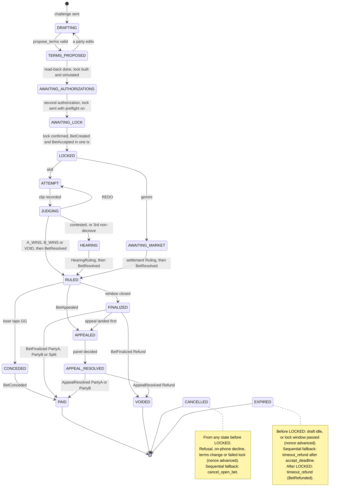

Status: DRAFT — Phase 0 planning written 2026-11-08 (before the build window). Re-author into the repo during the window; if committed verbatim, commit it as 'docs: import Phase 0 planning (written pre-window)'.

# SCHEMAS — shared types for You're On (`packages/shared`)

The source of truth for every JSON shape that crosses a process boundary: mobile ↔ server, server ↔ LLMs, server ↔ stage view, chain → server. Each schema becomes a Zod schema in `packages/shared/src/` during the window.

**At a glance (2026-11-08)**

- **Binding record.** `Terms` (§2) is the only binding record. `terms_hash = sha256(JCS(Terms))` goes onchain, and the terms code is its first 8 hex chars.
- **Lock = one transaction (D3, §9, §9.4).**
  - At read-back the server builds `[AdvanceNonce, ComputeBudget…, create_bet, accept_bet]` on a durable nonce and sends the same `AuthorizeRequest` to both phones.
  - Each phone returns a `PartyAuthorization` (hold + Face ID; signature over the stored bytes). The second one submits the lock.
  - `AWAITING_LOCK` is now transient. A decline or an expiry advances the nonce, and nothing moves.
- **Rulings.** The LLM outputs `claim_result`, never a winner (§5.1). `Ruling`, `HearingRuling` and `AppealResult` now commit to the exact frames the models saw (`frame_hashes`, O3 adopted). The example hashes are recomputed: §5.2 `997ce278…5daa`, §6 `a7721bbc…d368`.
- **Disputes.** `MAX_REDOS = 2`, then `HEARING`. An appeal with no majority upholds the original ruling (§7). Gemini bets keep the 10 s appeal window with a GG prompt (O6).
- **Realtime (§10).** `tx.*` events and `PendingTx` carry a `TxKind` (`atomic_lock`, `nonce_advance`, …). New event: `terms.authorize_request`.
- **Open items.** Every one is resolved (§12.3).

The code blocks were type-checked (TS strict) and run against every JSON example in this doc (`zod@4.6.7`, `canonicalize@5.1.0`) in a throwaway scratch folder. They are a spec: re-author them in the repo, don't paste.

Contents: [0 Conventions](#0-conventions) · [1 Primitives](#1-primitives) · [2 Terms](#2-terms-binding) · [3 Negotiation](#3-negotiation-termsproposal-termsdraft-clarifications-refusals) · [4 Evidence](#4-evidence) · [5 Ruling](#5-ruling) · [6 Hearing](#6-hearing) · [7 Appeals](#7-appeals) · [8 Gemini](#8-gemini-market-snapshot-and-fair-stakes) · [9 BetState](#9-betstate-offchain-state-machine) · [10 Realtime](#10-realtime-events) · [11 Versioning](#11-versioning) · [12 Decisions and open items](#12-proposed-changes-cross-doc-decisions-and-open-items) · [Changelog](#changelog)

---

## 0. Conventions

| Topic | Rule |
|---|---|
| Library | Zod 4 (pin the exact version in the repo). Use `z.strictObject` for hashed records and the records they're built from, so unknown keys are errors. Use `z.object`, which strips unknown keys, for wire payloads and LLM output, so readers are tolerant. |
| Wire-first | Schemas validate the JSON wire form. Money is a **string** on the wire and in every schema. Convert to `bigint` only where you do arithmetic. Never `JSON.stringify` a bigint. |
| Key case | snake_case, except objects that mirror Gemini's API (`Terms.market`, `GeminiMarketSnapshot`, `GeminiSettlementRecord.contract`), which keep Gemini's camelCase names exactly. The rule is per object: never mix cases inside one object. |
| Nulls | Hashed records have **no optional keys**. Every key is present, and `null` means "not applicable". This removes the "absent vs null" hashing ambiguity. |
| Timestamps | UTC. Offchain: exactly the `Date#toISOString()` format `YYYY-MM-DDTHH:mm:ss.sssZ`. Onchain and chain-event payloads: unix seconds (`i64`, a JSON number). Convert with `Math.floor(Date.parse(iso) / 1000)`. |
| IDs | `bet_id` is a UUIDv4: lowercase and hyphenated in JSON and Postgres, the same 16 bytes onchain (`[u8; 16]`). Other ids (`ruling_id`, `hearing_id`, …) are UUIDv4 and offchain only. |
| Hashes | 32 bytes: lowercase hex offchain (`Hex32`), `[u8; 32]` onchain. Hash with `sha256` from `@noble/hashes`, which is pure JS, so the same code runs on React Native and Node. |
| Pubkeys | Base58 strings, validated with `isAddress` from `@solana/kit` (confirmed: spike 07, `@solana/kit` 8.6.0 + a Codama client). Never shown to users. |
| Free text | Normalize anything a person or the judge says before validating it: NFC, then collapse whitespace runs to one space, then trim. Schemas **reject** text that isn't normalized instead of fixing it silently, so the bytes we hash are exactly the bytes we validated. |
| Biometrics | No schema in `packages/shared` carries face data. Embeddings live only in the face module: encrypted at rest, never logged, never in events, never onchain. `avatar_url` is a separate opt-in profile photo, never the enrollment selfie. |
| Users never see crypto | Pubkeys, hashes and signatures appear in payloads for the stage view's explorer links and for verification. The phone UI shows names, dollars and states only. One exception, from brief 5f: the terms card shows the first 8 hex chars of `terms_hash` as a "terms code", so both people can see they are authorizing the same thing. |
| Names across layers | Field names and enum values follow §0.3. snake_case is the canonical spelling from Rust to JSON to Postgres. The only camelCase objects are the Gemini mirrors and the Codama-generated client, which is converted at one edge. |

### 0.1 Constants

```ts
// packages/shared/src/constants.ts
export const SCHEMA_VERSION = 1 as const;
export const MICRO_PER_USD = 1_000_000n;
export const CENT = 10_000n;                         // $0.01 in micro-USDC
export const U64_MAX = 18_446_744_073_709_551_615n;
export const MAX_STAKE = 20_000_000n;                // $20 per side = Config.max_stake (demo); server re-reads Config
export const MIN_STAKE = 100_000n;                   // $0.10 per side (offchain rule only)
export const REDO_BELOW = 0.8;                       // judge confidence < 0.8 → REDO
export const PANEL_ABSTAIN_BELOW = 0.6;              // appeal vote confidence < 0.6 → ABSTAIN
export const MAX_REDOS = 2;                          // a 3rd non-decisive recording → HEARING
export const MAX_CLARIFICATIONS = 2;
export const RESOLVE_GRACE_SECS = 600;               // terms.deadline + this ≤ created_at + Config.resolve_deadline_secs (§9.3)
export const ACCEPT_WINDOW_SKILL_SECS = 300;         // create_bet accept_deadline arg for skill bets (§9.3)
export const QUOTE_TTL_SECS = 60;                    // create_bet accept_deadline arg for gemini bets = unix(quotedAt) + this
export const LOCK_SIGNATURE_MAX_SECS = 600;          // device policy: lock accept_deadline ≤ device now + this (= Config.accept_deadline_secs); with a durable nonce it is the only bound on a held lock signature
export const LOCK_SUBMIT_MARGIN_SECS = 5;            // the server never submits a lock within 5 s of accept_deadline: it revokes instead (a lock that fails onchain burns both signatures)
export const NONCE_POOL_SIZE = 5;                    // durable-nonce accounts, authority = server fee payer (FINDINGS §3.7)
export const NONCE_SEED_MAX = 16;                    // pool addresses = createWithSeed(fee payer, `yo-nonce-${k}`, System), k < 16 (ESCROW §5.0.1)
export const MAX_LOCK_REBUILDS = 1;                  // after lock_failed: re-propose the same terms under a new bet_id once, then stop
export const HELD_SIGNATURE_MAX_SECS = 30;           // LOCK_MODE=sequential only: B authorized first → re-prompt B if create_bet hasn't confirmed by then (blockhash ~36 s, spike 07)
export const STREAM_FALLBACK_MS = 5_000;             // RPC-confirmed tx with no Streams event after this → rpc_poll (spike 06: Streams latency est. 1–2.5 s, unmeasured until the key run)
```

### 0.2 Who produces and who consumes each schema

| Schema | Produced by | Consumed by | Hashed → onchain |
|---|---|---|---|
| `Terms` | server (judge's `TermsProposal` + server-owned fields) | all | `terms_hash` (`create_bet`, `accept_bet`) |
| `TermsDraft`, `ClarificationQuestion`, `GuardrailRefusal` | server / judge LLM | mobile, stage | no |
| `CameraEvidence` | performer's phone + server | judge, stage | clip bytes → `evidence_hash` |
| `GeminiSettlementRecord` | server Gemini service | settlement ruling | `evidence_hash` |
| `Ruling`, `HearingRuling` | server (LLM verdict + deterministic rules) | all | `ruling_hash` (`resolve`) |
| `AppealVote`, `AppealResult` | server (3 providers) | all | `AppealResult` → `ruling_hash` (`resolve_appeal`) |
| `GeminiMarketSnapshot` | server Gemini service | FairStakes, stage | no |
| `BetState` | server | all | no (mirrors onchain status) |
| `RealtimeEvent` | server (`source: 'server'`), Streams webhook (`source: 'chain'`) | mobile, stage | no |

### 0.3 Names and enum values across layers

ESCROW-PROGRAM owns the Rust names. This doc owns the JSON/Zod names. DATA-MODEL owns the column names. All three use the same spellings, by these rules:

| Layer | Field names | Enum values | Example |
|---|---|---|---|
| Rust (accounts, ix args, `#[event]` structs) | snake_case | PascalCase variants | `stake_a`, `accept_deadline`; `Outcome::PartyA`, `BetStatus::Settled` |
| Anchor IDL JSON | as in Rust | as in Rust | `"stake_a"`, `"PartyA"` |
| Codama / Anchor TS client | **camelCase** (generated) | PascalCase (`__kind`) | `stakeA`, `acceptDeadline`, `termsHash` |
| Wire JSON and Zod (`packages/shared`) | snake_case, identical to Rust | Rust variant names for onchain enums; SCREAMING_SNAKE for offchain enums | `stake_a`; `'PartyA'`; `'AWAITING_LOCK'`, `'A_WINS'` |
| Gemini mirrors (`Terms.market`, `GeminiMarketSnapshot`, `GeminiSettlementRecord.contract`) | Gemini's camelCase, verbatim | Gemini's values | `priceAtLock`, `resolutionSide: 'yes'` |
| Postgres columns | snake_case. A column that mirrors an onchain field has the Rust name. | Offchain enums: **identical** to Zod (`bet_state`, `ruling_outcome`, `party`). Onchain enums: snake_case of the Rust variant (`onchain_status`, `onchain_outcome`). | `bets.accept_deadline`; `'AWAITING_LOCK'`; `'party_a'`, `'settled'` |
| Drizzle row objects | snake_case keys (= column names) | as Postgres | `row.stake_a` |

Conversions happen only at these edges, and each has a unit test:
- `chain-codec.ts` turns Codama/IDL-decoded objects into wire objects: camelCase → snake_case, `bigint`/`BN` → decimal string, `[u8;16]` → UUID, `[u8;32]` → lowercase hex, `Pubkey` → base58, `{ __kind: 'PartyA' }` → `'PartyA'`. Codama objects never cross a process boundary.
- `pg-enums.ts` maps onchain enum values: `toPg = (v) => v.replace(/([a-z])([A-Z])/g, '$1_$2').toLowerCase()` (`PartyA` → `party_a`, `Settled` → `settled`). The test asserts `pgEnum.enumValues` equals `['none', ...OnchainStatus.options.map(toPg)]`, and equals `OnchainOutcome.options.map(toPg)`. Offchain enums are compared by deep equality.
- Gemini → Postgres: DATA-MODEL §5.16 lists each camelCase field next to its column.

---

## 1. Primitives

### 1.1 Money (micro-USDC)

```ts
// packages/shared/src/money.ts
export const MicroUsdc = z
  .string()
  .regex(/^(0|[1-9][0-9]{0,19})$/, 'micro-USDC: base-10 integer string')
  .refine((s) => BigInt(s) <= U64_MAX, 'exceeds u64');
export type MicroUsdc = z.infer<typeof MicroUsdc>;   // string

export const toMicro = (s: MicroUsdc): bigint => BigInt(s);
export function fromMicro(n: bigint): MicroUsdc {
  if (n < 0n || n > U64_MAX) throw new RangeError('micro-USDC out of u64 range');
  return n.toString();
}
/** Spoken/typed dollars → micro-USDC. Whole cents only: "$5", "5", "5.2", "6.20". */
export function parseUsd(input: string): MicroUsdc {
  const m = /^\$?(0|[1-9][0-9]{0,5})(?:\.([0-9]{1,2}))?$/.exec(input.trim());
  if (!m) throw new Error(`not a dollar amount: ${input}`);
  return fromMicro(BigInt(m[1]) * MICRO_PER_USD + BigInt((m[2] ?? '').padEnd(2, '0')) * CENT);
}
/** "5000000" → "$5", "6200000" → "$6.20", "1234567" → "$1.234567" (sub-cent never appears in UI). */
export function formatUsd(s: MicroUsdc): string {
  const n = BigInt(s), whole = n / MICRO_PER_USD, frac = n % MICRO_PER_USD;
  if (frac === 0n) return `$${whole}`;
  if (frac % CENT === 0n) return `$${whole}.${(frac / CENT).toString().padStart(2, '0')}`;
  return `$${whole}.${frac.toString().padStart(6, '0').replace(/0+$/, '')}`;
}
```

```json
{ "a": "6200000", "b": "3800000", "currency": "USDC" }
```

| Where | Representation | Notes |
|---|---|---|
| JSON / Zod | `"6200000"` | Base-10, no sign, no leading zeros, ≤ u64. Never a JS `number`. |
| Arithmetic | `bigint` | `toMicro` / `fromMicro` at the edges only. |
| Postgres | `BIGINT` | Signed 63-bit is enough, since amounts are ≤ 2 × `MAX_STAKE`. node-postgres returns BIGINT as a string, which goes straight into `MicroUsdc`. |
| Onchain | `u64` | Anchor/kit decoders give `BN`/`bigint`. Use `fromMicro(BigInt(x.toString()))`. |
| Display | `formatUsd` | No floats anywhere in money formatting. |
| Input | `parseUsd` | Voice/typed amounts are always whole cents. `Stake` (§2) also requires whole cents in `[MIN_STAKE, MAX_STAKE]`. |

Devnet USDC: Circle's devnet mint `4zMMC9srt5Ri5X14GAgXhaHii3GnPAEERYPJgZJDncDU` on classic SPL Token (`TokenkegQfeZyiNwAJbNbGKPFXCWuBvf9Ss623VQ5DA`), 6 decimals, freeze authority set (confirmed: spike 07, read onchain).

### 1.2 Party, ids, time, hashes, keys, text

```ts
// packages/shared/src/primitives.ts
import { isAddress } from '@solana/kit';
import { sha256 } from '@noble/hashes/sha2.js';                          // check the import path for the pinned version
import { bytesToHex, hexToBytes, utf8ToBytes } from '@noble/hashes/utils.js';

export const Party = z.enum(['A', 'B']);                  // A = challenger/proposer, B = challenged
export type Party = z.infer<typeof Party>;
export const otherParty = (p: Party): Party => (p === 'A' ? 'B' : 'A');

export const Uuid = z.string().regex(/^[0-9a-f]{8}-[0-9a-f]{4}-4[0-9a-f]{3}-[89ab][0-9a-f]{3}-[0-9a-f]{12}$/, 'lowercase UUIDv4');
export const BetId = Uuid;
export const betIdToBytes = (id: string): Uint8Array => hexToBytes(id.replaceAll('-', ''));   // 16 bytes, PDA seed
export const bytesToBetId = (b: Uint8Array): string => {
  const h = bytesToHex(b);
  return `${h.slice(0, 8)}-${h.slice(8, 12)}-${h.slice(12, 16)}-${h.slice(16, 20)}-${h.slice(20)}`;
};

export const Hex32 = z.string().regex(/^[0-9a-f]{64}$/, '32 bytes as lowercase hex');
export const Pubkey = z.string().regex(/^[1-9A-HJ-NP-Za-km-z]{32,44}$/).refine((s) => isAddress(s), 'not a 32-byte base58 key');
export const Signature = z.string().regex(/^[1-9A-HJ-NP-Za-km-z]{64,88}$/);   // tx signature, base58

export const IsoUtc = z
  .string()
  .regex(/^\d{4}-\d{2}-\d{2}T\d{2}:\d{2}:\d{2}\.\d{3}Z$/, 'Date#toISOString() format')
  .refine((s) => new Date(s).toISOString() === s, 'not a real instant');
export const IsoUtcWholeSecond = IsoUtc.refine((s) => s.endsWith('.000Z'), 'whole seconds only'); // maps 1:1 to i64 seconds
export const UnixSeconds = z.number().int().nonnegative();
export const DecimalStr = z.string().regex(/^(0|[1-9][0-9]*)(\.[0-9]+)?$/);   // Gemini prices/strikes, as sent

export const normText = (s: string): string => s.normalize('NFC').replace(/\s+/g, ' ').trim();
const CONTROL = /[\u0000-\u001f\u007f-\u009f]/;
/** Normalized free text: NFC, trimmed, single-spaced, no control chars, no lone surrogates. */
export const NText = (max: number, min = 1) =>
  z.string().min(min).max(max).refine(
    (s) => s.isWellFormed() && !CONTROL.test(s) && s === normText(s),
    'text must be NFC, trimmed, single-spaced, no control chars',
  );
export const DisplayName = NText(32);

export const sha256Hex = (s: string | Uint8Array): string =>
  bytesToHex(sha256(typeof s === 'string' ? utf8ToBytes(s) : s));
```

Notes:
- **`bet_id`** is generated server-side (`gen_random_uuid()`, v4) when A taps "Challenge". It is `bets.id` in Postgres. The Bet PDA seeds are `["bet", betIdToBytes(bet_id)]`. `betIdToBytes` gives the RFC 4122 textual byte order, the same bytes as npm `uuid.parse()` (ESCROW §2).
- **Vault** (must match ESCROW spec): a PDA token account, seeds `["vault", bet_id]`, token authority = the Bet PDA. Why this over the ATA of the PDA: anyone can create an ATA for any owner before `create_bet`, which would force `init_if_needed` on our side. Only our program can create a PDA vault. It also needs no ATA-program CPI.
- **Lengths** are UTF-16 code units (`String#length`). The limits keep the judge's read-back short, not exact.

### 1.3 UserRef

```ts
export const UserRef = z.object({
  user_id: Uuid,                    // offchain account id (Postgres users.id)
  pubkey: Pubkey,                   // device-generated wallet keypair (confirmed: spike 07)
  display_name: DisplayName,
  avatar_url: z.url().nullable(),   // opt-in profile photo; never the enrollment selfie
});
```

```json
{
  "user_id": "5b1f0c3e-8d2a-4c6b-9e7f-0a1b2c3d4e5f",
  "pubkey": "CnsajwK7djGNjGnXhGk7ZtzMqn58zBs4CTbhXrCaDsQr",
  "display_name": "Jake",
  "avatar_url": null
}
```

`UserRef` is for API and realtime payloads. Inside `Terms` a party is only `{pubkey, display_name}` (`TermsParty`), because `user_id` is an internal detail and the pubkey is the identity the escrow enforces.

---

## 2. Terms (binding)

`Terms` is the exact object whose hash goes onchain. **Everything inside `Terms` is binding. Nothing outside it is.** Presentation data travels next to it in a `TermsEnvelope` (§2.3).

### 2.1 Schema

```ts
// packages/shared/src/terms.ts
export const AttemptRule = z.enum(['single', 'first_success', 'best_of', 'all_of']);
export const Attempts = z
  .strictObject({ count: z.number().int().min(1).max(5), rule: AttemptRule })
  .superRefine((a, ctx) => {
    if ((a.rule === 'single') !== (a.count === 1))
      ctx.addIssue({ code: 'custom', message: "count = 1 iff rule = 'single'" });
    if (a.rule === 'best_of' && a.count % 2 === 0)
      ctx.addIssue({ code: 'custom', message: 'best_of needs an odd count' });
  });

export const EdgeCase = z.strictObject({
  question: NText(160),
  answer: NText(160),
  asked_by: z.literal('judge'),
});

export const Stake = MicroUsdc.refine((s) => {
  const n = BigInt(s);
  return n >= MIN_STAKE && n <= MAX_STAKE && n % CENT === 0n;
}, 'stake: whole cents, MIN_STAKE..max_stake');
export const Stakes = z.strictObject({ a: Stake, b: Stake, currency: z.literal('USDC') });

export const GeminiStrike = z.strictObject({                 // Gemini's Strike object, verbatim
  value: DecimalStr.nullable(),                              // null until availableAt for 'reference' strikes
  type: z.enum(['reference', 'above', 'spread', 'over', 'over_or_equal', 'under', 'under_or_equal']),
  availableAt: IsoUtc.nullable(),
});
export const PricePct = z.string().regex(/^0\.(0[5-9]|[1-8][0-9]|9[0-5])$/, '0.05..0.95, exactly 2 dp');
export const MarketRef = z.strictObject({                    // camelCase: mirrors Gemini
  venue: z.literal('gemini'),
  eventTicker: z.string().min(1).max(64),                    // e.g. "BTC05M2611211810" (from the API)
  instrumentSymbol: z.string().min(1).max(64),               // e.g. "GEMI-BTC05M2611211810-UP" (from the API, never built)
  side: z.enum(['YES', 'NO']),                               // party A's side; B holds the other
  priceAtLock: PricePct,                                     // P(YES) used for the stakes; see §8
  priceSource: z.enum(['mid', 'last_in_spread']),
  quotedAt: IsoUtc,
  strike: GeminiStrike,
  expiry: IsoUtcWholeSecond,
});
export const EscrowRef = z.strictObject({
  cluster: z.enum(['devnet', 'localnet']),
  program_id: Pubkey,
  mint: Pubkey,
});
export const TermsParty = z.strictObject({ pubkey: Pubkey, display_name: DisplayName });

export const TermsV1 = z
  .strictObject({
    schema_version: z.literal(1),
    bet_id: BetId,
    escrow: EscrowRef,
    party_a: TermsParty,
    party_b: TermsParty,
    type: z.enum(['skill', 'real_world', 'dance_off']),   // 'dance_off' widened in place (§2.7, §11 rule 4)
    claim: NText(200),
    performer: Party.nullable(),
    yes_party: Party,
    attempts: Attempts,
    success_criteria: z.array(NText(160)).min(1).max(5),
    failure_criteria: z.array(NText(160)).max(5),
    edge_cases: z.array(EdgeCase).max(4),
    evidence_source: z.enum(['camera', 'gemini']),
    market: MarketRef.nullable(),
    stakes: Stakes,
    deadline: IsoUtcWholeSecond,
    created_at: IsoUtc,
  })
  .superRefine((t, ctx) => {
    const bad = (path: (string | number)[], message: string) => ctx.addIssue({ code: 'custom', path, message });
    if (t.party_a.pubkey === t.party_b.pubkey) bad(['party_b', 'pubkey'], 'A and B must differ');
    if (Date.parse(t.deadline) <= Date.parse(t.created_at)) bad(['deadline'], 'deadline must be after created_at');
    if (t.type === 'skill') {
      if (t.evidence_source !== 'camera') bad(['evidence_source'], "skill => 'camera'");
      if (t.market !== null) bad(['market'], 'skill => null');
      if (t.performer === null) bad(['performer'], 'skill => required');
      // Odds (widened refinement, no version bump, §11): each stake is still a Stake; the larger
      // is at most MAX_ODDS_RATIO (10) × the smaller. Equal-stake terms hash exactly as before.
      if (isMicroUsdcString(t.stakes.a) && isMicroUsdcString(t.stakes.b)) {
        const [hi, lo] = [BigInt(t.stakes.a), BigInt(t.stakes.b)].sort((x, y) => (x > y ? -1 : 1));
        if (hi > MAX_ODDS_RATIO * lo) bad(['stakes'], 'skill => odds at most 10:1');
      }
    } else if (t.type === 'dance_off') {
      // Dance Off (widened in place, no version bump, §11): both perform; "A out-dances B".
      if (t.evidence_source !== 'camera') bad(['evidence_source'], "dance_off => 'camera'");
      if (t.market !== null) bad(['market'], 'dance_off => null');
      if (t.performer !== null) bad(['performer'], 'dance_off => null (both perform)');
      if (t.yes_party !== 'A') bad(['yes_party'], "dance_off => 'A'");
      if (t.attempts.rule !== 'single') bad(['attempts'], "dance_off => 'single'");
      if (t.stakes.a !== t.stakes.b) bad(['stakes'], 'dance_off => equal stakes');
    } else {
      if (t.evidence_source !== 'gemini') bad(['evidence_source'], "real_world => 'gemini'");
      if (t.performer !== null) bad(['performer'], 'real_world => null');
      if (t.attempts.rule !== 'single') bad(['attempts'], "real_world => 'single'");
      if (t.market === null) return bad(['market'], 'real_world => required');
      if (t.yes_party !== (t.market.side === 'YES' ? 'A' : 'B')) bad(['yes_party'], 'must match market.side');
      if (Date.parse(t.deadline) < Date.parse(t.market.expiry)) bad(['deadline'], 'must be >= market.expiry');
      const pot = BigInt(t.stakes.a) + BigInt(t.stakes.b);
      const fair = splitPot(pot, t.market.side, pctFromPrice(t.market.priceAtLock));        // §8
      if (fromMicro(fair.a) !== t.stakes.a || fromMicro(fair.b) !== t.stakes.b)
        bad(['stakes'], 'stakes != fair split of pot at priceAtLock');
    }
  });
export const Terms = TermsV1;   // later: z.discriminatedUnion('schema_version', [TermsV1, TermsV2])
export type Terms = z.infer<typeof Terms>;
```

### 2.2 Field notes

All fields below are **binding** (they are inside `Terms`, so they are in `terms_hash`).

| Field | Set by | Notes |
|---|---|---|
| `schema_version` | server | Always `1` for this schema. See §11. |
| `bet_id` | server | Binds the hash to one escrow account, so terms can't be replayed onto another bet. |
| `escrow` | server | `{cluster, program_id, mint}`. Binds the hash to one deployment and one token. Proposed addition; see §12. |
| `party_a`, `party_b` | server | `{pubkey, display_name}`. `accept_bet` must be signed by `party_b.pubkey`. The display name is a snapshot at proposal time. |
| `type` | judge | `skill` = settled by camera. `real_world` = settled by a Gemini contract (devnet demo only; see the note below). `dance_off` = two players dance one bundled routine side by side, scored by the shared deterministic scorer (§2.7, §4.2). |
| `claim` | judge | One **proposition** in the third person that resolves TRUE or FALSE, e.g. "Jake lands a water bottle flip upright on the table." Not phrased as the bet ("bet you can't…"). |
| `performer` | judge | Who attempts it (skill). `null` for real_world and dance_off (both dance). Drives "Jake, you're on" and which phone records. |
| `yes_party` | judge | The party who wins if the claim resolves TRUE. "Bet you can't flip it" → claim "Jake flips it", performer B, `yes_party` B. LLMs never output winner letters directly (§5.1). |
| `attempts` | judge | `single` (count 1), `first_success` (up to N tries, TRUE on the first success), `best_of` (odd N, TRUE if successes > N/2, may stop once decided), `all_of` (N in a row). All tries happen inside **one recording**. A REDO re-records the whole set. |
| `success_criteria[]` | judge | Observable conditions that make the claim TRUE. All must hold. Order is significant for hashing. |
| `failure_criteria[]` | judge | Conditions that make it FALSE. These are explicit fouls; the criteria not being met is also FALSE. |
| `edge_cases[]` | judge | `{question, answer, asked_by: 'judge'}`. The answer is written as a crisp rule, not the raw transcript. Holds at most 2 clarifications plus up to 2 defaults the judge states without asking. |
| `evidence_source` | judge | `camera` for `skill` and `dance_off`, `gemini` ⇔ `real_world`. |
| `market` | server | Required iff `real_world`. Copied from a `GeminiMarketSnapshot`, never typed by the LLM. See §2.6 and §8. |
| `stakes` | server | `{a, b, currency: 'USDC'}`, micro-USDC strings. Skill: `a = amount`, `b = amount_b ?? amount` (odds: unequal stakes agreed on both phones, at most 10:1, §3.5). Dance off: `a = b = amount` (even money, no odds). Real world: fair split of `pot = 2 × amount` (§8). Each side is checked against `MAX_STAKE`. |
| `deadline` | server | Whole-second UTC. Skill: attempt done by `created_at + 10 min` (or + the judge's `deadline_minutes`, ≤ 45), rounded to the nearest whole minute. Real world: `market.expiry + 10 min` (confirmed: spike 05: `resolvedAt` is 5.5–8.8 s after expiry over 173 contracts, and the REST side is visible by ~T+9 s; spike 05 also recommends expiry + 10 min). It is an offchain term, not an onchain deadline. The onchain `resolve_deadline` is `locked_at + Config.resolve_deadline_secs` (3600 s demo, ESCROW §5.2), so the server enforces `deadline + RESOLVE_GRACE_SECS ≤ created_at + resolve_deadline_secs`. That always leaves ≥ 10 min for judging, REDOs and the hearing (§9.3). |
| `created_at` | server | When the terms were finalized (the instant `terms_hash` is computed). |

**Presentation-only (not hashed):** title, read-back text, dollar strings, odds string, avatars, user ids, `room_id`, transcripts of the negotiation, the judge's voice audio. They live in `TermsPresentation` / `TermsDraft`.

**Real-world bets:** in the product, peer-to-peer money bets are skill challenges only, and real-world bets route each side to Gemini's regulated market (brief 5c). `type: 'real_world'` with our escrow is a **devnet demo exception**. The server accepts it only when `ALLOW_P2P_REAL_WORLD=true` (demo config) and `escrow.cluster = 'devnet'`.

### 2.3 Presentation and envelope

```ts
export const TermsPresentation = z.object({
  title: z.string().max(40),                 // "Bottle flip"
  readback: z.string().max(400),             // what the judge reads aloud
  stakes_display: z.string().max(40),        // "$5 vs $5" | "$6.20 vs $3.80"
  odds_display: z.string().max(12).nullable(),   // "62/38" for gemini bets
  party_a_avatar_url: z.url().nullable(),
  party_b_avatar_url: z.url().nullable(),
});
export const TermsEnvelope = z
  .object({ terms: Terms, terms_hash: Hex32, presentation: TermsPresentation })
  .refine((e) => hashJcs(e.terms) === e.terms_hash, { message: 'terms_hash mismatch', path: ['terms_hash'] });
```

Every client that parses a `TermsEnvelope` recomputes the hash (one SHA-256 over ~1 KB). A phone therefore never signs a lock for a hash it hasn't verified against the terms it displays. Before signing, it checks the server-built lock message's `create_bet.terms_hash` and `accept_bet.expected_terms_hash` args against its own recomputed hash (ESCROW §5.0.2).

### 2.4 Canonicalization and hashing

`terms_hash = sha256( UTF-8( JCS( Terms.parse(t) ) ) )`

1. **Normalize inputs** (server, before parse): run `normText` over every free-text field (`claim`, criteria, edge cases, display names). The LLM's raw output never goes into the hash unnormalized.
2. **Validate** with `Terms.parse`. Because it is strict, unknown keys are rejected rather than silently dropped. Unnormalized text, non-whole-cent stakes and non-whole-second deadlines are rejected too.
3. **Canonicalize** with RFC 8785 JCS (`canonicalize` npm package; pin the exact version):
   - Object keys are sorted by UTF-16 code units, recursively. **Field order in source objects is irrelevant.**
   - No insignificant whitespace. Strings use ECMAScript `JSON.stringify` escaping (non-ASCII is emitted raw as UTF-8; control characters are escaped, though we reject them anyway).
   - **Array order is significant** and is never sorted.
   - Numbers use the ECMAScript shortest round-trip form. `Terms` contains only small integers (`schema_version`, `attempts.count`). Money and prices are **strings**, so no float ever reaches the hash.
4. **Hash** the UTF-8 bytes of the canonical string with SHA-256. Use lowercase hex offchain and the raw 32 bytes onchain.
5. **Store** the canonical string byte-for-byte (recommendation for DATA_MODEL: `terms_canonical TEXT` + `terms_hash CHAR(64)`). Re-deriving from JSONB also works, since JCS re-sorts, but the stored text is the receipt.

```ts
import canonicalize from 'canonicalize';
export function jcs(value: unknown): string {
  const s = canonicalize(value);
  if (s === undefined) throw new Error('value is not JCS-serializable');
  return s;
}
export const hashJcs = (value: unknown): string => sha256Hex(jcs(value));
export function computeTermsHash(input: unknown): { terms: Terms; canonical: string; terms_hash: string } {
  const terms = Terms.parse(input);
  const canonical = jcs(terms);
  return { terms, canonical, terms_hash: sha256Hex(canonical) };
}
```

The same `hashJcs` produces `ruling_hash` (`Ruling` / `HearingRuling` / `AppealResult`) and the Gemini `evidence_hash` (`GeminiSettlementRecord`). The Rust program never parses JSON. It only stores and compares 32-byte hashes.

**Why NFC matters:** `"Zoë"` typed as `Zo` + U+00EB (NFC) hashes to `c6a12698…f067`. Typed as `Zoe` + U+0308 (NFD, common from iOS dictation and copy-paste), the same visible name hashes to `c106d155…f50f`. Normalizing first makes both produce one hash.

### 2.5 Worked example (skill bet)

A says: "Bet you $5 you can't land a bottle flip." The judge asks one question ("Does landing on the cap count?") and A and B answer.

```json
{
  "schema_version": 1,
  "bet_id": "7f3c2a9e-4b1d-4e8a-9c2f-1a2b3c4d5e6f",
  "escrow": {
    "cluster": "devnet",
    "program_id": "HrN54SG8B4uJzrcfkAJNgqNyafpCNek9XZ9o8NcR15YX",
    "mint": "4zMMC9srt5Ri5X14GAgXhaHii3GnPAEERYPJgZJDncDU"
  },
  "party_a": { "pubkey": "E97T44N6hdDS7S8r6vDYGrFPzNb9uKJsg5Eecya3AR4", "display_name": "Logan" },
  "party_b": { "pubkey": "CnsajwK7djGNjGnXhGk7ZtzMqn58zBs4CTbhXrCaDsQr", "display_name": "Jake" },
  "type": "skill",
  "claim": "Jake lands a water bottle flip upright on the table.",
  "performer": "B",
  "yes_party": "B",
  "attempts": { "count": 1, "rule": "single" },
  "success_criteria": [
    "The bottle rotates at least once in the air.",
    "The bottle comes to rest standing upright on its base."
  ],
  "failure_criteria": [
    "The bottle ends on its side, upside down, or off the table.",
    "Jake touches the bottle after releasing it."
  ],
  "edge_cases": [
    { "question": "Does landing on the cap count?", "answer": "No. Only upright on its base counts.", "asked_by": "judge" }
  ],
  "evidence_source": "camera",
  "market": null,
  "stakes": { "a": "5000000", "b": "5000000", "currency": "USDC" },
  "deadline": "2026-11-21T18:15:00.000Z",
  "created_at": "2026-11-21T18:05:12.345Z"
}
```

(The program id and the party keys are deterministic example keys, not real accounts. The mint is Circle's devnet USDC.)

Canonical JCS string (one line, 1,099 bytes UTF-8, no trailing newline):

```text
{"attempts":{"count":1,"rule":"single"},"bet_id":"7f3c2a9e-4b1d-4e8a-9c2f-1a2b3c4d5e6f","claim":"Jake lands a water bottle flip upright on the table.","created_at":"2026-11-21T18:05:12.345Z","deadline":"2026-11-21T18:15:00.000Z","edge_cases":[{"answer":"No. Only upright on its base counts.","asked_by":"judge","question":"Does landing on the cap count?"}],"escrow":{"cluster":"devnet","mint":"4zMMC9srt5Ri5X14GAgXhaHii3GnPAEERYPJgZJDncDU","program_id":"HrN54SG8B4uJzrcfkAJNgqNyafpCNek9XZ9o8NcR15YX"},"evidence_source":"camera","failure_criteria":["The bottle ends on its side, upside down, or off the table.","Jake touches the bottle after releasing it."],"market":null,"party_a":{"display_name":"Logan","pubkey":"E97T44N6hdDS7S8r6vDYGrFPzNb9uKJsg5Eecya3AR4"},"party_b":{"display_name":"Jake","pubkey":"CnsajwK7djGNjGnXhGk7ZtzMqn58zBs4CTbhXrCaDsQr"},"performer":"B","schema_version":1,"stakes":{"a":"5000000","b":"5000000","currency":"USDC"},"success_criteria":["The bottle rotates at least once in the air.","The bottle comes to rest standing upright on its base."],"type":"skill","yes_party":"B"}
```

```text
terms_hash = 05860f0a9c9034685ddbed902667f8453258056a21de30138b430ba3903f998f
onchain    = [0x05, 0x86, 0x0f, 0x0a, …, 0x3f, 0x99, 0x8f]   (32 bytes)
```

How it was computed: `computeTermsHash(example)` (Zod parse → `canonicalize` → SHA-256). The result was cross-checked against an independent Python canonicalizer (`json.dumps(sort_keys=True, separators=(',', ':'), ensure_ascii=False)`, which gives the same bytes for this ASCII-keyed object) and against `printf '%s' '<canonical>' | sha256sum`. All three agree. Shuffling the input's key order gives the same hash. Adding a stray key or a double space in `claim` makes `Terms.parse` throw. This example becomes test vector `terms-v1-001` (§11).

### 2.6 Real-world variant (the BTC closer)

These fields differ from §2.5. A says "Bitcoin's up by the end of this pitch", so A takes YES on the BTC 5-minute UP contract. The mid price is 0.62 and `amount` is $5, so the pot is $10, giving A $6.20 and B $3.80.

```json
{
  "bet_id": "0b8e5d2c-9a41-4f37-b6e2-5c1d0a9f8e73",
  "type": "real_world",
  "claim": "Gemini's BTC 5-minute contract expiring 18:10 UTC resolves UP.",
  "performer": null,
  "yes_party": "A",
  "attempts": { "count": 1, "rule": "single" },
  "success_criteria": ["Gemini settles this contract YES."],
  "failure_criteria": ["Gemini settles this contract NO."],
  "edge_cases": [],
  "evidence_source": "gemini",
  "market": {
    "venue": "gemini",
    "eventTicker": "BTC05M2611211810",
    "instrumentSymbol": "GEMI-BTC05M2611211810-UP",
    "side": "YES",
    "priceAtLock": "0.62",
    "priceSource": "mid",
    "quotedAt": "2026-11-21T18:06:30.000Z",
    "strike": { "value": "97250.03", "type": "reference", "availableAt": "2026-11-21T18:05:00.000Z" },
    "expiry": "2026-11-21T18:10:00.000Z"
  },
  "stakes": { "a": "6200000", "b": "3800000", "currency": "USDC" },
  "deadline": "2026-11-21T18:20:00.000Z",
  "created_at": "2026-11-21T18:06:30.120Z"
}
```

- Ticker shapes come from spike 05 samples (event `BTC05M2611072140`, instrument `GEMI-BTC05M2611072140-UP`, contract ticker `UP`). Always copy them from the API; never build them by hand.
- `strike.value` is `null` until `availableAt` (the start of the 5-minute window). A bet on a contract whose window hasn't opened yet binds to "the reference price Gemini captures at `availableAt`". That is still unambiguous, because Gemini settles it. For the **current** window the server quotes only once the strike is known (`STRIKE_PENDING`, §8.2). Spike 05 (confirmed) saw the strike arrive on the WS `contractStatus` frame 4–6 s into the window, on REST `/strike` after 14–22 s, and still `null` in the discovery list after 44 s. Never take the strike from the discovery list.
- **`priceAtLock` is the price when the terms are finalized (`quotedAt`, when the server builds the lock), not when the second party authorizes.** The quote expires after `QUOTE_TTL_SECS` (60 s), which is enforced onchain through the `accept_deadline` argument of `create_bet` (§8.3). The name is kept from the baseline; see §12.

### 2.7 Dance Off variant

`docs/planning/DANCE-OFF.md` is the build contract. A dance off is `type: 'dance_off'` with `evidence_source: 'camera'`, `market: null`, `performer: null` (both perform), `yes_party: 'A'` (the claim reads "A out-dances B", so `claim_result` MET ⇔ A wins), `attempts: {count: 1, rule: 'single'}`, `stakes.a === stakes.b`, and `edge_cases: []` allowed. **No new keys:** the routine is bound through the text fields (`packages/shared/src/dance/terms.ts`):

| Field | Text |
|---|---|
| `claim` | `Dance Off: <routine title>, 15 seconds, higher match score wins, $X each` (A = challenger) |
| `success_criteria[0]` | `Routine <routine_id> v<version> sha256:<first 16 hex of routineSha256>` |
| `success_criteria[1]` | `Higher match score wins; scores within 2 points are too close to call (refund)` (`TIE_MARGIN_X10` 20) |
| `failure_criteria` | `[]` |

- `parseDanceTermsRoutine(terms)` extracts `{routine_id, version, sha16}` from `success_criteria[0]` and verifies it against the bundled registry (`ROUTINES`, exactly 3). `Terms` itself checks only the structure, never the registry.
- Producer: `POST /v1/bets/:bet_id/terms/dance` `DanceTermsRequest {routine_id, amount_usd}` → `danceTermsArgs()` (`packages/shared/src/judge/dance-terms.ts`) → `evaluateProposeTerms` → `persistEvaluation`, the same pipeline as typed and market terms. The `propose_terms` cross rules also check performer `none`, yes_party `A`, one round, no `stake_b_usd` and a verified routine line. The voice agent's `PROPOSE_TERMS_BODY_SCHEMA` does **not** offer `dance_off` in v1, and `evaluateProposeTerms` enforces it: a `dance_off` from a body carrying `conversation_id` (every ElevenLabs webhook) is `invalid` (`type: dance_off only via /terms/dance`) unless `EvaluateOptions.allowDanceOff` is `true`; the id-less `danceTermsArgs()` projection is allowed by default. `TypedTermsRequest.type` stays `skill | real_world`.
- The challenge category of a dance off is `other` (no odds prior). Dance offs have no odds and no appeal.

---

## 3. Negotiation: TermsProposal, TermsDraft, clarifications, refusals

The judge owns the semantic fields. The server owns ids, parties, escrow, money math, market data and time. The judge's one terms tool, `propose_terms`, carries only judge-owned fields, and the server composes `Terms`.

- **No `ask_clarification` tool** (D6, FINDINGS §3.10). The agent asks its ≤ 2 edge-case questions in speech, and the agreed answers arrive as `edge_cases` in the next `propose_terms` call.
- **Wire params ≠ `TermsProposal`.** The tool's `request_body_schema` is the LLM-facing projection in API-CONTRACT §4.3 (`amount_usd`, `performer: 'none'`, `market_side`, `deadline_minutes: 0`), because the ElevenLabs schema subset has no `pattern`, ranges or nullable enums. The server maps it deterministically into `TermsProposal`, then validates.

```ts
// packages/shared/src/negotiation.ts
export const TermsProposal = z.strictObject({        // judge-owned fields; propose_terms wire params map into it (API-CONTRACT §4.3)
  type: TermsV1.shape.type,
  claim: NText(200),
  performer: Party.nullable(),
  yes_party: Party,
  attempts: Attempts,
  success_criteria: z.array(NText(160)).min(1).max(5),
  failure_criteria: z.array(NText(160)).max(5),
  edge_cases: z.array(EdgeCase).max(4),
  evidence_source: TermsV1.shape.evidence_source,
  amount: MicroUsdc,                                 // A's stake (parseUsd); with amount_b null the stake per side; real_world: pot = 2 × amount
  amount_b: MicroUsdc.nullable().default(null),      // odds: B's stake when not even (input optional); real_world: always null
  market_query: z.strictObject({                     // real_world only; the server resolves it to a concrete contract
    asset: z.enum(['BTC']),
    horizon: z.literal('5m'),
    a_side: z.enum(['YES', 'NO']),
  }).nullable(),
  deadline_minutes: z.number().int().min(1).max(45).nullable(),   // null → 10; ≤ 45 keeps RESOLVE_GRACE inside resolve_deadline (§9.3)
});

export const ClarificationField = z.enum(['claim', 'attempts', 'success_criteria', 'failure_criteria', 'edge_cases', 'amount', 'deadline']);
export const ClarificationQuestion = z.strictObject({
  question_id: Uuid,
  index: z.number().int().min(1).max(MAX_CLARIFICATIONS),   // 1st or 2nd question; there is no 3rd
  field: ClarificationField,                                // which term the answer resolves
  question: NText(140),                                     // spoken; one line
  options: z.array(NText(40)).max(4),                       // suggested answers for chips + STT biasing
  addressed_to: z.enum(['A', 'B', 'both']),
  asked_at: IsoUtc,
});
export const ClarificationAsk = ClarificationQuestion.pick({ field: true, question: true, options: true, addressed_to: true }); // LLM-facing
export const ClarificationAnswer = z.strictObject({
  question_id: Uuid,
  answer: NText(160),
  answered_by: Party,
  answered_at: IsoUtc,
});

export const RefusalCategory = z.enum(['dangerous', 'alcohol_drugs', 'self_harm', 'minors', 'illegal', 'other']);
export const GuardrailRefusal = z.strictObject({
  refused: z.literal(true),
  category: RefusalCategory,
  quip: NText(140),            // spoken by the judge, PG-13, one line, never preachy
});

export const DraftIssue = z.strictObject({
  code: z.enum(['STAKE_ABOVE_MAX', 'STAKE_BELOW_MIN', 'NO_MARKET', 'MARKET_UNFAIR', 'DEADLINE_TOO_FAR', 'AMBIGUOUS', 'ODDS_TOO_LONG']),
  message: z.string().max(160),
});
export const TermsDraft = z.strictObject({
  bet_id: BetId,
  revision: z.number().int().nonnegative(),          // +1 per judge turn that changes the draft
  proposal: TermsProposal.partial(),                  // what the judge has so far
  missing: z.array(TermsProposal.keyof()),            // fields still unset
  clarifications: z.array(z.strictObject({ question: ClarificationQuestion, answer: ClarificationAnswer.nullable() })).max(MAX_CLARIFICATIONS),
  issues: z.array(DraftIssue),                        // server checks the judge must fix before proposing
  updated_at: IsoUtc,
});

/** Structured output of one judge step in the terms phase (whichever LLM produces it). */
export const TermsStepOutput = z.discriminatedUnion('kind', [
  z.object({ kind: z.literal('ask'), ask: ClarificationAsk }),
  z.object({ kind: z.literal('propose'), proposal: TermsProposal, readback: NText(400) }),
  z.object({ kind: z.literal('refuse'), refusal: GuardrailRefusal }),
]);
```

```json
{
  "bet_id": "7f3c2a9e-4b1d-4e8a-9c2f-1a2b3c4d5e6f",
  "revision": 2,
  "proposal": {
    "type": "skill",
    "claim": "Jake lands a water bottle flip upright on the table.",
    "performer": "B",
    "yes_party": "B",
    "evidence_source": "camera",
    "amount": "5000000",
    "market_query": null
  },
  "missing": ["attempts", "success_criteria", "failure_criteria", "edge_cases", "deadline_minutes"],
  "clarifications": [
    {
      "question": {
        "question_id": "6a7b8c9d-0e1f-4a2b-8c3d-4e5f6a7b8c9d",
        "index": 1,
        "field": "edge_cases",
        "question": "Does landing on the cap count, or only the base?",
        "options": ["Base only", "Cap counts"],
        "addressed_to": "both",
        "asked_at": "2026-11-21T18:04:58.100Z"
      },
      "answer": null
    }
  ],
  "issues": [],
  "updated_at": "2026-11-21T18:04:58.100Z"
}
```

```json
{ "kind": "ask", "ask": { "field": "attempts", "question": "One flip or best of three?", "options": ["One flip", "Best of three"], "addressed_to": "both" } }
```

```json
{ "refused": true, "category": "alcohol_drugs", "quip": "Chugging contests? I judge bottle flips, not liver function. Pick something else." }
```

Notes:
- **Two clarifications at most.** After the 2nd answer the judge must propose and fill any remaining gaps with stated defaults, which become `edge_cases` the judge "asked" itself.
  - **ElevenLabs Agent path (v1):** the limit lives in the agent prompt and in `propose_terms`'s advisory `next` (API-CONTRACT §4.1, §4.3). There is no tool call to reject, and `TermsDraft.clarifications` is `[]`.
  - **Speech Engine fallback only** (Claude on our server, FINDINGS §3.10; API-CONTRACT §7.1): `ClarificationQuestion`, `ClarificationAsk`, `TermsStepOutput.ask`, `TermsDraft.clarifications` and the `terms.question` event are produced here. `index` ∈ {1, 2}, and the server rejects a 3rd `ask`. The draft example above is a fallback-path draft.
- **The answer becomes an edge case:** `{question, answer: <crisp rule>, asked_by: 'judge'}`. `ClarificationAnswer.answer` is the normalized transcript. The edge case answer is the judge's rewording, and both parties hear that wording in the read-back, then see it on the terms card they authorize on their own phones. The spoken read-back (and any spoken "accept") is not binding. Only the on-phone authorization is (§9).
- **Refusals** are produced by the server's guardrail check on every `propose_terms` call (and every `TermsStepOutput` in the fallback). A synchronous keyword prefilter returns the `GuardrailRefusal` inline as the tool result, so the agent speaks the `quip`. The LLM guardrail runs asynchronously and fails closed before the lock; a late refusal arrives as `terms.refused` plus `judge.cue REFUSED` (API-CONTRACT §4.3, §7.1). The bet goes to `CANCELLED` with `reason = 'refused:<category>'`. `minors` covers challenges that involve minors; the 18+ check itself happens at signup, not here. `other` is for anything else unsafe, plus harassment and non-consensual dares.
- **Over-cap amounts are not refusals.** "$50" yields `DraftIssue STAKE_ABOVE_MAX` and the judge counter-proposes the max ("Max is $20. $20 it is?").
- `TermsStepOutput` and `ClarificationAsk` are LLM-facing in the Speech Engine fallback; generate their JSON Schema with `z.toJSONSchema()` there. The ElevenLabs `propose_terms` schema is hand-written (API-CONTRACT §4.3).
- **Odds** (§3.5): `amount` is A's stake and `amount_b` B's; `stakeIssue` checks both sides and the 10:1 bound (`ODDS_TOO_LONG`). A `terms.draft` carries `amount_b` only when it is not null (older clients parse the draft strictly).
- On receipt the server first runs `normText` over every string. It then parses with a stripping variant (`z.object(TermsProposal.shape)`), so a stray key from the agent can't fail a live demo. Finally it composes `Terms` and parses that strictly. A validation error goes back to the agent as the tool result, so the judge can retry.

### 3.5 Odds: offers, the judge's suggestion, the performer's record

Odds are unequal stakes on a skill bet. There is **no new hashed field**: the odds are `Terms.stakes.a / .b` (the larger at most 10 × the smaller, §2.1), and every label ("3 to 1", "$15 vs $5") is derived from them (`odds-math.ts ratioLabel`). The two parties agree on them with **offers**, consent objects in the bet's event log (`odds.offered`, `odds.answered`, `odds.agreed`, §10.1), folded the same way by the server, the phones and the stage (`odds.ts foldOdds`). Agreement is of a stakes pair, so a re-proposal with the same stakes needs no new consent; both still hold to confirm the final card, whose hash binds the stakes. Rules (server `odds/service.ts`): an unequal card that is not yet agreed opens an offer; one offer is open at a time (a new one counters or supersedes it); an A/B offer is accepted by the other party, a judge offer by both; when both accept and the card has other stakes, the card is recomposed with them (a new version and hash); `confirm` is refused (`ODDS_PENDING`) while unequal stakes are not agreed or an offer is open; after the freeze the odds routes answer 409.

```ts
// packages/shared/src/odds.ts (not hashed)
export const OddsOffer = z.object({
  offer_id: Uuid, n: z.number().int().min(1),          // n = 1 + earlier odds.offered (a stale tap is refused)
  parent_id: Uuid.nullable(),                          // the offer this counters
  from: z.enum(['A', 'B', 'judge']),
  stakes: z.object({ a: Stake, b: Stake }),
  ratio_label: z.string().max(16), favored: Party.nullable(),   // who puts in more
  terms_hash: Hex32.nullable(),                        // the card then; null = a judge suggestion while DRAFTING
  suggestion: OddsSuggestion.nullable(), created_at: IsoUtc,
});
export const OddsSuggestion = z.object({
  ratio: OddsRatio,                                    // '1:1' | '3:2' | '2:1' | '3:1' | '5:1' | '10:1'
  favored: Party.nullable(), stakes: OddsStakes,       // stakesFor(ratio): never the model's
  chance_pct: z.number().int().min(1).max(99),         // P(claim succeeds) after the attempt rule
  fair_ratio: z.number(), allowed: z.array(OddsRatio), // the band a model may pick from
  base_rate_pct: z.number().int(), sample_meaningful: z.boolean(),
  stats: PerformerStats, reason: NText(160),
  source: z.enum(['model', 'template', 'default']), model: z.string().nullable(), cache_key: Hex32,
});
export const PerformerStats = z.object({
  performer: z.object({ party: Party, display_name: z.string() }),
  category: ChallengeCategory, category_label: z.string(),
  overall: { wins, losses, pushes },                   // every settled bet, any role, incl. seed rows
  in_category: { made, tries },                        // as the performer, this kind of bet
  as_performer: { made, tries },                       // as the performer, any kind
  recent: z.array(z.enum(['W', 'L'])).max(5),          // performer results, newest first
  streak: z.object({ kind, n }).nullable(),
  h2h: HeadToHead,                                     // performer vs this opponent (API-CONTRACT §2.18)
  includes_seed: z.boolean(),                          // any labelled demo-history row: show "Demo history"
});
```

- **Challenge category** (`challenge-category.ts`): `bottle_flip | throw | other`, a deterministic keyword classifier over the claim and success criteria (NFKD, ASCII-folded, as the guardrail prefilter), always derived and never stored or hashed (`CATEGORY_RULES_VERSION = 1`). Old rows classify on the fly; legacy seed rows without terms classify by title. Base rates (one try): bottle flip 25 %, throw 40 %, other 50 %.
- **The math** (`odds-math.ts`, all in code): `p1 = (made + 4·base) / (tries + 4)` (so 1 for 1 is 40 % on flips, not 100 %), the attempt rule (`first_success` 1−(1−p)ⁿ, `all_of` pⁿ, `best_of` the binomial tail), clamped to [1/11, 10/11]; fair ratio `r = max(p,1−p)/min(p,1−p)`; the band = the two ladder rungs that bracket `r` (one when within 2 %). `stakesFor`: the underdog stakes the base, the favourite base × num/den rounded half-up to the cent; a favourite over max_stake stakes max_stake and the underdog max × den/num floored to the cent.
- **The words**: a model (live LLM only, ≤ 3 s, effort low) writes one sentence and picks a rung **from the band**; a ratio outside it becomes the nearest rung, and a reason quoting any number not in the facts (`guardReason`) becomes the server template. Spend off, a timeout, an error or a refusal: the nearest rung and the template (`source 'template'`); no history: the category default (`'default'`, "That's my default.").

---

## 4. Evidence

```ts
// packages/shared/src/evidence.ts
export const FrameIndex = z.number().int().min(0).max(23);
export const EvidenceFrame = z.strictObject({
  index: FrameIndex,                 // position in frames[]; cited_frames point here
  t_ms: z.number().int().nonnegative(),   // offset from clip start
  sha256: Hex32,                     // of the JPEG bytes sent to the model
  landing_crop: z.literal(true).optional(),   // D10: this image is the landing crop (the last frame again, the middle 80 % at full resolution, ≤ 1024 px); at most one, always last
});
export const CameraEvidence = z.strictObject({
  schema_version: z.literal(1),
  kind: z.literal('camera'),
  bet_id: BetId,
  attempt_no: z.number().int().min(1),     // recording number; increments on REDO
  clip_sha256: Hex32,                      // = evidence_hash. The phone hashes the clip at record end; the server re-hashes the uploaded bytes and flags a mismatch (DATA-MODEL §9)
  clip_bytes: z.number().int().positive(),
  mime: z.enum(['video/mp4', 'video/quicktime']),
  duration_ms: z.number().int().positive().max(30_000),   // = DATA-MODEL attempts CHECK; spike 02 caps one try at 6 s (5 tries ≈ 30 s)
  recorded_by: Party,                      // whose device recorded; the demo judge-cam iPhone is a device of A (devices.role 'judge_cam', API-CONTRACT §2.9); with two phones, the non-performer's own phone ('self')
  recorded_at: IsoUtc,
  frames: z.array(EvidenceFrame).min(1).max(24),   // D10: 12 per try (8..12 accepted), 8 of them in the last ~1.2 s, + one landing crop
});

export const GeminiSettlementRecord = z.strictObject({
  schema_version: z.literal(1),
  kind: z.literal('gemini_settlement'),
  bet_id: BetId,
  terms_hash: Hex32,
  contract: z.strictObject({                 // camelCase: mirrors Gemini's Contract
    eventTicker: z.string(),
    instrumentSymbol: z.string(),
    status: z.enum(['settled', 'invalid']),
    resolutionSide: z.enum(['yes', 'no']).nullable(),   // null iff invalid
    settlementValue: DecimalStr.nullable(),             // e.g. "75550.7195"; arbitrary precision, kept as a string
    strike: GeminiStrike,
    resolvedAt: IsoUtc.nullable(),
  }),
  source_url: z.url(),                       // GET /v1/prediction-markets/events/{eventTicker}
  response_sha256: Hex32,                    // sha256 of the raw HTTP body we parsed
  fetched_at: IsoUtc,
});
```

| `evidence_source` | `evidence_hash` (onchain at `resolve`) |
|---|---|
| `camera` | `sha256(clip bytes)` = `CameraEvidence.clip_sha256` of the deciding recording |
| `gemini` | `hashJcs(GeminiSettlementRecord)`. The record contains `bet_id` and `terms_hash`, so it is per bet, not per market (DATA-MODEL stores it on the settlement `rulings` row). |
| `camera`, `type: 'dance_off'` | `hashJcs(DanceEvidence)` (§4.2). Stored as `attempts.evidence_canonical = jcs(DanceEvidence)`. |

- Clips are stored in object storage (key in Postgres, not in the schema). Frames are extracted **on the phone** (confirmed: spike 02: expo-video `generateThumbnailsAsync` at 512 px JPEG, uploaded before the clip; the server's static ffmpeg is the fallback when a clip arrives without frames). Since D10 the build uses expo-video-thumbnails and the shared sampler `packages/shared/src/judge/frames.ts` (12 frames: 4 spread over the clip, 8 in its last ~1.2 s; plus the landing crop); the server labels the frames inside the landing window and the crop in the prompt. `landing_crop` is optional, so 8-frame records from earlier builds still parse, and an absent flag is not part of the JCS bytes. `frames[i].sha256` lets a reviewer check that the frames the model saw came from the evidence. Recording: 720p H.264 at ~5 Mbps keeps a 30 s clip at ~19 MB, under DATA-MODEL's 25 MB cap (spike 02 estimate).
- The settlement record is built from the **event details endpoint** (`GET /v1/prediction-markets/events/{eventTicker}`). Confirmed by spike 05: `resolutionSide` shows there ~7.5–8.7 s after expiry, while `recently-settled` lags 26–36 s. `response_sha256` pins the exact body. What an `invalid` contract looks like is still unseen (0 of 173).

### 4.1 ReplayMoment (the slow-mo replay)

`packages/shared/src/replay.ts`, served by `GET /v1/bets/:bet_id/replay` (API-CONTRACT §2.14). What the stage and the phones play after a bet: the **winning moment** from the judge's own evidence frames (today), the real clip at quarter speed (once a clip URL exists), or a **foul** frozen at the moment a detector confirmed (once one is wired). One builder for the server, the stage and the phones.

```ts
export const REPLAY_SCHEMA_VERSION = 1 as const;
export const SLOWMO_RATE = 0.25;            // playback speed of real-time material
export const SLOWMO_DWELL_MIN_MS = 450;     // a frame's on-screen time: clamp(gap_to_next / SLOWMO_RATE, 450, 900)
export const SLOWMO_DWELL_MAX_MS = 900;
export const SLOWMO_XFADE_MS = 220;         // the landing crop fades in over SLOWMO_CROP_MS = 700 (the closing zoom)
export const SLOWMO_INTRO_MS = 500;
export const SLOWMO_HOLD_MS = 2600;
export const SLOWMO_ZOOM = { from: 1, to: 1.08, holdTo: 1.14 } as const;   // reduced motion: no zoom, no cross-fades

export const ReplayKind = z.enum(['win', 'foul']);
export const ReplayHoldSource = z.enum(['judge_cited', 'last_frame', 'detector']);
export const ReplayFrame = z.strictObject({
  idx: FrameIndex.nullable(),               // CameraEvidence.frames index (= attempt_frames.idx); null for a detector still
  t_ms: z.number().int().nonnegative(),     // ms from clip start (the crop carries the last frame's t_ms)
  landing_crop: z.boolean(),
  cited: z.boolean(),                       // in the deciding ruling's cited_frames
  path: z.string().startsWith('/v1/bets/').max(200),   // server-relative GET with the caller's bearer
  url: z.url().nullable(),                  // signed, short-lived GET once object storage exists; null today; preferred when set
});
export const ReplayClip = z.strictObject({
  url: z.url(), expires_at: IsoUtc, mime: z.enum(['video/mp4', 'video/quicktime']),
  source_rate: z.number().positive().max(1),   // 1 = real time (played at SLOWMO_RATE); < 1 = already slowed (played at 1x)
  from_ms, moment_ms, to_ms,                // in THIS file's timeline; from ≤ moment ≤ to
  overlays_burned: z.boolean(),             // boxes / line / FOUL text drawn into the video: the player adds no overlay text
});
export const ReplayFoul = z.strictObject({
  label: NText(40),                         // display data, e.g. 'Toe 17 cm over'
  measure_cm: z.number().nonnegative().nullable(),
  detector: z.string().min(1).max(80),      // e.g. 'sam3/fal@1'
});
export const ReplayMoment = z.strictObject({
  schema_version: z.literal(1),
  bet_id: BetId,
  attempt_no: z.number().int().min(1),
  kind: ReplayKind,
  winner: Party,                            // the FINAL winner (appeal final_outcome when there was one)
  moment_ms: z.number().int().nonnegative(),   // ms from the original clip's start (win: the held frame's t_ms)
  hold_source: ReplayHoldSource,
  frames: z.array(ReplayFrame).max(24),     // play order, t_ms non-decreasing; the LAST frame is held
  clip: ReplayClip.nullable(),
  foul: ReplayFoul.nullable(),              // set iff kind = 'foul'
  ruling_hash: Hex32,
  model: z.string().min(1).max(80),         // isCachedRulingModel(model) keeps the stage's "replay ruling" label
  reason: NText(280).nullable(),            // the judge's reason (data); null for a foul and for an appeal-flipped win
});
// refinements: foul set iff kind = 'foul'; a foul holds on 'detector', a win never does;
// frames or a clip; t_ms never decreases.

export const ReplayWhy = z.enum(['ready', 'not_ruled', 'no_winner', 'no_frames', 'purged']);
export const ReplayResponse = z.strictObject({ replay: ReplayMoment.nullable(), why: ReplayWhy, final: z.boolean() });
// why = 'ready' iff replay !== null

/** What a foul detector hands to buildFoulReplay: ONLY a confirmed foul (confidence ≥ 0.7). */
export const ReplayFoulInput = z.strictObject({
  moment_ms: z.number().int().nonnegative(),   // original clip timeline (release ± foul)
  foul: ReplayFoul,
  frames: z.array(ReplayFrame.omit({ cited: true })).max(8),   // its stills, or attempt frames; [] = the attempt's frames nearest moment_ms
  clip: ReplayClip.nullable(),              // its render: source_rate 0.25, overlays_burned true
});
```

| Function | Rule |
|---|---|
| `buildWinReplay({bet_id, evidence, ruling, ruling_hash, final_outcome, attempt_frame_hashes})` | `null` for REDO, a VOID that stayed VOID (a VOID an appeal turned into a win plays, held on the last frame), a non-decisive final outcome, a Gemini settlement. Frames: the non-crop frames in the landing window (`isLandingFrame`), the one lead-in frame before it, the crop, and any cited lead-in frame (time order). Held: the highest cited index, cut there, with at least 3 frames before it when the attempt has them (`judge_cited`). An appeal-flipped outcome, or nothing cited: the crop (else the last frame), `last_frame`. Citations count only when the ruling's `frame_hashes` equal the attempt's. |
| `buildFoulReplay(base, foul, evidence?)` | `kind: 'foul'`, `hold_source: 'detector'`, `moment_ms` from the detector, no `reason`. An invalid input is `null`. |
| `slowmoTimeline(m, {reduceMotion})` | `{steps: {key, at_ms, dwell_ms, xfade_ms, scale_from, scale_to}[], hold_at_ms, total_ms}`; a typical 12-frame upload: 0.5 + 0.9 + 7 × 0.6 + 0.45 + 2.6 ≈ 8.65 s. |
| `clipPlan(clip)` | `{playbackRate: source_rate === 1 ? 0.25 : 1, seekMs: from_ms, freezeAtMs: moment_ms, endMs: to_ms}`. |

- **Precedence:** a confirmed foul beats a win. **Never a fake foul:** the ruling has no structured foul and its free-text `reason` is never parsed; until a detector supplies a confirmed foul, `kind` is always `'win'`.
- These are live evidence frames, so the stage does **not** badge them "REPLAY" (ARCHITECTURE §7.1); its badges read `SLOW-MO · WINNING MOMENT` / `SLOW-MO · FOUL`.

### 4.2 Dance Off: PoseSeries and DanceEvidence

Pose data and the scorer live in `packages/shared/src/dance/` (`joints`, `pose`, `routine`, `track`, `score`, `terms`, `evidence`). Joint order is the fixed 19 Apple Vision joints (`JOINT_NAMES`); a raw person is `k: number[57]` = `[x, y, c] × 19` (x, y in [0, 1] in the upright, unmirrored image; c = 0 for a missing joint).

```ts
// packages/shared/src/dance/pose.ts — every value an int; pose_sha256 = hashJcs(PoseSeries)
export const PoseKeypoints = z.array(z.number().int().min(0).max(10_000)).length(57)   // x, y 0..10000; c ≤ 1000 (refined)
export const PoseFrame = z.strictObject({
  t: z.number().int().min(-3_000).max(20_000),   // ms since round t0 (count-in frames are negative)
  n: z.number().int().min(0).max(32),             // people seen; extra people are never scored
  a: PoseKeypoints.nullable(),                    // A = left in the image at round start
  b: PoseKeypoints.nullable(),
});
export const PoseSeries = z.strictObject({
  schema_version: z.literal(1),
  w: z.number().int().min(1).max(8192), h: z.number().int().min(1).max(8192),   // upright image size (aspect-correct vectors)
  fps_cap: z.number().int().min(1).max(30),
  sync_offset_ms: z.number().int().min(-500).max(500),   // the scorer subtracts it from every t
  frames: z.array(PoseFrame).max(700),                    // t never decreases (refined)
});

// packages/shared/src/evidence.ts — strict, hashed: evidence_hash = hashJcs(DanceEvidence)
export const DanceEvidence = z.strictObject({
  schema_version: z.literal(1),
  kind: z.literal('dance'),
  bet_id: BetId,
  attempt_no: z.number().int().min(1),
  terms_hash: Hex32,
  routine: z.strictObject({ id: z.string().min(1).max(32), version: z.number().int().min(1), sha256: Hex32 }),
  scorer_version: z.literal('dance-score@1'),
  pose_sha256: Hex32,
  pose_frames: z.number().int().min(0).max(700),
  sync_offset_ms: z.number().int().min(-500).max(500),
  scores: z.strictObject({ a: ScoreX10, b: ScoreX10 }),     // int tenths 0..1000, SERVER-recomputed from the series
  winner: Party.nullable(),
  too_close: z.boolean(),                                    // |a − b| < TIE_MARGIN_X10 (20)
  failed: z.enum(['coverage_a', 'coverage_b', 'no_frames']).nullable(),
  key_moves: z.array(z.strictObject({ id: z.string().min(1).max(24), a: Grade, b: Grade })).max(16),   // Grade = PERFECT | GOOD | MISS
  checks: z.strictObject({ coverage_a_pct: Pct, coverage_b_pct: Pct, max_people: z.number().int().min(0), side_swaps: z.number().int().min(0) }),
  frames: z.array(EvidenceFrame).min(1).max(6),              // the uploaded key frames (= the ruling's frame_hashes)
  clip_sha256: Hex32.nullable(),
});

// POST /v1/bets/:bet_id/attempts/:n/dance, multipart part `upload` (+ `frame` × 4 JPEGs ≤ 200 KB)
export const DanceUpload = z.object({
  routine_id: z.string().min(1).max(32), routine_sha256: Hex32,
  series: PoseSeries, pose_sha256: Hex32,
  client_scores: z.object({ a: ScoreX10, b: ScoreX10 }),   // only to flag a phone/server mismatch
  clip_sha256: Hex32.nullable(),
  frames: z.array(z.object({ index: FrameIndex, t_ms, sha256: Hex32, width, height, bytes })).min(1).max(6),
});
```

- A routine (`RoutineData`, generated into `dance/routines/<id>.ts` by `scripts/dance-routine.ts`) is `{schema_version: 1, id, version, title, song, bpm, duration_ms: 15000, first_beat_ms, count_in_beats: 3, w, h, mirrored_source: false, source: 'synthetic' | 'vision', frames: {t, k}[], key_moves: {id, t, name}[] (8–16), media: {video, audio}}`; `routineSha256(r) = hashJcs(r)`. A routine never changes once a bet locks on it: a new take is a new `version`. `scripts/dance-routine.ts import` (pure half: `dance/routine-import.ts`, not in the barrel) keeps key-move times as given (clamped to 0..15000, de-duplicated, thinned to 16, never snapped to a frame, since the scorer finds the nearest reference frame), and without `--key-moves`, `--every K` or JSON `key_moves` it picks every K beats from `first_beat_ms` (smallest K giving ≤ 16, 500 ms clear of both ends).
- The scorer (`scoreRound(routine, series)`, `dance-score@1`, every constant in `DANCE_SCORING`) runs on DEQUANTIZED values with only + − × ÷ and `Math.sqrt` (plus `Math.pow` in the display curve), so the phone (Hermes) and the server (V8) agree bit for bit. `buildDanceEvidence()` (`dance/evidence.ts`) re-scores the series and builds the record; `seriesChecks()` recomputes `max_people` and `side_swaps`.
- No float is ever hashed: `PoseSeries`, `RoutineData` and `DanceEvidence` hold ints, strings and booleans only.

---

## 5. Ruling

### 5.1 VisionVerdict (LLM output) → Ruling (record)

The vision model never decides who wins by letter. It answers "was the claim met?", and the server maps that through `yes_party`. This removes the classic "bet you *can't*" inversion bug.

```ts
// packages/shared/src/ruling.ts
// A_WINS | B_WINS | REDO is the baseline. VOID was added in the consistency pass (§12, X3): "no winner and no re-attempt left".
// REDO = re-attempt, never onchain. VOID → onchain Refund. Only deterministic server rules produce VOID; no LLM outputs it.
export const RulingOutcome = z.enum(['A_WINS', 'B_WINS', 'REDO', 'VOID']);
export type RulingOutcome = z.infer<typeof RulingOutcome>;
export const VoidReason = z.enum(['undecidable', 'max_redos', 'market_invalid', 'safety_stop']);
export const ClaimResult = z.enum(['MET', 'NOT_MET', 'UNCLEAR']);
export const Confidence = z.number().min(0).max(1).refine((x) => Math.round(x * 100) / 100 === x, 'round to 2 dp');

/** LLM structured output for attempt judging (and the base of the hearing verdict). Non-strict: we only read it. */
export const VisionVerdict = z.object({
  claim_result: ClaimResult,
  confidence: z.number().min(0).max(1),
  reason: z.string().min(1).max(280),          // spoken; may cite frames ("frame 7")
  cited_frames: z.array(z.number().int().min(0)).max(8),
  contested: z.boolean(),                      // a real attempt happened, but the result hinges on interpretation
});

export function toOutcome(v: { claim_result: z.infer<typeof ClaimResult>; confidence: number }, yesParty: Party): 'A_WINS' | 'B_WINS' | 'REDO' {
  if (v.claim_result === 'UNCLEAR' || v.confidence < REDO_BELOW) return 'REDO';
  const winner = v.claim_result === 'MET' ? yesParty : otherParty(yesParty);
  return winner === 'A' ? 'A_WINS' : 'B_WINS';
}
/** A hearing can't order a re-attempt: a non-decisive hearing verdict is VOID ('undecidable') → Refund. */
export const toHearingOutcome = (v: Parameters<typeof toOutcome>[0], yesParty: Party): 'A_WINS' | 'B_WINS' | 'VOID' => {
  const o = toOutcome(v, yesParty);
  return o === 'REDO' ? 'VOID' : o;
};
```

To build a `Ruling` from a verdict, the server:
1. Rounds `confidence` to 2 dp.
2. Computes `outcome = toOutcome(…)`.
3. Sets `redo_reason`: `contested` if `outcome = REDO && contested`, else `unclear` if UNCLEAR, else `low_confidence`.
4. Applies `normText` to `reason` and truncates it to 280.
5. Drops `cited_frames` that don't exist and keeps at most 8.

### 5.2 Ruling

```ts
const RulingCore = {
  schema_version: z.literal(1),
  ruling_id: Uuid,
  bet_id: BetId,
  outcome: RulingOutcome,
  claim_result: ClaimResult,          // what the model said, before mapping and the confidence rule
  confidence: Confidence,
  reason: NText(280),
  cited_frames: z.array(FrameIndex).max(8),   // indices into frame_hashes; [] for gemini
  frame_hashes: z.array(Hex32).max(24),       // O3 (D7): sha256 of each JPEG this model was sent, in send order
                                              // (= CameraEvidence.frames[].sha256 of the evidence_hash recording); [] for gemini
  model: z.string().min(1).max(80),   // "<provider>/<model-id>" or "rule/gemini-settlement@1"
  evidence_hash: Hex32,
  terms_hash: Hex32,
  created_at: IsoUtc,
};
const isDecisive = (o: RulingOutcome) => o === 'A_WINS' || o === 'B_WINS';
/** Shared by Ruling and HearingRuling: frames are committed, and citations point into them. */
const checkFrames = (r: { cited_frames: number[]; frame_hashes: string[]; model: string }, ctx: z.RefinementCtx) => {
  if (r.cited_frames.some((i) => i >= r.frame_hashes.length))
    ctx.addIssue({ code: 'custom', path: ['cited_frames'], message: 'cites a frame not in frame_hashes' });
  if ((r.model === 'rule/gemini-settlement@1') !== (r.frame_hashes.length === 0))
    ctx.addIssue({ code: 'custom', path: ['frame_hashes'], message: 'camera rulings commit ≥ 1 frame; gemini settlement commits none' });
};
export const Ruling = z
  .strictObject({
    ...RulingCore,
    stage: z.enum(['attempt', 'settlement']),
    attempt_no: z.number().int().min(1),
    redo_reason: z.enum(['unclear', 'low_confidence', 'contested']).nullable(),
    void_reason: VoidReason.nullable(),
  })
  .superRefine((r, ctx) => {
    if ((r.outcome === 'REDO') !== (r.redo_reason !== null))
      ctx.addIssue({ code: 'custom', path: ['redo_reason'], message: 'set iff outcome = REDO' });
    if ((r.outcome === 'VOID') !== (r.void_reason !== null))
      ctx.addIssue({ code: 'custom', path: ['void_reason'], message: 'set iff outcome = VOID' });
    if (r.void_reason === 'undecidable' && r.model !== 'rule/dance-off@1')   // widened for Dance Off (§11 rule 4)
      ctx.addIssue({ code: 'custom', path: ['void_reason'], message: "'undecidable' is HearingRuling-only (or a dance-off ruling)" });
    if (isDecisive(r.outcome) && r.confidence < REDO_BELOW)
      ctx.addIssue({ code: 'custom', path: ['outcome'], message: 'confidence < 0.8 must be REDO' });
    checkFrames(r, ctx);
  });
export const OnchainOutcome = z.enum(['PartyA', 'PartyB', 'Split', 'Refund']);   // = Rust Outcome, borsh 0..=3
```

```json
{
  "schema_version": 1,
  "ruling_id": "3d6f0e1a-2b4c-4d8e-9f10-a1b2c3d4e5f6",
  "bet_id": "7f3c2a9e-4b1d-4e8a-9c2f-1a2b3c4d5e6f",
  "stage": "attempt",
  "attempt_no": 1,
  "outcome": "B_WINS",
  "claim_result": "MET",
  "redo_reason": null,
  "void_reason": null,
  "confidence": 0.93,
  "reason": "Two full rotations, lands upright on its base in frame 7 and stays there. Jake never touches it.",
  "cited_frames": [5, 6, 7],
  "frame_hashes": [
    "4a732389e86b3cd38588077272022a6a56d2a4cae8b30a3d9e2471c44727aae6",
    "779dfb7bac671c5b00cb760fea9dbc9f45daccf6d44e3be1586bd94d86c5e90b",
    "d747a480b302119220981100fc1df0ba4d6f1b1b8a1c6f8946d695b89ed1b62c",
    "1d7fbd55211518f8d0166027e2a7f7dcb7c1a18df3ce039ac91b09509108768e",
    "171462f9c80234e023c7516aee81427dcc87dd313addbbac39600ae2f30eea12",
    "f8644bdba19f4a483baefa3f3c64811ef73fe8af25b725739d16e3fff5e6d5b8",
    "eb659b35c77775acce60072634526149fc1d321d7118ef4e74d26c8874e30a5e",
    "bdd11e96085964c7d1a7437baf23c95b52a76243f6c2febfaf856ea0827d82f8"
  ],
  "model": "anthropic/claude-sonnet-4-5",
  "evidence_hash": "6d16c2ef16a63aba518b2e229f7d80e11663560fcd38112d38c5e26a66e14a06",
  "terms_hash": "05860f0a9c9034685ddbed902667f8453258056a21de30138b430ba3903f998f",
  "created_at": "2026-11-21T18:07:04.512Z"
}
```

`ruling_hash = hashJcs(ruling) = 997ce27843ff323b7f7f8816f9eff0d0044a485a43c5625512a8967f82755daa` (canonical JCS: 1,173 bytes).

- **Recomputed 2026-11-08** after `frame_hashes` was added (O3, D7). Python JCS (`json.dumps(sort_keys=True, separators=(',', ':'), ensure_ascii=False)`), Node `JSON.stringify` over sorted keys, and `sha256sum` agree.
- **Obsolete values:** `437beeee…60ae` (2026-11-07) and `2ec295ad…6b95`.
- **Placeholders:**
  - `evidence_hash` is `sha256("example clip bytes")`;
  - `frame_hashes[k]` is `sha256("example frame k")`, for k = 0..7;
  - the model id is illustrative.

  Command: `for k in 0 1 2 3 4 5 6 7; do printf 'example frame %s' $k | sha256sum; done`.
- **Model candidates:** spike 02's are `claude-haiku-5-5` with thinking off, or `claude-opus-5-5` at low effort. Its accuracy eval is pending a key.

| Field | Notes |
|---|---|
| `outcome` | Bet-level result for this recording. `REDO` ⇔ `claim_result = UNCLEAR` or `confidence < 0.8`, with re-attempts left. `REDO` never goes onchain. `VOID` comes only from a server rule (`void_reason`) and goes onchain as `Refund`. |
| `claim_result` | The raw model answer, kept for audit. Example: "MET at 0.75" is stored as `REDO / low_confidence`. |
| `redo_reason` | Set iff `REDO`. `unclear` (can't see it, no attempt, bad footage) or `low_confidence` → re-attempt (`ATTEMPT`, `attempt_no + 1`). `contested` → `HEARING`. |
| `void_reason` | Set iff `VOID`. `max_redos` (3rd non-decisive result and hearings disabled), `market_invalid` (Gemini voided the contract), `safety_stop` (the judge halts an unsafe attempt after lock). `undecidable` is used by `HearingRuling`, and by a Dance Off ruling (`model: 'rule/dance-off@1'`, `DANCE_OFF_MODEL`): too close to call, a failed round or an invalid one, both refunded. |
| `cited_frames` | 0-based indices into `frame_hashes` (the same order as the `frames[]` of the recording `evidence_hash` refers to). The stage view highlights them. |
| `frame_hashes` | O3 (D7): the SHA-256 of every JPEG this model was sent, in send order. `[]` for `stage: 'settlement'`. A reviewer can check the frames against the stored `CameraEvidence` and the clip. If a model is sent a subset (e.g. a re-check), its ruling lists that subset. |
| `attempt_no` | Recording number. After `MAX_REDOS` (2) re-records, a 3rd non-decisive result goes to `HEARING`. If hearings are disabled, it is `VOID / max_redos` instead. |
| `model: 'rule/dance-off@1'` | Dance Off (§4.2): `stage: 'attempt'`, `confidence: 1`, `frame_hashes` = the uploaded key frames, `evidence_hash = hashJcs(DanceEvidence)`, `reason` = the cleaned announcer line. A winner on a valid round is decisive (`claim_result` MET ⇔ A wins); `too_close`, `failed` or an invalid round is `VOID / undecidable` (`danceRulingOutcome`). The scorer decides; Claude only validates the round and writes the line. |
| `stage: 'settlement'` | Gemini bets. Built deterministically from `GeminiSettlementRecord`: `yes` → MET, `no` → NOT_MET, `invalid` → `VOID / market_invalid`. `confidence: 1`, `cited_frames: []`, `frame_hashes: []`, `model: "rule/gemini-settlement@1"`. No LLM is involved. |

`ruling_hash` commits to the clip through `evidence_hash` **and** to the exact frames the model saw through `frame_hashes` (O3 adopted, D7). The frames come from `CameraEvidence.frames[]`, which is stored (DATA-MODEL `attempts.frame_hashes`) and sent with `attempt.evidence`.

**Multi-try bets:** a `best_of 3` bet is one recording with up to 3 tries, and the model judges the whole set (~8 frames per try, at most 24). **Alternative if spike 02 shows multi-try clips judge poorly:** one recording per try, with a per-try verdict that the server folds through `attempts.rule`. `Ruling` stays the bet-level record either way.

### 5.3 Mapping to onchain Outcome, losers, payouts

| Offchain result | Onchain ix | `Outcome` | Hash arg | `evidence_hash` |
|---|---|---|---|---|
| `Ruling` / `HearingRuling` `A_WINS` | `resolve` | `PartyA` | `ruling_hash = hashJcs(record)` | clip or settlement hash |
| `Ruling` / `HearingRuling` `B_WINS` | `resolve` | `PartyB` | `ruling_hash = hashJcs(record)` | clip or settlement hash |
| `Ruling` `REDO` (re-attempt, or a hearing follows) | — | — | — | — |
| `HearingRuling` `VOID / undecidable` ("even a hearing can't decide") | `resolve` | `Refund` | `ruling_hash = hashJcs(HearingRuling)` | clip |
| `Ruling` `VOID / max_redos` (hearings disabled) or `VOID / safety_stop` | `resolve` | `Refund` | `ruling_hash = hashJcs(Ruling)` | clip |
| `Ruling` `VOID / market_invalid` (Gemini voided the contract) | `resolve` | `Refund` | `ruling_hash = hashJcs(Ruling)` | settlement hash |
| `AppealResult.final_outcome` `A_WINS` / `B_WINS` / `VOID` | `resolve_appeal` | `PartyA` / `PartyB` / `Refund` | `appeal_ruling_hash = hashJcs(AppealResult)` | unchanged (not an arg) |
| Nothing resolved by `resolve_deadline`, or no appeal decision by `appeal_resolve_deadline` | `timeout_refund` | (event `BetRefunded`, `outcome: Refund`) | — | — |
| (DRAW) | — | `Split` | **Reserved. No v1 producer.** The program implements and tests it; the server never sends it. | |

**Loser** = the party who may `concede` or `appeal` (ESCROW §4, Proposed change P5, accepted):

| Outcome | May `concede` | May `appeal` |
|---|---|---|
| `PartyA` | `party_b` | `party_b` |
| `PartyB` | `party_a` | `party_a` |
| `Split`, `Refund` | **nobody** (`ConcedeNotAllowed`; `finalize` after the window) | **either party** (neither won, and either may disagree) |

**Payouts.** The program pays out the vault's actual balance `V = vault.amount`. `V = stake_a + stake_b` unless someone sent extra tokens to the vault ("excess"). Tokens only ever go to party_a's or party_b's token account for the bet's mint:

| Outcome | `to_a` | `to_b` | Example: stakes $6.20 / $3.80, no excess |
|---|---|---|---|
| `PartyA` | `V` | `0` | $10.00 / $0 |
| `PartyB` | `0` | `V` | $0 / $10.00 |
| `Refund` | `min(stake_a, V)` | `V − to_a` | $6.20 / $3.80 (each gets their own stake back; any excess goes to B) |
| `Split` | `floor(V / 2)` | `V − floor(V / 2)` | $5.00 / $5.00 (vault divided equally) |

- **Refund and Split differ only when stakes are unequal** (Gemini odds bets). With equal skill stakes they are identical.
- **Odd micro-unit in `Split` goes to B.** A authored the terms, so ties break toward the counterparty. Stakes are whole cents, so the pot is even in micro-units and this never happens through our server. The rule exists so the program is total.
- `timeout_refund` from `Open` and `cancel_open_bet` pay `(V, 0)`: only A has deposited.

```ts
/** Mirrors ESCROW §6 compute_payout. v = vault.amount at payout time. Total: never throws. */
export function payout(outcome: z.infer<typeof OnchainOutcome>, stakeA: bigint, v: bigint) {
  switch (outcome) {
    case 'PartyA': return { to_a: v, to_b: 0n };
    case 'PartyB': return { to_a: 0n, to_b: v };
    case 'Refund': { const a = stakeA < v ? stakeA : v; return { to_a: a, to_b: v - a }; }
    case 'Split':  { const half = v / 2n; return { to_a: half, to_b: v - half }; }
  }
}
```

---

## 6. Hearing

**When:** the server opens a hearing **before any onchain `resolve`** in three cases. Disputes after an onchain ruling go straight to appeal (§7).

| `trigger` | Condition |
|---|---|
| `contested` | `Ruling.redo_reason = 'contested'` |
| `max_redos` | A 3rd non-decisive recording |
| `demo` | A stage-view toggle, so beat 5 is deterministic |

**How:** A speaks, then B. Each turn is 10 s push-to-talk on their own phone, so the speaker is known from device auth, not from voice. Then the judge rules on the terms, the same frames and both transcripts. **Audio is not persisted**; only the transcript and its hash are.

```ts
// packages/shared/src/hearing.ts
export const HearingTurn = z.strictObject({
  schema_version: z.literal(1),
  turn_id: Uuid,
  hearing_id: Uuid,
  bet_id: BetId,
  turn_index: z.number().int().min(0).max(1),   // 0 = A, 1 = B
  party: Party,
  started_at: IsoUtc,
  ended_at: IsoUtc,
  duration_ms: z.number().int().min(0).max(12_000),   // 10 s turn + 2 s grace
  transcript: NText(600, 0),                     // may be "" (silence)
  transcript_sha256: Hex32,                      // sha256(UTF-8(transcript))
  stt: z.enum(['elevenlabs', 'device']),
});

export const ArgumentRef = z.strictObject({ party: Party, turn_id: Uuid, transcript_sha256: Hex32 });
export const HearingVerdict = VisionVerdict.extend({          // LLM output
  responses: z.object({ A: z.string().max(160), B: z.string().max(160) }),
});
export const HearingRuling = z
  .strictObject({
    ...RulingCore,
    stage: z.literal('hearing'),
    hearing_id: Uuid,
    trigger: z.enum(['contested', 'max_redos', 'demo']),
    arguments: z.tuple([ArgumentRef, ArgumentRef]),          // [A, B]
    responses: z.strictObject({ A: NText(160), B: NText(160) }),   // the judge's one-line answer to each side
  })
  .superRefine((r, ctx) => {
    if (r.arguments[0].party !== 'A' || r.arguments[1].party !== 'B')
      ctx.addIssue({ code: 'custom', path: ['arguments'], message: 'order is [A, B]' });
    if (r.outcome === 'REDO')
      ctx.addIssue({ code: 'custom', path: ['outcome'], message: 'a hearing never re-attempts: use VOID (toHearingOutcome)' });
    if (isDecisive(r.outcome) && r.confidence < REDO_BELOW)
      ctx.addIssue({ code: 'custom', path: ['outcome'], message: 'confidence < 0.8 must be VOID' });
    checkFrames(r, ctx);   // the hearing judge sees the same frames as the disputed attempt ruling
  });
// A HearingRuling has no void_reason key: outcome VOID in a hearing always means 'undecidable'.
// Its key set gained frame_hashes (via RulingCore) on 2026-11-08, so the §6 example hash was recomputed.
```

```json
{
  "schema_version": 1,
  "turn_id": "a1c2e3f4-5b6d-4e7f-8a9b-0c1d2e3f4a5b",
  "hearing_id": "c0ffee00-1234-4abc-8def-001122334455",
  "bet_id": "7f3c2a9e-4b1d-4e8a-9c2f-1a2b3c4d5e6f",
  "turn_index": 0,
  "party": "A",
  "started_at": "2026-11-21T18:07:10.000Z",
  "ended_at": "2026-11-21T18:07:19.400Z",
  "duration_ms": 9400,
  "transcript": "It hit the cap first and bounced, that is not a clean landing.",
  "transcript_sha256": "953c8e3e419c0f4093a076139c70fb18d1ded6b4f7e7f87125806f0b2e2ab285",
  "stt": "elevenlabs"
}
```

```json
{
  "schema_version": 1,
  "ruling_id": "b7e1d2c3-4f5a-4b6c-9d7e-8f9a0b1c2d3e",
  "bet_id": "7f3c2a9e-4b1d-4e8a-9c2f-1a2b3c4d5e6f",
  "stage": "hearing",
  "hearing_id": "c0ffee00-1234-4abc-8def-001122334455",
  "trigger": "contested",
  "outcome": "B_WINS",
  "claim_result": "MET",
  "confidence": 0.86,
  "reason": "The cap touches first in frame 5, but the bottle settles upright on its base by frame 7. The terms only ban finishing on the cap.",
  "cited_frames": [5, 7],
  "frame_hashes": [
    "4a732389e86b3cd38588077272022a6a56d2a4cae8b30a3d9e2471c44727aae6",
    "779dfb7bac671c5b00cb760fea9dbc9f45daccf6d44e3be1586bd94d86c5e90b",
    "d747a480b302119220981100fc1df0ba4d6f1b1b8a1c6f8946d695b89ed1b62c",
    "1d7fbd55211518f8d0166027e2a7f7dcb7c1a18df3ce039ac91b09509108768e",
    "171462f9c80234e023c7516aee81427dcc87dd313addbbac39600ae2f30eea12",
    "f8644bdba19f4a483baefa3f3c64811ef73fe8af25b725739d16e3fff5e6d5b8",
    "eb659b35c77775acce60072634526149fc1d321d7118ef4e74d26c8874e30a5e",
    "bdd11e96085964c7d1a7437baf23c95b52a76243f6c2febfaf856ea0827d82f8"
  ],
  "model": "anthropic/claude-sonnet-4-5",
  "evidence_hash": "6d16c2ef16a63aba518b2e229f7d80e11663560fcd38112d38c5e26a66e14a06",
  "terms_hash": "05860f0a9c9034685ddbed902667f8453258056a21de30138b430ba3903f998f",
  "arguments": [
    { "party": "A", "turn_id": "a1c2e3f4-5b6d-4e7f-8a9b-0c1d2e3f4a5b", "transcript_sha256": "953c8e3e419c0f4093a076139c70fb18d1ded6b4f7e7f87125806f0b2e2ab285" },
    { "party": "B", "turn_id": "d4e5f6a7-b8c9-4d0e-8f1a-2b3c4d5e6f70", "transcript_sha256": "fcc0bf64f8e66de852e163db4057a57f85158e6410077b38989066aee153ab58" }
  ],
  "responses": {
    "A": "A cap bounce is not a cap landing. Terms say where it ends, not how.",
    "B": "Correct, and you can stop gloating."
  },
  "created_at": "2026-11-21T18:07:33.020Z"
}
```

- "References evidence and both arguments" is enforced by the schema:
  - `frame_hashes` and `cited_frames` cover the evidence;
  - `arguments[]` binds both transcripts by hash;
  - `responses` holds what the judge says to each side.

  All of it lands in `ruling_hash`, while no transcript text goes onchain.
- A non-decisive hearing verdict is `VOID` (`toHearingOutcome`) → `resolve(Refund)` (§5.3). There is no second hearing. Either party may still appeal the Refund (§5.3 loser table).
- This example's `ruling_hash = hashJcs(…) = a7721bbc9d1aebe51401ecfa0ebceda9f8845413517c60dabd406aea68fdd368` (canonical JCS: 1,670 bytes).
  - It was recomputed on 2026-11-08 after `frame_hashes` was added, using the same three methods as §5.2. The frames are the same 8 as §5.2.
  - The old value `38ceec24…7865` is obsolete.
  - §7 uses this hash as `original_ruling_hash`.
- B's turn in this example is "It ended standing up. Pay me." (`fcc0bf64…ab58`). `transcript_sha256` is the SHA-256 of the normalized transcript's UTF-8 bytes. It is not JCS, because it hashes a plain string.

---

## 7. Appeals

A loser (§5.3: the non-winner of `PartyA`/`PartyB`, or either party of a `Refund`) files `appeal` onchain within the window (10 s demo). Then three providers vote **independently and in parallel** on the same inputs: the terms, the same frames, and the hearing transcripts if there was a hearing. They do **not** see the original ruling or each other's votes (no anchoring). Each vote has a timeout of 8 s (spike 02 estimates the panel's wall time at 2–5 s; real latency is pending a key). Spike 02's panel: `claude-opus-5-5` (low effort), `gpt-6.1-terra` and `gemini-3.8-flash`, which map to `anthropic`, `openai` and `google`.

```ts
// packages/shared/src/appeal.ts
export const PanelProvider = z.enum(['anthropic', 'openai', 'google']);   // 'google' = Gemini LLM; unrelated to Gemini the exchange
export const AppealVote = z.strictObject({
  schema_version: z.literal(1),
  appeal_id: Uuid,
  bet_id: BetId,
  seat: z.number().int().min(0).max(2),
  provider: PanelProvider,
  model: z.string().min(1).max(80),
  status: z.enum(['ok', 'error', 'timeout']),
  outcome: z.enum(['A_WINS', 'B_WINS', 'REDO']),   // voteOutcome(voter's VisionVerdict, yes_party): toOutcome without the 0.8 floor; REDO if status != ok. Never VOID.
  confidence: Confidence,                 // 0 if status != ok
  reason: NText(280, 0),                  // "" if status != ok
  counted_as: z.enum(['A_WINS', 'B_WINS', 'ABSTAIN']),
  latency_ms: z.number().int().nonnegative(),
  created_at: IsoUtc,
});
export const countVote = (v: { status: string; outcome: 'A_WINS' | 'B_WINS' | 'REDO'; confidence: number }) =>
  v.status === 'ok' && v.outcome !== 'REDO' && v.confidence >= PANEL_ABSTAIN_BELOW ? v.outcome : 'ABSTAIN';

export const Appealable = z.enum(['A_WINS', 'B_WINS', 'VOID']);   // onchain PartyA | PartyB | Refund; Split has no v1 producer
export const AppealResult = z.strictObject({
  schema_version: z.literal(1),
  appeal_id: Uuid,
  bet_id: BetId,
  appellant: Party,                       // the loser of a decisive original; either party if original = VOID
  original_outcome: Appealable,
  original_ruling_hash: Hex32,
  votes: z.array(AppealVote).length(3),
  tally: z.strictObject({ A_WINS: z.number().int(), B_WINS: z.number().int(), ABSTAIN: z.number().int() }),
  final_outcome: Appealable,              // VOID only when a VOID original is upheld
  decided_by: z.enum(['majority', 'upheld_no_majority']),
  flipped: z.boolean(),
  evidence_hash: Hex32,
  frame_hashes: z.array(Hex32).max(24),   // O3 (D7): the frames all three voters were sent (normally = the appealed ruling's); [] for gemini
  terms_hash: Hex32,
  created_at: IsoUtc,
});

export function decideAppeal(original: z.infer<typeof Appealable>, votes: { counted_as: 'A_WINS' | 'B_WINS' | 'ABSTAIN' }[]) {
  const tally = { A_WINS: 0, B_WINS: 0, ABSTAIN: 0 };
  for (const v of votes) tally[v.counted_as]++;
  const majority = tally.A_WINS >= 2 ? 'A_WINS' : tally.B_WINS >= 2 ? 'B_WINS' : null;
  const final_outcome = majority ?? original;
  return { tally, final_outcome, decided_by: majority ? 'majority' : 'upheld_no_majority', flipped: final_outcome !== original } as const;
}
```

**Rule:** a decisive majority is 2 or more `counted_as` votes for the same side, and it decides (confirm or flip). **Anything else, including a tie or no majority, upholds the original ruling** (D7; O7). The appellant carries the burden, and an appeal can never turn a decided bet into a refund, so appeals can't be used to grief a winner. An appeal of a `VOID` (Refund) ruling becomes a win only with a 2-vote majority; otherwise the Refund stands. A vote is `ABSTAIN` if the provider errored or timed out, said `REDO`, or had confidence < 0.6. (Conflict noted: spike 02's impact notes say "a tie or two abstentions means REDO". That is rejected, because after `resolve` the bet is `Appealed` onchain and can't be re-attempted. The only exits are `resolve_appeal` or `timeout_refund`.) Gemini bets: the UI offers no "I appeal!", because the settlement is deterministic. If an appeal lands anyway (the program allows it), the panel votes with the `GeminiSettlementRecord` as its evidence, and the same rules apply.

| Tally (A / B / abstain), original = B_WINS | Final | `decided_by` | `flipped` |
|---|---|---|---|
| 3/0/0, 2/1/0, 2/0/1 | A_WINS | majority | true |
| 0/3/0, 1/2/0, 0/2/1 | B_WINS | majority | false |
| 1/1/1, 1/0/2, 0/1/2, 0/0/3 | B_WINS | upheld_no_majority | false |

**Timing:** decide as soon as 2 votes agree, or when all 3 are in or timed out. Keep streaming late votes (`appeal.vote`) to the stage view for drama, but they can't change a decided result. Submit `resolve_appeal` immediately.

**Built (2026-11-18).** `voteOutcome` (`packages/shared/src/appeal.ts`) maps a vote's VisionVerdict to its side with no `REDO_BELOW` (0.8) floor: MET → the yes party, NOT_MET → the other, UNCLEAR → REDO. The vote's own floor is `PANEL_ABSTAIN_BELOW` (0.6) in `countVote`, which is what lets the example's 0.71 vote count (`toOutcome` would make it REDO, hence ABSTAIN). The server decides once all 3 votes are in or timed out (8 s each, `PANEL_VOTE_TIMEOUT_MS`), because `AppealResult.votes` holds exactly 3; two agreeing votes fix the majority either way, so only the timing differs from "decide at the second agreeing vote". `appellantsOf(outcome)` is the §5.3 loser table; `PANEL_SEATS` is the seat order.

```json
{
  "schema_version": 1,
  "appeal_id": "e9f8a7b6-c5d4-4e3f-a2b1-c0d9e8f7a6b5",
  "bet_id": "7f3c2a9e-4b1d-4e8a-9c2f-1a2b3c4d5e6f",
  "seat": 1,
  "provider": "openai",
  "model": "openai/gpt-5",
  "status": "ok",
  "outcome": "A_WINS",
  "confidence": 0.71,
  "reason": "The cap strike is the landing; it only rights itself after a bounce.",
  "counted_as": "A_WINS",
  "latency_ms": 2400,
  "created_at": "2026-11-21T18:07:41.000Z"
}
```

```jsonc
{
  "schema_version": 1,
  "appeal_id": "e9f8a7b6-c5d4-4e3f-a2b1-c0d9e8f7a6b5",
  "bet_id": "7f3c2a9e-4b1d-4e8a-9c2f-1a2b3c4d5e6f",
  "appellant": "A",
  "original_outcome": "B_WINS",
  "original_ruling_hash": "a7721bbc9d1aebe51401ecfa0ebceda9f8845413517c60dabd406aea68fdd368",
  "votes": [ /* 3 × AppealVote: anthropic B_WINS 0.82, openai A_WINS 0.71, google REDO 0.55 → ABSTAIN */ ],
  "tally": { "A_WINS": 1, "B_WINS": 1, "ABSTAIN": 1 },
  "final_outcome": "B_WINS",
  "decided_by": "upheld_no_majority",
  "flipped": false,
  "evidence_hash": "6d16c2ef16a63aba518b2e229f7d80e11663560fcd38112d38c5e26a66e14a06",
  "frame_hashes": [ /* the same 8 hashes as §5.2 */ ],
  "terms_hash": "05860f0a9c9034685ddbed902667f8453258056a21de30138b430ba3903f998f",
  "created_at": "2026-11-21T18:07:45.300Z"
}
```

(Model ids are illustrative; pick them during the window. `original_ruling_hash` is the hash of the §6 `HearingRuling` example.)

---

## 8. Gemini: market snapshot and fair stakes

### 8.1 GeminiMarketSnapshot

```ts
// packages/shared/src/gemini.ts  (camelCase: mirrors Gemini)
export const GeminiMarketSnapshot = z.strictObject({
  eventTicker: z.string(),
  eventTitle: z.string(),
  instrumentSymbol: z.string(),           // REST casing (upper). WS bookTicker `s` arrives lowercase: compare case-insensitively.
  contractLabel: z.string(),              // "Up"
  status: z.enum(['approved', 'active', 'closed', 'under_review', 'settled', 'invalid']),
  marketState: z.enum(['open', 'closed']).nullable(),
  strike: GeminiStrike,
  expiry: IsoUtc,
  bestBid: DecimalStr.nullable(),         // YES bid, as sent ("0.5800")
  bestAsk: DecimalStr.nullable(),         // YES ask
  lastTradePrice: DecimalStr.nullable(),
  indexPrice: DecimalStr.nullable(),      // BTC index for the stage chart (e.g. lukka LS-LRRR-XBTUSD)
  source: z.enum(['ws_book_ticker', 'rest_event']),
  exchangeTs: IsoUtc.nullable(),          // from bookTicker E (nanoseconds, > 2^53: parse as bigint, not number)
  observedAt: IsoUtc,                     // our receive time; staleness is measured from this
});
export type GeminiMarketSnapshot = z.infer<typeof GeminiMarketSnapshot>;
```

```json
{
  "eventTicker": "BTC05M2611211810",
  "eventTitle": "BTC price today at 1:10pm EST",
  "instrumentSymbol": "GEMI-BTC05M2611211810-UP",
  "contractLabel": "Up",
  "status": "active",
  "marketState": "open",
  "strike": { "value": "97250.03", "type": "reference", "availableAt": "2026-11-21T18:05:00.000Z" },
  "expiry": "2026-11-21T18:10:00.000Z",
  "bestBid": "0.5800",
  "bestAsk": "0.6600",
  "lastTradePrice": "0.6100",
  "indexPrice": "97318.442",
  "source": "ws_book_ticker",
  "exchangeTs": "2026-11-21T18:06:29.812Z",
  "observedAt": "2026-11-21T18:06:29.840Z"
}
```

Spike 05 observations from 2026-11-07 (confirmed: spike 05 Verification, which corrected some numbers):
- The next contract to open shows **placeholder levels of 0.01 bid / 0.99 ask**, which mean "no quote". Contracts further out show ~0.49/0.50 with a `null` strike. Real two-sided quotes appear 5–7 s after the window opens.
- Median spread per 30 s bucket is **0.09–0.22**.
- **Market makers pull their quotes at T−120 s** (3 of 4 windows). After that the book is placeholders or lopsided, and 0% of seconds have a usable quote. This is why `MIN_TTE_MS` is 120 s (§8.2).
- `priceIncrement` is 0.01, but WS prices carry 4 dp.
- bookTicker only pushes on change. The time since the last message reached p90 4.5 s and a max of 18–49 s while the stream was healthy. **When the WS quote is stale, refetch the event over REST (one round trip) instead of refusing.**
- Timestamp units: bookTicker/trade `E` is **nanoseconds** (parse as bigint), `contractStatus` `E` is milliseconds, and `indexPrice` `E` is seconds. Symbols in WS frames are lowercase.
- The strike arrives in a `contractStatus` frame with `o = n = 'Active'` plus `p`, so code that only reacts to status changes misses it.

### 8.2 FairStakes

If A takes YES at probability `p`, A stakes `pot·p` and B stakes `pot·(1−p)`. Integer math only. This matches spike 05's `lib/fair.ts`.

```ts
export function decimalToPpm(s: string): bigint {                 // "0.5800" → 580000n
  const m = /^(0|[1-9][0-9]*)(?:\.([0-9]{1,6}))?$/.exec(s);
  if (!m) throw new Error(`price needs <= 6 decimals: ${s}`);
  return BigInt(m[1]) * 1_000_000n + BigInt((m[2] ?? '').padEnd(6, '0'));
}
export const divRoundHalfUp = (n: bigint, d: bigint): bigint => (2n * n + d) / (2n * d);   // n >= 0, d > 0

export const FAIR = {
  STUB_PPM: 10_000n,          // bid <= 0.01 or ask >= 0.99 → placeholder → no quote
  MAX_SPREAD_PPM: 300_000n,   // 0.30; wider → last trade if inside the spread, else refuse
  MIN_PCT: 5n,                // p must be in [0.05, 0.95] after rounding
  MAX_PCT: 95n,
  STALE_MS: 5_000,            // observedAt older than this → refetch REST, else refuse
  MIN_TTE_MS: 120_000,        // quote >= 120 s before expiry: makers pull quotes at T-120 s (confirmed: spike 05)
  QUOTE_TTL_MS: 60_000,       // both authorizations within 60 s of quotedAt (create_bet accept_deadline arg = quotedAt + 60 s)
} as const;
export const pctFromPrice = (p: string): bigint => divRoundHalfUp(decimalToPpm(p), 10_000n);

/** YES stake rounds half-up to whole cents; NO takes the remainder, so a + b = pot exactly. */
export function splitPot(pot: bigint, aSide: 'YES' | 'NO', pYesPct: bigint): { a: bigint; b: bigint } {
  const yes = divRoundHalfUp(pot * pYesPct, 100n * CENT) * CENT;
  const no = pot - yes;
  return aSide === 'YES' ? { a: yes, b: no } : { a: no, b: yes };
}

export type FairRefusal =
  | 'MARKET_NOT_OPEN' | 'QUOTE_STALE' | 'TOO_CLOSE_TO_EXPIRY' | 'STRIKE_PENDING' | 'NO_TWO_SIDED_QUOTE'
  | 'SPREAD_TOO_WIDE' | 'PRICE_OUT_OF_RANGE' | 'STAKE_ABOVE_MAX' | 'STAKE_BELOW_MIN';
export type FairStakesResult =
  | { ok: true; priceAtLock: string; priceSource: 'mid' | 'last_in_spread'; quotedAt: string;
      stakes: { a: MicroUsdc; b: MicroUsdc; currency: 'USDC' } }
  | { ok: false; reason: FairRefusal };

export function fairStakes(snap: GeminiMarketSnapshot, amount: MicroUsdc, aSide: 'YES' | 'NO', nowMs: number): FairStakesResult {
  const no = (reason: FairRefusal) => ({ ok: false, reason }) as const;
  if (snap.status !== 'active' || snap.marketState !== 'open') return no('MARKET_NOT_OPEN');
  if (nowMs - Date.parse(snap.observedAt) > FAIR.STALE_MS) return no('QUOTE_STALE');
  if (Date.parse(snap.expiry) - nowMs < FAIR.MIN_TTE_MS) return no('TOO_CLOSE_TO_EXPIRY');
  const windowOpen = snap.strike.availableAt !== null && Date.parse(snap.strike.availableAt) <= nowMs;
  if (windowOpen && snap.strike.value === null) return no('STRIKE_PENDING');   // current window: wait for the WS strike frame
  let bid = snap.bestBid === null ? null : decimalToPpm(snap.bestBid);
  let ask = snap.bestAsk === null ? null : decimalToPpm(snap.bestAsk);
  if (bid !== null && bid <= FAIR.STUB_PPM) bid = null;
  if (ask !== null && ask >= 1_000_000n - FAIR.STUB_PPM) ask = null;
  if (bid === null || ask === null || ask < bid) return no('NO_TWO_SIDED_QUOTE');
  let pct: bigint, priceSource: 'mid' | 'last_in_spread';
  if (ask - bid <= FAIR.MAX_SPREAD_PPM) {
    pct = divRoundHalfUp(bid + ask, 20_000n); priceSource = 'mid';          // mid, rounded to 0.01
  } else {
    const last = snap.lastTradePrice === null ? null : decimalToPpm(snap.lastTradePrice);
    if (last === null || last < bid || last > ask) return no('SPREAD_TOO_WIDE');
    pct = divRoundHalfUp(last, 10_000n); priceSource = 'last_in_spread';
  }
  if (pct < FAIR.MIN_PCT || pct > FAIR.MAX_PCT) return no('PRICE_OUT_OF_RANGE');
  const { a, b } = splitPot(2n * BigInt(amount), aSide, pct);               // pot = 2 × spoken amount
  if (a > MAX_STAKE || b > MAX_STAKE) return no('STAKE_ABOVE_MAX');
  if (a < MIN_STAKE || b < MIN_STAKE) return no('STAKE_BELOW_MIN');
  return {
    ok: true,
    priceAtLock: `0.${pct.toString().padStart(2, '0')}`,
    priceSource,
    quotedAt: new Date(nowMs).toISOString(),
    stakes: { a: fromMicro(a), b: fromMicro(b), currency: 'USDC' },
  };
}
```

| Step | Rule | Why |
|---|---|---|
| Pot | `pot = 2 × amount`, where `amount` is the spoken stake. | "Bet you $5" keeps the same $10 pot as an even bet; odds only move who puts in what. |
| Price | YES mid `(bid+ask)/2`, after dropping 0.01/0.99 placeholders. If the spread is > 0.30, use `lastTradePrice` only when it lies inside the spread. | The mid is unbiased between the parties. The ask or bid alone would hand one side the spread. |
| Rounding p | Half-up to 0.01 (Gemini's tick). Shown as "62/38". | The displayed odds are exactly the odds used. |
| Rounding stakes | The YES stake rounds half-up to whole cents. **NO gets the remainder** (`pot − yes`). | `a + b = pot` exactly; dollars display exactly. |
| p guard | Refuse unless 0.05 ≤ p ≤ 0.95. | Lopsided markets make degenerate stakes. The judge suggests the next contract. |
| Stale guard | `observedAt` > 5 s old → refetch over REST. If it's still stale or REST fails, refuse. | WS is quiet between changes (§8.1). |
| Expiry guard | ≥ 120 s to expiry at quote time. | Makers pull quotes at T−120 s (spike 05). Lopsided-refusal risk grows from ~0.1% at W+1:00 to ~18% at W+3:00, so the closer should **lock by about W+1:30** (spike 05 estimate). |
| Strike guard | Inside the current window, refuse until `strike.value` is known (`STRIKE_PENDING`). | The bet must bind a concrete strike. Spike 05 saw the WS strike 4–6 s into the window. |
| Cap guard | Both sides must be in `[MIN_STAKE, MAX_STAKE]`. For example, $20 at 62/38 means A would stake $24.80, so the judge offers a smaller amount that fits (e.g. $16 → $19.84 / $12.16). | `max_stake` is per side onchain. |

Worked: bid 0.5800, ask 0.6600 → mid 0.62 → `amount` $5, pot $10, A takes YES → **A $6.20, B $3.80**. If A takes NO, it's A $3.80, B $6.20. An odd case: mid 0.615 → 0.62; `amount` $3.33, pot $6.66, YES = 4.1292 → $4.13, NO = $2.53.

### 8.3 Quote lifetime and settlement

- The quote is taken when the judge finalizes the terms. `priceAtLock`, `priceSource`, `quotedAt` and the stakes are bound into `terms_hash`, and A deposits at `create_bet`.
- For Gemini bets the server builds the lock with `accept_deadline = unix(quotedAt) + QUOTE_TTL_SECS` (60) as the `create_bet` argument (ESCROW §5.2). Both authorizations must land before `expires_at` (= `quotedAt` + 55 s). If they don't, the server never submits (a late submit would fail preflight anyway), advances the nonce, and nothing has moved. The bet goes `EXPIRED` (`quote_expired`), and the judge re-quotes as a **new** `bet_id`. *Sequential fallback:* a late `accept_bet` fails onchain and the server submits `timeout_refund` to return A's stake.
- Settlement (confirmed: spike 05): the WS `contractStatus` frame flips to `Settled` 5.7–8.3 s after expiry. It carries no outcome, so on that frame the server GETs `/v1/prediction-markets/events/{eventTicker}`. As a fallback it also polls that endpoint every 2 s from expiry. When the contract has `status: settled` and `resolutionSide`, the server builds a `GeminiSettlementRecord` and a settlement `Ruling`, then calls `resolve`. On `invalid`, the Ruling is `VOID / market_invalid` → `resolve(Refund)`. With no settlement by `resolve_deadline`, `timeout_refund` (anyone) applies. Top-of-hour (:00) expiries settle slower (p50 7.8 s, max 8.8 s), so avoid them in the demo.
- **Payout timing for the closer.** `resolve` opens the normal appeal window (10 s demo). Money moves when the loser taps GG (`concede`) or at `finalize` after the window, so the payout lands ~T+17–20 s after expiry, not ~T+9 s. Spike 05 flagged this. The program has no per-bet window override, by decision (D7; §12.3 O6).

---

## 9. BetState (offchain state machine)

There is **no handshake** (brief amendment of 2026-11-07, lead-engineer amendment of the same day). Face identification only finds and addresses B (DATA-MODEL §7.2), and a face match never authorizes anything. Agreement happens on each party's **own** phone, and the lock is **one transaction** (D3, 2026-11-08; ESCROW §5.0.1):

1. **One card, one message.** After the judge's read-back, the server freezes the Terms and builds and simulates one lock transaction: `[AdvanceNonceAccount, ComputeBudget…, create_bet, accept_bet]` on a durable nonce from its pool. Both phones show the same terms card and receive the same `AuthorizeRequest`, with the same message bytes. The card shows:
   - the claim, criteria and edge cases;
   - the stakes in dollars and the deadline;
   - the accept countdown;
   - the terms code (the first 8 hex chars of `terms_hash`).
2. **Each party authorizes** with hold-to-confirm plus Face ID. iOS LocalAuthentication runs at every authorization; the passcode fallback is allowed and the method recorded (O8).
   - That unlocks the device key, which signs the lock message once the device policy passes (ESCROW §5.0.2).
   - A's key signs as `party_a` of `create_bet`, which is A's deposit. B's key signs as `party_b` of `accept_bet`, which is B's deposit and must match `terms_hash`, the stakes and `party_a`.
   - The server is only the fee payer and nonce authority.
3. **The second authorization submits the lock.** Either party may go first, decline, or let it expire. Both deposits move in one transaction, or neither does. Target: second authorization → lock confirmed < 2 s (ESCROW §8.4: ~0.70–1.39 s, E).

A spoken "accept" is not the binding act. Wherever an older doc or the baseline says "at the handshake", read "at the second on-phone authorization". The card's copy "Nothing moves until you both lock in" is literally true only under the atomic lock. `LOCK_MODE=sequential` (two transactions; ESCROW §5.0.3) is a fallback only, and its rules are marked "sequential" below.

```ts
// packages/shared/src/authorization.ts — wire only (not hashed); the lock signature is the binding act
export const LockMode = z.enum(['atomic', 'sequential']);                       // server env LOCK_MODE; 'atomic' is the default (D3)
export const AuthorizationMethod = z.enum(['faceid_hold', 'passcode_hold']);   // how it is detected: §12.3 O8
export const TxKind = z.enum(['atomic_lock', 'create_bet', 'accept_bet', 'cancel_open_bet', 'resolve', 'concede', 'appeal',
                              'resolve_appeal', 'finalize', 'timeout_refund', 'close_bet', 'nonce_advance']);
// = DATA-MODEL tx_kind, same order. 'atomic_lock' = [AdvanceNonce, ComputeBudget…, create_bet, accept_bet] (ESCROW §5.0.1).
// 'create_bet' / 'accept_bet' alone: LOCK_MODE=sequential only. 'nonce_advance' = a fee-payer-only revoke.
// Every other value is that escrow instruction (terminal ones carry a bundled close_bet).

export const AuthorizeRequest = z.object({   // server → both phones (same payload) with the terms card; spike 3b measured 1,997 B
  bet_id: BetId,
  lock_request_id: Uuid,                     // = DATA-MODEL chain_txs.id of this build; any rebuild gets a new id
  kind: TxKind.extract(['atomic_lock', 'create_bet', 'accept_bet']),   // cross-checked: the phone derives the kind from its own UI (ESCROW §5.0.2)
  envelope: TermsEnvelope,                   // the phone recomputes terms_hash from envelope.terms (§2.3) and finds its own role by pubkey
  message_b64: z.string().max(1_644),        // the exact message bytes (tx ≤ 1,232 B); the phone decodes them with Kit codecs only and signs them
  message_sha256: Hex32,
  nonce_index: z.number().int().min(0).max(NONCE_SEED_MAX - 1).nullable(),   // 'atomic_lock': seed index k; the phone re-derives the nonce address. null otherwise
  accept_deadline: UnixSeconds,              // = the create_bet arg; the phone checks now < it ≤ now + LOCK_SIGNATURE_MAX_SECS
  expires_at: IsoUtc,                        // accept_deadline − LOCK_SUBMIT_MARGIN_SECS: the server stops taking signatures; the card's countdown
});
export const PartyAuthorization = z.object({   // phone → server after hold + Face ID (or passcode) and a passing device policy
  bet_id: BetId,
  lock_request_id: Uuid,             // the build that was signed; an old id is rejected (STALE_LOCK_REQUEST, API-CONTRACT §1.5) and the card refreshes
  party: Party,
  terms_hash: Hex32,                 // what the phone recomputed from the displayed Terms and checked in the message
  method: AuthorizationMethod,
  authorized_at: IsoUtc,             // device clock at Face ID success; the server also stores its receive time
  ms_since_auth_success: z.number().int().nonnegative().max(60_000),   // latency metric (FINDINGS §6 step 12)
  message_sha256: Hex32,             // sha256 of the message bytes the phone signed
  party_signature: Signature,        // base58 ed25519 over those bytes (same encoding as a tx signature)
});
export const PartyDecline = z.object({ bet_id: BetId, party: Party, lock_request_id: Uuid.nullable(), declined_at: IsoUtc });
```

### 9.1 Diagram



### 9.2 States

`chain_ack` (in `bet.state`) is `none` | `rpc` | `stream`.

- **Money-out terminal states are entered only on the chain event.** These are `PAID`, `VOIDED`, `EXPIRED` with a deposit, and `CANCELLED` with a deposit. That is "the webhook is the source of truth for money moved".
  - If no Streams event arrives within `STREAM_FALLBACK_MS` (5 s) of the server's own confirmation, an `rpc_poll` fallback fetches the transaction. It uses `getTransaction` with `maxSupportedTransactionVersion: 1`, because devnet carries v1 transactions (confirmed: spike 06).
  - Spike 06 estimates Streams at 1–2.5 s, so 5 s is ≥ 2× that; the real number is pending a key.
  - Under the atomic lock, no pre-lock end state moves money: nothing was deposited.
- **Non-terminal states that track a chain status** (`LOCKED`, `RULED`, `APPEALED`) may be entered on the server's own `confirmed` RPC result, with `chain_ack: 'rpc'`. They are upgraded to `stream` when the event arrives.
  - `AWAITING_LOCK` is entered when the server sends the lock; under the sequential fallback, on `create_bet`'s confirm.
  - This keeps second authorization → lock confirmed under 2 s whatever the Streams latency (ESCROW §8.4: ~0.70–1.39 s from Face ID success, E; local Agave p50 406–407 ms from the server receiving the second signature, M).
- **`CONCEDED`, `FINALIZED` and `APPEAL_RESOLVED` are the "payout pending" states.**
  - The phones play the payout animation and haptics when the payout transaction reaches **`processed`** on the server's own `signatureSubscribe` (`pending_tx.rpc_processed_at` set). That is the only trigger that meets the < 1 s target. Spike 06's correction: `confirmed` plus the cellular hops comes to ~1.0–1.6 s, while `processed` is ~0.2–0.6 s after send.
  - The server simulated the transaction before sending, and `confirmed` follows ~0.4 s later (`rpc_confirmed_at`). If it hasn't confirmed within 5 s, or it fails, the UI reverts.
  - `PAID`/`VOIDED` follow on the Streams event. DATA-MODEL §8.4 shows the same rule from the DB side.

| State | Meaning | Onchain status | Entered on | Exits to |
|---|---|---|---|---|
| `DRAFTING` | A challenged B (B's phone buzzed). The judge negotiates: `TermsDraft` revisions, ≤ 2 clarifications. | — (no account) | `bet.invited` sent | TERMS_PROPOSED, CANCELLED, EXPIRED (idle 5 min) |
| `TERMS_PROPOSED` | `Terms` is valid and hashed; the judge is reading it back. | — | `propose_terms` → `Terms.parse` OK | AWAITING_AUTHORIZATIONS; DRAFTING (edit, new revision); EXPIRED (idle 5 min: a read-back nobody finishes must not hold `pair_busy`) |
| `AWAITING_AUTHORIZATIONS` | Read-back done. The lock is built, simulated and stored; both phones show the terms card with the same `AuthorizeRequest`. Each party authorizes on their own phone (hold + Face ID), in either order. Each verified signature is held by the server (DATA-MODEL `chain_txs`, kind `atomic_lock`) and emits `terms.authorized` (§9.4). **Binding fields are frozen from here.** A change means a new `bet_id`. | — | `confirm_terms` voice tool (read-back finished; not binding), then the lock is built | AWAITING_LOCK; CANCELLED (on-phone decline, terms change, or the lock can't be built); EXPIRED (`expires_at` passed with < 2 signatures, including the gemini quote TTL) |
| `AWAITING_LOCK` | **Transient** (~0.6–1.0 s from send to confirmed, E). Both signatures are held, and the server co-signed and sent the lock once with preflight on. Sequential fallback: A's `create_bet` landed and B is pending. | — (atomic: nothing exists until it lands); **Open** (sequential) | Second `PartyAuthorization` verified and the lock sent; sequential: `BetCreated` | LOCKED; CANCELLED (`lock_failed`: preflight rejected or tx failed, nonce advanced; sequential: `cancel_open_bet`); EXPIRED (fate unknown at `expires_at` and the revoke landed first; sequential: `timeout_refund`) |
| `LOCKED` | Both stakes are in the vault; `terms_hash` is immutable. | **Locked** | Lock tx RPC `confirmed` (`chain_ack: 'rpc'`), then `BetAccepted` | ATTEMPT / AWAITING_MARKET |
| `ATTEMPT` | Recording number `attempt_no`. | Locked | `request_attempt` | JUDGING; RULED (`VOID / safety_stop`); EXPIRED |
| `JUDGING` | Vision model running on the clip. | Locked | `CameraEvidence` stored | ATTEMPT (REDO); HEARING; RULED; EXPIRED |
| `HEARING` | Two 10 s arguments, then `HearingRuling`. | Locked | `hearing.opened` | RULED, EXPIRED |
| `AWAITING_MARKET` | Gemini bet waiting for settlement. | Locked | `BetAccepted` (gemini) | RULED, EXPIRED |
| `RULED` | `resolve` landed; the appeal window is open (10 s demo). | **Resolved** | `BetResolved` | CONCEDED, FINALIZED, APPEALED |
| `CONCEDED` | The loser tapped "GG"; `[concede, close_bet]` was submitted. PartyA/PartyB outcomes only. Payout pending. | Resolved | `tx.submitted(concede)` | PAID |
| `FINALIZED` | The window closed; `[finalize, close_bet]` was submitted (server timer at `appeal_deadline` + 1 s). Payout pending. | Resolved | `tx.submitted(finalize)` | PAID, VOIDED; APPEALED (an appeal landed first and `finalize` failed) |
| `APPEALED` | A loser appealed; the panel is voting. | **Appealed** | `BetAppealed` | APPEAL_RESOLVED, EXPIRED |
| `APPEAL_RESOLVED` | Panel decided; `[resolve_appeal, close_bet]` was submitted. Payout pending. | Appealed | `tx.submitted(resolve_appeal)` | PAID, VOIDED |
| `PAID` | Winner paid (PartyA/PartyB), or Split. | Settled → closed | `BetConceded` / `BetFinalized` / `AppealResolved` with outcome ≠ `Refund` | — |
| `VOIDED` | A `VOID` ruling (onchain `Refund`) paid out: each party got their own stake back. | Settled → closed | `BetFinalized` / `AppealResolved` with outcome `Refund` | — |
| `CANCELLED` | Ended before lock by a person, a guardrail or a failed lock. | — (atomic); or Cancelled → closed (sequential) | refusal, decline, terms change, `lock_failed`; `BetCancelled` if A had deposited (sequential) | — |
| `EXPIRED` | Ended by a deadline. | — or Refunded → closed | draft idle or lock window passed (offchain), or `BetRefunded` (`timeout_refund` from Open, Locked or Appealed) | — |

**Naming trap.** The onchain status `Refunded` means `timeout_refund`, which maps to offchain `EXPIRED`. A judge-ruled `Refund` is onchain status `Settled` with outcome `Refund`, which maps to offchain `VOIDED`. The offchain state was called `REFUNDED` before the consistency pass, and it was renamed to avoid exactly this collision.

- **"closed":** a terminal instruction sets `Settled`/`Refunded`/`Cancelled` and pays out. The `close_bet` bundled into the same transaction closes the Bet and vault, returns rent to the rent payer and emits `BetClosed` (ESCROW §5.2, P8). If `close_bet` fails, the server resends the terminal instruction alone, and the Bet waits in its terminal status for a later `close_bet`. The offchain state never waits on `BetClosed`.
- **Changing terms from `AWAITING_AUTHORIZATIONS` on** means `CANCELLED`. The server advances the lock's nonce, which revokes any held signature; under the sequential fallback it also sends `cancel_open_bet` if A deposited (A, B or the judge key may sign it). The conversation continues on a **new** `bet_id` (`bets.supersedes_bet_id`). Terms are never re-hashed under an existing bet, and a lock message is never rebuilt after a signature.
- **Either order:** the first signature, A's or B's, is verified and held. The second submits the lock, so B-first is no longer special and takes one confirmation. *Sequential fallback:* the server holds B's signed `accept_bet` and re-prompts B if `create_bet` hasn't confirmed within `HELD_SIGNATURE_MAX_SECS` (30 s).
- **Decline:** either party's terms card has a "Decline" button (`PartyDecline`), which needs no Face ID. It works until the second signature, including for a party who has already signed. Atomic: nothing is onchain, so the server advances the nonce and the bet goes `CANCELLED` (`declined`). *Sequential fallback:* after `create_bet` lands, the server sends `cancel_open_bet` signed by the judge key, and the bet becomes `CANCELLED` on `BetCancelled`.
- **Deadline sweep:** this happens server-side. The server revokes expired locks, and it submits `timeout_refund` as soon as that becomes valid. `timeout_refund` is permissionless, so anyone could, but the fee payer does it.
- **`lock_bet`** is **not** an LLM tool (D6, FINDINGS §3.10; O5). Only the phones sign. The server pushes the lock result to A's phone, which calls `sendUserMessage("[EVENT] …")` so the judge voices "both stakes locked". The judge tells both parties to authorize on their phones; a spoken "accept" is theatre only.

### 9.3 Timers (demo config; must match ESCROW `Config` §3.1)

| Timer | Value | Enforced |
|---|---|---|
| Draft idle | 5 min since the last negotiation event → `EXPIRED` | server |
| Lock window | `expires_at = accept_deadline − LOCK_SUBMIT_MARGIN_SECS` (5 s): skill ≈ build + 295 s, gemini `quotedAt` + 55 s. A second signature after it is not submitted; the nonce is advanced → `EXPIRED`. | server, and onchain through `accept_deadline` |
| Lock signature validity | `accept_deadline` ≤ build + `LOCK_SIGNATURE_MAX_SECS` (600 s), checked on both phones. It is the only bound on a durable-nonce signature. | device + onchain |
| Quote TTL (gemini) | Both authorizations within `QUOTE_TTL_SECS` (60 s) of `quotedAt` | onchain, via `accept_deadline` |
| Held signature (sequential fallback only, B first) | `HELD_SIGNATURE_MAX_SECS` (30 s), then re-prompt B | server |
| `accept_deadline` | A `create_bet` **argument**: skill `now + 300 s` (`ACCEPT_WINDOW_SKILL_SECS`); gemini `unix(quotedAt) + 60 s`. The program requires `now < accept_deadline ≤ now + Config.accept_deadline_secs` (600 s). | onchain |
| `deadline` (terms) | Skill `created_at + 10 min` (`deadline_minutes` ≤ 45); gemini `expiry + 10 min`. Server rule: `deadline + RESOLVE_GRACE_SECS (600) ≤ created_at + resolve_deadline_secs`. | server |
| `resolve_deadline` | `locked_at + Config.resolve_deadline_secs` (3600 s), snapshotted per bet | onchain |
| `appeal_deadline` | `resolved_at + appeal_window_secs` (10 s; kept for gemini bets too, O6) | onchain |
| `appeal_resolve_deadline` | `appealed_at + appeal_resolve_secs` (300 s) | onchain |
| Hearing turn | 10 s + 2 s grace | server |
| Panel vote timeout | 8 s per voter | server |
| `STREAM_FALLBACK_MS` | 5 s after RPC confirm with no Streams event → `rpc_poll` | server |

```ts
export const BetState = z.enum([
  'DRAFTING', 'TERMS_PROPOSED', 'AWAITING_AUTHORIZATIONS', 'AWAITING_LOCK', 'LOCKED',
  'ATTEMPT', 'JUDGING', 'HEARING', 'AWAITING_MARKET', 'RULED',
  'CONCEDED', 'FINALIZED', 'APPEALED', 'APPEAL_RESOLVED',
  'PAID', 'VOIDED', 'CANCELLED', 'EXPIRED',
]);   // order is significant: Postgres bet_state has these exact values in this order (DATA-MODEL §4). Unchanged by D3.
export const OnchainStatus = z.enum(['Open', 'Locked', 'Resolved', 'Appealed', 'Settled', 'Refunded', 'Cancelled']);   // = Rust BetStatus, borsh 0..=6
export const Instruction = z.enum(['create_bet', 'accept_bet', 'cancel_open_bet', 'resolve', 'concede', 'appeal',
                                   'resolve_appeal', 'finalize', 'timeout_refund', 'close_bet']);   // = DATA-MODEL chain_ix (escrow instruction names)
export const PendingTx = z.strictObject({
  kind: TxKind,                       // what the tx is (§9); payouts carry a bundled close_bet
  signature: Signature,
  submitted_at: IsoUtc,
  rpc_processed_at: IsoUtc.nullable(),   // payout animation fires here; the lock shows "Locking…" here (§9.2)
  rpc_confirmed_at: IsoUtc.nullable(),
});
```

### 9.4 Lock flow (atomic): both signatures, expiry, revoke

Owners: ESCROW §5.0.1 (the transaction and `LockService` steps), §5.0.2 (device policy), DATA-MODEL §5.8 and §5.20 (the lock row and the nonce pool). This section is the offchain behaviour.

| Event | Server | Phones and stage |
|---|---|---|
| Read-back done | Freeze the Terms, lease a nonce, build and simulate, store the bytes, send `terms.authorize_request` | Both phones: terms card, "Hold to lock in $5", countdown to `expires_at`. The device policy and the noble pre-warm run at mount. |
| First signature (A or B) | Verify over the stored bytes against that party's Terms pubkey. Store it (`chain_txs.a_signature`/`b_signature`), set `first_signer` and `bets.x_authorized_at`, and emit `terms.authorized {count: 1}`. | Signer: Success haptic and "You're in. Waiting for Jake…"; Decline still works. The other phone: "Logan is in". Stage: "Logan authorized (nothing has moved)". |
| The same party again (resent after a lost uplink) | No-op, idempotent per `(lock_request_id, party)` | — |
| Signature for an old `lock_request_id` | Reject with `STALE_LOCK_REQUEST` (409, API-CONTRACT §1.5) and push the current `AuthorizeRequest` | The card refreshes |
| Second signature | Verify and store, co-sign, send once (preflight on), enter `AWAITING_LOCK`, emit `terms.authorized {count: 2}` | "Locking…" at `processed`; at `confirmed`, both phones double-buzz "LOCKED · $10 pot" |
| Preflight rejected, or the tx failed | Mark it failed, revoke (advance), `CANCELLED` (`lock_failed`). Up to `MAX_LOCK_REBUILDS` (1) times, re-propose the same terms content under a new `bet_id` (`supersedes_bet_id`). | "Couldn't lock it. Nothing moved." Then a new card and a new terms code |
| Decline before the second signature | Revoke; `CANCELLED` (`declined`) | "Declined. Nothing moved." |
| `expires_at` with < 2 signatures | Revoke; `EXPIRED` (`accept_timeout`, or `quote_expired` for gemini) | "Expired. Nothing moved." |
| Lock sent, fate unknown at `expires_at` | Revoke, then read the lock signature's status. Landed → `LOCKED` (the chain wins); otherwise `EXPIRED`. | — |
| Crash after both signatures were stored, before send | Recovery sweep: send if before `expires_at`, otherwise revoke | — |

- **No withdrawal after the pair completes.** The second signature submits at once. Before that, "Decline" is the withdrawal, even for a party who already signed.
- **Storage.** Signatures are stored only in the lock row and never logged. Each verifies only over its stored bytes, which commit to the nonce value, so a revoke makes every stored signature useless.
- **Stage view.** It shows one lock transaction: 3 signatures (A, B, You're On as fee payer), `BetCreated → BetAccepted`, one Explorer link. It never displays a `bet_id` before `LOCKED`, which limits squats (ESCROW TM-I1).

---

## 10. Realtime events

### 10.1 Envelope

One envelope for WebSocket fan-out to both phones and the stage view.

```ts
// packages/shared/src/realtime.ts   (imports ChainEvents from ./chain-events.ts, §10.2)
const env = <T extends string, S extends 'server' | 'chain', P extends z.ZodType>(type: T, source: S, payload: P) =>
  z.strictObject({
    v: z.literal(1),                 // envelope version
    type: z.literal(type),
    bet_id: BetId,
    seq: z.number().int().nonnegative(),   // per-bet, gapless, assigned at fan-out
    ts: IsoUtc,                      // server emit time
    source: z.literal(source),
    payload,
  });

export const RealtimeEvent = z.discriminatedUnion('type', [
  env('bet.invited',      'server', z.object({ challenger: UserRef, room_id: Uuid,
                                                 rivalry: StageRivalry.optional(),
                                                 rematch_of: BetId.optional(),
                                                 suggested_stake_usd: z.number().positive().optional() })),    // to B's user channel; rivalry: API-CONTRACT §2.18 / §3.4 (the pair's record before the bet, A's view); rematch_of / suggested_stake_usd: double or nothing (DANCE-OFF §7)
  env('bet.state',        'server', z.object({ state: BetState, prev: BetState.nullable(), onchain_status: OnchainStatus.nullable(),
                                               chain_ack: z.enum(['none', 'rpc', 'stream']), pending_tx: PendingTx.nullable(),
                                               reason: z.string().max(80).nullable() })),
  env('terms.draft',      'server', z.object({ draft: TermsDraft })),
  env('terms.question',   'server', z.object({ question: ClarificationQuestion })),      // Speech Engine fallback only (§3)
  env('terms.refused',    'server', z.object({ refusal: GuardrailRefusal })),
  env('terms.proposed',   'server', z.object({ envelope: TermsEnvelope })),
  env('terms.authorize_request', 'server', AuthorizeRequest),                                // §9: the same lock message to both phones
  env('terms.authorized', 'server', z.object({ party: Party, method: AuthorizationMethod, authorized_at: IsoUtc,
                                               count: z.number().int().min(1).max(2) })),    // signatures now held; 2 = lock being sent
  env('terms.declined',   'server', z.object({ party: Party })),
  env('odds.offered',     'server', z.object({ offer: OddsOffer })),                      // §3.5: a party or the judge offers stakes a/b
  env('odds.answered',    'server', z.object({ offer_id: Uuid, party: Party,
                                               answer: z.enum(['accepted', 'countered', 'withdrawn', 'superseded']),
                                               by_offer_id: Uuid.nullable() })),
  env('odds.agreed',      'server', z.object({ offer_id: Uuid, stakes: OddsStakes, ratio_label: z.string().max(16),
                                               terms_hash: Hex32 })),                       // both accepted: the card carries these stakes
  env('judge.line',       'server', z.object({ utterance_id: Uuid, text: z.string().max(400), final: z.boolean() })),
  env('party.line',       'server', z.object({ party: Party, utterance_id: Uuid, text: z.string().max(600), final: z.boolean() })),
  env('attempt.started',  'server', z.object({ attempt_no: z.number().int().min(1), performer: Party, max_ms: z.number().int().positive() })),
  env('attempt.evidence', 'server', z.object({ evidence: CameraEvidence, frame_urls: z.array(z.url()).max(24) })),  // signed, short-lived
  env('ruling.issued',    'server', z.object({ ruling: z.union([Ruling, HearingRuling]), ruling_hash: Hex32 })),  // REDO too
  env('hearing.opened',   'server', z.object({ hearing_id: Uuid, trigger: z.enum(['contested', 'max_redos', 'demo']),
                                               order: z.tuple([z.literal('A'), z.literal('B')]), turn_ms: z.number().int().positive() })),
  env('hearing.turn',     'server', z.object({ turn: HearingTurn })),
  env('appeal.vote',      'server', z.object({ vote: AppealVote })),
  env('appeal.result',    'server', z.object({ result: AppealResult, ruling_hash: Hex32 })),
  env('market.tick',      'server', z.object({ snapshot: GeminiMarketSnapshot })),          // 1 Hz per gemini bet; the stage chart uses the stage.market control frame (API-CONTRACT §3.1)
  env('tx.submitted',     'server', z.object({ kind: TxKind, signature: Signature })),
  env('tx.confirmed',     'server', z.object({ kind: TxKind, signature: Signature, slot: z.number().int() })),
  env('tx.failed',        'server', z.object({ kind: TxKind, signature: Signature.nullable(), error: z.string().max(200) })),
  env('chain.BetCreated',     'chain', ChainEvents.BetCreated),
  env('chain.BetAccepted',    'chain', ChainEvents.BetAccepted),
  env('chain.BetCancelled',   'chain', ChainEvents.BetCancelled),
  env('chain.BetResolved',    'chain', ChainEvents.BetResolved),
  env('chain.BetConceded',    'chain', ChainEvents.BetConceded),
  env('chain.BetAppealed',    'chain', ChainEvents.BetAppealed),
  env('chain.AppealResolved', 'chain', ChainEvents.AppealResolved),
  env('chain.BetFinalized',   'chain', ChainEvents.BetFinalized),
  env('chain.BetRefunded',    'chain', ChainEvents.BetRefunded),
  env('chain.BetClosed',      'chain', ChainEvents.BetClosed),   // housekeeping (rent back); not a "money moved" event
]);
export type RealtimeEvent = z.infer<typeof RealtimeEvent>;
```

```json
{
  "v": 1,
  "type": "chain.BetResolved",
  "bet_id": "7f3c2a9e-4b1d-4e8a-9c2f-1a2b3c4d5e6f",
  "seq": 14,
  "ts": "2026-11-21T18:07:05.230Z",
  "source": "chain",
  "payload": {
    "signature": "52i3cfdiJhBc6Wko6rxC2MUJBK2SoB7JBt6wLy8UEYUwyLPzxMvLr8PTvx1PjQJsCMjW3gCDWNaiymADMGhazeUk",
    "slot": null,
    "block_height": 400118207,
    "outer_ix": 2,
    "inner_ix": 0,
    "block_time": 1795284425,
    "observed_via": "quicknode_stream",
    "bet_id": "7f3c2a9e-4b1d-4e8a-9c2f-1a2b3c4d5e6f",
    "judge": "B1Qtn1Zk68Sqx2rFDNdqGbMv5m5t4pCKU2P1MDjZ7NWi",
    "outcome": "PartyB",
    "evidence_hash": "6d16c2ef16a63aba518b2e229f7d80e11663560fcd38112d38c5e26a66e14a06",
    "ruling_hash": "997ce27843ff323b7f7f8816f9eff0d0044a485a43c5625512a8967f82755daa",
    "appeal_deadline": 1795284435,
    "ts": 1795284425
  }
}
```

(`outer_ix: 2` because the transaction is `[SetComputeUnitLimit, SetComputeUnitPrice, resolve]`. `slot` is `null` because a Streams block payload doesn't carry it (spike 06); check with `test_filter --probe` whether Streams adds one. The `judge` key is a deterministic example key. The envelope's `ts` is the ISO server emit time; the payload's `ts` is the Rust event field, in unix seconds.)

| Rule | Detail |
|---|---|
| `source` | Fixed per `type` by the schema: `chain.*` ⇔ `chain`, everything else `server`. A `server` event never claims money moved. |
| `seq` | Per `bet_id`, +1 per event. Assigned in one Postgres statement (`UPDATE bets SET last_seq = last_seq + 1 … RETURNING`) and appended to `bet_events` (DATA-MODEL §5.19) before fan-out. |
| Client ordering | Apply in `seq` order. Drop `seq ≤ last_seen`. On a gap, fetch `GET /bets/:id/events?after=<last_seen>` (replay from `bet_events`); confirm vs API spec. |
| Chain dedup | Streams delivers at least once. Dedup on `(signature, outer_ix, inner_ix)` **before** assigning `seq`, so each chain event enters the log once. This is the same key as ESCROW §7.1 and DATA-MODEL `chain_events`. |
| Unknown types | Clients ignore an unknown `type`, which keeps new types non-breaking (§11). Parse with `RealtimeEvent.safeParse` and drop failures with a log line. |
| Channels | Per-bet room: A, B, stage. Per-user channel: `bet.invited` only. The same envelope is used on both. |
| Privacy | No face data, no raw audio and no auth tokens in any payload. `frame_urls` are signed and expire after 10 min. `terms.authorize_request` carries an unsigned message only. Party signatures never appear in any event. |
| Lock display | The stage view never displays a `bet_id` before `LOCKED`, which limits squats (ESCROW TM-I1). It shows the lock as **one transaction** with 3 signatures. |

**Extensions owned by API-CONTRACT §3.4** (non-breaking per §11 rule 4; they join this union when `realtime.ts` is re-authored, with payload types from `packages/shared/src/api.ts`):

| `type` | Payload | Why |
|---|---|---|
| `tx.sign_request` | `{request: SignRequest}` (API §2.18), kinds `concede` and `appeal` only, recent blockhash | The loser's GG / "I appeal!" message. The lock is **not** sent this way: it is `terms.authorize_request` with `AuthorizeRequest` (§9). |
| `judge.cue` | `{cue, text, speak}` | Server-composed `[EVENT]` line; A's phone (the voice host) speaks the `speak: true` ones (API §4.5). The stage also voices `PAID` and the payout's `VOIDED` from the line's values, unless a voice judge hosts the bet (API §4.5 "One judge at a time"), so `text` must reach the stage intact |
| `hearing.turn_open` | `{hearing_id, turn_index, party, closes_at}` | Starts each hearing turn's clock |
| `bet.invite_answered` | `{party: 'B', answer}` | B tapped accept/decline on the invite (not an authorization) |
| `attempt.started` (+ fields) | adds `recorder_device_id`, `go_at` | The judge cam's countdown |
| `bet.gg` | `BetGgPayload {by, winner, to_a, to_b, record: {before: PairRecord, after: PairRecord} \| null, conceded_at}` (`packages/shared/src/gg.ts`; `by ≠ winner`) | The GG moment: the loser's concede went out (same commit as `bet.state CONCEDED`). `PairRecord {a_wins, b_wins, pushes, total, streak: {party, length} \| null, rival, includes_seed}` in this bet's parties; `= StageRivalry.omit({challenge_method})` after feat/rivalry-scan |
| `review.requested` | `{review_id, for_party, source: 'voice' \| 'demo', requested_at, confirm_by}` | Someone asked the judge to check the ruling again; the loser's phone opens the appeal confirmation (API §2.12a). No speech text, no speaker. `confirm_by = appeal_deadline − 1 s`, never extended (ESCROW I10) |
| `review.closed` | `{review_id, reason: 'declined' \| 'lapsed'}` | The loser kept the ruling, or `confirm_by` passed. A confirmed review is the appeal (`tx.submitted {appeal}`); a GG is `bet.gg` |
| `dance.scored` | `DanceScoredPayload {evidence: DanceEvidence, evidence_hash, validation: {verdict: 'valid' \| 'invalid' \| 'skipped', notes, skipped}, announcer_line}` (`packages/shared/src/realtime.ts`; `skipped` ⇔ verdict `skipped`) | Dance Off (§4.2): the server's re-scored record and Claude's round check, appended in the same commit as `ruling.issued` (the `market.settled` precedent). `skipped`: the LLM failed or timed out and the round settled on the score with a canned line |

Not bet-scoped, so not `RealtimeEvent`s: the unsequenced WS control frames `room.presence`, `stage.market` (≤ 2/s chart feed), `stage.cue {bet_id, kind, audio_url?}` (`audio_url`: the cue's ElevenLabs Sound Effects clip; absent, the stage synthesizes it) and `stage.voice {bet_id, seq, type, voice, text, clip_id, audio_url}` (stage sessions only: the TTS clip of the stage line for bet event `(bet_id, seq)`, `packages/shared/src/stage-voice.ts`) (API §3.1, §4.5; `WsServerControlFrame` in `packages/shared/src/api.ts`). Other API-owned types (`PartySignature`, `AuthorizationResult`, `BetSnapshot`, `SignedMicroUsdc`, `SealedEmbedding`, `HeadToHead`) live in API-CONTRACT §2.18 and import from this doc.

### 10.2 Chain event payloads (mirror ESCROW-PROGRAM §7.2 field for field)

ESCROW §7.2 owns the event structs. These schemas copy them field for field: the same snake_case names, the same order, and `ts` (not `at`). A change there is a change here.

```ts
// packages/shared/src/chain-events.ts
const ChainMeta = {                                   // added by the webhook decoder, not part of the Anchor event
  signature: Signature,
  slot: z.number().int().nonnegative().nullable(),   // getBlock objects have no slot field (spike 06); rpc_poll always has it
  block_height: z.number().int().nonnegative().nullable(),   // Streams block dataset carries blockHeight; getTransaction doesn't
  outer_ix: z.number().int().nonnegative(),          // index of the top-level instruction in the tx
  inner_ix: z.number().int().nonnegative(),          // index of the emit_cpi! self-CPI in meta.innerInstructions[outer_ix]
  block_time: UnixSeconds.nullable(),
  observed_via: z.enum(['quicknode_stream', 'rpc_poll']),
};
const U64 = MicroUsdc;                                // any u64 as a decimal string (token amounts are micro-USDC; rent is lamports)
const Terminal = {                                    // common fields of the 5 token-moving events, in Rust order
  bet_id: BetId, final_status: OnchainStatus, outcome: OnchainOutcome, mint: Pubkey,
  party_a: Pubkey, party_b: Pubkey,
  party_a_token: Pubkey, party_b_token: Pubkey,      // '11111111111111111111111111111111' (Pubkey::default) if that side was omitted (amount 0)
  to_a: MicroUsdc, to_b: MicroUsdc, ts: UnixSeconds,
};
export const ChainEvents = {
  BetCreated:     z.strictObject({ ...ChainMeta, bet_id: BetId, bet: Pubkey, vault: Pubkey, party_a: Pubkey, party_b: Pubkey,
                                   mint: Pubkey, stake_a: MicroUsdc, stake_b: MicroUsdc, terms_hash: Hex32,
                                   judge_authority: Pubkey, appeal_authority: Pubkey, accept_deadline: UnixSeconds,
                                   rent_payer: Pubkey, ts: UnixSeconds }),
  BetAccepted:    z.strictObject({ ...ChainMeta, bet_id: BetId, party_a: Pubkey, party_b: Pubkey, terms_hash: Hex32,
                                   stake_a: MicroUsdc, stake_b: MicroUsdc, vault_amount: MicroUsdc,
                                   resolve_deadline: UnixSeconds, ts: UnixSeconds }),
  BetResolved:    z.strictObject({ ...ChainMeta, bet_id: BetId, judge: Pubkey, outcome: OnchainOutcome,
                                   evidence_hash: Hex32, ruling_hash: Hex32, appeal_deadline: UnixSeconds, ts: UnixSeconds }),
  BetAppealed:    z.strictObject({ ...ChainMeta, bet_id: BetId, appellant: Pubkey, original_outcome: OnchainOutcome,
                                   appeal_resolve_deadline: UnixSeconds, ts: UnixSeconds }),
  BetConceded:    z.strictObject({ ...ChainMeta, ...Terminal, conceded_by: Pubkey }),
  BetFinalized:   z.strictObject({ ...ChainMeta, ...Terminal, caller: Pubkey }),
  AppealResolved: z.strictObject({ ...ChainMeta, ...Terminal, original_outcome: OnchainOutcome,
                                   appeal_ruling_hash: Hex32, overturned: z.boolean() }),
  BetRefunded:    z.strictObject({ ...ChainMeta, ...Terminal, from_status: OnchainStatus, caller: Pubkey }),
  BetCancelled:   z.strictObject({ ...ChainMeta, ...Terminal, cancelled_by: Pubkey }),
  BetClosed:      z.strictObject({ ...ChainMeta, bet_id: BetId, final_status: OnchainStatus, rent_payer: Pubkey,
                                   rent_returned: U64, residual_to_a: MicroUsdc, ts: UnixSeconds }),
} as const;
// ConfigInitialized / ConfigUpdated are decoded and stored (chain_events, bet_id NULL) but never fanned out.
```

| Event | Emitted by | Moves tokens | Onchain status after | → BetState |
|---|---|---|---|---|
| `BetCreated` | `create_bet` | A → vault (`stake_a`) | Open | atomic lock: none on its own (it always arrives with `BetAccepted`, same signature) → LOCKED; sequential: AWAITING_LOCK |
| `BetAccepted` | `accept_bet` | B → vault (`stake_b`) | Locked | LOCKED |
| `BetResolved` | `resolve` | — | Resolved | RULED |
| `BetAppealed` | `appeal` | — | Appealed | APPEALED |
| `BetConceded` | `concede` | vault → winner | Settled | PAID |
| `BetFinalized` | `finalize` | vault → per outcome | Settled | PAID, or VOIDED if `Refund` |
| `AppealResolved` | `resolve_appeal` | vault → per final outcome | Settled | PAID, or VOIDED if `Refund` |
| `BetRefunded` | `timeout_refund` | vault → own stakes (all to A from `Open`) | Refunded | EXPIRED |
| `BetCancelled` | `cancel_open_bet` | vault → A | Cancelled | CANCELLED |
| `BetClosed` | `close_bet` (bundled) | lamports → `rent_payer`; post-settlement donations → A | (accounts closed) | no change |

The atomic lock emits `BetCreated` (outer ix 3) and `BetAccepted` (outer ix 4) under **one signature**: `[AdvanceNonce, SetComputeUnitLimit, SetComputeUnitPrice, create_bet, accept_bet]`, or outer ix 2 and 3 without the price ix. The dedup key `(signature, outer_ix, inner_ix)` keeps them distinct.

There is **no separate `BetPaid` event**. Each of the five token-moving events carries `final_status`, `to_a` and `to_b`, so the webhook's "money moved" test is simply "the event has `to_a`". `BetClosed` is housekeeping.

Rust → JSON mapping, applied in the webhook decoder (`chain-codec.ts`, §0.3):

| Rust (Anchor `#[event]`) | JSON |
|---|---|
| `bet_id: [u8; 16]` | UUID string (`bytesToBetId`) |
| `Pubkey` | base58 string |
| `u64` amounts | decimal string (`MicroUsdc`) |
| `i64` unix seconds | number |
| `[u8; 32]` hashes | lowercase hex |
| `bool` | boolean |
| `enum Outcome` / `enum BetStatus` | variant name string (`'PartyB'`, `'Settled'`) |
| field names | snake_case exactly as in Rust. Codama/Anchor TS clients camelCase them, so map explicitly (§0.3). |

The Streams filter recognizes our events as `emit_cpi!` **inner instructions**, per ESCROW §7.1. Each must meet three conditions: the program ID is `ESCROW_ID`, the data starts with Anchor's event-ix tag, and the first account is the event-authority PDA. Failed transactions are dropped. The 8 bytes after the tag are `sha256("event:<EventName>")[..8]` and select the struct. The `Program data:` log path is disabled in production. Confirmed by spike 06: `emit!` events were lost when the logs were truncated at ~10 KB, while `emit_cpi!` events decoded from `meta.innerInstructions` in the Streams **block** dataset. Whether `programs_with_logs` carries inner instructions is unknown, so use `block`.

---

## 11. Versioning

1. **Every persisted or hashed record carries `schema_version`**: `Terms`, `Ruling`, `HearingRuling`, `HearingTurn`, `AppealVote`, `AppealResult`, `CameraEvidence`, `GeminiSettlementRecord`, `DanceEvidence`, `PoseSeries`, `RoutineData`. The realtime envelope carries `v`.
2. **A hashed record version is frozen once it ships.** Its fields, limits, normalization and canonicalization never change. Any change (add, remove or rename a field; change a limit; change normalization) means `V2` plus `z.discriminatedUnion('schema_version', [V1, V2])`. Readers keep every version they have ever accepted, because old hashes onchain must stay verifiable. Writers emit only the latest.
3. **Non-hashed wire payloads** (`TermsDraft`, `TermsPresentation`, realtime payloads) can gain optional or nullable fields without a bump; readers use `z.object`, which strips unknown keys. Removing or renaming a field, or changing its meaning, bumps envelope `v`. The server serves `v` and `v-1` for the rest of the hackathon, since phones run EAS builds that lag the server.
4. **Enums:** adding a realtime `type` is non-breaking, because clients ignore unknown types. Adding a value to `BetState`, `RulingOutcome`, `OnchainOutcome` or any hashed enum is breaking: bump. (`VOID` and the BetState renames were made before anything shipped, so they are still v1.)
   *Widened refinements:* the skill stakes rule went from "equal" to "at most 10:1" (odds, 2026-11-18) **without a version bump**: no field, limit or normalization changed, every terms_hash that ever validated still validates and hashes the same, and only previously-rejected terms became valid. Older shared builds reject unequal skill terms, so phones and the stage must run a build with the widened rule.
   *Dance Off (2026-11-18), the same precedent:* `Terms.type` gained `'dance_off'` with its own refinement branch (§2.7), and the `Ruling` refinement allows `void_reason: 'undecidable'` when `model === 'rule/dance-off@1'`. No field, limit or normalization changed, every terms_hash and ruling_hash that ever validated still validates and hashes the same (the golden vectors are untouched), and only previously-rejected records became valid. `undecidable` already exists in the pg `void_reason` enum, so no migration. Phones and the stage must run a build that knows `dance_off` (an older build rejects the envelope, so it cannot lock one).
5. **Onchain:** the Bet account carries `version: u8 = 1`. A program redeploy with a new layout gets a new program id. `Terms.escrow.program_id` makes old terms unmistakably bound to the old program.
6. **Test vectors** live in `packages/shared/test/vectors/`, as `{name, input, canonical, hash}` JSON. The first is `terms-v1-001`, the §2.5 example with hash `05860f0a…f998f`. Add:
   - the §5.2 ruling (`997ce278…5daa`) and the §6 hearing ruling (`a7721bbc…d368`), both recomputed 2026-11-08 with `frame_hashes`;
   - one vector each for NFC, key order, an extra key and a non-normalized string (the last two must throw);
   - one `atomic_lock` device-policy fixture per DP row (ESCROW §9.2).

   CI runs them on Node. Run them once on Hermes in the app too, because `String#normalize` and `isWellFormed` must behave identically there. Verify this on the first dev build: the spikes ran only legacy Hermes v0.13 on a desktop. The phone path needs no `crypto.subtle`, because noble does the hashing and signing (FINDINGS §2.3; RNQC only if Kit signers run on the phone).

---

## 12. Proposed changes, cross-doc decisions and open items

### 12.1 This doc's proposals: resolved in the consistency pass (2026-11-07)

| # | Proposal | Resolution |
|---|---|---|
| P1 | Add `cancel_open_bet` (signer `party_a`); let `timeout_refund` handle `Open` | **Accepted, with ESCROW P4's wider signer set** (A, B or `judge_authority`). The refund can only go to A, so the extra signers are safe. ESCROW §5.2 already lets `timeout_refund` handle `Open`. |
| P2 | `finalize` immediately for `Split`/`Refund` | **Rejected.** ESCROW P5 (accepted) lets either party appeal a `Split`/`Refund`, so the 10 s window is not dead time. |
| P3 | Add `escrow {cluster, program_id, mint}` to binding `Terms` | **Accepted.** This also covers ESCROW P3's and DATA-MODEL P4's request that the hash commit to `bet_id`, both wallets, the mint and the stakes. |
| P4 | `priceAtLock` = price when the terms are finalized | **Accepted.** It is consistent with the `accept_deadline` argument (X7). |
| P5 | No v1 producer for `Split` | **Accepted.** ESCROW P6's DRAW → `Split` stays reserved. |

### 12.2 Cross-doc decisions (SCHEMAS, ESCROW-PROGRAM and DATA-MODEL all match these)

| # | Decision | Where |
|---|---|---|
| X1 | No handshake (lead-engineer amendment). A face match only addresses B. Each party authorizes on their own phone (hold + Face ID), and that signs the shared lock message: their key authorizes only their own deposit. The states are `AWAITING_AUTHORIZATIONS` → `AWAITING_LOCK` (transient) → `LOCKED`. | §9 |
| X2 | One `BetState`, 18 values, identical in Zod and Postgres, in the same order. `REFUNDED` was renamed `VOIDED`. | §9.3, DATA-MODEL §4 |
| X3 | Offchain outcome gains `VOID` (→ `Refund`), produced only by server rules (DATA-MODEL P2 / ESCROW P6, accepted). `REDO` never goes onchain. | §5 |
| X4 | `Split`/`Refund`: nobody concedes, and either party may appeal (ESCROW P5). `AppealResult` outcomes are `A_WINS \| B_WINS \| VOID`. | §5.3, §7 |
| X5 | Chain event payloads mirror ESCROW §7.2 exactly, plus `BetClosed`. The dedup key is `(signature, outer_ix, inner_ix)`. | §10.2 |
| X6 | `OnchainStatus` lists all 7 `BetStatus` variants. Account closure is tracked through `BetClosed`. | §9.3 |
| X7 | `create_bet` takes an `accept_deadline: i64` argument: skill +300 s, gemini `quotedAt` + 60 s, capped by `Config.accept_deadline_secs` (600). Then `resolve_deadline = locked_at + 3600`, `appeal_deadline = resolved_at + 10`, and `appeal_resolve_deadline = appealed_at + 300`. | §9.3, ESCROW §5.2 |
| X8 | `close_bet` closes the Bet and vault (ESCROW P8). DATA-MODEL P4's "keep the Bet as a receipt" is **rejected**: the baseline returns rent on close, and the terminal events plus Postgres are the receipt. | §9.2 |
| X9 | Payout math uses `V = vault.amount` (excess → B for Refund, split for Split). The DB CHECK tolerates excess. | §5.3, DATA-MODEL §6.2 |
| X10 | The payout animation fires when the payout tx is **`processed`** on the server's own subscription (changed in the second pass, per spike 06's correction). `LOCKED`/`RULED` advance on RPC `confirmed`. `PAID`/`VOIDED`/`EXPIRED`/`CANCELLED` come only from the chain event (Streams, or `rpc_poll` after 5 s). | §9.2, DATA-MODEL §8.4, ESCROW §8.4 |
| X11 | Names and enum casing follow §0.3. | §0.3 |
| X12 | The Gemini settlement record is per bet (it contains `bet_id`) and is stored on the settlement `rulings` row (`rulings.evidence_canonical`). | §4, DATA-MODEL §5.13 |
| X13 | Authorization vocabulary everywhere. State `AWAITING_AUTHORIZATIONS`; realtime `terms.authorized` / `terms.declined`; `AuthorizationMethod = faceid_hold \| passcode_hold`; DB `bets.a_authorized_at`, `a_authorization_method`, `b_authorized_at`, `b_authorization_method`. No handshake state, field, enum, table or test remains in any doc. | §9, DATA-MODEL §4, §5.6 |
| X14 | **Changed 2026-11-08 (D3).** The lock is ONE transaction, `[AdvanceNonceAccount, ComputeBudget…, create_bet, accept_bet]`, on a durable nonce from a 5-account server pool (fee payer = nonce authority).<br>• It is built and simulated at read-back. Both phones sign the same bytes in either order.<br>• The server submits once, at the second authorization, with preflight on.<br>• Decline, expiry, a terms edit or a failed lock advance the nonce.<br>• `accept_deadline ≤ now + 600` bounds every lock signature.<br>• The device policy allows `AdvanceNonceAccount` only as ix 0 of an `atomic_lock`. Every other kind keeps "exactly one escrow instruction" and rejects nonces.<br>DATA-MODEL keeps one `chain_txs` row (kind `atomic_lock`) with both signatures, plus `nonce_pool`. `LOCK_MODE=sequential` (two txs, `HELD_SIGNATURE_MAX_SECS`) is the fallback only. | §9, §9.4, ESCROW §5.0.1–§5.0.3, §8.4, DATA-MODEL §5.8, §5.20 |
| X15 | `ChainMeta.slot` is nullable and `block_height` was added, because getBlock payloads have no slot (spike 06). The dedup key stays `(signature, outer_ix, inner_ix)`. | §10.2, DATA-MODEL §5.9 |
| X16 | Clip limits are ≤ 30 s and ≤ 24 frames in both `CameraEvidence` and DATA-MODEL `attempts`. | §4, DATA-MODEL §5.12 |
| X17 | Gemini guards: quote ≥ 120 s before expiry, and wait for the strike inside the current window. Settlement triggers on the WS `Settled` frame and is confirmed by REST. Offchain market status values are Gemini's own (`approved \| active \| closed \| under_review \| settled \| invalid`), in Zod and Postgres. | §8, DATA-MODEL §4 |
| X18 | Rulings commit to the frames the model saw. `frame_hashes` is in `RulingCore` (`Ruling`, `HearingRuling`) and in `AppealResult`; it is `[]` for gemini (O3, D7). DATA-MODEL `rulings.frame_hashes` mirrors it. | §5.2, §6, §7, DATA-MODEL §5.13 |
| X19 | Outbound transactions are typed by `TxKind`, the same as DATA-MODEL `tx_kind` (`atomic_lock`, `nonce_advance`, plus the escrow ix names). `Instruction`/`chain_ix` stays for escrow instruction names. | §9, §9.3, §10.1, DATA-MODEL §4, §5.8 |

Earlier decisions, unchanged:
- The LLM outputs `claim_result` (MET / NOT_MET / UNCLEAR), never a winner, and `yes_party` maps it (§5.1).
- A hearing happens before `resolve`. After an onchain ruling, the only recourse is appeal (§6). DATA-MODEL's sequencing assumption is confirmed.
- An appeal with no majority upholds the original ruling (§7).
- The fair price is the mid with a 0.30 spread cap and a last-in-spread fallback. Placeholders 0.01/0.99 count as no quote. Stakes are whole cents and NO takes the remainder (§8).
- Vault = PDA `["vault", bet_id]` in all three docs (§1.2).

### 12.3 Open items for the lead engineer: all resolved (2026-11-08)

Resolved by the lead engineer's decisions D2, D3, D6 and D7, or with the one-line rationale given.

| # | Question | Resolution | Rationale |
|---|---|---|---|
| O1 | Is adding `VOID` to the baseline's offchain outcome enum OK? | **Yes** (X3) | Without it, REDO would have to mean both "retry" and "refund", and `resolve(Refund)` needs a hashable record. |
| O2 | Should a `Refund`/`Split` ruling be appealable by either party, or be final with an immediate `finalize`? | **Appealable by either party** (X4, ESCROW P5) | Neither side won, either may disagree, and an undecidable hearing should still reach the panel. |
| O3 | Should `Ruling` commit to the frames the model saw? | **Adopted (D7).** `frame_hashes` is in `RulingCore` (so `Ruling` and `HearingRuling`) and in `AppealResult` (X18). The §5.2 and §6 example hashes are recomputed (`997ce278…5daa`, `a7721bbc…d368`). | The clip hash alone can't show which frames were sampled and sent. The record must bind exactly what each model judged. |
| O4 | ~~Payout animation on RPC confirm vs on the Streams event~~ | **Resolved by spike 06:** fire on `processed` (X10) | — |
| O5 | Brief 5d's `lock_bet` tool no longer locks anything. Rename or drop it? | **Dropped as an LLM tool** (D6, FINDINGS §3.10; `issue_ruling` likewise). The server pushes lock results to A's phone, which voices them with `sendUserMessage("[EVENT] …")`. | Only the phones sign, and an LLM-callable "lock" could announce a lock the chain hasn't confirmed. |
| O6 | Should `create_bet` take a per-bet `appeal_window_secs` for oracle bets? | **No (D7).** Keep 10 s, show the GG prompt (no "I appeal!" on gemini bets), and the server finalizes at `appeal_deadline + 1 s`. | One program constant. GG is the instant path. Otherwise the payout lands ~T+17–20 s after expiry (FINDINGS §4). |
| O7 | Spike 02 suggests a tied or abstaining panel means REDO. | **Rejected (D7): no majority upholds the original ruling** (§7) | After `appeal` the bet is `Appealed` onchain, so a re-attempt is impossible. |
| O8 | Allow the passcode fallback (`passcode_hold`) when Face ID fails, or require Face ID only? | **Allowed and recorded (D2).** Detection, because `authenticateAsync` doesn't say which method succeeded (FINDINGS §7):<br>• first call `authenticateAsync({disableDeviceFallback: true})`; success → `faceid_hold`;<br>• on `user_fallback` or `lockout`, call again with the fallback allowed; success → `passcode_hold`.<br>This is ESTIMATED; check it on the device (FINDINGS §6 step 8). | Stage lights or a lockout must not end Beat 3. Passcode adds ~3–5 s (E). `passcode_hold` means "the fallback prompt succeeded". |
| O9 | B authorized first and A's `create_bet` is late: re-prompt B, or pre-sign B's `accept_bet` on a durable nonce? | **Superseded by D3:** the atomic lock (§9.4). The order doesn't matter: one tx, one confirmation. | — |
| — | `MAX_REDOS` (D7) | **2, then `HEARING`** (unchanged, §5.2) | — |

### 12.4 Status vs spike FINDINGS (each spike's Verification section wins)

| Item | Spike | Status |
|---|---|---|
| Devnet USDC mint (classic SPL, 6 dp), `@solana/kit` 8.6.0 + Codama, device keypair wallet, Face ID at each authorization, blockhash ~36 s | 07 | **Confirmed** |
| Atomic one-tx lock on a durable nonce (D3); both phones sign the same bytes; doomed lock with preflight on costs 0 and keeps the nonce | 3b | **Measured** in LiteSVM (21/21) and on local Agave 4.1.2 (20/20). Devnet, phone and real-program CU/size are pending (FINDINGS §6 steps 5, 8, 12, 13). |
| `AuthorizeRequest` size; phone-side policy + sign cost | 3b | 1,997 B (M). Hermes v0.13 desktop: warm 5.6–5.8 + 8.6–8.9 ms (M). iPhone pending. |
| Hermes `normalize` / `isWellFormed`; real Face ID-gated signing latency on an iPhone | 07 | Pending: no phone run yet |
| Frames extracted on the device, ~8 per try, final frames included | 02 | **Confirmed** |
| Vision model id, accuracy, per-vote latency (8 s timeout) | 02 | Pending key |
| Placeholders, spread, staleness, bookTicker `E` in ns, settlement endpoint and lag, ticker shapes, quotes pulled at T−120 s | 05 | **Confirmed** (numbers updated in §8) |
| Shape of a voided (`invalid`) contract | 05 | Unseen (0 of 173) |
| `emit_cpi!` events in the block dataset's inner instructions; the log path is lossy | 06 | **Confirmed** |
| Streams send → webhook latency (`STREAM_FALLBACK_MS`), slot field in the payload | 06 | Pending key |
| ElevenLabs STT for hearing transcripts, tool-call payload limits | 04 | Pending key. Spike 04 asks for tool responses under 300 bytes. |

## Changelog

- **2026-11-07, cross-doc consistency pass** (an editor reconciled SCHEMAS, ESCROW-PROGRAM and DATA-MODEL against the brief):
  - **Handshake.** Removed it, per the brief amendment. `AWAITING_ACCEPTS`/`AWAITING_HANDSHAKE` became `AWAITING_CONFIRMS`/`AWAITING_LOCK`; `REFUNDED` became `VOIDED`. Rewrote §9: diagram, state table, timers, a naming-trap note, and the `lock_bet` note. Renamed the realtime event `terms.accepted` to `terms.confirmed`.
  - **VOID.** Added `VOID` and `VoidReason`; `Ruling` gained `void_reason`, and `market_invalid` moved from `redo_reason` to `void_reason`. Added `toHearingOutcome`; a hearing can no longer return REDO. `AppealVote.outcome` excludes VOID. `AppealResult` uses `Appealable` (A_WINS | B_WINS | VOID). Rewrote the §5.3 mapping and loser tables to match ESCROW P5.
  - **Hashes.** Recomputed the §5.2 ruling hash to `437beeee…60ae`. Verified the §6 hearing hash `38ceec24…7865` unchanged.
  - **Payouts.** The payout table and `payout()` now use `V = vault.amount`, as ESCROW `compute_payout` does.
  - **Chain events.** Rewrote §10.2 to mirror ESCROW §7.2 field for field (`ts`, flat `to_a`/`to_b`, `final_status`, `BetClosed`). The dedup key is now `(signature, outer_ix, inner_ix)`. Updated the realtime example. The filter description now uses `emit_cpi!` inner instructions.
  - **Enums and deadlines.** `OnchainStatus` has all 7 variants, and `Instruction` gained `close_bet`. Deadlines are aligned to ESCROW: the `accept_deadline` argument, 3600 s resolve and 300 s appeal-resolve windows. `deadline_minutes` max went from 60 to 45 with `RESOLVE_GRACE_SECS`, and new constants were added.
  - **Mapping.** Added §0.3 (name and enum mapping) and the terms-code exception.
  - Resolved P1–P5 (§12.1) and added the cross-doc decisions X1–X12 and open items O1–O5.
- **2026-11-07, second consistency pass** (the lead-engineer amendment, plus spike FINDINGS; each spike's Verification section wins):
  - **Authorization, not handshake.** Renamed `AWAITING_CONFIRMS` to `AWAITING_AUTHORIZATIONS` (Zod and Postgres, same position). Renamed `terms.confirmed` to `terms.authorized {party, method, authorized_at}` and added `terms.declined`. Added `AuthorizationMethod` (`faceid_hold | passcode_hold`), `PartyAuthorization` and `PartyDecline` (§9). Rewrote the §9 intro: a face match only addresses B; each party's hold + Face ID signs their own deposit; the lock is two transactions with the unsigned message fetched at hold start and no durable nonce (spike 07). Added `HELD_SIGNATURE_MAX_SECS` (30 s; blockhash ~36 s measured) and the decline path (judge-key `cancel_open_bet`). Changed "confirm" to "authorize" throughout.
  - **Payout trigger.** The animation now fires on the payout tx's `processed` (spike 06 correction: `confirmed` + cellular misses < 1 s). Added `PendingTx.rpc_processed_at`. X10 updated; O4 resolved.
  - **Chain meta.** `ChainMeta.slot` is nullable and `block_height` was added (getBlock has no slot, spike 06). Updated the realtime example. The filter note is marked confirmed.
  - **Gemini.** `FAIR.MIN_TTE_MS` went from 90 s to 120 s (makers pull quotes at T−120). Added the `STRIKE_PENDING` guard. The §8.1 observations, §8.3 settlement trigger (WS `Settled` + REST), §2.2 deadline note and §4 settlement lag now use spike 05 numbers. Added the lock-by-W+1:30 guidance and the closer payout-timing note (O6).
  - **Evidence.** `CameraEvidence.duration_ms` max went from 45 s to 30 s, to match DATA-MODEL. On-device frame extraction is marked confirmed (spike 02).
  - **Markers.** Every "(confirm vs FINDINGS)" became confirmed or pending in place, and §12.4 became a status table. Added X13–X17 and O6–O9, and noted the spike 02 panel conflict (tie → REDO, rejected).
  - Re-verified in a scratch folder: all TS blocks type-check together (TS 5.9, zod 4.6.7), every JSON example parses, and the hashes are unchanged (`05860f0a…f998f`, `437beeee…60ae`, `38ceec24…7865`).
- **2026-11-08, atomic lock (D3) + open items (D7, D2, D6)**. Sources: FINDINGS §2.1, §2.3, §3.7, §3.10, §7, and spike 3b including its Verification.
  - **Header.** Status line updated; added an "At a glance" summary.
  - **§0.1.** New constants: `LOCK_SIGNATURE_MAX_SECS` (600), `LOCK_SUBMIT_MARGIN_SECS` (5), `NONCE_POOL_SIZE` (5), `NONCE_SEED_MAX` (16), `MAX_LOCK_REBUILDS` (1). `HELD_SIGNATURE_MAX_SECS` is now sequential-only.
  - **§9 rewritten for the one-transaction lock.**
    - New schemas: `LockMode`, `TxKind` (= DATA-MODEL `tx_kind`) and `AuthorizeRequest` (the same message bytes to both phones). `PartyAuthorization` gained `lock_request_id` and `ms_since_auth_success`; `PartyDecline` gained `lock_request_id`.
    - Diagram, state table and bullets: `AWAITING_LOCK` is transient (atomic) or Open (sequential). `LOCKED` is entered on the lock tx's RPC confirm. Decline, expiry, terms change and `lock_failed` all advance the nonce. "B authorizes first" is replaced by "either order".
    - `lock_bet` is not an LLM tool.
    - Timers: lock window and signature validity added; held signature is sequential-only.
    - `PendingTx.ix` → `PendingTx.kind: TxKind`.
    - New **§9.4**: both-signatures handling (which party signed first, storage, idempotency, stale builds, second-signature submit, preflight failure → `lock_failed` and re-propose under a new `bet_id`, decline, expiry, fate-unknown revoke, crash recovery, stage-view "one lock transaction").
  - **§2.3 / §2.6 / §8.3.** The phone checks both hash args in the lock message. `priceAtLock` is taken at lock build. A late gemini lock is never submitted (nonce advanced, `EXPIRED`); `timeout_refund` only under the sequential fallback.
  - **O3 adopted (D7).** `frame_hashes` added to `RulingCore` (`Ruling`, `HearingRuling`) and `AppealResult`, plus a `checkFrames` refinement. Example hashes recomputed and cross-checked three ways (Python JCS, Node, `sha256sum`); a Zod 4.6.7 runtime parse also matched.
    - §5.2: `437beeee…60ae` → `997ce27843ff323b7f7f8816f9eff0d0044a485a43c5625512a8967f82755daa`;
    - §6: `38ceec24…7865` → `a7721bbc9d1aebe51401ecfa0ebceda9f8845413517c60dabd406aea68fdd368`;
    - §7 `original_ruling_hash`, the §10.1 example and the §11 vectors updated;
    - the Terms hash `05860f0a…f998f` is unchanged.
  - **§10.** New event `terms.authorize_request`. `terms.authorized` gained `count`. `tx.*` events carry `kind: TxKind`. New privacy and lock-display rules (no party signatures in events; no `bet_id` on stage before LOCKED). §10.2 notes `BetCreated` + `BetAccepted` under one signature.
  - **§11.** Updated test vectors; corrected the stale Hermes/RNQC note (noble needs no `crypto.subtle`).
  - **§12.** X1 and X14 rewritten (atomic); added X18 (`frame_hashes`) and X19 (`TxKind`). §12.3: **O1–O9 all resolved** with rationale (O3 adopted; O5 dropped per D6; O6 and O7 per D7; O8 with a two-call detection; O9 superseded by D3; `MAX_REDOS` = 2 confirmed). §12.4 adds the 3b rows.
  - **Verification.** All 20 TS blocks type-check together (TS 5.9.3 strict, zod 4.6.7, kit 8.6.0, noble 2.4.0; `canonicalize` stubbed) in a scratch folder outside the repo.
  - **Naming aligned** with API-CONTRACT and TASKS, which were drafted in parallel: the lock's tx kind is `atomic_lock` (SCHEMAS `TxKind` = DATA-MODEL `tx_kind`), and the signed payload field is `message_b64`.
- **2026-11-08, cross-doc consistency pass** (all eight planning docs checked against D1–D7 and FINDINGS; ownership: SCHEMAS types, ESCROW onchain, DATA-MODEL tables, API-CONTRACT endpoints/events/tools):
  - **§3.** No `ask_clarification` tool (D6): clarifications are spoken, and answers arrive as `edge_cases`. `ClarificationQuestion`/`ClarificationAsk`/`TermsStepOutput.ask`/`terms.question` are produced only by the Speech Engine fallback. The `propose_terms` wire params are API-CONTRACT §4.3's projection, mapped into `TermsProposal`. Guardrail: inline keyword prefilter + async LLM check that fails closed.
  - **§4.** `recorded_by` documented for the judge-cam iPhone (a device of A, `devices.role 'judge_cam'`).
  - **§9 / §9.4.** The stale-build rejection is the API error code `STALE_LOCK_REQUEST`.
  - **§10.1.** `market.tick` comment corrected (1 Hz per gemini bet; the stage chart uses `stage.market`). Added the table of API-owned extensions (`tx.sign_request` for concede/appeal only, `judge.cue`, `hearing.turn_open`, `bet.invite_answered`, `attempt.started` fields) and the unsequenced control frames. The lock push stays `terms.authorize_request` with `AuthorizeRequest`.
  - Re-verified the §5.2 ruling hash independently (Python JCS, 1,173 B → `997ce278…5daa`; frame and clip placeholders match their commands). No TS code changed except comments.
- **2026-11-18, D10 judge inputs** (branch `feat/attempt-capture`): **§4** `EvidenceFrame.landing_crop` (optional `true`; at most one, last), the `frames` comment (12 + the crop), and `recorded_by` for the two-phone fallback (`recorder:'self'`, API-CONTRACT §2.9). No hash vector changes: the field is absent on every existing record.
- **2026-11-18 (Beat 5 appeal built).** §7: `AppealVote.outcome` is `voteOutcome` (no 0.8 floor; the 0.6 floor is `countVote`'s), and the built decision timing (all three votes in; the result is unchanged). Shared helpers `voteOutcome`, `appellantsOf`, `PANEL_SEATS`, `PANEL_VOTE_TIMEOUT_MS`; API types `AppealSubmitted`, `DemoAppealRequest`.
- **2026-11-18 (stage voice, from API-CONTRACT §3.1 / §4.5).** §10.1: the control frames gain `stage.voice` (stage sessions only) and `stage.cue.audio_url?`; the `judge.cue` row says the stage voices `PAID` / the payout `VOIDED` too (not A's phone only). Docs only: the shared `WsServerControlFrame` already had both.
- **2026-11-18, slow-mo replay (feat/slowmo-replay):** new **§4.1** `ReplayMoment` / `ReplayResponse` / `ReplayFoulInput` and the pure builders (`buildWinReplay`, `buildFoulReplay`, `slowmoTimeline`, `clipPlan`) in `packages/shared/src/replay.ts`. Additive; no existing schema changes.
- **2026-11-18, live rivalry scan (feat/rivalry-scan; additive).** §10.1: `bet.invited` gains optional `rivalry: StageRivalry` (API-CONTRACT §2.18 / §3.4: the pair's record before the bet, A's view, for the projector line). The API-owned `HeadToHead` gains optional `total`, `last_result`, `streak`, `rival`, and `FaceMatchRequest` optional `mode: 'tap'|'live'` (API-CONTRACT §2.4, §2.18). Older payloads still parse.
- **2026-11-18, the GG moment + spoken review (feat/gg-moment; API-CONTRACT §2.12a, §3.4, §4.3, §4.5).** §10.1: three API-owned events, `bet.gg`, `review.requested`, `review.closed`, from the new `packages/shared/src/gg.ts` (`PairRecord`, `GgRecord`, `BetGgPayload`, `ReviewRequestedPayload`, `ReviewClosedPayload`, `ReviewFix`, `PayoutVia`, `recordAfter`, `recordLine`, `reviewOpen`, `REVIEW_MIN_LEAD_MS` 1.5 s). `JudgeCueName` gains `REVIEW_CLOSED`. Additive: older clients drop the unknown types (§11 rule 4). O6 note: the appeal window stays 10 s (`config.appeal_window_secs`); with it the spoken review only works when asked at once; `update_config appeal_window_secs 10 → 20` (decision D1, runbook) would give it room.
- **2026-11-18 (odds).** §2.1: the skill rule "equal stakes (v1)" becomes "odds at most 10:1" (`MAX_ODDS_RATIO`), a widened refinement with no version bump (§11 rule 2 note); golden hashes unchanged. §2.2 `stakes`. §3: `TermsProposal.amount_b` (B's stake, null = even) and `DraftIssue` `ODDS_TOO_LONG`. New §3.5 (OddsOffer, OddsSuggestion, PerformerStats, the derived challenge category, the math). §10.1: `odds.offered`, `odds.answered`, `odds.agreed`.
- **2026-11-18, Dance Off (feat/dance-off; `docs/planning/DANCE-OFF.md`).** §2.1/§2.2 + new §2.7: `Terms.type` widened in place to `'dance_off'` (camera, no market, no performer, yes_party A, single, even stakes; the routine bound through `claim` / `success_criteria` text, no new keys). New §4.2: `PoseSeries`, `DanceEvidence` (`evidence_hash = hashJcs`), `DanceUpload`, the routine and scorer modules in `packages/shared/src/dance/`. §5.2: `Ruling` allows `undecidable` for `model: 'rule/dance-off@1'`. §10.1: new event `dance.scored`; `bet.invited` gains optional `rematch_of` + `suggested_stake_usd` (double or nothing, any bet type). §11 rule 4: both widenings noted. Golden hashes unchanged; no new control frames. Fix pass: `evaluateProposeTerms` refuses a `dance_off` from a voice webhook body (`allowDanceOff`); the routine importer keeps key moves on the beat and picks beats when the tool JSON has none.
