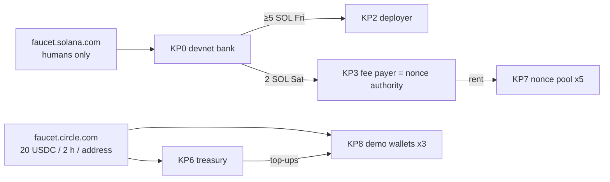
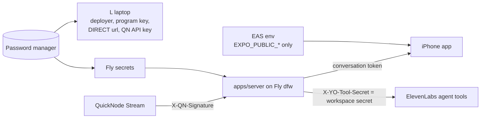

# SETUP-CHECKLIST: accounts, API keys, devices and keypairs

This is the checklist of accounts, keys, devices and keypairs. Every price and limit keeps its label (M = measured, C = claimed, E = estimated). Anything unknown is marked **PENDING**. **[PAID: approve]** marks an item that needs the lead engineer's OK before anyone spends money.

Owners follow TASKS §1.1: **L** = lead engineer (paid accounts, infra, chain); **E2** = iOS app, Expo/EAS and device registration; **E3** = judge, voice and AI keys, markets, stage, filming the clips, video and Devpost; **ALL** = everyone. A **phone owner** is whoever carries that iPhone.

---

## Summary (one screen)

**Critical path:**
1. **Apple Developer (Individual).** Then register all 4 iPhones (A, B, judge cam, spare). Apple can take **24–72 h** to process a newly registered device (C). Register them as early as possible. Enrollment approval time is PENDING. If a teammate already has an active membership, use theirs.
2. **Devnet SOL is human-only.** faucet.solana.com allows 2 requests per 8 h, and agents are not allowed to use it. Start filling a human-held "devnet bank" wallet early, aiming for about **10 SOL** (C1; TASKS P-09).
3. **Expo account** (free). It's needed for `eas device:create`.

**Paid items: need your approval**

| Item | Cost | Needed |
|---|---|---|
| Apple Developer Program (Individual) | $99/yr | First. There is no iPhone build without it. |
| EAS Starter | $19, including a $45 build credit | By Fri. The Free queue can take 90+ min at peak. |
| ElevenLabs Creator | $11 for the first month, then $22. Or sponsor credits. | Window |
| QuickNode Build | $49/mo | Decide by Fri. The trial lasts about 22 Stream-hours. |
| Fly.io | about $2–3 for 2 weeks (card required) | Window |
| Anthropic / OpenAI / Google AI Studio | Pay as you go. The Anthropic eval is about $1.7 (E); OpenAI and Google per-appeal costs are PENDING. | Window |
| Tigris (or R2) object storage | PENDING | Window |
| Custom domain | PENDING | Optional. Recommendation: skip. |

The fixed items add up to about **$181 plus usage** if all are approved (E: 99 + 19 + 11 + 49 + 3). Cancel EAS Starter, ElevenLabs Creator and QuickNode Build after the finals (Nov 21), before they renew.

**Window only:** Fly, Neon, Tigris, moving devnet USDC into product wallets (C2), the GitHub repo (created at 18:00 UTC Fri), the TestFlight upload, the APNs key, the server keypairs, Devpost.

**Rules:**
- Secrets are never committed.
- Phones hold no secrets: EAS env vars are `EXPO_PUBLIC_*` only.
- Every key here is devnet-only.

---

## 1. Master checklist

| ID | Item | For (beat / bounty) | Pick and cost | Lead time | Owner | Env vars | When |
|---|---|---|---|---|---|---|---|
| A1 | Apple Developer Program | Every iPhone build (all beats; Consumer "working frontend") | **Individual, $99/yr** [PAID: approve] | Approval PENDING; device processing 24–72 h (C) | L | none (EAS stores the credentials) | **First** |
| A2 | App Store Connect record + TestFlight internal | Final demo build; backup for a late or replacement phone | $0 (inside A1) | Minutes; build processing PENDING | L | none | Record: any time after A1. Upload: window. |
| A3 | `eas device:create` for 4 iPhones + phone prep | All beats; judge cam = Beat 4; spare = Face ID reset test | $0 | 24–72 h after Apple registration (C) | E2 + phone owners (TASKS P-04) | none | **Right after A1** |
| A4 | Expo account + EAS plan | Dev, preview and TestFlight builds | Free, or **Starter $19** for the window [PAID: approve] | Minutes; Free queue 90+ min at peak (C) | L decides, E2 sets up (TASKS P-03) | EAS env: `EXPO_PUBLIC_API_URL`, `EXPO_PUBLIC_WS_URL` | Account first; Starter by Fri |
| A5 | APNs push key | Beat 1 buzz while B's app is suspended (P1) | $0 | Minutes | L | (`EXPO_ACCESS_TOKEN` only if Expo enhanced push security is on) | Window |
| K1 | Anthropic API | Beat 2 Terms JSON, Beat 4 ruling, Beat 5 hearing + panel seat 1 | Pay as you go (C prices) [PAID: approve credits] | Minutes | E3 | `ANTHROPIC_API_KEY` | Early |
| K2 | ElevenLabs | Beats 2–5 voice; **ElevenLabs bounty** | Free to start; **Creator** for the window [PAID: approve] | Minutes | E3 | `ELEVENLABS_API_KEY`, `ELEVENLABS_TOOL_SECRET`, `ELEVENLABS_WEBHOOK_SECRET`, `ELEVENLABS_AGENT_ID`, `ELEVENLABS_JUDGE_VOICE_ID` | Key early; agent in the window |
| K3 | QuickNode | **Streams bounty**; server devnet RPC (Beats 3–6) | Trial to start; **Build $49/mo** for the window [PAID: approve] | Minutes | L | `QUICKNODE_API_KEY`, `SOLANA_DEVNET_RPC`, `SOLANA_DEVNET_WS`, `QN_STREAM_SECURITY_TOKEN` | Trial early; Build by Fri |
| K4 | OpenAI API | Beat 5 appeals panel seat 2 (P1) | Pay as you go [PAID: approve credits] | Minutes | E3 | `OPENAI_API_KEY` | Early |
| K5 | Google AI Studio | Beat 5 appeals panel seat 3 (P1) | Billing on for the window; price PENDING [PAID: approve] | Minutes | E3 | `GOOGLE_GENERATIVE_AI_API_KEY` | Early |
| H1 | Fly.io | Public HTTPS for both webhooks, WS push, stage view | about $2–3 for 2 weeks (card) [PAID: approve] | Minutes | L | Fly secrets (§4) | Account any time; app in the window (Sat at the latest) |
| H2 | Neon Postgres | All state; head-to-head | Free | Minutes | L | `DATABASE_URL`, `DATABASE_URL_DIRECT` | Window |
| H3 | Tigris (or R2) | Beat 4 evidence; avatars | PENDING [PAID: approve] | Minutes | L | `S3_*` (6 vars) | Window |
| H4 | Domain | Nothing required | PENDING [PAID: approve] | DNS/cert risk | L | none | Optional: skip |
| C1 | Devnet SOL | Solana track; locks, payouts, deploys | $0, human faucet | **Days** (2 requests / 8 h) | ALL (TASKS P-09) | none | Early (product keys in the window) |
| C2 | Devnet USDC | Stakes (Beats 3–6) | $0, Circle faucet | Hours (20 USDC / 2 h / address) | E2, E3 (TASKS P-10) | none | Collect into human-held addresses early; move into product wallets in the window (TASKS D1-L6) |
| C3 | Gemini Prediction Markets | Beat 6 (**Gemini bounty**) | $0, no account (M) | none | n/a | none | Never |
| S1 | GitHub | Submission repo (public history) | Free | Minutes | L | none | Repo at **Fri 18:00 UTC** |
| S2 | Devpost + video host | Submission + 2–3 min video with audio | Free | Minutes | E3 | none | Window |
| S3 | Password manager | Backup of every secret and keypair | Whatever the team already uses | Minutes | L | n/a | First |

---

## 2. Item details

### A1. Apple Developer Program [PAID: approve, $99/yr]

| | Individual (pick this) | Organization |
|---|---|---|
| Cost | $99/yr (C) | $99/yr |
| Needs | Apple ID with 2FA, legal name, card | Legal entity, D-U-N-S number, website, signing authority |
| Lead time | Approval PENDING (not measured) | D-U-N-S adds lead time (PENDING). Too risky for the timeline. |
| Seller name shown | The holder's legal name | The organization's name |
| Who can do Apple-side steps | In practice only the holder (L) | Several admins |

- **Pick:** Individual (it avoids D-U-N-S). The cost is that L is the only person who can approve Apple 2FA prompts during EAS credential and device steps, so stay reachable during the first builds.
- **Steps:**
  1. developer.apple.com → Enroll, with L's Apple ID (2FA on).
  2. Pay.
  3. Wait for approval (PENDING). If it isn't approved within about 24 h, contact Apple Developer Support. There is no Linux fallback: free provisioning needs Xcode on a Mac.
  4. Do A3 immediately.
- **Env:** none. EAS keeps the distribution certificate and provisioning profiles on its servers (`eas credentials`).

### A2. App Store Connect app record + TestFlight internal vs ad hoc

| | Ad hoc (EAS internal distribution) | TestFlight internal |
|---|---|---|
| Installs on | Only UDIDs registered **before** the build (C) | Any internal tester (an ASC user), up to 100 (C) |
| Apple wait | 24–72 h per new device, at registration (C) | Each upload is processed by Apple (time PENDING) |
| Lifetime | Tied to the provisioning profile | 90 days (C) |
| Needs | `eas device:create`, Developer Mode on each phone | ASC app record, `eas submit`, each tester's Apple ID |
| Use it for | `development` builds (Fri–Wed) and a `preview` release build for the 4 phones | The final build (Thu), and the **escape hatch for a replacement phone** (no UDID, no 24–72 h wait, no rebuild) |

- **Plan:** ad hoc development builds, then TestFlight internal for the final build.
- **Steps:**
  1. After A1: ASC → Apps → New App.
     - Platform iOS.
     - Name: ASC rejects names already in use. Have a fallback such as "You're On: AI Judge". The home-screen name comes from `app.json`, not from this record.
     - Bundle ID: proposed **`dev.youreon.app`**.
     - SKU.
  2. ASC → Users and Access: invite E2, E3 and whoever signs in on the judge-cam phone. Add them to an internal testing group.
  3. **Window only** (it ships product code): `eas build -p ios --profile production`, then `eas submit -p ios`. EAS can create and store an ASC API key, so no env var is needed.
  4. If the app's only encryption is HTTPS and signatures (confirm this), set `ITSAppUsesNonExemptEncryption: false` in `ios.infoPlist`, so each upload skips the export-compliance question.
  5. Upload by Wed to leave room for processing (PENDING).
- **Gotcha:** a dev build and a TestFlight build share one Keychain wallet only if they have the same bundle ID and team. The custodial demo accounts get re-provisioned by QR code anyway.

### A3. iPhones: registration and prep (A, B, judge cam, spare)

- **Why 4:** A and B are the parties. The judge cam is the Beat 4 tripod phone and must be registered too. The spare runs the Face ID reset test (that phone's owner must agree to "Reset Face ID"), and it doubles as the replacement phone.
- **Steps:**
  1. **Each phone owner:**
     - iOS ≥ 16.4 (the deployment target);
     - a passcode set and known to the presenter (never remove it);
     - Face ID enrolled;
     - Low Power Mode off;
     - a cellular data plan (everything runs over cellular; the fallback is a hotspot on another carrier).
  2. **E2 (TASKS P-04):** `npx eas-cli@latest login && npx eas-cli@latest init && npx eas-cli@latest device:create`, once per phone.
     - Send the link or QR code to the phone owner, who opens it in Safari and installs the profile.
     - Run `eas init` under the **Expo organization** (A4), so the device list belongs to the organization. Otherwise, re-import the devices later with `eas device:create` → Developer Portal.
  3. Check Apple Developer → Certificates, IDs & Profiles → Devices: all 4 must be listed. EAS registers UDIDs with Apple when it signs with L's Apple login (E; verify it here). The 24–72 h clock starts at that registration.
  4. After the first install, turn on Developer Mode on each phone (Settings → Privacy & Security).
  5. After every install, pre-accept the Face ID permission alert.
- **Rule:** adding a phone later means a rebuild. TestFlight (A2) is the way around that.

### A4. Expo account + EAS plan

| | Free | Starter [PAID: approve] |
|---|---|---|
| Cost | $0 | $19, including a $45 credit; an iOS medium build costs $2 (C), so the credit covers about 22 builds (E) |
| Quota | 15 iOS builds/month, low priority (90+ min at peak), 1 macOS concurrency, 45 min per build (C) | Priority queue |
| Fits | A handful of builds | The window: a dev build for every native-dependency change, plus preview and production builds |

- **Recommendation:** move to **Starter by Fri Nov 13**, or earlier if a build waits more than 90 min. Cancel after Nov 21.
- **Steps:**
  1. L signs up at expo.dev.
  2. Create an organization (for example `youreon`; believed free, not re-checked) and invite E2 and E3. If you upgrade, subscribe **the organization**, because it owns the project.
  3. Run `npx eas-cli@27.5.0 login`.
- **Env:** EAS environment variables (`eas env:create` in eas-cli 27.5.0; the old `eas secret:*` flow is deprecated, so check `--help`) hold **only** `EXPO_PUBLIC_API_URL` and `EXPO_PUBLIC_WS_URL`, as plain text. Anything `EXPO_PUBLIC_*` is bundled into the app and is therefore public.
- **Why the phones need no secrets:** they never call RPC, never hold an LLM or ElevenLabs key (they get server-minted conversation tokens), and never talk to the database.
- **Committed constants:** the program ID, the USDC mint and the fee-payer pubkey (for the device policy, ESCROW §5.0) go in `packages/shared` constants, not in env vars.

### A5. APNs key (P1)

- **Why it's only P1:** the primary path for Beat 1 is WS + haptics + a local notification, with B's app in the foreground. APNs only matters if B's app is suspended.
- **Steps (window):**
  1. `eas credentials -p ios` → Push Notifications → set up a push key. EAS creates it using L's Apple login.
  2. Register the "challenge" category with an `opensAppToForeground` action (in code).
- **Env:** none for the default Expo push service. Only if Expo's enhanced push security is turned on: the server needs `EXPO_ACCESS_TOKEN` (a Fly secret).

### K1. Anthropic API [PAID: approve credits]

- **For:** server-side Terms JSON (Beat 2), the first ruling and the re-check (Beat 4), the hearing (Beat 5) and panel seat 1. The voice LLM inside the ElevenLabs agent is billed by **ElevenLabs**, not by this key.
- **Cost:**
  - Haiku / Sonnet / Opus 5.5: $0.10/$0.50, $2/$10, $4/$20 per MTok (C).
  - Per ruling: Haiku about $0.0004, Opus about $0.015–0.02 (E).
  - The full eval on the 20 clips: about $1.7 (E).
  - Minimum credit purchase: PENDING.
- **Steps:**
  1. console.anthropic.com → organization → Billing → buy a small credit.
  2. Create a workspace "youre-on" with a spend limit (a Console feature; not re-checked).
  3. Create a `yo-server` key.
- **Env:** `ANTHROPIC_API_KEY`: `apps/server/.env` (local) and a Fly secret, using the `yo-server` key.

### K2. ElevenLabs [PAID: approve Creator]

- **For:** Beats 2–5. **ElevenLabs bounty** evidence: the Agent, TTS, STT for the hearing, a Sound Effects gavel, a Voice Design judge voice, and post-call webhooks.
- **Plan (C):**
  - Free: 15 min/mo, 4 concurrent.
  - **Creator: $22 ($11 the first month), 275 min, 10 concurrent, overage $0.08/min.** Or sponsor credits, so check the hackathon's perks before paying.
  - Starter ($1 first month, then $6; 75 min) is probably too small for build week (E).
  - Set `bursting_enabled:false` on the agent, because bursting bills at 2x.
  - The LLM is billed on top: `claude-haiku-5-5` about $0.0013/min (C).
- **Timing:** one month of Creator covers the window and the finals. Cancel before it renews.
- **Steps:**
  1. E3 signs up.
  2. Create an API key **`yo-server`** restricted to ElevenAgents write + TTS + voices read, plus Speech-to-Text, Sound Effects and Voice Design, using the labels the dashboard shows.
  3. **After Fly HTTPS is live** (before Sat), a repo setup script creates:
     - the **workspace secret** (`POST /v1/convai/secrets`; value = `ELEVENLABS_TOOL_SECRET`);
     - the webhook tools, pointing at `https://<app>.fly.dev/el/tools/:name`, with header `X-YO-Tool-Secret` referencing that `secret_id` (API-CONTRACT §4.2) and dynamic variables for `conversation_id` and `bet_id`;
     - the **private** agent (auth on), with backup LLM disabled and temperature omitted;
     - the Voice Design judge voice;
     - the **post-call webhook**, HMAC-signed with an `ElevenLabs-Signature` header, whose signing secret goes into `ELEVENLABS_WEBHOOK_SECRET`.
  4. **Conversation tokens:** the server's `POST /v1/voice/tokens` (API-CONTRACT §2.6) calls ElevenLabs `GET /v1/convai/conversation/token` once per conversation. Treat each token as single-use and pre-mint it on the challenge screen. There is no env var for this, and the API key never leaves the server.
- **Env:**
  - Window, as Fly secrets: `ELEVENLABS_API_KEY`, `ELEVENLABS_TOOL_SECRET`, `ELEVENLABS_WEBHOOK_SECRET`.
  - Window, as config (not secret): `ELEVENLABS_AGENT_ID`, `ELEVENLABS_JUDGE_VOICE_ID`.
- **PENDING-KEY:**
  - whether `claude-haiku-5-5` is actually served;
  - the data-retention setting (DATA-MODEL §13);
  - the conversation-token lifetime.

### K3. QuickNode [PAID: approve Build]

- **For:** the **Streams bounty** (the Stream is the source of truth for "money moved"), and the server's devnet RPC for Beats 3–6. Never use the public RPC.
- **Plan (C/E):**
  - Free trial: 10 M credits, no overage, **shared with the RPC**, 1 active Solana Stream, tip only.
  - Cost of a Stream: 30 credits/block (V6; V4 = 50), so about 11.0 M credits/day at 24/7. **The trial lasts about 22 Stream-hours.**
  - **Build plan: $49/mo, 80 M credits**, about 7.3 days at 24/7.
- **Rationale:**
  - The window needs the Stream from Sat Nov 14, when the hosted server exists, through the finals on Sat Nov 21: about 7.5 days. That is beyond the trial, and at 24/7 slightly beyond Build too (E).
  - **Recommendation:** Build plan, **and** pause the Stream when nobody is testing.
  - Before the demo, reset `start_range` (or recreate the Stream), because `activate` resumes from where it paused and replays the backlog.
  - Rationing the trial (about 22 h in total, minus RPC usage) is not recommended. Decide by Fri.
- **Steps:**
  1. L signs up.
  2. Create a **Solana Devnet endpoint**. Its HTTPS and WSS URLs embed an auth token, so treat them as secrets: never log them, never commit them, and never put them in `Anchor.toml`.
  3. dashboard.quicknode.com/api-keys → a console API key with the **Streams** application enabled.
  4. While signed in, open quicknode.com/docs/streams/billing → Solana Devnet, Block, and note the account's credits per block (30 or 50).
  5. Window: create the real Stream after Fly is live:
     - network `solana-devnet`, dataset `block`;
     - a filter generated from the escrow IDL;
     - batch 5, region `usa_east`;
     - webhook `https://<app>.fly.dev/webhooks/quicknode`.
  6. Copy the Stream's **security token**.
  7. Set usage alerts if the dashboard offers them (PENDING).
- **Env:**
  - `QUICKNODE_API_KEY`, for managing Streams: L's laptop only, unless the server re-points the Stream itself.
  - `SOLANA_DEVNET_RPC` and `SOLANA_DEVNET_WS`: Fly secrets.
  - `QN_STREAM_SECURITY_TOKEN`: a Fly secret; the server verifies `X-QN-Signature` with it.
- **PENDING:** the credit cost per RPC call, and whether Stream credits can be capped separately from the RPC.

### K4. OpenAI API [PAID: approve credits]

- **For:** appeals panel seat 2 (Beat 5, P1): `gpt-6.1-terra` through `openai@7.53.0`, Responses API. Pricing is $1/$5 per MTok (C). The per-appeal cost is PENDING.
- **Steps:**
  1. platform.openai.com → organization → Billing → a small prepaid credit (minimum PENDING).
  2. Create a project "youre-on" with a budget limit (not re-checked).
  3. Create a `yo-server` key.
  4. Confirm that `gpt-6.1-terra` with image input is enabled for a new organization. This is PENDING; organization-verification gating was not checked.
- **Env:** `OPENAI_API_KEY`: a Fly secret.

### K5. Google AI Studio [PAID: approve billing]

- **For:** appeals panel seat 3 (Beat 5, P1): `gemini-3.8-flash` through `@google/genai@2.32.0`. Stay off 3.0.0. The price is PENDING.
- **Steps:**
  1. aistudio.google.com → Get API key. This creates or picks a Google Cloud project.
  2. Turn on billing for the window. Two reasons:
     - On the unpaid tier, Google may use prompts to improve its products (C, Gemini API terms; not re-checked), and the panel sends frames of real people.
     - Free-tier rate limits are a live-demo risk (PENDING).
- **Env:** `GOOGLE_GENERATIVE_AI_API_KEY`: a Fly secret.
- **Never use `GEMINI_API_KEY`:**
  - That name is reserved for Gemini-exchange trading keys, which we don't create.
  - The Google SDK also reads `GEMINI_API_KEY` / `GOOGLE_API_KEY` automatically when no key is passed (C).
  - So always pass the panel key explicitly.

### H1. Fly.io [PAID: approve card]

- **For:**
  - public HTTPS for the ElevenLabs tool webhooks and the QuickNode webhook;
  - the WS push channel (Beat 1 buzz, payouts);
  - serving the stage view.
- **Plan:** no free tier ($1 / 7-day trial). `shared-cpu-1x` with 512 MB costs $3.69/mo at the iad/ewr rate, and `dfw` may cost more: about **$2–3 for 2 weeks** (C/E). Don't use Fly Postgres (MPG starts at $38/mo).
- **Steps:**
  1. L signs up and adds a card.
  2. Install flyctl and run `fly auth login`.
  3. Optional: `fly apps create youre-on` reserves `youre-on.fly.dev`, with no machines and no code (name availability PENDING).
  4. **Window, Fri/Sat:** `fly launch --region dfw` with `auto_stop_machines="off"` and `min_machines_running=1`. The app must be live **before** the Stream and the ElevenLabs tools are created (Sat).
  5. Secrets: write them to a file **outside** the repo, run `fly secrets import < that-file`, then delete the file. Or use `fly secrets set NAME=… --stage` followed by `fly deploy`. Non-secret config goes in `fly.toml [env]`, which is committed.
- **Env:** see §4 and §7.

### H2. Neon Postgres (free)

- **Plan:** Free: 100 CU-h, scale-to-zero after 5 min, which cannot be disabled (C).
- **Keepalive budget:** the 60 s keepalive keeps the compute on. At the smallest size (0.25 CU, E) that is about 6 CU-h/day, so 100 CU-h lasts about 16 days (E, arithmetic). Run the keepalive only from window open to the finals, and pin compute to the minimum.
- **Steps (L):**
  1. Sign up at neon.com.
  2. Create a project in `aws-us-east-2`.
  3. Copy the **pooled** URL and the **direct** URL.
  4. `ALTER DATABASE … SET timezone TO 'UTC'` (DATA-MODEL §12).
- **Env:**
  - `DATABASE_URL` (pooled): the server; a Fly secret plus `apps/server/.env`.
  - `DATABASE_URL_DIRECT`: migrations. Only on L's laptop, or on Fly if migrations run as a release command.
- **Not Supabase:** the connected organization is full. Never touch NewExit.

### H3. Object storage: Tigris (default) or R2 [PAID: approve; price PENDING]

- **For:** Beat 4 evidence (frames and clip, via presigned PUT/GET) and the avatars on the stage view (DATA-MODEL §9).
- **Pick:** **Tigris on Fly**, billed through Fly. The price is PENDING; the volume is tens of MB (E). The alternative is R2 on a Cloudflare account; enabling R2 may require a card (PENDING).
- **Steps (window):**
  1. `fly storage create`. This reportedly creates a Tigris bucket and sets `AWS_*` / `BUCKET_NAME` secrets on the app (C, Fly docs; not verified).
  2. Create **two private buckets**:
     - `evidence`, with a 30-day lifecycle rule;
     - `avatars`.

     Block public access and allow no listing (DATA-MODEL §9).
- **Env:** `S3_ENDPOINT`, `S3_REGION`, `S3_ACCESS_KEY_ID`, `S3_SECRET_ACCESS_KEY`, `S3_BUCKET_EVIDENCE`, `S3_BUCKET_AVATARS` (Fly secrets). If Tigris sets the `AWS_*` names itself, either read those or copy the values into these names. Pick one approach in the server config.

### H4. Domain (optional): skip

`*.fly.dev` already provides HTTPS. A custom domain costs money ([PAID: approve], PENDING) and adds DNS and certificate risk in demo week. Buy one only if you want a nicer stage URL.

### C1. Devnet SOL ($0, human-only)

- **Facts:**
  - The RPC faucet is closed (HTTP 410).
  - faucet.solana.com allows 2 requests per 8 h; a GitHub login raises the limit. AI agents must not use it.
  - The PoW faucets are drained.
  - The amount per request is PENDING.
- **Plan:** one human-held **devnet bank** wallet (KP0, §3) collects faucet SOL and funds everything else. Each teammate requests with their own GitHub login, into the bank address.

| Recipient | Amount | When | Source |
|---|---|---|---|
| KP2 deployer / upgrade authority | **≥ 5 SOL** | Window, Fri (before Saturday's deploy) | ESCROW §10.2 (a 250–450 KB `.so` costs ≈2.5–4.6 SOL) |
| KP3 fee payer = nonce authority | **2 SOL**; alert below 1 SOL | Window, Sat | See the breakdown below |
| KP4/5/6 judge, appeal, treasury | 0 | n/a | ESCROW §10.2 |

- **What the fee payer's 2 SOL covers:**
  - Estimate: 0.5 SOL to start and about 1–2 SOL across 30 rehearsals; ESCROW §10.2 sets the alert below 1 SOL.
  - It pays the nonce pool (5 × 0.00106 SOL), per-bet rent (≈0.0058 SOL, returned on close), 15,000 lamports per atomic lock, and ATA creation.
- **Bank target: about 10 SOL** (ESCROW §10.2; TASKS P-09) = ≥5 for the deployer + 2 for the fee payer + margin.
- **Transfer command:** `solana transfer --keypair <bank.json> <pubkey> <amount> --url devnet --allow-unfunded-recipient`.

### C2. Devnet USDC ($0)

- **Facts:** faucet.circle.com → Solana Devnet. 20 USDC per 2 h, per address, per chain; reCAPTCHA; no account needed (C). The mint is `4zMMC9srt5Ri5X14GAgXhaHii3GnPAEERYPJgZJDncDU` (classic SPL, 6 decimals).
- **Start early (TASKS P-10):** the faucet is slow, so collect it into **human-held** addresses: the devnet bank (KP0) and one more teammate address. Aim for about **$400**.
- **Window:**
  - **Move the float** with `scripts/fund.ts` (TASKS D1-L6) on Saturday: bank → treasury (KP6) → A's and B's device wallets and the 3 custodial demo wallets (KP8, the seed users in DATA-MODEL §11), creating each USDC ATA with the fee payer as payer.
  - Keep clicking the faucet for the treasury and demo wallets from Fri evening, once every 2 h whenever someone is around, until about **$100–400 in total** recirculates.
  - Keep at least $40 in each party wallet (two max-stake bets, E). The rest stays in the treasury for top-ups.
  - Finish before `seed:chain` runs, the day before the demo (DATA-MODEL §11).
- **If the faucet rejects an address that has no USDC token account:** have the server create the ATA first, as fee payer (DATA-MODEL §3.1). This case is PENDING.

### C3. Gemini Prediction Markets: nothing to set up

- Market data is public (M), and the demo doesn't trade.
- Trading would need a KYC'd US account and an account-scoped key (`GEMINI_API_KEY` / `GEMINI_API_SECRET`). **Don't create one.**
- The to-do is a rehearsal, not an account: rehearse at the pitch hour (CST) on a Saturday.

### S1. GitHub

- **Repo:** create it at **window open (Fri 2026-11-13 18:00 UTC)**. Make it public from the first commit, because judges read the history.
- **Organization vs personal:**

  | Option | Pros | Cons |
  |---|---|---|
  | Organization (free) | Neutral name; all three can be owners | One extra step |
  | Personal | Fewest steps; E2/E3 added as collaborators | Repo sits under L's name |

  Either works.
- **First commit:**
  - Turn on secret scanning push protection (free for public repos; not re-checked).
  - Add a `.gitignore` covering `.env*` (except `.env.example`), `target/deploy/*-keypair.json`, `*-keypair.json`, `keys/` and `.keys/`.
  - `create-expo-app@5` runs git init and adds `.claude/settings.json` and `AGENTS.md`; check for them.
- **Personal GitHub logins** also raise the faucet.solana.com limit (C1).

### S2. Devpost + video host

- Every member needs a Devpost account. Join the hackathon and create one project. Submit before **Fri Nov 20, 18:00 UTC** (12:00 CST).
- The demo video is 2–3 min and must have audio, because the ElevenLabs bounty requires it. Host it where Devpost accepts it (YouTube or Vimeo; the unlisted-vs-public rule is PENDING).

### S3. Password manager

Use whatever the team already has; no new paid account. Create one shared vault, "You're On (devnet)", with one entry per secret in §7 and per keypair in §3, including each key's pubkey and where it is deployed.

---

## 3. Keypairs we generate ourselves

| # | Key | When | Who / how | Stored | SOL | Notes |
|---|---|---|---|---|---|---|
| KP0 | Devnet bank (human-held) | First | Any teammate: `solana-keygen new --no-bip39-passphrase -o ~/.config/solana/youre-on-devnet-bank.json` | That laptop + password manager | Collects faucet SOL | Not a product key. Never on the server. |
| KP1 | Program keypair `target/deploy/escrow-keypair.json` | Fri (window) | L: `anchor build`, then `anchor keys sync`. Optional vanity prefix with `solana-keygen grind`. | L's laptop + password manager; gitignored | 0 | Needed only for the first deploy (ESCROW §10.2) |
| KP2 | Deployer = upgrade authority = `Config.admin` | Fri | L: `solana-keygen new -o ~/.config/solana/youre-on-deployer.json` | L's laptop + password manager. **Never on Fly.** | ≥ 5 | Upgradeable through Nov 21. Pubkey disclosed in the README (ESCROW §10.4). |
| KP3 | Server fee payer = durable-nonce authority (D3) | Fri/Sat | L | Fly secret `FEE_PAYER_SECRET_KEY` + password manager | 2 | Hot key. Pubkey pinned in `packages/shared` (device policy). Co-signs only transactions the server built. |
| KP4 | `judge_authority` | Fri/Sat | L | Fly secret `JUDGE_AUTHORITY_SECRET_KEY` | 0 | Distinct key |
| KP5 | `appeal_authority` | Fri/Sat | L | Fly secret `APPEAL_AUTHORITY_SECRET_KEY` | 0 | Distinct key (enforced onchain) |
| KP6 | Treasury (USDC float) | Sat | L | Fly secret `TREASURY_SECRET_KEY` | 0 | Never an SPL delegate. |
| KP7 | Nonce pool (×5, `NONCE_POOL_SIZE`) | Sat, at deploy | L runs `scripts/nonce-pool.ts` (ESCROW §10.3 step 9), paid by KP3; the server re-reads the pool at boot and adds a seed index only if it runs dry | DATA-MODEL `nonce_pool` (§5.20) | 0.00106 each | `createAccountWithSeed` with base = fee payer and seed `yo-nonce-<k>` (ESCROW §5.0.1, E), so there is no per-nonce keypair to store and phones derive the addresses. |
| KP8 | Custodial demo wallets (3, plus an optional spare) | Sat | The server generates the seeds | AES-GCM under `DEMO_SEED_KEK` (devnet only); provisioned by one-time QR | 0 | Say so in the README. |
| KP9 | Real user keys | At signup | Each iPhone | SecureStore seed, without `requireAuthentication` (D2) | 0 | Never leaves the phone |
| n/a | Symmetric secrets | Fri/Sat | `openssl rand -base64 32` | Fly secrets + password manager | n/a | `FACE_KEK_*`, `DEMO_SEED_KEK`, `ELEVENLABS_TOOL_SECRET`, `SESSION_SECRET`, `STAGE_KEY`, `DEMO_ADMIN_TOKEN` |

**Rules:**
- **Product keys are generated in the window only.**
- **Format:** generate with `solana-keygen new --no-bip39-passphrase -o <path>`, then `chmod 600`. Record `solana-keygen pubkey <path>` in the password-manager entry. ESCROW §10.2 says hosting secrets are base58. Have the server's key loader accept either base58 or the solana-keygen JSON array (E), which avoids a conversion step.
- **Pubkeys are config and get committed:** program ID, Config PDA, fee payer, judge and appeal authorities, USDC mint. The README lists the program ID and the upgrade authority.
- **After the hackathon:** unset the Fly secrets and destroy the app. Every key is devnet-only.



---

## 4. Where each secret lives

| Destination | Holds | Must never hold |
|---|---|---|
| `apps/server/.env` (window; local development; gitignored) | The same names as Fly | n/a |
| **Fly secrets** | Every server secret (§7) | n/a |
| `fly.toml [env]` (committed) | Non-secret config: `PROGRAM_ID`, `USDC_MINT`, `LOCK_MODE`, … | Secrets and QuickNode URLs |
| **EAS env vars** | `EXPO_PUBLIC_*` only | Any secret (it all ends up in the app bundle) |
| `packages/shared` constants (committed) | Program ID, mint, pinned pubkeys | Secret keys |
| L's laptop | KP1, KP2, `DATABASE_URL_DIRECT`, `QUICKNODE_API_KEY`, `ANCHOR_*` | n/a |
| Password manager | A backup of everything above | n/a |



---

## 5. Conflicts and gaps found in other docs

| # | Where | Issue | Resolution used here |
|---|---|---|---|
| 1 | ESCROW §10.2 vs the estimate | ESCROW funds the fee payer with ≈5 SOL; the estimate is 0.5 to start and about 1–2 across rehearsals. | Fund 2 SOL, alert below 1 SOL, top up from the bank. **Done:** ESCROW §10.1–§10.2 updated. |
| 2 | ESCROW §10.2 | The deployer and fee-payer keys are generated in the window. | A human-held bank wallet (KP0) collects the SOL and funds the product keys in the window. |
| 3 | ESCROW §10.2 | ESCROW's key table had no separate `TREASURY` key. | KP6 added. **Done:** ESCROW §10.2 has a treasury row. |
| 4 | DATA-MODEL §11 | The demo accounts are custodial, with server-generated seeds under AES-GCM and QR provisioning, but DATA-MODEL took `wallet_pubkey` from `DEMO_WALLET_*` env "exported from each phone". No doc named the AES-GCM key. | Custodial seeds. `DEMO_WALLET_*` is not needed; `DEMO_SEED_KEK` is the AES-GCM key. **Done:** DATA-MODEL §5.1 and §11 updated. |
| 5 | ESCROW §5.0 / §10.2 vs D3 | They described the sequential lock, with no nonce authority. | Per D3 the nonce authority = the fee payer (KP3), so no extra key is needed. **Done:** ESCROW, SCHEMAS and DATA-MODEL now describe the atomic lock. |
| 6 | DATA-MODEL §10 | The env name `FACE_KEK_<KEY_ID>` with `key_id = face-kek-2026-11-a` is not a valid env var name. | `FACE_KEK_2026_11_A` plus `FACE_KEK_ACTIVE=face-kek-2026-11-a`. **Done:** DATA-MODEL §10 and ARCHITECTURE §2.3 use these names. |
| 7 | The Google SDK | `GEMINI_API_KEY` is reserved for Gemini-exchange trading, and the Google SDK also reads that name automatically. | The panel key stays `GOOGLE_GENERATIVE_AI_API_KEY` and is passed explicitly. Never set `GEMINI_API_KEY`. |
| 8 | Device count | `eas device:create` for 3 iPhones vs 4. | 4: A, B, judge cam, spare. |
| 9 | ESCROW §10.2 | Server key env names were not defined anywhere. | `*_SECRET_KEY` names (§7). **Done:** ARCHITECTURE §2.3, ESCROW §10.2 and TASKS §3.1 use them. |
| 10 | QuickNode plan | The choice looked like "Build plan or ration", but a 24/7 Stream across the window (≈7.5 days) also exceeds Build's ≈7.3 days (E). | Build plan **and** pause the Stream when idle. |
| 11 | Neon keepalive | A 24/7 keepalive uses the Free 100 CU-h in about 16 days (E). | Run it only during the window, at minimum compute. |
| 12 | ESCROW §10.3 step 1 | Uses the QuickNode devnet URL as the deploy cluster. That's fine through `solana config` / `ANCHOR_PROVIDER_URL`, but the URL embeds a token. | Never write it into `Anchor.toml` (committed). **Done:** ESCROW §10.3 step 1 says so. |
| 13 | This doc vs API-CONTRACT | Tool-secret header `x-youreon-tool-secret` and route `GET /el/token`. | API-CONTRACT owns endpoints: `X-YO-Tool-Secret` (§4.2) and `POST /v1/voice/tokens` (§2.6). **Done** here and in ARCHITECTURE §2.2. |
| 14 | KP7 vs ESCROW §10.3 | Nonce pool created at server boot vs once by a script. | `scripts/nonce-pool.ts` at deploy; the server re-reads it at boot. **Done** (KP7, API-CONTRACT §6.1). |
| 15 | Owners | This doc used T2/T3 with a different split from TASKS (E2/E3). | TASKS §1.1 adopted. **Done.** |
| 16 | Env names missing from §7 | API-CONTRACT needs a stage key, the demo header value, `DEMO_MODE` and (if O8 ships) a face-seal key. | Added `STAGE_KEY`, `DEMO_MODE`, `FACE_SEAL_SECRET_KEY`; `DEMO_ADMIN_TOKEN` = `X-YO-Demo-Key`. **Done.** |

---

## 7. `.env.example` template (names only)

```bash
# ======================================================================
# BUILD (window): apps/server/.env locally (gitignored); Fly secrets in prod
# ======================================================================
# --- non-secret config (may live in fly.toml [env], committed)
NODE_ENV=
PORT=
PUBLIC_BASE_URL=                # https://<app>.fly.dev (webhook targets)
PROGRAM_ID=                     # escrow program id (also in packages/shared)
USDC_MINT=                      # Circle devnet USDC (DATA-MODEL §3.1)
MAX_STAKE_MICRO=                # mirrors Config.max_stake (DATA-MODEL §3.1)
APPEAL_WINDOW_S=                # mirrors Config (SCHEMAS O6: 10)
LOCK_MODE=                      # atomic (D3) | sequential (fallback)
DEMO_MODE=                      # true only on the demo deployment; /v1/demo/* return 404 otherwise (API-CONTRACT §2.17)
# NONCE_POOL_SIZE (5) is a packages/shared constant (SCHEMAS §0.1), not an env var
ELEVENLABS_AGENT_ID=            # K2
ELEVENLABS_JUDGE_VOICE_ID=      # K2 Voice Design voice (also the stage TTS judge voice)
ELEVENLABS_PANEL_VOICE_IDS=     # optional: 3 comma-separated voice ids, appeal seats 1-3 on the stage (default: premade voices)
STAGE_TTS=                      # on (default) | off: kill switch for the stage's ElevenLabs voice (API-CONTRACT §4.5)
STAGE_TTS_MODEL=                # optional: stage TTS model (default eleven_v4_turbo, A/B eleven_flash_v2)
# Paid-provider switches (apps/server/src/providers; planning D14). Default mock = offline and free.
ALLOW_SPEND=                    # true allows any *_PROVIDER=live; never set in tests or CI
LLM_PROVIDER=                   # mock (default) | live: Anthropic + OpenAI + Google judge/panel calls
STT_PROVIDER=                   # mock (default) | live: ElevenLabs Scribe (hearing turn B)
SFX_PROVIDER=                   # auto (default: live with ELEVENLABS_API_KEY + ALLOW_SPEND, else mock) | mock | live: ElevenLabs Sound Effects (stage cues)
STAGE_SFX_PREWARM=              # true = generate the four cue clips at every boot (costs credits per deploy). Default false: on first use
TERMS_MODEL=                    # Anthropic model that structures a typed or spoken sentence into terms (default claude-haiku-5-5)
# --- Solana / QuickNode (secret)
SOLANA_DEVNET_RPC=
SOLANA_DEVNET_WS=
QN_STREAM_SECURITY_TOKEN=       # verifies X-QN-Signature
# --- server keypairs (secret; base58 or solana-keygen JSON; §3)
FEE_PAYER_SECRET_KEY=           # KP3, also the durable-nonce authority
JUDGE_AUTHORITY_SECRET_KEY=     # KP4
APPEAL_AUTHORITY_SECRET_KEY=    # KP5
TREASURY_SECRET_KEY=            # KP6
# --- AI providers (secret; "yo-server" keys)
ANTHROPIC_API_KEY=
OPENAI_API_KEY=
GOOGLE_GENERATIVE_AI_API_KEY=
# --- ElevenLabs (secret)
ELEVENLABS_API_KEY=
ELEVENLABS_TOOL_SECRET=         # = value of the ElevenLabs workspace secret
ELEVENLABS_WEBHOOK_SECRET=      # post-call webhook HMAC secret
# --- data (secret)
DATABASE_URL=                   # Neon pooled
S3_ENDPOINT=
S3_REGION=
S3_ACCESS_KEY_ID=
S3_SECRET_ACCESS_KEY=
S3_BUCKET_EVIDENCE=
S3_BUCKET_AVATARS=
# --- app secrets (secret; openssl rand -base64 32)
FACE_KEK_ACTIVE=                # key_id, e.g. face-kek-2026-11-a (DATA-MODEL §10)
FACE_KEK_2026_11_A=             # 32-byte KEK for that key_id
DEMO_SEED_KEK=                  # proposed; AES-GCM key for custodial demo seeds
SESSION_SECRET=                 # proposed: HMAC key for opaque tokens (match_ticket, claim_token; API-CONTRACT §1.3, §2.4); sessions are stored as sha256
STAGE_KEY=                      # posted to POST /v1/stage/session for a stage token (API-CONTRACT §1.3)
DEMO_ADMIN_TOKEN=               # value of the X-YO-Demo-Key header on /v1/demo/* (API-CONTRACT §2.17)
FACE_SEAL_SECRET_KEY=           # proposed (API-CONTRACT O8): x25519 key that opens SealedEmbedding; its pubkey is a packages/shared constant
# --- optional
EXPO_ACCESS_TOKEN=              # only if Expo enhanced push security is on (A5, P1)

# ======================================================================
# L's LAPTOP ONLY (never on Fly)
# ======================================================================
DATABASE_URL_DIRECT=            # Neon direct URL, for migrations
QUICKNODE_API_KEY=              # Stream create/patch/pause scripts
ANCHOR_PROVIDER_URL=            # QuickNode devnet HTTPS (never in Anchor.toml)
ANCHOR_WALLET=                  # path to ~/.config/solana/youre-on-deployer.json (KP2)

# ======================================================================
# apps/mobile: EAS environment variables (plain text; bundled = PUBLIC)
# ======================================================================
EXPO_PUBLIC_API_URL=            # https://<app>.fly.dev
EXPO_PUBLIC_WS_URL=             # wss://<app>.fly.dev/v1/ws
# Signing-policy pins (program ID, USDC mint, fee-payer pubkey, the "yo-nonce-" prefix) are committed
# packages/shared constants, not env vars (API-CONTRACT §1.2). No nonce-pool list (ESCROW §5.0.1).
```

## Changelog

- **2026-11-14 (planning D14):** §7 gains `ALLOW_SPEND`, `LLM_PROVIDER`, `STT_PROVIDER` and `SFX_PROVIDER`, matching `apps/server/src/env.ts` and `.env.example`. Any `*_PROVIDER=live` refuses to start unless `ALLOW_SPEND=true`.
- **2026-11-18, the stage voice:** §7 gains `STAGE_TTS`, `STAGE_TTS_MODEL` and `ELEVENLABS_PANEL_VOICE_IDS`; `SFX_PROVIDER` defaults to `auto` (live exactly when `ELEVENLABS_API_KEY` and `ALLOW_SPEND=true` are set). The stage TTS needs the server key's Text to Speech and Sound Effects permissions (K2 `yo-server`).
