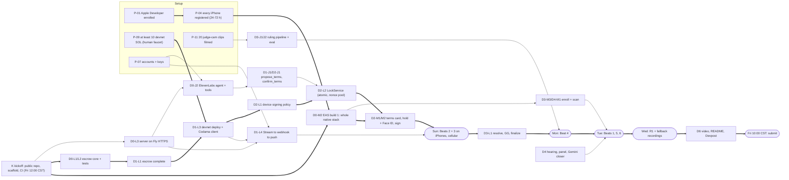

# TASKS — 7-day build breakdown (`youre-on`)

This doc covers who builds what, when, in what order, and how we know each piece works. It runs to submission (Fri Nov 20, 12:00 CST) and finals (Sat Nov 21). It follows BRIEF §8 (amended), re-planned for the atomic lock (D3). The specs it schedules are ESCROW-PROGRAM ("ESCROW"), SCHEMAS and DATA-MODEL.

## Summary (one screen)

**Rules.** Times are CST (UTC−6), with UTC in brackets.

**Workstreams (§1)**
- **L, Lead:** the escrow program, devnet operations, the chain side of the server (device signing policy, LockService and nonce pool, Streams, payouts), the server skeleton and infra, and CI.
- **E2, iOS app:** the EAS/native build path, the wallet and Face ID authorization, the terms card, face enrollment and scan, the judge cam, and the payout UX.
- **E3, judge, voice, markets, stage and demo:** the shared schemas, the ElevenLabs agent and its tools, the vision ruling, hearing and appeals panel, Gemini, the stage view, demo mode, the video and Devpost.

**The week at a glance.** Each evening checkpoint is at 21:00 CST [03:00 UTC the next day]. "Works" means on real iPhones with Wi-Fi off.

| Day | Build goal | Checkpoint must pass |
|---|---|---|
| Fri 13 (from 12:00) | Repo, scaffold and CI; escrow core; server on Fly; **EAS build #1 with the whole native stack** | Build #1 installed; `/health` reachable over cellular; first escrow rows green |
| Sat 14 | Escrow complete and on **devnet**; Stream → webhook → push; Face ID and face-embed smoke tests on a device | The devnet smoke run (create → accept → resolve → finalize) shows up on both phones and on the stage ticker, through Streams |
| Sun 15 | **Judge and terms flow on A's phone; on-phone authorization; atomic lock** | **Beats 2 + 3** pass 3 times in a row, in both signing orders |
| Mon 16 | Vision ruling and REDO; payout via resolve, GG or finalize; face enrollment; **sponsor office hours** | **Beat 4** passes; Beats 2 → 4 run chained |
| Tue 17 | Face scan; hearing and appeals; Gemini closer; head-to-head | **Beat 1** passes; Beats 5 and 6 pass once each; Beats 1 → 4 pass 3 times |
| Wed 18 | Demo mode, polish, real-user test, bug bash; **rehearsal R1 at 19:00** | The full pitch fits in 5:00; every beat has a recorded fallback |
| Thu 19 | README, video, Devpost; rehearsals R2 and R3; **code freeze 20:00** | The freeze build is on every phone; R3 runs clean |
| Fri 20 | Smoke test, P0 fixes only, **submit by 10:00 CST [16:00 UTC]** | Submission checklist (§8.4) complete |

**Critical path (§9).** Two chains have to meet on Sunday:
- Apple enrollment → device registration (24–72 h) → build #1 on Friday → Beat 3 on Sunday.
- Escrow → devnet deploy (needs ≥ 10 devnet SOL funded by a human) → device policy → LockService → Beat 3 on Sunday.

Every later beat depends on Sunday's checkpoint.

**Top schedule risks, and where each is handled**

| Risk | Handled in |
|---|---|
| iOS native build | P-04, D0-M2 |
| EAS build queue | §4.0 |
| Streams credits | P-13, D5-L2 |
| Devnet SOL | P-09 |
| Keys arriving late | §2.2 |
| Beat 6 lock window | §6.6 |

**Cut line (§5.2).** Drop in this order: P2 → APNs → hardening tests → sequential fallback → real seed history → head-to-head → stage polish → hearing push-to-talk → live panel → live closer. The live paths of Beats 1–4 are never cut.

**Spec status (§10).** The D3/D7 spec edits are applied: every planning doc now describes the atomic lock and rulings that commit to frame hashes. The planning README (`README.md`) lists the open questions for the lead.

---

## 0. Conventions

- **IDs:**
  - `P-nn`: human setup (§2).
  - `K-nn`: Friday kickoff.
  - `Dd-Xn`: window tasks, where d = day 0 (Fri 13) to 7 (Fri 20) and X = L (Lead), M (E2), J (E3) or X (whole team).
  - `T-*`: tests (§6).
- **Owners:** L, E2, E3, ALL.
- **Priority:** P0/P1/P2 per BRIEF §7 (amended), with one deviation. The bare stage **ticker** (escrow events + Explorer links) is P0. BRIEF §5h makes "push to phones *and the stage view*" part of the P0 Streams item, and Beat 3 shows the transaction on stage. The full stage view stays P1.
- **Beats:**

  | Code | Beat |
  |---|---|
  | B1 | Challenge by face |
  | B2 | Terms by voice |
  | B3 | Lock it in |
  | B4 | Attempt + payout |
  | B5 | Dispute + appeal |
  | B6 | BTC closer |
  | H2H | Head-to-head record |
  | ALL | Infra |
  | SUB | Submission |

- **Est h** = focused hours, not counting EAS queue time.
- **DoD** = a check that someone other than the author can run. Every number measured in the window goes into `docs/measurements.md` in the repo.
- **PENDING** = still needs a key, a phone, SOL or an external schedule.
- **Official docs first (BRIEF §10).** Before writing against an external API (ElevenLabs, QuickNode, Gemini via `developer.gemini.com/llms.txt`, Anthropic/OpenAI/Google, Anchor, Expo), read its official docs and cite the page in the PR description. Never guess an endpoint, field or flag.
- **Assumptions:**
  - about 11 focused hours per person per day, Sat–Thu;
  - 4 iPhones: A, B, the judge cam, and one non-demo phone for the Face ID reset test;
  - availability Mon–Thu (classes, jobs) is PENDING, collected in P-15.

---

## 1. Workstreams

### 1.1 Suggested split

| | L, Lead | E2, iOS app | E3, judge/voice/markets/stage/demo |
|---|---|---|---|
| Owns (paths) | `programs/escrow`; `packages/shared/src/chain/*` (Codama client, PDAs, signing policy); `apps/server/src/{lock,chain,streams,payout,sweeper}`; `packages/db`; `fly.toml`; CI | `apps/mobile/**`; `apps/server/src/{auth,face}`; `eas.json` | `packages/shared/src/{terms,negotiation,ruling,hearing,appeal,gemini,realtime}`; `apps/server/src/{voice,judge,hearing,appeals,gemini}`; `apps/stage/**`; `scripts/el-agent.ts`; video; Devpost |
| External dependencies | Devnet SOL, QuickNode, Fly, Neon | Apple, EAS | Anthropic, ElevenLabs, OpenAI, Google AI Studio, Gemini |
| Beats | B3; the money paths of B4, B5 and B6; Streams | B1; B3 UX; B4 capture and payout; H2H | B2; B4 ruling; B5; B6; stage |
| Planned hours (window) | ~81 | ~80 | ~80 |

### 1.2 Why this split

- **One toolchain per person.** The three streams map to Rust/Solana, React Native/iOS native, and LLM/voice/web. Each person reads one set of docs and holds one set of accounts. The only contract between streams is the set of Zod schemas in `packages/shared` (SCHEMAS), so all three can start on Friday in parallel.
- **One owner for the money path.** The program, the device signing policy, LockService and the payout builders must agree byte for byte (ESCROW §5.0, Threat model TM-S). Keeping them with one person keeps the security risk with the lead engineer.
- **One owner for the iOS build path.** It is the top risk: no Mac, EAS only, and the native stack has never been built together. One owner serializes native dependency changes and EAS builds (§4.0).
- **E3 produces the bounty evidence.** E3 owns the AI side of all three sponsor integrations plus the stage view and the video. The person who films the evidence (the ElevenLabs list, the Streams ticker, the Gemini chart) also builds it.
- **The server skeleton goes to L on Friday** (2.5 h), because LockService and Streams are the heaviest server parts. E2 and E3 add their own routes in their own folders.

### 1.3 How to rebalance

- **The skills survey (P-15) can change the split before Friday.**
  - If E3 is the stronger React Native/iOS developer, swap E2 and E3 wholesale. Keep a single native-build owner either way.
  - If E2 or E3 writes Rust, they take escrow matrix rows on Saturday (D1-L1 tests), and L starts LockService a day early.
- **What can move:**
  - Portable tasks, which any TypeScript developer can take, move first: stage view, Gemini service, demo mode, seed scripts, README sections, Devpost.
  - Never move these mid-flight: EAS/native config; escrow + signing policy + LockService; ElevenLabs agent config.
- **At each evening checkpoint:**
  - A stream more than 4 h behind on P0 hands its next portable task to the stream with slack.
  - More than 8 h behind, or a failed checkpoint, triggers the cut line (§5.2).
- **Pair on integration days:**
  - Sun: L + E2 (Beat 3);
  - Mon: E2 + E3 (Beat 4);
  - Tue: E2 + E3 (Beats 1 and 5).
- **Keep slack for the lead.** L holds about 2 h a day for review and integration; the tables list it as "integration".

---

## 2. Human setup

- Anything that costs money is the lead's call (BRIEF §10).

### 2.1 Human to-dos

| ID | To-do | Owner | Due CST [UTC] | Done when |
|---|---|---|---|---|
| P-01 | Enroll in the **Apple Developer Program as an Individual** ($99/yr; Individual avoids needing a D-U-N-S number). Everything iOS depends on this. | L | — | Apple confirms the membership (processing time PENDING) |
| P-02 | **Device inventory.** List the 4 iPhones: A, B, judge cam, non-demo test phone. Each needs iOS ≥ 16.4, Face ID, a passcode set (never remove it), Low Power Mode off, and cellular data on. Note each phone's carrier; two different carriers give a hotspot fallback. | ALL | — | Table posted in the team chat |
| P-03 | Create the Expo account and team org. Decide **EAS Starter** ($19, priority queue) vs Free (15 iOS builds, 90+ min queue at peak). | L decides, E2 sets up | — | `eas whoami` works for E2; plan recorded |
| P-04 | **As soon as P-01 clears**, run `eas device:create` for **every** iPhone (all 4), then turn on Developer Mode on each. Apple can take 24–72 h to process a new device, and ad hoc builds only install on devices registered before the build. | E2 + each phone owner | Within 2 h of P-01 | `eas device:list` shows 4 devices |
| P-07 | **Accounts and keys** (see the list below this table). | L (paid and infra), E3 (AI keys) | — | Each key is in the vault, never committed |
| P-09 | **Devnet SOL, funded by a human** (see the notes below this table). | ALL | — | `solana balance` checked on each address |
| P-10 | **Devnet USDC.** The Circle faucet gives 20 USDC per 2 h per address, behind a reCAPTCHA. Aim for about $400 (20 claims) across the funding wallet and one more team address. | E2, E3 | — | ≥ 400 USDC across team addresses |
| P-11 | **Film the 20 judge-cam clips** (see the notes below this table). | E3 + a helper | — | 20 files + manifest rows in place |
| P-13 | **Decisions to close** (see the list below this table). | L | — | Decisions written into the kickoff notes |
| P-14 | **Collect schedules:** sponsor office hours Nov 16–19 (times, format, which sponsors attend); finals logistics (pitch slot time, AV, venue connectivity); the Devpost form fields; the event's rule on commits after the deadline. | E3 | — | Dates in the team calendar; PENDING items in this doc updated |
| P-15 | **Skills and availability survey.** Each person rates themselves on RN/iOS, Rust/Anchor, TS server, LLM/prompting, React web and video editing, and gives their hours per day Mon–Thu. Confirm or swap the split (§1.3). | L | — | Split confirmed |
| P-16 | **Pre-reading** (see the list below this table). | ALL | — | — |
| P-17 | **Stage laptop:** check that it plays avc1 video; run the Gemini CORS snippet in its browser; install OBS; get an HDMI adapter; test it on the phone hotspot. | E3 | — | Checklist ticked |
| P-18 | **Gear:** a tripod or clamp for the judge cam, the demo bottle(s) with a coloured label and taped cap, chargers and battery packs, and a hotspot on a second carrier. | E2 | — | Packed |

**P-07 accounts and keys:**
- Anthropic.
- ElevenLabs: Creator ($11 the first month) or sponsor credits. The free tier is 15 min/month, not enough for build week.
- QuickNode: the Build plan ($49), or ration the free trial (see P-13).
- OpenAI.
- Google AI Studio.
- Fly.io (needs a card).
- Neon Free, in `aws-us-east-2`.
- Object storage: Tigris (via Fly) or Cloudflare R2 (DATA-MODEL §9).
- GitHub accounts for all three teammates.
- A shared password-manager vault.

**P-09 devnet SOL:**
- Use faucet.solana.com in a browser. It allows 2 requests per 8 h (more with a GitHub login), and its terms say AI agents must not use it. The RPC faucet is closed (HTTP 410).
- Spread the requests across all three people and across the days. Collect the SOL in a human-held **team funding wallet**, whose keypair lives outside any repo.
- **For the build:** at least **10 SOL** in the funding wallet. That covers:
  - deploys and upgrades, at least 5 SOL;
  - the fee payer, 0.5–2 SOL;
  - the nonce pool, about 0.0053 SOL.

  Source: ESCROW §10.2.

**P-11 judge-cam clips:**
- **Setup:** a tripod or clamp, landscape, 1–1.5 m from the landing spot. Use a bottle with a coloured label and taped cap, against a contrasting background.
- **Recording:** 720p H.264.
- **The set:**
  - 8 successes;
  - 8 failures: 4 cap landings, 2 side, 2 tip-over;
  - 4 ambiguous: blocked view, cut off early, base out of frame, dark.
- **Delivery:** AirDrop the files and add a row per clip to the clip manifest.

**P-13 decisions to close:**
- EAS plan.
- QuickNode: the Build plan, or ration the free trial. The trial covers about 22 Stream-hours, and its credits are shared with the RPC.
- ElevenLabs plan.
- Voice LLM.
- Judge model, Haiku 5.5 or Opus-low.
- Camera stack, provisionally.
- Repo name and licence.

**P-16 pre-reading:**
- L: all of ESCROW; DATA-MODEL §5.8–5.9 and §8.
- E3: SCHEMAS §2–8.

### 2.2 Key gates: the latest arrival before a window task slips

| Needed by | Key or resource | Latest arrival (CST) | If it's late |
|---|---|---|---|
| D0-L3 server | Fly + Neon accounts | Fri 12:00 | Run on a local Postgres with a quick tunnel (development only) |
| D0-J2 agent and tools | ElevenLabs key | Fri 18:00 | E3 builds the tool handlers and Zod checks against recorded fixtures first, and the agent on Sat morning |
| D1-L3 devnet deploy | ≥ 5 SOL for the deployer + 0.5 SOL for the fee payer | Sat 09:00 | Tests stay on LiteSVM, and Saturday's checkpoint fails. All three humans work the faucet (P-09). |
| D1-L4 Stream | QuickNode key | Sat 12:00 | The server's `signatureSubscribe` fast lane carries the UX; the Stream follows on Sun morning |
| D2-J4 / D3-J1 ruling | Anthropic key | Sun 09:00 | None. This blocks a P0 beat. |
| D4-J2 panel | OpenAI + Google keys | Tue 09:00 | Run the panel with the providers that have keys (a missing vote is an abstention), or use the pre-recorded Beat 5 |
| D1-J3 Gemini | None (public data) | — | — |

---

## 3. Friday kickoff (Fri Nov 13, 11:30–14:00 CST [17:30–20:00 UTC])

### 3.1 Checklist

| # | CST [UTC] | Step | Owner |
|---|---|---|---|
| K-00 | 11:30 [17:30] | Team call. Skim §1–§4 of this doc and confirm the P-13 decisions. **Nobody touches git yet.** | ALL |
| K-01 | 12:00 [18:00] | Check that `date -u` reads ≥ 18:00. Create the **public** GitHub repo `youre-on`, fresh: empty, no template. Add E2 and E3. Protect `main`: PR + CI required, no force-push, no deletion. Turn on secret scanning and push protection. | L |
| K-02 | 12:05 | Each person clones the repo to `ubc26/youre-on/`, sets `git config user.name`/`user.email` to their own GitHub identity, and installs the gitleaks pre-commit hook. | ALL |
| K-03 | 12:10 | Commit `chore: initial commit` (contents below this table). | L |
| K-05 | 12:20–13:00 | Review the specs together. The D3/D7 edits are already in them (§10.1), so nothing is re-applied. A change found in review lands as its own `docs(<doc>): …` commit, reviewed by the other two. | L (ESCROW, DATA-MODEL, API-CONTRACT); E3 (SCHEMAS); E2 (ARCHITECTURE app sections) |
| K-06 | 12:20–13:30 | Monorepo scaffold, as parallel PRs (split below this table). | ALL |
| K-07 | 13:30 | CI in `.github/workflows/ci.yml` (jobs below this table). | L |
| K-08 | 13:45 | Set up secrets handling (rules below this table). | L |
| K-09 | 13:45 | Create a GitHub issue for each P0 task in this doc, with labels `P0`/`P1`/`P2`, `ws:L`/`ws:E2`/`ws:E3` and `beat:B1…`, and one milestone per day. | E3 |
| K-10 | 14:00 [20:00] | All scaffold PRs merged and CI green on `main`. Day-0 tasks start. | ALL |

**K-03 contents of the first commit:**
- `.gitignore`: `node_modules`, `.env*` except `!.env.example`, `target/`, `**/*-keypair.json`, `keys/`, `.expo/`, `ios/`, `android/`, `*.log`;
- `LICENSE`: MIT, with the face-model licence noted separately;
- `README.md`: the skeleton headings from §8.1, empty;
- `.env.example`, below.

**K-06 scaffold split:**
- **L:**
  - root `package.json` with **npm workspaces**;
  - `tsconfig.base.json` (strict), `.nvmrc` (Node 22), Prettier/ESLint;
  - `apps/server` (Hono, `/health`), `packages/shared`, `packages/db`;
  - `programs/escrow` via `anchor init`: Anchor 1.2.2, no nested `.git`; the template pins Rust 1.89.0; set `NO_DNA=1`.
- **E2:** `apps/mobile` via create-expo-app for SDK 58. Delete the nested `.git`, `.claude/settings.json` and `AGENTS.md` that it creates.
- **E3:** `apps/stage` (Vite + React + TS), and Zod in `packages/shared`.

**K-07 CI jobs:**
- `ts`: `npm ci`, typecheck, and the unit tests of every workspace.
- `secrets`: gitleaks.
- `escrow`: Agave 4.1.2, Anchor 1.2.2 and Rust 1.89, all cached; runs `anchor build` and `cargo test`.

If the `escrow` job takes more than 20 minutes to set up, ship it on Saturday, and paste the `cargo test` output into escrow PRs until then.

**K-08 secrets handling:**
- Secret values live only in:
  - the shared vault;
  - local `.env` files;
  - `fly secrets`;
  - ElevenLabs workspace secrets;
  - EAS environment variables, which hold non-secret `EXPO_PUBLIC_*` values only, because anything named `EXPO_PUBLIC_*` ships inside the app.
- Keypairs live in `~/.config/solana/youre-on-*.json` and in the vault.
- If a secret is ever committed, rotate it immediately. The history is public, and rewriting it doesn't un-leak anything.

`.env.example`: copy the **BUILD**, **L's LAPTOP ONLY** and **apps/mobile** sections of SETUP-CHECKLIST §7 verbatim. That list is canonical for every env var name; ARCHITECTURE §2.3 and API-CONTRACT use the same names.
- Server keypairs: `FEE_PAYER_SECRET_KEY` (also the nonce authority, D3), `JUDGE_AUTHORITY_SECRET_KEY`, `APPEAL_AUTHORITY_SECRET_KEY`, `TREASURY_SECRET_KEY`.
- Symmetric secrets: `FACE_KEK_ACTIVE` + `FACE_KEK_2026_11_A`, `DEMO_SEED_KEK`, `SESSION_SECRET`, `STAGE_KEY`, `DEMO_ADMIN_TOKEN`, `ELEVENLABS_TOOL_SECRET`, `ELEVENLABS_WEBHOOK_SECRET`.
- Non-secret config (`fly.toml [env]`): `PROGRAM_ID`, `USDC_MINT`, `LOCK_MODE=atomic`, `DEMO_MODE=false`, `PUBLIC_BASE_URL`, `ELEVENLABS_AGENT_ID`.
- The mobile app gets only `EXPO_PUBLIC_API_URL` and `EXPO_PUBLIC_WS_URL`. The signing-policy pins (program ID, USDC mint, fee-payer pubkey, the `yo-nonce-` seed prefix) are committed constants in `packages/shared`, not env vars. No nonce-pool list ships: phones derive pool addresses from the pinned fee payer (ESCROW §5.0.1).

### 3.2 Commit hygiene (the history is evidence)

1. **Timing.** No commit before 18:00 UTC on Friday. Never backdate (`--date`), never rewrite `main`, never force-push.
2. **Size.** Small commits, one logical change each. Commit at least every 1–2 h of work, and push the branch.
3. **Messages.** Use `type(scope): summary`.
   - Types: `feat`, `fix`, `test`, `docs`, `chore`, `ci`, `refactor`.
   - Scopes: `escrow`, `server`, `mobile`, `stage`, `shared`, `db`, `judge`, `voice`, `gemini`, `streams`, `infra`.
4. **Merging.** Merge PRs with a rebase or a merge commit, **never a squash**: squashing would hide the incremental history judges look at. Each person commits as themselves.
5. **Tests ship with code.** An escrow instruction lands together with its matrix rows. A schema lands together with its test vectors. A red `main` means stop and fix.
6. **Generated code gets its own commit.** The IDL and the Codama client go in `chore(shared): regenerate escrow client from IDL`.
7. **Specs first.** Code is written from the specs. A spec change lands as its own `docs(<doc>): …` commit.
8. **No secrets.** gitleaks runs locally and in CI, plus GitHub push protection. `.env` files and keypairs are never committed.
9. **Binaries.** The only binaries in git are the face model (13.6 MB, with its licence note) and short fallback clips. Video masters stay out of git.
   - The face model is generated by a committed script (D0-M2).
   - The 20 judge-cam eval clips (P-11) are test data, not code: keep them out of git (object storage or a local path the eval reads).
10. **Tags.** Tag each passed checkpoint `cp-d0`…`cp-d6`, then tag `submission` (§8.4).
11. **The README moves with the code (BRIEF §10).** A PR that lands a feature with a §8.1 README row (program IDs, Solana, Streams config, ElevenLabs, Gemini, privacy, guardrails, setup) updates that section in the same PR, even if only a stub with the real values. Thursday (D6) finishes the prose; it does not start it.

### 3.3 Daily rhythm

| CST [UTC] | What happens |
|---|---|
| 09:30 [15:30] | 15-minute standup: yesterday's checkpoint result, today's P0 tasks, blockers, cut decisions |
| 19:30–20:30 [01:30–02:30] | Merge window: everything the checkpoint needs is merged, and the phones are updated (rebuilt, or reloaded through Metro) |
| 21:00 [03:00] | Checkpoint on real iPhones with Wi-Fi off (§5.1), then a 15-minute debrief. Tag `cp-dN` if it passes. |
| Night | Pause the Stream to save credits (D5-L2 runbook) |

---

## 4. Day-by-day plan

### 4.0 EAS build budget

| # | When (CST) | Profile | Purpose |
|---|---|---|---|
| 1 | Fri 16:00 | development | The whole native stack (D0-M2) |
| 2 | Sat morning, only if native dependencies or config changed | development | Fix-forward |
| 3 | Sun 15:00 | preview (ad hoc, JS embedded) | The cellular checkpoint, without Metro |
| 4 | Tue 14:00 | preview | Beats 1, 5 and 6, plus office-hours fixes |
| 5 | Wed 09:00 | preview or TestFlight internal (release candidate) | Rehearsal R1 and the real-user test |
| 6 | Thu 14:00 | final (freeze) | The demo and the video |
| spare ×3 | | | |

- Six to nine builds fit within Free's 15 iOS builds. Starter buys queue priority; Free can wait 90+ min at peak, and real queue times are PENDING. Queue each build before 15:00 CST.
- **Rebuild only when native code or config changes.** Otherwise the development client loads JS from Metro.
  - Over cellular, use `expo start --tunnel`. Only the JS bundle goes through the tunnel; app ↔ server traffic still goes over cellular.
  - Take latency-target numbers on **preview** builds (release JS). Dev-mode JS is slower.
- Ad hoc builds install only on devices registered before the build. A phone added late goes through TestFlight internal instead.
- Optional (P2): add `expo-updates` in build #1 so JS can be pushed over the air to preview builds. This is unverified.

### 4.1 D0: Fri Nov 13, 12:00–24:00 CST [18:00 Fri – 06:00 Sat UTC]

**Goal:** scaffold; escrow skeleton + tests; Expo app with auth + wallet; server skeleton (BRIEF §8). Also **queue build #1 with the whole native stack by 16:00**: it is the top risk.

| ID | Task | Owner | Depends on | h | P | Definition of done | Beat |
|---|---|---|---|---|---|---|---|
| D0-L1 | Escrow core: `Config`/`Bet`/vault accounts, enums and constants, `EscrowError` with append-only codes (ESCROW §2–4, §8.1); `initialize_config` and `update_config`. `Box` every account; treat stack warnings as errors. | L | K-06 | 3 | P0 | `anchor build` clean with no stack-offset warning; rows C1–C5 and U1–U10 green | B3 |
| D0-L2 | `create_bet` and `accept_bet` with every check (I2, I3, I15–I17, P3, P9, P10), `emit_cpi!` on each; generate the program keypair (gitignored) and run `anchor keys sync` | L | D0-L1 | 3 | P0 | Rows B1–B12, B15–B20, B22 and A1–A12 green; IDL generated locally | B3 |
| D0-L3 | Server skeleton: Hono, zod-validated env, `/health`, WebSocket hub (per-bet rooms, ping every 20 s, client reconnect). Drizzle on Neon: pooled URL for the app, direct URL for migrations, 60 s keepalive. Migration 0001 with `users`, `devices`, `rooms`, `room_members`, `bets` (core columns), `bet_events`, `audit_log`. Deploy to Fly `dfw` with `auto_stop_machines="off"`, `min_machines_running=1`. | L | K-06, P-07 | 2.5 | P0 | From an iPhone on cellular, `https://<app>.fly.dev/health` returns 200 and a WebSocket echo round trip is logged; `drizzle-kit migrate` applied | ALL |
| D0-M1 | `apps/mobile` config: SDK 58 pins, dev client, `expo-build-properties` with iOS 16.4, bundle ID, one usage string each for camera, mic and Face ID, `eas init`, `eas.json` with development/preview/production profiles | E2 | K-06, P-03 | 1.5 | P0 | `npx expo-doctor` clean; `eas.json` committed | ALL |
| D0-M2 | Install **the whole native stack at once** (checklist below this table), add a diagnostics screen, and queue **EAS build #1** by 16:00 CST | E2 | D0-M1, P-04 | 2.5 | P0 | Build #1 installs on A, B and the judge cam, and every diagnostics check is green (list below this table) | B1–B4 |
| D0-M3 | Wallet module (behaviour below this table) | E2 | D0-M1 | 3 | P0 | Node tests: signatures verify; the noble PDA helper matches Kit's derivation for 20 `bet_id`s | B3 |
| D0-M4 | Login and signup shell: `POST /v1/auth/challenge` → `/v1/auth/signup` or `/v1/auth/session` (API-CONTRACT §1.3). A separate device auth key (not the wallet key) signs the challenge, and an existing key is accepted after a reinstall. The signup placeholder collects a name and the 18+ attestation. | E2 | D0-L3, D0-M3 | 1.5 | P0 | Tests: a valid signature gets a session; a replayed nonce or the wrong key gets 401; a signup without the 18+ attestation gets `AGE_REQUIRED` (BRIEF 5c guardrail) | ALL |
| D0-J1 | `packages/shared` schemas per SCHEMAS (list below this table), with JCS hashing through `canonicalize` and the test vectors from SCHEMAS §11 (rule 6) | E3 | K-06 | 4 | P0 | CI checks below this table pass | B2–B5 |
| D0-J2 | ElevenLabs agent as code, in `scripts/el-agent.ts` (create or update; settings below this table), plus `POST /v1/voice/tokens`, which mints a conversation token (API-CONTRACT §2.6) | E3 | D0-L3, P-07 | 2.5 | P0 | A second run of the script is a no-op; a desktop test conversation reaches `POST /el/tools/propose_terms` on Fly, with `bet_id` and `conversation_id` filled in | B2 |
| D0-J3 | Judge persona; `propose_terms` tool schema = the LLM-facing projection in API-CONTRACT §4.3, mapped server-side into `TermsProposal`; guardrail refusal rules (SCHEMAS §3, BRIEF 5c); 12 spoken-bet fixtures, including 4 refusals (one per BRIEF 5c category: `dangerous`, `alcohol_drugs`, `self_harm`, `minors`) and 2 that need clarification | E3 | D0-J1 | 2 | P0 | The fixture run gives a valid `TermsProposal` for 8/8 benign bets and a PG-13 quip refusal with the right `RefusalCategory` for 4/4 unsafe ones, with ≤ 2 clarifying questions each | B2 |
| D0-J4 | Rooms and challenge API (API-CONTRACT §2.3, §2.5): `POST /v1/rooms`, `POST /v1/rooms/join` (code or `youreon://room/<code>`), `…/leave`, `GET …/presence` + the `room.presence` frame; `POST /v1/bets` with `challenge_method:'list'` (the `'face'` + `match_ticket` check lands in D4-M1); invite accept/decline; `bet.invited` (seq 1) then `bet.state DRAFTING` (seq 2); outbox `challenge_received`; binds `voice_sessions` and returns the agent's `dynamic_variables`. May spill into Sat morning. | E3 | D0-L3, D0-M4 | 2 | P0 | API tests: a non-member gets `NOT_IN_ROOM`; a self-challenge gets `VALIDATION_FAILED`; a second pre-lock bet for the same pair gets `409 pair_busy`; B's socket receives `bet.invited` then `bet.state DRAFTING`; B's decline → `CANCELLED` | B1, B2 |

**D0-M2 install checklist:**
- Pin `react-native-nitro-modules@0.37.2`.
- Install `face-detector` and apply its iOS `performanceMode` patch with patch-package.
- Keep both LiveKit packages out of `expo install`.
- Install `react-dom@19.3.0`, then run `npm dedupe`.
- **Face model.** Commit `scripts/face-model.sh`: download InsightFace `buffalo_s` from the official model zoo, convert `w600k_mbf` with `onnx2tf==2.6.9 -b 1` (fp32), and print the sha256. The conversion is deterministic (`ca17b05a…`), so a matching hash proves the pipeline. Commit the `.tflite` with its non-commercial licence note.

**D0-M2 diagnostics that must be green:**
- VisionCamera preview;
- the tflite model loads and runs one warm-up inference;
- ML Kit detects a face on a still;
- expo-camera records 2 s;
- `LocalAuthentication.hasHardwareAsync` returns true;
- SecureStore read and write;
- haptics fire;
- the mic permission is granted and LiveKit imports.

**D0-M3 wallet module behaviour:**
- The seed comes from `getRandomValues`, never `getRandomBytes`.
- It is stored in SecureStore with `WHEN_UNLOCKED_THIS_DEVICE_ONLY` and **without** `requireAuthentication`. The public key is a separate item, so app start never prompts.
- `authorize(messageBytes, prompt)`:
  1. Run LocalAuthentication.
  2. Read the seed.
  3. Sign with noble.
  4. Wipe the seed.
- Recording the method: the first prompt passes `disableDeviceFallback: true`. On `user_fallback`, prompt again with the passcode allowed and record `passcode_hold`. This is E: check it on a device.
- PDAs are derived with a noble helper, which is pre-warmed when the terms card mounts.

**D0-J1 schemas:**
- primitives, Money, Terms, TermsProposal, VisionVerdict;
- Ruling with **`frame_hashes`** (D7, SCHEMAS O3: it commits to the exact frames the model saw);
- CameraEvidence, HearingRuling, AppealVote, AppealResult, BetState, RealtimeEvent;
- PartyAuthorization, AuthorizeRequest.

**D0-J1 CI checks:**
- `terms-v1-001` still hashes to `05860f0a…f998f`.
- The §5.2 ruling vector hashes to `997ce278…5daa` and the §6 hearing vector to `a7721bbc…d368` (recomputed in SCHEMAS).
- The NFC, key-order, extra-key and non-normalized vectors behave as specified (the last two must throw).

**D0-J2 agent settings:**
- LLM: `claude-haiku-5-5`, or the winner of D1-J2.
- Temperature omitted and the backup LLM disabled.
- `pre_tool_speech: force` on `propose_terms`.
- TTS, ASR and turn settings, with `bursting_enabled:false`.
- Webhook tools point at the Fly URL and authenticate with a secret header.
- The client tools are declared.
- Set the agent's data-retention setting and record it for the README privacy section (ARCHITECTURE §6.7 PENDING; DATA-MODEL §10).

**Checkpoint (21:00 CST [03:00 UTC]):** see §5.1.

### 4.2 D1: Sat Nov 14, 09:00–23:00 CST [15:00 Sat – 05:00 Sun UTC]

**Goal:** finish the escrow and deploy it to devnet. Run create → accept → resolve → finalize end to end; under the atomic design the server signs with custodial demo keys today, and phone-signed locks arrive Sunday (see §10.2, item 6). Get Stream → webhook → push working. Smoke-test Face ID signing and face embedding on a device. Have Gemini data ready for Monday.

| ID | Task | Owner | Depends on | h | P | Definition of done | Beat |
|---|---|---|---|---|---|---|---|
| D1-L1 | The remaining instructions: `cancel_open_bet`, `resolve`, `concede`, `appeal`, `resolve_appeal`, `finalize`, `timeout_refund`, `close_bet`. One `payout()`/`compute_payout`; one event per state change. | L | D0-L2 | 5 | P0 | The P0 terminal, math and event rows of §6.2 green. Third-party payout attempts K7, RA7 and F6 fail. `vault.amount == 0` is asserted after every terminal instruction. | B3–B6 |
| D1-L2 | Atomic lock tests ESCROW §9.2 N1–N16 (§6.3): TS LiteSVM for the composition, and local Agave 4.1.2 for the nonce and fee behaviour (N10, N11) | L | D1-L1 | 1.5 | P0 | All those N rows green; CU min and max recorded in the PR | B3 |
| D1-L3 | Devnet deploy (ESCROW §10.3 steps 1–8; details below this table) | L | D1-L1, P-09 | 1.5 | P0 | Program ID, Config PDA and Explorer links in the README; `scripts/check-config.ts` prints the demo values read from devnet | B3 |
| D1-L4 | The QuickNode Stream and its receiver (details below this table) | L | D1-L3, D0-L3, P-07 | 3 | P0 | Every smoke-run event lands in `chain_events` exactly once; E5 and E6 green; the Stream is paused after the session; the filter source and `scripts/qn-stream.ts` (create, pause, activate, reset `start_range`) are committed, and the README Streams stub links both (§3.2 rule 11) | B3, B4 |
| D1-L5 | `scripts/smoke-devnet.ts`, plus a debug "Run smoke" button. It runs create → accept as **one atomic transaction** signed with the custodial demo keys, then `resolve`, then `[finalize, close_bet]`. The phones and the stage join the bet's WebSocket room. | L | D1-L3, D1-L4, D1-L6 | 1 | P0 | Tapping "Run smoke" on a phone shows LOCKED → RULED → PAID on both phones, driven by Stream events; devnet send → processed/confirmed logged; both party wallets hold 0 lamports before and after (the fee payer paid every fee and the rent; BRIEF 5b) | B3, B4 |
| D1-L6 | `scripts/fund.ts`, the devnet USDC float (the "top-up job" of ARCHITECTURE §2.3 and ESCROW §10.2; the user-facing top-up flow stays P2). It moves the faucet USDC (P-10) into `TREASURY`, creates each party's USDC ATA with the fee payer as payer, and tops up A's and B's device wallets and the custodial demo wallets to $40 each (SETUP-CHECKLIST C2, KP6, KP8). | L | D1-L3, P-10 | 1 | P0 | Before Sun 09:00, A's and B's phone wallets each hold ≥ $40 devnet USDC and 0 SOL; balances logged | B3 |
| D1-M1 | Fix forward from build #1. Queue build #2 only if native dependencies changed. **Decide the camera stack**: one stack, or VisionCamera plus expo-camera opened one after the other. | E2 | D0-M2 | 2 | P0 | The decision is recorded; both camera uses work five times in one app session without a crash | B1, B4 |
| D1-M2 | Authorization matrix in the real app (what to log below this table) | E2 | D0-M2, D0-M3 | 2 | P0 | Pass: warm sign < 30 ms; cold < 300 ms; Face ID p50 < 1.5 s; the passcode fallback works | B3 |
| D1-M3 | Face pipeline smoke test in the app: still → resize → landmarks → warp to 112×112 → embed. Compute the cosine between each pair of teammates and time each stage. | E2 | D0-M2 | 2.5 | P0 | Each teammate's genuine score ≥ 0.30; every other pair of teammates scores < 0.30 with a top1−top2 margin ≥ 0.05; on-device stage timings logged | B1 |
| D1-M4 | WebSocket client: reconnects and keeps B's app in the foreground. B gets a full-screen challenge with a haptic, and a local-notification fallback whose "View terms" action opens the app. Run the SCHEMAS §11 (rule 6) vectors on Hermes. | E2 | D0-L3, D0-J1 | 2.5 | P0 | 10/10 server pushes buzz B's foreground app within 1 s; the vectors are byte-identical on Hermes | B1, B2 |
| D1-M5 | `HoldToConfirm`: 800 ms, `maxDistance` 24, Reanimated ring, a haptics map | E2 | D0-M2 | 2 | P0 | Releasing early springs back with no Face ID prompt; a full hold opens Face ID; the VoiceOver action works | B3 |
| D1-M6 | Room and challenge screens (minimal): join a room by code (QR scan is polish); the member list with presence; "Challenge" from the list (`challenge_method:'list'`, which is also ARCHITECTURE §7.2's `face_pick_list` fallback); B's invite card with Accept / Decline (Accept is **not** an authorization, API-CONTRACT §2.5) | E2 | D0-J4, D1-M4 | 1 | P0 | On two phones over cellular, A challenges B from the list and B's full-screen invite appears < 1 s; B's Decline cancels the bet on both phones | B1, B2 |
| D1-J1 | Terms tools (behaviour below this table) | E3 | D0-J1, D0-J2 | 3 | P0 | Desktop voice run: the terms reach the stage < 1 s after the tool call; handler p50 < 5 ms; a replayed call gets the same response | B2 |
| D1-J2 | Voice latency with the repo's agent. Pick the voice LLM among Haiku 5.5, Haiku 4.5 and `gemini-3.5-flash`; `check-llm-usage` shows which model actually served. | E3 | D0-J2, P-07 | 1.5 | P0 | End of speech → first audio p50/p95 logged for pre-tool and post-tool turns; the model choice committed (PENDING-KEY until then) | B2 |
| D1-J3 | Gemini market service core: discovery every 60 s, one WebSocket, strike latch, fair stakes in integer cents, refusals, index ring buffer. Exposes `GET /v1/markets/btc5m/current` (API-CONTRACT §2.13). | E3 | D0-L3 | 3 | P1 | The endpoint returns the current contract, its strike, p and the stakes for a $10 pot; it refuses at T−120 s; 30 minutes of running accept no stale quote | B6 |
| D1-J4 | Gemini rehearsal at the expected pitch hour, on a Saturday | E3 | D1-J3 | 1 | P1 | Liquidity and spread logged for 3 consecutive contracts in `docs/measurements.md` | B6 |
| D1-J5 | Stage ticker v0: subscribes to a bet's room and lists its escrow events with Explorer links, plus the terms JSON | E3 | D0-L3, D1-L4 | 2 | P0 | During the smoke run every event appears with a working Explorer link | B3, B4 |

**D1-L3 deploy details:**
- Deploy through the QuickNode RPC.
- Publish the IDL, then generate the Codama client into `packages/shared`.
- Run `init-config` with the demo values.
- Put the fee-payer, judge, appeal and treasury keys into Fly secrets (`FEE_PAYER_SECRET_KEY`, `JUDGE_AUTHORITY_SECRET_KEY`, `APPEAL_AUTHORITY_SECRET_KEY`, `TREASURY_SECRET_KEY`).
- Run `scripts/nonce-pool.ts` (ESCROW §10.3 step 9): 5 accounts at `createWithSeed(fee payer, "yo-nonce-<k>")`, authority = fee payer. No list ships with the app: phones re-derive pool addresses from the pinned fee payer, so only the fee-payer pubkey must be in `packages/shared` before preview build #3 (Sunday).

**D1-L4 Stream and receiver details:**
- **Filter.** Generated from the IDL. It requires our program ID and the event-authority inner instruction, drops transactions with `meta.err`, and avoids BigInt, atob, TextDecoder and Buffer. Validate it with `test_filter` and `--probe`.
- **Stream.** `solana-devnet`, `block` dataset, batch 5, elastic batching, `usa_east`, posting to `/webhooks/quicknode`.
- **Receiver:**
  - verify the HMAC with `timingSafeEqual`;
  - gunzip only when the body starts with `1f 8b`;
  - acknowledge with a fast 2xx;
  - upsert idempotently on `(signature, outer_ix, inner_ix)`.
- **Projector.** Writes `bets.onchain_status` and pushes over the WebSocket. It applies events only to bets the server created.

**D1-M2 authorization matrix, what to log:**
- Face ID time to success, plus a deliberate failure that falls back to the passcode;
- SecureStore read time;
- noble signing, cold and warm, and PDA derivation time;
- `nativeCallSyncHook` and `RN$Bridgeless`;
- haptics with the LiveKit mic open vs closed;
- the Face ID reset test, on the non-demo phone only.

**D1-J1 terms tools:**
- `propose_terms`:
  1. Parse `TermsProposal` with Zod and run the guardrail check.
  2. Compose `Terms` with the server-owned fields and hash it.
  3. Push the `TermsDraft` to both phones and the stage.
  4. Reply with an ack under 300 B, in under 5 ms, idempotent per `bet_id`.
- `confirm_terms` moves the bet to `AWAITING_AUTHORIZATIONS`, which triggers LockService.

### 4.3 D2: Sun Nov 15, 09:00–23:00 CST [15:00 Sun – 05:00 Mon UTC]

**Goal (amended):** the ElevenLabs judge and the terms flow running on A's phone, on-phone authorization, and the **atomic lock**. Beats 2 and 3 must work on real iPhones over cellular tonight. Queue preview build #3 by 15:00.

| ID | Task | Owner | Depends on | h | P | Definition of done | Beat |
|---|---|---|---|---|---|---|---|
| D2-L1 | Device signing policy in `packages/shared/src/chain/signing-policy.ts`: ESCROW §5.0 in full, plus the D3 atomic exception (rules below this table) | L | D1-L3 | 3 | P0 | A13 and ESCROW DP1–DP16 (§6.4) green in CI; the clean atomic message signs | B3 |
| D2-L2 | **LockService, atomic** (steps below this table) | L | D2-L1, D1-J1 | 4 | P0 | On devnet: A-first and B-first both lock. A decline after one signature leaves no Bet and an advanced nonce. A message mutated by the server is caught by its own byte compare. ESCROW N17 (concurrent signatures, crash recovery, expiry) green. | B3 |
| D2-L3 | Fast lane: `signatureSubscribe` at processed and confirmed → push. If no Stream event arrives within `STREAM_FALLBACK_MS`, fall back to `rpc_poll`. Write `chain_txs.rpc_processed_at` and log t_recv, t_preflight, t_send, t_processed and t_confirmed. | L | D2-L2 | 1.5 | P0 | All five timestamps logged for every lock | B3, B4 |
| D2-L4 | Integration on the phones with E2 and E3; fix forward | L | all D2 | 2.5 | P0 | The checkpoint passes | B2, B3 |
| D2-M1 | Terms card on both phones (contents below this table) | E2 | D0-J1, D1-J1 | 3 | P0 | Both phones and the stage show the same terms code; Decline sends `PartyDecline` with no Face ID | B2, B3 |
| D2-M2 | Authorization flow (steps below this table) | E2 | D2-M1, D1-M5, D2-L1, D2-L2 | 3 | P0 | 10/10 locks on Wi-Fi in either order; a tampered message disables the hold and shows a visible error | B3 |
| D2-M3 | ElevenLabs session on A's phone, built with E3 (behaviour below this table) | E2 | D0-M2, D0-J2 | 3 | P0 | 5 sessions in a row start on cellular, each logging its ICE candidate type; the judge voices the "locked" `[EVENT]` within 1.5 s of the push | B2, B3 |
| D2-M4 | Lock-flow edge UX: accept countdown; expiry ("Nothing moved"); passcode-fallback copy; after a nonce revoke, a "terms changed, review again" re-request | E2 | D2-M2 | 1.5 | P0 | Each edge reproduced once on a device | B3 |
| D2-M5 | Queue preview build #3 at 15:00. If the queue is longer than 2 h, run tonight on the dev client with `expo start --tunnel`. | E2 | D2-M1–M3 | 0.5 | P0 | Installed on A and B before 21:00 | ALL |
| D2-J1 | Negotiation loop: at most 2 spoken clarifications (no tool; the agreed answers become `edge_cases` in the next `propose_terms`, SCHEMAS §3), then the read-back and `confirm_terms`. A draft idle for 5 minutes expires; an edit creates a new revision; a refusal goes to CANCELLED. | E3 | D1-J1 | 3 | P0 | 5 scripted spoken bets on a phone each reach the terms card with ≤ 2 questions; the Beat 2 line ("Bet you $5 you can't land a bottle flip") gets **1–2** edge-case questions (BRIEF §3: cap landing, attempts) in 5/5 runs; an unsafe bet gets a quip refusal | B2 |
| D2-J2 | Judge voice polish: Voice Design voice, persona lines, 2–3 soft-timeout fillers, a "both stakes locked" line for the `[EVENT]` | E3 | D2-J1 | 2 | P0 | First audio after end of speech p50 < 1.5 s on cellular for pre-tool turns; post-tool p50 logged (PENDING until measured) | B2 |
| D2-J3 | Stage v1, per bet: parties' names and photos (`TermsPresentation.party_*_avatar_url`; initials when null; BRIEF 5i); terms card with terms code; live transcript (A's phone forwards the agent's `onMessage` lines); authorization status ("Alex authorized (nothing has moved)"); the lock tx with its 3 signers and an Explorer link | E3 | D1-J5, D2-L2 | 3 | P0 (bare), P1 (full) | During Beat 3 the stage shows **one** tx with 3 signers, then BetCreated → BetAccepted | B2, B3 |
| D2-J4 | Ruling-service skeleton, prep for Monday (details below this table) | E3 | D0-J1, P-11 | 3 | P0 | Frames from all 20 filmed clips → VisionVerdict parses 20/20; a presigned PUT round trip works | B4 |

**D2-L1 signing-policy rules:**
- Kinds: `atomic_lock`, `concede`, `appeal`; plus `create_bet`, `accept_bet` and `cancel_open_bet` for the sequential fallback.
- **Exactly one** `AdvanceNonceAccount`, at index 0, and **only** for `atomic_lock`. Its nonce account must equal `createWithSeed(pinned fee payer, "yo-nonce-<k>", System)` for some `k < 16`, and its authority must be the pinned fee payer.
- In `atomic_lock`, the escrow instructions are `create_bet` then `accept_bet`, in that order.
- Every other kind keeps "exactly one escrow instruction".
- The device key appears only in its own party slot.
- `accept_deadline` ≤ now + 600 s.

**D2-L2 LockService steps:**
1. Lease a nonce from the pool.
2. Build `[AdvanceNonce, SetComputeUnitLimit (simulated × 1.3, and at least the measured max + 10%), SetComputeUnitPrice, create_bet, accept_bet]`.
3. Simulate it.
4. Persist the wire bytes and `message_sha256`.
5. Push the same `AuthorizeRequest` to both phones as `terms.authorize_request` (API-CONTRACT §3.4).
6. Check each `PartyAuthorization` against the stored bytes.
7. At the second signature, co-sign and send with **preflight on** (`preflightCommitment: processed`).
8. Push `locking` at processed and `locked` at confirmed.

On decline, expiry or a terms edit, advance the nonce and release it. A re-sent signature is handled idempotently.

**D2-M1 terms card contents** (BRIEF 5f; SCHEMAS §9 item 1): the claim, both parties, criteria, edge cases, evidence source, stakes in dollars, the bet **deadline** (`Terms.deadline`, e.g. "attempt by 3:42 PM"), the accept countdown, the terms code, "Nothing moves until you both lock in", and a Decline button.

**D2-M2 authorization flow steps:**
1. When the card mounts, pre-warm noble and run the device policy on the pushed message. The hold stays disabled until the policy passes.
2. Hold → Face ID → sign → `PartyAuthorization`.
3. Show "You're in. Waiting for Jake…".
4. On LOCKED, play the double haptic on both phones.

There is error copy for a policy refusal, a Face ID cancel and a timeout.

**D2-M3 session behaviour:**
- `useConversation` with `clientTools`: `show_terms_card`, `request_attempt` and `cue` (API-CONTRACT §4.4; haptics are app-side).
- The conversation token is pre-minted on the challenge screen.
- Speakerphone.
- `sendUserActivity` during silent stretches.
- Server pushes are relayed to the agent with `sendUserMessage("[EVENT] …")`.
- Before the terms card: **mute, don't end**, the session, and stop the face-scan camera.

**D2-J4 ruling-service skeleton:**
- `POST /v1/bets/:bet_id/attempts/:n/frames` (API-CONTRACT §2.9).
- A Claude call with a hand-written JSON schema and `{transform:false}`; enums are upper-cased before Zod validation.
- A warm-up call at boot.
- A Tigris bucket and a presigned PUT for the clip (DATA-MODEL §9).

### 4.4 D3: Mon Nov 16, 09:00–23:00 CST [15:00 Mon – 05:00 Tue UTC]

**Goal:** vision rulings with REDO; the payout UX; face enrollment. **Sponsor office hours begin:** show Sunday's Beats 2 + 3, the Streams ticker and the Gemini odds (§7).

| ID | Task | Owner | Depends on | h | P | Definition of done | Beat |
|---|---|---|---|---|---|---|---|
| D3-L1 | Resolve and payout services, plus the balance reads (ESCROW §8.3; flow below this table) | L | D2-L3 | 4.5 | P0 | On devnet: the GG path pays the winner with a haptic at processed; with no GG, `finalize` lands at +1 s; the standalone fallback works | B4 |
| D3-L2 | Deadline sweeper (`timeout_refund` as soon as it is valid) is P0; `scripts/crank.ts` is P1 | L | D1-L1 | 1.5 | P0 / P1 | A Locked bet past `resolve_deadline` refunds by itself; CR1 green | B4 |
| D3-L3 | Latency runs with E2 (runs below this table) | L, E2 | D2 checkpoint, D3-L1 | 2 | P0 | Second authorization → LOCKED p50 < 2 s in both orders; payout visible < 1 s at processed; numbers recorded | B3, B4 |
| D3-L4 | Office hours: QuickNode, and Solana if present (§7) | L | D2 checkpoint | 1.5 | P1 | Answers in `docs/sponsor-notes.md`; follow-ups filed as issues | ALL |
| D3-L5 | Integration and review | L | — | 2 | P0 | — | — |
| D3-M1 | Judge-cam mode (steps below this table) | E2 | D1-M1, D2-J4 | 4 | P0 | 10 recordings: 12 frames + the landing crop each (D10), and the client hash equals the server's recomputed hash 10/10; frame upload p50 < 1 s on cellular | B4 |
| D3-M2 | Payout UX (screens below this table) | E2 | D3-L1 | 3.5 | P0 | The winner's phone buzzes < 1 s after the loser's Face ID success (p50, n=10), and its balance header shows the new dollar amount in the same animation | B4 |
| D3-M3 | Face enrollment (DATA-MODEL §5.3, §10; flow below this table) | E2 | D1-M3 | 4 | P0 | All 3 teammates enrolled; enrollment is offered (skippable) right after signup; disabling excludes the user from the next match; delete removes the row; a log grep finds no embedding; a photo spoof fails liveness | B1 |
| D3-J1 | Ruling pipeline (SCHEMAS constants; rules below this table) | E3 | D2-J4, D3-L1 | 4 | P0 | Bottle at rest → first outcome audio p50 < 4 s on cellular (n=10; clock per §6.5); a third non-decisive recording opens HEARING | B4 |
| D3-J2 | In-repo judge eval on the 20 clips (T-JDG) → choose the model and threshold | E3 | D3-J1, P-11 | 2 | P0 | Results table in the README; **0 wrong winners**; REDO rate reported | B4 |
| D3-J3 | Office hours: ElevenLabs and Gemini (§7) | E3 | D2 checkpoint | 1.5 | P1 | Notes and issues filed | B2, B6 |
| D3-J4 | Stage: evidence frames, the cited frame, the ruling and the appeal-window countdown | E3 | D2-J3 | 2 | P1 | Beat 4 is visible on stage end to end | B4 |
| D3-J5 | Gemini odds widget on stage (live price, fair p, countdown), ready for office hours | E3 | D1-J3 | 1 | P1 | Shows the live BTC 5-minute contract during the visit | B6 |

**D3-L1 resolve and payout flow:**
- **Resolve.** A ruling becomes `resolve`, signed by the judge key, with `evidence_hash` and `ruling_hash`.
- **Appeal window.** The countdown comes from `BetResolved.appeal_deadline`.
- **Finalize.** Send `[finalize, close_bet]` at `appeal_deadline + 1 s`. On `AppealWindowOpen`, retry every 1 s.
- **GG.** The tap builds a `[concede, close_bet]` message for the loser's phone to sign (policy kind `concede`).
- **Bundling.** Terminal instructions are always bundled with `close_bet`; if the bundle fails, resend the terminal instruction standalone.
- **Payout UX.** Push the payout at processed; revert if it isn't confirmed within 5 s.
- **Balance reads** (BRIEF 5b "balances display as dollars"). `GET /v1/me/balance` and `GET /v1/me/bets` (API-CONTRACT §2.14): the sum of the user's USDC token accounts plus the amount in escrow, as `MicroUsdc` with a dollar string, cached 2 s and invalidated on the user's terminal events.

**D3-L3 latency runs:** 10 A-first and 10 B-first locks over cellular, and 10 GG payouts. Also record the real escrow's CU range and transaction size.

**D3-M1 judge-cam steps:**
1. Role switch to judge cam; "3-2-1, flip on GO" countdown. With no judge cam in the room the non-performer's own phone runs the same screen for the attempt (`recorder:'self'`, API-CONTRACT §2.9; built 2026-11-18).
2. `recordAsync({codec:'avc1', maxDuration:6})` at 720p, about 5 Mbps, muted (no audio track), with a big STOP button.
3. D10 frames (`packages/shared/src/judge/frames.ts`): 12 stills through `expo-video-thumbnails` (4 spread over the clip, 8 in its last ~1.2 s, ≤ 512 px) and the landing crop of the last one (middle 80 % at full resolution, ≤ 1024 px). Was: u4d4, 8 frames through `generateThumbnailsAsync`.
4. Save frames as JPEG at 0.8 and compute `client_clip_hash`.
5. Upload the frames first, then the clip through the presigned PUT.

**D3-M2 payout UX screens:**
- the ruling screen, with the 10 s window countdown;
- GG, a **tap + Face ID** with no hold (API-CONTRACT §2.10, O1), which concedes;
- the payout animation and haptic, fired by the processed push;
- a balance header in dollars (`GET /v1/me/balance`) that ticks up with the payout; no SOL, lamports, addresses or "gas" anywhere;
- the "Run it back" REDO screen, with one filming tip.

**D3-M3 face enrollment flow** (API-CONTRACT §2.2):
1. Offered right after signup as a skippable step (BRIEF §1 "signup is a selfie"; BRIEF 5e "opt-in only").
2. A consent e-signature screen showing `GET /v1/face/consent` text `face-consent-v1` (purpose, retention, deletion, no sale; ARCHITECTURE §6.7). E2 writes the v1 text; a teammate checks it against a legal re-read.
3. Liveness: a blink or a head turn, with the same `trackingId` throughout.
4. 3 stills across poses.
5. The embedding only (never an image) goes, sealed, to `POST /v1/face/enrollment`. The server re-encrypts it with AES-256-GCM using a per-row nonce and never logs it.
6. A **disable** toggle (`PATCH /v1/face/enrollment {status:'disabled'}`, effective at the next match) and a **delete** button (`DELETE /v1/face/enrollment`, a hard delete). BRIEF 5e: "disable or delete it anytime".

**D3-J1 ruling pipeline rules:**
- VisionVerdict → Ruling.
- REDO when confidence < 0.8 (`REDO_BELOW`), or on a refusal or a parse error. After `MAX_REDOS` = 2, the bet goes to HEARING.
- `ruling_hash` includes the frame hashes (D7).
- `cache_control` on the terms block.
- Stream `claim_result` so the outcome stinger can play early.
- Push the ruling to the phones and the stage; the judge voices it through A's phone as an `[EVENT]`.

### 4.5 D4: Tue Nov 17, 09:00–23:00 CST [15:00 Tue – 05:00 Wed UTC]

**Goal:** hearing and appeals; the Gemini closer; head-to-head; the face scan for Beat 1. Preview build #4.

| ID | Task | Owner | Depends on | h | P | Definition of done | Beat |
|---|---|---|---|---|---|---|---|
| D4-L1 | Appeal path: "I appeal!" → an `appeal` message the loser's device signs (policy kind `appeal`) → `BetAppealed` → panel → `[resolve_appeal, close_bet]` signed by the appeal key. **No majority upholds the original ruling** (D7). The sweeper covers the Appealed timeout. | L | D3-L1, D4-J2 | 3 | P1 | On devnet, STANDS and OVERTURNED both pay the right party | B5 |
| D4-L2 | Gemini bet path: asymmetric stakes; `accept_deadline = quotedAt + 60`; AWAITING_MARKET. The settlement Ruling becomes `resolve` with `evidence_hash = sha256(settled event JSON)`, then finalize at `appeal_deadline + 1 s` (10 s window kept, D7). The terms deadline is expiry + 10 min. | L | D2-L2, D4-J3 | 2.5 | P1 | One live BTC 5-minute bet settles on devnet; it pays at the GG tap or within ~T+20 s of expiry (E) | B6 |
| D4-L3 | `LOCK_MODE=sequential` fallback (the two-transaction flow in SCHEMAS §9 as written today) | L | D2-L2 | 2 | P1 | Flipping the flag locks with two transactions, A-first, on devnet; A14 and A15 green | B3 |
| D4-L4 | `seed:chain`: about 11 real devnet bets between the demo wallets (DATA-MODEL §11), plus `db:demo-reset` | L | D3-L1 | 2 | P1 | `head_to_head` returns 4–7 and −$7.00 for Logan vs Jake, computed from real `chain_events` | H2H |
| D4-L5 | Escrow P1 rows: Token-2022 (B13, B14, B21, T22-1), griefing G1–G6, CPI1, L4 | L | D1-L1 | 2 | P1 | Green in CI | ALL |
| D4-M1 | Face scan → challenge (steps below this table) | E2 | D3-M3, D0-J4 | 5 | P0 | 3-person test (§6.1 T-FACE): 0 wrong-person matches; tap → name p50 < 1 s; no match shows nothing and stores nothing (after the 30 stranger scans, no probe in any table, cache or log; BRIEF 5e) | B1 |
| D4-M2 | Head-to-head: a scan shows "You're 4-7 against Jake" | E2 | D4-M1, D4-L4 | 1.5 | P1 | The record matches the seed data | H2H |
| D4-M3 | Hearing and appeal UI: two 10 s push-to-talk turns (B's clip → server → STT); an appeal button with tap + Face ID (no hold; API-CONTRACT §2.12, O1), disabled at `appeal_deadline − 1 s` and hidden on Gemini bets; a panel votes view | E2 | D4-J1, D4-L1 | 3 | P1 | A full Beat 5 runs on the phones | B5 |
| D4-M4 | Gemini closer UI: the terms card shows "$6.20 vs $3.80 at 62/38", an awaiting-market screen, and the GG prompt | E2 | D4-L2 | 1 | P1 | Beat 6 is readable on both phones | B6 |
| D4-M5 | Queue preview build #4 by 14:00 | E2 | — | 0.5 | P0 | On all demo phones by 21:00 | ALL |
| D4-J1 | Hearing: `open_hearing`; turns of 10 s + 2 s grace; B's audio through ElevenLabs STT; `HearingRuling` from Opus 5.5 at medium effort, given the frames, both transcripts and the terms; an undecidable hearing → VOID → `Refund`. Also `POST /v1/demo/bets/:bet_id/force-hearing` (trigger `'demo'`, SCHEMAS §6), so the pitch's "contested shot" is deterministic. | E3 | D3-J1 | 3.5 | P1 | A contested clip produces a HearingRuling that cites frames, voiced on A's phone; `hearing.opened` → verdict voiced takes ≤ 30 s wall time (BRIEF §1 "30-second hearing"; logged n=5, Opus latency PENDING-KEY) | B5 |
| D4-J2 | Appeals panel: Opus-low, `gpt-6.1-terra` and `gemini-3.8-flash` in parallel, 8 s timeout each. A timeout, error, REDO vote or confidence < 0.6 is an abstention. Majority decides; anything else upholds the original. Votes stream to the stage and are voiced. | E3 | D0-J1, P-07 | 3 | P1 | A panel run on 5 clips logs wall-time p50; a unit test shows no majority → the original stands | B5 |
| D4-J3 | Closer flow (details below this table) | E3 | D1-J3, D4-L2 | 3 | P1 | Saying "Bitcoin's up by the end of this pitch" produces a 62/38-style terms card within one 5-minute window | B6 |
| D4-J4 | Stage: Gemini chart from the server's own ring buffer, plus countdown; appeal votes; hearing transcript; the Sound Effects gavel plays on the stage laptop | E3 | D3-J4 | 2 | P1 | Beats 5 and 6 are visible on stage | B5, B6 |

**Built 2026-11-18 (branch `feat/appeal`), Beat 5 without the hearing:** D4-L1 (the appeal path, `apps/server/src/appeal`; STANDS and OVERTURNED both pay the right party on LiteSVM + Postgres, not yet on devnet), D4-J2 (the panel; a missing key is an abstention; the panel p50 on 5 clips is not measured yet), D4-M3's appeal half ("I appeal!" tap + Face ID, the panel view), and D4-J4's appeal votes (the stage already folded them). Since built: the voiced votes (the stage voice speaks each `appeal.vote` with ElevenLabs TTS, `apps/server/src/stage/voice.ts`; live once the key is set). Not built: the hearing (D4-J1, D4-M3's push-to-talk), the `appeal_decided` push.

**D4-M1 face scan steps:**
1. ML Kit's realtime output drives the UI.
2. `capturePhoto` at 960×1280; un-mirror; `resizeAsync`; assert the dimensions.
3. Landmarks from the still → warp → embed.
4. `POST /v1/rooms/:room_id/face-match` with the sealed probe (API-CONTRACT §2.4). The server takes the room-scoped cosine top-2 and accepts only cos ≥ 0.30 with a margin ≥ 0.05; otherwise it returns `{match:null}`. The probe embedding is never stored.
5. Show "Challenge Jake?". The tap calls `POST /v1/bets` with `challenge_method:'face'` and the 60 s `match_ticket` (the server-side ticket check is added to D0-J4's route here), which sends `bet.invited`.

**D4-J3 closer flow:**
- The `get_market_odds` tool.
- `real_world` Terms that carry the quote snapshot.
- A lock-window guard: only between strike-known and T−120 s, and in practice by W+1:30.
- A settlement watcher: the WebSocket `Settled` message, confirmed by REST.

### 4.6 D5: Wed Nov 18, 09:00–23:00 CST [15:00 Wed – 05:00 Thu UTC]

**Goal:** demo mode, polish, a real-user test and a bug bash. **Rehearsal R1 at 19:00.** Record the fallbacks.

| ID | Task | Owner | Depends on | h | P | Definition of done | Beat |
|---|---|---|---|---|---|---|---|
| D5-L1 | Demo-mode server: `DEMO_MODE` timers; custodial demo accounts (server-generated seeds, AES-GCM, one-time QR provisioning, disclosed in the README) with their seed avatars (DATA-MODEL §11); replay of recorded webhook payloads to the stage ticker; the rest of API-CONTRACT §2.17: `reset`, `lock-mode`, `toggles` (`cached_ruling`, `gemini_fallback`, `voice_fallback`, `face_pick_list`), `stream/{pause\|activate\|reset-start}`, `warmup`, `health` | L | D4-L4 | 4 | P1 | The stage replays a recorded Stream session; a reinstalled phone gets its demo account back from the QR; every `/v1/demo/*` route returns 404 with `DEMO_MODE=false` and works with it on; `/v1/demo/health` reports fee-payer SOL, the nonce pool, the Stream and the Gemini WS | ALL |
| D5-L2 | Ops runbook `docs/runbook.md` (contents below this table) | L | — | 2 | P0 | The runbook is followed once from a cold start | ALL |
| D5-L3 | Bug-bash fixes, P0 first | L | — | 4 | P0 | All P0 bugs closed | ALL |
| D5-M1 | Release candidate build #5 at 09:00 (preview or TestFlight internal) | E2 | — | 1 | P0 | Installed on every phone by 13:00 | ALL |
| D5-M2 | UX polish: dollars everywhere, a bet-history list (`GET /v1/me/bets`), an opt-in profile photo (`POST /v1/me/avatar`, never the enrollment selfie), empty and error states, Face ID failure → passcode copy, reconnect banner, onboarding selfie flow, haptic timing | E2 | — | 4 | P0 | Checklist ticked in the PR, plus a **crypto-copy audit** (Consumer track: hide crypto complexity): a walk through every party screen and a grep of the copy strings find no "SOL", "lamports", "gas", "seed phrase", "wallet address", "transaction" or base58 string. The terms code is the one allowed hash fragment (SCHEMAS §0). | ALL |
| D5-M3 | Real-user test: 3–5 people from outside the team, on the team's phones. Use the consent screen, and delete their enrollments afterwards. | E2 | D5-M1 | 2 | P1 | Observation notes written; top 5 issues filed | ALL |
| D5-M4 | APNs remote push | E2 | P-01 | 1.5 | P1 | A killed app still receives the challenge push | B1 |
| D5-M5 | Bug bash | E2 | — | 3 | P0 | — | ALL |
| D5-J1 | Stage demo mode: a "play fallback" toggle per beat, seeded profiles, big-screen layout | E3 | D4-J4 | 3 | P1 | Each beat's fallback plays from one keypress, labelled **REPLAY** on screen (ARCHITECTURE §7.1) | ALL |
| D5-J2 | Fallback recordings (§6.7), right after R1 | E3, E2 | D5-X1 | 2 | P1 | 6 beats + H2H recorded, each ≤ 40 s | ALL |
| D5-J3 | Devpost answers draft (§8.3); video script and shot list (§8.2) | E3 | — | 2 | P0 | Draft in `docs/devpost.md`; the script times at ≤ 2:50 | SUB |
| D5-J4 | Bug bash; film 10 more clips at the rehearsal spot under stage-like light and re-run T-JDG | E3 | — | 3 | P0 | Still 0 wrong winners on the new clips | B4 |
| D5-J5 | ElevenLabs post-call webhook (HMAC check) stores transcripts as evidence (bounty proof) | E3 | D0-J2 | 1 | P1 | Transcript objects in storage, with their hash in `voice_sessions` | B2 |
| D5-X1 | **Rehearsal R1, 19:00 CST [01:00 UTC]**, then a debrief (§6.6) | ALL | D4 checkpoint, D5-X2 | 2 | P0 | A timed run fits in 5:00; every failure logged | ALL |
| D5-X2 | **Finals pitch run-of-show and Q&A prep** (BRIEF §2: 5 min pitch + 2 min Q&A), written before R1. Contents below this table. | L owns; ALL | D4 checkpoint | 1.5 | P0 | `docs/pitch.md` exists and R1 runs from it; every judging criterion maps to a pitch moment; the Q&A drill in R1 uses its question list | ALL |

**D5-X2 `docs/pitch.md` contents:**
- **Run-of-show, 5:00.** Who speaks, which phone is in whose hand, and the cue for each beat's REPLAY fallback. Beat 6 is set up first (lock by W+1:30, §6.6) and settles as the closer. The pitch line ("You're On makes a handshake enforceable in under a second") is used as copy, not as a feature: there is no handshake (D1).
- **Judging criteria map.** One pitch moment per criterion: technical execution (atomic durable-nonce lock, escrow invariants and tests), product & UX (invisible crypto, Face ID, haptics), innovation (appealable AI judge, privacy-first face addressing), impact & potential (Devpost "next"), demo (live on cellular).
- **Q&A, at least 10 prepared answers:** custody and the custodial demo accounts; devnet test money; gambling law and the skill-only P2P rule with Gemini routing for real-world bets (BRIEF 5c); biometric law (Texas CUBI, Illinois BIPA); why Solana; what is onchain vs offchain; what happens when the AI judge is wrong (REDO, hearing, panel, no-majority rule); who can move money (ESCROW §1.2); the cost per bet; the face-model licence.

**D5-L2 runbook contents:**
- the Neon keepalive;
- a fee-payer alert below 1 SOL;
- a daily check of Stream credits;
- the procedure to reset the Stream's `start_range` before a demo (activating a Stream resumes from where it paused);
- Fly logs;
- warm-up calls.

### 4.7 D6: Thu Nov 19, 09:00–23:00 CST [15:00 Thu – 05:00 Fri UTC]

**Goal:** the README, architecture diagram and bounty sections; the video; Devpost; rehearsals R2 and R3. **Code freeze at 20:00 CST [02:00 UTC]** (ESCROW §10.4). The details are in §8.

| ID | Task | Owner | Depends on | h | P | Definition of done | Beat |
|---|---|---|---|---|---|---|---|
| D6-L1 | README: setup, architecture in Mermaid, program IDs, how we use Solana (ESCROW §11), the Streams section, trust assumptions and residual risks, the custodial demo-account disclosure | L | — | 4 | P0 | §8.1 rows owned by L ticked | SUB |
| D6-L2 | Freeze gate: the full escrow matrix, the devnet smoke run and the policy suite all green; tag `rc-thu` | L | — | 1.5 | P0 | CI green on the tag | SUB |
| D6-L3 | Run `seed:chain` for the history; top up the fee payer and the demo wallets | L | D4-L4 | 1 | P1 | Balances logged | ALL |
| D6-M1 | **Final build #6** at 14:00 (freeze); install on every phone and pre-accept the Face ID permission alerts | E2 | — | 1 | P0 | Build number recorded in the README | ALL |
| D6-M2 | Video capture of the phones and the third-person camera (§8.2) | E2, E3 | morning | 3 | P0 | Every shot in the list captured | SUB |
| D6-M3 | README: mobile setup, privacy design (biometrics), guardrails, face-model licence disclosure | E2 | — | 2 | P0 | §8.1 rows owned by E2 ticked | SUB |
| D6-J1 | Edit and export the video (2:00–3:00); upload it by 21:00 | E3 | D6-M2 | 5 | P0 | It runs 2:00–3:00 and plays when logged out | SUB |
| D6-J2 | README: the ElevenLabs section (which products, and how), the Gemini section, the judge eval table, the latency table | E3 | — | 2 | P0 | §8.1 rows owned by E3 ticked | SUB |
| D6-J3 | Devpost: all fields final and saved as a draft (§8.3) | E3 | D5-J3 | 1.5 | P0 | Every field filled; not yet submitted | SUB |
| D6-X1 | **R2 at 11:00 [17:00]** (the video can be cut from it) and **R3 at 20:30 [02:30]** on the freeze build; fixes in between | ALL | — | 4 | P0 | R3 clean in ≤ 5:00, with a go/no-go per beat | ALL |
| D6-X2 | **Clean-clone setup run** (BRIEF §2 "setup instructions"; §8.4 row 1). A teammate who did not write the Setup section follows README Setup from a fresh clone on their own laptop: install, `.env` from `.env.example`, `anchor build && anchor test`, server and stage dev, the shared tests. The EAS build step is read through, not run. | E2 runs; L fixes | D6-L1, D6-M3, D6-J2 | 1 | P0 | Every step works as written, or the README is fixed the same evening; the result is noted in the §8.4 checklist | SUB |

### 4.8 D7: Fri Nov 20, 07:30–12:00 CST [13:30–18:00 UTC], then finals

| CST [UTC] | Step | Owner |
|---|---|---|
| 07:30 [13:30] | Smoke test: every beat, on all phones over cellular, with demo mode off | ALL |
| 08:00–09:30 [14:00–15:30] | Demo-breaking (P0) fixes only. Each fix is its own small commit, with CI green. | ALL |
| 09:30 [15:30] | Freeze `main`; tag `submission`; final check of the program IDs and links in the README | L |
| 09:30–10:00 [15:30–16:00] | Run the submission checklist (§8.4) | E3 + L verifies |
| **10:00 [16:00]** | **Submit on Devpost** | E3 |
| 10:00–12:00 [16:00–18:00] | Buffer: check the submission page from a logged-out browser (repo public, video plays, links work). Only Devpost text gets fixed now. **Hard deadline 12:00 [18:00].** | ALL |
| After 12:00 | No pushes to `main` (the event's rule on later commits is PENDING, P-14). Keep Fly, Neon, the fee payer and the demo wallets alive through the finals; pause the Stream while idle. | L |

**Finals, Sat Nov 21 (pitch slot PENDING; no code changes):**
- **Phones:**
  - charged; Wi-Fi off; Low Power Mode off;
  - the Face ID permission alerts already accepted, and the passcodes known to the presenter;
  - force-quit A's app before the pitch (the iOS second-session silent-mic bug, #991).
- **Server and chain:**
  - fee payer ≥ 1 SOL;
  - demo wallets funded;
  - the Stream active with its `start_range` reset;
  - Neon warm;
  - a Claude warm-up call 10 minutes before the pitch.
- **Gemini timing (§6.6):** start the pitch W+0:06 to W+1:00 after a 5-minute UTC boundary; avoid an expiry on the hour; lock the BTC bet by W+1:30.

---

## 5. Integration checkpoints and cut line

### 5.1 Evening checkpoints (21:00 CST [03:00 UTC], real iPhones, Wi-Fi off)

| Day | Must work end to end | Measure | If it fails |
|---|---|---|---|
| Fri 13 | Build #1 on A, B and the judge cam with diagnostics green, or the fix known and build #2 queued. `/health` and the WebSocket reachable from a phone over cellular. Escrow B and A rows green. Shared vectors green in CI. | WebSocket RTT over cellular | Sat morning: E2 + L work the native build before anything else, because it is on the critical path |
| Sat 14 | The program on devnet, with its ID in the README. A phone's "Run smoke" shows LOCKED → RULED → PAID on **both phones and the stage ticker**, driven by Stream events. Face ID signing and face-embed numbers logged. | Devnet send → processed/confirmed; Stream → webhook (PENDING until this run) | Sun morning: L finishes the deploy and Stream before LockService; E2 and E3 carry on against mocks |
| **Sun 15** | **Beats 2 + 3** (sequence below this table), **3 times in a row** without restarting the app | Judge first-audio p50; second authorization → LOCKED p50 | Cut items 1–5 now. Mon morning: L + E2 pair on Beat 3. The office-hours demo becomes whatever works, plus the stage replay. |
| Mon 16 | **Beat 4:** the judge cam records → the ruling is voiced in < 4 s → GG (tap + Face ID) → the winner's phone buzzes in < 1 s. With no GG, it finalizes at +1 s. One REDO. Beats 2 → 3 → 4 chained once. | STOP → ruling audio; GG → payout | Cut through item 8. Tue morning: E2 + E3 pair on Beat 4. |
| Tue 17 | **Beat 1:** scan → "Challenge Jake?" → B's phone buzzes. Beat 5 once: hearing → appeal → panel → paid. Beat 6 once, on a live contract. Beats 1 → 4 three times. | Face-match p50; panel wall time; closer payout time | Beat 1: keep it live (it abstains rather than mismatching) and prepare the pre-recorded Beat 1. Beats 5 and 6: cut items 9–11 to their fallbacks. |
| Wed 18 | After R1: the full pitch live over cellular in ≤ 5:00, and every beat has a recorded fallback that plays from the stage | Per-beat pass/fail over 3 runs | A beat that fails 2 of 3 runs goes fallback-first in the pitch |
| Thu 19 | The freeze build on every phone; R3 clean; video exported; README complete | — | Fri morning: P0 fixes only |

**The Sunday sequence (Beats 2 + 3):**
1. A says the bet.
2. The judge asks at most 2 questions, then reads the terms back.
3. The terms card appears on both phones and the stage, with the same terms code.
4. Both parties hold + Face ID, in either order (A-first and B-first both tested).
5. **One atomic transaction** locks the bet: LOCKED buzzes on both phones, and the stage shows 1 tx, 3 signers and an Explorer link.

### 5.2 Cut line (drop from the top when a checkpoint fails or a stream is > 8 h behind)

| # | Cut | What replaces it | Saves |
|---|---|---|---|
| 1 | All P2 items: web-link accept, NFL/NBA markets, top-up | Never started | — |
| 2 | APNs remote push (D5-M4) | B's app stays in the foreground with the WebSocket connected, plus local notifications (already demo-safe) | 1.5 h |
| 3 | A shorter real-user test (D5-M3) | A 30-minute session | 1.5 h |
| 4 | Escrow P1 hardening rows (D4-L5) | The classic-USDC mint allowlist, which is the P0 control. The README says exactly which rows were tested. | 2 h |
| 5 | `LOCK_MODE=sequential` (D4-L3) | The pre-recorded Beat 3 is the fallback | 2 h |
| 6 | `seed:chain` real history (D4-L4) | The SQL seed (DATA-MODEL §11 fallback) | 2 h |
| 7 | Live head-to-head (D4-M2) | A seeded H2H card on the stage | 1.5 h |
| 8 | Stage polish (chart, transcript, hearing view) | The bare ticker + terms + ruling (the P0 part) | 3–4 h |
| 9 | B's push-to-talk in the hearing (part of D4-M3) | Hearing turns on A's speakerphone, then the pre-recorded Beat 5 | 2 h |
| 10 | The live appeals panel (D4-J2) | The pre-recorded Beat 5. The `appeal`/`resolve_appeal` instructions stay tested onchain. | 3 h |
| 11 | The live Gemini closer (D4-J3/L2) | A labelled 50/50 bet on the next contract, then the pre-recorded closer. The live Gemini odds widget stays, so the API is still used in the product. | 5 h |

**Never cut:**
- the live paths of Beats 1–4;
- the device signing policy, and sending with preflight on;
- the Streams webhook as the source of truth, and the stage ticker;
- the README skeleton and the program IDs;
- the demo video.

---

## 6. Testing plan

### 6.1 Test tasks

| ID | What | Owner | Scheduled in | Pass |
|---|---|---|---|---|
| T-ESC | Escrow matrix (ESCROW §9.2), batched as in §6.2, with the ESCROW §9.1 global post-conditions asserted after every terminal test | L | D0-L1/L2, D1-L1, D4-L5 | Every scheduled row green in CI on `main` |
| T-AT | Atomic lock tests ESCROW N1–N17 (§6.3) | L | D1-L2 (N1–N16), D2-L2 (N17) | All green, plus the CU range recorded |
| T-POL | Device policy: A13 plus ESCROW DP1–DP16, plus DP-HERMES and DP-FUZZ (§6.4), in Node CI and once on a device (Hermes) | L writes it; E2 writes adversarial vectors | D2-L1, D2-M2 | Each refusal case refused, the clean message signed, and identical results on Node and Hermes |
| T-WH | Streams filter and webhook: E2–E6 on LiteSVM fixtures, plus forged and replayed deliveries | L | D1-L4 | As ESCROW §9.2 |
| T-SH | Shared-schema vectors on Node (CI) and on Hermes | E3, E2 | D0-J1, D1-M4 | Byte-identical hashes |
| T-SMK | Devnet smoke script: create → accept → resolve → `[finalize, close_bet]`, plus all events seen by the webhook | L | D1-L5, D6-L2, D7 | Exit 0, with all 5 events in `chain_events`; both party wallets hold 0 lamports throughout (BRIEF 5b) |
| T-JDG | Judge eval on the filmed clips: in the repo (D3-J2), then 10 more clips at the rehearsal spot (D5-J4) | E3 | as listed | **0 wrong winners**. REDO ≤ 25% of decisive clips is a proposed bar. Latency per §6.5. |
| T-FACE | 3-person phone test (scenarios below this table) | E2 | D1-M3 (smoke), D4-M1 (full) | 0 wrong-person; strangers never match; threshold T set from team data, and never below the highest stranger score plus a margin |
| T-AUTH | Authorization matrix | E2 | D1-M2 | As D1-M2 |
| T-LAT | One measurement per BRIEF §6 target (§6.5) | per row | D2–D4 | All targets pass, or a mitigation is recorded |
| T-CELL | Cellular: every checkpoint runs with Wi-Fi off; R1 and R2 also run with the stage laptop on a hotspot from another carrier; one run somewhere crowded (campus) to imitate venue congestion; log ICE candidate types | ALL | §5.1, §6.6 | No beat depends on Wi-Fi |
| T-REH | Rehearsals (§6.6) | ALL | Wed/Thu/Fri | R3 clean |
| T-FB | Fallback recordings (§6.7) | E3, E2 | D5-J2 | Every beat replays from the stage |
| T-UX | Real-user test | E2 | D5-M3 | Top issues filed |

**T-FACE scenarios:**
- each of A, B and C scanned 10 times at 1 m, 1.5 m and 2 m;
- 3 strangers, 10 scans each;
- hard cases: glasses, backlight, a 45° turn, two faces in frame;
- liveness spoofs with a printed photo and a replayed video.

### 6.2 Escrow matrix schedule (row IDs from ESCROW §9.2)

| Batch | Rows | When | P |
|---|---|---|---|
| Config | C1–C5, U1–U10 | D0-L1 | P0 |
| Create and accept | B1–B12, B15–B20, B22, A1–A12 | D0-L2 | P0 |
| Terminal paths | X1–X6, R1–R5, K1–K15, P1–P6, RA1–RA8, F1–F8, T1–T9, L1–L3, L5–L7 | D1-L1 | P0 |
| Math and events | M1–M6, E1–E4 | D1-L1 | P0 |
| Webhook | E5–E6 | D1-L4 | P0 |
| Atomic lock | N1–N16 (§6.3); N17 with LockService | D1-L2; D2-L2 | P0 |
| Device policy | A13 + DP1–DP16, DP-HERMES (§6.4) | D2-L1, D2-M2 | P0 (DP-FUZZ is P1) |
| Budget | CU1, plus N11/N12 re-run on devnet (real atomic CU range and tx size) | D3-L3 | P0 |
| Crank | CR1 | D3-L2 | P1 |
| Sequential only | A14, A15 | D4-L3 | P1 |
| Hardening | B13, B14, B21, T22-1, G1–G6, CPI1, L4 | D4-L5 | P1 |

BRIEF §5a requires a test of a payout to a third party, which must fail. Rows K7, RA7 and F6 cover it (P0), and CPI1(a) adds the CPI case (P1).

### 6.3 Atomic lock tests (ESCROW §9.2 N1–N17)

The cases live in ESCROW §9.2; this section only schedules them.

| ESCROW row | Case (short) |
|---|---|
| N1 | Clean lock, 3 signers; `BetCreated` + `BetAccepted` in one tx |
| N2 | Only A signed |
| N3 | `accept_bet` fails inside the tx; nothing moves |
| N4 | Reversed order → `AccountNotInitialized` |
| N5 | Still valid after 300 blockhash expiries (durable nonce) |
| N6 | Revoke after one or both signatures |
| N7 | Two bets on one nonce value |
| N8 | Submitted at `accept_deadline` → preflight rejects, nonce kept |
| N9 | Replay a landed lock |
| N10 | Doomed lock, preflight on vs `skipPreflight` (local Agave) |
| N11 | CU across ≥ 50 `bet_id`s; the × 1.3 rule |
| N12 | Wire size ≤ 1,232 B |
| N13–N16 | Squat, paused, balance drop, terms edited after A signed |
| N17 | LockService: concurrent signatures, crash recovery, expiry (scheduled in D2-L2) |

### 6.4 Device-policy tests (ESCROW §9.2 A13 + DP1–DP16; run in CI and once on a device)

ESCROW §9.2 owns the rows. This plan adds two rows on top:

| ID | Case | Expect | P |
|---|---|---|---|
| A13, DP1–DP16 | ESCROW §9.2 | As ESCROW | P0 |
| DP-HERMES | The whole suite on Hermes, from a hidden diagnostics screen | Same results as on Node | P0 |
| DP-FUZZ | 1,000 random instruction insertions and mutations of the clean lock (DP1) | Only the unmodified message signs | P1 |

### 6.5 Latency per target (BRIEF §6; all PENDING until measured; record in `docs/measurements.md`)

| Target | Clock (start → stop) | Instrumentation | n | Pass | Owner, when |
|---|---|---|---|---|---|
| Face match < 1 s | Shutter tap → "Challenge Jake?" rendered | Per-stage ms: capture, resize, detect, warp, embed, RTT | 30 (3 people × 10, at 1 m) | p50 < 1 s; p90 reported | E2, D4 |
| Judge first audio < 1.5 s | End of the party's speech → first agent audio (`getOutputVolume` onset) | App timing | 10 pre-tool + 10 post-tool | Pre-tool p50 < 1.5 s; post-tool p50 reported, with filler lines as the mitigation | E3, D2 |
| Second authorization → lock < 2 s | Face ID success of the second party → LOCKED on **both** phones | Phone sends `ms_since_auth_success` (SCHEMAS `PartyAuthorization`); server logs t_recv/t_preflight/t_send/t_processed/t_confirmed | 10 A-first + 10 B-first | p50 < 2 s in both orders | L + E2, D3-L3 |
| Attempt → ruling < 4 s | Bottle at rest → first audio that states the outcome (the stinger counts), the same clock as ARCHITECTURE §4. Rest time = the STOP tap minus the tail read off the clip timeline; STOP → audio is also logged. | Server and app timestamps, clip timeline | 10 | p50 < 4 s from rest (tail ≤ 1.0 s) | E3, D3 |
| Payout visible < 1 s | Loser's Face ID success at GG (or the finalize send) → the winner's haptic | Push at processed (SCHEMAS X10) | 10 | p50 < 1 s | L + E2, D3-L3 |

### 6.6 Rehearsals

| # | When CST [UTC] | Format | Output |
|---|---|---|---|
| R0 | Each evening checkpoint | The beats due that day (§5.1) | Pass/fail |
| R1 | Wed 19:00 [Thu 01:00] | Full 5-minute pitch plus a 2-minute Q&A drill, all live over cellular, timed | Bug list; source footage for the fallbacks |
| R2 | Thu 11:00 [17:00] | Full run with the stage laptop on a hotspot | Video footage if clean |
| R3 | Thu 20:30 [Fri 02:30] | Full run on the freeze build | Go/no-go per beat (live or fallback) |
| R4 | Fri 07:30 [13:30] | Short form of Beats 1–4 | Smoke result |
| Finals | Sat Nov 21, before the slot | Smoke run plus the Gemini window check | — |

**Beat 6 timing.** The pitch line is "Bitcoin's up by the end of this pitch". The bet has to be **locked early**: quotes are only usable until about T−120 s, so in practice lock by W+1:30. It then **settles as the closer**: the payout lands at the loser's GG tap, or ~T+17–20 s after expiry (SCHEMAS O6). Script the pitch to open with the BTC bet, and start it W+0:06 to W+1:00 after a 5-minute UTC boundary.

### 6.7 Fallback recordings (demo mode)

- **What:** each beat, recorded live right after R1, at 40 s or less.
  - phone screen recordings with audio;
  - a stage capture in OBS;
  - the recorded Stream webhook payloads, for the ticker replay (D5-L1).
- **Where:** in `apps/stage/public/fallbacks/` (small files) or in object storage.
- **Playback:** a stage toggle per beat (D5-J1), labelled **REPLAY** on screen (ARCHITECTURE §7.1); never pass a recording off as live.
- **Re-record:** any beat whose UI changes after Wednesday.

---

## 7. Sponsor office hours (Mon Nov 16 – Thu Nov 19; times PENDING, P-14)

**What we show on Monday, all from Sunday's checkpoint:**
- Beat 2 + Beat 3 live on two iPhones over cellular;
- the stage ticker with the lock transaction (3 signers) and its Explorer link, arriving through the Stream;
- the live Gemini BTC 5-minute odds widget.

| Sponsor | When / who | Show | Ask |
|---|---|---|---|
| ElevenLabs | Mon; E3 (+E2) | Beat 2 on A's phone; transcript on the stage | (1) Is `claude-haiku-5-5` really served as an Agent LLM? It isn't in the Supported LLMs table. (2) Is there a supported way to inject server events into a live conversation, or is our `sendUserMessage("[EVENT] …")` pattern fine? (3) Any fix or workaround for the iOS second-session silent mic (#991)? (4) How long does a conversation token live? (5) How do we cut the post-tool read-back latency (estimated 1.25–2.2 s)? (6) What do judges want to see as proof that ElevenLabs is "core"? (7) Hackathon credits? |
| QuickNode | Mon; L | The Stream config, the webhook ticker, the measured latency | (1) Hackathon credits? (Devnet blocks cost 30 credits each, and the trial's credits are shared with the RPC.) (2) Which commitment level do Streams deliver at, and are failed txs and a slot field included? (3) Does `programs_with_logs` include inner instructions? (4) What are the filter engine's limits (runtime, globals, payload size)? (5) What latency should we expect from Streams, and anything we can tune? (6) How should a demo reset `start_range`? |
| Gemini | Mon or Tue; E3 | The odds widget; the settlement watcher; the closer flow once it exists | (1) How liquid is the BTC 5-minute market on Sat Nov 21 in the afternoon (CST)? (2) The WS `Settled` message carries no outcome: is there a faster official way to get `resolutionSide`? (3) Does market data alone, without trading, qualify for the bounty? (4) What does a voided (`invalid`) contract look like? (5) What are the real rate limits? (6) Is there a test market with liquidity (the sandbox books are empty)? |
| Solana (if present) | Mon or Tue; L | The atomic lock tx on Explorer; the program and its tests | (1) Any concerns with the durable-nonce, two-party-signed lock pattern? (2) What counts as "Solana-native primitives" (SPL USDC, durable nonces, `emit_cpi!`, Token-2022 support)? (3) Devnet SOL for deploys and upgrades? |
| Organizers / Consumer track | Tue; anyone | — | Judging weights; finals logistics (cellular at the venue, HDMI, audio, setup time); whether commits after the deadline are allowed |

---

## 8. Thursday deliverables and Friday submission

### 8.1 README sections

ARCHITECTURE §9 is the README skeleton and fixes the heading order; this table assigns owners and sources (BRIEF §2 and §10 and the bounty rules). Commit the headings at kickoff (K-03), fill sections in as features land, and finish them on Thursday.

| Section | Must contain | Owner | Source |
|---|---|---|---|
| What it is + demo video link | 3 lines, the video link, a screenshot | E3 | — |
| Architecture | Mermaid diagram of apps, server, program, Stream, ElevenLabs, Gemini, LLMs; one request trace (Beat 3) | L | ARCHITECTURE |
| Solana | **Program ID, Config PDA, Explorer links**, the "how we use Solana" paragraph, the atomic lock, fee sponsorship, devnet USDC | L | ESCROW §11, §10.2 |
| QuickNode Streams | Network, dataset, filter logic, destination, and **why** (bounty requirement); the two-lane design | L | — |
| ElevenLabs | **Which products we used and how**: Agent (WebRTC), webhook and client tools, TTS, STT for the hearing, Voice Design, Sound Effects gavel, post-call webhooks | E3 | — |
| Gemini Prediction Markets | Endpoints and the WebSocket, fair-stakes math, strike latch, settlement path; no trading | E3 | — |
| AI judge | Models per job, the REDO rule, hearing, panel rule, the eval table (0 wrong winners), refusal guardrails | E3 | — |
| Privacy and biometrics | Opt-in consent, embeddings only, encrypted at rest, room-scoped matching, delete, retention; Texas CUBI and Illinois BIPA; nothing biometric onchain | E2 | DATA-MODEL §10 |
| Guardrails | 18+, the $20 stake cap, skill-only P2P money bets, refusals | E2 | BRIEF 5c |
| Trust assumptions and residual risks | Upgrade authority, judge keys choose outcomes but not destinations, USDC freeze authority, custodial demo accounts | L | ESCROW §1.2 |
| Setup | Prerequisites with versions; `.env`; running each app; deploying the program; creating the Stream; provisioning the agent; EAS builds | L, E2, E3 | — |
| Demo mode and accounts | Seeded accounts, fallbacks labelled "REPLAY" (ARCHITECTURE §7.1), custodial demo seeds disclosed | L | — |
| Testing and measurements | How to run the tests; the latency table from §6.5 | L, E3 | `docs/measurements.md` |
| Licences | InsightFace `w600k_mbf` weights are **non-commercial research only** | E2 | — |
| Team, technologies used | Names and roles; technology list (same as Devpost) | E3 | — |

### 8.2 Demo video (2–3 min, target 2:50)

| # | Time | Shot | Proof it must show | Capture |
|---|---|---|---|---|
| 1 | 0:00–0:12 | Hook: two friends, "Bet you $5…"; title card | — | Third-person camera |
| 2 | 0:12–0:25 | Beat 1: face scan → "Challenge Jake?" → B's phone buzzes | Opt-in, room-scoped scan (caption) | A's screen recording + camera on B |
| 3 | 0:25–0:55 | Beat 2: the judge asks an edge-case question and reads the terms back; terms card on both phones | **ElevenLabs audio clearly audible**; caption "ElevenLabs Agent: voice, STT, tools" | A's screen recording with mic audio + room audio |
| 4 | 0:55–1:15 | Beat 3: hold + Face ID on both phones → LOCKED double buzz → the stage shows **one transaction, 3 signers** → Solana Explorer | **Onchain transaction** (program ID visible) | OBS + phones |
| 5 | 1:15–1:30 | The Streams ticker updating live; overlay: Stream → filter → webhook → phones | **QuickNode Streams** (dashboard config shot + the live ticker) | OBS + dashboard screenshot |
| 6 | 1:30–1:55 | Beat 4: judge cam → the ruling spoken → GG → payout buzz | Voiced ruling; payout | Judge-cam footage + phones |
| 7 | 1:55–2:20 | Beat 5: contested shot → hearing → "I appeal!" → 3 models vote | Panel votes on the stage | OBS + phones |
| 8 | 2:20–2:45 | Beat 6: Gemini BTC 5-minute market, 62/38 stakes, settlement → payout | **Gemini Prediction Markets** (ticker and live chart) | OBS; label any time skip ("5 minutes later") |
| 9 | 2:45–2:55 | Architecture slide; "devnet, test money"; repo URL | — | Slide |

**Schedule:**

| Thu, CST | Step |
|---|---|
| 10:00–14:00 | Capture, reusing R2 footage where possible |
| 14:00–19:00 | Edit; add captions, since judges may watch muted |
| 20:00 | Export |
| 21:00 | Upload with the visibility Devpost requires (PENDING, P-14) |

Then test that the video plays from a logged-out browser.

### 8.3 Devpost answers

| Field | Owner | Draft | Final | Source |
|---|---|---|---|---|
| What did you build? | E3 | Wed (D5-J3) | Thu (D6-J3) | BRIEF §1 |
| What problem does it solve? | E3 | Wed | Thu | Pitch line; BRIEF §1 |
| How does it work? | L (tech), E3 (edit) | Wed | Thu | README Architecture + Solana sections |
| What makes it unique? | E3 | Wed | Thu | Atomic two-party lock; AI judge with an appeal panel; voice-first; invisible crypto |
| What would you build next? | E2 | Wed | Thu | P2 list; Gemini-routed real-world bets; Squads upgrade authority; real signups with a key backup |
| Technologies used | E3 | Wed | Thu | §8.1 |
| Program IDs, repo, video links | L | Thu | Fri 09:30 | README |

### 8.4 Friday freeze and submission checklist (BRIEF §2)

| ✓ | Item | Check |
|---|---|---|
| ☐ | Public GitHub repo with source and setup instructions | Opens from a logged-out browser; README Setup works from a clean clone (D6-X2, Thu night) |
| ☐ | README with technical docs and architecture | Every §8.1 row filled; Mermaid renders on GitHub |
| ☐ | Working demo | R3 and the Friday 07:30 smoke run pass on the freeze build |
| ☐ | 2–3 minute demo video | 2:00–3:00 long; plays logged out; ElevenLabs audio, an onchain tx, Streams and Gemini all visible |
| ☐ | Devpost written answers | All 5 answered |
| ☐ | Technologies used | Listed on Devpost and in the README |
| ☐ | Program IDs | In the README and on Devpost; they match `declare_id!` and `Anchor.toml` |
| ☐ | Solana: core onchain functionality, IDs, README explains the use | §8.1 Solana row |
| ☐ | ElevenLabs: core feature, audio in the video, README names the products used | §8.1 + video shot 3 |
| ☐ | QuickNode: a Stream with a filter and a destination is configured; README covers network, dataset, filter, destination and why | Stream active; §8.1 row |
| ☐ | Gemini: the Prediction Markets API is used | §8.1 row + video shot 8 |
| ☐ | Hygiene | gitleaks clean across the full history; `.env.example` complete; no keypairs; the history is intact (no squash, no force-push); tag `submission` |
| ☐ | Submitted by 10:00 CST [16:00 UTC] | Devpost confirmation screenshot |

---

## 9. Critical path

Thick arrows are the critical path. Two chains feed Sunday's Beat 3: the iOS build chain and the chain/LockService chain.

---

## 10. Spec edits owed, and conflicts found

### 10.1 Spec edits from D3 and D7: applied

All six are applied. K-05 is now a review, not an edit.

| # | Doc and section | Edit | Owner |
|---|---|---|---|
| 1 | ESCROW §5.0 | **Done** (§5.0.1–§5.0.3). Apply D3 to the device-policy table, signing-flow step 1 (under atomic, the server pushes the message in `AuthorizeRequest` before the hold, so the policy runs before the hold is enabled), the "Rejecting durable nonces…" paragraph and the sequence diagram. | L |
| 2 | ESCROW §8.4, §9.2, §10.1, §13 | **Done.** §8.4: lock latency under atomic. §9.2: added N1–N17 and DP1–DP16; mark A14/A15 sequential-only. §10.1: the CU limit is simulated × **1.3** with a floor of the measured max + margin (it says × 1.2; a 60k cap failed 1 in 20). §13: the "two per-party txs" row becomes superseded. | L |
| 3 | SCHEMAS §9 intro, §9.1, §9.2, §9.3, X14, O9 | **Done** (plus a new §9.4). Under atomic: AWAITING_AUTHORIZATIONS holds the first signature with nothing onchain. AWAITING_LOCK becomes "tx in flight" (transient). The B-first held-tx bullet and `HELD_SIGNATURE_MAX_SECS` apply only to `LOCK_MODE=sequential`. A decline or expiry advances the nonce; `cancel_open_bet` stays for robustness. O9 is resolved as atomic. Copy: "Nothing moves until you both lock in". | E3 (L reviews) |
| 4 | SCHEMAS O3, §5.2, §6; DATA-MODEL §9, §13 | **Done.** D7: `frame_hashes` (the SHA-256 of each frame the model saw) added to `Ruling`, `HearingRuling` and `AppealResult`. Recomputed: §5.2 `437beeee…` → `997ce278…5daa`; §6 `38ceec24…` → `a7721bbc…d368`. The Terms vector `05860f0a…` doesn't change. Remove DATA-MODEL's "ruling_hash does not commit to frames" note. | E3 |
| 5 | DATA-MODEL §5.8 + a new table | **Done** (`nonce_pool` §5.20; `chain_txs` per-party signature columns, kind `atomic_lock`). Add a nonce pool table (pubkey, authority, current nonce, leased `bet_id`, `leased_at`, status). `chain_txs` assumes one party signer (`signer_role`, `party_signed_at`) and one in-flight tx per `(bet_id, ix)`, while the atomic tx has two escrow instructions and two party signatures: add per-party signed-at columns and a tx kind (e.g. `atomic_lock`), or an equivalent. | L |
| 6 | SCHEMAS O6, O7, `MAX_REDOS` | **Done** (SCHEMAS §12.3). No change: D7 confirms the 10 s window for Gemini bets with the GG prompt, that no majority upholds the original ruling, and `MAX_REDOS` = 2 then HEARING. Mark them "confirmed (lead)". | E3 |

### 10.2 Conflicts found while planning

1. **Sequential lock in the specs.** Resolved: the specs now describe the atomic lock (§10.1 items 1–3).
2. **Ruling hash.** Resolved: `ruling_hash` now commits to `frame_hashes` too (§10.1 item 4).
3. **DATA-MODEL vs the atomic tx.** `chain_txs` (one party signer, one in-flight tx per instruction) doesn't fit a two-instruction, two-signer transaction, and there is no nonce-pool table. Resolved by §10.1 item 5.
4. **Package manager.** DATA-MODEL §11 says `pnpm db:demo-reset`, while the install recipes use npm (`npm dedupe`, `npx expo install`). This plan uses npm workspaces. Resolved: DATA-MODEL §11 now says `npm run db:demo-reset`.
5. **Voice tools.** SCHEMAS §3 still names an `ask_clarification` tool, and runs the guardrail "on every `propose_terms` / `ask_clarification` call". D6 drops that tool (the agent asks clarifications in speech) and makes `lock_bet`/`issue_ruling` uncallable by the LLM. DATA-MODEL `judge_tool_calls.tool_name` still lists `lock_bet`. Resolved: SCHEMAS §3 now says the clarifications are spoken, the answers arrive as `edge_cases`, and `ClarificationQuestion` records exist only in the Speech Engine fallback. DATA-MODEL §5.11 no longer lists `lock_bet` as a tool.
6. **Saturday's plan.** BRIEF §8 says Saturday runs create/accept/resolve/finalize "end to end from the app". Under the atomic lock, the phone-signed create + accept is Sunday's authorization flow. On Saturday the same transaction runs through the server with custodial demo keys, triggered from a phone (D1-L5). This is a deliberate re-plan.
7. **Stage priority.** BRIEF §7 makes the stage view P1, but Beat 3 and §5h need the events on stage. This plan makes a bare ticker P0 (§0).
8. **Devnet SOL target.** ESCROW §10.2 says "≈ 10 SOL"; deploys need ≥ 5 SOL, plus 0.5–2 SOL for the fee payer. This plan targets 10 SOL, which covers both. ESCROW §10.2 now puts it in the human-held bank wallet (SETUP-CHECKLIST KP0).
9. **Test framework.** ESCROW §9.1 makes Rust `litesvm` 0.15.0 primary, while TS LiteSVM 1.6.2 is pinned "for the paths". The plan uses Rust litesvm for the matrix, TS litesvm for the client, the policy and the atomic composition, and a local Agave validator for nonce and fee behaviour.
10. **Hermes vectors.** Resolved: SCHEMAS §11 (rule 6) now says noble needs no `crypto.subtle` (RNQC only if Kit signers run on the phone). The plan runs the vectors with noble sha256 and no RNQC.
11. **Sibling docs.** Resolved: ARCHITECTURE.md and API-CONTRACT.md exist. §3.1 now points at the canonical env names (SETUP-CHECKLIST §7), and §8.1 follows ARCHITECTURE §9.
12. **Camera stack (open).** Nothing yet decides between VisionCamera and expo-camera for recording; D1-M1 decides on Saturday.
13. **Face matching day.** BRIEF §8 puts "face enrollment + matching" on Monday. This plan enrolls on Monday (D3-M3) and matches on Tuesday (D4-M1), after Beat 4. It is a deliberate re-plan: Beat 1 abstains rather than mismatching, and its fallback (`face_pick_list`, D1-M6) exists from Saturday.
14. **Gesture for GG and "I appeal!".** Earlier drafts of D3-M2, D4-M3 and the Monday checkpoint said "hold + Face ID". Resolved: **tap + Face ID**, no hold (API-CONTRACT O1, ARCHITECTURE O-A1, planning README question 5). The hold is only for the stake authorization (BRIEF 5f).

## Changelog

- **2026-11-18, D10 judge inputs and the two-phone fallback** (branch `feat/attempt-capture`): D3-M1's DoD and steps 1–3 say 12 frames + the landing crop, a muted recording, and that the non-performer's phone films when the room has no judge cam.
